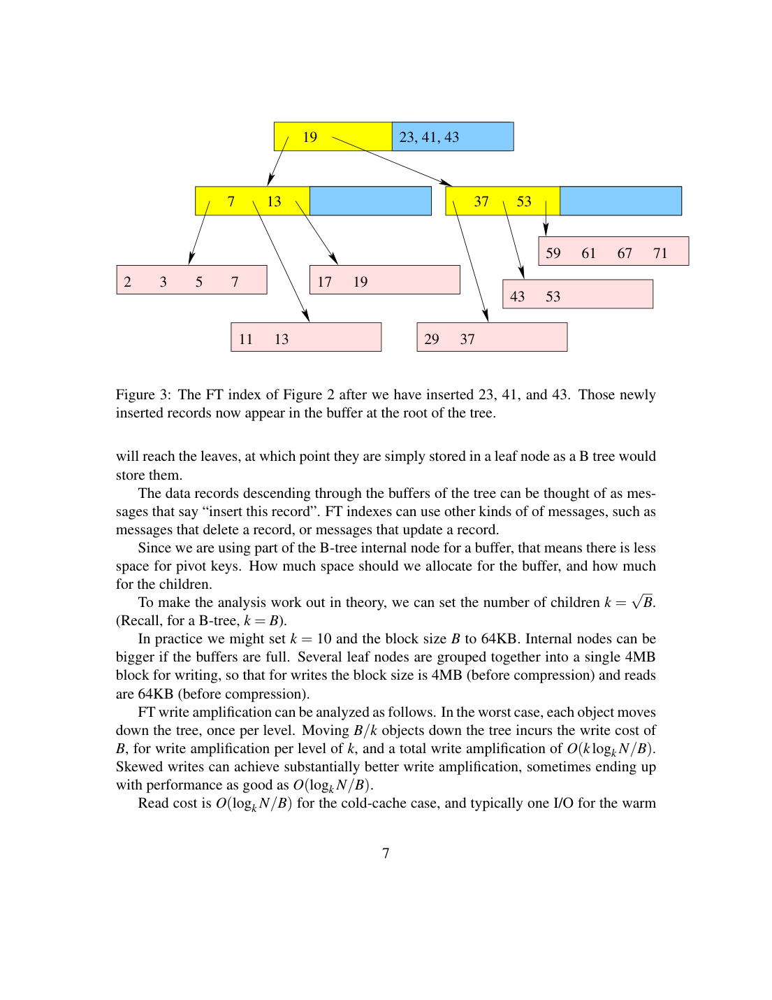
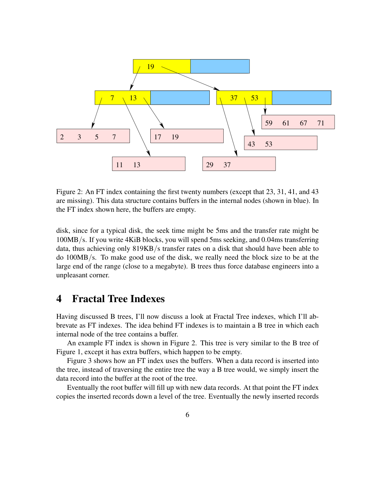

> 本组第 56 篇 · 存储结构与索引 · [全部论文]() · [上一篇]() · [下一篇]()

这份2014年Tokutek首席架构师白皮书以厂商立场比较FT、B树、leveled与size-tiered LSM，主要证据是渐近分析及10TB/64GB假设配置，不是独立性能benchmark。FT在内部节点缓冲操作并批量下推；leveled反复重写重叠层，tiered减少写入却增加run数及范围读代价。字节写放大、I/O次读放大和空间峰值不是同一口径。表中热范围1/3/13依赖缓存和短范围，FT“negligible”不等于零空间，leveled1.1与临时2倍也须分开。报告保留图注和示例冲突，不把作者“很少应用应选B树/leveled”的倡议当当前选型事实。

本文保留论文陈述、读者推断与待验证方案的区别；实验数字只适用于原文条件。原文和翻译来自已有 AI 辅助精读报告，已做来源匹配与编辑复核，不等于人工逐项核验或独立实验复现。所有页码均为 PDF 物理页。

## 论文与阅读范围

Bradley C. Kuszmaul, Chief Architect, Tokutek. A Comparison of Fractal Trees to Log-Structured Merge (LSM) Trees. April 22, 2014. Local 15-page vendor white paper, explicitly advocacy/comparison using asymptotic analysis and hypothetical database; not an independent measured benchmark.

[论文集中的原始 PDF](https://github.com/lonng/db-papers/blob/4ff1331069c7cf52ac97dd769e5f484c1c35c200/papers/storage-structure/a-comparison-of-fractal-trees-to-log-structured-merge-%28lsm%29-trees.pdf) · 本地来源：`storage-structure/a-comparison-of-fractal-trees-to-log-structured-merge-(lsm)-trees.pdf`，共 15 页。

本篇保留 32 组原文精读和 40 条证据。截图为原始 PDF 的局部页选，不是重新生成的图表；未将整份 PDF 复制到博客。

## 研究问题与适用边界

作者明确说要解释FT相对LSM优势，自身为Tokutek首席架构师、日期2014-04-22；来源立场必须保留。它讨论如何在读、写和空间成本间选择结构，比较DAM模型及假设10TB数据库、64GB RAM，不是给完整机器/数据集/吞吐实验。

传统B树单次随机更新可能为一条小记录写整页；增大页有利树深和顺序传输，却增加单记录写字节。FT把更新消息分批下推，LSM用sorted runs与compaction，试图摊薄随机写；不同批处理组织又影响读和临时空间。

本报告不检查当前RocksDB、Cassandra或Tokutek功能默认值，不把2014实现叙述当今天事实。

依据：论文陈述；PDF 物理页 1, 2, 6, 8。证据：[FRACTAL-VS-LSMREV01](#evidence-fractal-vs-lsmrev01), [FRACTAL-VS-LSMREV02](#evidence-fractal-vs-lsmrev02), [FRACTAL-VS-LSMREV03](#evidence-fractal-vs-lsmrev03), [FRACTAL-VS-LSMREV07](#evidence-fractal-vs-lsmrev07), [FRACTAL-VS-LSMREV11](#evidence-fractal-vs-lsmrev11)。

## 架构设计与核心组件

**先统一计量**
本白皮书WA=物理写字节/应用写字节，RA=一次查询的I/O次数，SA涉及存储利用与临时副本。RA不是RUM论文的读取字节/结果字节比；不同块大小的一次I/O成本也不同，不能把3次读、30倍写与1.1空间直接相加。

B树内部存pivot、叶存记录，读路径随树高；热缓存内部驻留时点查可仅触达叶页。FT内部增加buffer，叶仍类似B树；buffer消息可以insert/delete/update，必须考虑尚未到叶的操作可见性。

LSM是多个有序run，run可单文件也可多文件；层数、文件数与run数不是同义。leveled每层一个逻辑run，tiered每尺寸可有多个run。这里只讨论作者模型，不能将其分类当全部历史或现代LSM设计的完整枚举。

依据：论文陈述；PDF 物理页 2, 3, 5, 6, 7, 8, 9。证据：[FRACTAL-VS-LSMREV02](#evidence-fractal-vs-lsmrev02), [FRACTAL-VS-LSMREV05](#evidence-fractal-vs-lsmrev05), [FRACTAL-VS-LSMREV06](#evidence-fractal-vs-lsmrev06), [FRACTAL-VS-LSMREV07](#evidence-fractal-vs-lsmrev07), [FRACTAL-VS-LSMREV08](#evidence-fractal-vs-lsmrev08), [FRACTAL-VS-LSMREV09](#evidence-fractal-vs-lsmrev09), [FRACTAL-VS-LSMREV11](#evidence-fractal-vs-lsmrev11), [FRACTAL-VS-LSMREV12](#evidence-fractal-vs-lsmrev12)。

*原论文 PDF 物理页 7，版权归原作者或出版方。点击图片可查看原尺寸。页面文本中定位到：Figure 3: The FT index of Figure 2 after we have inserted 23, 41, and 43. Those newly。这是页面定位信息，不表示本次已复核图内所有数据。*

## 算法机制与复杂度分析

**FT如何摊薄写入**
插入先进入根buffer，缓冲满后按键方向批量下推。若一个B大小节点有k个子方向，至少有一方向积累约B/k条，写一个B块可共享到这些记录，层内字节WA约k，总O(k log_k(N/B))；偏斜写有时更好。理论常取k=根号B，工程例k=10、读64KB、写组合4MB，不能把理论B记录数与字节大小混用。

实际读者toy：B=1000条、k=10，100条共享一个块写，字节WA10、摊销I/O0.01。不是每条插入做10次I/O，也不是原引擎吞吐实测。buffer中set x=2应使逻辑读覆盖叶中x=1；消息顺序、MVCC和恢复需额外协议，本文没有完整说明。

**LSM两种合并**
leveled增长比k，某数据进入层后可能被上层重叠合并反复重写，作者平均约k/2次，WA为Theta(k log_k(N/B))。tiered同尺寸多个run整体合并，每数据每尺寸层写一次，WA O(log_k(N/B))，但需查更多run。

冷短范围在每run直接二分时，对递减run求对数和；leveled O(log(N/B) log_k(N/B))，tiered再有k因子。Bloom可减少点查的无关run访问，不直接解决任意范围检索。长范围必须另加输出块成本；表中的一次I/O不是任意长区间的总成本。

依据：论文陈述；PDF 物理页 6, 7, 8, 9, 10, 11。证据：[FRACTAL-VS-LSMREV07](#evidence-fractal-vs-lsmrev07), [FRACTAL-VS-LSMREV08](#evidence-fractal-vs-lsmrev08), [FRACTAL-VS-LSMREV09](#evidence-fractal-vs-lsmrev09), [FRACTAL-VS-LSMREV10](#evidence-fractal-vs-lsmrev10), [FRACTAL-VS-LSMREV11](#evidence-fractal-vs-lsmrev11), [FRACTAL-VS-LSMREV12](#evidence-fractal-vs-lsmrev12), [FRACTAL-VS-LSMREV13](#evidence-fractal-vs-lsmrev13), [FRACTAL-VS-LSMREV14](#evidence-fractal-vs-lsmrev14), [FRACTAL-VS-LSMREV15](#evidence-fractal-vs-lsmrev15), [FRACTAL-VS-LSMREV16](#evidence-fractal-vs-lsmrev16)。

## 正确性、不变量与边界条件

**缓冲和多版本必须保持语义**
FT不能只看叶而忽略路径消息；同键delete/insert不可随意换序，也不能不经证明认定所有消息幂等。LSM查询需要按键与版本归并，不能返回所有run的重复版本；快照、tombstone、WAL、故障恢复不由compaction示意图自动保证。

作者字节例100字节行、16KiB页约160倍，精确比163.84是近似而非固定所有B树代价。缓存合并、多行同页、压缩及额外日志改变结果。DAM固定等价块I/O是理论抽象，不同尺寸真实磁盘或SSD不必等价。

**源图与数值疑点**
图2图注说43缺失，目视叶中43仍在；图3又把43放根buffer。只记录图示不一致，不据此称实际FT会重复或数据损坏。9页说图6增长比5，10页图注写10；不任取其一后称全部模型已复现。

8页单run10TB/1MB称约26次冷读，明确十进制块比log2(10^7)约23.25，需澄清隐藏口径。11页冷例切到100TB并称17I/O，随后热例回10TB、列13个大run；不能与leveled93拼为同配置实测。空间1.1偏常驻近似，9–10页又承认临时最坏2倍，图8标worst case时边界不统一；不静默合并成普遍峰值保证。

依据：读者推断；PDF 物理页 2, 3, 5, 6, 7, 9, 11, 12, 13。证据：[FRACTAL-VS-LSMREV02](#evidence-fractal-vs-lsmrev02), [FRACTAL-VS-LSMREV04](#evidence-fractal-vs-lsmrev04), [FRACTAL-VS-LSMREV05](#evidence-fractal-vs-lsmrev05), [FRACTAL-VS-LSMREV06](#evidence-fractal-vs-lsmrev06), [FRACTAL-VS-LSMREV07](#evidence-fractal-vs-lsmrev07), [FRACTAL-VS-LSMREV08](#evidence-fractal-vs-lsmrev08), [FRACTAL-VS-LSMREV12](#evidence-fractal-vs-lsmrev12), [FRACTAL-VS-LSMREV17](#evidence-fractal-vs-lsmrev17), [FRACTAL-VS-LSMREV18](#evidence-fractal-vs-lsmrev18), [FRACTAL-VS-LSMREV19](#evidence-fractal-vs-lsmrev19), [FRACTAL-VS-LSMREV21](#evidence-fractal-vs-lsmrev21), [FRACTAL-VS-LSMREV22](#evidence-fractal-vs-lsmrev22)。

## 实验设置、推算结果与局限性

**主要是模型比较，不是benchmark**
没有完整实测协议、随机种子、数据分布、并发或延迟分位数。10TB/64GB、93/3/13是演算数字，不能改写为实际测得吞吐或SQL加速。本文也承认uniform与Zipf键会改变成本，不能只按静态渐近式排名。

读者脚本qa/rum-reader-tests.py（结果qa/fractal-vs-lsm-reader-tests.json）核验16KiB/100=163.84、批处理单位、七层10^i块的log2和约93.014、13个列举run及总大小约9.26TB。它没有运行原系统，也不证明所有原文数值一致。

FT与leveled写放大同阶不等于真实相等；tiered低写的代价是更多范围启动读和空间。图8热范围1/1/3/13需内部节点或小层驻留等条件。FT空间“negligible”是作者称额外开销小，不是总SA0或不占内存。其他产品默认值及功能归属仅作为2014作者陈述，未核实当前状态。

依据：论文陈述；PDF 物理页 1, 2, 6, 7, 9, 10, 11, 12, 13。证据：[FRACTAL-VS-LSMREV01](#evidence-fractal-vs-lsmrev01), [FRACTAL-VS-LSMREV02](#evidence-fractal-vs-lsmrev02), [FRACTAL-VS-LSMREV09](#evidence-fractal-vs-lsmrev09), [FRACTAL-VS-LSMREV10](#evidence-fractal-vs-lsmrev10), [FRACTAL-VS-LSMREV14](#evidence-fractal-vs-lsmrev14), [FRACTAL-VS-LSMREV15](#evidence-fractal-vs-lsmrev15), [FRACTAL-VS-LSMREV17](#evidence-fractal-vs-lsmrev17), [FRACTAL-VS-LSMREV18](#evidence-fractal-vs-lsmrev18), [FRACTAL-VS-LSMREV19](#evidence-fractal-vs-lsmrev19), [FRACTAL-VS-LSMREV21](#evidence-fractal-vs-lsmrev21), [FRACTAL-VS-LSMREV22](#evidence-fractal-vs-lsmrev22)。

*原论文 PDF 物理页 6，版权归原作者或出版方。点击图片可查看原尺寸。页面文本中定位到：Figure 2: An FT index containing the first twenty numbers (except that 23, 31, 41, and 43；Figure 1, except it has extra buffers, which happen to be empty.；Figure 3 shows how an FT index uses the buffers. When a data record is inserted into。这是页面定位信息，不表示本次已复核图内所有数据。*

## 权衡分析与工程判断

FT以较小fanout和内部buffer换批量写，读仍须正确解释路径状态；缓存、消息压缩与实现成本不能省略。leveled重叠重写多但较少run、常驻空间较紧；tiered省写却容纳更多run和合并峰值。没有一个单数字覆盖全部工作负载。

大写块在旋转盘可摊seek，但真实时间还受CPU、压缩、同步与读写混合影响。作者FTL的1/(1−r)仅在所列随机小块模型假设，不能当所有SSD实测规律。系统层WA与设备层WA要分开测。

容量规划应分别记稳态数据、旧版本、compaction临时副本、WAL、快照与备份；“1.1”不能自动转为只需额外10%空间。

依据：读者推断；PDF 物理页 2, 7, 10, 11, 12, 13。证据：[FRACTAL-VS-LSMREV02](#evidence-fractal-vs-lsmrev02), [FRACTAL-VS-LSMREV03](#evidence-fractal-vs-lsmrev03), [FRACTAL-VS-LSMREV04](#evidence-fractal-vs-lsmrev04), [FRACTAL-VS-LSMREV09](#evidence-fractal-vs-lsmrev09), [FRACTAL-VS-LSMREV10](#evidence-fractal-vs-lsmrev10), [FRACTAL-VS-LSMREV13](#evidence-fractal-vs-lsmrev13), [FRACTAL-VS-LSMREV16](#evidence-fractal-vs-lsmrev16), [FRACTAL-VS-LSMREV18](#evidence-fractal-vs-lsmrev18), [FRACTAL-VS-LSMREV19](#evidence-fractal-vs-lsmrev19), [FRACTAL-VS-LSMREV20](#evidence-fractal-vs-lsmrev20)。

## 与其他系统及现代引擎的联系

B树偏读、随机小更新可能高字节WA；FT和leveled批处理降低单行随机写，组织形式与缓存行为不同；tiered以更多读/空间交换较低写。本文的“很少应用应选B树/leveled”是厂商观点，并非独立受控实验得出的普遍选型结论。

点查可用Bloom排除无关run，存在误判且可能有多版本；短范围需合并多个run，长范围另付输出成本。不能用点查近一次I/O隐藏范围代价，也不把2014对Bloom的判断推广所有后续范围过滤器。

13页作者承认MVCC、ACID恢复、分布式提交、备份、压缩等常决定适用性。数据结构模型只是一部分，本篇没有给这些机制的完整协议或故障测试。

依据：读者推断；PDF 物理页 1, 3, 5, 10, 11, 12, 13。证据：[FRACTAL-VS-LSMREV01](#evidence-fractal-vs-lsmrev01), [FRACTAL-VS-LSMREV05](#evidence-fractal-vs-lsmrev05), [FRACTAL-VS-LSMREV06](#evidence-fractal-vs-lsmrev06), [FRACTAL-VS-LSMREV14](#evidence-fractal-vs-lsmrev14), [FRACTAL-VS-LSMREV15](#evidence-fractal-vs-lsmrev15), [FRACTAL-VS-LSMREV16](#evidence-fractal-vs-lsmrev16), [FRACTAL-VS-LSMREV18](#evidence-fractal-vs-lsmrev18), [FRACTAL-VS-LSMREV19](#evidence-fractal-vs-lsmrev19), [FRACTAL-VS-LSMREV20](#evidence-fractal-vs-lsmrev20)。

## 复现指南与验证建议

**建议路线，实际仅小型算术/逻辑例**
先明确字节/记录/块的单位，设定B、k、M、N及缓存分配，选择短点查、短范围和长扫描分别计起始与输出成本。为每结构计逻辑写、物理写、I/O数、字节数、CPU及峰值/稳态空间，不能只画混合amplification表。

实现极小buffer消息和sorted-run版本归并，核对同键覆盖、删除、重排、未落叶更新与崩溃恢复；真正可靠协议需读代码和相关原论文，本报告没有完成。之后控制数据分布、写比例、缓存、压缩、日志、并发与快照，做同预算实测，保留尾延迟和空间峰值。

原表数值矛盾应先澄清，不凭猜测修改图注或隐藏单位；若自选k=10七层复算93，应标自己的简化配置，不说作者实验已复现。

依据：待验证的工程设想；PDF 物理页 1, 2, 3, 5, 6, 7, 9, 10, 11, 12。证据：[FRACTAL-VS-LSMREV01](#evidence-fractal-vs-lsmrev01), [FRACTAL-VS-LSMREV02](#evidence-fractal-vs-lsmrev02), [FRACTAL-VS-LSMREV05](#evidence-fractal-vs-lsmrev05), [FRACTAL-VS-LSMREV06](#evidence-fractal-vs-lsmrev06), [FRACTAL-VS-LSMREV07](#evidence-fractal-vs-lsmrev07), [FRACTAL-VS-LSMREV08](#evidence-fractal-vs-lsmrev08), [FRACTAL-VS-LSMREV09](#evidence-fractal-vs-lsmrev09), [FRACTAL-VS-LSMREV10](#evidence-fractal-vs-lsmrev10), [FRACTAL-VS-LSMREV12](#evidence-fractal-vs-lsmrev12), [FRACTAL-VS-LSMREV14](#evidence-fractal-vs-lsmrev14), [FRACTAL-VS-LSMREV17](#evidence-fractal-vs-lsmrev17), [FRACTAL-VS-LSMREV18](#evidence-fractal-vs-lsmrev18), [FRACTAL-VS-LSMREV21](#evidence-fractal-vs-lsmrev21), [FRACTAL-VS-LSMREV22](#evidence-fractal-vs-lsmrev22)。

## 总结与内核工程启示

可以借鉴批量更新如何从小随机写转为多记录共享I/O，以及leveled/tiered如何交换写重写、读run数和临时空间。不能借渐近式或假设数字直接推出所有数据库的现实优劣。

严谨读法应同时保留厂商立场、2014版本、度量单位、缓存和输出条件，以及事务/恢复功能边界。面向当前机器的引擎选择仍需独立实测，本报告未作当前软件兼容或性能承诺。

依据：读者推断；PDF 物理页 1, 7, 10, 11, 12, 13。证据：[FRACTAL-VS-LSMREV01](#evidence-fractal-vs-lsmrev01), [FRACTAL-VS-LSMREV10](#evidence-fractal-vs-lsmrev10), [FRACTAL-VS-LSMREV13](#evidence-fractal-vs-lsmrev13), [FRACTAL-VS-LSMREV16](#evidence-fractal-vs-lsmrev16), [FRACTAL-VS-LSMREV18](#evidence-fractal-vs-lsmrev18), [FRACTAL-VS-LSMREV19](#evidence-fractal-vs-lsmrev19), [FRACTAL-VS-LSMREV20](#evidence-fractal-vs-lsmrev20)。

## 原文精读：从句子回到机制

以下保留原文、忠实翻译、含义与边界；假设示例不作为论文实验结果。

### P001 · PDF 物理页 1

**原文**

<blockquote class="paper-source-quote"><pre><code>I’ll compare these data structures both using asymptotic analysis, and for a “typical”&#10;database of 10TB of data on a machine with 64GB of RAM, for several measures of&#10;quality: write amplification, read amplification, and space amplification. I’ll try to express&#10;these in terms of the block size B, the fanout k, the memory size M, and the database size&#10;N, although it can be difficult to compare different data structures because, for example,&#10;they choose different fanouts depending on their characteristics.</code></pre></blockquote>

**忠实翻译**

> 我将使用渐近分析，以及针对一台拥有 64GB RAM 的机器上 10TB 数据的“典型”数据库，从几个质量度量来比较这些数据结构：写放大（write amplification）、读放大（read amplification）和空间放大（space amplification）。我将尝试用块大小 B、扇出 k、内存大小 M 和数据库大小 N 来表达这些指标，尽管比较不同的数据结构可能很困难，因为例如它们会根据自身特性选择不同的扇出。

**技术含义与边界**

> 这里的10TB/64GB是作者用于代入渐近模型的假想配置，不是实际部署的测量平台。全文同时讨论理论代价和这个具体算例，并没有提供基准程序、测量日志或吞吐实验。作者为Tokutek首席架构师，结论有明确的产品立场。

**常见误读**

> 不能把using asymptotic analysis及typical配置翻译成理论与实测并列。跨结构的B、k和读取粒度不同，常数也不能直接统一。

**读者构造的假设示例**

> 读者构造的假设示例：两种结构同样处理10TB，但一方按64KB读取、4MB写入，另一方按16KiB改写；即使都有三层，也不能把三层直接比较成相同I/O代价。

### P002 · PDF 物理页 14

**原文**

<blockquote class="paper-source-quote"><pre><code>[5] B. H. Bloom. Spacetime trade-offs in hash coding with allowable errors. Communi-&#10;cations of the ACM, 13(7):422–426, 1970.&#10;[6] G. S. Brodal and R. Fagerberg. Lower bounds for external memory dictionaries.&#10;In Proceedings of the 13th Annual ACM-SIAM Symposium on Discrete Algorithms&#10;(SODA), pages 39–48, 2002.&#10;[7] A. L. Buchsbaum, M. Goldwasser, S.</code></pre></blockquote>

**忠实翻译**

> [5] B. H. Bloom：《允许错误的哈希编码中的时空权衡》，Communications of the ACM，13(7):422–426，1970。[6] G. S. Brodal、R. Fagerberg：《外部存储字典的下界》，SODA，39–48页，2002。[7] A. L. Buchsbaum、M. Goldwasser、S.……（本段截断）。

**技术含义与边界**

> 这是参考文献片段，只能证实作者引用了这些作品，不能替代对被引论文证明的实际阅读。其与本文的联系分别是Bloom过滤的点查询用途和外存字典理论背景。

**常见误读**

> 不要从参考文献标题推断本文已经证明FT在所有真实数据库上优于LSM；也不要补全截断的条目[7]。

**读者构造的假设示例**

> 读者构造的假设示例：假设某篇论文的参考文献列表中列出了一篇关于 LSM-tree 优化的文章，这并不意味着当前文章的作者已经复现了该优化，或者认同该文章的所有结论，它仅表示作者在写作时参考了该文献。

### P003 · PDF 物理页 7

**原文**

<blockquote class="paper-source-quote"><pre><code>FT write amplification can be analyzed as follows. In the worst case, each object moves&#10;down the tree, once per level. Moving B/k objects down the tree incurs the write cost of&#10;B, for write amplification per level of k, and a total write amplification of O(klogk N/B).&#10;Skewed writes can achieve substantially better write amplification, sometimes ending up&#10;with performance as good as O(logk N/B).</code></pre></blockquote>

**忠实翻译**

> FT 写放大可以如下分析。在最坏情况下，每个对象向下移动树，每层一次。将 B/k 个对象向下移动树会产生 B 的写入成本，使得每层的写放大为 k，总写放大为 O(k log_k (N/B))。倾斜写入（Skewed writes）可以实现显著更好的写放大，有时最终性能可达到 O(log_k (N/B)) 一样好。

**技术含义与边界**

> FT是Fractal Tree（分形树），不是Flush-Tree。缓冲区向某个子节点批量转移B/k个等长记录，付出一个B记录块的写入量，故单层字节写放大为k；摊还I/O次数则是k/B每条记录，两者不是同一指标。倾斜分布可能使批次更集中，作者只说有时达到更好的渐近量级。

**常见误读**

> 不能把k倍写放大读成每条记录k次I/O，不能把B的记录数与工程字节混用；更不能从倾斜有利推出未满缓冲总是更省写。

**读者构造的假设示例**

> 读者构造的假设示例：B=160条记录、k=10，写一个160条容量块转移16条记录，单层写放大160/16=10，摊还I/O为1/16；这只是等长记录模型，不含WAL、压缩或FTL。

### P004 · PDF 物理页 4

**原文**

<blockquote class="paper-source-quote"><pre><code>The theory literature (see, for example, the Disk-&#10;Access Model (DAM) of [1]) usually assumes that the underlying disk drives employ a&#10;fixed-sized block, and sets the block size of the B tree to match that device block size. To&#10;simplify the analysis, the theory assumes that all blocks are equally expensive to access&#10;(real disks exhibit locality between bocks, and furthermore the blocks near the outer edge&#10;of an disk are faster than the ones near the inner edge). The theory further assumes that&#10;inconsistent terminology, so I’ll have to explain what I mean by terms such as “leaf”.</code></pre></blockquote>

**忠实翻译**

> 理论文献（例如[1]的磁盘访问模型DAM）通常假设设备使用固定大小块，并使B树块与设备块匹配。为简化分析，假设所有块访问代价相同；真实磁盘却有块间局部性和内外圈速度差异。最后的“术语不一致……”属于跨页脚注续文，并不是“理论进一步假设”的宾语。

**技术含义与边界**

> 本段原始提取把正文末尾The theory further assumes that与页底脚注拼在了一起。结合物理页4和下一页5，正文实际续为不存在大小块之分、只计块读写数；脚注是作者声明B树命名不统一。原始引句保留，但中文不能顺着抽取顺序制造一个荒谬的理论假设。

**常见误读**

> The theory further assumes that inconsistent terminology不是完整原句，不能翻译为理论假设术语不一致。DAM均价I/O只是模型简化，不是磁盘实测。

**读者构造的假设示例**

> 读者构造的假设示例：在 DAM 理论模型中，读取逻辑块地址 0 和逻辑块地址 10000 的代价被认为是相同的 1 次 I/O。但在真实的机械硬盘中，如果这两个块物理上相邻（局部性），或者分别位于外圈和内圈，实际的寻道时间和旋转延迟会有显著差异。

### P005 · PDF 物理页 12

**原文**

<blockquote class="paper-source-quote"><pre><code>A workload that performs few reads and is not sensitive to space amplification, but is&#10;very sensitive to write costs might benefit from size-tiered LSM’s. In my experience,&#10;it is an unusual application that is so short on write bandwidth that it can gladly give&#10;up a factor of 13 on read amplification.</code></pre></blockquote>

**忠实翻译**

> 一个执行很少读取、对空间放大不敏感，但对写入成本非常敏感的工作负载可能会从 size-tiered LSM 中受益。根据我的经验，很少有应用程序如此缺乏写入带宽，以至于愿意在读放大上放弃 13 倍。

**技术含义与边界**

> 作者用个人工程经验评价size-tiered的读写空间权衡；13来自前面的10TB/64GB、多个大于内存run的暖缓存短范围查询算例，而不是测得的通用延迟倍数。这里没有给出应用分布调查来证明此类负载罕见。

**常见误读**

> 可能受益不是推荐定律。13个候选run、13次模型I/O和13倍真实响应时间不同；不能据此排除所有日志或混合工作负载。

**读者构造的假设示例**

> 读者构造的假设示例：若查询可容忍扫描多个run且写成本占绝大部分，tiered可能合适；若某点查询被Bloom排除多数run，不能仍强行算13次读。实际选择还要测空间峰值和尾延迟。

### P006 · PDF 物理页 10

**原文**

<blockquote class="paper-source-quote"><pre><code>Data must be&#10;moved out of each level once, but data from a given level is merged repeatedly with data&#10;from the previous level. On average, after being first written into a level, each data item&#10;is remerged back into the same level about k/2 times. So the total write amplification is&#10;Θ(klogk N/B).&#10;To perform a short range query in the cold cache case, we must perform a binary search&#10;on each of the runs. The biggest run is O(N), thus requires O(logN/B I/O’s.</code></pre></blockquote>

**忠实翻译**

> 数据必须从每一层移出一次，但来自给定层的数据会与上一层的数据反复合并。平均而言，在首次写入某一层之后，每个数据项会被重新合并回同一层大约 k/2 次。因此总写放大为 Θ(k log_k (N/B))。
> 要在冷缓存（cold cache）情况下执行短范围查询，我们必须在每个 run 上执行二分查找。最大的 run 是 O(N)，因此需要 O(log (N/B)) 次 I/O。

**技术含义与边界**

> 这里明确是leveled LSM：数据在同一层反复与上层合并，平均k/2次是本文的简化模型，得到Θ(k log_k(N/B))写放大。随后冷缓存每run二分查找是另一个条件模型；现代索引、过滤器、缓存布局未被完整覆盖。

**常见误读**

> 冷缓存93次与暖缓存3次不能混成同一测量；短范围定位也不等于输出任意长范围的总成本。k/2是平均重写模型，不是每条记录严格上界。

**读者构造的假设示例**

> 读者构造的假设示例：假设扇出 k=10，某个数据项进入第 2 层后，在随第 1 层新数据不断压实（compaction）的过程中，平均会被重新写回第 2 层约 5 次（k/2）。当缓存为空时，要查找一个范围内的键，系统必须对该范围内涉及的每一个 run 独立进行二分查找，如果最大的 run 包含了几乎整个数据库的数据，那么在这个 run 上的查找就需要 O(log (N/B)) 次磁盘 I/O。

### P007 · PDF 物理页 2

**原文**

<blockquote class="paper-source-quote"><pre><code>For example, for an SSD provisioned at 80%&#10;utilization, with an erase-block size of 256KiB and B-tree blocks of 16KiB under a work-&#10;load with uniform random writes, the FTL induces another factor of 5 of write amplifica-&#10;tion. In general, if the SSD is provisioned with a fraction r of its storage made available to&#10;the user, and blocks are written randomly, and if the written blocks are much smaller than&#10;the erase-block size, then the write amplification induced by the FTL is another 1/(1−r).&#10;Compression can further reduce write amplification. Reducing the uncompressed write&#10;amplification can reduce the CPU load, and hence improve performance, by reducing the&#10;amount of data that needs to be compressed.</code></pre></blockquote>

**忠实翻译**

> 例如，对于一个配置为 80% 利用率的 SSD，擦除块大小为 256KiB，B 树块为 16KiB，在均匀随机写入的工作负载下，FTL 会引起额外 5 倍的写放大。一般来说，如果 SSD 配置为将其存储的比例 r 提供给用户，并且块是随机写入的，并且如果写入的块远小于擦除块大小，那么由 FTL 引起的写放大是额外的 1/(1−r)。压缩可以进一步降低写放大。降低未压缩的写放大可以减少 CPU 负载，从而提高性能，因为它减少了需要压缩的数据量。

**技术含义与边界**

> 此处1/(1-r)是作者针对随机小块写入、设备预留比例等条件给出的简化FTL因子，不是对所有SSD垃圾回收算法的完整建模。它说明数据库级与设备级写放大可能叠乘，压缩还能改变实际写入字节。

**常见误读**

> 不能以2014年的简式预测当前SSD寿命或断言所有r=0.8设备必有5倍FTL放大。随机小块、空闲空间状态和工作负载假设都重要。

**读者构造的假设示例**

> 读者构造的假设示例：仅按该简化模型，r=0.9给出10倍因子，数据库字节写放大2时乘积20；它是算术练习，不是100GB真实设备的测量或性能保证。

### P008 · PDF 物理页 13

**原文**

<blockquote class="paper-source-quote"><pre><code>• B trees have much higher write amplification than the other alternatives, and are&#10;good at read amplification, and pretty good at space amplification. Very few appli-&#10;cations should use B trees.&#10;The data structure used in a database is only part of the decision.</code></pre></blockquote>

**忠实翻译**

> • B 树的写放大远高于其他替代方案，在读放大方面表现良好，在空间放大方面相当不错。极少有应用程序应该使用 B 树。
> 数据库中使用的数据结构只是决策的一部分。

**技术含义与边界**

> “极少应用应使用B树”是作者在特定指标、工作负载和产品背景下的强判断，不是本文证明的普适结论。紧接着列出MVCC、ACID恢复、分布式提交、备份和压缩等系统因素会主导工程选择，全文没有给出这些机制的正确性协议。

**常见误读**

> 不能把作者的产品主张升级成当代存储选型结论，也不能从数据结构的读放大推得事务一致性。

**读者构造的假设示例**

> 读者构造的假设示例：即使一个索引的模型写放大更低，如果应用依赖现有恢复、备份和事务隔离机制，也不能只替换索引图示便得到同等可用的数据库。

### P009 · PDF 物理页 3

**原文**

<blockquote class="paper-source-quote"><pre><code>Some reads are performed for range queries, where we want all key-value pairs&#10;for which the key lies in a particular range. These two problems are different because, for&#10;example, Bloom filters [5] can help with point queries, but do not seem to help with range&#10;queries.&#10;Note that the units are different for write amplification and read amplification.</code></pre></blockquote>

**忠实翻译**

> 有些读取是为了范围查询执行的，我们希望获取键位于特定范围内的所有键值对。这两个问题是不同的，因为例如，布隆过滤器 [5] 可以帮助点查询，但似乎对范围查询没有帮助。
> 注意，写放大和读放大的单位是不同的。

**技术含义与边界**

> 在物理页3的完整上下文，写放大明确计物理写入量相对应用写入量的倍数，读放大明确计完成查询所需I/O次数；不是原文未定义单位。作者所说Bloom主要帮助点查，也不能推及所有后续范围过滤器变体。

**常见误读**

> 不能把本文读I/O计数与RUM的读取字节比混用；不应直接计算WA减RA，也不能把范围查询输出大量数据的必需I/O抹去。

**读者构造的假设示例**

> 读者构造的假设示例：假设某数据结构的写放大为 10（意味着写入 1 字节实际产生 10 字节物理写入），读放大为 3（意味着 1 次逻辑读取产生 3 次物理 I/O）。数字 10 和 3 代表完全不同的物理意义，不能说“写放大比读放大差 7 个单位”。对于范围查询，如果要找键在 [A, Z] 之间的所有记录，布隆过滤器只能告诉你某个块“可能包含”或“绝对不包含”某个特定键，无法高效地跳过整个不在范围内的连续块集合。

### P010 · PDF 物理页 5

**原文**

<blockquote class="paper-source-quote"><pre><code>(To maintain tree’s “balance” includes main-&#10;taining the invariant that the tree has uniform depth and every node has O(B) children.)&#10;Although maintaining B-tree balance is tricky (the code to do so is often quite complex),&#10;almost no additional I/O’s are incurred to keep the tree balanced, however.&#10;In practice, most engineered B trees choose a block size B measured in bytes. The keys&#10;and data records are of various sizes, so real B trees typically simply fill up their nodes&#10;as much as possible.</code></pre></blockquote>

**忠实翻译**

> （维护树的“平衡”包括维护树具有统一深度且每个节点有 O(B) 个子节点的不变式。）
> 尽管维护 B 树平衡很棘手（执行此操作的代码通常相当复杂），但几乎不会产生额外的 I/O 来保持树的平衡。
> 在实践中，大多数工程化的 B 树选择一个以字节为单位测量的块大小 B。键和数据记录的大小各不相同，因此真实的 B 树通常只是尽可能多地填满它们的节点。

**技术含义与边界**

> 这里把理论等长记录容量B与实际字节容量B区分开。平衡维护在作者I/O模型中摊还额外代价很小，不意味着每次节点分裂不写新页，也不意味着恢复、锁竞争和日志成本不存在。

**常见误读**

> O(B)不是恰好B，不同节点有效占用与记录长度影响深度；almost no也不是严格零I/O，更不是实际系统无维护成本。

**读者构造的假设示例**

> 读者构造的假设示例：忽略页头和索引槽，8KiB页以100字节记录约容纳81条，以500字节记录约16条。真正分裂需分配和修改页，不能把上述近似容量推成零额外写入。

### FRACTAL-VS-LSMP001 · PDF 物理页 1

**原文**

<blockquote class="paper-source-quote"><pre><code>This paper explains the advantages of Fractal-Tree R⃝indexing compared to Log-Structured&#10;Merge (LSM) trees. LSM trees were originally described by O’Neil [13], and have been&#10;implemented in several systems including [8–10,12,14,17]. Fractal-Tree indexes are based&#10;on research on streaming B trees [4], which drew in part on earlier algorithmic work on&#10;buffered repository trees [6, 7]. Fractal-Tree indexes appear in Tokutek’s database prod-&#10;ucts [16].&#10;I’ll compare these data structures both using asymptotic analysis, and for a “typical”&#10;database of 10TB of data on a machine with 64GB of RAM, for several measures of&#10;quality: write amplification, read amplification, and space amplification. I’ll try to express&#10;these in terms of the block size B, the fanout k, the memory size M, and the database size&#10;N,</code></pre></blockquote>

**忠实翻译**

> 作者称本文解释Fractal-Tree相对LSM优势；比较渐近分析及一台64GB RAM、10TB数据的“典型”假设机器，度量写、读、空间放大，以B、k、M、N描述。

**技术含义与边界**

> 来源为Tokutek首席架构师的2014白皮书，有明确产品立场；10TB/64GB是演算场景，不是给出实验机器、数据集与测量协议。

**常见误读**

> 不把演算I/O次数称独立benchmark吞吐或当前产品结论，也不隐藏厂商与日期。

**读者构造的假设示例**

> 读者构造的假设示例：报告可保留作者观点，再逐项检查模型假设，不直接据其“很少应用应选LSM”替用户选引擎。

### FRACTAL-VS-LSMP002 · PDF 物理页 2

**原文**

<blockquote class="paper-source-quote"><pre><code>Write amplification is the amount of data written to storage compared to the amount of data&#10;that the application wrote. LSM trees and Fractal-Tree indexes both provide significant&#10;advantages over traditional B-trees. For example, if a database row contains 100 bytes,&#10;and a B tree such as InnoDB employs 16KiB pages [11], then the B tree may perform&#10;16KiB of I/O to write a single 100-byte row, for a write amplification of 160, compared to&#10;a write amplification of 30 to 70 for the other data structures.</code></pre></blockquote>

**忠实翻译**

> 写放大是物理存储写入量与应用写入量之比。示例100字节行、16KiB页的B树可能为一行写整页，作者近似称放大160，对比其他结构30至70。

**技术含义与边界**

> 16KiB/100实际163.84，160是近似；B在理论按记录数、工程按字节时需要归一化。此例是随机单行整页写假设，不代表所有B树每次写固定160。

**常见误读**

> 不把该字节比当I/O次数或吞吐倍数；缓存合并、多行同页、日志及压缩都会改变总量。

**读者构造的假设示例**

> 读者构造的假设示例：实际读者算术只求16384/100，没有对InnoDB执行写入。

### FRACTAL-VS-LSMP003 · PDF 物理页 2

**原文**

<blockquote class="paper-source-quote"><pre><code>many small writes are slower than one big write of the&#10;same total number of bytes. But both LSM trees and Fractal-Tree indexes perform large&#10;writes, for which all we care about is bandwidth.</code></pre></blockquote>

**忠实翻译**

> 很多小写比同总字节数的一次大写慢；作者称LSM与FT都进行大写，因此比较主要关注带宽。

**技术含义与边界**

> 字节放大不能单独决定墙钟时间，尤其旋转盘seek。后半句是简化比较前提，不证明所有真实FT/LSM写入都只受带宽限制。

**常见误读**

> 不把WA更低必定更快，或把队列、CPU、压缩、读改写与同步开销删除。

**读者构造的假设示例**

> 读者构造的假设示例：相同1MB总量可以是256次4KB随机写或一次顺序写，耗时未必相同。

### FRACTAL-VS-LSMP004 · PDF 物理页 2

**原文**

<blockquote class="paper-source-quote"><pre><code>In general, if the SSD is provisioned with a fraction r of its storage made available to&#10;the user, and blocks are written randomly, and if the written blocks are much smaller than&#10;the erase-block size, then the write amplification induced by the FTL is another 1/(1−r).</code></pre></blockquote>

**忠实翻译**

> 作者称在向用户开放比例r、随机写且写块远小于擦除块时，FTL可额外带来1/(1−r)的写放大。

**技术含义与边界**

> 这是所述简化假设与设备层模型，不是所有SSD、任意GC策略与负载的精确普遍公式；系统WA与FTL WA也需明确边界。

**常见误读**

> 不把r=0.8的5倍当本机SSD实测或当前厂商保证；本次未做设备实验。

**读者构造的假设示例**

> 读者构造的假设示例：同一应用写量，若主机WA为10、设备层另5倍，模型乘积50，但真实设备仍需测量。

### FRACTAL-VS-LSMP005 · PDF 物理页 3

**原文**

<blockquote class="paper-source-quote"><pre><code>Note that the units are different for write amplification and read amplification. Write&#10;amplification measures how much more data is written than the application thought it was&#10;writing, whereas read amplification counts the number of I/O’s to perform a read.</code></pre></blockquote>

**忠实翻译**

> 作者明确写读与写放大单位不同：写放大衡量额外写入数据量，读放大数完成一次读所需I/O次数。

**技术含义与边界**

> 因此本白皮书R并不等于RUM论文按读取字节/结果字节定义的RO，跨文比较必须先统一口径。

**常见误读**

> 不把表中read3与write30相加成总33，或直接与RUM的1.2倍读取量画同尺度图。

**读者构造的假设示例**

> 读者构造的假设示例：一次64KB I/O与一次1MB I/O在本表都数1，但字节成本、延迟和缓存污染不同。

### FRACTAL-VS-LSMP006 · PDF 物理页 5

**原文**

<blockquote class="paper-source-quote"><pre><code>In a system with cache, once the cache&#10;is warmed up all the internal nodes of the tree are typically cached, and so a search or&#10;insertion may cost only one I/O.</code></pre></blockquote>

**忠实翻译**

> 有缓存且内部节点预热时，查找或插入可能仅需一次I/O。

**技术含义与边界**

> 这是内部节点驻留且目标页需访问的情形，不是所有冷缓存或长范围查询的无条件上界；总写入含日志等也另计。

**常见误读**

> 不把may写成always，不把定位一页的启动成本当读出任意m条记录的全部成本。

**读者构造的假设示例**

> 读者构造的假设示例：若范围输出跨100个叶页，即使索引路径全缓存，也不可能仅一次页I/O读完所有未缓存数据。

### FRACTAL-VS-LSMP007 · PDF 物理页 6

**原文**

<blockquote class="paper-source-quote"><pre><code>The idea behind FT indexes is to maintain a B tree in which each&#10;internal node of the tree contains a buffer.&#10;An example FT index is shown in Figure 2. This tree is very similar to the B tree of&#10;Figure 1, except it has extra buffers, which happen to be empty.&#10;Figure 3 shows how an FT index uses the buffers. When a data record is inserted into&#10;the tree, instead of traversing the entire tree the way a B tree would, we simply insert the&#10;data record into the buffer at the root of the tree.</code></pre></blockquote>

**忠实翻译**

> FT在B树每个内部节点加缓冲；插入不立即遍历全树，而是先放入根缓冲。

**技术含义与边界**

> 消息沿树分批下推，逻辑可见性必须含尚在路径缓冲的更新；不能只读叶页。本文示意不提供完整并发、消息序号或恢复算法。

**常见误读**

> 不把尚未到叶理解为可以暂时丢失已确认写入；它不是持久化或事务语义的替代。

**读者构造的假设示例**

> 读者构造的假设示例：实际读者toy中叶x=1、待应用set x=2，逻辑读取应看到2；该脚本不实现MVCC或WAL。

### FRACTAL-VS-LSMP008 · PDF 物理页 7

**原文**

<blockquote class="paper-source-quote"><pre><code>The data records descending through the buffers of the tree can be thought of as mes-&#10;sages that say “insert this record”. FT indexes can use other kinds of of messages, such as&#10;messages that delete a record, or messages that update a record.</code></pre></blockquote>

**忠实翻译**

> 下行记录可看作“插入此记录”的消息，FT也可携带删除与更新消息。

**技术含义与边界**

> 缓冲的是操作而不只新值；同键操作顺序、合并与查询期间解释会影响正确性。

**常见误读**

> 不将所有消息无条件交换或幂等，也不假设delete后insert等于insert后delete；原文没有给全协议。

**读者构造的假设示例**

> 读者构造的假设示例：同键先delete后insert应保留新值，反序则删除，批处理不能随意重排。

### FRACTAL-VS-LSMP009 · PDF 物理页 7

**原文**

<blockquote class="paper-source-quote"><pre><code>To make the analysis work out in theory, we can set the number of children k =&#10;√&#10;B.&#10;(Recall, for a B-tree, k = B).&#10;In practice we might set k = 10 and the block size B to 64KB. Internal nodes can be&#10;bigger if the buffers are full. Several leaf nodes are grouped together into a single 4MB&#10;block for writing, so that for writes the block size is 4MB (before compression) and reads&#10;are 64KB (before compression).</code></pre></blockquote>

**忠实翻译**

> 理论设子节点数k=根号B，相对B树k=B。工程示例k=10、读块64KB，若干叶组合成4MB块写，读写块尺寸均为压缩前。

**技术含义与边界**

> 读取与写入粒度不同，不能把一个B字节常量直接代全部理论/工程单位；k=10也不等于对64KB数值直接开根。

**常见误读**

> 不把k=根号B误写成工程必须256或固定10，也不声称64KB等同设备物理页。

**读者构造的假设示例**

> 读者构造的假设示例：若理论B表示1000条等长记录，k=10使单子批至少100条；实际字节大小要换算记录大小。

### FRACTAL-VS-LSMP010 · PDF 物理页 7

**原文**

<blockquote class="paper-source-quote"><pre><code>FT write amplification can be analyzed as follows. In the worst case, each object moves&#10;down the tree, once per level. Moving B/k objects down the tree incurs the write cost of&#10;B, for write amplification per level of k, and a total write amplification of O(klogk N/B).&#10;Skewed writes can achieve substantially better write amplification, sometimes ending up&#10;with performance as good as O(logk N/B).</code></pre></blockquote>

**忠实翻译**

> 最坏对象逐层下行，每次移动B/k对象写B，层内写放大k，总为O(k log_k(N/B))；偏斜写有时可改善到O(log_k(N/B))。

**技术含义与边界**

> 这是按批摊销的数据量分析，不是每次插入必做k次I/O；单条摊销I/O约k/B乘层数，单位不同。

**常见误读**

> 不把偏斜改善当所有负载保证，也不把O形式和常数当吞吐实测。

**读者构造的假设示例**

> 读者构造的假设示例：实际toy B=1000条、k=10，100条共享一次块写，单位记录写字节比10，摊销I/O0.01。

### FRACTAL-VS-LSMP011 · PDF 物理页 8

**原文**

<blockquote class="paper-source-quote"><pre><code>The idea behind LSM trees is to maintain a collection of sorted runs of data, each run&#10;containing key-value pairs with the keys sorted in ascending order.</code></pre></blockquote>

**忠实翻译**

> LSM维护一组按键升序的sorted runs，每run包含键值对。

**技术含义与边界**

> run是逻辑有序层，可一文件或多文件；文件数、run数与层数不能互换。2014实现说明仅作历史语境。

**常见误读**

> 不把所有LSM都说成每层恰一SST文件，也不按当前软件默认值解读本文Cassandra等历史描述。

**读者构造的假设示例**

> 读者构造的假设示例：一个leveled run可切很多不重叠键范围文件，一次点查询未必访问所有文件。

### FRACTAL-VS-LSMP012 · PDF 物理页 9

**原文**

<blockquote class="paper-source-quote"><pre><code>LSM trees never overwrite old data runs. Instead, they write all updates into new runs.&#10;Over time, many versions of a row may exist in different runs, and finding a row could&#10;involve looking in all those runs. To maintain good read performance compaction merges&#10;two or more runs together into a single run. This merging can be done at disk bandwidth,&#10;since the various runs being merged can be read sequentially, and the new run can be&#10;written sequentially.</code></pre></blockquote>

**忠实翻译**

> LSM不覆盖旧run，更新写新run；同一行多个版本可存在，compaction合并多个run以控制读成本，读写可按顺序进行。

**技术含义与边界**

> 保留多个版本不等于全部版本永存或查询返回全部副本；需要按键与版本语义归并，回收还受快照/删除标记影响，本文未给完整协议。

**常见误读**

> 不把compaction当单纯拼文件而不处理同键版本，也不声称任何旧数据可立即回收。

**读者构造的假设示例**

> 读者构造的假设示例：新run的x=2应覆盖旧run的x=1给当前读，历史快照是否仍读1需另定义。

### FRACTAL-VS-LSMP013 · PDF 物理页 10

**原文**

<blockquote class="paper-source-quote"><pre><code>On average, after being first written into a level, each data item&#10;is remerged back into the same level about k/2 times. So the total write amplification is&#10;Θ(klogk N/B).</code></pre></blockquote>

**忠实翻译**

> 每条数据首次进入某层后，平均又在同层被合并约k/2次，因此总写放大为Theta(k log_k(N/B))。

**技术含义与边界**

> 这是特定leveled增长比模型下的均摊推演，不能仅因与FT同阶就断言实测相等或FT总更优。

**常见误读**

> 不把每层仅向下移动一次等同只写一次；上层重叠合并会重写已在下层的数据。

**读者构造的假设示例**

> 读者构造的假设示例：层增长比10时，推演约5次同层重写，而不是只统计最终迁入下一层一次。

### FRACTAL-VS-LSMP014 · PDF 物理页 10

**原文**

<blockquote class="paper-source-quote"><pre><code>To perform a short range query in the cold cache case, we must perform a binary search&#10;on each of the runs. The biggest run is O(N), thus requires O(logN/B I/O’s. The next run&#10;is size O(N/k), and so requires O(log(N/(kB))) = O((logN/B) −logk) I/O’s. The next&#10;run requires O(log(N/(k2B))) = O((logN/B) −2logk) I/O’s. The total number of I/O’s&#10;is thus, asymptotically,&#10;R = (logN/B)+(logN/B−logk)+(logN/B−2logk)+···+1&#10;which has solution R = O((logN/B)(logk N/B)) = O((log2 N/B)/logk). For our hypo-&#10;thetical 10TB database, that comes out to about 93 reads for a cold cache.</code></pre></blockquote>

**忠实翻译**

> 冷缓存短范围查询对每个run作二分，作者把递减对数求和，给O(log(N/B) log_k(N/B))，假设10TB库约93次读取。

**技术含义与边界**

> 这依赖直接在run二分及缓存/索引模型；不能当所有LSM的不可突破下界。此处强调short range，不含任意长输出的完整读取。

**常见误读**

> 不把93作为实测，也不忽略工程稀疏索引、缓存与块大小会改变成本。

**读者构造的假设示例**

> 读者构造的假设示例：实际读者以七层10^i块的log2之和得约93.014，说明一个可解释该演算的简化配置，但非原系统复现。

### FRACTAL-VS-LSMP015 · PDF 物理页 10

**原文**

<blockquote class="paper-source-quote"><pre><code>For a warm cache we need one read per level that doesn’t fit in main memory. For a&#10;64GB machine and a 10TB database, all but the last three levels fit in main memory, so&#10;the system requires 3 reads. That factor of 3 compares unfavorably with a B tree’s single&#10;read for a short range query.&#10;Point queries can run more efficiently by adding a Bloom filter to each run, avoiding&#10;the need to do a disk I/O for levels that do not actually contain the row of interest. In most&#10;cases, this means that a point query requires one read.</code></pre></blockquote>

**忠实翻译**

> 热缓存时每个未驻留层一次读，10TB/64GB示例最后三层不驻留，短范围需3次；Bloom filter可避免没有目标行的层，点查多数情形约一次。

**技术含义与边界**

> 点查与短范围分开，Bloom仍有误判且同键版本可能需查多处。表中数字受缓存分配和具体配置影响，不是确定保证。

**常见误读**

> 不将Bloom对点查的帮助扩到任意范围谓词，或把3/1与冷缓存93直接不加条件比较。

**读者构造的假设示例**

> 读者构造的假设示例：一个不存在的键若所有Bloom均正确排除，可无需读数据块；误判则仍可能读多个，不能称总恰一次。

### FRACTAL-VS-LSMP016 · PDF 物理页 11

**原文**

<blockquote class="paper-source-quote"><pre><code>The worst-case write amplification for this system can be analyzed as follows. If the&#10;fanout is k (k = 4 for Cassandra, for example) there are O(logk N/B) levels. Data is written&#10;to each level once. So writes incur O(logk N/B) write amplification. This is substantially&#10;less than the O(klogk N/B) write amplification of leveled LSM trees even though k is typ-&#10;ically smaller for size-tiered: making the factor of logk N/B larger (by making k smaller)&#10;is not nearly as important as multiplying the number of writes by k.</code></pre></blockquote>

**忠实翻译**

> size-tiered约log_k(N/B)层，每数据每层写一次，写放大O(log_k(N/B))，低于leveled的O(k log_k(N/B))；较小k使对数增大通常不及外乘k影响。

**技术含义与边界**

> 同尺寸多个run累计后整体合并，省写但读需检查更多run，空间及临时副本也可能增加。

**常见误读**

> 不只比较k数值忽略compaction策略，或把tiered低WA当R/U/M全面胜利。

**读者构造的假设示例**

> 读者构造的假设示例：读很少且写带宽紧可考虑此交换，但是否适合仍需实测读尾延迟与可用空间。

### FRACTAL-VS-LSMP017 · PDF 物理页 11

**原文**

<blockquote class="paper-source-quote"><pre><code>This works out to 17 I/Os for our hypothetical&#10;100TB database with 64GB RAM.&#10;For the warm cache case, for our hypothetical 10TB database on a 64GB machine,</code></pre></blockquote>

**忠实翻译**

> 文中将一个冷缓存例写作100TB、64GB RAM下17次I/O，随后热缓存例回到10TB、64GB。

**技术含义与边界**

> 场景从前文10TB切至100TB，且17未有完整可复算步骤；不能混成同场景实测。后文13来自13个大于RAM的run例，不是概率上界。

**常见误读**

> 不把冷17、热13和leveled冷93拼成公平同配置排名；需要重建完整大小与索引模型。

**读者构造的假设示例**

> 读者构造的假设示例：实际算术只检查1+4+4+4=13个run、总列举大小约9.26TB，不声称得到原冷17。

### FRACTAL-VS-LSMP018 · PDF 物理页 12

**原文**

<blockquote class="paper-source-quote"><pre><code>The multi-file leveled approach used by LevelDB and RocksDB has a space amplifica-&#10;tion of about 1.1 since about 90% of the data is the highest level. Size-tiered compaction&#10;does not seem able to get space amplification that low. RocksDB is configured by default&#10;to have space amplification of 3, but it may be possible to reduce that at the cost of one&#10;hurting read amplification or write amplification.&#10;Size-tiered compaction is implemented by Cassandra [9], WiredTiger [17], HBase&#10;[10], and RocksDB [14]. The Bigtable paper [8] did not describe their LSM carefully&#10;enough to know for sure: it looks like a size-tiered compaction scheme, which is confus-&#10;ing since LevelDB, which is often described as an open-source version of the same data&#10;structure, is leveled.&#10;Like for file-per-run leveled LSM’s, one potential problem is that the system may re-&#10;quire temporary storage equal to the size of the database to perform compaction.&#10;6&#10;Summary&#10;Figure 8 shows a summary of the various kinds of amplification.&#10;• FT indexes provide excellent write amplification, read amplification, and space am-&#10;plification, both asymptotically and in practice.&#10;• Leveled LSM’s can basically match the write amplification of FT indexes. For&#10;many-files-per-run Leveled LSM’s do pretty well for space amplification, but not&#10;so well for file-per-run. Leveled LSM’s incur significantly more read amplification&#10;than FT indexes both asymptotically and in practice. Very few applications should&#10;use leveled LSM’s.&#10;• Size-tiered LSM’s can provide much lower write amplification than Leveled LSM’s&#10;or FT indexes at a horrible cost for range query and pretty bad space amplification.</code></pre></blockquote>

**忠实翻译**

> 作者称多文件leveled约1.1空间放大（最高层约90%数据）；tiered难达这么低，文中某配置约3，可用读或写代价降低。

**技术含义与边界**

> 该段近似常驻量，与9–10页临时compaction最坏2倍不在同一边界；13页表又标worst case，不能静默合并成统一最坏峰值。

**常见误读**

> 不把1.1当无论快照、tombstone和compaction都严格上界，也不把2014默认配置当当前事实。

**读者构造的假设示例**

> 读者构造的假设示例：容量规划分别列稳态、compaction峰值、保留快照及日志，不能只预留10%。

### FRACTAL-VS-LSMP019 · PDF 物理页 13

**原文**

<blockquote class="paper-source-quote"><pre><code>Data Structure&#10;Write Amp&#10;Read Amp&#10;Read Amp&#10;Space Amp&#10;(range)&#10;(range)&#10;(worst case)&#10;(cold cache)&#10;(warm)&#10;B Tree&#10;O(B)&#10;O(logB N/B)&#10;1&#10;1.33&#10;FT index&#10;O(klogk N/B)&#10;O(logk N/B)&#10;1&#10;negligible&#10;LSM leveled&#10;O(klogk N/B)&#10;O((log2 N/B)/logk)&#10;3&#10;2 (file-per-run)&#10;1.1 (many files)&#10;LSM size-tiered&#10;O(logk N/B)&#10;O(k(log2 N/B)/logk)&#10;13&#10;3&#10;Figure 8: A summary</code></pre></blockquote>

**忠实翻译**

> 图8总结B树、FT、leveled和tiered的写放大、冷/热范围读与空间。热范围数字1、1、3、13；FT空间写negligible，leveled分单文件2与多文件1.1，tiered3。

**技术含义与边界**

> negligible指作者声称的额外开销很小，不是总占用比率0；表混入配置数字与渐近式，应读出条件而不是统一实测排名。

**常见误读**

> 不把FT零空间或13倍SQL加速写成结论，也不让空间/读/写不同单位遮盖权衡。

**读者构造的假设示例**

> 读者构造的假设示例：同一表单元虽都叫amplification，读数I/O、写比字节、空间边界还需分别注明。

### FRACTAL-VS-LSMP020 · PDF 物理页 13

**原文**

<blockquote class="paper-source-quote"><pre><code>Features such as&#10;MVCC, transactions with ACID recovery and two-phase distributed commit, backup, and&#10;compression often dominate the engineering challenges of these systems and often de-&#10;termine whether the database actually meets the needs of an application.</code></pre></blockquote>

**忠实翻译**

> MVCC、ACID恢复、两阶段分布式提交、备份与压缩常主导系统工程挑战，并影响是否满足应用需求。

**技术含义与边界**

> 作者承认数据结构只是选型的一部分；本文没给这些机制协议、故障测试或完整实现核验，末尾产品能力是作者声明。

**常见误读**

> 不因索引模型胜出就承诺事务、恢复、运维稳定性，也不据此称已经读了Tokutek代码。

**读者构造的假设示例**

> 读者构造的假设示例：读者选型可先列功能与恢复约束，再比较对应负载下读写空间，而不是只盯渐近式。

### FRACTAL-VS-LSMP021 · PDF 物理页 6

**原文**

<blockquote class="paper-source-quote"><pre><code>Figure 2: An FT index containing the first twenty numbers (except that 23, 31, 41, and 43&#10;are missing). This data structure contains buffers in the internal nodes (shown in blue). In&#10;the FT index shown here, the buffers are empty.</code></pre></blockquote>

**忠实翻译**

> 图2说明FT内部有蓝色空buffer，并称23、31、41、43缺失。

**技术含义与边界**

> 原图叶中43仍可见；图3又把43放根buffer。记录为图注/示意不一致，不据此宣称实际FT会重复计数或实现损坏。

**常见误读**

> 不悄悄改图把矛盾抹掉，也不把示意排版错误当算法正确性反例。

**读者构造的假设示例**

> 读者构造的假设示例：复现应独立选无歧义小键集验证插入可见性，不照图注直接构造作者代码bug。

### FRACTAL-VS-LSMP022 · PDF 物理页 9

**原文**

<blockquote class="paper-source-quote"><pre><code>Figure 6 shows a leveled LSM with runs that grow by a factor of 5. A run of length 5&#10;is shown being merged into a run of length 15.</code></pre></blockquote>

**忠实翻译**

> 9页正文说图6的run按因子5增长，长度5的run并入长度15的run。

**技术含义与边界**

> 10页图注却写增长因子10，目视核对确实如此；图示不是足以无歧义恢复全部数值模型的定义。

**常见误读**

> 不把5与10任取一个混入93读取推导，再称完全复现；记录矛盾与所用假设。

**读者构造的假设示例**

> 读者构造的假设示例：读者复算可显式选k=10并列出各层容量，但这是自己的配置，不是确定修正原图。

## 尚未解决的问题

1. 原文26/17等读取数、10TB/100TB切换及图注冲突需回查作者版本。
2. 稳态1.1与最坏临时2倍空间比较边界未统一。
3. FT消息顺序/MVCC/WAL和实际源码实现未检查。
4. 当前引擎、设备层WA、并发尾延迟与本机性能均未实测。

## 证据索引

证据编号沿用原报告，便于将上文判断追溯到原句。引文匹配只验证位置，不证明解读正确。

**C001N01 · PDF 物理页 1**

本文比较Fractal Tree与LSM树的适用场景与质量度量，包括写放大、读放大和空间放大。分析参数为块大小B、扇出k、内存大小M和数据库大小N。作者指出不同数据结构会选择不同的扇出，导致跨结构比较困难。这是读者推断：该比较框架将不同结构的内部参数统一为B、k、M、N以便理论对照，但实际系统中这些参数的选择受工程约束影响很大。

<blockquote class="paper-source-quote"><pre><code>I’ll try to express these in terms of the block size B, the fanout k, the memory size M, and the database size N, although it can be difficult to compare different data structures because</code></pre></blockquote>

**C001N02 · PDF 物理页 2**

以100字节记录、16KiB页作整页随机改写模型，精确字节比16384/100=163.84，作者约为160；不是160=16384/100的精确等式。LSM/FT的30–70同为本文条件算例，不是统一实测常数，缓存合并、日志、压缩和设备FTL会改变总写入。

<blockquote class="paper-source-quote"><pre><code>For example, if a database row contains 100 bytes, and a B tree such as InnoDB employs 16KiB pages [11], then the B tree may perform 16KiB of I/O to write a single 100-byte row, for a write amplification of 160</code></pre></blockquote>

**C001N03 · PDF 物理页 2**

SSD写放大问题源于闪存有限擦写次数以及FTL（Flash Translation Layer）引入的额外放大。文中给出公式：若SSD向用户暴露比例为r的存储空间，且写入块远小于擦除块大小、写入均匀随机分布，则FTL引入的写放大因子为1/(1−r)。例如r=0.8时，FTL额外引入5倍写放大。前提假设是写入块远小于擦除块且均匀随机。

<blockquote class="paper-source-quote"><pre><code>if the SSD is provisioned with a fraction r of its storage made available to the user, and blocks are written randomly, and if the written blocks are much smaller than the erase-block size, then the write amplification induced by the FTL is another 1/(1−r).</code></pre></blockquote>

**C001N04 · PDF 物理页 3**

本文读放大计查询I/O次数，写放大计字节比。普通键成员Bloom可以帮助点查排除run，但不能直接处理任意区间；不能将此历史表述升级成所有后续范围过滤器均不可能。两指标与RUM读取字节比也不同。

<blockquote class="paper-source-quote"><pre><code>Bloom filters [5] can help with point queries, but do not seem to help with range queries.</code></pre></blockquote>

**C001N05 · PDF 物理页 5**

DAM等长记录模型中B树深度/搜索插入I/O为O(log_B(N/B))。暖缓存内部页驻留时作者给出通常一次叶页I/O的估算，不是任意插入(含分裂/WAL)必仅一次。平衡维护复杂与其渐近I/O小是模型层面判断，不等于实际零额外写。

<blockquote class="paper-source-quote"><pre><code>Although maintaining B-tree balance is tricky (the code to do so is often quite complex), almost no additional I/O’s are incurred to keep the tree balanced, however.</code></pre></blockquote>

**C001N07 · PDF 物理页 6**

Fractal Tree索引的核心机制是在B树的每个内部节点中维护一个buffer。插入记录时不遍历整棵树，而是将记录放入根节点的buffer。当buffer满时，将记录批量下移到下一层。理论上设子节点数k=√B；实践中可能设k=10、块大小B=64KB，叶节点以4MB块为单位写入。下移的消息可以是插入、删除或更新。

<blockquote class="paper-source-quote"><pre><code>The idea behind FT indexes is to maintain a B tree in which each internal node of the tree contains a buffer.</code></pre></blockquote>

**C001N08 · PDF 物理页 7**

FT批量转移B/k条记录写入一个B容量块，单层写放大k、摊还I/O为k/B每条，总WA为O(k log_k(N/B))；偏斜写可能更好。暖缓存一次I/O适用于定位/短范围起始，任意长范围的输出页开销不能省略，也不含完整事务实现。

<blockquote class="paper-source-quote"><pre><code>Moving B/k objects down the tree incurs the write cost of B, for write amplification per level of k, and a total write amplification of O(klogk N/B).</code></pre></blockquote>

**C001N09 · PDF 物理页 10**

leveled层内数据在本文模型中平均重写约k/2次，得到Θ(k log_k(N/B))。临时副本可令总空间接近两倍数据库；这不是说额外空间本身又要两倍。run可拆成多个文件，层数、run数与文件数不能互换。

<blockquote class="paper-source-quote"><pre><code>On average, after being first written into a level, each data item is remerged back into the same level about k/2 times. So the total write amplification is Θ(klogk N/B).</code></pre></blockquote>

**C001N11 · PDF 物理页 11**

Size-tiered LSM树的每个run实现为单文件，大小不固定，随时间增大。典型策略（如Cassandra）将k个大小相近的run合并为一个更大的run。写放大为O(log_k(N/B))，显著低于Leveled LSM的O(k·log_k(N/B))。但冷缓存读代价为O(k·(log²(N/B))/log k)，是Leveled方法的k倍，因为每层需读取k个文件。

<blockquote class="paper-source-quote"><pre><code>The worst-case write amplification for this system can be analyzed as follows. If the fanout is k (k = 4 for Cassandra, for example) there are O(logk N/B) levels. Data is written to each level once. So writes incur O(logk N/B) write amplification.</code></pre></blockquote>

**C001N12 · PDF 物理页 1**

10TB/64GB是假想代价算例，不是实测实验平台；文中引用InnoDB、Cassandra、LevelDB、RocksDB与负载工作，但没有本地基准运行数据。93冷缓存读、13暖缓存候选run等按各自假设讨论；p11另用100TB推17I/O，不能并作相同配置排名。

<blockquote class="paper-source-quote"><pre><code>for a “typical” database of 10TB of data on a machine with 64GB of RAM, for several measures of quality: write amplification, read amplification, and space amplification.</code></pre></blockquote>

**C001N13 · PDF 物理页 4**

DAM模型假设所有块访问代价相同、块大小固定、键和记录大小恒定，忽略了真实磁盘的局部性和内外圈速度差异。作者承认这些假设不现实，但认为DAM理论在实践中效果很好。此外，写放大指标本身对小块和大块的区分不足：同样的写放大倍数，16KiB块和1MiB块在旋转磁盘上的实际性能差距可达一个数量级。

<blockquote class="paper-source-quote"><pre><code>To simplify the analysis, the theory assumes that all blocks are equally expensive to access (real disks exhibit locality between bocks, and furthermore the blocks near the outer edge of an disk are faster than the ones near the inner edge).</code></pre></blockquote>

**C002N01 · PDF 物理页 12**

普通Bloom成员过滤在点查中可排除不含键的run，但存在误判率，也不能按任意范围的全部键直接过滤。不能从本文论述推导出所有范围过滤方案的正确性不可能，更不是Bloom无误判或保证一次读取。

<blockquote class="paper-source-quote"><pre><code>A bloom filter can avoid most of those reads in the case of a point query, but not for range queries.</code></pre></blockquote>

**C002N04 · PDF 物理页 12**

作者站在Tokutek/FT视角，认为特定模型里leveled范围读较差、tiered牺牲读空间以省写。这是2014年的工程主张，非系统实测普适结论；所谓极少应用应选某结构需结合真实工作负载及事务、恢复等整体约束。

<blockquote class="paper-source-quote"><pre><code>Very few applications should use leveled LSM’s.</code></pre></blockquote>

**C002N05 · PDF 物理页 12**

作者基于经验断言，愿意为节省写带宽而放弃 13 倍读放大性能的应用极为罕见。此处 'factor of 13' 对应 Figure 8 中 size-tiered LSM 的范围查询读放大数值，属于作者的主观工程判断而非严格实验结论。

<blockquote class="paper-source-quote"><pre><code>it is an unusual application that is so short on write bandwidth that it can gladly give up a factor of 13 on read amplification.</code></pre></blockquote>

**C002N06 · PDF 物理页 13**

图8的leveled冷缓存读为O((log(N/B))²/log k)，tiered再乘k：平方是log的平方，不是下标2的单个对数。暖缓存短范围定位1/1/3/13来自特定配置；FT negligible指额外空间小，不是总SA=0。图中worst-case标题与many-files 1.1稳态、临时合并峰值的混用需保留警示，不能把它当统一最坏界。

<blockquote class="paper-source-quote"><pre><code>Figure 8: A summary of the write amplification, read amplification for range queries, and space amplification of the various schemes.</code></pre></blockquote>

**C002N07 · PDF 物理页 13**

作者在所选放大模型和产品视角下建议极少应用使用B树，这是主张而非普适定理。本文没有证明写放大在所有系统中必须成为首要目标；最后强调MVCC、恢复、分布式提交、备份等也会主导选择。

<blockquote class="paper-source-quote"><pre><code>B trees have much higher write amplification than the other alternatives, and are good at read amplification, and pretty good at space amplification.</code></pre></blockquote>

**C002N08 · PDF 物理页 13**

数据库使用的数据结构仅是决策的一部分。MVCC、ACID 事务恢复、两阶段分布式提交、备份和压缩等工程特性往往主导系统挑战，并决定数据库是否真正满足应用需求。例如压缩对 FT indexes 效果很好，可大幅降低写放大。这提醒读者单纯比较索引结构的理论复杂度不足以评估完整系统。

<blockquote class="paper-source-quote"><pre><code>Features such as MVCC, transactions with ACID recovery and two-phase distributed commit, backup, and compression often dominate the engineering challenges</code></pre></blockquote>

**C002N09 · PDF 物理页 14**

引用列表包含外部存储字典下界 (Brodal & Fagerberg, SODA 2002)、LSM-tree 原始论文 (O'Neil et al., 1996)、cache-oblivious streaming B-trees (Bender et al., SPAA 2007) 以及 Bigtable (Chang et al., 2008)。这些文献构成了本文分析 I/O 复杂度和 LSM 变体的理论基础。

<blockquote class="paper-source-quote"><pre><code>G. S. Brodal and R. Fagerberg. Lower bounds for external memory dictionaries.</code></pre></blockquote>

**FRACTAL-VS-LSMREV01 · PDF 物理页 1**

来源为Tokutek首席架构师的2014白皮书，有明确产品立场；10TB/64GB是演算场景，不是给出实验机器、数据集与测量协议。

<blockquote class="paper-source-quote"><pre><code>This paper explains the advantages of Fractal-Tree R⃝indexing compared to Log-Structured&#10;Merge (LSM) trees. LSM trees were originally described by O’Neil [13], and have been&#10;implemented in several systems including [8–10,12,14,17]. Fractal-Tree indexes are based&#10;on research on streaming B trees [4], which drew in part on earlier algorithmic work on&#10;buffered repository trees [6, 7]. Fractal-Tree indexes appear in Tokutek’s database prod-&#10;ucts [16].&#10;I’ll compare these data structures both using asymptotic analysis, and for a “typical”&#10;database of 10TB of data on a machine with 64GB of RAM, for several measures of&#10;quality: write amplification, read amplification, and space amplification. I’ll try to express&#10;these in terms of the block size B, the fanout k, the memory size M, and the database size&#10;N,</code></pre></blockquote>

**FRACTAL-VS-LSMREV02 · PDF 物理页 2**

16KiB/100实际163.84，160是近似；B在理论按记录数、工程按字节时需要归一化。此例是随机单行整页写假设，不代表所有B树每次写固定160。

<blockquote class="paper-source-quote"><pre><code>Write amplification is the amount of data written to storage compared to the amount of data&#10;that the application wrote. LSM trees and Fractal-Tree indexes both provide significant&#10;advantages over traditional B-trees. For example, if a database row contains 100 bytes,&#10;and a B tree such as InnoDB employs 16KiB pages [11], then the B tree may perform&#10;16KiB of I/O to write a single 100-byte row, for a write amplification of 160, compared to&#10;a write amplification of 30 to 70 for the other data structures.</code></pre></blockquote>

**FRACTAL-VS-LSMREV03 · PDF 物理页 2**

字节放大不能单独决定墙钟时间，尤其旋转盘seek。后半句是简化比较前提，不证明所有真实FT/LSM写入都只受带宽限制。

<blockquote class="paper-source-quote"><pre><code>many small writes are slower than one big write of the&#10;same total number of bytes. But both LSM trees and Fractal-Tree indexes perform large&#10;writes, for which all we care about is bandwidth.</code></pre></blockquote>

**FRACTAL-VS-LSMREV04 · PDF 物理页 2**

这是所述简化假设与设备层模型，不是所有SSD、任意GC策略与负载的精确普遍公式；系统WA与FTL WA也需明确边界。

<blockquote class="paper-source-quote"><pre><code>In general, if the SSD is provisioned with a fraction r of its storage made available to&#10;the user, and blocks are written randomly, and if the written blocks are much smaller than&#10;the erase-block size, then the write amplification induced by the FTL is another 1/(1−r).</code></pre></blockquote>

**FRACTAL-VS-LSMREV05 · PDF 物理页 3**

因此本白皮书R并不等于RUM论文按读取字节/结果字节定义的RO，跨文比较必须先统一口径。

<blockquote class="paper-source-quote"><pre><code>Note that the units are different for write amplification and read amplification. Write&#10;amplification measures how much more data is written than the application thought it was&#10;writing, whereas read amplification counts the number of I/O’s to perform a read.</code></pre></blockquote>

**FRACTAL-VS-LSMREV06 · PDF 物理页 5**

这是内部节点驻留且目标页需访问的情形，不是所有冷缓存或长范围查询的无条件上界；总写入含日志等也另计。

<blockquote class="paper-source-quote"><pre><code>In a system with cache, once the cache&#10;is warmed up all the internal nodes of the tree are typically cached, and so a search or&#10;insertion may cost only one I/O.</code></pre></blockquote>

**FRACTAL-VS-LSMREV07 · PDF 物理页 6**

消息沿树分批下推，逻辑可见性必须含尚在路径缓冲的更新；不能只读叶页。本文示意不提供完整并发、消息序号或恢复算法。

<blockquote class="paper-source-quote"><pre><code>The idea behind FT indexes is to maintain a B tree in which each&#10;internal node of the tree contains a buffer.&#10;An example FT index is shown in Figure 2. This tree is very similar to the B tree of&#10;Figure 1, except it has extra buffers, which happen to be empty.&#10;Figure 3 shows how an FT index uses the buffers. When a data record is inserted into&#10;the tree, instead of traversing the entire tree the way a B tree would, we simply insert the&#10;data record into the buffer at the root of the tree.</code></pre></blockquote>

**FRACTAL-VS-LSMREV08 · PDF 物理页 7**

缓冲的是操作而不只新值；同键操作顺序、合并与查询期间解释会影响正确性。

<blockquote class="paper-source-quote"><pre><code>The data records descending through the buffers of the tree can be thought of as mes-&#10;sages that say “insert this record”. FT indexes can use other kinds of of messages, such as&#10;messages that delete a record, or messages that update a record.</code></pre></blockquote>

**FRACTAL-VS-LSMREV09 · PDF 物理页 7**

读取与写入粒度不同，不能把一个B字节常量直接代全部理论/工程单位；k=10也不等于对64KB数值直接开根。

<blockquote class="paper-source-quote"><pre><code>To make the analysis work out in theory, we can set the number of children k =&#10;√&#10;B.&#10;(Recall, for a B-tree, k = B).&#10;In practice we might set k = 10 and the block size B to 64KB. Internal nodes can be&#10;bigger if the buffers are full. Several leaf nodes are grouped together into a single 4MB&#10;block for writing, so that for writes the block size is 4MB (before compression) and reads&#10;are 64KB (before compression).</code></pre></blockquote>

**FRACTAL-VS-LSMREV10 · PDF 物理页 7**

这是按批摊销的数据量分析，不是每次插入必做k次I/O；单条摊销I/O约k/B乘层数，单位不同。

<blockquote class="paper-source-quote"><pre><code>FT write amplification can be analyzed as follows. In the worst case, each object moves&#10;down the tree, once per level. Moving B/k objects down the tree incurs the write cost of&#10;B, for write amplification per level of k, and a total write amplification of O(klogk N/B).&#10;Skewed writes can achieve substantially better write amplification, sometimes ending up&#10;with performance as good as O(logk N/B).</code></pre></blockquote>

**FRACTAL-VS-LSMREV11 · PDF 物理页 8**

run是逻辑有序层，可一文件或多文件；文件数、run数与层数不能互换。2014实现说明仅作历史语境。

<blockquote class="paper-source-quote"><pre><code>The idea behind LSM trees is to maintain a collection of sorted runs of data, each run&#10;containing key-value pairs with the keys sorted in ascending order.</code></pre></blockquote>

**FRACTAL-VS-LSMREV12 · PDF 物理页 9**

保留多个版本不等于全部版本永存或查询返回全部副本；需要按键与版本语义归并，回收还受快照/删除标记影响，本文未给完整协议。

<blockquote class="paper-source-quote"><pre><code>LSM trees never overwrite old data runs. Instead, they write all updates into new runs.&#10;Over time, many versions of a row may exist in different runs, and finding a row could&#10;involve looking in all those runs. To maintain good read performance compaction merges&#10;two or more runs together into a single run. This merging can be done at disk bandwidth,&#10;since the various runs being merged can be read sequentially, and the new run can be&#10;written sequentially.</code></pre></blockquote>

**FRACTAL-VS-LSMREV13 · PDF 物理页 10**

这是特定leveled增长比模型下的均摊推演，不能仅因与FT同阶就断言实测相等或FT总更优。

<blockquote class="paper-source-quote"><pre><code>On average, after being first written into a level, each data item&#10;is remerged back into the same level about k/2 times. So the total write amplification is&#10;Θ(klogk N/B).</code></pre></blockquote>

**FRACTAL-VS-LSMREV14 · PDF 物理页 10**

这依赖直接在run二分及缓存/索引模型；不能当所有LSM的不可突破下界。此处强调short range，不含任意长输出的完整读取。

<blockquote class="paper-source-quote"><pre><code>To perform a short range query in the cold cache case, we must perform a binary search&#10;on each of the runs. The biggest run is O(N), thus requires O(logN/B I/O’s. The next run&#10;is size O(N/k), and so requires O(log(N/(kB))) = O((logN/B) −logk) I/O’s. The next&#10;run requires O(log(N/(k2B))) = O((logN/B) −2logk) I/O’s. The total number of I/O’s&#10;is thus, asymptotically,&#10;R = (logN/B)+(logN/B−logk)+(logN/B−2logk)+···+1&#10;which has solution R = O((logN/B)(logk N/B)) = O((log2 N/B)/logk). For our hypo-&#10;thetical 10TB database, that comes out to about 93 reads for a cold cache.</code></pre></blockquote>

**FRACTAL-VS-LSMREV15 · PDF 物理页 10**

点查与短范围分开，Bloom仍有误判且同键版本可能需查多处。表中数字受缓存分配和具体配置影响，不是确定保证。

<blockquote class="paper-source-quote"><pre><code>For a warm cache we need one read per level that doesn’t fit in main memory. For a&#10;64GB machine and a 10TB database, all but the last three levels fit in main memory, so&#10;the system requires 3 reads. That factor of 3 compares unfavorably with a B tree’s single&#10;read for a short range query.&#10;Point queries can run more efficiently by adding a Bloom filter to each run, avoiding&#10;the need to do a disk I/O for levels that do not actually contain the row of interest. In most&#10;cases, this means that a point query requires one read.</code></pre></blockquote>

**FRACTAL-VS-LSMREV16 · PDF 物理页 11**

同尺寸多个run累计后整体合并，省写但读需检查更多run，空间及临时副本也可能增加。

<blockquote class="paper-source-quote"><pre><code>The worst-case write amplification for this system can be analyzed as follows. If the&#10;fanout is k (k = 4 for Cassandra, for example) there are O(logk N/B) levels. Data is written&#10;to each level once. So writes incur O(logk N/B) write amplification. This is substantially&#10;less than the O(klogk N/B) write amplification of leveled LSM trees even though k is typ-&#10;ically smaller for size-tiered: making the factor of logk N/B larger (by making k smaller)&#10;is not nearly as important as multiplying the number of writes by k.</code></pre></blockquote>

**FRACTAL-VS-LSMREV17 · PDF 物理页 11**

场景从前文10TB切至100TB，且17未有完整可复算步骤；不能混成同场景实测。后文13来自13个大于RAM的run例，不是概率上界。

<blockquote class="paper-source-quote"><pre><code>This works out to 17 I/Os for our hypothetical&#10;100TB database with 64GB RAM.&#10;For the warm cache case, for our hypothetical 10TB database on a 64GB machine,</code></pre></blockquote>

**FRACTAL-VS-LSMREV18 · PDF 物理页 12**

该段近似常驻量，与9–10页临时compaction最坏2倍不在同一边界；13页表又标worst case，不能静默合并成统一最坏峰值。

<blockquote class="paper-source-quote"><pre><code>The multi-file leveled approach used by LevelDB and RocksDB has a space amplifica-&#10;tion of about 1.1 since about 90% of the data is the highest level. Size-tiered compaction&#10;does not seem able to get space amplification that low. RocksDB is configured by default&#10;to have space amplification of 3, but it may be possible to reduce that at the cost of one&#10;hurting read amplification or write amplification.&#10;Size-tiered compaction is implemented by Cassandra [9], WiredTiger [17], HBase&#10;[10], and RocksDB [14]. The Bigtable paper [8] did not describe their LSM carefully&#10;enough to know for sure: it looks like a size-tiered compaction scheme, which is confus-&#10;ing since LevelDB, which is often described as an open-source version of the same data&#10;structure, is leveled.&#10;Like for file-per-run leveled LSM’s, one potential problem is that the system may re-&#10;quire temporary storage equal to the size of the database to perform compaction.&#10;6&#10;Summary&#10;Figure 8 shows a summary of the various kinds of amplification.&#10;• FT indexes provide excellent write amplification, read amplification, and space am-&#10;plification, both asymptotically and in practice.&#10;• Leveled LSM’s can basically match the write amplification of FT indexes. For&#10;many-files-per-run Leveled LSM’s do pretty well for space amplification, but not&#10;so well for file-per-run. Leveled LSM’s incur significantly more read amplification&#10;than FT indexes both asymptotically and in practice. Very few applications should&#10;use leveled LSM’s.&#10;• Size-tiered LSM’s can provide much lower write amplification than Leveled LSM’s&#10;or FT indexes at a horrible cost for range query and pretty bad space amplification.</code></pre></blockquote>

**FRACTAL-VS-LSMREV19 · PDF 物理页 13**

negligible指作者声称的额外开销很小，不是总占用比率0；表混入配置数字与渐近式，应读出条件而不是统一实测排名。

<blockquote class="paper-source-quote"><pre><code>Data Structure&#10;Write Amp&#10;Read Amp&#10;Read Amp&#10;Space Amp&#10;(range)&#10;(range)&#10;(worst case)&#10;(cold cache)&#10;(warm)&#10;B Tree&#10;O(B)&#10;O(logB N/B)&#10;1&#10;1.33&#10;FT index&#10;O(klogk N/B)&#10;O(logk N/B)&#10;1&#10;negligible&#10;LSM leveled&#10;O(klogk N/B)&#10;O((log2 N/B)/logk)&#10;3&#10;2 (file-per-run)&#10;1.1 (many files)&#10;LSM size-tiered&#10;O(logk N/B)&#10;O(k(log2 N/B)/logk)&#10;13&#10;3&#10;Figure 8: A summary</code></pre></blockquote>

**FRACTAL-VS-LSMREV20 · PDF 物理页 13**

作者承认数据结构只是选型的一部分；本文没给这些机制协议、故障测试或完整实现核验，末尾产品能力是作者声明。

<blockquote class="paper-source-quote"><pre><code>Features such as&#10;MVCC, transactions with ACID recovery and two-phase distributed commit, backup, and&#10;compression often dominate the engineering challenges of these systems and often de-&#10;termine whether the database actually meets the needs of an application.</code></pre></blockquote>

**FRACTAL-VS-LSMREV21 · PDF 物理页 6**

原图叶中43仍可见；图3又把43放根buffer。记录为图注/示意不一致，不据此宣称实际FT会重复计数或实现损坏。

<blockquote class="paper-source-quote"><pre><code>Figure 2: An FT index containing the first twenty numbers (except that 23, 31, 41, and 43&#10;are missing). This data structure contains buffers in the internal nodes (shown in blue). In&#10;the FT index shown here, the buffers are empty.</code></pre></blockquote>

**FRACTAL-VS-LSMREV22 · PDF 物理页 9**

10页图注却写增长因子10，目视核对确实如此；图示不是足以无歧义恢复全部数值模型的定义。

<blockquote class="paper-source-quote"><pre><code>Figure 6 shows a leveled LSM with runs that grow by a factor of 5. A run of length 5&#10;is shown being merged into a run of length 15.</code></pre></blockquote>

## 版本与使用边界

- 原 PDF SHA256：`669c6a10184fbd01b2f6b392fddb0a386c282b7f74736d62f179a2534ff30d88`。
- 报告来源：`qwen3.8-max`；此处按已完成报告整理，没有重新请求模型。
- OCR 记录页：[]；低文本页：[]。
- 本次新增页面截图，未据此自动重写原报告的数值、公式或实验结论；原有“未进行图像识别”限制仍适用于分析生成过程。
- 截图与短引仅服务于论文评论，版权归原作者或出版方；正式发布前复查转载范围和授权。
- 本文保留未核实的书目信息及研究问题，不用现代产品行为替代历史论文的证据。

前序报告保留的书目与阅读过程记录

Bradley C. Kuszmaul, Chief Architect, Tokutek. A Comparison of Fractal Trees to Log-Structured Merge (LSM) Trees. April 22, 2014. Local 15-page vendor white paper, explicitly advocacy/comparison using asymptotic analysis and hypothetical database; not an independent measured benchmark.

Codex实际逐页阅读全部15页提取文本，另目视核对PDF物理页[4, 6, 7, 8, 9, 10, 11, 13]。未逐项核对所有图表细节，未运行原系统、原始数据性能复现、硬件测量或当前软件兼容测试；读者小算例与作者实验明确区分。

