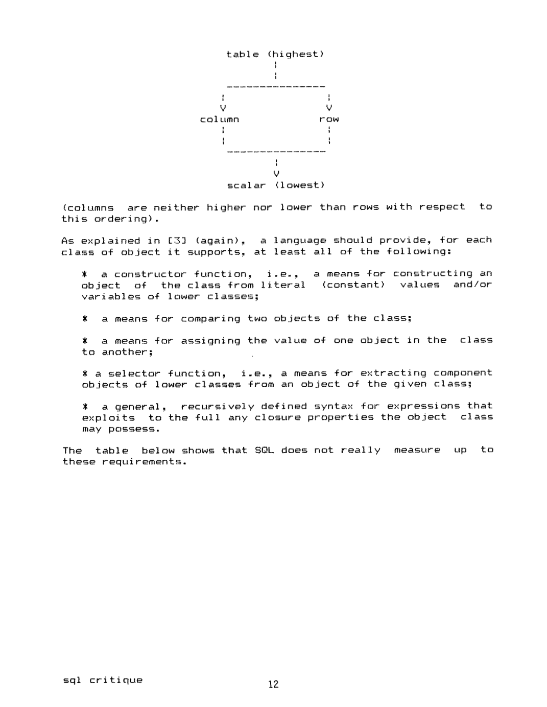
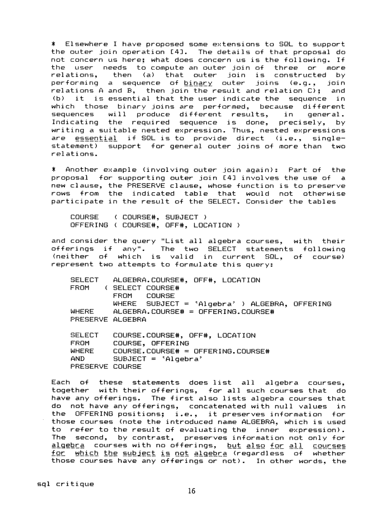

> 本组第 40 篇 · 关系模型与查询语言 · [全部论文]() · [上一篇]() · [下一篇]()

这是一份语言设计批评，不是SQL毫无价值的宣言。Date先承认SQL相对旧式导航语言的生产力与数据独立性进步，再以对象类型、运算闭包、语法正交性、空值和宿主接口为尺度，讨论当时IBM方言的结构性困难。

阅读时必须把三层分开：1983特定方言的功能缺失、至今仍值得思考的设计原则、以及作者提出但未实施的替代语法。本文没有证明SQL关系不完备，也没有运行查询性能基准。报告特别核对行/列的偏序、空集与NULL的不同形状，以及ALL到双重NOT EXISTS在三值逻辑下不能无条件替换。

本文保留论文陈述、读者推断与待验证方案的区别；实验数字只适用于原文条件。原文和翻译来自已有 AI 辅助精读报告，已做来源匹配与编辑复核，不等于人工逐项核验或独立实验复现。所有页码均为 PDF 物理页。

## 论文与阅读范围

C. J. Date. A Critique of the SQL Database Language. 本地封面标December 1983；共47个PDF物理页，印刷页8-54（物理页+7）。报告按物理页引用，不据其他出版元数据改写这份稿件日期。

[论文集中的原始 PDF](https://github.com/lonng/db-papers/blob/4ff1331069c7cf52ac97dd769e5f484c1c35c200/papers/essentials/a-critique-of-the-sql-database-language.pdf) · 本地来源：`essentials/a-critique-of-the-sql-database-language.pdf`，共 47 页。

本篇保留 27 组原文精读和 37 条证据。截图为原始 PDF 的局部页选，不是重新生成的图表；未将整份 PDF 复制到博客。

## 研究问题与适用边界

**批评的对象和时间必须先固定**
第2页明确针对IBM SQL/DS、DB2和QMF所实现的方言；作者也允许某些批评不适用于其他方言。这里的current SQL不是今天的SQL。FROM不能任意嵌套、COUNT列参数必须DISTINCT、没有UNION ALL或外键支持等描述，都不能作为当前产品事实直接引用。

作者不是否认关系语言的价值：开篇列出简单结构、强运算、较短学习期、数据独立性和优化等优点。其担心是，一旦带着结构上的不一致被广泛采用，扩展与教学会长期受制于历史选择；第43页也承认标准草案已经改进部分问题。

对内核工程师，真正的问题不是“SQL好还是坏”，而是逻辑对象能否一致组合，语义是否能被规范、优化器与接口共同维持。不要把规范设计评价偷换成当前引擎缺陷报告。

依据：论文陈述；PDF 物理页 2, 43。证据：[DATE01](#evidence-date01), [DATE17](#evidence-date17)。

## 语言架构与设计哲学

**四类对象是菱形，不是一条链**
表、行、列、标量构成作者的对象分类。单行和单列分别是表的特殊情况；标量又分别是行、列的特殊情况。第5页明确行与列彼此不可比，图像核对确认这一点。文本层把图排成纵列，不意味着“表>列>行>标量”的全序。

对每种对象，作者要求构造、比较、赋值、选择组件和递归表达式等能力。这是规范性设计准则，不是已实现的运行时架构，也不直接给出复杂度结论。

关系代数闭包意味着运算产物仍属于可继续使用的逻辑对象。报告把表达式可组合与物理执行分开：可把一个关系表达式作为另一个的输入，并不要求先物化一张临时表；视图展开也不保证优化器必得同一执行计划。

依据：论文陈述；PDF 物理页 5, 6。证据：[DATE02](#evidence-date02), [DATE03](#evidence-date03)。

*原论文 PDF 物理页 5，版权归原作者或出版方。点击图片可查看原尺寸。这是页面定位信息，不表示本次已复核图内所有数据。*

## 查询表达机制与逻辑推演步骤

**围绕几个语义切口阅读，而不是找一个新算法**
第一，PRESERVE是作者提出的外连接扩展。先取“代数课程”再保留未匹配课程，与对所有课程做保留并把学科条件混在连接谓词中，可能保留不同的行。问题是组合结构与谓词位置，而不是所有连接重排都不合法。

第二，函数章节的APPLY、GROUP等表达式，是作者探索聚合正交性的替代写法，不是当前SQL可直接执行的语法。table functions在其分类里包括COUNT(*)、EXISTS、DISTINCT、UNION，并不等于现代返回表UDF这一狭义术语。聚合参数的上下文与分组结果是否能继续组合，才是批评核心。

第三，ANY的数学含义是存在量化。英语“younger than any”可能被理解为比每个人年轻，却只需存在一个成员满足比较。七种供应商查询写法涉及投影和重复行，不能只看自然语言意图就认定它们对所有bag输入等价，更不能把“七种”读成“七倍性能差”。

依据：论文陈述；PDF 物理页 9, 17, 18, 37, 38。证据：[DATE04](#evidence-date04), [DATE05](#evidence-date05), [DATE06](#evidence-date06), [DATE13](#evidence-date13), [DATE14](#evidence-date14)。

## 正确性、一致性与逻辑缺陷

**NULL让直觉等式和二值逻辑改写失效**
作者区分空表、单个NULL聚合值、宿主SQLCODE=+100和负指示变量。它们的结果形状和控制流不同；不能统一解释为“没有值，所以是0”。当时NULL判断、排序、去重与分组的规则还存在作者指出的不一致，但那些具体方言规则不可直接套给今天所有引擎。

物理第27页的COUNT星号被文本层误成S或波浪号，已视觉核对。SUM/AVG忽略NULL，而COUNT(*)计行，因此AVG(x)并不一般等于SUM(x)/COUNT(*)。同理SUM(x+y)与SUM(x)+SUM(y)在含NULL数据上可能不同；这不是在否认全非NULL数值加法的常见分配律，溢出与类型规则也须另论。

第39页把ALL写成NOT EXISTS(...NOT predicate)。在二值条件下这体现全称量化的双重否定，但在三值逻辑中，NULL比较得到UNKNOWN，NOT后仍UNKNOWN，内层WHERE不会保留它，从而反存在式可能返回TRUE。要保持WHERE筛选结果，需要非NULL前提或显式处理UNKNOWN；若需保持完整标量三值结果，还需分别处理FALSE与UNKNOWN，不能只加一个粗略布尔守卫。

依据：读者推断；PDF 物理页 23, 27, 28, 39。证据：[DATE07](#evidence-date07), [DATE09](#evidence-date09), [DATE10](#evidence-date10), [DATE15](#evidence-date15)。

## 实验设计与实证数据缺失

**没有作者自己的延迟或用户实验基准**
开篇“生产力提高可达20倍”使用的是have been reported措辞；没有本文新增的样本、任务、对照、统计检验或硬件方法。正文多数证据是语法限制、反例与设计论证，不能改写成受控性能实验。七种查询形式也没有对应七条执行时间曲线。

本报告已运行的只是SQLite3.45.1内存读者测试：两行(1,NULL)、(NULL,2)使SUM(x+y)=NULL而SUM(x)+SUM(y)=3；AVG(x)=1而SUM(x)/COUNT(*)=0.5。单个NULL比较返回UNKNOWN，而字面的双重NOT EXISTS形式返回TRUE。这演示的是三值逻辑风险；SQLite不支持ALL语法，因此没有声称执行过ALL，也没有运行1983 IBM系统。

测试记录保存在qa/sql-critique-reader-tests.json；有限语义例子既不是所有Date批评成立的证明，也不是现代数据库之间的性能排名。

依据：读者推断；PDF 物理页 28, 38, 39。证据：[DATE10](#evidence-date10), [DATE14](#evidence-date14), [DATE15](#evidence-date15)。

*原论文 PDF 物理页 9，版权归原作者或出版方。点击图片可查看原尺寸。这是页面定位信息，不表示本次已复核图内所有数据。*

## 设计权衡与工程妥协

**一致的组合规则与历史兼容性之间有成本**
递归表表达式能让查询构造、视图说明和扩展更统一，但实现与兼容性仍需处理。作者指出UNION缺少ALL及默认去重与SELECT默认保留重复的不对称；这是当时语言表面的一个设计事实，不是UNION从数学上无法定义多重集版本。

对GROUP BY“告诉系统如何做”的批评，是作者关于声明性和表示层次的判断，不等于GROUP BY要求物理排序或指定一种聚合算法。PRESERVE、STEP/FETCH拆分、ROW_MAX与APPLY等改进也各有规范与实现负担，报告不把提案当成已发布功能。

嵌入式宿主边界使永久/临时对象、类型、异常与控制结构分裂。作者批评PL/I、COBOL等当时接口，而非证明所有现代驱动或ORM必然低效。检查这种不匹配，应逐项检查状态码、指示变量、对象生命周期与事务失败行为。

依据：论文陈述；PDF 物理页 9, 26, 33。证据：[DATE04](#evidence-date04), [DATE08](#evidence-date08), [DATE12](#evidence-date12)。

## 与现代系统及关系代数的比较

**关系完备、语法正交与实现质量是三件事**
作者承认SQL直接或间接支持关系代数运算，批评的是这些能力在语法和类型规则上缺少统一组合。因此不能把“缺少嵌套FROM”概括成“SQL不能表达关系查询”。同样，第29页明确说暗示SQL没有详细定义会误导；真正批评是规范在实现之后形成、部分定义与实现不一致、部分行为仍不精确，并承认草案已解决一些问题。

关于视图更新，作者认为某些保键投影或连接在逻辑上可更新，同时承认细节不简单。不同更新操作、隐藏键、默认值、重复行与约束会引出不同问题；不是每个保键连接的任意IUD都自动有唯一逆映射。

与今日StarRocks、Calcite、DuckDB或其他产品的联系，仅能作为后续源码/规范核查问题：表达式类型是否闭合、NULL改写是否保语义、视图更新规则如何定义。本次没有核查这些现代实现，不给它们贴已证实缺陷标签。

依据：读者推断；PDF 物理页 6, 29, 41。证据：[DATE03](#evidence-date03), [DATE11](#evidence-date11), [DATE16](#evidence-date16)。

## 复现指南与验证方法

**把历史符合性和现代语义实验拆开**
第一层是历史方言符合性：需要当年的手册、版本与运行环境，逐条确认FROM、UNION、聚合与嵌入式SQL的限制。没有环境时应标记未复现，不拿现代支持情况反推原文虚假。

第二层是孤立语义例子：给每个改写生成空表、NULL、重复值、同名非键、多行子查询等数据。比较完整结果形状、重数与TRUE/FALSE/UNKNOWN，不只看某个正常数据集上是否返回相同几行。ALL的WHERE等价与标量三值等价必须分别验证。

第三层是实现检查：如果要研究优化器是否安全应用某规则，需固定源码版本，定位规则前提、类型和空值分析，再用计划与结果回归测试确认。这里没有运行原IBM系统或现代优化器工程，以上是读者计划。

依据：待验证的工程设想；PDF 物理页 2, 23, 27, 38, 39, 41。证据：[DATE01](#evidence-date01), [DATE07](#evidence-date07), [DATE09](#evidence-date09), [DATE14](#evidence-date14), [DATE15](#evidence-date15), [DATE16](#evidence-date16)。

## 结论与对内核工程的启示

这份文章最值得保留的是审问语言结构的方法，而不是一张永不过期的功能缺失表。对象类型是否清楚、组合是否一致、边界情形如何定义、宿主状态如何传播，都能转成具体的规范与测试问题。

报告已保留历史范围、作者的自我限定和草案改进进展，增加17段原文精读与可追溯语义例子。SQL的关系表达能力、语言设计批评和当前实现缺陷不能互相替代；尤其不能把省略NULL前提的二值等式当成优化器可无条件使用的三值规则。所有未执行的系统实验与现行产品核查仍明确留空。

依据：读者推断；PDF 物理页 2, 29, 39, 43。证据：[DATE01](#evidence-date01), [DATE11](#evidence-date11), [DATE15](#evidence-date15), [DATE17](#evidence-date17)。

## 原文精读：从句子回到机制

以下保留原文、忠实翻译、含义与边界；假设示例不作为论文实验结果。

### P001 · PDF 物理页 2

**原文**

<blockquote class="paper-source-quote"><pre><code>Specifically, &#10;SQL &#10;is &#10;far &#10;easier &#10;to &#10;use &#10;than &#10;those &#10;older &#10;languages; &#10;as a result, &#10;users in a SQL system &#10;(both &#10;end-users &#10;and application &#10;programmers) can be far more productive &#10;than they &#10;used to be in those older systems &#10;(improvements &#10;of up to 20 times &#10;have &#10;been reported).</code></pre></blockquote>

**忠实翻译**

> 具体而言，SQL 比那些更老的语言容易使用得多；因此，SQL 系统中的用户（包括最终用户和应用程序员）可以比他们在那些老系统中时高效得多（据报道有高达 20 倍的提升）。

**技术含义与边界**

> 原文陈述了 SQL 相较于早期数据库语言在易用性上的优势，并引用了“据报道”的生产力提升数据。适用边界在于这是作者对历史对比的总结，而非对当前所有场景的量化保证。读者可推断该论断旨在强调声明式语言降低使用门槛的价值。

**常见误读**

> 容易将‘据报道有高达 20 倍的提升’误解为经过严格复现的全局性能保证。原文明确使用了‘据报道（have been reported）’这一限定词，表明这是引用的外部说法，且‘高达（up to）’表示上限而非平均值，不能泛化为所有工作负载下的必然结果。

**读者构造的假设示例**

> 读者假设：同一报表的开发从20小时缩到1小时，描述的是开发生产力，不是查询执行快20倍；本文没有新受控实验支撑这一具体假设。

### P002 · PDF 物理页 46

**原文**

<blockquote class="paper-source-quote"><pre><code>SQL &#10;imposes &#10;comparatively &#10;few &#10;artificial &#10;boundaries &#10;between &#10;definition &#10;functions &#10;and manipulation &#10;functions. &#10;For example, &#10;the &#10;creation &#10;of a view (a definition &#10;function) &#10;involves &#10;essentially &#10;the &#10;same SELECT operation &#10;as does the formulation &#10;of a query &#10;(a &#10;manipulation &#10;function).</code></pre></blockquote>

**忠实翻译**

> SQL 在定义功能与操纵功能之间施加的人为界限相对较少。例如，创建视图（一种定义功能）本质上涉及与构造查询（一种操纵功能）相同的 SELECT 操作。

**技术含义与边界**

> 原文指出 SQL 的设计特点之一是 DDL（定义功能）与 DML（操纵功能）之间的语法界限较模糊，并以视图创建复用 SELECT 语句为例。机制上，视图的定义依赖于查询表达式。适用边界是作者仅以视图为例说明‘相对较少’的界限，并未声称完全无界限。

**常见误读**

> 容易误读为 SQL 中 DDL 和 DML 完全没有区别或可以任意混用。原文使用的是‘相对较少的人为界限（comparatively few artificial boundaries）’和‘本质上涉及相同的 SELECT 操作’，并非指两者语义等价或在所有实现中可以互换执行上下文。

**读者构造的假设示例**

> 读者例：CREATE VIEW v AS SELECT a FROM t与独立SELECT共享查询表达的语言结构，但不由此证明实现必须使用完全相同的执行路径、立即计算或物化视图。

### P003 · PDF 物理页 22

**原文**

<blockquote class="paper-source-quote"><pre><code>DELETE &#10;CURRENT &#10;OF C &#10;The examples &#10;illustrate &#10;the point that "CURRENT &#10;OF C" is really &#10;a &#10;very &#10;clumsy &#10;notation, &#10;incidentally, &#10;but an improved &#10;syntax &#10;is &#10;beyond &#10;the &#10;scope &#10;of &#10;this paper. &#10;See &#10;[5] &#10;~or &#10;a &#10;preferable &#10;alternative. &#10;Specifying &#10;ORDER BY in the declaration &#10;of cursor &#10;C means that the &#10;statements &#10;UPDATE/DELETE &#10;... &#10;CURRENT &#10;OF C are illegal &#10;(in fact, &#10;the declaration &#10;of C cannot &#10;include &#10;a FOR UPDATE &#10;clause &#10;if &#10;ORDER &#10;BY &#10;is &#10;specified).</code></pre></blockquote>

**忠实翻译**

> DELETE CURRENT OF C
> 顺便说一句，这些例子说明了‘CURRENT OF C’实际上是一种非常笨拙的记法，但改进语法超出了本文的范围。参见 [5] 以获得一种更可取的替代方案。
> 在游标 C 的声明中指定 ORDER BY 意味着 UPDATE/DELETE ... CURRENT OF C 语句是非法的（事实上，如果指定了 ORDER BY，C 的声明就不能包含 FOR UPDATE 子句）。

**技术含义与边界**

> 作者评价CURRENT OF语法，并描述当时IBM方言对ORDER BY游标定位更新的限制；原段没有证明这是排序的必然物理结果，也没有给出现代所有游标必须遵守的定理。

**常见误读**

> 容易将作者对语法的个人评价（‘非常笨拙’）误解为标准规范中的缺陷定义，或者将‘超出本文范围’误解为该问题已被解决。此外，不能将‘指定 ORDER BY 导致定位更新非法’泛化为所有 SQL 方言的绝对规则，原文描述的是其讨论的特定 SQL 版本的约束。

**读者构造的假设示例**

> 读者构造的假设示例：假设声明游标 DECLARE C CURSOR FOR SELECT id FROM t ORDER BY id;，随后尝试执行 DELETE CURRENT OF C;，根据原文规则，此操作将被系统拒绝为非法，因为游标定义中包含了 ORDER BY。

### P004 · PDF 物理页 36

**原文**

<blockquote class="paper-source-quote"><pre><code>At &#10;least &#10;the system should offer the user the &#10;explicit &#10;option &#10;either &#10;to &#10;ignore &#10;nulls &#10;or &#10;to &#10;treat &#10;their &#10;presence &#10;as &#10;an &#10;exception. &#10;Field &#10;uniqueness &#10;is &#10;a &#10;logical property &#10;of &#10;the &#10;data, &#10;not &#10;a &#10;physical &#10;property &#10;of an access path. &#10;It should be specified &#10;on &#10;CREATE TABLE, &#10;not on CREATE &#10;INDEX. Specifying &#10;it on CREATE &#10;INDEX &#10;is &#10;an &#10;unfortunate &#10;bundling, &#10;and may lead to a &#10;loss &#10;of &#10;data &#10;independence &#10;(dropping &#10;the &#10;index puts &#10;the &#10;integrity &#10;of &#10;the &#10;database &#10;at risk).</code></pre></blockquote>

**忠实翻译**

> 至少系统应该向用户提供显式的选项，要么忽略 null，要么将其存在视为异常。
> 字段唯一性是数据的逻辑属性，而不是访问路径的物理属性。它应该在 CREATE TABLE 上指定，而不是在 CREATE INDEX 上指定。在 CREATE INDEX 上指定它是一种不幸的捆绑，并且可能导致数据独立性的丧失（删除索引会使数据库的完整性面临风险）。

**技术含义与边界**

> 原文提出两点设计主张：一是系统应提供处理 NULL 的显式策略选项；二是唯一性约束属于逻辑层，应在建表时声明，若绑定在索引创建上则违反数据独立性原则。机制上，若唯一性依赖索引，删除索引会连带破坏完整性约束。

**常见误读**

> 这里是作者明确提出的规范性建议，不是已实现行为，也不是读者额外发明的主张。索引与逻辑唯一约束如何绑定须看具体系统；不能声称删除任何现代索引都会删除全部完整性约束。

**读者构造的假设示例**

> 读者构造的假设示例：假设在某早期系统中通过 CREATE UNIQUE INDEX idx ON t(col) 来强制 col 的唯一性，若管理员执行 DROP INDEX idx，则 col 的唯一性约束随之消失，这正是原文所警告的‘删除索引使数据库完整性面临风险’的场景。

### P005 · PDF 物理页 43

**原文**

<blockquote class="paper-source-quote"><pre><code>The mistakes we make now will come back to haunt us in the &#10;future. &#10;Indeed~ &#10;the &#10;language &#10;in its present form &#10;is &#10;already &#10;proving &#10;difficult to extend in some (desirable) ways because &#10;of &#10;limitations &#10;in its current structure. &#10;A very trivial example is &#10;provided &#10;by the problems of adding support for composite &#10;fields &#10;(i.e.~ minor structures).</code></pre></blockquote>

**忠实翻译**

> 我们现在犯的错误将在未来回来困扰我们。事实上，该语言以其当前形式已经证明在某些（理想的）方面难以扩展，因为其当前结构存在局限性。一个非常琐碎的例子是由添加对复合字段（即次要结构）支持的问题所提供的。

**技术含义与边界**

> 原文陈述了 SQL 当前结构设计导致的可扩展性问题，指出即使是添加复合字段这样看似简单的需求也会遇到阻碍。作者以此警告早期设计决策的长期负面影响。适用边界是作者仅举了‘复合字段’作为一个‘非常琐碎的例子’，并未穷举所有扩展困难。

**常见误读**

> 容易将‘在某些（理想的）方面难以扩展’泛化为 SQL 在所有方面都无法扩展。原文限定了是‘某些’方面，且归因于‘当前结构的局限性’。同时，不能将‘复合字段’问题等同于整个语言的根本性失败，作者明确称其为‘非常琐碎的例子（A very trivial example）’。

**读者构造的假设示例**

> 读者设想：加入地址这类复合字段时，须定义构造、字段选择、比较、赋值及宿主映射是否正交。本文指出扩展困难，但本段没有给出解析器或存储引擎的检查结果，也不证明关系模型本质上永远只能有某套固定标量类型。

### P006 · PDF 物理页 45

**原文**

<blockquote class="paper-source-quote"><pre><code>REFERENCES &#10;I. M.M.Astrahan &#10;et al. "System R: Relational &#10;Approach to Database &#10;Management." &#10;ACM TODS i, No. 2 (June 1976). &#10;2. &#10;E.F.Codd. &#10;"Extending &#10;the Database Relational &#10;Model to Capture &#10;More Meaning." &#10;ACM TODS 4, No. 4 (December 1979). &#10;3. C.O.Date.</code></pre></blockquote>

**忠实翻译**

> 参考文献
> 1. M.M.Astrahan 等人。‘System R: Relational Approach to Database Management.’ ACM TODS 1, No. 2 (June 1976)。
> 2. E.F.Codd。‘Extending the Database Relational Model to Capture More Meaning.’ ACM TODS 4, No. 4 (December 1979)。
> 3. C.O.Date。

**技术含义与边界**

> 这是作者列出的背景文献，可作为后续定位原论文的线索。本次并未仅因书目出现就阅读或验证所有被引内容；也不将书目作者视为对本文结论的背书。

**常见误读**

> 书目能支持“本文引用了哪一项”的追溯，却不能单独支持被引论文中的所有技术或实验结论。此处出版字符串应按原页记录，另行核查时说明版本。

**读者构造的假设示例**

> 读者构造的假设示例：假设研究人员希望追溯 SQL 的历史渊源，可能会查阅列表中提到的 System R 相关文献，但在此上下文中，我们仅知道原文在第 45 页列出了这些条目，不对条目本身的准确性做背书。

### P007 · PDF 物理页 11

**原文**

<blockquote class="paper-source-quote"><pre><code>See the following &#10;section. &#10;We &#10;conclude &#10;this discussion &#10;of SQL expressions &#10;by noting &#10;additional &#10;(and apparently &#10;arbitrary) &#10;restrictions. &#10;a &#10;few &#10;The &#10;predicate &#10;C &#10;BETWEEN &#10;A AND B &#10;is &#10;equivalent &#10;to &#10;the &#10;predicate &#10;A &lt;= C AND C &lt;= B -- except &#10;that B (but not A or C!) &#10;can &#10;be &#10;a &#10;column-expression &#10;(subquery) &#10;in &#10;the &#10;second &#10;formulation &#10;but not in the first.</code></pre></blockquote>

**忠实翻译**

> 见下一节。
> 我们通过注意一些额外的（且显然是任意的）限制来结束关于 SQL 表达式的讨论。
> 谓词 C BETWEEN A AND B 等价于谓词 A <= C AND C <= B —— 除了在第二种形式中 B（但不是 A 或 C！）可以是列表达式（子查询），而在第一种形式中不行。

**技术含义与边界**

> 原文指出了 SQL 中 BETWEEN 谓词与其展开形式在语法允许度上的不对称性：虽然逻辑等价，但在 A <= C AND C <= B 中，B 的位置允许出现子查询，而 BETWEEN 语法不允许。作者将此评价为‘显然是任意的限制’。

**常见误读**

> 这是本文历史IBM方言的语法不对称，不是今天所有SQL的普遍限制。原文突出第二种形式只有B可为该类列表达式；子查询返回行数、NULL与比较语义还需另定，不能凭一个示例认定无条件等价。

**读者构造的假设示例**

> 读者构造的假设示例：假设查询 WHERE salary BETWEEN 1000 AND (SELECT max_sal FROM limits) 是非法的，但改写为 WHERE 1000 <= salary AND salary <= (SELECT max_sal FROM limits) 则是合法的，这具体展示了原文描述的语法不对称性。

### P008 · PDF 物理页 30

**原文**

<blockquote class="paper-source-quote"><pre><code>The obvious &#10;formulation &#10;of &#10;this &#10;query &#10;i s: &#10;SELECT &#10;S# &#10;FROM &#10;S &#10;WHERE &#10;NOT EXISTS &#10;( SELECT &#10;FROM &#10;P &#10;WHERE &#10;PCITY &#10;= SCITY &#10;) &#10;However., &#10;this statement &#10;is invalid. &#10;SQL assumes &#10;that &#10;"SCITY" &#10;is &#10;shorthand &#10;for "P.SCITY", &#10;and then complains &#10;that no such &#10;field &#10;exists. &#10;The following &#10;statement., &#10;by contrast, &#10;is perfectly &#10;valid: &#10;SELECT &#10;S# &#10;FROM &#10;S &#10;WHERE &#10;NOT EXISTS &#10;( SELECT &#10;FROM &#10;P &#10;WHERE &#10;PCITY &#10;= S.SCITY &#10;) &#10;So &#10;also &#10;is: &#10;SELECT &#10;S# &#10;FROM &#10;S SX &#10;WHERE &#10;NOT EXISTS &#10;( SELECT &#10;FROM &#10;P &#10;WHERE &#10;PCITY &#10;= SX.SCITY &#10;) &#10;Is the following &#10;legal?</code></pre></blockquote>

**忠实翻译**

> 这个查询的明显表述是：
> SELECT S# FROM S WHERE NOT EXISTS ( SELECT FROM P WHERE PCITY = SCITY )
> 然而，这条语句是无效的。SQL 假定‘SCITY’是‘P.SCITY’的简写，然后抱怨不存在这样的字段。
> 相比之下，以下语句是完全有效的：
> SELECT S# FROM S WHERE NOT EXISTS ( SELECT FROM P WHERE PCITY = S.SCITY )
> 以下也是有效的：
> SELECT S# FROM S SX WHERE NOT EXISTS ( SELECT FROM P WHERE PCITY = SX.SCITY )
> 以下是合法的吗？

**技术含义与边界**

> 原文用当时方言的名称绑定说明相关子查询需要显式限定的问题。它不证明所有现代解析器都在内层找不到列时拒绝外层查找；本次没有检查任何现代实现。

**常见误读**

> 不能把这段历史作用域规则当成今日所有SQL的默认算法。摘录末尾问题需要回看后续正文，不从半句独立推断语法是否有效。

**读者构造的假设示例**

> 读者构造的假设示例：假设有表 S(S#, SCITY) 和 P(P#, PCITY)，若在子查询中写 PCITY = SCITY，解析器会在 P 中寻找 SCITY 列；若改为 PCITY = S.SCITY，解析器则能正确跨越作用域引用外部表 S 的列，这与原文描述的行为一致。

### P009 · PDF 物理页 26

**原文**

<blockquote class="paper-source-quote"><pre><code>There &#10;is &#10;no &#10;"DISTINCT/ALL" &#10;option &#10;as there &#10;is with a simple &#10;SELECT; &#10;and &#10;if &#10;there &#10;were~ &#10;the &#10;default &#10;would &#10;have &#10;to &#10;be &#10;DISTINCT &#10;(for &#10;compatibility &#10;reasons)., &#10;whereas &#10;the default &#10;for a simple &#10;SELECT &#10;is ALL.. &#10;GROUP &#10;BY: &#10;- &#10;only &#10;works &#10;to one level &#10;(it can construct &#10;a "set of tables" &#10;but not a "set of sets of tables"., &#10;etc.) &#10;' &#10;- can only have simple &#10;fields &#10;as arguments &#10;(unlike &#10;ORDER &#10;BY) &#10;The fact is., as indicated &#10;in the discussion &#10;of functions &#10;earlier., &#10;an &#10;orthogonal &#10;treatment &#10;of GROUP &#10;BY would &#10;require &#10;a &#10;thorough &#10;treatment &#10;of an entirely &#10;new kind of data object., &#10;namely &#10;the "set &#10;of tables ....</code></pre></blockquote>

**忠实翻译**

> 没有像简单 SELECT 那样的‘DISTINCT/ALL’选项；而且如果有，默认值必须是 DISTINCT（出于兼容性原因），而简单 SELECT 的默认值是 ALL。
> GROUP BY：
> - 只能工作到一层（它可以构造‘表的集合’，但不能构造‘表的集合的集合’等）
> - 只能以简单字段作为参数（不像 ORDER BY）
> 事实是，正如前面在函数讨论中所指出的，对 GROUP BY 的正交处理将需要彻底处理一种全新类型的数据对象，即‘表的集合’……

**技术含义与边界**

> 摘录前半仍在谈UNION缺少DISTINCT/ALL选项；后面才转入GROUP BY。不能把前一句选项缺失错误归给GROUP BY。作者以表的集合讨论分组的类型和正交性，而非指定必须物理排序。

**常见误读**

> 容易将‘只能工作到一层’误解为 SQL 完全不支持复杂聚合。原文是在讨论 GROUP BY 子句本身的嵌套能力，而非指代所有可能的聚合查询技巧。此外，‘出于兼容性原因’默认值必须是 DISTINCT 是作者的分析，不应视为标准文档的官方解释。

**读者构造的假设示例**

> 读者设想：要表达嵌套分组对象，应先定义结果类型及后续可用运算。本文针对当时方言讨论，不等于所有现代复杂聚合都无法表达。

### P010 · PDF 物理页 17

**原文**

<blockquote class="paper-source-quote"><pre><code>AVG &#10;( APPLY &#10;( SUM, SELECT &#10;QTY &#10;FROM &#10;( GROUP SP BY P# ) ) ) &#10;But &#10;(as already &#10;stated) &#10;existing &#10;SQL cannot &#10;handle &#10;this &#10;problem &#10;at all in a single expression. &#10;Let &#10;us now leave the scoping &#10;rules and consider &#10;some &#10;additional &#10;points. &#10;Each of SUM, &#10;AVG, &#10;MAX, and MIN can optionally &#10;have its &#10;argument &#10;qualified &#10;by the operator &#10;DISTINCT.</code></pre></blockquote>

**忠实翻译**

> AVG ( APPLY ( SUM, SELECT QTY FROM ( GROUP SP BY P# ) ) )
> 但是（如前所述）现有的 SQL 根本无法在单个表达式中处理这个问题。
> 现在让我们离开作用域规则，考虑一些额外的点。
> SUM、AVG、MAX 和 MIN 中的每一个都可以选择性地让其参数由运算符 DISTINCT 限定。

**技术含义与边界**

> 原文展示了一个假设的正交语法（APPLY 结合 GROUP），并指出现有 SQL 无法在单条表达式中完成此类嵌套聚合计算。随后补充说明了标准聚合函数（SUM, AVG, MAX, MIN）支持可选的 DISTINCT 修饰符。

**常见误读**

> APPLY/GROUP是作者的期望语法，不是合法SQL片段或“反面教材”。单表达式限制也专指当时方言；DISTINCT修饰仍须分函数和参数规则。

**读者构造的假设示例**

> 读者计划：可用明确物化中间结果的两阶段程序解释先求每零件SUM再求AVG，但这不是本文已经运行的实现；尤其不能未核查就承诺当时任意分组视图可正常合并。

### DATE-REVIEW-01 · PDF 物理页 2

**原文**

<blockquote class="paper-source-quote"><pre><code>implemented by IBM in i t s products SQL/DS, DB2, and QMF.</code></pre></blockquote>

**忠实翻译**

> 本文特指IBM在SQL/DS、DB2和QMF里实现的方言。

**技术含义与边界**

> 历史方言范围是所有功能缺失陈述的前提，不是现代SQL审计。

**常见误读**

> 不能把这里的current译成2026年的现状。

**读者构造的假设示例**

> 读者例：今天测试某语法是否可用，必须另选引擎版本和文档。

### DATE-REVIEW-02 · PDF 物理页 5

**原文**

<blockquote class="paper-source-quote"><pre><code>columns &#10;are neither higher nor lower than rows with respect &#10;to &#10;this ordering).</code></pre></blockquote>

**忠实翻译**

> 就这一排序而言，列既不高于行，也不低于行。

**技术含义与边界**

> 这是菱形偏序，行与列不可比，二者低于表而高于标量。

**常见误读**

> 文本层纵向排版不能读成表>列>行>标量的全序。

**读者构造的假设示例**

> 读者例：单列表和单行表交于标量，但一个并非另一个的普遍特例。

### DATE-REVIEW-03 · PDF 物理页 6

**原文**

<blockquote class="paper-source-quote"><pre><code>relations &#10;form &#10;a closed &#10;system &#10;under &#10;the operations &#10;of &#10;the &#10;algebra., &#10;in the sense that the result &#10;of applying &#10;any of those &#10;operations &#10;to any relation(s) &#10;is itself &#10;another &#10;relation.</code></pre></blockquote>

**忠实翻译**

> 关系在代数运算下构成封闭系统：这些运算作用于关系后，结果本身仍是关系。

**技术含义与边界**

> 封闭性支持递归组合；作者另承认SQL直接或间接支持关系代数各运算。

**常见误读**

> 正交性不足不等于关系不完备，也不等于完全不能表达嵌套计算。

**读者构造的假设示例**

> 读者例：关系算子输出能成为下个算子的输入，是逻辑类型属性，不是必须物化临时表。

### DATE-REVIEW-04 · PDF 物理页 9

**原文**

<blockquote class="paper-source-quote"><pre><code>the PRESERVE &#10;clause, &#10;whose function &#10;is to preserve &#10;rows &#10;from &#10;the &#10;indicated &#10;table &#10;that &#10;would &#10;not &#10;otherwise &#10;participate &#10;in the result &#10;of the SELECT.</code></pre></blockquote>

**忠实翻译**

> PRESERVE子句的功能是保留指定表中本来不会参与SELECT结果的行。

**技术含义与边界**

> 这是作者在别处提出的外连接扩展，本文用来说明组合表达式的重要性。

**常见误读**

> 不是现行SQL标准关键字，也不能无条件任意重排外连接。

**读者构造的假设示例**

> 读者例：先过滤代数课程再保留，与保留所有课程后过滤条件的放置，可能不同。

### DATE-REVIEW-05 · PDF 物理页 17

**原文**

<blockquote class="paper-source-quote"><pre><code>Each of SUM, &#10;AVG, &#10;MAX, and MIN can optionally &#10;have its &#10;argument &#10;qualified &#10;by the operator &#10;DISTINCT.</code></pre></blockquote>

**忠实翻译**

> SUM、AVG、MAX和MIN都可以选择用DISTINCT修饰其参数。

**技术含义与边界**

> 作者进一步批评当时COUNT的特殊限制及聚合作用域不正交。

**常见误读**

> 后文COUNT必须DISTINCT是历史方言限制，不是今天COUNT(column)的普遍语法。

**读者构造的假设示例**

> 读者例：集合输入与多重集输入必须分开测试，不凭函数名推断是否去重。

### DATE-REVIEW-06 · PDF 物理页 18

**原文**

<blockquote class="paper-source-quote"><pre><code>DISTINCT &#10;takes &#10;a table &#10;and returns &#10;another &#10;which &#10;is a copy &#10;of &#10;that &#10;first &#10;table &#10;except &#10;that &#10;redundant &#10;duplicate &#10;rows &#10;have &#10;been &#10;removed</code></pre></blockquote>

**忠实翻译**

> DISTINCT接受一个表，返回其副本，但删去了冗余的重复行。

**技术含义与边界**

> 在作者分类中，DISTINCT是表到表操作；同页的table function不是现代返回表UDF这一专门术语。

**常见误读**

> 不能把作者的分类直接映射为今日函数目录类型。

**读者构造的假设示例**

> 读者例：去重处理NULL行的等同性规则，不必与WHERE比较的三值逻辑相同。

### DATE-REVIEW-07 · PDF 物理页 23

**原文**

<blockquote class="paper-source-quote"><pre><code>If T happens &#10;to evaluate &#10;to an empty &#10;set, then what happens &#10;depends &#10;on the context &#10;in which T appears.</code></pre></blockquote>

**忠实翻译**

> 若表表达式T恰好求值为空集，会发生什么取决于T所处的上下文。

**技术含义与边界**

> 接下来的例子区分零行结果、聚合返回NULL、宿主SQLCODE和指示变量。

**常见误读**

> 空表不是含一个NULL的表，更不等于标量零。

**读者构造的假设示例**

> 读者例：COUNT返回0与没有任何输出行，是两个不同的结果形状。

### DATE-REVIEW-08 · PDF 物理页 26

**原文**

<blockquote class="paper-source-quote"><pre><code>Note &#10;also that UNION &#10;always &#10;eliminates &#10;duplicates. &#10;There &#10;is &#10;no &#10;"DISTINCT/ALL" &#10;option &#10;as there &#10;is with a simple &#10;SELECT; &#10;and &#10;if &#10;there &#10;were~ &#10;the &#10;default &#10;would &#10;have &#10;to &#10;be &#10;DISTINCT &#10;(for &#10;compatibility &#10;reasons)., &#10;whereas &#10;the default &#10;for a simple &#10;SELECT &#10;is ALL..</code></pre></blockquote>

**忠实翻译**

> UNION总是消除重复；它不像简单SELECT那样有DISTINCT/ALL选项。若添加选项，为了兼容默认应为DISTINCT，而简单SELECT默认是ALL。

**技术含义与边界**

> 这是1983方言的设计不对称论证。

**常见误读**

> 不能据此声称现代SQL没有UNION ALL。

**读者构造的假设示例**

> 读者例：API需要显式说明输出是集合还是多重集，别把历史缺失混成数学限制。

### DATE-REVIEW-09 · PDF 物理页 27

**原文**

<blockquote class="paper-source-quote"><pre><code>Null &#10;values &#10;are always &#10;eliminated &#10;from &#10;the &#10;argument &#10;to &#10;a &#10;builtin &#10;function &#10;such &#10;as SUM or &#10;AVG, &#10;regardless &#10;of &#10;whether &#10;DISTINCT &#10;is specified &#10;in the function &#10;reference &#10;-- except &#10;for the &#10;case of COUNT(S), &#10;which &#10;counts &#10;all rows, &#10;including &#10;duplicates &#10;and &#10;including &#10;all-null &#10;rows.</code></pre></blockquote>

**忠实翻译**

> 内建SUM或AVG总从参数中排除NULL，不论是否指定DISTINCT；COUNT(*)例外，计入所有行，包括重复行和全NULL行。

**技术含义与边界**

> 星号在提取层常变成S或波浪号，已视觉核对物理第27页，不能照OCR把COUNT(S)解释为列S。

**常见误读**

> AVG列不一般等于SUM列/COUNT(*)，分母对NULL行的处理不同。

**读者构造的假设示例**

> 读者测试：x为1、NULL时，AVG(x)=1，而SUM(x)/COUNT(*)=0.5；仅SQLite语义例子。

### DATE-REVIEW-10 · PDF 物理页 28

**原文**

<blockquote class="paper-source-quote"><pre><code>SUM ( F i + F2) &#10;is not equivalent &#10;to the expression &#10;SUM &#10;(Fi) + SUM &#10;(F2)</code></pre></blockquote>

**忠实翻译**

> SUM(F1+F2)不等于SUM(F1)+SUM(F2)。

**技术含义与边界**

> 原文跨页延续NULL语义问题。读者测试取(1,NULL)、(NULL,2)，左式NULL，右式3。

**常见误读**

> 只对含NULL的相应语义给反例；全非NULL且忽略溢出时不能据此说加法永不分配。

**读者构造的假设示例**

> 测试是SQLite3.45.1内存示例，不是1983 IBM执行结果或通用优化器缺陷证明。

### DATE-REVIEW-11 · PDF 物理页 29

**原文**

<blockquote class="paper-source-quote"><pre><code>it &#10;would &#10;be &#10;misleading &#10;to &#10;suggest &#10;that &#10;SQL does &#10;not &#10;possess &#10;a detailed &#10;definition.</code></pre></blockquote>

**忠实翻译**

> 暗示SQL没有详细定义将会误导。

**技术含义与边界**

> 作者批评定义在实现之后形成，并承认草案已解决不少问题；不是简单说SQL从无形式定义。

**常见误读**

> 不应截掉这句，只保留后面的定义缺陷。

**读者构造的假设示例**

> 读者例：区分规范未定义、实现定义、与规范不符，三者证据需求不同。

### DATE-REVIEW-12 · PDF 物理页 33

**原文**

<blockquote class="paper-source-quote"><pre><code>SQL does not exploit &#10;the exception-handling &#10;capabilities &#10;of the &#10;host &#10;(e.g., &#10;PL/I ON-conditions).</code></pre></blockquote>

**忠实翻译**

> SQL没有利用宿主的异常处理能力，例如PL/I的ON条件。

**技术含义与边界**

> 讨论的是嵌入式语言边界及错误/控制/类型模型不匹配，不是ORM性能比较。

**常见误读**

> 不能将历史描述推广为所有现代驱动都不支持异常。

**读者构造的假设示例**

> 读者例：检查行状态、错误状态、异常与事务回滚如何映射，属于接口设计复现计划。

### DATE-REVIEW-13 · PDF 物理页 37

**原文**

<blockquote class="paper-source-quote"><pre><code>employees who are younger than some employee in E21.</code></pre></blockquote>

**忠实翻译**

> 比E21中某个员工年轻的员工。

**技术含义与边界**

> ANY在SQL中是存在量化，英语any在上下文中却可能被理解成所有，作者讨论可读性歧义。

**常见误读**

> 不是ANY实现随机选一行，也不是用自然语言强迫改变形式语义。

**读者构造的假设示例**

> 读者例：只需比E21中一个人年轻就满足，可能仍比其中另一个人年长。

### DATE-REVIEW-14 · PDF 物理页 38

**原文**

<blockquote class="paper-source-quote"><pre><code>no less &#10;than &#10;seven &#10;at &#10;least &#10;superficially &#10;distinct &#10;formulations &#10;for it</code></pre></blockquote>

**忠实翻译**

> 这个简单问题不难找到至少七种表面不同的表达式。

**技术含义与边界**

> 句子首部接续前页，作者质疑表达冗余和实现负担，未运行七种形式的性能基准。

**常见误读**

> 投影SNAME是否唯一及连接重复会影响bag等价，不能仅看文字意图认定七式无条件相同。

**读者构造的假设示例**

> 读者例：两个不同供应商同名，DISTINCT连接与不去重半连接可能返回不同重数。

### DATE-REVIEW-15 · PDF 物理页 39

**原文**

<blockquote class="paper-source-quote"><pre><code>WHERE NOT EXISTS &#10;( SELECT &#10;* FROM T WHERE &#10;(p) &#10;AND NOT &#10;( x $ T.y ) )</code></pre></blockquote>

**忠实翻译**

> WHERE NOT EXISTS (SELECT * FROM T WHERE p AND NOT(x $ T.y))。

**技术含义与边界**

> 这是原文为ALL给出的双重否定表达；在允许UNKNOWN的三值逻辑里，字面替换需要额外条件。

**常见误读**

> NULL比较不满足TRUE/FALSE二分，NOT UNKNOWN仍为UNKNOWN，内层WHERE不保留它。

**读者构造的假设示例**

> 已运行读者例：单个NULL比较返回UNKNOWN，而该反存在式返回TRUE；SQLite不支持ALL语法，未声称实际执行ALL。

### DATE-REVIEW-16 · PDF 物理页 41

**原文**

<blockquote class="paper-source-quote"><pre><code>though such a request can have no &#10;effect &#10;if the underlying &#10;table does have a primary key)~ &#10;nor &#10;if &#10;the FROM clause lists multiple tables. &#10;What is more, even &#10;when it does allow updates~ SQL does not always check that &#10;updated records satisfy the restriction &#10;predicate; &#10;hence, &#10;an updated &#10;(or inserted) record may instantaneously &#10;vanish &#10;from the view~ and moreover there are concomitant &#10;security &#10;exposures &#10;(e.g.., &#10;a &#10;user who is restricted &#10;to &#10;accessing &#10;employees &#10;with &#10;salary less than &#10;$40K &#10;may &#10;nevertheless &#10;g.E_eatt~ &#10;a &#10;salary &#10;greater than that value via &#10;INSERT &#10;or &#10;UF'DATE). &#10;[Note: &#10;The CHECK option, &#10;which is intended &#10;to &#10;prevent &#10;such abuses, &#10;cannot always be specified.] &#10;Also; &#10;the &#10;fact that SQL automatically &#10;supplies null values &#10;for &#10;missing &#10;fields &#10;in &#10;inserted &#10;records means &#10;that &#10;it &#10;is &#10;im_po%s.ib_le f o r &#10;such r e c o r d s t o s a t i s f y &#10;t h e &#10;r e s t r i c t i o n &#10;p r e d i c a t e i n some cases ( c o n s i d e r : &#10;f o r example: &#10;t h e view &#10;"employees i n department D3", i f &#10;t h e view does not i n c l u d e &#10;t h e DEPT# f i e l d ) . &#10;However, &#10;t h e s e l a t t e r &#10;d e f i c i e n c i e s &#10;are &#10;n o t h i n g t o do w i t h SQL"s lack of knowledge of p r i m a r y keys &#10;per se. &#10;3 ( c ) . &#10;A &#10;j o i n &#10;of &#10;two t a b l e s on t h e i r &#10;p r i m a r y &#10;keys &#10;i s &#10;l o g i c a l l y &#10;u p d a t a b l e , So a l s o i s a j o i n of one t a b l e on i t s &#10;p r i m a r y &#10;key t.o another on a matching f o r e i g n key &#10;(though &#10;t h e d e t a i l s &#10;are not t o t a l l y &#10;s t r a i g h t f o r w a r d )</code></pre></blockquote>

**忠实翻译**

> 虽然细节并非全都直接明了。

**技术含义与边界**

> 这句限定前文主键/外键连接视图可更新的论断，实际须区分INSERT、UPDATE、DELETE与约束。

**常见误读**

> 不能推广成每个保键连接的所有操作都自动有唯一无歧义更新。

**读者构造的假设示例**

> 读者例：更新子表非键列和向丢失父记录的连接视图插入，需处理不同约束。

### DATE-REVIEW-17 · PDF 物理页 43

**原文**

<blockquote class="paper-source-quote"><pre><code>the ANS &#10;Database &#10;Committee &#10;(X3H2) has already remedied some of them in its &#10;"RDL" &#10;proposal; &#10;a secondary objective for the present paper is thus to &#10;serve &#10;as &#10;a document of justification &#10;for the changes &#10;X3H2 &#10;has &#10;already made.</code></pre></blockquote>

**忠实翻译**

> ANS数据库委员会X3H2已在RDL提案中修复部分问题；本文次要目的也是为这些更改提供理由。

**技术含义与边界**

> 原文愿景是改进语言，而非宣称SQL毫无价值。

**常见误读**

> 不得删掉历史改进进展后，将所有缺点永恒化。

**读者构造的假设示例**

> 读者例：报告应分开保留的语言设计原则与已被后续规范改变的语法细节。

## 尚未解决的问题

1. 现代 MPP 数据库的 CBO 优化器是否已经完全解决了论文警告的‘多种等价表述导致不同执行计划’的问题？需要构造大规模等价查询集进行计划对比验证。
2. 现代分析引擎在处理嵌套聚合（论文指出的单表达式无法完成的任务）时，是否引入了类似 APPLY 算子的原生支持，还是依然依赖子查询物化？
3. 论文指出的游标与 ORDER BY 交互导致的物理数据独立性丧失，在现代基于快照隔离的存储引擎中是否依然存在？CURRENT OF 更新的底层实现机制是什么？
4. NULL 语义在不同子句中的不一致（UNIQUE/DISTINCT 视为重复，WHERE/GROUP BY 视为不重复）在现代 SQL 标准中是否得到了统一？各主流数据库的实际行为是否存在分歧？
5. 论文主张移除 ANY/SOME/ALL 语法以消除冗余，现代数据库 Parser 在词法/语法分析阶段保留这些关键字的向后兼容性成本与重构成本相比，工程上如何权衡？

## 证据索引

证据编号沿用原报告，便于将上文判断追溯到原句。引文匹配只验证位置，不证明解读正确。

**C001N08 · PDF 物理页 2**

文中未提供任何实验环境、基线系统、性能指标或数据集。所有论点均基于语言规范的形式化分析和逻辑推演，属于理论层面的批判，缺乏实证数据支撑其关于“用户生产力下降”或“转换困难程度”的断言。

<blockquote class="paper-source-quote"><pre><code>improvements of up to 20 times have been reported</code></pre></blockquote>

**C001N11 · PDF 物理页 11**

SQL 中存在多处看似任意的语法限制，进一步证明了正交性的缺失。例如：BETWEEN 谓词中 B 不能是子查询，但等价的 A <= C AND C <= B 形式中 B 可以是子查询；字段与子查询的比较必须写成 'field comparison (subquery)' 而不能反过来；如果将 SELECT、UPDATE、INSERT 视为赋值语句，SELECT 和 UPDATE 的源值可以使用包含算术运算的标量表达式，但 INSERT 的 VALUES 子句只能使用简单的宿主变量或常量。

<blockquote class="paper-source-quote"><pre><code>The predicate C BETWEEN A AND B is equivalent to the predicate A &lt;= C AND C &lt;= B -- except that B (but not A or C!) can be a column-expression</code></pre></blockquote>

**C002N01 · PDF 物理页 13**

SQL中SUM等列函数的参数并非以常规表达式指定，而是依赖外部查询上下文确定作用域。这导致函数引用只能出现在极少数特殊场景中，且不能嵌套在其他函数调用内部，违反了正交性原则：若函数输入为标量列、输出为标量值，则任何列表达式都应可作为参数，函数引用也应可出现在任何标量可出现的位置。

<blockquote class="paper-source-quote"><pre><code>the argument to a function such as SUM is a column of scalar values and the result is a single scalar value</code></pre></blockquote>

**C002N02 · PDF 物理页 13**

作者将SQL内置函数非正式地分为两类：列函数（column functions）和表函数（table functions）。列函数包括COUNT（不含COUNT(*)）、SUM、AVG、MAX、MIN，它们将一整列标量值归约为单个值。表函数操作整个表，其中返回标量的有COUNT(S)和EXISTS，返回表的有DISTINCT和UNION。两类函数在语法风格上不统一。

<blockquote class="paper-source-quote"><pre><code>SQL in fact supports two distinct categories of function, not however in any uniform syntactic style</code></pre></blockquote>

**C002N03 · PDF 物理页 14**

由于列函数参数的作用域依赖上下文，查询'找出总供应量超过1000的零件'无法用自然方式表达。直接在WHERE中使用SUM(QTY)>1000不合法。标准SQL写法必须引入GROUP BY P#和HAVING子句。作者指出用户并不真正关心分组本身，写GROUP BY实际上是在告诉系统如何执行查询，违背了关系模型的声明式哲学。

<blockquote class="paper-source-quote"><pre><code>by writing GROUP BY, he or she is in effect telling the system how to execute the query</code></pre></blockquote>

**C002N06 · PDF 物理页 17**

SQL不允许嵌套列函数引用。例如要计算'每个零件总供应量的平均值'（即先按零件求SUM，再对这些SUM求AVG），无法在单个表达式中完成。作者给出的逻辑形式需要APPLY算子配合嵌套的SUM和AVG，但现有SQL完全不支持这种单表达式写法。

<blockquote class="paper-source-quote"><pre><code>existing SQL cannot handle this problem at all in a single expression</code></pre></blockquote>

**C002N08 · PDF 物理页 18**

EXISTS接受一个表作为参数并返回true/false，但由于SQL当时没有BOOLEAN或BIT数据类型，EXISTS只能出现在WHERE子句中，不能出现在SELECT子句中，这是缺乏正交性的又一例证。此外EXISTS的参数必须写成SELECT表达式而不能直接写表名。

<blockquote class="paper-source-quote"><pre><code>Because there is currently no BOOLEAN or BIT data type in SQL, EXISTS can be used only in a WHERE clause, not (e.g.) in a SELECT clause</code></pre></blockquote>

**C002N11 · PDF 物理页 22**

若游标声明中包含ORDER BY，则UPDATE/DELETE ... CURRENT OF C变为非法（游标声明也不能包含FOR UPDATE子句）。理由是ORDER BY可能导致程序操作副本而非实际数据。这迫使用户改用基于主键的显式WHERE条件更新，带来两个问题：(a)更新是否通过游标可见取决于游标遍历的是真实数据还是副本；(b)若更新修改了排序字段，游标位置的行为未定义。作者认为这是物理数据独立性的严重丧失。

<blockquote class="paper-source-quote"><pre><code>Specifying ORDER BY in the declaration of cursor C means that the statements UPDATE/DELETE ... CURRENT OF C are illegal</code></pre></blockquote>

**C003N02 · PDF 物理页 26**

GROUP BY仅支持单层分组（构造'table的集合'），不支持多层嵌套（'table集合的集合'）。其参数只能是简单字段，不能像ORDER BY那样使用表达式。作者指出正交的GROUP BY需要引入全新的数据对象类型，这是一个重大工程。

<blockquote class="paper-source-quote"><pre><code>only works to one level (it can construct a "set of tables" but not a "set of sets of tables"</code></pre></blockquote>

**C003N03 · PDF 物理页 27**

NULL值在不同SQL子句中的语义存在严重不一致：对于UNIQUE、DISTINCT和ORDER BY，NULL被视为彼此重复；但对于WHERE和GROUP BY，NULL不被视为重复。在ORDER BY中，NULL被认为大于所有非NULL值，但在WHERE中不适用此规则。这种上下文相关的行为破坏了逻辑一致性。

<blockquote class="paper-source-quote"><pre><code>Null values are considered as duplicates of each other for the purposes of UNIQUE and DISTINCT and ORDER BY but not for the purposes of WHERE and GROUP BY.</code></pre></blockquote>

**C003N04 · PDF 物理页 27**

内置聚合函数（如SUM、AVG）会自动忽略参数中的NULL值（无论是否指定DISTINCT），但COUNT(*)会计算所有行（包括全NULL行）。这导致基本的数学恒等式失效：AVG(F)不再保证等于SUM(F)/COUNT(*)。更进一步，SUM(F1+F2)也不等价于SUM(F1)+SUM(F2)。这是正确性问题而非启发式优化问题。

<blockquote class="paper-source-quote"><pre><code>there is no guarantee that x = y/z.</code></pre></blockquote>

**C003N05 · PDF 物理页 28**

某些包含自引用子查询的DML语句是非法的。例如，DELETE FROM S WHERE STATUS < (SELECT AVG(STATUS) FROM S) 是非法的，因为子查询的FROM子句引用了正在被删除的表。同理，UPDATE和INSERT INTO T SELECT * FROM T也是非法的。这限制了表达能力。

<blockquote class="paper-source-quote"><pre><code>is illegal, because the FROM clause in the subquery refers to the table against which the deletion is to be done.</code></pre></blockquote>

**C003N07 · PDF 物理页 30**

SQL的名称解析规则存在缺陷。当列名全局唯一（如SCITY和PCITY）时，在子查询中直接使用SCITY会被错误地解析为内层表的P.SCITY并报错，必须显式加上外层表名前缀（S.SCITY）或使用别名（SX.SCITY）。此外，别名的作用域规则（如在多个嵌套EXISTS中重用同一别名SPX）缺乏明确说明。

<blockquote class="paper-source-quote"><pre><code>SQL assumes that "SCITY" is shorthand for "P.SCITY", and then complains that no such field exists.</code></pre></blockquote>

**C003N11 · PDF 物理页 36**

字段唯一性（Field uniqueness）是数据的逻辑属性，不应绑定在物理访问路径（CREATE INDEX）上。在CREATE INDEX上指定唯一性会导致不良的耦合：如果删除该索引，数据库的完整性将面临风险，从而丧失数据独立性。正确的设计应在CREATE TABLE时声明唯一性。

<blockquote class="paper-source-quote"><pre><code>Field uniqueness is a logical property of the data, not a physical property of an access path. It should be specified on CREATE TABLE, not on CREATE INDEX.</code></pre></blockquote>

**C004N01 · PDF 物理页 39**

作者指出ANY/SOME/ALL子查询构造在功能上是冗余的：x $ ANY (SELECT y FROM T WHERE p) 等价于 EXISTS 形式；x $ ALL 等价于 NOT EXISTS 形式。作者推断整个子查询构造可以从SQL中移除而不损失功能，但嵌套表和列表达式仍需保留。这是语言设计层面的冗余性批评，不涉及执行引擎优化。

<blockquote class="paper-source-quote"><pre><code>the entire subquery construct could be removed from SQL with effectively no loss of function.</code></pre></blockquote>

**C004N07 · PDF 物理页 42**

SQL不支持域（domain），仅将基本数据类型（INTEGER, FLOAT等）视为极原始的域。关系赋值仅通过INSERT...SELECT部分支持，但不会覆盖目标表现有内容，且源不能是任意代数表达式。这些是语言能力的边界限制。

<blockquote class="paper-source-quote"><pre><code>SQL currently provides no support for domains at all, except inasmuch as the fundamental data types</code></pre></blockquote>

**C004N08 · PDF 物理页 42**

关于显式集合运算符：作者认为既然支持UNION，对称性要求也应显式支持INTERSECT和DIFFERENCE。但同时警告：提供多种等价表述方式通常不是好主意，除非能保证实现层识别等价性并对所有表述一视同仁地处理，而作者认为这不太可能。这涉及查询优化器的等价变换能力假设。

<blockquote class="paper-source-quote"><pre><code>unless it can be guaranteed that the implementation will recognize the equivalences and will treat all formulations equally</code></pre></blockquote>

**C004N09 · PDF 物理页 43**

总结部分提到ANS数据库委员会(X3H2)已在其'RDL'提案中修复了部分缺陷，本文的次要目的是为X3H2已做的更改提供论证依据。作者承认许多缺陷可能被视为学术性的，但认为当前结构已使语言难以扩展（如添加复合字段支持）。这是对标准化进程的上下文说明。

<blockquote class="paper-source-quote"><pre><code>the language in its present form is already proving difficult to extend in some (desirable) ways</code></pre></blockquote>

**C004N10 · PDF 物理页 45**

参考文献列表包含System R论文(Astrahan et al., 1976)、Codd扩展关系模型(1979)、Date关于外连接(ICOD-2, 1983)和UDL(VLDB 1980)的论文、Gray关于锁粒度的论文(VLDB 1975)，以及X3H2的RDL草案(1983年8月)。这些引用为论文的技术论点提供了来源支撑。

<blockquote class="paper-source-quote"><pre><code>M.M.Astrahan et al. "System R: Relational Approach to Database Management." ACM TODS i, No. 2 (June 1976).</code></pre></blockquote>

**C004N11 · PDF 物理页 46**

附录列举SQL优点：基于关系模型，支持简单表格数据结构，不支持用户可见的表间链接；间接支持关系代数全部运算符（SELECT/RESTRICT、PROJECT、自然JOIN），且均为高层集合操作；定义功能与操纵功能之间人工边界少（如创建视图与查询均用SELECT）。这些是语言设计特征，非性能数据。

<blockquote class="paper-source-quote"><pre><code>SQL imposes comparatively few artificial boundaries between definition functions and manipulation functions.</code></pre></blockquote>

**DATE01 · PDF 物理页 2**

历史方言范围是所有功能缺失陈述的前提，不是现代SQL审计。 不能把这里的current译成2026年的现状。

<blockquote class="paper-source-quote"><pre><code>implemented by IBM in i t s products SQL/DS, DB2, and QMF.</code></pre></blockquote>

**DATE02 · PDF 物理页 5**

这是菱形偏序，行与列不可比，二者低于表而高于标量。 文本层纵向排版不能读成表>列>行>标量的全序。

<blockquote class="paper-source-quote"><pre><code>columns &#10;are neither higher nor lower than rows with respect &#10;to &#10;this ordering).</code></pre></blockquote>

**DATE03 · PDF 物理页 6**

封闭性支持递归组合；作者另承认SQL直接或间接支持关系代数各运算。 正交性不足不等于关系不完备，也不等于完全不能表达嵌套计算。

<blockquote class="paper-source-quote"><pre><code>relations &#10;form &#10;a closed &#10;system &#10;under &#10;the operations &#10;of &#10;the &#10;algebra., &#10;in the sense that the result &#10;of applying &#10;any of those &#10;operations &#10;to any relation(s) &#10;is itself &#10;another &#10;relation.</code></pre></blockquote>

**DATE04 · PDF 物理页 9**

这是作者在别处提出的外连接扩展，本文用来说明组合表达式的重要性。 不是现行SQL标准关键字，也不能无条件任意重排外连接。

<blockquote class="paper-source-quote"><pre><code>the PRESERVE &#10;clause, &#10;whose function &#10;is to preserve &#10;rows &#10;from &#10;the &#10;indicated &#10;table &#10;that &#10;would &#10;not &#10;otherwise &#10;participate &#10;in the result &#10;of the SELECT.</code></pre></blockquote>

**DATE05 · PDF 物理页 17**

作者进一步批评当时COUNT的特殊限制及聚合作用域不正交。 后文COUNT必须DISTINCT是历史方言限制，不是今天COUNT(column)的普遍语法。

<blockquote class="paper-source-quote"><pre><code>Each of SUM, &#10;AVG, &#10;MAX, and MIN can optionally &#10;have its &#10;argument &#10;qualified &#10;by the operator &#10;DISTINCT.</code></pre></blockquote>

**DATE06 · PDF 物理页 18**

在作者分类中，DISTINCT是表到表操作；同页的table function不是现代返回表UDF这一专门术语。 不能把作者的分类直接映射为今日函数目录类型。

<blockquote class="paper-source-quote"><pre><code>DISTINCT &#10;takes &#10;a table &#10;and returns &#10;another &#10;which &#10;is a copy &#10;of &#10;that &#10;first &#10;table &#10;except &#10;that &#10;redundant &#10;duplicate &#10;rows &#10;have &#10;been &#10;removed</code></pre></blockquote>

**DATE07 · PDF 物理页 23**

接下来的例子区分零行结果、聚合返回NULL、宿主SQLCODE和指示变量。 空表不是含一个NULL的表，更不等于标量零。

<blockquote class="paper-source-quote"><pre><code>If T happens &#10;to evaluate &#10;to an empty &#10;set, then what happens &#10;depends &#10;on the context &#10;in which T appears.</code></pre></blockquote>

**DATE08 · PDF 物理页 26**

这是1983方言的设计不对称论证。 不能据此声称现代SQL没有UNION ALL。

<blockquote class="paper-source-quote"><pre><code>Note &#10;also that UNION &#10;always &#10;eliminates &#10;duplicates. &#10;There &#10;is &#10;no &#10;"DISTINCT/ALL" &#10;option &#10;as there &#10;is with a simple &#10;SELECT; &#10;and &#10;if &#10;there &#10;were~ &#10;the &#10;default &#10;would &#10;have &#10;to &#10;be &#10;DISTINCT &#10;(for &#10;compatibility &#10;reasons)., &#10;whereas &#10;the default &#10;for a simple &#10;SELECT &#10;is ALL..</code></pre></blockquote>

**DATE09 · PDF 物理页 27**

星号在提取层常变成S或波浪号，已视觉核对物理第27页，不能照OCR把COUNT(S)解释为列S。 AVG列不一般等于SUM列/COUNT(*)，分母对NULL行的处理不同。

<blockquote class="paper-source-quote"><pre><code>Null &#10;values &#10;are always &#10;eliminated &#10;from &#10;the &#10;argument &#10;to &#10;a &#10;builtin &#10;function &#10;such &#10;as SUM or &#10;AVG, &#10;regardless &#10;of &#10;whether &#10;DISTINCT &#10;is specified &#10;in the function &#10;reference &#10;-- except &#10;for the &#10;case of COUNT(S), &#10;which &#10;counts &#10;all rows, &#10;including &#10;duplicates &#10;and &#10;including &#10;all-null &#10;rows.</code></pre></blockquote>

**DATE10 · PDF 物理页 28**

原文跨页延续NULL语义问题。读者测试取(1,NULL)、(NULL,2)，左式NULL，右式3。 只对含NULL的相应语义给反例；全非NULL且忽略溢出时不能据此说加法永不分配。

<blockquote class="paper-source-quote"><pre><code>SUM ( F i + F2) &#10;is not equivalent &#10;to the expression &#10;SUM &#10;(Fi) + SUM &#10;(F2)</code></pre></blockquote>

**DATE11 · PDF 物理页 29**

作者批评定义在实现之后形成，并承认草案已解决不少问题；不是简单说SQL从无形式定义。 不应截掉这句，只保留后面的定义缺陷。

<blockquote class="paper-source-quote"><pre><code>it &#10;would &#10;be &#10;misleading &#10;to &#10;suggest &#10;that &#10;SQL does &#10;not &#10;possess &#10;a detailed &#10;definition.</code></pre></blockquote>

**DATE12 · PDF 物理页 33**

讨论的是嵌入式语言边界及错误/控制/类型模型不匹配，不是ORM性能比较。 不能将历史描述推广为所有现代驱动都不支持异常。

<blockquote class="paper-source-quote"><pre><code>SQL does not exploit &#10;the exception-handling &#10;capabilities &#10;of the &#10;host &#10;(e.g., &#10;PL/I ON-conditions).</code></pre></blockquote>

**DATE13 · PDF 物理页 37**

ANY在SQL中是存在量化，英语any在上下文中却可能被理解成所有，作者讨论可读性歧义。 不是ANY实现随机选一行，也不是用自然语言强迫改变形式语义。

<blockquote class="paper-source-quote"><pre><code>employees who are younger than some employee in E21.</code></pre></blockquote>

**DATE14 · PDF 物理页 38**

句子首部接续前页，作者质疑表达冗余和实现负担，未运行七种形式的性能基准。 投影SNAME是否唯一及连接重复会影响bag等价，不能仅看文字意图认定七式无条件相同。

<blockquote class="paper-source-quote"><pre><code>no less &#10;than &#10;seven &#10;at &#10;least &#10;superficially &#10;distinct &#10;formulations &#10;for it</code></pre></blockquote>

**DATE15 · PDF 物理页 39**

这是原文为ALL给出的双重否定表达；在允许UNKNOWN的三值逻辑里，字面替换需要额外条件。 NULL比较不满足TRUE/FALSE二分，NOT UNKNOWN仍为UNKNOWN，内层WHERE不保留它。

<blockquote class="paper-source-quote"><pre><code>WHERE NOT EXISTS &#10;( SELECT &#10;* FROM T WHERE &#10;(p) &#10;AND NOT &#10;( x $ T.y ) )</code></pre></blockquote>

**DATE16 · PDF 物理页 41**

这句限定前文主键/外键连接视图可更新的论断，实际须区分INSERT、UPDATE、DELETE与约束。 不能推广成每个保键连接的所有操作都自动有唯一无歧义更新。

<blockquote class="paper-source-quote"><pre><code>though such a request can have no &#10;effect &#10;if the underlying &#10;table does have a primary key)~ &#10;nor &#10;if &#10;the FROM clause lists multiple tables. &#10;What is more, even &#10;when it does allow updates~ SQL does not always check that &#10;updated records satisfy the restriction &#10;predicate; &#10;hence, &#10;an updated &#10;(or inserted) record may instantaneously &#10;vanish &#10;from the view~ and moreover there are concomitant &#10;security &#10;exposures &#10;(e.g.., &#10;a &#10;user who is restricted &#10;to &#10;accessing &#10;employees &#10;with &#10;salary less than &#10;$40K &#10;may &#10;nevertheless &#10;g.E_eatt~ &#10;a &#10;salary &#10;greater than that value via &#10;INSERT &#10;or &#10;UF'DATE). &#10;[Note: &#10;The CHECK option, &#10;which is intended &#10;to &#10;prevent &#10;such abuses, &#10;cannot always be specified.] &#10;Also; &#10;the &#10;fact that SQL automatically &#10;supplies null values &#10;for &#10;missing &#10;fields &#10;in &#10;inserted &#10;records means &#10;that &#10;it &#10;is &#10;im_po%s.ib_le f o r &#10;such r e c o r d s t o s a t i s f y &#10;t h e &#10;r e s t r i c t i o n &#10;p r e d i c a t e i n some cases ( c o n s i d e r : &#10;f o r example: &#10;t h e view &#10;"employees i n department D3", i f &#10;t h e view does not i n c l u d e &#10;t h e DEPT# f i e l d ) . &#10;However, &#10;t h e s e l a t t e r &#10;d e f i c i e n c i e s &#10;are &#10;n o t h i n g t o do w i t h SQL"s lack of knowledge of p r i m a r y keys &#10;per se. &#10;3 ( c ) . &#10;A &#10;j o i n &#10;of &#10;two t a b l e s on t h e i r &#10;p r i m a r y &#10;keys &#10;i s &#10;l o g i c a l l y &#10;u p d a t a b l e , So a l s o i s a j o i n of one t a b l e on i t s &#10;p r i m a r y &#10;key t.o another on a matching f o r e i g n key &#10;(though &#10;t h e d e t a i l s &#10;are not t o t a l l y &#10;s t r a i g h t f o r w a r d )</code></pre></blockquote>

**DATE17 · PDF 物理页 43**

原文愿景是改进语言，而非宣称SQL毫无价值。 不得删掉历史改进进展后，将所有缺点永恒化。

<blockquote class="paper-source-quote"><pre><code>the ANS &#10;Database &#10;Committee &#10;(X3H2) has already remedied some of them in its &#10;"RDL" &#10;proposal; &#10;a secondary objective for the present paper is thus to &#10;serve &#10;as &#10;a document of justification &#10;for the changes &#10;X3H2 &#10;has &#10;already made.</code></pre></blockquote>

## 版本与使用边界

- 原 PDF SHA256：`b58801afbd47356caac70e3e3a983ab5cd74e3cb17be6ca654d71a9a760b38e5`。
- 报告来源：`qwen3.8-max`；此处按已完成报告整理，没有重新请求模型。
- OCR 记录页：[]；低文本页：[]。
- 本次新增页面截图，未据此自动重写原报告的数值、公式或实验结论；原有“未进行图像识别”限制仍适用于分析生成过程。
- 截图与短引仅服务于论文评论，版权归原作者或出版方；正式发布前复查转载范围和授权。
- 本文保留未核实的书目信息及研究问题，不用现代产品行为替代历史论文的证据。

前序报告保留的书目与阅读过程记录

C. J. Date. A Critique of the SQL Database Language. 本地封面标December 1983；共47个PDF物理页，印刷页8-54（物理页+7）。报告按物理页引用，不据其他出版元数据改写这份稿件日期。

API读取47页全文的4个文本块；本次Codex实读物理1-47页，视觉核对1、5、6、15、17、27、39、41页。测试仅是SQLite3.45.1内存语义例子，不是IBM SQL/DS、DB2、QMF原系统复现；ALL语法未执行。保留API来源、模型、用量、原引文与审查结果，Codex编辑用量未测量，仍为AI待复核稿。

