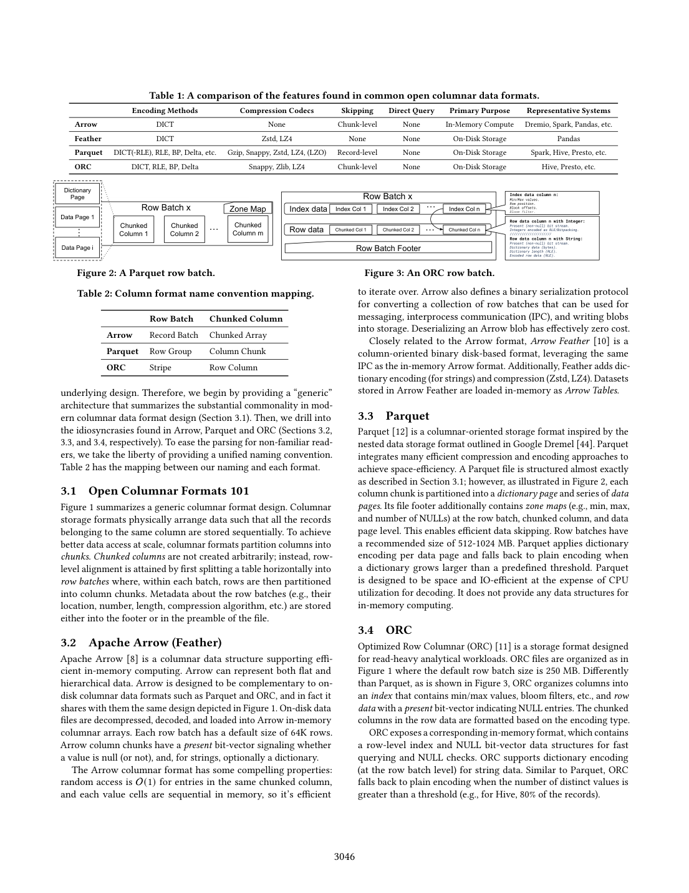
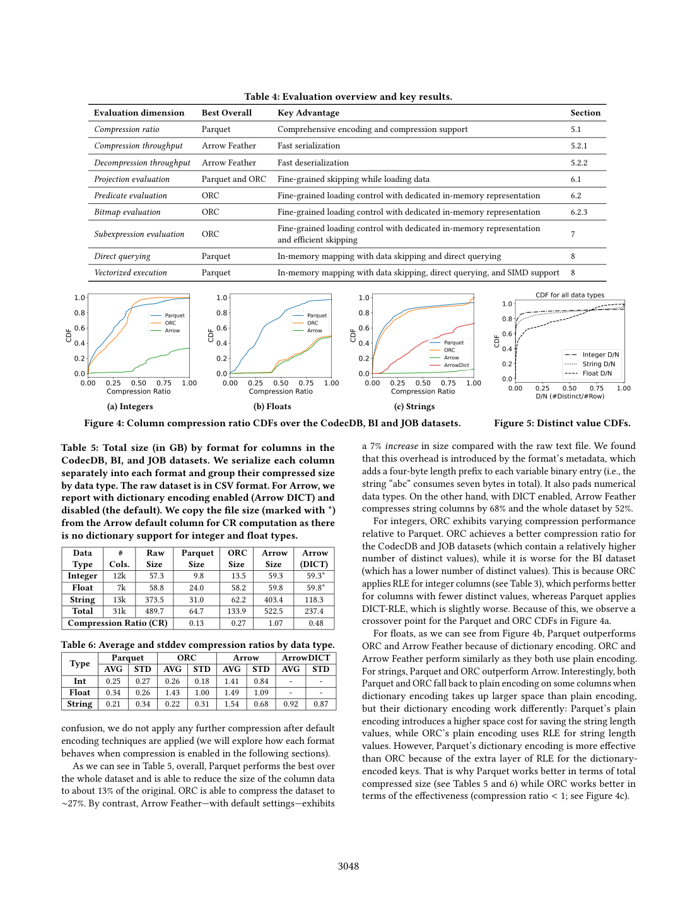

> 本组第 45 篇 · 分析型数据格式 · [全部论文]() · [上一篇]() · [下一篇]()

论文评估Arrow、Parquet、ORC作为分析型DBMS原生表示的候选，而非给所有文件格式或完整数据库排名。比较有意包含不同默认编码、API、内存结构和转换路径；作者明确说并非严格apples-to-apples。默认设置的结果不能单独证明格式规范本身必然导致全部性能差异。

必须区分编码、通用压缩、转码与查询执行。Table 5/6是未叠加通用codec的编码实验，压缩比以原始CSV为分母；总字节比、逐列均值与列数CDF权重不同。序列化统一以Arrow Table为起点，读取也转换为Arrow；disk、null device和tmpfs控制不同的成本，图9-11单位为时间，不能把不同格式各自的物理字节当作相同逻辑吞吐分母。

ORC的批量路径、Parquet的流式/细粒度访问、Arrow的互操作路径各有适用区间；数字/字符串实验使用不同规模的表，不能直接跨轴比较。最终up to 60x/100x属于改造后的Parquet相对于本论文默认Parquet流式基线，不是Parquet相对ORC/Arrow，也不是SIMD单独100x。全部10段API解读已修订，纠正“30%”指标、row batch命名、图22时间轴、默认Arrow/Feather差别和未写完的示例。

本文保留论文陈述、读者推断与待验证方案的区别；实验数字只适用于原文条件。原文和翻译来自已有 AI 辅助精读报告，已做来源匹配与编辑复核，不等于人工逐项核验或独立实验复现。所有页码均为 PDF 物理页。

## 论文与阅读范围

Chunwei Liu, Anna Pavlenko, Matteo Interlandi, Brandon Haynes. A Deep Dive into Common Open Formats for Analytical DBMSs. PVLDB 16(11):3044-3056, 2023. doi:10.14778/3611479.3611507。PDF物理页p对应印刷页p+3043。

[论文集中的原始 PDF](https://github.com/lonng/db-papers/blob/4ff1331069c7cf52ac97dd769e5f484c1c35c200/papers/formats/a-deep-dive-into-common-open-formats-for-analytical-dbmss.pdf) · 本地来源：`formats/a-deep-dive-into-common-open-formats-for-analytical-dbmss.pdf`，共 13 页。

本篇保留 18 组原文精读和 49 条证据。截图为原始 PDF 的局部页选，不是重新生成的图表；未将整份 PDF 复制到博客。

## 研究问题、方法与比较边界

【实际范围】已完整读物理1-13页，包括脚注和全部参考文献；视觉查看3-12页，未视觉查看1、2、13页。原API的图像未识别限制属于当时流程，本次另外核对关键图表；未重跑公开工件、联网查规范或比较当前版本。API原始critique保留，只针对其旧稿，不能冒充本次Codex修改后的独立审查。

【研究问题】作者问三种开放列式表示能否作为分析型DBMS内部原生格式：磁盘与内存如何转码，能否把过滤/跳过/计算推进编码域，能否利用向量化或编译。它不承诺完全不转换，也不以提出新格式或完整大数据系统端到端评测为目标。[C001N01,C004N03]

【比较边界】第4页明确说并非严格apples-to-apples：Arrow偏内存互操作，Parquet偏磁盘表示，ORC提供磁盘与对应内存访问结构。测试对象还包括默认编码选择、API与实现路径，不能把它们抽离后称作格式规范的纯净对比。软件为Arrow 5.0.0、ORC 1.7.2、Parquet Java API 1.9.0，部分序列化使用Arrow C++库；不同实验到底走哪条路径，复现时应逐项记录，而不是断言所有Parquet测试都在JVM中。[OF01-OF03]

工作负载为非嵌套关系数据，TPC-DS scale 10以及JOB、Public BI和CodecDB数据；查询端是五个select-project叶部子表达式，不是完整TPC-DS查询套件。本文未评估CarbonData/Avro，也未把工作负载感知分区作为主评测变量；这些是研究范围，不是对其当前采用率或能力的重新判断。[OF14,C004N06,C004N09]

依据：论文陈述；PDF 物理页 1, 4, 10, 12。证据：[C001N01](#evidence-c001n01), [C004N03](#evidence-c004n03), [C004N06](#evidence-c004n06), [C004N09](#evidence-c004n09), [OF01](#evidence-of01), [OF02](#evidence-of02), [OF03](#evidence-of03), [OF14](#evidence-of14)。

## 布局、命名与编码/压缩层次

【原文命名】row batch是论文为便于跨格式讨论采用的通用名称，不是ORC专用术语。Table 2映射为Arrow Record Batch、Parquet Row Group、ORC Stripe；column chunk也有各自术语。不要把批次、数据页、字典作用域、读取API批量大小混为同一单位。[OF17]

论文示意Parquet column chunk内含dictionary page和data pages，并用zone maps解释跳过机会；ORC把index、行数据与present位流分开，提供对应ColumnVectorBatch访问。这里是源文对历史格式/接口的概述，不是本次对每个版本规范的认证；Parquet不提供专用内存表示也不表示每个引擎都必须先转换为Arrow才能计算。[C001N05-C001N06]

Table 1区分Arrow与Feather：Arrow行的codec为None，Feather行有Zstd/LZ4。不能将“Arrow无通用codec”泛化成Feather没有压缩能力。Table 3也区分类型与API默认：测试中Arrow数值默认无轻量编码，字符串字典可选；Parquet/ORC采取不同编码策略，某些编码支持存在并不表示本实验实际选用了它。[C001N07,OF02-OF03]

编码是利用类型/重复结构的DICT、RLE、BP等；通用codec把字节流压缩，读取时通常还要解压。Table 5/6先应用默认编码而不再叠加codec；因此None不是所有格式同样裸二进制，箭头图中的缺失codec标记也不是0字节。源文把部分Arrow空间开销归于长度/元数据和填充，本报告仅保留该解释的作者归属，不把它扩张成所有Arrow布局的实现审计结论。CSV是比较基准，不是相同宽度内存数组。[C002N02,C002N05,OF04]

依据：论文陈述；PDF 物理页 3, 4, 5。证据：[C001N05](#evidence-c001n05), [C001N06](#evidence-c001n06), [C001N07](#evidence-c001n07), [C002N02](#evidence-c002n02), [C002N05](#evidence-c002n05), [OF02](#evidence-of02), [OF03](#evidence-of03), [OF04](#evidence-of04), [OF17](#evidence-of17)。

*原论文 PDF 物理页 3，版权归原作者或出版方。点击图片可查看原尺寸。页面文本中定位到：Table 1: A comparison of the features found in common open columnar data formats.；Figure 2: A Parquet row batch.；Figure 3: An ORC row batch.；Table 2: Column format name convention mapping.；Table 2 has the mapping between our naming and each format.。这是页面定位信息，不表示本次已复核图内所有数据。*

## 访问流程、定制优化与读者算例

【原文机制】常规路径包括从磁盘读、解压、解码、构建内存表示、过滤和结果物化。测试中Arrow/ORC先批量构造其内存表示，Parquet流式API交错加载与谓词计算；不同路径的工作量本来就不相同，不能把一个路径的compute-only时间直接与另一路径总时间相比。[C003N02]

【读者构造的假设示例：统计跳过】两个row group的整数max分别为500和1000，谓词x>800。可靠的第一个统计可证明整组不匹配，因此跳过它；这是row-group级块跳过，不因为格式另支持record-level接口就变成记录级索引检索。具体页、行和列可跳到什么粒度，需要区分存储布局、索引及API。[C001N05]

【原文定制机制】Arrow Direct不是默认接口。作者改造读取路径，解压/提取块内字典，把字符串常量映射到该字典编码域，比较整数键，最后只解码通过谓词的记录。Parquet的P-IM另引入惰性内存映射/物化，再叠加Direct和SIMD；不是仅换一个压缩选项就自动得到这些优化。[C003N09,C004N01]

【读者构造的假设示例：字典等值】字典{0:apple,1:banana,2:cherry}，码流[0,1,0,2]，等值banana得到码1和掩码[false,true,false,false]，再物化相应结果。另一个chunk可用不同码，需重新映射；无保序保证时不能用码值大小代替字符串范围判断。RLE的连续游程示例可以解释空间变化，但不能据此断言ORC原生执行始终直接在RLE域计算。[C001N06,C003N09]

CLS只加载需要的chunk，但随机稀疏行也可能触及大多数chunk。读者模型：每行独立被选概率s、每块m行时，触块概率为1-(1-s)^m；s=0.001、m=10000时约0.999955。因此低结果比例不等于高块跳过率。该算例不是原实验块设置或性能测量。[OF12]

依据：读者推断；PDF 物理页 3, 9, 11, 12。证据：[C001N05](#evidence-c001n05), [C001N06](#evidence-c001n06), [C003N02](#evidence-c003n02), [C003N09](#evidence-c003n09), [C004N01](#evidence-c004n01), [OF12](#evidence-of12)。

## 正确性义务与未证明事项

【读者审计义务，非原文形式化结论】论文主要评测性能，未给三种格式与所有算子组合的完整正确性证明。更快路径应与相同逻辑数据/SQL语义的基线比对，再谈速度；压缩成功、批次可读取和返回正确查询结果不是同一检查。[C001N05-C001N06]

字典等值优化只需常量与当前字典码的语义一致，不要求所有块构造出同一个全局确定字典。还要处理NULL、不存在常量、跨块不同字典和类型/比较规则；这些是工程验证条件。范围查询则需比较顺序相容，不能默认普通字典码具有词典序。源文仅提出保序字典作为扩展方向，不能写成已支持所有字符串范围语义。[C003N09]

数据跳过要求元数据和谓词推导足够保守，任何未能证明不匹配的块仍应保留。这里是提出验证标准，并非本次证明所有zone map/Bloom实现绝无假阴性；索引存在不等于读者已经审计其维护、NULL与异常值处理。无需加入没有来源的浮点截断事故故事。[C001N05-C001N06]

编码fallback是在给定编码不划算时换表示的策略，不是保证永不OOM或永不写失败的定理；读取方必须识别实际编码及边界。对Direct、惰性物化和SIMD，结果等价、输出顺序要求、投影列与结果物化成本都需测清，不能以更少解码直接替代正确性。

原文的性能结论不含并发更新、事务隔离或所有schema演进场景。若另引入工作负载感知布局，其结果属于新的系统方案，不能悄悄纳入本文workload-agnostic默认评测。[C004N01,C004N09]

依据：读者推断；PDF 物理页 3, 11, 12。证据：[C001N05](#evidence-c001n05), [C001N06](#evidence-c001n06), [C003N09](#evidence-c003n09), [C004N01](#evidence-c004n01), [C004N09](#evidence-c004n09)。

## 指标、转码边界与实验数字

【设置】Azure Standard D8s v3、8 vCPU、32GiB、premium SSD LRS、Ubuntu 18.04。保留版本/API差异、默认参数、冷缓存为主/部分热缓存条件；不能把默认设置称为控制了全部混杂变量，也不能补出未报告的CPU型号、重复次数或置信区间。[C001N08,OF01-OF03,OF15]

【编码空间】约31k真实数据列分别序列化后聚合。Table 5原CSV总489.7GB，Parquet 64.7GB/0.13，ORC 133.9GB/0.27，默认Arrow 522.5GB/1.07，Arrow DICT 237.4GB/0.48；这些是无额外codec的结果。比值=存储大小/CSV大小，0.13不是13倍；1.07是相对CSV增加约7%，非相同裸二进制表示额外7%。Table 6逐列平均与Figure 4列CDF不等于总字节比，舍入后的表格格子也无需被强行改到精确相加。[C001N11,C002N01,C002N05,OF04,OF13]

【codec与类型】TPC-DS测试Zstd、LZ4等，不是每格式都支持每codec。原文“within ~30% of Parquet”处于压缩比讨论，不能译成运行速度差30%。ORC LZ4无收益时回退与另一实验Arrow C++适配器省略ORC LZ4/Snappy条是两件事。Zstd从5到9的<1.5%空间收益及Arrow约3x、Parquet约2x压缩时间增加，是该测试条件的观察，不是任意数据的codec定律。整数CDF交叉的实测可保留，但基数不足以单独解释RLE；还需连续游程/物理顺序，源文该段因果说明不宜当作普遍规律。[C002N03,C002N06-C002N08,OF06,OF16]

【转码而非纯codec吞吐】catalog_sales约14M行、34数值列、3GB原始数据，写入从Arrow Table开始，读取也转换为Arrow。Figure 9比较disk与null device写以及不同输出大小；Figure 10/11比较disk/tmpfs读。这些轴是elapsed seconds，不是等字节工作量的GB/s。Arrow少转码是该共同接口的优势，不等于全部原生表示比过后仍同样排名；null device仍做相关编码/序列化，tmpfs仍有内存流量。LZ4 Arrow读比None低约30%是该路径I/O减少与解压成本的平衡，不适用于所有格式和介质。[C002N10-C002N11,OF05-OF08]

【访问与查询】数字用catalog_sales，字符串用约2M行/80MB的customer_demographic(s)，源文明确不可直接比较二者耗时。Arrow整行批解析和锁约80%是历史接口profiling，不是所有Arrow读实现必然如此；>90%加载/解码也属于所测谓词路径。随机bitmap应用先给定mask，非包含发现mask的全查询；<=0.001与约0.01的交叉点以及0.5峰值只在所测条件成立，分支失败是作者解释。Figure 19是五个SP片段、log毫秒；Parquet报告组合load+compute，其他可拆分，不能只取compute对比。[C002N12-C002N13,C003N01,C003N03,C003N05-C003N06,C003N08,OF09-OF11,OF14]

【定制优化】Gandiva未向量化原始这组查询，不等于永不向量化；另一个算术变体74ms到42ms约1.8x，Q2编译103ms/执行79ms。Figure 22轴1..10000是毫秒而非数据规模；P-IM、P-IM+D、P-IM+D+SIMD逐层改造，对比同一个默认Parquet流式基线；up to 60x/100x不是跨格式平均，也不是SIMD单项100x。本次已视觉查看图21/22及正文，原API“图表未知/OCR数字”措辞不再作为本次复核事实；没有因此声称独立重跑实验。[C003N10-C003N11,C004N01,OF18]

依据：论文陈述；PDF 物理页 4, 5, 6, 7, 8, 9, 10, 11, 12。证据：[C001N08](#evidence-c001n08), [C001N11](#evidence-c001n11), [C002N01](#evidence-c002n01), [C002N03](#evidence-c002n03), [C002N05](#evidence-c002n05), [C002N06](#evidence-c002n06), [C002N07](#evidence-c002n07), [C002N08](#evidence-c002n08), [C002N10](#evidence-c002n10), [C002N11](#evidence-c002n11), [C002N12](#evidence-c002n12), [C002N13](#evidence-c002n13), [C003N01](#evidence-c003n01), [C003N03](#evidence-c003n03), [C003N05](#evidence-c003n05), [C003N06](#evidence-c003n06), [C003N08](#evidence-c003n08), [C003N10](#evidence-c003n10), [C003N11](#evidence-c003n11), [C004N01](#evidence-c004n01), [OF01](#evidence-of01), [OF02](#evidence-of02), [OF03](#evidence-of03), [OF04](#evidence-of04), [OF05](#evidence-of05), [OF06](#evidence-of06), [OF07](#evidence-of07), [OF08](#evidence-of08), [OF09](#evidence-of09), [OF10](#evidence-of10), [OF11](#evidence-of11), [OF13](#evidence-of13), [OF14](#evidence-of14), [OF15](#evidence-of15), [OF16](#evidence-of16), [OF18](#evidence-of18)。

*原论文 PDF 物理页 5，版权归原作者或出版方。点击图片可查看原尺寸。页面文本中定位到：Table 4: Evaluation overview and key results.；Figure 4: Column compression ratio CDFs over the CodecDB, BI and JOB datasets.；Figure 5: Distinct value CDFs.；Table 5: Total size (in GB) by format for columns in the；Table 6: Average and stddev compression ratios by data type.。这是页面定位信息，不表示本次已复核图内所有数据。*

## 空间、CPU、跳过粒度与编译取舍

【读者推断】空间更小可能减少磁盘与内存带宽，但增加编码/解码CPU成本；不同类型和字典回退使权衡随数据改变。不能从单个TPC-DS LZ4结果写成所有SSD上压缩都值得，或把高Zstd级别收益小写成任何部署都不值得。[C002N01-C002N02,C002N07-C002N08,C002N11,OF16]

共同Arrow Table终点使互操作方便，但会把原生编码表示转成plain数组；它是在比较特定工作流，不是强制所有DBMS都这样执行。P-IM展示避免不必要解码的潜力，需承认其增加了专门的内存访问层和执行实现；Parquet不原生提供内存结构也不表示必须无法原地计算。[OF05,C004N01]

流式接口便于跳过未选记录和避免字符串全量物化，批量接口在访问比例高时可摊销调用/解析开销。更细粒度跳过还要付元数据与控制流成本；小批次也改变字典/压缩开销，不存在独立于布局、顺序和选择率的最佳批量大小。随机mask很快触及多数chunk，是Arrow CLS收益有限的一个原因，不等于聚簇选择也同样无益。[C003N02,C003N06,OF12]

JIT可优化计算，即使加载占比很大也不是“毫无用处”；准确说法是仅加速小计算段时，总收益受限。编译可被重复执行摊销，也可能对一次性小查询不划算。Gandiva原组查询没有生成向量代码，另算术变体能生成并获1.8x，不能把前者归为格式先天不支持所有SIMD的证明。[C003N10-C003N11,OF18]

本报告不从生态流行度推出ORC绑定内存API导致采用受限，也不补造版本演进、CXL/NVMe普及等当前事实。值得审计的是每条路径做了哪些工作、减少的是I/O还是解码、编译是否计入、物化结果是否相同，再决定某个取舍是否适合目标负载。[OF03]

依据：读者推断；PDF 物理页 4, 5, 6, 7, 8, 9, 10, 11, 12。证据：[C002N01](#evidence-c002n01), [C002N02](#evidence-c002n02), [C002N07](#evidence-c002n07), [C002N08](#evidence-c002n08), [C002N10](#evidence-c002n10), [C002N11](#evidence-c002n11), [C002N12](#evidence-c002n12), [C003N02](#evidence-c003n02), [C003N06](#evidence-c003n06), [C003N10](#evidence-c003n10), [C003N11](#evidence-c003n11), [C004N01](#evidence-c004n01), [OF03](#evidence-of03), [OF05](#evidence-of05), [OF12](#evidence-of12), [OF16](#evidence-of16), [OF18](#evidence-of18)。

## 比较对象与结论可迁移范围

【来源内比较】本文比较开放列式表示及其所选API作为分析DBMS内部格式的候选；它不是某个完整SQL引擎在另一引擎之上的排名，也不是2026年的格式/reader现状。CarbonData和Avro未评估，不能据此得出性能较差或当前不适用。[C004N03,C004N06]

作者选择不同默认编码与API反映现实使用路径，明说非严格apples-to-apples。这个设计适合观察工程瓶颈，但不自动隔离格式结构、实现语言、codec、批量大小、并行度等变量。Parquet Java版本列在全局设置中，而转码实验也使用Arrow C++，不能未经逐实验核实就把所有差距归为JVM GC；同样不能把缺失的ORC codec bar解释为ORC格式不支持它。[OF01-OF02,OF05-OF06]

默认API与研究改造要分开比较：Table 1的direct-query None和后文改造后的Direct结果不矛盾；Table 4总结的最佳维度可能来自不同配置，不能拼成一条单一默认管线。Figure 22的100x是相对该Parquet基线，若想比较改造后Parquet与同等优化的ORC/Arrow，必须另做匹配实验。[C004N03]

原稿借Velox及工作负载感知布局讨论编码支持与执行层共同设计；本报告只保留其历史归属，未检查其当前源码。可迁移的结论是原生内存访问、物理布局和算子应共同考虑，不是已证明所有系统都应采用同一个文件格式或必须重写现有引擎。[C004N08-C004N09]

依据：读者推断；PDF 物理页 4, 7, 12。证据：[C004N03](#evidence-c004n03), [C004N06](#evidence-c004n06), [C004N08](#evidence-c004n08), [C004N09](#evidence-c004n09), [OF01](#evidence-of01), [OF02](#evidence-of02), [OF05](#evidence-of05), [OF06](#evidence-of06)。

## 可执行但未运行的复现与公平性计划

【读者提案，未执行】建立两套矩阵：一套忠实复现论文的版本、默认参数与数据；另一套做受控消融，固定逻辑输入/输出、行序、可支持的相同codec级别、线程数和批量配置，再逐项改变实现或布局。后者是新实验，不必禁止调优；默认不同并不等于所有混杂已被控制。[OF01-OF03]

记录每个实验的实际reader/writer库、语言/适配器、字典开关、fallback、chunk/page/row-group粒度、codec与级别，标明不支持组合而不填0。保留原CSV大小和类型/行数，分别计算总字节比与逐列分布。验证所有路径读取结果/NULL/投影/过滤结果等价；对定制Direct另验证跨字典chunk和常量不存在。[C001N11,C002N05,C003N09,OF06,OF13]

转码实验必须记录Arrow Table共同起点/终点，并另对原生计算路径计时。若报告吞吐，规定共同逻辑输入字节/耗时；另报物理文件字节与I/O，不把每格式不同压缩输出字节混作等基准。拆开disk/null写、disk/tmpfs读、parse、decompress、decode、filter、materialize、compile和重复执行摊销。[C002N10,OF05,OF07-OF08]

保留冷/热cache条件但不要加入未经本文提供、可能影响整机的系统命令。数字/字符串使用不同表的原实验要分别报告；如需跨类型比较，新增相同行数/宽度受控表，而不是直接拿图12/13的柱高相除。随机mask与聚簇mask分开测，并注明mask生成是否计时。[C003N08,OF09,OF14]

复现P-IM/Direct/SIMD要保存实现差异和正确性结果，标明对哪条基线加速；实际CPU型号、ISA支持和构建参数需记录，不能从云规格名称补造AVX_512支持。JIT分别报编译、单次执行、重复执行总成本。输出重复次数、误差范围和原始数据；本次只有本地来源/结构/算例检查，没有下载运行工件或做任何性能实验。[C001N08,C003N11,C004N01,OF18]

依据：待验证的工程设想；PDF 物理页 4, 5, 6, 7, 8, 10, 11, 12。证据：[C001N08](#evidence-c001n08), [C001N11](#evidence-c001n11), [C002N05](#evidence-c002n05), [C002N10](#evidence-c002n10), [C002N12](#evidence-c002n12), [C003N08](#evidence-c003n08), [C003N09](#evidence-c003n09), [C003N11](#evidence-c003n11), [C004N01](#evidence-c004n01), [OF01](#evidence-of01), [OF02](#evidence-of02), [OF03](#evidence-of03), [OF05](#evidence-of05), [OF06](#evidence-of06), [OF07](#evidence-of07), [OF08](#evidence-of08), [OF09](#evidence-of09), [OF13](#evidence-of13), [OF14](#evidence-of14), [OF18](#evidence-of18)。

## 结论、逐页索引与未验证事项

【结论】格式不是脱离访问API和执行实现的独立性能开关。压缩比、编码/codec成本、转码、跳过、内存访问、物化与编译互相作用，论文展示的主要机会是共同设计磁盘/内存表示与执行路径，而不是推选一个永远最佳的格式。

【证据索引】第1页研究目标；第2页编码背景完整阅读；第3页布局、Table 1/2命名；第4页版本/默认/缓存与非同类比较限定；第5页Table 5/6、列CDF和CSV基准；第6页codec/类型压缩与级别取舍；第7页共同Arrow转码及disk/null/tmpfs；第8页投影与锁开销及跨表脚注；第9页谓词/bitmap与Table 7；第10页SP总时延、冷/热与batch；第11页Direct、CLS、Gandiva及惰性内存Parquet；第12页Figure 22优化阶梯及研究边界；第13页参考文献完整阅读但外部链接未核查。

【修正重点】保留原31条API证据的id、page与quote，仅修正错误claim并补18条逐字来源；原10段英文片段不变，全部10段解读四字段均重新核对，另加8段。图22是时间轴非数据规模，30%处为压缩比非运行性能，row batch为通用命名非ORC专用，100x非跨格式/单项SIMD保证；最后一段未写完的示例已完成。

【限制】没有实现审计、规范认证、外部源码/当前产品核查、独立基准或人工复核。原API用量与critique完整保留，critique仅适用于原API稿；本次Codex源文编辑不冒充新的API审查。整体仍待人工检查，结构和引文校验不能认证每个因果解释或统计结论。

依据：读者推断；PDF 物理页 1, 3, 4, 5, 6, 7, 8, 9, 10, 11, 12。证据：[C001N01](#evidence-c001n01), [C001N05](#evidence-c001n05), [C001N06](#evidence-c001n06), [C001N07](#evidence-c001n07), [C001N08](#evidence-c001n08), [C001N11](#evidence-c001n11), [C002N01](#evidence-c002n01), [C002N02](#evidence-c002n02), [C002N03](#evidence-c002n03), [C002N05](#evidence-c002n05), [C002N06](#evidence-c002n06), [C002N07](#evidence-c002n07), [C002N08](#evidence-c002n08), [C002N10](#evidence-c002n10), [C002N11](#evidence-c002n11), [C002N12](#evidence-c002n12), [C002N13](#evidence-c002n13), [C003N01](#evidence-c003n01), [C003N02](#evidence-c003n02), [C003N03](#evidence-c003n03), [C003N05](#evidence-c003n05), [C003N06](#evidence-c003n06), [C003N08](#evidence-c003n08), [C003N09](#evidence-c003n09), [C003N10](#evidence-c003n10), [C003N11](#evidence-c003n11), [C004N01](#evidence-c004n01), [C004N03](#evidence-c004n03), [C004N06](#evidence-c004n06), [C004N08](#evidence-c004n08), [C004N09](#evidence-c004n09), [OF01](#evidence-of01), [OF02](#evidence-of02), [OF03](#evidence-of03), [OF04](#evidence-of04), [OF05](#evidence-of05), [OF06](#evidence-of06), [OF07](#evidence-of07), [OF08](#evidence-of08), [OF09](#evidence-of09), [OF10](#evidence-of10), [OF11](#evidence-of11), [OF12](#evidence-of12), [OF13](#evidence-of13), [OF14](#evidence-of14), [OF15](#evidence-of15), [OF16](#evidence-of16), [OF17](#evidence-of17), [OF18](#evidence-of18)。

## 原文精读：从句子回到机制

以下保留原文、忠实翻译、含义与边界；假设示例不作为论文实验结果。

### P001 · PDF 物理页 1

**原文**

<blockquote class="paper-source-quote"><pre><code>Given this environment, the goal of this paper is to evaluate these&#10;three formats, explore their trade-offs, and evaluate their perfor-&#10;mance as candidates for direct subsumption in an analytical DBMS.&#10;Three main challenges exist in subsuming an in-memory format&#10;such as Arrow or traditionally on-disk formats such as Parquet or&#10;ORC. First, a DBMS needs to be able to efficiently (de)serialize and&#10;(de)compress on-disk data to and from an in-memory representa-&#10;tion.</code></pre></blockquote>

**忠实翻译**

> 在此背景下，作者希望评估三种格式、探讨权衡及其作为分析DBMS直接采用的原生表示的性能。将Arrow这类内存格式或Parquet/ORC这类传统磁盘格式纳入DBMS有三类挑战，首先是高效完成磁盘与内存表示间的序列化、反序列化、压缩和解压。

**技术含义与边界**

> direct subsumption是内部采用的设计问题，不保证完全没有转换。此段只展开第一个挑战，全文还讨论下推和执行优化。比较范围为分析DBMS候选表示，不是完整系统排名。

**常见误读**

> 不要把研究目标翻成所有格式已经不转码或已经获得统一性能保证；原文允许改造表示和访问层。

**读者构造的假设示例**

> 读者构造的假设示例：引擎可把Parquet先转为Arrow来执行，也可设计惰性编码访问；比较两条路径时应分别计入转码与物化，而不是先假定原生采用必然零转换。

### P002 · PDF 物理页 12

**原文**

<blockquote class="paper-source-quote"><pre><code>This can be further improved with direct query and avoiding&#10;decoding; P-IM+D is up to 60× faster than the Parquet baseline.&#10;Finally, if we enable SIMD execution (AVX_512) we observe up to&#10;100× speedup compared with the Parquet baseline.</code></pre></blockquote>

**忠实翻译**

> 通过直接查询并避免解码，P-IM+D相对Parquet基线最高可快60倍；再启用AVX_512的SIMD执行，作者观察到相对同一Parquet基线最高100倍加速。

**技术含义与边界**

> 这里是改造后的Parquet相对默认Parquet流式API的峰值，不是Parquet对ORC/Arrow。100x包含此前内存表示和Direct等改造，不能归为SIMD单独100x；Figure 22轴为毫秒，不是数据量。

**常见误读**

> up to不是平均，不能跨不同查询的峰值相除以推定SIMD的准确增益，也不能假设所有reader默认有这些研究实现。

**读者构造的假设示例**

> 读者构造的假设示例：若同一查询基线1000ms、Direct变体约16.7ms、再加SIMD10ms，则对应约60x/100x；这是数量级例子，非原始测量。

### P003 · PDF 物理页 5

**原文**

<blockquote class="paper-source-quote"><pre><code>ORC is able to compress the dataset to&#10;∼27%. By contrast, Arrow Feather—with default settings—exhibits&#10;a 7% increase in size compared with the raw text file. We found&#10;that this overhead is introduced by the format’s metadata, which&#10;adds a four-byte length prefix to each variable binary entry (i.e., the&#10;string “abc” consumes seven bytes in total). It also pads numerical&#10;data types. On the other hand, with DICT enabled, Arrow Feather&#10;compresses string columns by 68% and the whole dataset by 52%.</code></pre></blockquote>

**忠实翻译**

> 作者说ORC压至约原始文本的27%，默认Arrow Feather比原文本大约7%，并将开销归于变长条目的四字节长度/元数据和数值填充；启用DICT后字符串列减少约68%，全数据减少约52%。

**技术含义与边界**

> Table 5是在默认编码后不再叠加通用codec、逐列序列化的特定数据结果；CSV为参考。长度前缀的说明按作者原样归属，不表示本次认证所有Arrow内存布局。

**常见误读**

> 不能从相对CSV增大推断相对同宽裸二进制也增7%；压缩比0.48表示剩余48%，不是节省48%。也不能说默认Arrow无codec便等于Feather不支持Zstd/LZ4。

**读者构造的假设示例**

> 读者构造的假设示例：100MB CSV若得到107MB存储，比例1.07；若DICT后为48MB，比例0.48、节省52%。这个换算不说明运行时间或所有数据的效果。

### P004 · PDF 物理页 8

**原文**

<blockquote class="paper-source-quote"><pre><code>Relative to Arrow Feather, this occurs for several reasons.&#10;First, ORC offers the ability to perform fine-grained reads at the&#10;column level while Arrow Feather requires reading, decompressing&#10;and decoding the entire row batch before projecting the target&#10;column(s). This means that ORC’s runtime is proportional to the&#10;number of columns extracted, while extracting one single column&#10;from an Arrow Feather file is only 2× faster than extracting the full&#10;table.</code></pre></blockquote>

**忠实翻译**

> 作者解释：所测ORC支持列级细粒度读取，而Arrow Feather要在投影前读取、解压并解码整个row batch；ORC时间随提取列数变化，Arrow提一列只比提全表约快两倍。

**技术含义与边界**

> 这是历史库/API路径的profiling，不是规范要求每个Arrow reader永远这样。真实耗时含固定与逐列成本，不能从趋势推出100列变1列就严格快100倍。

**常见误读**

> 不能用该结果给所有Arrow实现定罪，也不能把图中的线性趋势写成无固定开销的数学定律；不同cache/codec/并行模式另有对照。

**读者构造的假设示例**

> 读者构造的假设示例：若固定解析耗时5ms、每列1ms，读1列6ms、读10列15ms，不是10倍差距；这只说明固定成本应与逐列成本分开看。

### P005 · PDF 物理页 10

**原文**

<blockquote class="paper-source-quote"><pre><code>Queries have&#10;low (Q5), medium (Q2–Q4), and high (Q1) selectivities.&#10;We execute each subexpression: (i) for each format, (ii) with and&#10;without compression (LZ4), and (iii) with and without clearing the&#10;system cache (to simulate the cases with repeated queries on the&#10;hot data, and infrequent queries on cold files, respectively).&#10;The results are shown in Figure 19 (uncompressed vs LZ4), and&#10;Figure 20 (warm vs cold cache).</code></pre></blockquote>

**忠实翻译**

> 作者将Q5/Q2-Q4/Q1分别称低/中/高selectivity，并对五个子表达式逐格式测试LZ4与不压缩、清与不清系统cache，以对照冷文件与热数据；图19/20给出这些对照。

**技术含义与边界**

> 原句的低/高标签应保留作者归属，若需数值判断应说清通过比例。Table 7已提供SQL，不能把Q1改成无WHERE全表扫描；它实际有两个等值条件。

**常见误读**

> 不要加入整机清cache命令或伪称原文未给SQL；清/不清的语义也不能按原句respectively的措辞误译成清cache就是热数据。

**读者构造的假设示例**

> 读者构造的假设示例：对同一个Table 7 Q1片段，分别报告预先访问后的warm结果和清理系统cache条件下的cold结果；不改SQL，不把它替换成全表扫描。

### P006 · PDF 物理页 3

**原文**

<blockquote class="paper-source-quote"><pre><code>A Parquet file is structured almost exactly&#10;as described in Section 3.1; however, as illustrated in Figure 2, each&#10;column chunk is partitioned into a dictionary page and series of data&#10;pages. Its file footer additionally contains zone maps (e.g., min, max,&#10;and number of NULLs) at the row batch, chunked column, and data&#10;page level. This enables efficient data skipping.</code></pre></blockquote>

**忠实翻译**

> 原文示意Parquet column chunk分为字典页和数据页，footer含作者所称row batch、column chunk、data page等层级的min/max/NULL数量统计，以支持跳过。

**技术含义与边界**

> 这是论文布局描述。row batch为统一命名，对Parquet是row group，对ORC是stripe。统计可提供块不匹配证据，不等于这个示例已证明记录级随机跳过或当前规范所有版本的精确索引存储位置。

**常见误读**

> 不要把row batch叫ORC专用，也不要把跳过整row group自动称作record-level skipping；不同粒度与API能力须分开。

**读者构造的假设示例**

> 读者构造的假设示例：某row group可靠统计max=50，谓词x>100可排除整组；这是块级跳过，不能据此声称定位到单行的索引已被使用。

### P007 · PDF 物理页 4

**原文**

<blockquote class="paper-source-quote"><pre><code>To summarize our findings, in Table 4 we show the structure of&#10;our experiments and the overall best format for each dimension.&#10;Setup. All experiments are performed on an Azure Standard D8s v3&#10;(8 vCPUs, 32 GiB memory), premium SSD LRS, and Ubuntu 18.04.&#10;We test Apache Arrow 5.0.0, ORC 1.7.2, and the Apache Parquet Java&#10;API version 1.9.0. Where needed, we use the Apache Arrow C++&#10;library to write in-memory Arrow tables to disk.</code></pre></blockquote>

**忠实翻译**

> 所有实验在Azure Standard D8s v3、8vCPU、32GiB、premium SSD LRS、Ubuntu18.04上进行。测试Arrow5.0.0、ORC1.7.2、Parquet Java API1.9.0；需要时用Arrow C++库把内存Arrow Table写入磁盘。

**技术含义与边界**

> 这是版本与路径线索，不是每个Parquet实验都只在JVM的充分证据；转码还有Arrow C++适配器。逐实验应记录实际库、API和转换终点，而非把差距全归语言。

**常见误读**

> 不要补造JVM GC停顿或CPU型号来解释数据，也不能从云规格名称自行认证AVX_512；当前库修复情况未查。

**读者构造的假设示例**

> 读者构造的假设示例：复现记录里分别列“Arrow Table到Parquet writer的具体库/版本”和“原生Parquet过滤的具体API”，而不只写“格式=Parquet”。

### P008 · PDF 物理页 9

**原文**

<blockquote class="paper-source-quote"><pre><code>Because of this, Parquet&#10;runtimes vary for different selectivity levels. However, Parquet run-&#10;time is not a simple linear function of selectivity level. Instead, we&#10;observe the highest runtime for this format at ∼0.5 selectivity, the&#10;point at which the largest number of branch mispredictions occur.&#10;2We discuss the “Arrow Feather (Direct)” bar in Section 8.1.1.</code></pre></blockquote>

**忠实翻译**

> Parquet运行时间随selectivity变化但不是简单线性；作者观察到约0.5处耗时最高，并将其解释为分支预测失败最多的位置。

**技术含义与边界**

> 这是给定随机mask的bitmap应用路径，不是任何完整SQL的定律。分支失败是作者解释，本次没有独立性能计数验证。数据顺序也影响分支可预测性。

**常见误读**

> 同样50%通过，交错随机与长段连续分布可能不同；不能说所有格式/CPU都恰在0.5最慢或从文字反推精确计数。

**读者构造的假设示例**

> 读者构造的假设示例：两个mask均有一半true，一个随机交错，一个前半true后半false；结果条数相同，但控制流行为可能不同，应分开测而不是仅按比例预测。

### P009 · PDF 物理页 6

**原文**

<blockquote class="paper-source-quote"><pre><code>However, when compression is enabled, Arrow per-&#10;forms within ∼30% of Parquet. ORC achieves a similar compression&#10;ratio as Parquet, except under LZ4. In this case, ORC automatically&#10;disables compression because it detects that the LZ4 compressed&#10;data size is greater than the original data size.&#10;Finally, we observe that different compression algorithms yield&#10;different compression ratios.</code></pre></blockquote>

**忠实翻译**

> 该压缩比实验中，启用压缩后Arrow的压缩结果在Parquet约30%范围内，ORC通常相似，但LZ4时作者说它检测到压后更大而禁用压缩；不同codec得到不同比例。

**技术含义与边界**

> 上下文指标是压缩比/大小，不是吞吐或运行速度。负收益fallback不同于第7页因Arrow C++适配器而省略ORC LZ4/Snappy的写入条。

**常见误读**

> 不要用“性能相差30%”混淆指标，也不要由禁用某次压缩推出ORC格式不支持LZ4。原文没有给统一最佳codec保证。

**读者构造的假设示例**

> 读者构造的假设示例：若两文件原CSV相同，压后分别100MB和125MB，可讨论大小差25%；即使其中一个写更慢，也不能把大小差当作runtime差。

### P010 · PDF 物理页 11

**原文**

<blockquote class="paper-source-quote"><pre><code>We modify Arrow to implement direct querying&#10;as follows. For each data chunk, we decompress and extract the&#10;dictionary from the metadata. We then map the string constant&#10;in the query predicate from the string domain into the encoded&#10;integer domain of the extracted dictionary. This process allows&#10;us to: (i) transform string comparisons into integer comparisons,&#10;which can be executed efficiently; and (ii) decode only the records&#10;admitted by the predicate.</code></pre></blockquote>

**忠实翻译**

> 作者修改Arrow：对每块解压并提取元数据中的字典，把谓词字符串常量映射到当前字典的整数域，执行整数比较，并仅解码谓词接受的记录。

**技术含义与边界**

> 这是研究改造路径，不是默认API。字典每块可不同，等值可按本地字典映射，范围需要顺序相容；并非要求全局字典构建结果完全相同。

**常见误读**

> 不能把DICT选项等同于已获得Direct，也不能用整数大小自动代表词典序；原API示例未写完，现已补成可检查的完整小例子。

**读者构造的假设示例**

> 读者构造的假设示例：字典[apple,banana,cherry]对应码[0,1,2]，数据[0,1,0,2]，谓词banana映射1并得mask[false,true,false,false]，结果只物化banana；下一chunk的banana若编码0，须重新映射。

### P011 · PDF 物理页 4

**原文**

<blockquote class="paper-source-quote"><pre><code>This is not&#10;strictly an apples-to-apples comparison because each format was&#10;developed with a different use case in mind</code></pre></blockquote>

**忠实翻译**

> 这并非严格的同类条件比较，因为每种格式开发时的用途不同。

**技术含义与边界**

> 作者主动限定因果归因能力：结果包含用途、默认编码、API和实现差异。

**常见误读**

> 同硬件或同数据不等于控制了所有变量；默认参数也不保证等工作量。

**读者构造的假设示例**

> 读者构造的假设示例：一个路径输出Arrow Table，另一个直接在编码域返回结果，即使输入CSV一样，所做转换仍不同。

### P012 · PDF 物理页 5

**原文**

<blockquote class="paper-source-quote"><pre><code>The raw dataset is in CSV format.</code></pre></blockquote>

**忠实翻译**

> 原始数据集采用CSV格式。

**技术含义与边界**

> Table 5比例相对文本参考，不是与等宽裸二进制内存数组比较。

**常见误读**

> 不要把1.07直接当成格式相对内存表示的7%元数据开销，或把所有列平均比例当作总字节比。

**读者构造的假设示例**

> 读者构造的假设示例：原列大小100/900字节、存储50/90，逐列比均值0.3，总比140/1000=0.14，权重不同。

### P013 · PDF 物理页 7

**原文**

<blockquote class="paper-source-quote"><pre><code>formats support serializing from an Arrow Table, and so we adopt&#10;it as our common in-memory representation.</code></pre></blockquote>

**忠实翻译**

> 所有格式都支持从Arrow Table序列化，因此作者将它作为共同内存表示。

**技术含义与边界**

> 这使逻辑输入接口统一，但各格式的编码/转换成本不同；读取实验也转成Arrow。

**常见误读**

> 不能把共同对象称作每条路径都零转码，或用各自不同输出字节数计算后宣称统一逻辑吞吐。

**读者构造的假设示例**

> 读者构造的假设示例：同一1GB逻辑输入，各路径耗时1秒/2秒时可按共同逻辑字节比；另报各自压后大小，不将较小输出的MB/s与较大输出混算。

### P014 · PDF 物理页 7

**原文**

<blockquote class="paper-source-quote"><pre><code>We omit the LZ4 and&#10;Snappy bars for ORC as the Apache Arrow C++ library has limited&#10;compression support for the ORC format.</code></pre></blockquote>

**忠实翻译**

> 作者省略ORC的LZ4和Snappy条，因为Apache Arrow C++库对ORC格式的压缩支持有限。

**技术含义与边界**

> 缺失来自所选适配器路径；格式可表达的codec与该writer能测试的codec不相同。

**常见误读**

> 缺条不是0耗时、0字节，也不证明ORC规范不支持这些codec。

**读者构造的假设示例**

> 读者构造的假设示例：结果表对不可用组合记N/A及适配器原因，不把N/A画成优于所有格式的零高度柱。

### P015 · PDF 物理页 8

**原文**

<blockquote class="paper-source-quote"><pre><code>The runtimes between the numeric and string experiments are not directly&#10;comparable</code></pre></blockquote>

**忠实翻译**

> 数字与字符串实验的运行时间不能直接比较。

**技术含义与边界**

> 原脚注说明它们使用不同规模/宽度的表，不能把runtime差全归数据类型。

**常见误读**

> 即使两张图都以ms为单位，也不意味着分母相同。

**读者构造的假设示例**

> 读者构造的假设示例：14M行大表的数值投影与2M行小表字符串投影需各报行数/字节；若要跨类型结论应另做匹配规模实验。

### P016 · PDF 物理页 11

**原文**

<blockquote class="paper-source-quote"><pre><code>even at extremely low selec-&#10;tivities, we quickly select at least one tuple per chunk, obviating&#10;any performance advantages.</code></pre></blockquote>

**忠实翻译**

> 即使selectivity极低，随机行选择仍很快让每个chunk至少有一个被选元组，因而失去跳过优势。

**技术含义与边界**

> 跳过收益由触及块数而不只结果行数决定，随机与聚簇mask不同。

**常见误读**

> 不要把低通过比例自动等同于大幅块I/O减少，也不把该随机实验扩成所有范围查询。

**读者构造的假设示例**

> 读者构造的假设示例：独立选择概率0.001、每块10000行时，触块概率1-(1-0.001)^10000约0.999955；这是占用模型而非原始测量。

### P017 · PDF 物理页 6

**原文**

<blockquote class="paper-source-quote"><pre><code>Compression ratio (compressed size / original CSV&#10;size) on TPC-DS (smaller is better).</code></pre></blockquote>

**忠实翻译**

> TPC-DS上的压缩比为压后大小除以原CSV大小，越小越好。

**技术含义与边界**

> 它是空间指标，需与压缩/解压时间和查询时间另报。

**常见误读**

> 0.13不是13倍，0.48不是节省48%，也不能把within30%从本节译成速度。

**读者构造的假设示例**

> 读者构造的假设示例：1000字节参考压为130字节，比例0.13、节省87%、逆大小因子约7.69。

### P018 · PDF 物理页 11

**原文**

<blockquote class="paper-source-quote"><pre><code>Gandiva’s use of vectorization (and other LLVM optimizations)&#10;resulted in a 1.8× speedup (74ms vs 42ms) relative to normal Arrow.</code></pre></blockquote>

**忠实翻译**

> 对另一个算术变体，Gandiva使用向量化及其他LLVM优化，相对普通Arrow得到1.8倍加速，74ms对42ms。

**技术含义与边界**

> 该变体不同于原组未向量化的查询，证明不能用那组结果声称Gandiva永远不能向量化；收益还包含其他LLVM优化。

**常见误读**

> 不要把全部74到42差异归于单一SIMD指令，也不自动把编译时间忽略。

**读者构造的假设示例**

> 读者构造的假设示例：若编译另需100ms，只执行一次的总成本不是42ms；重复执行k次时分别报100+42k与74k，明确这个假设模型非论文原值。

## 尚未解决的问题

1. 逐项固定codec、字典策略、row order、批量大小、线程数和API路径后，各项差距还剩多少来自格式结构本身？
2. 保留共同Arrow转码基准，同时允许各格式原生计算时，空间/解码/物化成本如何重新分布？
3. 随机与聚簇mask下，记录级、页级、chunk级跳过的收益阈值分别如何变化？
4. 在相同语义与优化投入下，改造后的Parquet/ORC/Arrow怎样比较，如何避免用很弱的默认接口夸大单项优化？
5. 原稿所述云环境、实际CPU/ISA与AVX_512构建路径如何精确复现，编译与重复执行成本如何计入？

## 证据索引

证据编号沿用原报告，便于将上文判断追溯到原句。引文匹配只验证位置，不证明解读正确。

**C001N01 · PDF 物理页 1**

本文评估三种开放列式表示作为分析DBMS内部原生表示的候选，涉及转码、下推与执行技术；不保证完全不转换或评价所有完整DBMS。

<blockquote class="paper-source-quote"><pre><code>Three main challenges exist in subsuming an in-memory format such as Arrow or traditionally on-disk formats such as Parquet or ORC.</code></pre></blockquote>

**C001N05 · PDF 物理页 3**

原文示意Parquet column chunk的字典页/数据页及统计跳过；row batch是作者通用术语，映射到Parquet row group，不是ORC专用。该引文不独立证明所有版本默认布局/批量大小。

<blockquote class="paper-source-quote"><pre><code>each column chunk is partitioned into a dictionary page and series of data pages. Its file footer additionally contains zone maps</code></pre></blockquote>

**C001N06 · PDF 物理页 3**

原文ORC示意含索引与present位流，并讨论对应内存结构；不能由此推断所有原生算子直接在RLE域执行或fallback能保证永不OOM。

<blockquote class="paper-source-quote"><pre><code>ORC organizes columns into an index that contains min/max values, bloom filters, etc., and row data with a present bit-vector indicating NULL entries.</code></pre></blockquote>

**C001N07 · PDF 物理页 3**

Table 1是历史特征对照，须区分Arrow内存行与支持Zstd/LZ4的Feather行；默认接口direct query与后文定制优化不同，不能混写。

<blockquote class="paper-source-quote"><pre><code>Table 1: A comparison of the features found in common open columnar data formats.</code></pre></blockquote>

**C001N08 · PDF 物理页 4**

源文声明Azure D8s v3/8vCPU/32GiB/SSD/Ubuntu18.04环境；软件/API、缓存与默认条件另有具体说明，不能补造CPU型号或每个测试的语言路径。

<blockquote class="paper-source-quote"><pre><code>All experiments are performed on an Azure Standard D8s v3 (8 vCPUs, 32 GiB memory), premium SSD LRS, and Ubuntu 18.04.</code></pre></blockquote>

**C001N11 · PDF 物理页 4**

编码实验将真实数据列逐列序列化再聚合，按列均值/CDF和总字节比权重不同，不能互相替代。

<blockquote class="paper-source-quote"><pre><code>we group each data column by data type, convert each column one-by-one into each format, and finally aggregate the statistics of the compressed columns.</code></pre></blockquote>

**C002N01 · PDF 物理页 5**

Table 5的总大小和CSV相对比值是印刷舍入值；0.13代表存储/原CSV，1.07约为CSV的107%，不代表相对同一裸二进制布局开销。

<blockquote class="paper-source-quote"><pre><code>Total 31k 489.7 64.7 133.9 522.5 237.4 Compression Ratio (CR) 0.13 0.27 1.07 0.48</code></pre></blockquote>

**C002N02 · PDF 物理页 5**

作者把此数据集Arrow Feather空间膨胀归于长度/元数据和填充；这是历史路径的解释，不是本次对所有Arrow内存布局的规范审计。

<blockquote class="paper-source-quote"><pre><code>this overhead is introduced by the format’s metadata, which adds a four-byte length prefix to each variable binary entry</code></pre></blockquote>

**C002N03 · PDF 物理页 5**

整数CDF交叉及RLE/DICT差异为原文观察与解释；不同值数量不足以单独决定RLE收益，还需连续游程和顺序，原文该段解释不应泛化。

<blockquote class="paper-source-quote"><pre><code>ORC applies RLE for integer columns (see Table 3), which performs better for columns with fewer distinct values, whereas Parquet applies DICT-RLE</code></pre></blockquote>

**C002N05 · PDF 物理页 5**

Table 5/6先应用默认编码但不叠加通用codec，不等于所有格式都存相同未编码字节。

<blockquote class="paper-source-quote"><pre><code>we do not apply any further compression after default encoding techniques are applied (we will explore how each format behaves when compression is enabled</code></pre></blockquote>

**C002N06 · PDF 物理页 6**

TPC-DS该节讨论压缩比，within30%不是运行速度差；ORC在所述LZ4负收益时禁用压缩，不等于不支持LZ4，也不同于适配器省略测试。

<blockquote class="paper-source-quote"><pre><code>ORC automatically disables compression because it detects that the LZ4 compressed data size is greater than the original data size.</code></pre></blockquote>

**C002N07 · PDF 物理页 6**

Zstd 5到9空间收益<1.5%是该实验观察，相关写时成本须限定条件，不能定义所有负载的高压缩级别性价比。

<blockquote class="paper-source-quote"><pre><code>increasing Zstd’s level from 5 to 9 yields more aggressive compression and achieves smaller sizes. However, this gain is minimal (&lt; 1.5%)</code></pre></blockquote>

**C002N08 · PDF 物理页 6**

ORC/Parquet默认块/字典作用域造成的空间差异属于该类型/数据/默认设置解释，不能当成所有配置都相同。

<blockquote class="paper-source-quote"><pre><code>ORC has a smaller default block size and thus pays more dictionary overhead per row batch; and (ii) it more frequently falls back to plain encoding</code></pre></blockquote>

**C002N10 · PDF 物理页 7**

共同Arrow输入下null-device写降低I/O，结果体现序列化/编码与适配路径差别；不是纯codec统一GB/s或完全零成本。

<blockquote class="paper-source-quote"><pre><code>Arrow Feather has the biggest difference, thanks to its inherent zero-copy implementation in Arrow. The compression time for Parquet and ORC does not change substantially</code></pre></blockquote>

**C002N11 · PDF 物理页 7**

LZ4 Arrow读低约30%只针对该磁盘转Arrow路径；tmpfs对照帮助分析CPU/I/O，不证明所有压缩与介质都有同样结果。

<blockquote class="paper-source-quote"><pre><code>loading compressed data has 30% less overhead than the uncompressed case for Arrow under LZ4. This is because LZ4 requires less disk I/O</code></pre></blockquote>

**C002N12 · PDF 物理页 8**

所测Arrow Feather API存在整行批处理与锁成本；不是格式规范强制所有reader必须如此，也不是所有投影始终最差。

<blockquote class="paper-source-quote"><pre><code>Arrow Feather requires reading, decompressing and decoding the entire row batch before projecting the target column(s).</code></pre></blockquote>

**C002N13 · PDF 物理页 8**

整型与double投影的排名取决于所测数据、默认编码和路径，不能跨到不同规模字符串表直接比较耗时。

<blockquote class="paper-source-quote"><pre><code>ORC is the most performant format for projections over integer columns because it applies RLE encoding, which yields a higher compression ratio and lower I/O costs.</code></pre></blockquote>

**C003N01 · PDF 物理页 9**

所测数值谓词路径先加载/解码后评估，加载/解码占主导是此实验结果，不是任意过滤的普遍耗时比例。

<blockquote class="paper-source-quote"><pre><code>For each format, we load the data from disk, decode the target column to its in-memory representation when available</code></pre></blockquote>

**C003N02 · PDF 物理页 9**

Parquet所测流式API交错解压和谓词评估；不能推成所有Parquet计算必须先转Arrow，或绝对单页内存上界。

<blockquote class="paper-source-quote"><pre><code>For Parquet, which does not have a dedicated in-memory representation, we use its native API and interleave decompression with predicate evaluation.</code></pre></blockquote>

**C003N03 · PDF 物理页 9**

较小customer_demographic(s)字符串表的I/O/解码权衡不同于catalog_sales，不能把两者runtime直接当作类型性能比较。

<blockquote class="paper-source-quote"><pre><code>This is because the customer_demographic table is small, implying that I/O is not a bottleneck for this experiment.</code></pre></blockquote>

**C003N05 · PDF 物理页 9**

约0.5处bitmap应用峰值是观察，分支失败为作者解释；不把它当成所有布局/系统都如此或独立收集的硬件计数。

<blockquote class="paper-source-quote"><pre><code>we observe the highest runtime for this format at ∼0.5 selectivity, the point at which the largest number of branch mispredictions occur.</code></pre></blockquote>

**C003N06 · PDF 物理页 10**

<=0.001及约0.01的跳过/批量交叉只适用于所测随机mask与数据/接口条件；mask已给定，不含求mask全部成本。

<blockquote class="paper-source-quote"><pre><code>at extremely low selectivity levels (i.e., ≤0.001), Parquet performs better because it supports fine-grained record level data skipping.</code></pre></blockquote>

**C003N08 · PDF 物理页 10**

SP实验分别清/不清缓存及LZ4/None，报告五个叶部子表达式而非完整TPC-DS；未指定具体清cache系统命令。

<blockquote class="paper-source-quote"><pre><code>with and without clearing the system cache (to simulate the cases with repeated queries on the hot data, and infrequent queries on cold files</code></pre></blockquote>

**C003N09 · PDF 物理页 11**

作者修改Arrow，在当前chunk字典域映射常量、比较码并只解码通过记录；非默认接口，范围还需顺序相容字典。

<blockquote class="paper-source-quote"><pre><code>map the string constant in the query predicate from the string domain into the encoded integer domain of the extracted dictionary.</code></pre></blockquote>

**C003N10 · PDF 物理页 11**

原始所测查询Gandiva未向量化，另算术变体可向量化并有74/42ms观察；不能说永不向量化或加载主导时JIT毫无作用。

<blockquote class="paper-source-quote"><pre><code>Gandiva fails to generate vectorized versions for any of the evaluated queries.</code></pre></blockquote>

**C003N11 · PDF 物理页 11**

Q2编译103ms、执行79ms是特定小查询成本；重复执行如何摊销应另算，不能泛化所有JIT收益。

<blockquote class="paper-source-quote"><pre><code>for Q2 compilation time was 103ms and runtime was 79ms</code></pre></blockquote>

**C004N01 · PDF 物理页 12**

Figure 22对比Parquet到P-ArrowTable/P-IM/P-IM+D/P-IM+D+SIMD；轴1..10000是毫秒不是数据规模。up to60x/100x相对默认Parquet流式基线，非相对ORC/Arrow，也非SIMD单项100x。

<blockquote class="paper-source-quote"><pre><code>P-IM+D is up to 60× faster than the Parquet baseline. Finally, if we enable SIMD execution (AVX_512) we observe up to 100× speedup</code></pre></blockquote>

**C004N03 · PDF 物理页 12**

目标是内部原生表示适用性，不是新格式或大数据系统端到端排名；五个SP片段不等于完整TPC-DS。

<blockquote class="paper-source-quote"><pre><code>our goal is not to evaluate the end-to-end performance of big data systems, but rather to understand how these format can be leveraged as native formats in analytical DBMSs</code></pre></blockquote>

**C004N06 · PDF 物理页 12**

CarbonData/Avro未评估属于作者研究范围，不能用未评估证明其性能或当前采用情况。

<blockquote class="paper-source-quote"><pre><code>We did not evaluate these formats in the paper since they are either not columnar or rarely employed by OLAP systems.</code></pre></blockquote>

**C004N08 · PDF 物理页 12**

Velox相关描述仅为本论文历史归属，未对当前实现核查，不能据此普遍定义Arrow生态能力。

<blockquote class="paper-source-quote"><pre><code>Velox recognizes that Apache Arrow limited support for encodings is not a good fit for performant analytical engines.</code></pre></blockquote>

**C004N09 · PDF 物理页 12**

workload-agnostic限定主评测范围，工作负载感知布局是未来方向，不是当前所有场景已得最优配置。

<blockquote class="paper-source-quote"><pre><code>in this paper we focus on workload-agnostic columnar formats without considering any workload-specific techniques.</code></pre></blockquote>

**OF01 · PDF 物理页 4**

作者明确比较并非严格apples-to-apples，格式用途和默认实现路径不同。

<blockquote class="paper-source-quote"><pre><code>This is not&#10;strictly an apples-to-apples comparison because each format was&#10;developed with a different use case in mind</code></pre></blockquote>

**OF02 · PDF 物理页 4**

源文列出Arrow5.0.0、ORC1.7.2、Parquet Java API1.9.0，不能当作当前版本。

<blockquote class="paper-source-quote"><pre><code>We test Apache Arrow 5.0.0, ORC 1.7.2, and the Apache Parquet Java&#10;API version 1.9.0.</code></pre></blockquote>

**OF03 · PDF 物理页 4**

默认设置不等于全变量公平控制，作者承认数据集特定调优会改变结果。

<blockquote class="paper-source-quote"><pre><code>Unless stated otherwise, we use each format’s default&#10;settings. Different results could certainly be obtained if dataset-&#10;specific parameter tuning were applied to each format.</code></pre></blockquote>

**OF04 · PDF 物理页 5**

编码空间比较的原始基准为CSV，非相同裸二进制内存布局。

<blockquote class="paper-source-quote"><pre><code>The raw dataset is in CSV format.</code></pre></blockquote>

**OF05 · PDF 物理页 7**

序列化共同起点为Arrow Table，读取实验同样以Arrow为目的表示，转换工作并不相同。

<blockquote class="paper-source-quote"><pre><code>formats support serializing from an Arrow Table, and so we adopt&#10;it as our common in-memory representation.</code></pre></blockquote>

**OF06 · PDF 物理页 7**

ORC LZ4/Snappy写测试省略来自Arrow C++适配器限制，非格式不支持证明。

<blockquote class="paper-source-quote"><pre><code>We omit the LZ4 and&#10;Snappy bars for ORC as the Apache Arrow C++ library has limited&#10;compression support for the ORC format.</code></pre></blockquote>

**OF07 · PDF 物理页 7**

null-device写隔离磁盘I/O，但仍可能包含序列化、编码和codec成本。

<blockquote class="paper-source-quote"><pre><code>we isolate the compression overhead in Figure 9b by&#10;avoiding disk I/O by writing to the null device.</code></pre></blockquote>

**OF08 · PDF 物理页 7**

tmpfs读取对照隔离部分磁盘成本，不等于无CPU或内存流量。

<blockquote class="paper-source-quote"><pre><code>we load each&#10;compressed dataset onto a memory-resident disk mounted on tmpfs.</code></pre></blockquote>

**OF09 · PDF 物理页 8**

源文明确数字与字符串不同表的runtime不可直接比较。

<blockquote class="paper-source-quote"><pre><code>The runtimes between the numeric and string experiments are not directly&#10;comparable</code></pre></blockquote>

**OF10 · PDF 物理页 8**

锁获取约80%是所测Arrow路径profiling归因，不能普遍化为格式固有比例。

<blockquote class="paper-source-quote"><pre><code>we found that the lock acquisition step consumed ∼80%&#10;of the runtime for each row batch.</code></pre></blockquote>

**OF11 · PDF 物理页 9**

>90%加载/解码是所测谓词操作的观察，不是所有查询恒定比例。

<blockquote class="paper-source-quote"><pre><code>we found that the majority of&#10;the time (i.e., &gt;90%) is spent on data loading and decoding, whereas&#10;the contribution of the execution of the filter condition is minimal.</code></pre></blockquote>

**OF12 · PDF 物理页 11**

随机稀疏行很快触及多数chunk，使CLS跳过优势受限；不等于聚簇选择同样。

<blockquote class="paper-source-quote"><pre><code>even at extremely low selec-&#10;tivities, we quickly select at least one tuple per chunk, obviating&#10;any performance advantages.</code></pre></blockquote>

**OF13 · PDF 物理页 6**

压缩比为compressed/original CSV，数值小为好，不是速度或逆压缩因子。

<blockquote class="paper-source-quote"><pre><code>Compression ratio (compressed size / original CSV&#10;size) on TPC-DS (smaller is better).</code></pre></blockquote>

**OF14 · PDF 物理页 10**

查询实验选五个TPC-DS SP子表达式，不是完整TPC-DS套件得分。

<blockquote class="paper-source-quote"><pre><code>We select five representative SP subexpressions from TPC-DS</code></pre></blockquote>

**OF15 · PDF 物理页 4**

默认报告冷系统cache，部分实验另外区分热cache。

<blockquote class="paper-source-quote"><pre><code>we report numbers when the system caches are cold&#10;by default.</code></pre></blockquote>

**OF16 · PDF 物理页 6**

Zstd级别增加的空间/时间权衡是特定条件观察，非统一codec定律。

<blockquote class="paper-source-quote"><pre><code>this gain is minimal (&lt; 1.5%) while the compression&#10;time increases by ∼3× for Arrow Feather and ∼2× for Parquet.</code></pre></blockquote>

**OF17 · PDF 物理页 3**

row batch是作者统一名称，对应Arrow record batch、Parquet row group、ORC stripe。

<blockquote class="paper-source-quote"><pre><code>Table 2: Column format name convention mapping.&#10;Row Batch&#10;Chunked Column&#10;Arrow&#10;Record Batch&#10;Chunked Array&#10;Parquet&#10;Row Group&#10;Column Chunk&#10;ORC&#10;Stripe&#10;Row Column</code></pre></blockquote>

**OF18 · PDF 物理页 11**

另一个算术变体可向量化并观察74到42ms；不与原组过滤查询未向量化相矛盾。

<blockquote class="paper-source-quote"><pre><code>Gandiva’s use of vectorization (and other LLVM optimizations)&#10;resulted in a 1.8× speedup (74ms vs 42ms) relative to normal Arrow.</code></pre></blockquote>

## 版本与使用边界

- 原 PDF SHA256：`b3e3c63b4d3883665dd17aefd6802c199bb66621816f90bf0bf802a4d25f39e9`。
- 报告来源：`qwen3.8-max`；此处按已完成报告整理，没有重新请求模型。
- OCR 记录页：[]；低文本页：[]。
- 本次新增页面截图，未据此自动重写原报告的数值、公式或实验结论；原有“未进行图像识别”限制仍适用于分析生成过程。
- 截图与短引仅服务于论文评论，版权归原作者或出版方；正式发布前复查转载范围和授权。
- 本文保留未核实的书目信息及研究问题，不用现代产品行为替代历史论文的证据。

前序报告保留的书目与阅读过程记录

Chunwei Liu, Anna Pavlenko, Matteo Interlandi, Brandon Haynes. A Deep Dive into Common Open Formats for Analytical DBMSs. PVLDB 16(11):3044-3056, 2023. doi:10.14778/3611479.3611507。PDF物理页p对应印刷页p+3043。方法：当前Codex已完整阅读13页，渲染查看3-12页的关键表格/图；在保留API模型、用量、原critique和原始英文片段的基础上修订报告及全部10段原有解读，另补8段。仅分析历史Arrow 5.0.0、ORC 1.7.2、Parquet Java API 1.9.0等所述路径，未核查当前版本或运行基准；待人工复核。

