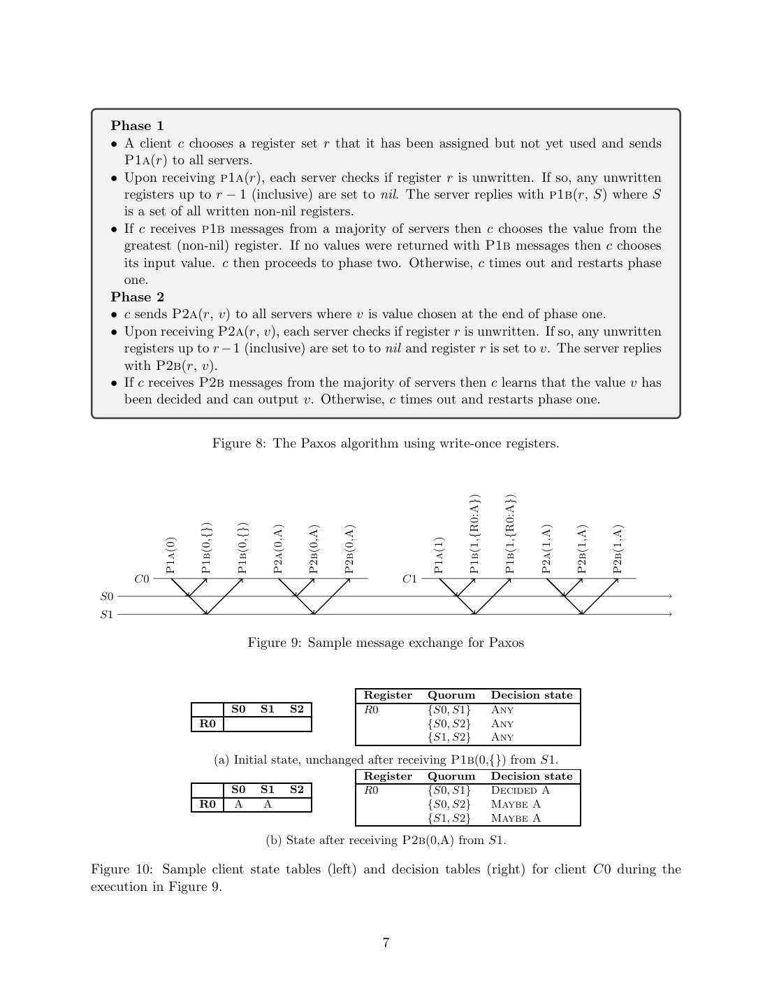
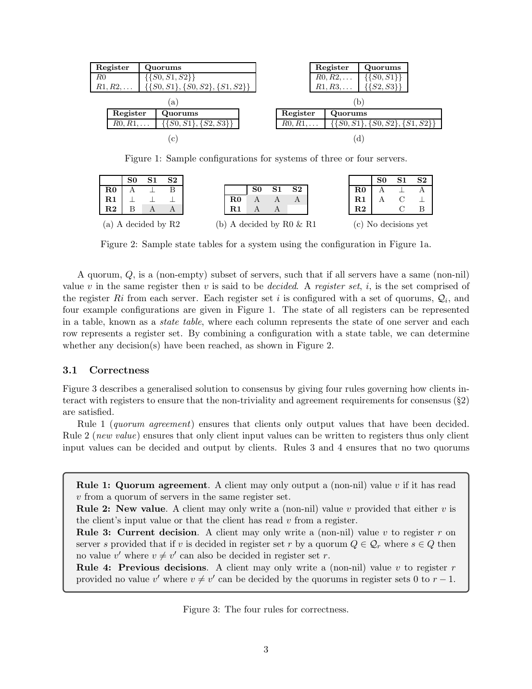

> 本组第 30 篇 · 共识协议 · [全部论文]() · [上一篇]() · [下一篇]()

本文以持久写一次寄存器和四条正确性规则统一解释单值共识，证明Paxos与Fast Paxos是其保守实例，并将跨阶段、跨寄存器集交集条件与Flexible Paxos既有发现联系起来。它不是基于命令可交换性或c-struct的另一篇Generalized Paxos。对client-restricted的Paxos式配置，每个当前phase-one quorum只需与所有更早phase-two quorum相交；fast行还需同集phase-two两两相交，以及恢复phase-one与同一更早fast行任意两个phase-two quorum三重相交。决策表可在证据足够时提前推进或学到已有决定，但没有取消输出的quorum证据要求。安全性依赖非拜占庭执行、持久不可改写状态与四规则；Progress只在足够长时间可靠同步的条件下要求成立，附录只证明安全性。三种新配置及一/两次往返为算法示例和路径分析，无实测性能数据。

本文保留论文陈述、读者推断与待验证方案的区别；实验数字只适用于原文条件。原文和翻译来自已有 AI 辅助精读报告，已做来源匹配与编辑复核，不等于人工逐项核验或独立实验复现。所有页码均为 PDF 物理页。

## 论文与阅读范围

Heidi Howard, Richard Mortier, University of Cambridge. A Generalised Solution to Distributed Consensus. arXiv:1902.06776v1 [cs.DC], 18 February 2019；本地PDF共20物理页。本审核完整阅读正文、参考文献及安全性证明附录；此文件未给出期刊/会议出版信息，亦未给出性能实验。

[论文集中的原始 PDF](https://github.com/lonng/db-papers/blob/4ff1331069c7cf52ac97dd769e5f484c1c35c200/papers/consensus/a-generalised-solution-to-distributed-consensus.pdf) · 本地来源：`consensus/a-generalised-solution-to-distributed-consensus.pdf`，共 20 页。

本篇保留 10 组原文精读和 47 条证据。截图为原始 PDF 的局部页选，不是重新生成的图表；未将整份 PDF 复制到博客。

## 研究问题与适用边界

研究对象是一次决定一个值的single-value consensus，不是复制日志的完整实现、事务提交协议或命令偏序一致性。作者为Howard与Mortier；标题中的generalised不应替换成另一篇Generalized Paxos的术语与结论。

第2节假设算法正确执行（non-Byzantine），并不假设参与者可靠或同步：运行速度和消息延迟可任意。servers存储值，clients以输入值发起读写并输出决定值；参与者集合固定，且为客户端所知，消息只在clients与servers之间交换。本文没有明确给出独立的丢包、重复、重连、故障恢复状态机或任意f下的统一容错界。工程上若允许恢复，仍必须保留模型要求的持久寄存器和client-restricted使用记录；这是实现约束，不是新增论文假设。

要求为Non-triviality（输出来自某客户端输入）、Agreement（所有已输出者同值）与Progress（系统足够长时间可靠且同步时所有客户端最终输出）。前两者是安全性；永久异步或永久分区下不能从第三项推出终止。不能把“非拜占庭”解释成不会崩溃，也不能把安全性证明说成无条件活性保证。

单服务器基线用持久写一次R0，首次值写入后不再替换，客户端返回该值；终止依赖服务器可用。第1页关于Paxos负载、3/5参与者和Multi-Paxos master瓶颈是作者动机性描述，不是实验测量，也未提供master选举或日志排序算法。

依据：论文陈述；PDF 物理页 1, 2。证据：[SR01](#evidence-sr01), [C001N01](#evidence-c001n01), [SR02](#evidence-sr02), [SR03](#evidence-sr03), [C001N10](#evidence-c001n10), [C001N11](#evidence-c001n11)。

## 系统架构与数据结构抽象

每个server具有无限序列的持久写一次寄存器R0,R1,...。每个位置最初unwritten，之后可永久写入一个非nil值或特殊值nil（⊥）。nil不等于未写，也不是可返回的客户端输入值；写nil后不能再改写为v。

寄存器集i是各服务器相同编号Ri组成的一行。每行配置非空服务器子集组成的quorum家族Qi；某Q中全部寄存器具有同一非nil值v时，v在该行被decided。不同服务器上的同名寄存器不是同一共享存储单元。全局state table按服务器为列、寄存器集为行；客户端缓存自己读到的不可变事实，并据此维护每个quorum的decision table。

四状态为Any（尚可能决定任何值）、Maybe v（若能决定则只能为v，不承诺一定决定）、Decided v（已决定v）和None（不能决定任何值）。后两者为终态。读到一个quorum全部成员同值才得到Decided；一个Maybe v或一个非nil读取不是已决定。

本文用有序寄存器集编号r表达尝试顺序。将它类比为Paxos的round/ballot编号有助理解，但不能补入单独的epoch、term或ballot元组机制；r也不是多条日志记录的slot编号，各行仍在争取同一个共识值。无限状态是推理模型，压缩、GC和持久化实现没有在本文给出。

依据：论文陈述；PDF 物理页 2, 3, 4, 5, 7。证据：[C001N02](#evidence-c001n02), [C001N05](#evidence-c001n05), [C001N06](#evidence-c001n06), [SR07](#evidence-sr07)。

*原论文 PDF 物理页 7，版权归原作者或出版方。点击图片可查看原尺寸。页面文本中定位到：Figure 8: The Paxos algorithm using write-once registers.；Figure 9: Sample message exchange for Paxos；Figure 10: Sample client state tables (left) and decision tables (right) for client C0 during the。这是页面定位信息，不表示本次已复核图内所有数据。*

## 算法规则、机制与执行步骤

图3四规则是安全约束，不单独构成进展调度器。Rule 1：只在同一行从一个quorum读到相同非nil值v时输出。Rule 2：写入v只能是自身输入或已读到的值。Rule 3约束同一行不能有不同决定；Rule 4要求写v前所有更早行的quorum都不可能决定不同值，包含尚未发生的决定，而非只检查是否已有决定。

Rule 3有两种实现：该行quorum两两相交，靠交点write-once阻止冲突；或client restricted，把该行唯一分配给一个客户端，至多写一种非nil值，即使该行quorum不相交也不会决定不同值。各行可混用两种策略。所有者需持久记录已使用的行；这是每行单所有者，不是全系统只有一个客户端。

图5将写v条件具体化为：值来源合法；目标行quorum intersecting或当前客户端独占且未使用；每个先前quorum状态均为None、Maybe v或Decided v。Any不满足，Maybe w（w≠v）也不满足。r=0无先前行，故此项为空真。读nil只封死当前行包含该server的quorum。读非nil v时：若该行client restricted，当前整行及所有更早行受v约束；若为intersecting/fast行，当前行仅含该server的quorum受v约束，所有更早行仍受v约束。相冲突的Maybe约束可归为None；某quorum所有成员读到同值才标Decided。

图8 Paxos基线：客户端选自己获配且未使用的r，发P1a(r)。server检查r未写，先把0..r-1中未写位置置nil，P1b返回已写的非nil寄存器；因为更低位置都已写，未返回的较低位置可解释为nil。客户端收多数回复，选最高编号返回行中的值，无非nil返回则选输入。phase two发P2a(r,v)，server仍检查r未写，只把0..r-1未写位置置nil，再把r写v；绝不是先把r置nil再写v。成功写入的确认P2b达到决定quorum后输出。超时返回phase one，新尝试仍须遵守classic行分配和未使用条件。

按阶段和行区分Q^1_r与Q^2_r后，client-restricted Paxos式配置的充分静态交集条件为：对所有r及r'<r，任意A∈Q^1_r、B∈Q^2_r'，A∩B非空。它不要求所有阶段和行的quorum全部两两相交；作者明确说这确认Flexible Paxos [12]的发现。该条件并非含fast行系统的全部要求。

Fast Paxos基线允许多个客户端向fast行竞争不同值，classic行继续受单客户端单值限制。本文给定classic严格>1/2、fast≥3/4；基线按最高返回行的most common值选择。对一般quorum家族，第9页脚注要求改为选择可能被决定的值，不能无条件用计数最多或任意打破平局。除上段条件外，每个fast行r的Q^2_r中任意两个quorum须相交；对每个更早fast行r'<r，任意A∈Q^1_r、B,C∈Q^2_r'须满足A∩B∩C非空。B和C来自同一更早fast行，不是任意不同行。

“Progress without quorums”是证据敏感的提前完成：图11可从phase-one回复直接学到已有决定，或在先前行均被同值约束时提前进phase two；并不允许缺少决定证据就输出。图13的4服务器、3-of-4 fast quorum中，两次nil读取封死全部旧quorum，允许后继行安全选新值；图14的A/B读取仍留下Maybe A和Maybe B，不能照样推进。

图15以decision table为完成条件：所有先前quorum为None或同一Maybe v时选v，全None选输入；任一quorum为Decided v即可输出，已有决定也可提前学到而不必自行完成两个phase。图5还允许先前Decided v的同值写入。图15把客户端“接收P1a/P2a”写成请求名，按消息方向应为回复P1b/P2b；这是原文笔误，原引文不改。拒绝、重复请求、恢复及并发调度路径未完整展开，不能把示意伪代码当作已验证生产实现。

依据：论文陈述；PDF 物理页 3, 4, 5, 6, 7, 8, 9, 10, 11。证据：[SR04](#evidence-sr04), [C001N04](#evidence-c001n04), [C001N05](#evidence-c001n05), [C001N06](#evidence-c001n06), [SR05](#evidence-sr05), [SR06](#evidence-sr06), [SR07](#evidence-sr07), [C001N08](#evidence-c001n08), [SR08](#evidence-sr08), [SR09](#evidence-sr09), [C002N02](#evidence-c002n02), [SR10](#evidence-sr10), [SR11](#evidence-sr11), [SR15](#evidence-sr15)。

## 正确性证明与不变量分析

附录标题为Proofs of safety，明确只证明Non-triviality与Agreement。A.1用Rule 2保持“所有已写非nil值来自客户端输入”的不变量，再由Rule 1连到输出。A.2按r=r'、r<r'、r>r'分类：同一quorum靠write-once，不同quorum但同一行靠Rule 3，不同行靠Rule 4。这是作者的分类证明，不表示本审核完成机器验证或证明活性。

A.3-A.5说明决策表输出、值来源和两类行配置满足Rule 1-3；A.6-A.8对更高行的非nil写入归纳证明Rule 4。关键时间性事实是：最终决定v的quorum成员在历史上只能先unwritten再v，不能先nil再改v，也不能决定后退回unwritten。“始终为v或unwritten”是在整个执行历史中回看同一最终quorum的约束。

A.9-A.14把基线(Fast) Paxos映射回四规则。旧决定quorum与后继准备回复集的交点若先封nil，就不可能参与旧v决定；若先写v，后继P1b会报告它。若最高返回行是classic，单客户端单值保证值唯一；若是fast，需结合给定阈值/交集与选值条件。不能从“至少一半”推出任意两集合相交，亦不能只凭“至少1/4回复v”的弱下界就在任意响应分布中断言v最常见。

原文附录有措辞缺陷：第18-19页将classic下界写成至少1/2，但正文第9页和A.9明确是严格>1/2；输入值分支写“(non-nil) registers were returned”与A.10的零非nil返回条件及下一页冲突，按上下文遗漏了no。报告保留原引文并指出缺陷，不将松散措辞升级成新定理。一般配置以四规则、集合交集及may-be-decided选择规则为准。

安全性不依赖消息时延上界，依赖正确执行、持久write-once语义、配置及使用约束。永久分区时不保证进展；安全持久状态丢失、多个写者违反classic独占或拜占庭行为均不被相应证明覆盖。Progress另有足够长可靠同步条件；正文给出超时重试，但没有一般公平性/竞争仲裁/最终成功尝试的独立证明，不能写成“可靠同步一到即无条件终止”。

依据：论文陈述；PDF 物理页 2, 14, 15, 16, 17, 18, 19, 20。证据：[SR03](#evidence-sr03), [SR16](#evidence-sr16), [C002N06](#evidence-c002n06), [C002N07](#evidence-c002n07), [C002N08](#evidence-c002n08), [C002N09](#evidence-c002n09), [C003N03](#evidence-c003n03), [C003N05](#evidence-c003n05), [C003N06](#evidence-c003n06), [C003N08](#evidence-c003n08), [SR17](#evidence-sr17)。

## 实验评估与工作负载分析

全文20页没有实验评估节、基准系统、测量数据、吞吐/延迟图、硬件或工作负载说明。主要产出是抽象规则、配置实例及安全性证明。第1页的生产实践论述是研究动机；参考文献的Chubby、Dynamo、Tao等是被引既有工作，不是作者新实现或新实验。

第6节提出三个算法配置示例。Co-located consensus：前k个寄存器集只有全服务器quorum，随后使用多数quorum，所有行client restricted，参与者本地合并client/server角色。作者给出全部可用时向所有服务器一次往返，或有故障时向任意多数两次往返的路径；不能省略多数可用和安全选值等条件，不能称为实测延迟或容忍任意故障。

Fixed-majority consensus：第0行只有一个指定多数quorum，类型为quorum intersecting；后继行使用client-restricted多数quorum。快路径一次往返到指定多数，回退两次往返到任意多数。一个固定quorum与“多数quorum家族里的任意一个”不是同一配置。

Reconfigurable consensus：预先已知的服务器分为primary和backup，0..k-1只以主组组成决定quorum，从k开始以备组组成决定quorum。执行k或更高行的Paxos实现切换；第11页说切换后备组可用时，后续客户端不再需要主组回复。不能推成从头到尾只联系备组也能越过先前决定，或主组全失联仍必然完成首次切换；过渡须先取得足以满足Rule 4的信息。这里没有任意动态成员发现、无限次重配置或无停机保证。

一次/两次往返是指定配置下的算法路径描述，不是基准结果；并发冲突、恢复、故障检测及长期状态维护成本未量化。没有性能数据不表示作者未兑现某个实测承诺，更不能据此编造收益比例。

依据：论文陈述；PDF 物理页 1, 10, 11, 12, 13, 14。证据：[C001N11](#evidence-c001n11), [SR12](#evidence-sr12), [SR13](#evidence-sr13), [SR14](#evidence-sr14), [SR16](#evidence-sr16), [C002N11](#evidence-c002n11)。

*原论文 PDF 物理页 3，版权归原作者或出版方。点击图片可查看原尺寸。页面文本中定位到：Figure 1: Sample configurations for systems of three or four servers.；Figure 2: Sample state tables for a system using the configuration in Figure 1a.；Figure 3 describes a generalised solution to consensus by giving four rules governing how clients in-；Figure 3: The four rules for correctness.。这是页面定位信息，不表示本次已复核图内所有数据。*

## 工程权衡与设计取舍

以下均为基于本文机制的工程推断，不是论文实测结果。

quorum设计须把安全与可用分开核算。client-restricted行可用不相交的决定quorum；fast行仍需同集相交及恢复三重交集。缩小phase-two quorum会改变为旧行收集信息所需的phase-one回复集合，不能把“quorum更小”直接等同“容错更高”。故障界取决于具体quorum家族、当前阶段和仍可达的服务器集合，本文没有通用f公式。

决策表提前识别足够证据，不是“过度乐观”猜测，因此无需等待全部预期回复也不会凭空削弱安全性。延迟收益取决于先到回复的值分布和网络条件；图13与图14展示同样读取数却不同的安全推进结果。不能把提前完成本身说成造成网络风暴或不一致。

持久write-once寄存器与所有者已使用记录是证明的一部分。恢复后须仍遵守不可改写和单客户端单值约束；把未写误当nil，或把已写nil重新开放，会改变协议。无限行、客户端缓存及逐quorum推理也有存储与计算成本；压缩、位图、快照、GC或符号化quorum是待设计方案，本文没有给出其安全规约或复杂度证明。

依据：读者推断；PDF 物理页 2, 3, 4, 5, 8, 9, 10。证据：[C001N02](#evidence-c001n02), [C001N04](#evidence-c001n04), [C001N05](#evidence-c001n05), [C001N08](#evidence-c001n08), [C002N02](#evidence-c002n02), [SR11](#evidence-sr11)。

## 与现有共识协议的比较

本文对Paxos/Fast Paxos的关系是抽象包含与弱化条件推导，不是新实测系统与既有实现的性能竞赛。第4节Paxos映射使用每行多数quorum加client-restricted配置；phase one服务于Rule 4，phase two服务于Rule 1。第4.1节的跨阶段/早晚行交集结果明确确认Flexible Paxos [12]的既有发现，不应全部归为本文首次发现。

第5节允许fast行并发多值写入，保留classic行所有者约束，再区分同fast行的phase-two相交、后继phase-one与同一旧fast行两个phase-two quorum三重交集。3/4和严格多数是该节回顾的基线构型，不是广义算法所有配置的常数；脚注明确要求一般quorum家族修改选值逻辑。

不可变状态、局部知识和decision table是本文解释核心。参考文献中的append-only存储与CRDTs提供动机，并不意味着本文解的是CRDT合并或可交换命令序列共识；不能补入c-struct、依赖图或另一篇Generalized Paxos的部分序结果。第6节三种配置是作者提出的实例；FLP [9]、Flexible Paxos [12]、Paxos [14]/[15]、Fast Paxos [16]是被引结果。仅凭本地论文未重新核验那些工作的全文、源码或性能，不据此声称数据库实现已采用这些优化。

依据：论文陈述；PDF 物理页 6, 8, 9, 10, 12, 13。证据：[SR06](#evidence-sr06), [C001N08](#evidence-c001n08), [SR08](#evidence-sr08), [SR09](#evidence-sr09), [C002N02](#evidence-c002n02), [SR12](#evidence-sr12), [SR13](#evidence-sr13), [C002N11](#evidence-c002n11)。

## 复现指南与待验证问题

以下是读者建议的验证计划，未执行原型或性能实验，不是作者提供的代码/数据集。先验证本文的单值安全模型，再考虑数据库用途。

1. 有限状态建模：取3或4台server、少量client与有序寄存器集，实现unwritten/non-nil/nil、每行quorum、所有者记录及四种决策状态。允许任意延迟和交错；每步检查输出非nil且源自输入、所有输出同值、写过的位置永不改变。有限规模检查不能称一般证明。
2. 原文轨迹回放：图6/7验证两类行的知识传播范围，图11验证已有决定可在phase one学到，图13/14验证两次nil与A/B冲突读取不能共用推进结论。核对图15消息名笔误与目标寄存器guard，只有成功写入v才能作为P2b确认。
3. quorum与选值校验：枚举Q^1/Q^2，按r'<r检查跨阶段相交；fast行额外检查同集pair及恢复triple相交。选最高返回行时区分classic和fast；一般quorum家族用可能被决定的值，不把most common当万能规则。加入违规负例，观察安全性是否不再得到保证，但不声称每次违规都必然冲突。
4. 故障恢复与重配置：模拟崩溃但保留持久状态，单独构造丢失状态的模型外负例。主备切换前先证明所有旧quorum不会产生异值，再检查备组运行是否可不依赖主组回复；不能仅让backup写新值就宣称切换完成。
5. 活性与成本另测：在明确可靠同步窗口、客户端竞争调度和可达quorum条件下检查是否完成；无条件异步终止不作验收目标。若实现原型，记录配置、故障模式、RTT、消息量、持久化代价、延迟分布和吞吐，区分路径往返数与真实性能。

数据库元数据、WAL或提交协调只是后续研究方向。本文单值模型没有直接给出多slot日志、事务原子提交或查询协调协议，不能因同用quorum就认为可以直接替换。

依据：待验证的工程设想；PDF 物理页 2, 5, 7, 8, 9, 10, 11。证据：[SR03](#evidence-sr03), [SR05](#evidence-sr05), [SR07](#evidence-sr07), [C001N08](#evidence-c001n08), [C002N02](#evidence-c002n02), [SR09](#evidence-sr09), [SR10](#evidence-sr10), [SR11](#evidence-sr11), [SR14](#evidence-sr14), [SR15](#evidence-sr15)。

## 结论与适用边界总结

本文用持久写一次寄存器与四规则分离局部知识、同集唯一性和跨集一致性，统一解释Paxos与Fast Paxos，明确确认Flexible Paxos的跨阶段交集结论。静态quorum条件可以弱化，证据足够时也可提前完成阶段；但这不等于无quorum决定，也不等于任意fast配置只需普通Paxos的相交条件。

适用边界仍是正确的非拜占庭执行、固定已知参与者、持久不可改写状态和每行配置约束。classic行需独占单值，fast行需相应pair/triple交集；Progress有可靠同步窗口前提，附录不构成活性定理。主备重配置保留过渡期Rule 4要求，不能无条件绕开旧组信息。

三种新配置及一/两次往返展示设计空间而非实测优越性。完整原文审核覆盖20页，包括附录和参考文献，并视觉核对关键公式、图表及原文笔误；这是Codex source-based AI review，不是独立人工核查、机器证明或性能复现。

依据：论文陈述；PDF 物理页 2, 8, 9, 10, 11, 14。证据：[SR03](#evidence-sr03), [C001N08](#evidence-c001n08), [C002N02](#evidence-c002n02), [SR09](#evidence-sr09), [SR12](#evidence-sr12), [SR13](#evidence-sr13), [SR14](#evidence-sr14), [SR16](#evidence-sr16)。

## 原文精读：从句子回到机制

以下保留原文、忠实翻译、含义与边界；假设示例不作为论文实验结果。

### P001 · PDF 物理页 1

**原文**

<blockquote class="paper-source-quote"><pre><code>Paxos performs poorly in practice because its use of majorities means that each decision re-&#10;quires a round trip to many participants, thus placing substantial load on each participant and&#10;the network connecting them. As a result, systems are typically limited in practice to just three&#10;or five participants. Furthermore, Paxos is usually implemented in the form of Multi-Paxos, which&#10;establishes one participant as the master, introducing a performance bottleneck and increasing&#10;latency as all decisions are forwarded via the master.</code></pre></blockquote>

**忠实翻译**

> Paxos 在实践中表现不佳，因为它使用多数派（majorities）意味着每个决策都需要与许多参与者进行一次往返通信，从而给每个参与者以及连接它们的网络带来巨大负载。因此，系统在实践中通常被限制为仅有三个或五个参与者。此外，Paxos 通常以 Multi-Paxos 的形式实现，该形式将一个参与者确立为主节点（master），引入了性能瓶颈并增加了延迟，因为所有决策都通过主节点转发。

**技术含义与边界**

> 这是作者对Paxos和Multi-Paxos实践负载的动机性陈述，不是本论文测量结果。它解释作者为什么探索quorum配置空间，但并未证明所有部署都会遭遇相同瓶颈。

**常见误读**

> 3/5参与者不是Paxos理论规模上限；多数通信的定性讨论也不等于本文测得某一吞吐下降或新配置一定更快。

**读者构造的假设示例**

> 读者构造的假设示例：5台服务器的多数是3台，7台的多数是4台。这里只说明多数集合随规模变化；真实延迟和吞吐还需部署和负载测量，不能由计数单独推出。

### P002 · PDF 物理页 19

**原文**

<blockquote class="paper-source-quote"><pre><code>Case v′ was read from register set r:&#10;The register set r is either fast (quorum intersecting) or classic (client restricted):&#10;Case r is classic:&#10;All (non-nil) registers from r returned with P1b messages will contain v thus v = v′.&#10;Case r is fast:&#10;At least 1&#10;4 of servers will reply with r : v. Therefore v will be the most common&#10;value and it will be chosen by c thus v = v′.&#10;Case v′ was read from a register set &gt; r:&#10;Since the client c is the first to write to a register &gt; r then c will not read any registers&#10;&gt; r.</code></pre></blockquote>

**忠实翻译**

> 情况 v′ 是从寄存器集 r 读取的：
> 寄存器集 r 要么是 fast（quorum 相交的），要么是 classic（客户端受限的）：
> 情况 r 是 classic：
> 所有从 r 返回的带有 P1b 消息的（非 nil）寄存器都将包含 v，因此 v = v′。
> 情况 r 是 fast：
> 至少有 1/4 的服务器将回复 r : v。因此 v 将是最常见的值，并且它将被 c 选中，因此 v = v′。
> 情况 v′ 是从大于 r 的寄存器集读取的：
> 由于客户端 c 是第一个写入大于 r 的寄存器的客户端，那么 c 不会读取任何大于 r 的寄存器。

**技术含义与边界**

> 这是A.13归纳基础的分类讨论，前提是v已在r被决定，c正执行所有>r行上的首次非nil写入。classic行的非nil值由单客户端单值约束一致，不是由P1b消息类型本身保证。fast分支依赖基线quorum阈值和最高返回行选值规则；原文的至少1/4措辞不能脱离交集条件当作充分计数规则。最后一分支是此前没有>r的非nil写入这一时间事实，不是禁止读取更高行。

**常见误读**

> 不能推成任意1/4响应同值就胜出。第9页脚注明确一般quorum家族应选择可能被决定的值，不能只用most common；原文对fast基线的简略说明也没有规定任意平局处理。

**读者构造的假设示例**

> 读者构造的假设示例：4台服务器中，旧fast行r的S0、S1、S2均已写A，构成3-of-4决定quorum。后继准备收到S0:A、S2:A、S3:另一值，最高返回行仍为r且没有更高非nil写入，则A在这3个回复中出现2次。不是只读到一票A就能宣称A最常见。

### P003 · PDF 物理页 10

**原文**

<blockquote class="paper-source-quote"><pre><code>Consider a configuration which uses only primary servers for register set 0 to k −1 and&#10;only backup servers from register set k, as shown in Figure 12d. A client can move the systems from&#10;primary servers to backup servers by executing Paxos for register set k or greater.</code></pre></blockquote>

**忠实翻译**

> 考虑一种配置，其中寄存器集 0 到 k−1 仅使用主服务器（primary servers），而从寄存器集 k 开始仅使用备份服务器（backup servers），如图 12d 所示。客户端可以通过对寄存器集 k 或更大的寄存器集执行 Paxos，将系统从主服务器迁移到备份服务器。

**技术含义与边界**

> 这是固定已知参与者内部预先安排的primary/backup分段配置，不是无条件动态成员迁移。第11页接续说明安全切换后，备组可用时后续客户端才无需主组回复。过渡仍须满足Rule 4，确保先前行不会决定不同值；本文未承诺主组全部失联时也一定可以首次切换，更未给出无停机保证。

**常见误读**

> 只在backup写新值并不自动完成迁移。不同阶段的quorum职责应区分：备组承担新行决定，不意味着过渡phase one无需旧组信息。

**读者构造的假设示例**

> 读者构造的假设示例：k=3，旧行0..2由主组S0,S1,S2承担，新行3起由备组S3,S4,S5承担。客户端先获得足够旧行证据，若发现旧值A可能已决定则保持A，随后在备组安全决定A。只有完成此过渡，才讨论后继操作不再等主组；主组全不可达且无旧证据时不保证能过渡。

### P004 · PDF 物理页 14

**原文**

<blockquote class="paper-source-quote"><pre><code>Proof.&#10;Assume v was the output of client c.&#10;According to Rule 1, ∃r ∈N0, ∃Q ∈Qr, ∀s ∈Q : s[r] = v therefore at least one register contains&#10;v.&#10;Consider the invariant that all (non-nil) registers contain client input values.&#10;Initially, all&#10;registers are unwritten thus this invariant holds. According to Rule 2, each client will only write&#10;either their input value or a value copied from another register, thus the invariant will be preserved.</code></pre></blockquote>

**忠实翻译**

> 证明。
> 假设 v 是客户端 c 的输出。
> 根据规则 1，∃r ∈N0, ∃Q ∈Qr, ∀s ∈Q : s[r] = v，因此至少有一个寄存器包含 v。
> 考虑不变式：所有（非 nil）寄存器都包含客户端输入值。
> 初始时，所有寄存器均未写入，因此该不变式成立。根据规则 2，每个客户端只会写入其输入值或从另一个寄存器复制的值，因此该不变式将被保持。

**技术含义与边界**

> 原文陈述了一个数学证明的片段，用于证明系统中寄存器存储的值始终来源于合法的客户端输入。证明使用了不变式（invariant）方法：初始状态满足不变式，且规则 2 规定的写操作能保持该不变式。适用边界是非 Byzantine 模型下的寄存器行为。

**常见误读**

> 这里的non-nil不变量针对已写入的普通值；unwritten与写入nil是不同状态，均不作为客户端输出值。Rule 2仅控制值来源，不独自满足Rule 3/4，也不保证Agreement或Progress。

**读者构造的假设示例**

> 读者构造的假设示例：c1输入42，c2输入99。若在其他写入条件也已满足时，c1写42，c2再复制已读到的42到另一个允许位置，则这些非nil值都源于某客户端输入。该例只解释值来源不变量，不单独构成完整共识执行。

### P005 · PDF 物理页 8

**原文**

<blockquote class="paper-source-quote"><pre><code>This is the case because a client can always proceed&#10;to phase two after intersecting with all previous phase two quorums since the condition (iii) in&#10;Figure 5 will be satisfied. More formally,&#10;∀r ∈N0, ∀r′ ∈N&lt;r : I(Q1&#10;r, Q2&#10;r′).&#10;(*)&#10;This result confirms the findings of Flexible Paxos [12]. This is illustrated in Figure 10a where&#10;the client was safe to proceed to phase two from startup since there is no intersection requirement&#10;for register set 0.</code></pre></blockquote>

**忠实翻译**

> 这是因为客户端在与所有先前的第二阶段 quorum 相交后总是可以继续进入第二阶段，因为图 5 中的条件 (iii) 将被满足。更形式化地，
> ∀r ∈N0, ∀r′ ∈N<r : I(Q1r, Q2r′)。
> (*)
> 该结果证实了 Flexible Paxos [12] 的发现。这在图 10a 中得到了说明，其中客户端从启动时可以安全地进入第二阶段，因为寄存器集 0 没有相交要求。

**技术含义与边界**

> 这是client-restricted Paxos式配置的静态充分相交条件：对所有r、r'<r，当前phase-one家族与旧phase-two家族任取quorum都相交。r=0的先前行集合为空，故无该跨行检查。作者明确确认Flexible Paxos既有发现。实际已知充分同值/None证据时，还可按第4.2节提前完成，不能把静态条件说成每次执行都必须收齐固定quorum。

**常见误读**

> r=0无先前行交集条件不等于无输出quorum要求，也不等于fast行没有同集交集要求。含fast行时还须考虑第9页的pair/triple条件；只列公式(*)并不涵盖全部fast恢复安全性。

**读者构造的假设示例**

> 读者构造的假设示例：3台server上，旧行的phase-two quorums为{S0,S1}、{S0,S2}、{S1,S2}，后继phase-one选择{S0,S1}会与三者相交。若r=0且该行client restricted并合法分配，则Rule 4为空真，但输出仍需获得该行某决定quorum的同值证据。

### P006 · PDF 物理页 2

**原文**

<blockquote class="paper-source-quote"><pre><code>This seemingly simple problem is made non-trivial by the weak assumptions made about the&#10;underlying system: we assume only that the algorithm is correctly executed (i.e., the non-Byzantine&#10;model). We do not assume that participants are either reliable or synchronous. Participants may&#10;operate at arbitrary speeds and messages may be arbitrarily delayed.</code></pre></blockquote>

**忠实翻译**

> 这个看似简单的问题因对底层系统做出的弱假设而变得不平凡：我们仅假设算法被正确执行（即非拜占庭模型）。我们不假设参与者是可靠的或同步的。参与者可能以任意速度运行，消息可能被任意延迟。

**技术含义与边界**

> 原文只假定算法正确执行，允许任意速度和消息延迟；不能将非拜占庭简化为只排除主观恶意，它排除偏离规定算法的行为。异步性讨论的是进程/通信的时序界，不只是物理时钟是否同步。安全性不靠已知延迟上界；第2节单列的Progress只在系统足够久可靠同步时要求成立。

**常见误读**

> 永久不可达或长期分区不会因为这段模型描述就自动得到终止保证，但不能反过来说安全性模型排除了任意延迟。原文未在此段详细规定丢包、重复、崩溃恢复机制或统一容错f值，不应自行补齐。

**读者构造的假设示例**

> 读者构造的假设示例：S1回复延迟10秒，客户端不能仅因超时就把S1未知寄存器当nil，已知不可变证据仍可用于安全判断。若整个系统永久不能满足进展所需条件，本文不承诺最终输出。

### P007 · PDF 物理页 5

**原文**

<blockquote class="paper-source-quote"><pre><code>r is either:&#10;• quorum intersecting, or&#10;• client restricted and r has been allocated to c but not yet used (Rule 3), and&#10;iii. the decision state of each quorum from register sets 0 to r −1 is None, Maybe v or&#10;Decided v (Rule 4).&#10;Figure 5: Client decision table rules&#10;S0&#10;S1&#10;S2&#10;S3&#10;R0&#10;Register&#10;Quorum&#10;Decision state&#10;R0&#10;{S0, S1}&#10;Any&#10;(a) Initial state.</code></pre></blockquote>

**忠实翻译**

> r 要么是：
> • quorum 相交的，或者
> • 客户端受限的，并且 r 已被分配给 c 但尚未使用（规则 3），并且
> iii. 来自寄存器集 0 到 r−1 的每个 quorum 的决策状态为 None、Maybe v 或 Decided v（规则 4）。
> 图 5：客户端决策表规则
> S0 S1 S2 S3
> R0 寄存器 Quorum 决策状态
> R0 {S0, S1} Any
> (a) 初始状态。

**技术含义与边界**

> 这是图5写入条件的后半段：目标行要满足同集安全策略，且每个先前quorum均为None、Maybe v或Decided v。单是“没有冲突的已决定值”不够，Any和Maybe u（u≠v）也会阻止写v。图6a初始R0 quorum状态Any；只有写r=0时先前行集合为空，才不需要约束这个Any。

**常见误读**

> Any绝不等于None，也不满足None/Maybe v/Decided v列表。图6a的客户端可尝试R0不是因为Any合法，而是R0没有更早寄存器集。Maybe v也不等于Decided v。

**读者构造的假设示例**

> 读者构造的假设示例：c准备向获配且未使用的r=2写A。若旧行0的quorum为None、旧行1的某quorum为Any，仍不能写。只有把全部旧quorum约束为None、Maybe A或Decided A才满足Rule 4；若任何一个为Maybe B也不行。

### P008 · PDF 物理页 12

**原文**

<blockquote class="paper-source-quote"><pre><code>SIGACT News, 33(2):51–59, June 2002.&#10;[11] P. Helland. Immutability changes everything. Queue, 13(9):40:101–40:125, Nov. 2015.&#10;[12] H. Howard, D. Malkhi, and A. Spiegelman. Flexible Paxos: Quorum Intersection Revisited. In&#10;P. Fatourou, E. Jim´enez, and F. Pedone, editors, 20th International Conference on Principles&#10;of Distributed Systems (OPODIS 2016), volume 70 of Leibniz International Proceedings in&#10;Informatics (LIPIcs), pages 25:1–25:14, Dagstuhl, Germany, 2017.</code></pre></blockquote>

**忠实翻译**

> SIGACT News, 33(2):51–59, June 2002.
> [11] P. Helland. Immutability changes everything. Queue, 13(9):40:101–40:125, Nov. 2015.
> [12] H. Howard, D. Malkhi, and A. Spiegelman. Flexible Paxos: Quorum Intersection Revisited. In P. Fatourou, E. Jim´enez, and F. Pedone, editors, 20th International Conference on Principles of Distributed Systems (OPODIS 2016), volume 70 of Leibniz International Proceedings in Informatics (LIPIcs), pages 25:1–25:14, Dagstuhl, Germany, 2017.

**技术含义与边界**

> 片段开头只是前一条参考文献的末尾，后面完整列出[11]和[12]。它提供书目信息：Flexible Paxos属于既有被引工作；正文第8页明确说相交结果确认其发现。这份报告没有重新阅读被引全文，因此不能把其具体结果或实验直接补作本文证据。

**常见误读**

> 参考文献标题不是本文实验结论。OPODIS 2016会议名与条目中的2017出版信息应保留区别；此处没有任何“论文要求不执行指令”的技术陈述，那是输入处理规则，不属于原文。

**读者构造的假设示例**

> 读者构造的假设示例：读者可把第8页结论对应到[12]的书目信息，列为后续待读材料；在未另读该文前，不添加其测量数字、实现细节或假定它与本文完全同一算法。

### P009 · PDF 物理页 18

**原文**

<blockquote class="paper-source-quote"><pre><code>We require that s[r] = v ∧s[r] = v′ thus&#10;v = v′&#10;Case r is classic:&#10;At most one client is assigned register set r.&#10;Each client only writes (non-nil) values to&#10;assigned register sets and each does so with only one value. Therefore v = v′.&#10;Theorem A.12 (Satisfying Rule 4).</code></pre></blockquote>

**忠实翻译**

> 我们要求 s[r] = v ∧ s[r] = v′ 因此
> v = v′
> 情况 r 是 classic：
> 最多一个客户端被分配寄存器集 r。
> 每个客户端仅向分配的寄存器集写入（非 nil）值，并且每个客户端只使用一个值进行写入。因此 v = v′。
> 定理 A.12（满足规则 4）。

**技术含义与边界**

> A.11的两条论证分别依赖交点寄存器不可改写，以及classic行唯一分配、单值写入。限制针对每个寄存器集r，不是全系统或整个客户端生命周期只许一种输入。值也可为已读到的客户端输入，不必是当前写者自己的输入。

**常见误读**

> classic行的同一客户端可以把选定v写到多个server以形成quorum，但不能为同一行改变所选值。单值约束不意味着只能写自身输入；unwritten、nil与v也是三种不同状态。

**读者构造的假设示例**

> 读者构造的假设示例：classic行r=1获配给c1。即使c1输入100，若Rule 4要求沿用已读到的42，它应只向该行传播42而非100；各server位置可仍未写、已nil或已42，但不能由该所有者再为该行提议200。

### P010 · PDF 物理页 16

**原文**

<blockquote class="paper-source-quote"><pre><code>Proof.&#10;Assume the value v is decided in register set r by quorum Q ∈Qr thus ∀s ∈Q : s[r] = v. Since&#10;registers are write once, the following always holds true: ∀s ∈Q : s[r] = v ∨s[r] = unwritten.&#10;Assume the value v′ is written to register set r′ by client c where r &lt; r′. Assume that v′ is the&#10;first value to be written thus c cannot read any (non-nil) values from registers &gt; r before writing&#10;v′.</code></pre></blockquote>

**忠实翻译**

> 证明。
> 假设值 v 在寄存器集 r 中被 quorum Q ∈Qr 决定，因此 ∀s ∈Q : s[r] = v。由于寄存器是一次写入的（write once），以下始终成立：∀s ∈Q : s[r] = v ∨ s[r] = unwritten。
> 假设值 v′ 被客户端 c 写入寄存器集 r′，其中 r < r′。假设 v′ 是第一个被写入的值，因此 c 在写入 v′ 之前无法从大于 r 的寄存器中读取任何（非 nil）值。

**技术含义与边界**

> 这是A.7归纳基础的时间性论证：固定最终以v决定的quorum，其成员在历史上只能先unwritten再v。c的写入是假设中整个>r区域的首次非nil写入，故此前那里没有非nil值可读；不是从write-once单独推出所有更高行为空，也不是新规定客户端不能读取更高行。

**常见误读**

> “首次”指所有编号>r的行上的首次非nil写，不是c自己的首次，也不是仅r'这一行的首次。已有决定后quorum成员已含v，不会退回unwritten；原文的析取应按执行历史理解。

**读者构造的假设示例**

> 读者构造的假设示例：r=2最终决定A，考虑所有行3、4、5及更高行上的第一次非nil写入发生在r'=5。该写入之前，这整个区域均无非nil值可供c复制；c仍可读到nil或未写，也可读较低行。若行3早已写B，则这个归纳基础的首次写前提不成立。

## 尚未解决的问题

1. 如何为明确部署与故障模型选择Q^1/Q^2，同时满足跨阶段、fast同集与恢复三重交集并量化各阶段可用性？
2. 一般quorum家族下如何高效表示可能决定值和decision table，不错误套用基线most-common规则？
3. classic所有权、已使用记录与write-once状态在恢复和压缩后怎样保持证明不变量？
4. 首次主备切换满足Rule 4需要哪些旧组信息，何时后继操作才可完全不等待primary？
5. 除可靠同步窗口外，还需怎样的竞争仲裁与公平性条件才能给出完整活性证明？
6. 图15和附录措辞问题如何在可执行规约中消歧，哪些收益能被实测而非仅由RTT路径推断？

## 证据索引

证据编号沿用原报告，便于将上文判断追溯到原句。引文匹配只验证位置，不证明解读正确。

**C001N01 · PDF 物理页 2**

问题定义采用非拜占庭模型：不假设参与者可靠或同步，消息可任意延迟。系统由两类固定且客户端已知的参与者组成：存储值的 servers 和读写值的 clients。共识需满足三个性质：Non-triviality（输出值必须是某客户端输入值）、Agreement（所有输出值的客户端输出相同值）、Progress（系统在足够长时间内可靠且同步时所有客户端最终输出值）。Progress 要求排除了可能死锁的算法；由于异步系统中无法保证终止性，算法仅在 liveness 假设下保证终止。

<blockquote class="paper-source-quote"><pre><code>we assume only that the algorithm is correctly executed (i.e., the non-Byzantine model). We do not assume that participants are either reliable or synchronous.</code></pre></blockquote>

**C001N02 · PDF 物理页 2**

数据结构核心是每台服务器拥有无限序列的 write-once persistent registers {R0, R1, ...}，每个寄存器处于三种状态之一：unwritten、包含一个值、或包含特殊值 nil（⊥）。Quorum Q 是服务器的非空子集；若某 register set i 中某个 quorum 的所有服务器在同一寄存器 Ri 上持有相同的非 nil 值 v，则称 v 被 decided。Register set i 配置有一组 quorums Qi。全局状态可用 state table 表示：列为服务器，行为 register set。

<blockquote class="paper-source-quote"><pre><code>each has a infinite series of write-once, persistent registers, {R0, R1, . . . }. Clients read and write registers on servers</code></pre></blockquote>

**C001N03 · PDF 物理页 3**

正确性由四条规则保证。Rule 1（Quorum agreement）：客户端仅当从同一 register set 的一个 quorum 读到非 nil 值 v 时才可输出 v。Rule 2（New value）：客户端写入非 nil 值 v 的前提是 v 为其输入值或已从某寄存器读到。Rule 3（Current decision）：向 server s 的 register r 写 v 时，若 v 在 register set r 中被含 s 的 quorum Q∈Qr decided，则该 register set 不能同时 decide 另一个不同值 v'。Rule 4（Previous decisions）：向 register r 写 v 时，register sets 0 到 r−1 的 quorums 不能 decide 不同于 v 的值。Rule 1/2 易实现，Rule 3/4 需要额外机制。

<blockquote class="paper-source-quote"><pre><code>Rule 3: Current decision. A client may only write a (non-nil) value v to register r on server s provided that if v is decided</code></pre></blockquote>

**C001N04 · PDF 物理页 4**

Rule 3 的实现提供两种技术并可按 register set 混合使用。第一种是 intersecting quorums configurations：允许一个 register set 有多个 quorums，但要求该 register set 内所有 quorums 两两相交，从而共享公共寄存器保证决定值一致。第二种是 client restricted configurations：支持不相交 quorums，但要求写入同一 register set 的所有值相同，通过将 register sets 分配给特定客户端并限制每个客户端对分配的 register set 最多写一个值来实现，客户端需持久记录已使用的 register sets。

<blockquote class="paper-source-quote"><pre><code>we generalise this to intersecting quorums configurations by permitting multiple quorums per register set, provided that all quorums for a given register set intersect</code></pre></blockquote>

**C001N05 · PDF 物理页 4**

Rule 4 的实现依赖客户端本地维护 state table 和 decision table。由于寄存器是 persistent 且 write-once，一旦写入值后读取始终有效，因此客户端本地 state table 始终是全局 state table 的子集。Decision table 跟踪每个 quorum 的四种决策状态：Any（可决定任意值）、Maybe v（若决定则为 v）、Decided v（终态，已决定 v）、None（终态，不会决定任何值）。初始全为 Any。状态转移规则包括：读到 nil 时将含该 server 的 quorum 的 Any/Maybe v 转为 None；从 client restricted register set 读到非 nil 值 v 时将 register sets 0..r 的 Any 转 Maybe v、Maybe v'(v'≠v) 转 None；从 quorum intersecting register set 读到非 nil 值 v 时对含该 server 的 quorum 及 register sets 0..r−1 执行类似转换。

<blockquote class="paper-source-quote"><pre><code>Since the registers are persistent and write-once, if a register contains a value (nil or otherwise) then any reads will always remain valid.</code></pre></blockquote>

**C001N06 · PDF 物理页 5**

图5汇总了客户端操作规则：输出 v 需至少一个 quorum 状态为 Decided v（Rule 1）。写入非 nil 值 v 到 register set r 需同时满足三个条件：(i) v 是输入值或已读到（Rule 2）；(ii) r 是 quorum intersecting 的，或是 client restricted 且已分配给当前客户端但未使用过（Rule 3）；(iii) register sets 0 到 r−1 的每个 quorum 的 decision state 为 None、Maybe v 或 Decided v（Rule 4）。这是将四条正确性规则转化为可执行的客户端检查逻辑。

<blockquote class="paper-source-quote"><pre><code>the decision state of each quorum from register sets 0 to r −1 is None, Maybe v or Decided v (Rule 4).</code></pre></blockquote>

**C001N07 · PDF 物理页 6**

第4节将Paxos作为保守实例：所有行多数quorum且client restricted；phase one实现Rule 4，phase two实现Rule 1。P1b返回非nil已写寄存器，结合目标r未写且较低未写位置已封nil，可推知0..r-1完整状态，不是回复逐项列出所有nil。

<blockquote class="paper-source-quote"><pre><code>We observe that Paxos is a conservative instance of our generalised solution to consensus.</code></pre></blockquote>

**C001N08 · PDF 物理页 8**

论文推导出比 Paxos 更弱的 quorum 交集条件。Paxos 要求所有 quorums 无论 register set 或 phase 都两两相交，即 I(Q,Q)。本文将 quorum 按 phase k 和 register set r 区分为 Q^k_r，并证明仅需 phase one 的 quorum 集合 Q^1_r 与此前所有 register sets 0..r−1 的 phase two quorum 集合 Q^2_{r'} 相交即可，形式化为 ∀r∈N0, ∀r'<r : I(Q^1_r, Q^2_{r'})。这确认了 Flexible Paxos 的发现。对于 register set 0，不存在先前的 phase two quorums，因此无需交集即可安全进入 phase two。

<blockquote class="paper-source-quote"><pre><code>quorum intersection is required only between the phase one quorum for register set r and the phase two quorums of register sets 0 to r −1.</code></pre></blockquote>

**C001N09 · PDF 物理页 8**

第4.2节在Paxos全部client-restricted的范围内，允许学到已有决定时直接输出，或读到非nil v后约束0..r整行而提前进入phase two。这不是对fast行读取的通用规则；fast的区别在第10页。

<blockquote class="paper-source-quote"><pre><code>it is no longer necessary for the client in phase one to intersect with the phase two quorums of registers up to r (inclusive).</code></pre></blockquote>

**C001N10 · PDF 物理页 2**

单服务器基线使用持久写一次R0，首次写入胜出，之后返回既有值；终止需要服务器可用，不要求整个历史上永不故障。

<blockquote class="paper-source-quote"><pre><code>This algorithm achieves consensus but requires the server to be available for clients to terminate.</code></pre></blockquote>

**C001N11 · PDF 物理页 1**

本文缺乏实验证据。摘要声称 Paxos 'performs poorly in practice' 且系统通常限于三或五个参与者，Introduction 声称 Multi-Paxos 引入性能瓶颈和延迟增加，但这些均为定性断言，文中未提供任何基准测试、吞吐量/延迟数据、网络拓扑或对比实验来量化这些性能问题。同样，提出的弱化 quorum 条件和提前终止优化也没有实验验证其在实际部署中的收益。

<blockquote class="paper-source-quote"><pre><code>systems are typically limited in practice to just three or five participants. Furthermore, Paxos is usually implemented in the form of Multi-Paxos</code></pre></blockquote>

**C001N12 · PDF 物理页 8**

引用 [12] 对应 Flexible Paxos，本文第 4.1 节的弱化 quorum 交集结论明确声明 'confirms the findings of Flexible Paxos [12]'。引用 [16] 对应 Fast Paxos，摘要和第 2 节提到本文证明 Fast Paxos 也是广义方案的实例。引用 [9] 用于支撑异步系统中无法保证终止性的经典不可能性结果。引用 [14] 为 Lamport 的 Paxos 原始论文。

<blockquote class="paper-source-quote"><pre><code>This result confirms the findings of Flexible Paxos [12].</code></pre></blockquote>

**C002N01 · PDF 物理页 9**

基线Fast Paxos区分fast sets（quorum>=3/4）与classic sets（quorum>1/2）；fast行允许不同客户端竞争写不同值。基线按最高返回行的most common选值，一般quorum家族须遵循第9页脚注的may-be-decided规则。

<blockquote class="paper-source-quote"><pre><code>Fast Paxos [16] generalises Paxos by permitting intersecting quorum configurations for some register sets, known as fast sets</code></pre></blockquote>

**C002N02 · PDF 物理页 9**

在标准 Paxos 弱化交集要求基础上，Fast Paxos 额外需要两个 quorum 交集条件：(1) 每个 fast register set r 的 phase two quorum 自身必须两两相交 I(Q2_r, Q2_r)；(2) 任意 register set r 的 phase one quorum 必须与所有编号小于 r 的 fast register set 的任意两个 phase two quorum 三者相交 I(Q1_r, Q2_r', Q2_r')。这属于安全性不变量，不是剪枝或启发式。

<blockquote class="paper-source-quote"><pre><code>∀r ∈F : I(Q2 r, Q2 r) and ∀r ∈N0, ∀r′ ∈F&lt;r : I(Q1 r, Q2 r′, Q2 r′)</code></pre></blockquote>

**C002N04 · PDF 物理页 10**

第6节为作者配置示例，非实验：co-located前k行client restricted且全服务器quorum，之后多数；fixed-majority第0行仅一个指定多数quorum，之后client-restricted多数；主备切换仍须满足Rule 4，非主组全失联也无条件完成过渡。

<blockquote class="paper-source-quote"><pre><code>A client can move the systems from primary servers to backup servers by executing Paxos for register set k or greater</code></pre></blockquote>

**C002N05 · PDF 物理页 11**

图15要求目标r未写；phase one把0..r-1的未写寄存器置nil，返回已写寄存器；所有先前quorum为None或同一Maybe v时选v，全None时选输入。phase two也只把0..r-1的未写位置置nil，再把r写v，不把r先置nil。某quorum为Decided v才输出。原文客户端接收P1a/P2a为消息名笔误，按上下文应为回复P1b/P2b。

<blockquote class="paper-source-quote"><pre><code>If the decision state of all quorums from register sets 0 to r −1 is None or Maybe v then c chooses v</code></pre></blockquote>

**C002N06 · PDF 物理页 14**

安全性证明依赖的核心不变量：所有非 nil 寄存器都包含某个客户端的输入值。初始时所有寄存器未写，不变量成立；根据 Rule 2，客户端只写入自己的输入值或从其他寄存器复制的值，因此不变量保持。此不变量用于 Theorem A.1 证明 non-triviality。

<blockquote class="paper-source-quote"><pre><code>Consider the invariant that all (non-nil) registers contain client input values.</code></pre></blockquote>

**C002N07 · PDF 物理页 14**

A.2依寄存器集全序分r=r'、r<r'、r>r'；同集再分相同与不同quorum，分别用write-once、Rule 3和Rule 4。这是作者安全性证明结构，不代表本审核做了机器验证。

<blockquote class="paper-source-quote"><pre><code>Since register sets are totally ordered, it must be the case that either r = r′, r &lt; r′ or r &gt; r′</code></pre></blockquote>

**C002N08 · PDF 物理页 15**

Theorem A.5 证明 Rule 3（同一寄存器集不能决定两个不同值）分两种配置：client restricted 时每个客户端被分配不相交的寄存器集子集，至多一个客户端被分配到 r，且只在未写过时写入，故只有一个非 nil 值；intersecting quorums 时存在公共服务器 s 同时属于 Q 和 Q'，由于 write-once 语义 s[r] 只能有一个值。

<blockquote class="paper-source-quote"><pre><code>Each client is assigned a disjoint subset of register sets thus at most one client is assigned r</code></pre></blockquote>

**C002N09 · PDF 物理页 16**

A.7/A.8对r之后的非nil写入归纳证明Rule 4；最终决定v的quorum成员在整个历史中只能从unwritten变为v，不表示已写位置可以退回unwritten。

<blockquote class="paper-source-quote"><pre><code>Since registers are write once, the following always holds true: ∀s ∈Q : s[r] = v ∨s[r] = unwritten</code></pre></blockquote>

**C002N11 · PDF 物理页 12**

参考文献涵盖分布式共识与存储系统核心工作：Lamport 的 Paxos 系列（1998 part-time parliament、2001 made simple、2005 Fast Paxos）、Flexible Paxos（Howard et al., OPODIS 2016）、Raft（Ongaro & Ousterhout, 2014）、FLP 不可能性（Fischer et al., 1985）、CAP 定理（Gilbert & Lynch, 2002）、以及 CORFU、Chubby、Dynamo、Tao 等工业系统。

<blockquote class="paper-source-quote"><pre><code>H. Howard, D. Malkhi, and A. Spiegelman. Flexible Paxos: Quorum Intersection Revisited</code></pre></blockquote>

**C003N02 · PDF 物理页 18**

Theorem A.11 证明 Rule 3：同一 register set r 中不可能决定两个不同值。证明分两类：若 r 是 fast（quorum intersecting），任意两个 quorum Q、Q' 必有交集服务器 s，s[r] 同时等于 v 和 v'，故 v=v'；若 r 是 classic（client restricted），至多一个客户端被分配到 r，且每个客户端对分配的 register set 只写一个 non-nil 值，故不可能出现冲突。这属于正确性保证。

<blockquote class="paper-source-quote"><pre><code>The register set r is either fast (quorum intersecting) or classic (client restricted):</code></pre></blockquote>

**C003N03 · PDF 物理页 18**

classic register set 的关键前提：至多一个客户端被分配该 register set，且每个客户端仅向其被分配的 register set 写入 non-nil 值，并且只写一个值。这一假设是 Theorem A.11 中 classic 分支成立的基础。如果违反此前提（如多客户端写入同一 classic register set），Rule 3 的正确性不再由该证明覆盖。

<blockquote class="paper-source-quote"><pre><code>At most one client is assigned register set r. Each client only writes (non-nil) values to assigned register sets</code></pre></blockquote>

**C003N04 · PDF 物理页 18**

Theorem A.12 声明 Rule 4：若在 register set r 决定了值 v，且 non-nil 值 v' 被写入更大的 register set r'（r < r'），则 v = v'。证明策略是对所有大于 r 的 register set 上的写操作进行归纳。这是一个跨 register set 的一致性/单调性不变量，确保后续写入不会覆盖先前决定的值。

<blockquote class="paper-source-quote"><pre><code>We will prove this by induction over the writes to register sets &gt; r.</code></pre></blockquote>

**C003N05 · PDF 物理页 18**

A.13在基线配置下证明归纳基础；正文和A.9的classic阈值为严格>1/2，fast>=3/4。附录该段简写classic至少1/2，不能据此把恰好一半当相交保证。

<blockquote class="paper-source-quote"><pre><code>If r is fast (quorum intersecting), v must have been written to register r on 3 4 or more of servers.</code></pre></blockquote>

**C003N06 · PDF 物理页 18**

A.13输入值分支应结合A.10零非nil返回条件。旧决定quorum与后继准备集相交：交点先封nil会阻止旧决定，先写v则会报告v。原文该分支遗漏no并用至少一半的松散措辞，不能以两个恰好半数集合推出相交。

<blockquote class="paper-source-quote"><pre><code>Prior to sending P1b, the server s must write nil to all unwritten registers 0 to r′ −1, including register r since r &lt; r′.</code></pre></blockquote>

**C003N07 · PDF 物理页 18**

成功准备更高r'前，server把所有较低未写位置置nil；已含非nil值的旧位置不变。这阻止旧未写位置在准备后接受非nil值，是跨轮安全论证，不是通用因果一致性模型。

<blockquote class="paper-source-quote"><pre><code>Server s will not be able to later write s[r] = v so this case cannot occur.</code></pre></blockquote>

**C003N08 · PDF 物理页 19**

第19页在基线阈值与已有决定v的前提下说明最高返回行会选择v；不能仅由至少1/4的弱下界断言任意分布中v必为最常见值。一般quorum家族须用第9页脚注的may-be-decided规则。

<blockquote class="paper-source-quote"><pre><code>At least 1 4 of servers will reply with r : v. Therefore v will be the most common value and it will be chosen by c thus v = v′.</code></pre></blockquote>

**C003N09 · PDF 物理页 19**

归纳基础假定c在所有编号>r的行上作首次非nil写入，因此此前这些行没有非nil值可读；不是规定客户端不得读取更高寄存器。

<blockquote class="paper-source-quote"><pre><code>Since the client c is the first to write to a register &gt; r then c will not read any registers &gt; r.</code></pre></blockquote>

**C003N11 · PDF 物理页 18**

附录A.3针对给定fast/classic基线说明安全性；显式阈值以正文classic>1/2、fast>=3/4为准。广义配置约束来自四规则、所有者及集合交集，不是所有fast行固定3/4。无性能实测。

<blockquote class="paper-source-quote"><pre><code>Otherwise, if r is classic (client restricted), v must have been written to register r on least 1 2 of servers.</code></pre></blockquote>

**SR01 · PDF 物理页 1**

Howard与Mortier的2019年预印本，非另一篇Generalized Paxos。

<blockquote class="paper-source-quote"><pre><code>arXiv:1902.06776v1  [cs.DC]  18 Feb 2019&#10;A Generalised Solution to Distributed Consensus&#10;Heidi Howard, Richard Mortier&#10;University of Cambridge&#10;first.last@cl.cam.ac.uk</code></pre></blockquote>

**SR02 · PDF 物理页 2**

参与者固定且为客户端所知；消息仅在clients与servers之间交换。

<blockquote class="paper-source-quote"><pre><code>We consider systems comprised of two types of participant: servers, which store the value, and&#10;clients, which read/write the value. Clients take as input a value to be written and produce as&#10;output the value decided by the system. Messages may only be exchanged between clients and&#10;servers and we assume that the set of participants, servers and clients, is fixed and known to the&#10;clients.</code></pre></blockquote>

**SR03 · PDF 物理页 2**

Progress只在足够长时间的可靠同步条件下要求所有客户端最终输出。

<blockquote class="paper-source-quote"><pre><code>• Progress. All clients must eventually output a value if the system is reliable and synchronous&#10;for a sufficient period.</code></pre></blockquote>

**SR04 · PDF 物理页 3**

四规则约束输出、值来源、同集决策及先前寄存器集的可能决策。

<blockquote class="paper-source-quote"><pre><code>Rule 1: Quorum agreement. A client may only output a (non-nil) value v if it has read&#10;v from a quorum of servers in the same register set.&#10;Rule 2: New value. A client may only write a (non-nil) value v provided that either v is&#10;the client’s input value or that the client has read v from a register.&#10;Rule 3: Current decision. A client may only write a (non-nil) value v to register r on&#10;server s provided that if v is decided in register set r by a quorum Q ∈Qr where s ∈Q then&#10;no value v′ where v̸ = v′ can also be decided in register set r.&#10;Rule 4: Previous decisions. A client may only write a (non-nil) value v to register r&#10;provided no value v′ where v̸ = v′ can be decided by the quorums in register sets 0 to r −1.&#10;Figure 3: The four rules for correctness.</code></pre></blockquote>

**SR05 · PDF 物理页 5**

nil封死包含该寄存器的quorum；非nil约束传播范围依行类型而异。

<blockquote class="paper-source-quote"><pre><code>When a client reads nil from register r on server s then for all quorums Q ∈Qr&#10;where s ∈Q, the decision state Any/Maybe v becomes None. When a client reads a non-nil value&#10;v from a client restricted register set r then for all quorums over register sets 0 to r, the decision&#10;state Any becomes Maybe v and Maybe v′ where v̸ = v′ becomes None. When a client reads a&#10;non-nil value v from a quorum intersecting register set r on server s then for all quorums Q ∈Qr&#10;where s ∈Q and for all quorums over register sets 0 to r −1, the state Any becomes Maybe v&#10;and Maybe v′ where v̸ = v′ becomes None.</code></pre></blockquote>

**SR06 · PDF 物理页 6**

Paxos使用多数quorum且每行client restricted；phase one实现Rule 4，phase two实现Rule 1。

<blockquote class="paper-source-quote"><pre><code>We observe that Paxos is a conservative instance of our generalised solution to consensus. The&#10;configuration used by Paxos is majorities for all register sets, such a configuration is given in&#10;Figure 1d. Paxos also uses client restricted for all register sets and a suitable client assignment is&#10;given in Figure 4. The purpose of phase one is to implement Rule 4 and the purpose of phase two&#10;is to implement Rule 1.</code></pre></blockquote>

**SR07 · PDF 物理页 7**

图8：目标r须未写，只将较低编号未写寄存器置nil；P1b返回非nil已写寄存器；按最高返回行选值。

<blockquote class="paper-source-quote"><pre><code>Phase 1&#10;• A client c chooses a register set r that it has been assigned but not yet used and sends&#10;P1a(r) to all servers.&#10;• Upon receiving p1a(r), each server checks if register r is unwritten. If so, any unwritten&#10;registers up to r −1 (inclusive) are set to nil. The server replies with p1b(r, S) where S&#10;is a set of all written non-nil registers.&#10;• If c receives p1b messages from a majority of servers then c chooses the value from the&#10;greatest (non-nil) register. If no values were returned with P1b messages then c chooses&#10;its input value. c then proceeds to phase two. Otherwise, c times out and restarts phase&#10;one.&#10;Phase 2&#10;• c sends P2a(r, v) to all servers where v is value chosen at the end of phase one.&#10;• Upon receiving P2a(r, v), each server checks if register r is unwritten. If so, any unwritten&#10;registers up to r−1 (inclusive) are set to to nil and register r is set to v. The server replies&#10;with P2b(r, v).&#10;• If c receives P2b messages from the majority of servers then c learns that the value v has&#10;been decided and can output v. Otherwise, c times out and restarts phase one.&#10;Figure 8: The Paxos algorithm using write-once registers.</code></pre></blockquote>

**SR08 · PDF 物理页 9**

基线classic>1/2与fast>=3/4，不是所有广义quorum配置的固定门槛。

<blockquote class="paper-source-quote"><pre><code>Fast Paxos [16] generalises Paxos&#10;by permitting intersecting quorum configurations for some register sets, known as fast sets, whilst&#10;still utilising client restricted configurations for remaining sets, known as classic sets. Quorums&#10;for classic sets must include &gt; 1/2 of servers whereas quorums for fast sets must include ≥3/4 of&#10;servers. Figure 12a is an example of such a configuration.</code></pre></blockquote>

**SR09 · PDF 物理页 9**

一般quorum家族须选择可能被决定的值，不能无条件套用most common。

<blockquote class="paper-source-quote"><pre><code>Generalisation to quorums requires us to rewrite the value selection rule to chose the value which may be decided.</code></pre></blockquote>

**SR10 · PDF 物理页 10**

fast非nil读取约束更早行；classic还约束当前整行。

<blockquote class="paper-source-quote"><pre><code>(ii) If a client learns that a register r contains a (non-nil) value v then it also learns that if&#10;any quorums from register sets 0 to r −1 reach a decision then v must be chosen. If r is a classic&#10;register set then it also learns that if any quorums from register sets r reach a decision then v must&#10;be chosen. The client therefore no longer needs to intersect with quorums 0 to r −1 if r is fast or&#10;quorums 0 to r if r is classic.</code></pre></blockquote>

**SR11 · PDF 物理页 10**

图13两个nil封死全部3-of-4旧quorum；图14的A/B不足以确定唯一提议值。

<blockquote class="paper-source-quote"><pre><code>(iii) Furthermore, a client in phase one will only need to intersect with any previous two fast&#10;quorums if it is unable to determine which value to propose. Figures 13 &amp; 14 give an example&#10;of this with the configuration from Figure 12a. According to Equation (**), the client C0 needs&#10;to read three registers from register set 0 before it can safely write to register set 1. However, in&#10;Figure 13, the client can safely write to register set 1 after reading just two registers. This is not&#10;the case in Figure 14 however.</code></pre></blockquote>

**SR12 · PDF 物理页 10**

Co-located与fixed-majority的一/两次往返是条件性路径分析，非测量。

<blockquote class="paper-source-quote"><pre><code>Co-located consensus. Consider a configuration which uses a quorum containing all servers&#10;for the first k register sets and majority quorums afterwards, as shown in Figure 12b. All registers&#10;sets are client restricted. Participants in a system may be deciding a value between themselves,&#10;and so a server and client are co-located on each participant. A client can therefore either achieve&#10;consensus in one round trip to all servers (if all are available) or two round trips to any majority&#10;(in case a server has failed).&#10;Fixed-majority consensus. Consider a configuration with one majority quorum for register&#10;set 0 and majority quorums for register sets 1 onwards, as shown in Figure 12c. Register set 0 is&#10;quorum intersecting and register sets 1 onwards are client restricted. A client can either achieve&#10;consensus in one round trip to a specific majority or two round trips to any majority.</code></pre></blockquote>

**SR13 · PDF 物理页 10**

重配置依赖预知主备组并满足Rule 4，不能消除过渡信息要求。

<blockquote class="paper-source-quote"><pre><code>Reconfigurable consensus.&#10;Consider a set of servers partitioned into a primary set and&#10;backup set. Consider a configuration which uses only primary servers for register set 0 to k −1 and&#10;only backup servers from register set k, as shown in Figure 12d. A client can move the systems from&#10;primary servers to backup servers by executing Paxos for register set k or greater. No subsequent</code></pre></blockquote>

**SR14 · PDF 物理页 11**

安全切换后，备组可用时后续客户端才不再需要主组回复。

<blockquote class="paper-source-quote"><pre><code>client will need a reply from a primary server to make progress whilst the backup set is available.</code></pre></blockquote>

**SR15 · PDF 物理页 11**

图15是决策表完成条件；客户端接收P1a/P2a为原文请求/回复名笔误。

<blockquote class="paper-source-quote"><pre><code>Phase 1&#10;• A client c chooses a register set r that is either: quorum intersecting or is client restricted&#10;and has been assigned to c but not yet used. c sends P1a(r) to all servers.&#10;• Upon receiving p1a(r), each server checks if register r is unwritten. If so, any unwritten&#10;registers up to r −1 (inclusive) are set to to nil. The server replies with p1b(r,S) where&#10;S is a set of all written registers.&#10;• Each time c receives a P1a, it updates its state and decision tables accordingly. If the&#10;decision state of all quorums from register sets 0 to r −1 is None or Maybe v then c&#10;chooses v (or if all states are None then its input value) and proceeds to phase two. If c&#10;times out before completing phase one, it restarts phase one.&#10;Phase 2&#10;• c sends P2a(r,v) to all servers where v is value chosen at the end of phase one.&#10;• Upon receiving P2a(r,v), each server checks if register r is unwritten. If so, any unwritten&#10;registers up to r −1 (inclusive) are set to nil and register r is set to v. The server replies&#10;with P2b(r,v).&#10;• Each time c receives a P2a, it updates its state and decision tables accordingly. If the&#10;decision state of a quorum is Decided v then c outputs v. If c times out before completing&#10;phase two, it restarts phase one.&#10;Figure 15: The Generalised Fast Paxos algorithm.</code></pre></blockquote>

**SR16 · PDF 物理页 14**

附录只证明non-triviality与agreement安全性质，非一般活性证明。

<blockquote class="paper-source-quote"><pre><code>A&#10;Proofs of safety&#10;In this appendix, we provide proofs for the safety properties (non-triviality, agreement) of our&#10;proposed algorithms for solving consensus.</code></pre></blockquote>

**SR17 · PDF 物理页 20**

A.14由更高行已写值均为v保持下一次非nil写入一致。

<blockquote class="paper-source-quote"><pre><code>Since all non-nil registers &gt; r contain v then c will not read any other value from any&#10;registers &gt; r thus v = v′.</code></pre></blockquote>

## 版本与使用边界

- 原 PDF SHA256：`39fdf18efd1d7d0ed019ca6409865c3ed5f14e064294a65d181874cbe598b774`。
- 报告来源：`qwen3.8-max`；此处按已完成报告整理，没有重新请求模型。
- OCR 记录页：[]；低文本页：[]。
- 本次新增页面截图，未据此自动重写原报告的数值、公式或实验结论；原有“未进行图像识别”限制仍适用于分析生成过程。
- 截图与短引仅服务于论文评论，版权归原作者或出版方；正式发布前复查转载范围和授权。
- 本文保留未核实的书目信息及研究问题，不用现代产品行为替代历史论文的证据。
