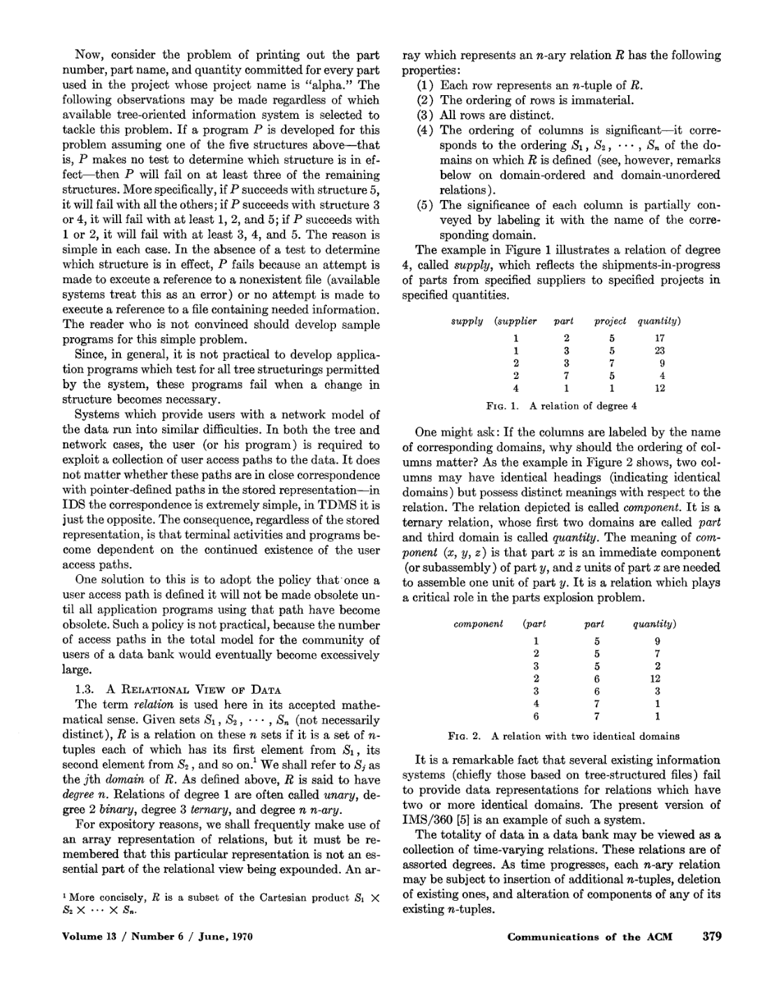
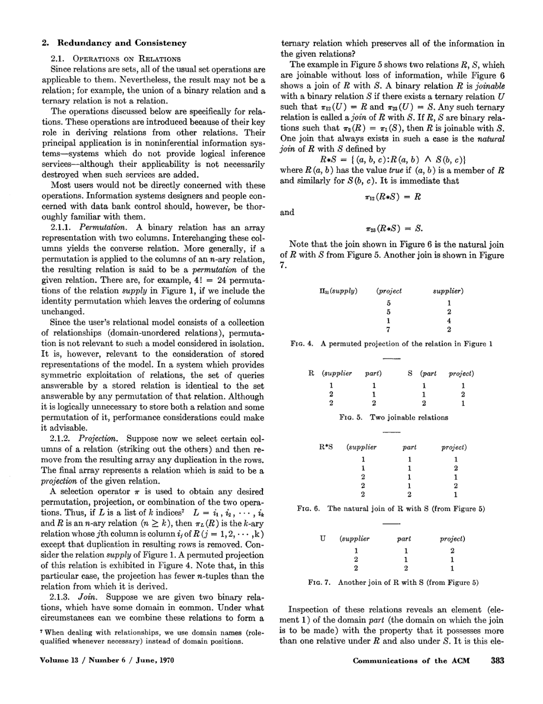

> 本组第 41 篇 · 关系模型与查询语言 · [全部论文]() · [上一篇]() · [下一篇]()

核心不是把数据画成表格，而是让应用依赖数据的逻辑关系，避免绑定排序、索引和访问路径。原文先给关系集合及消去非简单域的normalization，再用投影、join、composition等讨论可推导性、冗余和约束一致性。

阅读需要保留历史定义：此处normal form不是3NF/BCNF算法；join可指任何保持给定投影的候选U，自然连接才是特定的唯一运算；consistency是瞬时状态满足声明约束，不是分布式线性一致。报告还记录两处按图像核对的局部定义/例子张力，并以有限集合测试说明疑问，不把它包装成已确认勘误或关系模型失效。

本文保留论文陈述、读者推断与待验证方案的区别；实验数字只适用于原文条件。原文和翻译来自已有 AI 辅助精读报告，已做来源匹配与编辑复核，不等于人工逐项核验或独立实验复现。所有页码均为 PDF 物理页。

## 论文与阅读范围

E. F. Codd. A Relational Model of Data for Large Shared Data Banks. Communications of the ACM 13(6), June 1970, pp.377-387. 本地11页；物理页+376=印刷页。1969接收、1970年2月修订不是刊发时间。

[论文集中的原始 PDF](https://github.com/lonng/db-papers/blob/4ff1331069c7cf52ac97dd769e5f484c1c35c200/papers/essentials/a-relational-model-of-data-for-large-shared-data-banks.pdf) · 本地来源：`essentials/a-relational-model-of-data-for-large-shared-data-banks.pdf`，共 11 页。

本篇保留 21 组原文精读和 21 条证据。截图为原始 PDF 的局部页选，不是重新生成的图表；未将整份 PDF 复制到博客。

## 研究问题与适用边界

**把应用从表示变化中保护出来**
论文面对的是共享格式化数据库：业务增长和查询、更新流量变化，会迫使物理表示调整。若应用依赖记录次序、特定索引或一条导航路径，这些调整就可能破坏程序。关系模型希望把表示变化的责任转移给数据系统，而不是要求每个用户识别所有树结构。

这不是禁止物理树、指针、索引或哈希；被排除的是它们作为用户逻辑不可更改的依赖。第1页明确不讨论支持该模型的系统实现，不能把后来的B树、MVCC或代价优化器当成本文已实现功能。

表格是解释关系的一种数组表示，并非模型的全部本体。关系的定义、角色与可表达操作，比屏幕上是否呈现行列更重要。

依据：论文陈述；PDF 物理页 1, 3, 4。证据：[CODD01](#evidence-codd01), [CODD02](#evidence-codd02), [CODD03](#evidence-codd03)。

## 模型与架构

**从有位置的数学关系到有角色名的用户关系**
第3页关系是若干域笛卡尔积的子集：行没有顺序，元组互异；形式化域序决定列位置意义。若component两个域都叫part，仅看域名无法区分部件和上级部件。第4页用sub.part、super.part之类角色名提供用户层的无域序关系。因此“列位置有意义”与“用户不必记位置”分别针对两层，不是任意选一句否定另一句。

主键、外键和活动域描述逻辑身份与引用。原文允许多个“非冗余主键”，再指定其一为该关系主键，是历史术语；不要把今天的命名惯例倒套成矛盾。键不是物理地址指针。

具名集合、可表达集合和存储表示也分层：有名字的关系通常只是能用表达式指定的很小部分；保留旧关系名可以支持兼容，但不要求物理重复保存其所有数据。

依据：论文陈述；PDF 物理页 3, 4, 6。证据：[CODD02](#evidence-codd02), [CODD03](#evidence-codd03), [CODD04](#evidence-codd04), [CODD09](#evidence-codd09)。

*原论文 PDF 物理页 3，版权归原作者或出版方。点击图片可查看原尺寸。页面文本中定位到：FIG. 1. A relation of degree 4；FiG. 2. A relation with two identical domains。这是页面定位信息，不表示本次已复核图内所有数据。*

## 操作与算法

**1. 展开非简单域**
employee中的jobhistory、children等域本身可取关系值。normalization从顶层拿主键加入直接子关系，子关系键扩成父键加原子键；删去父关系的非简单域，再递归处理子树。薪酬历史因而需要携带员工与任职日期来区分父实例。该程序要求非简单域关联图是森林、主键不含非简单成分，不能无条件用于任意共享或循环嵌套图，也不是函数依赖驱动的3NF/BCNF分解。

**2. 投影与自然连接**
投影选列后去重。本文一般join要求某个U的两个投影恰为R、S；自然连接用公共值组合所有兼容元组，是其中一个特定运算。已运行有限集合例子：自然连接有5条三元组，另一个U只有3条，两者投影均能还原同一R、S。这说明历史join族不唯一，不说明现代自然连接的算法输出随机。

**3. Composition**
从join再投影首尾得到composition，中间的配对信息可能被抹去，多个join有时仍只有一个端点composition。将这些操作用于业务推理前，必须证明端点业务关系确实由该路径定义，不能仅因路径能走通就认定现实事实成立。

依据：论文陈述；PDF 物理页 5, 7, 8, 9。证据：[CODD05](#evidence-codd05), [CODD06](#evidence-codd06), [CODD10](#evidence-codd10), [CODD11](#evidence-codd11), [CODD12](#evidence-codd12), [CODD13](#evidence-codd13)。

## 正确性与局部疑问

**可推导约束必须跨时间成立**
O-derivable要求同一操作序列对所有时间都得到目标关系。某个当前样本的偶然相等，不是可永久删除信息的依赖。connection trap也在强调同一边界：供应商供应零件、项目使用该零件，不自然推出该供应商实际给该项目供货，除非业务约束保证这正是自然复合。

**两处局部文字/图例疑问，保持为待核查**
物理第9页restriction定义印作πL(R′)=πM(S)，但图13的S含(c,B)，图示R′并未覆盖这一项。原图也有这个张力。若按现代半连接重建，可解释为匹配筛选，但那是读者重建，不能悄悄把原等号改为子集。

第10页composition检查列出端点覆盖与每条T都有R-S路径三项条件。有限集合读者例R={(a1,b1),(a1,b2),(a2,b2)}、S={(b1,c1),(b2,c2)}、T={(a1,c1),(a2,c2)}通过三项，却没有候选U能覆盖R中的(a1,b2)：对应路径会产生不在T的(a1,c2)。第8页循环连接条件另有边覆盖要求。这是按字面集合解释提出的局部检查器疑问，未做外部勘误确认，不是整套关系模型的反例。

依据：读者推断；PDF 物理页 9, 10。证据：[CODD13](#evidence-codd13), [CODD14](#evidence-codd14), [CODD20](#evidence-codd20), [CODD21](#evidence-codd21)。

## 实验与证据等级

**没有系统基准，只有模型与例子**
原文没有硬件配置、吞吐、尾延迟、基线实现、重复次数或方差，不发布可运行DBMS。第11页仍说明语言细节和实现问题未讨论。不能把论述的简洁性转成已测得的查询性能优势。

本报告执行了Python有限集合测试，记录在qa/codd1970-reader-tests.json。第一组构造5条自然连接与3条候选join，实际检查二者投影都等于R、S；第二组检查第10页三个条件与候选U的边覆盖，得到上节的局部疑问。它们只验证具体输入上的集合计算，未运行原系统、现代SQL优化器或真实完整性维护协议。

视觉检查覆盖物理5、7、8、9、10页，重点包括展开示例、join图表及上述公式；不能据此声称所有被引资料或现代术语映射都已核验。

依据：读者推断；PDF 物理页 1, 7, 10。证据：[CODD01](#evidence-codd01), [CODD11](#evidence-codd11), [CODD17](#evidence-codd17), [CODD21](#evidence-codd21)。

*原论文 PDF 物理页 7，版权归原作者或出版方。点击图片可查看原尺寸。页面文本中定位到：FIG. 4.；FIG. 5. Two joinable relations；FIG. 6.；FIG. 7. Another join of R with S (from Figure 5)。这是页面定位信息，不表示本次已复核图内所有数据。*

## 权衡与成本

**逻辑独立并不保证所有访问方向同样快**
作者希望任意参数组合可作为knowns，其余作为unknowns，这种对称利用是逻辑表达能力；第6页明说不能期待性能对称。n!是导航路径命名控制的讨论，不是证明某个查询优化器必须花n!时间。

逻辑具名冗余可用于用户便利与旧程序兼容。若把它物化成物理冗余，则可能增加空间和更新时间，同时减少某些查询成本；本文没有给出实测比例。选择多少表示应覆盖负载需求但避免过多描述与维护开销，具体映射仍是开放工程问题。

弱冗余没有唯一推导等式，却可能承载不可消去的业务信息。能成为“某个join的投影”不等于已能由其余关系唯一重建，不能一律作为冗余数据删除。

依据：论文陈述；PDF 物理页 6, 9, 10。证据：[CODD08](#evidence-codd08), [CODD09](#evidence-codd09), [CODD14](#evidence-codd14), [CODD15](#evidence-codd15), [CODD16](#evidence-codd16)。

## 历史定义与现代概念

**不要用后来的词覆盖原来的定义**
本文的normal form消去非简单域，不包括后来的完整函数依赖规范化理论；其集合投影会去重，不等于普通SQL SELECT的bag行为；其一般join不是今天讨论某个自然连接物理算法时的唯一结果定义。

consistency则是给定关系集合C、约束Z与瞬时值V，检查V是否满足Z。它不等于分布式线性一致、读写quorum、事务隔离或自动原子提交。文章讨论即时检测、日志、延时通知和批量检查等响应路径；某次状态为何不一致，可能需要询问环境才能判断是错误输入还是后续尚未补齐。

与现代数据库的联系应变成核查问题：逻辑计划是否保持集合/多重集与空值语义；键和约束如何供重写使用；物化维护如何权衡；瞬时检查如何取得一致观察。本次没有为具体当前引擎提供源码证据，因此不声称它们已实现某一映射。

依据：读者推断；PDF 物理页 5, 7, 10, 11。证据：[CODD05](#evidence-codd05), [CODD10](#evidence-codd10), [CODD17](#evidence-codd17), [CODD18](#evidence-codd18), [CODD19](#evidence-codd19)。

## 复现计划

**分三层做读者实验，未执行部分明确留空**
集合层可枚举小R、S、T，检查投影、join候选与composition，并验证每个保信息定义要求的等式。已运行的两个例子只是起点，不构成一般证明。对restriction的定义/图例张力，应保留原页并比较不同解释，不自行改原文。

表示层可把同一逻辑关系置于不同物理布局，保持表达接口不变，检查查询结果和负载差异；逻辑对称而物理不同的对照比单纯“表格比树快”更贴近论文目标。此项尚未实现。

约束层需区分跨时间声明、某次样本规律与实际事务执行。并发更新时取得同一瞬时快照本身是未讨论的工程问题；分别扫描多张变化中的表可能组合出从未同时存在的状态。若要研究维护与恢复，应另定义事务、失败、日志与通知策略，而不能把本文概念定义直接当运行协议。

依据：待验证的工程设想；PDF 物理页 1, 6, 9, 10。证据：[CODD01](#evidence-codd01), [CODD08](#evidence-codd08), [CODD14](#evidence-codd14), [CODD17](#evidence-codd17), [CODD18](#evidence-codd18), [CODD20](#evidence-codd20), [CODD21](#evidence-codd21)。

## 结论

1970论文的设计承诺是应用依赖逻辑数据关系，让系统承担表示变化和高层请求到存储动作的映射。其贡献不需要靠补造现代引擎实现或性能数字来放大；原文自己也坦陈不少语言与工程问题尚未讨论。

本报告增加21段精读与有限集合例子，明确区分位置/角色、集合/bag、一般join/自然连接、状态约束/分布式一致性。对两处局部公式与图例问题保留原样、列出解释前提和复现记录，既不掩盖张力，也不把未外部确认的疑问升级为整个模型失效的结论。

依据：读者推断；PDF 物理页 1, 4, 7, 9, 10。证据：[CODD01](#evidence-codd01), [CODD03](#evidence-codd03), [CODD10](#evidence-codd10), [CODD11](#evidence-codd11), [CODD18](#evidence-codd18), [CODD20](#evidence-codd20), [CODD21](#evidence-codd21)。

## 原文精读：从句子回到机制

以下保留原文、忠实翻译、含义与边界；假设示例不作为论文实验结果。

### P001 · PDF 物理页 1

**原文**

<blockquote class="paper-source-quote"><pre><code>Implementations of &#10;systems to support the relational model are not discussed.</code></pre></blockquote>

**忠实翻译**

> 不讨论支持关系模型的系统实现。

**技术含义与边界**

> 本文建立逻辑模型与操作定义，没有发布一个可运行DBMS。

**常见误读**

> 不能补上现代索引、MVCC或CBO实现作为作者已完成工作。

**读者构造的假设示例**

> 读者例：逻辑去重与用哈希还是排序实现去重是不同层次。

### P002 · PDF 物理页 3

**原文**

<blockquote class="paper-source-quote"><pre><code>The ordering of rows is immaterial. &#10;(3) All rows are distinct.</code></pre></blockquote>

**忠实翻译**

> 行顺序不重要，而且所有行互不相同。

**技术含义与边界**

> 原模型的关系是元组集合，不是默认保留重复的SQL多重集。

**常见误读**

> 不能把关系投影与普通SELECT列完全等同。

**读者构造的假设示例**

> 读者例：两条不同原元组投影成同一值时，关系结果只保留一条。

### P003 · PDF 物理页 4

**原文**

<blockquote class="paper-source-quote"><pre><code>where there &#10;are two or more identical domains, we require in each case &#10;that the domain name be qualified by a distinctive role &#10;name, which serves to identify the role played by that &#10;domain in the given relation.</code></pre></blockquote>

**忠实翻译**

> 当有两个或更多相同的域时，要求域名以不同角色名限定，以识别该域在关系里的角色。

**技术含义与边界**

> 第3页形式化关系的列位置有意义；第4页用户关系用角色名消除对位置的依赖。

**常见误读**

> 不能同时无条件宣称原文列顺序重要和列顺序永远无关。

**读者构造的假设示例**

> 读者例：sub.part与super.part虽同属part域，却表达不同角色。

### P004 · PDF 物理页 4

**原文**

<blockquote class="paper-source-quote"><pre><code>may possess more than one nonredundant primary &#10;key.</code></pre></blockquote>

**忠实翻译**

> 一个关系可以拥有多个非冗余主键。（摘录从谓语开始。）

**技术含义与边界**

> 这是本文的历史术语；作者随后从中任选一个称该关系的主键。

**常见误读**

> 不要不加说明地把今天主键唯一命名习惯倒套成原文自相矛盾。

**读者构造的假设示例**

> 读者例：零件编号与唯一名称都能识别元组，但系统最终可指定其中一组为主键。

### P005 · PDF 物理页 5

**原文**

<blockquote class="paper-source-quote"><pre><code>Starting with the re- &#10;lation at the top of the tree, take its primary key and ex- &#10;pand each of the immediately subordinate relations by &#10;inserting this primary key domain or domain combination. &#10;The primary key of each expanded relation consists of the &#10;primary key before expansion augmented by the primary &#10;key copied down from the parent relation.</code></pre></blockquote>

**忠实翻译**

> 从树顶关系开始，将它的主键加入各直接子关系；扩充后的子关系主键为原主键加上从父关系复制下来的主键。

**技术含义与边界**

> normalization这里主要消去非简单的关系值域，按层向下传播身份。

**常见误读**

> 不是后来基于函数依赖的3NF或BCNF分解算法。

**读者构造的假设示例**

> 读者例：薪酬历史键需携带员工及任职日期以区分不同父实例。

### P006 · PDF 物理页 5

**原文**

<blockquote class="paper-source-quote"><pre><code>the unnormalized collection of relations must satisfy the &#10;following conditions: &#10;(1) The graph of interrelationships of the nonsimple &#10;domains is a collection of trees. &#10;(2) No primary key has a component domain which is &#10;nonsimple.</code></pre></blockquote>

**忠实翻译**

> 未规范化关系集合须满足：非简单域关联图是一组树，而且任何主键都不含非简单域成分。

**技术含义与边界**

> 该展开过程有明确结构与键前提，不能当成任意嵌套图无条件展开定理。

**常见误读**

> 忽略共享子对象或循环会使键传播与重建语义不清楚。

**读者构造的假设示例**

> 读者例：若同一子实例被多个父引用，先明确复制与身份语义再使用树形算法。

### P007 · PDF 物理页 6

**原文**

<blockquote class="paper-source-quote"><pre><code>The universality of the data sublangnage lies in its &#10;descriptive ability (not its computing ability).</code></pre></blockquote>

**忠实翻译**

> 数据子语言的普适性在于描述能力，而不是计算能力。

**技术含义与边界**

> 以应用谓词演算为标尺，面向数据指定；不等于图灵完备或完整SQL语法。

**常见误读**

> 不要把first-order足够说成不用宿主语言实现任何计算。

**读者构造的假设示例**

> 读者例：H定义算术函数，R在检索限定中调用，是文中提出的职责分工。

### P008 · PDF 物理页 6

**原文**

<blockquote class="paper-source-quote"><pre><code>Naturally, &#10;symmetry in performance is not to be expected.</code></pre></blockquote>

**忠实翻译**

> 自然，不能期待性能也具有对称性。

**技术含义与边界**

> 任意参数组合可作为已知条件，是逻辑可用性；不同方向仍可有不同物理代价。

**常见误读**

> n!路径命名讨论不是优化器枚举时间的复杂度证明。

**读者构造的假设示例**

> 读者例：按员工号查部门和按部门查所有员工都应能表达，却可能访问不同数量记录。

### P009 · PDF 物理页 6

**原文**

<blockquote class="paper-source-quote"><pre><code>The named set is a subset of the expressible set--usually a &#10;very small subset.</code></pre></blockquote>

**忠实翻译**

> 具名集合是可表达集合的子集，而且通常是很小的子集。

**技术含义与边界**

> 能以表达式指定的关系比只用简单名字标识的多，具名也不等于必物理存储。

**常见误读**

> 不要把视图名与物化副本混为一类。

**读者构造的假设示例**

> 读者例：声明一个兼容旧程序的关系名，并不决定其数据应单独存一份。

### P010 · PDF 物理页 7

**原文**

<blockquote class="paper-source-quote"><pre><code>Suppose now we select certain col- &#10;umns &#10;of a relation (striking out the others) and then re- &#10;move from the resulting array any duplication in the rows. &#10;The final array represents a relation which is said to be a &#10;projection of the given relation.</code></pre></blockquote>

**忠实翻译**

> 选择某些列、删除其余列，再删除结果中的重复行；最终数组表示原关系的一个投影。

**技术含义与边界**

> 投影同时改变模式与集合基数，重数不会无条件保留。

**常见误读**

> 不能省略去重步骤再把bag算子代入所有论证。

**读者构造的假设示例**

> 读者例：{(a,1),(a,2)}投影首列得{a}，不是两条a。

### P011 · PDF 物理页 7

**原文**

<blockquote class="paper-source-quote"><pre><code>Any such ternary &#10;relation is called a join of R with S.</code></pre></blockquote>

**忠实翻译**

> 任何满足前述投影等式的三元关系都称为R与S的一个join。

**技术含义与边界**

> 本文join是可重建R、S两个投影的任意U；自然连接是其中一个特定运算。

**常见误读**

> 多个join不等于标准自然连接执行有随机结果。

**读者构造的假设示例**

> 读者例：同一对R、S可有五元组自然连接及三元组候选U，二者投影都满足要求。

### P012 · PDF 物理页 8

**原文**

<blockquote class="paper-source-quote"><pre><code>T is a com- &#10;position of R with S if there exists a join U of R with S such &#10;that T = 7913 (U).</code></pre></blockquote>

**忠实翻译**

> 若存在R与S的一个join U，且T为U的首尾投影，则T是R与S的一个composition。

**技术含义与边界**

> 投影丢掉中间域；不同join有时仍可能产生同一个composition。

**常见误读**

> 路径可连接不自动说明端点关系具有某种现实业务含义。

**读者构造的假设示例**

> 读者例：供应某零件并且某项目使用该零件，不当然证明该供应商给该项目供了货。

### P013 · PDF 物理页 9

**原文**

<blockquote class="paper-source-quote"><pre><code>Such a conclusion is correct &#10;only in the very special case that the target relation be- &#10;tween projects and suppliers is, in fact, the natural com- &#10;position of the other two relations--and we must normally &#10;add the phrase "for all time," because this is usually im- &#10;plied in claims concerning path-following techniques.</code></pre></blockquote>

**忠实翻译**

> 只有目标项目—供应商关系事实上就是另两关系的自然复合时，该结论才正确；通常还须加上“始终如此”。

**技术含义与边界**

> connection trap是误把路径导出的连接当成预期业务关系。

**常见误读**

> 不是指针遍历算法崩溃，也不是所有join都不可用。

**读者构造的假设示例**

> 读者例：同型号零件由不同供应商送往不同项目，二跳路径会产生未经事实支持的配对。

### P014 · PDF 物理页 9

**原文**

<blockquote class="paper-source-quote"><pre><code>A relation R is O-derivable from a set S of rela- &#10;tions if there exists a sequence of operations from the col- &#10;lection 0 which, for all time, yields R from members of S.</code></pre></blockquote>

**忠实翻译**

> 若存在由操作集合O构成的操作序列，在所有时间都能从S的成员生成R，则R是从S可O推导的。

**技术含义与边界**

> 这里是跨状态成立的约束，不是某一次数据偶然相等。

**常见误读**

> 从一个样本发现等式不能当作可安全删除数据的永久依赖。

**读者构造的假设示例**

> 读者例：今天每部门恰好一人，不证明部门号可永远作为员工键。

### P015 · PDF 物理页 10

**原文**

<blockquote class="paper-source-quote"><pre><code>extra storage space and update time are &#10;consumed with a potential drop in query time for some &#10;queries and in load on the central processing units.</code></pre></blockquote>

**忠实翻译**

> 通常会消耗额外存储空间和更新时间，但可能降低某些查询时间及CPU负载。

**技术含义与边界**

> 原文已把逻辑冗余与物理冗余分开；物化是潜在读写权衡，不是冗余一律有害。

**常见误读**

> 没有硬件实验或比例，不能给出现代物化视图收益数字。

**读者构造的假设示例**

> 读者例：兼容旧关系名可保留，而是否存其结果应按更新与查询负载另选。

### P016 · PDF 物理页 10

**原文**

<blockquote class="paper-source-quote"><pre><code>weak redundancies are inherent in &#10;the logical needs of the community of users. They are not &#10;removable by the system or data base administrator.</code></pre></blockquote>

**忠实翻译**

> 弱冗余一般内在于用户群体的逻辑需求，不能由系统或数据库管理员消除。

**技术含义与边界**

> 弱冗余不提供唯一推导等式，约束仍有信息价值。

**常见误读**

> 不能把能作为某个join投影，误解成已能唯一重建并删除它。

**读者构造的假设示例**

> 读者例：多个可行U对应不同真实配对时，端点关系还保留区分这些情况的信息。

### P017 · PDF 物理页 10

**原文**

<blockquote class="paper-source-quote"><pre><code>There are practical problems (which we shall not discuss &#10;here) in taking an instantaneous snapshot of a collection &#10;of relations, some of which may be very large and highly &#10;variable.</code></pre></blockquote>

**忠实翻译**

> 对可能很大且变化频繁的关系集合取得瞬时快照存在实际困难，本文不讨论。

**技术含义与边界**

> 一致性检查定义依赖一个瞬时状态，获取该状态的实现仍留空。

**常见误读**

> 不能据此声称论文已经给出了MVCC或分布式一致快照协议。

**读者构造的假设示例**

> 读者例：分别扫描变化中的R、S、T，组合结果不一定曾同时存在。

### P018 · PDF 物理页 10

**原文**

<blockquote class="paper-source-quote"><pre><code>consistency as defined above &#10;is a property of the instantaneous state of a data bank, and &#10;is independent of how that state came about.</code></pre></blockquote>

**忠实翻译**

> 上述一致性是数据库瞬时状态的属性，与该状态如何形成无关。

**技术含义与边界**

> 这里指状态满足约束集合，不是线性一致、复制quorum或事务隔离级别。

**常见误读**

> 记录了更新日志，不自动证明所有中间状态原子满足约束。

**读者构造的假设示例**

> 读者例：错误插入和稍后将补齐关联记录的暂时遗漏，可导致同一不满足约束的状态。

### P019 · PDF 物理页 11

**原文**

<blockquote class="paper-source-quote"><pre><code>Another &#10;approach is to conduct consistency checking as a batch &#10;operation once a day or less frequently.</code></pre></blockquote>

**忠实翻译**

> 另一个方法是每天一次或更低频地批量检查一致性。

**技术含义与边界**

> 原文容许检测、记录与后续通知的处理路径，不是默认每次更新即时拒绝。

**常见误读**

> 不能把本文一致性维护讨论直接称作现代ACID提交协议。

**读者构造的假设示例**

> 读者例：批量检查对短暂与持久不一致的可见性不同，需要业务明确接受。

### P020 · PDF 物理页 9

**原文**

<blockquote class="paper-source-quote"><pre><code>is the maximal subset R' of R such that &#10;~L (R') &#10;= &#10;~M (S).</code></pre></blockquote>

**忠实翻译**

> 定义要求R的最大子集R′满足πL(R′)=πM(S)。（保留提取层公式，等号已按原页核对。）

**技术含义与边界**

> 印刷定义使用等号，而图13的S还含(c,B)，并未被图示R′覆盖；该不协调在原图中也存在。

**常见误读**

> 不能悄悄把等号改成子集，再声称满足字面定义。现代半连接是一个可能的读者重建，不是原文逐字结论。

**读者构造的假设示例**

> 读者例：若S多一个从未出现在R的键，匹配筛选仍有输出，但无法实现两侧投影完全相等。

### P021 · PDF 物理页 10

**原文**

<blockquote class="paper-source-quote"><pre><code>gorithm for making this check would examine the first two &#10;columns of each of R, S, T (in whatever way they are repre- &#10;sented in the system) and determine whether &#10;(1) Try(T) = ~-i(R), &#10;(2) ~(T) = ~(S), &#10;(3) for every element pair (a, c) in the relation ~2 (T) &#10;there is an element b such that (a, b) is in ~-12 (R) &#10;and (b, c) is in 7r12(S).</code></pre></blockquote>

**忠实翻译**

> 所述检查依次要求T两端投影与R、S对应端点相同，以及每条T(a,c)存在b使R(a,b)和S(b,c)成立。（摘录起于断词后半，公式文本层有损，已按第10页图像核对。）

**技术含义与边界**

> 字面三项条件可遗漏R或S中某条边必须被候选U覆盖的要求；第8页循环连接条件另列了这类覆盖。

**常见误读**

> 这是局部检查器的可复现解释疑问，不是已被外部确认的勘误或整个关系模型反例。

**读者构造的假设示例**

> 已运行读者例：R={(a1,b1),(a1,b2),(a2,b2)},S={(b1,c1),(b2,c2)},T={(a1,c1),(a2,c2)}通过三项却无法覆盖R(a1,b2)。

## 尚未解决的问题

1. restriction等号定义与图13覆盖不一致如何解释？需外部版本或勘误核查。
2. 第10页三项composition检查是否隐含额外边覆盖假设？
3. 本文未讨论的高层请求映射、瞬时快照与完整性维护应如何实现？

## 证据索引

证据编号沿用原报告，便于将上文判断追溯到原句。引文匹配只验证位置，不证明解读正确。

**CODD01 · PDF 物理页 1**

本文建立逻辑模型与操作定义，没有发布一个可运行DBMS。 不能补上现代索引、MVCC或CBO实现作为作者已完成工作。

<blockquote class="paper-source-quote"><pre><code>Implementations of &#10;systems to support the relational model are not discussed.</code></pre></blockquote>

**CODD02 · PDF 物理页 3**

原模型的关系是元组集合，不是默认保留重复的SQL多重集。 不能把关系投影与普通SELECT列完全等同。

<blockquote class="paper-source-quote"><pre><code>The ordering of rows is immaterial. &#10;(3) All rows are distinct.</code></pre></blockquote>

**CODD03 · PDF 物理页 4**

第3页形式化关系的列位置有意义；第4页用户关系用角色名消除对位置的依赖。 不能同时无条件宣称原文列顺序重要和列顺序永远无关。

<blockquote class="paper-source-quote"><pre><code>where there &#10;are two or more identical domains, we require in each case &#10;that the domain name be qualified by a distinctive role &#10;name, which serves to identify the role played by that &#10;domain in the given relation.</code></pre></blockquote>

**CODD04 · PDF 物理页 4**

这是本文的历史术语；作者随后从中任选一个称该关系的主键。 不要不加说明地把今天主键唯一命名习惯倒套成原文自相矛盾。

<blockquote class="paper-source-quote"><pre><code>may possess more than one nonredundant primary &#10;key.</code></pre></blockquote>

**CODD05 · PDF 物理页 5**

normalization这里主要消去非简单的关系值域，按层向下传播身份。 不是后来基于函数依赖的3NF或BCNF分解算法。

<blockquote class="paper-source-quote"><pre><code>Starting with the re- &#10;lation at the top of the tree, take its primary key and ex- &#10;pand each of the immediately subordinate relations by &#10;inserting this primary key domain or domain combination. &#10;The primary key of each expanded relation consists of the &#10;primary key before expansion augmented by the primary &#10;key copied down from the parent relation.</code></pre></blockquote>

**CODD06 · PDF 物理页 5**

该展开过程有明确结构与键前提，不能当成任意嵌套图无条件展开定理。 忽略共享子对象或循环会使键传播与重建语义不清楚。

<blockquote class="paper-source-quote"><pre><code>the unnormalized collection of relations must satisfy the &#10;following conditions: &#10;(1) The graph of interrelationships of the nonsimple &#10;domains is a collection of trees. &#10;(2) No primary key has a component domain which is &#10;nonsimple.</code></pre></blockquote>

**CODD07 · PDF 物理页 6**

以应用谓词演算为标尺，面向数据指定；不等于图灵完备或完整SQL语法。 不要把first-order足够说成不用宿主语言实现任何计算。

<blockquote class="paper-source-quote"><pre><code>The universality of the data sublangnage lies in its &#10;descriptive ability (not its computing ability).</code></pre></blockquote>

**CODD08 · PDF 物理页 6**

任意参数组合可作为已知条件，是逻辑可用性；不同方向仍可有不同物理代价。 n!路径命名讨论不是优化器枚举时间的复杂度证明。

<blockquote class="paper-source-quote"><pre><code>Naturally, &#10;symmetry in performance is not to be expected.</code></pre></blockquote>

**CODD09 · PDF 物理页 6**

能以表达式指定的关系比只用简单名字标识的多，具名也不等于必物理存储。 不要把视图名与物化副本混为一类。

<blockquote class="paper-source-quote"><pre><code>The named set is a subset of the expressible set--usually a &#10;very small subset.</code></pre></blockquote>

**CODD10 · PDF 物理页 7**

投影同时改变模式与集合基数，重数不会无条件保留。 不能省略去重步骤再把bag算子代入所有论证。

<blockquote class="paper-source-quote"><pre><code>Suppose now we select certain col- &#10;umns &#10;of a relation (striking out the others) and then re- &#10;move from the resulting array any duplication in the rows. &#10;The final array represents a relation which is said to be a &#10;projection of the given relation.</code></pre></blockquote>

**CODD11 · PDF 物理页 7**

本文join是可重建R、S两个投影的任意U；自然连接是其中一个特定运算。 多个join不等于标准自然连接执行有随机结果。

<blockquote class="paper-source-quote"><pre><code>Any such ternary &#10;relation is called a join of R with S.</code></pre></blockquote>

**CODD12 · PDF 物理页 8**

投影丢掉中间域；不同join有时仍可能产生同一个composition。 路径可连接不自动说明端点关系具有某种现实业务含义。

<blockquote class="paper-source-quote"><pre><code>T is a com- &#10;position of R with S if there exists a join U of R with S such &#10;that T = 7913 (U).</code></pre></blockquote>

**CODD13 · PDF 物理页 9**

connection trap是误把路径导出的连接当成预期业务关系。 不是指针遍历算法崩溃，也不是所有join都不可用。

<blockquote class="paper-source-quote"><pre><code>Such a conclusion is correct &#10;only in the very special case that the target relation be- &#10;tween projects and suppliers is, in fact, the natural com- &#10;position of the other two relations--and we must normally &#10;add the phrase "for all time," because this is usually im- &#10;plied in claims concerning path-following techniques.</code></pre></blockquote>

**CODD14 · PDF 物理页 9**

这里是跨状态成立的约束，不是某一次数据偶然相等。 从一个样本发现等式不能当作可安全删除数据的永久依赖。

<blockquote class="paper-source-quote"><pre><code>A relation R is O-derivable from a set S of rela- &#10;tions if there exists a sequence of operations from the col- &#10;lection 0 which, for all time, yields R from members of S.</code></pre></blockquote>

**CODD15 · PDF 物理页 10**

原文已把逻辑冗余与物理冗余分开；物化是潜在读写权衡，不是冗余一律有害。 没有硬件实验或比例，不能给出现代物化视图收益数字。

<blockquote class="paper-source-quote"><pre><code>extra storage space and update time are &#10;consumed with a potential drop in query time for some &#10;queries and in load on the central processing units.</code></pre></blockquote>

**CODD16 · PDF 物理页 10**

弱冗余不提供唯一推导等式，约束仍有信息价值。 不能把能作为某个join投影，误解成已能唯一重建并删除它。

<blockquote class="paper-source-quote"><pre><code>weak redundancies are inherent in &#10;the logical needs of the community of users. They are not &#10;removable by the system or data base administrator.</code></pre></blockquote>

**CODD17 · PDF 物理页 10**

一致性检查定义依赖一个瞬时状态，获取该状态的实现仍留空。 不能据此声称论文已经给出了MVCC或分布式一致快照协议。

<blockquote class="paper-source-quote"><pre><code>There are practical problems (which we shall not discuss &#10;here) in taking an instantaneous snapshot of a collection &#10;of relations, some of which may be very large and highly &#10;variable.</code></pre></blockquote>

**CODD18 · PDF 物理页 10**

这里指状态满足约束集合，不是线性一致、复制quorum或事务隔离级别。 记录了更新日志，不自动证明所有中间状态原子满足约束。

<blockquote class="paper-source-quote"><pre><code>consistency as defined above &#10;is a property of the instantaneous state of a data bank, and &#10;is independent of how that state came about.</code></pre></blockquote>

**CODD19 · PDF 物理页 11**

原文容许检测、记录与后续通知的处理路径，不是默认每次更新即时拒绝。 不能把本文一致性维护讨论直接称作现代ACID提交协议。

<blockquote class="paper-source-quote"><pre><code>Another &#10;approach is to conduct consistency checking as a batch &#10;operation once a day or less frequently.</code></pre></blockquote>

**CODD20 · PDF 物理页 9**

印刷定义使用等号，而图13的S还含(c,B)，并未被图示R′覆盖；该不协调在原图中也存在。 不能悄悄把等号改成子集，再声称满足字面定义。现代半连接是一个可能的读者重建，不是原文逐字结论。

<blockquote class="paper-source-quote"><pre><code>is the maximal subset R' of R such that &#10;~L (R') &#10;= &#10;~M (S).</code></pre></blockquote>

**CODD21 · PDF 物理页 10**

字面三项条件可遗漏R或S中某条边必须被候选U覆盖的要求；第8页循环连接条件另列了这类覆盖。 这是局部检查器的可复现解释疑问，不是已被外部确认的勘误或整个关系模型反例。

<blockquote class="paper-source-quote"><pre><code>gorithm for making this check would examine the first two &#10;columns of each of R, S, T (in whatever way they are repre- &#10;sented in the system) and determine whether &#10;(1) Try(T) = ~-i(R), &#10;(2) ~(T) = ~(S), &#10;(3) for every element pair (a, c) in the relation ~2 (T) &#10;there is an element b such that (a, b) is in ~-12 (R) &#10;and (b, c) is in 7r12(S).</code></pre></blockquote>

## 版本与使用边界

- 原 PDF SHA256：`89021870ffacd8cf251ed88abdbd5351ff9d15fe90c9bd51d0820eb4c5232311`。
- 报告来源：`codex-current-session`；此处按已完成报告整理，没有重新请求模型。
- OCR 记录页：[]；低文本页：[]。
- 本次新增页面截图，未据此自动重写原报告的数值、公式或实验结论；原有“未进行图像识别”限制仍适用于分析生成过程。
- 截图与短引仅服务于论文评论，版权归原作者或出版方；正式发布前复查转载范围和授权。
- 本文保留未核实的书目信息及研究问题，不用现代产品行为替代历史论文的证据。

前序报告保留的书目与阅读过程记录

E. F. Codd. A Relational Model of Data for Large Shared Data Banks. Communications of the ACM 13(6), June 1970, pp.377-387. 本地11页；物理页+376=印刷页。1969接收、1970年2月修订不是刊发时间。

本报告由当前Codex会话实际撰写；实读物理1-11页，视觉核对5、7、8、9、10页。API前两块读取已完成，第三块call387虽finish_reason=stop，却输出无效JSON并在claim中断，不修补为完整报告，原响应保留。Python有限集合读者测试已运行，不是原DBMS或现代SQL优化器实验。被引论文、现行产品和源码实现未独立核查。Engine=codex-current-session，usage=None，用量未测量，先前API账单不冒充本报告账单；仍为AI待复核稿。

