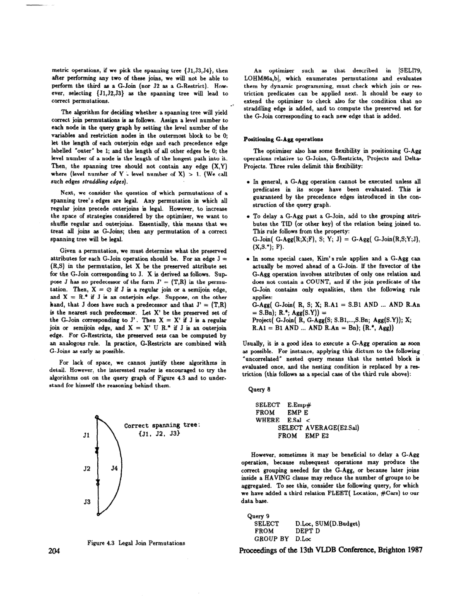
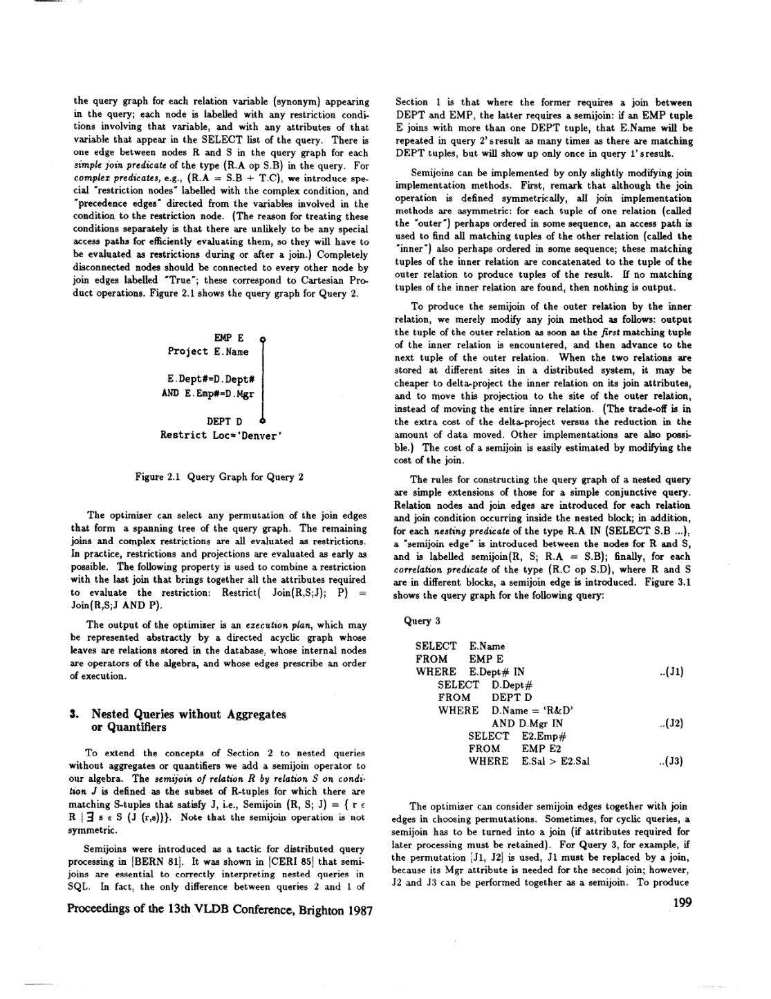

> 本组第 15 篇 · 嵌套查询与去相关 · [全部论文]() · [上一篇]() · [下一篇]()

本文把嵌套查询、重复控制、聚合与混合EXISTS/NOT EXISTS量词纳入同一个查询图和扩展代数：Project/Delta-Project控制重复，Semijoin表达存在性，G-Agg表达分组及布尔聚合，G-Join/G-Restrict记录需要保留的外层属性。优化器据合法生成树、层号、优先边和随枚举顺序更新的保留集生成候选计划，再选择物理实现；这不是把所有子查询无条件展平为普通Join。COUNT空集为0，普通Join会丢掉本应参加比较的外层行；作者用非对称Outerjoin处理其示例，但实现还必须区分真实匹配与补空行。聚合延迟需保护分组身份；第8页的提前聚合规则明确要求单关系聚合、无COUNT、等值连接。流水线依赖实际输出分组，不由Hash Join的build侧或逻辑键自动保证。论文没有性能实验，也未完成形式化证明和详细代价模型；元组替换仍是候选实现。原文的EXISTS投影预处理及ANY/IS NOT IN归约按历史语义陈述，不能直接推广为含NULL的现代SQL通用重写。读者反例、SQLite微检验与复现建议在正文中单独标识。

本文保留论文陈述、读者推断与待验证方案的区别；实验数字只适用于原文条件。原文和翻译来自已有 AI 辅助精读报告，已做来源匹配与编辑复核，不等于人工逐项核验或独立实验复现。所有页码均为 PDF 物理页。

## 论文与阅读范围

Umeshwar Dayal. Of Nests and Trees: A Unified Approach to Processing Queries That Contain Nested Subqueries, Aggregates, and Quantifiers. Computer Corporation of America. Proceedings of the 13th VLDB Conference, Brighton, 1987, pp. 197–208。题名、作者、机构与会议信息已核对PDF首页图像；本文件共12个物理页，已分段读取全部提取正文，包括第11页结论及第11–12页参考文献，不存在本文件尚未读取的第13页。提取文本的aud、Untied、@、8等失真保留于原引文；解释层按扫描图像辨识，不把转写失真当作作者结论。

[论文集中的原始 PDF](https://github.com/lonng/db-papers/blob/4ff1331069c7cf52ac97dd769e5f484c1c35c200/papers/nested-query/a-unitied-approach-to-processing-queries-that-contain-nested-subqueries%2C-aggregates%2C-and-quantifiers.pdf) · 本地来源：`nested-query/a-unitied-approach-to-processing-queries-that-contain-nested-subqueries,-aggregates,-and-quantifiers.pdf`，共 12 页。

本篇保留 10 组原文精读和 32 条证据。截图为原始 PDF 的局部页选，不是重新生成的图表；未将整份 PDF 复制到博客。

## 研究问题与适用边界

作者针对1987年以Restrict-Project-Join为重心的优化器，研究如何把嵌套块、重复控制、聚合、量词乃至析取纳入全局计划优化。第1页Query 1的IN子查询按外层EMP元组替换求值；Query 2把它写成Join，却会在多个DEPT匹配时复制外层结果。第3页用Semijoin指出二者差别，因此解嵌套首先必须保持重复语义，而不只是消除SQL语法嵌套。

第2页明确以[DATE85]所述DB2 SQL为说明对象，并把详细枚举启发式、代价建模及形式化正确性证明排除在本文范围外。所谓统一，是统一内部表示、算子和优化策略空间，不是已经证明任意现代SQL都可无条件变为普通Join，也不是取代所有元组替换。第11页仍将nested iteration与sort-merge等列为G-Join的候选实现，收益由代价选择；文中对分布式替换开销的论述不能改写成任何场景下都不可接受的绝对结论。

依据：论文陈述；PDF 物理页 1, 2, 3, 11。证据：[C001N01](#evidence-c001n01), [C001N06](#evidence-c001n06), [SR001](#evidence-sr001), [SR009](#evidence-sr009)。

## 系统架构与算子扩展

统一内部表示由查询图和扩展关系代数组成；执行计划则是以关系为叶、算子为内部节点的DAG，不是把SQL块拆成互不相干的查询。

Project保留重复，Delta-Project消除重复。第4页假设每个基础关系有TID（或用户主键），中间投影保留身份，Join结果用各输入TID组合标识。这个前提使Semijoin转为Join后再按R.*去重仍能保留外层原有的不同元组；不能把R.*误解成已丢失TID的显示列。

G-Agg(R;X;fnvector)按X分组，每组产生X及聚合值；X为空时按文中约定为一个全局组。EXISTS和NOTEXISTS也是布尔聚合，因而与数值聚合共享G-Agg。G-Join(R,S;X;J)把匹配结果与未匹配R在X上去重并对其余属性补NULL的结果合并；X为保留属性集，不是连接键。第6页明确约定：R duplicate-free时X为空集的特例是regular Join，X=R.*为非对称Outerjoin。空集符号在提取文本中失真为@/8，不能把它误作任意参数。G-Restrict以类似方式把不满足谓词的行投影到保留集后补NULL。

第6–7页查询图包括关系节点、regular/semijoin/有向outerjoin边，以及restriction、outerrestriction、G-Agg节点和优先边。COUNT块的immediate scope排除更深聚合块的作用域；该范围中引用块外变量的谓词才被标为outer predicate。简单外内变量谓词建立Outerjoin边，其他outer predicate建Outerrestrict节点并标出保留来源。G-Agg分组属性包括最外层GROUP BY、相关外变量的TID和未来限制/投影需用属性；其输入谓词与输出消费者通过优先边约束。G-Join/G-Restrict并不直接画在原始查询图上，而是枚举混合连接后出现在执行计划中。

依据：论文陈述；PDF 物理页 2, 3, 4, 5, 6, 7, 9。证据：[C001N04](#evidence-c001n04), [C001N06](#evidence-c001n06), [C002N05](#evidence-c002n05), [C002N07](#evidence-c002n07), [C002N09](#evidence-c002n09), [SR002](#evidence-sr002), [SR003](#evidence-sr003), [SR004](#evidence-sr004), [SR006](#evidence-sr006)。

*原论文 PDF 物理页 8，版权归原作者或出版方。点击图片可查看原尺寸。页面文本中定位到：Figure 4.3 Legal Join Permutations。这是页面定位信息，不表示本次已复核图内所有数据。*

## 核心算法与代数变换规则

以下先列作者算法；读者示例单独标识，不冒充作者实验。

1. 重复与Semijoin。第4页给出Semijoin(R,S;J)=Delta-Project(Join(R,S;J);R.*)，并允许在保留TID和后续所需属性时延迟去重，但不能越过最终保留重复的Project。Semijoin(R,Semijoin(S,T;J2);J1)=Semijoin(R,Join(S,T;J2);J1)中的J1只能使用原内层Semijoin保留的S属性。外层只检查存在性，因此内部Join的多匹配不会乘大R的输出；这不是对R自身做DISTINCT。

2. 合法连接枚举。第8页把最外层变量和限制节点设为level 0，Outerjoin边及标outer的优先边长度为1，其余为0；节点level是进入它的最长路径长度。作者要求生成树不得含level(Y)-level(X)>1的straddling edge。图4.3正确树为{J1,J2,J3}，不能随意选跨层边。对正确树按G-Join形式枚举，再按顺序计算保留集：J=(R,S)没有最近前驱(T,R)时，regular/semijoin的X为空集，outerjoin的X=R.*；有最近前驱且其保留集为X'时，regular/semijoin继承X'，outerjoin用X'并R.*。G-Restrict用类似规则，并尽早与G-Join结合。故不是任意Outerjoin和Join都能按普通连接律交换。

3. 聚合定位。优先边要求先满足聚合输入作用域的谓词。延迟聚合是从先Agg后Join改成先Join后Agg：G-Join(G-Agg(R;X;F),S;Y;J)=G-Agg(G-Join(R,S;Y;J),(X,S.*);F)，须加入S的TID/键以保护每个S元组的身份；可省去加入的特例是已知每个R最多匹配一个S（第9页），不是一对多也成立。此式仍在前述保留集、属性依赖和可用谓词的上下文中使用，不能跨过依赖聚合结果的过滤。相反，第8页允许提前聚合的Kim型特例要求fnvector只涉及一个关系、不含COUNT、连接谓词全为等值，并按该式的分组、投影及保留集结构重写。读者构造的假设示例：按部门求AVERAGE(E.Sal)的相关比较可比较先按外层TID连接聚合、或先按EMP.Dept#聚合再连接两种计划；不能用COUNT例子声称满足作者的无COUNT规则。

4. 流水线。第5、9页在当时Join输出按外层元组聚集的实现前提下，用外层键分组可把Join结果直接送入G-Agg；按D.Loc这类非键分组时，若已有相应分组也可流水线。实际输出的分组连续性才是所需物理属性，逻辑键和Hash Join build侧并不自动产生它。优化器需追踪interesting groupings。

5. 混合量词。EXISTS聚合从FALSE开始，遇到首个真实元组置TRUE；NOTEXISTS对它取反。NOT EXISTS像COUNT一样需要保留空匹配的外层，混合/循环查询不一定能直接化为Semi/Antijoin。第9页的完整例子为Outerjoin、按E.TID/E.Name做NOTEXISTS、Restrict(NOTEXISTS=True)、Project。第10页在量词作用域最后一个G-Join紧邻对应G-Agg时提出特化规则；原印刷公式使用空保留集（不是θ），NOT EXISTS换成R.*及Antijoin。该页简写公式未写出布尔过滤，且只写R.TID分组却投影R.*，不能当成无需属性携带/真假筛选的可执行计划。实现时应结合第7页分组属性与第9页过滤说明；补空行不能算作真实存在的S元组。

6. 标量和析取扩展。第10页为标量比较增加Test-FD(R;R.TID->S.B)，并规定其不能延迟越过Restrict、Delta-Project、G-Agg；其多行错误语义仍有下节所列待核对缺口。对OR，作者列出并行计算布尔Agg后过滤、两个Semijoin求并、以及Semiouterjoin先拆匹配/未匹配再计算第二分支等方案；更复杂的量词内析取回到G-Join/G-Agg，不保证总可用普通半连接。

依据：论文陈述；PDF 物理页 3, 4, 5, 6, 7, 8, 9, 10。证据：[C001N06](#evidence-c001n06), [C001N08](#evidence-c001n08), [C001N10](#evidence-c001n10), [C002N01](#evidence-c002n01), [C002N02](#evidence-c002n02), [C002N05](#evidence-c002n05), [C002N07](#evidence-c002n07), [C002N08](#evidence-c002n08), [C002N12](#evidence-c002n12), [C002N13](#evidence-c002n13), [C003N01](#evidence-c003n01), [C003N02](#evidence-c003n02), [C003N03](#evidence-c003n03), [C003N05](#evidence-c003n05), [C003N06](#evidence-c003n06), [C003N10](#evidence-c003n10), [SR002](#evidence-sr002), [SR004](#evidence-sr004), [SR005](#evidence-sr005), [SR006](#evidence-sr006), [SR007](#evidence-sr007), [SR008](#evidence-sr008)。

## 正确性论证与语义陷阱

作者陈述与读者语义审核分开列出。本文没有形式化证明体系，第2、8、11页均对此作了限制，以下不能理解成所有重写均已获完整证明。

1. COUNT与空集（作者，第5–6页）。把Query 6的AVERAGE(E.Sal)换成COUNT(E.Emp#)后，无员工部门的计数应为0，D.Budget<=1000*0的部门本应留下；普通Join会先把它们删除。作者把先连接再聚合的计划改为保留D的非对称Outerjoin，并把子查询内部仅涉及D的条件（如D.Loc='Boston'）当作outerrestriction，与Outerjoin匹配条件结合，不能当最终WHERE把D删掉。预聚合后普通内连接也会因缺少零组而漏行；作者的第8页提前聚合规则明确排除COUNT。

2. 补空行不能变成计数1（读者实现要求）。作者用的是COUNT(E.Emp#)，不是Outerjoin之后的COUNT(*)。读者构造的假设示例：空匹配的D经LEFT JOIN得到一条E全NULL的占位行，COUNT(*)=1而COUNT(E.Emp#)=0。原始相关COUNT(*)若解关联，应统计真实匹配标记/非NULL内层TID，不能照抄连接后的COUNT(*)。若原始表达式为COUNT(E.x)，还应保持对真实NULL值的忽略，不能统统改为COUNT(TID)。外层显示列相同但TID不同的行也不能合并。

3. NULL和三值逻辑的范围。第6页所谓其他聚合空集返回NULL、不能满足WHERE，是对前述<=比较的解释；NULL比较产生UNKNOWN，WHERE只保留TRUE。不能据此推出任何含空集聚合的谓词都可以删外层行：IS NULL、显式默认值及OR等场景须另审。读者构造的反例：1 NOT IN {NULL}为UNKNOWN，而NOT EXISTS(SELECT ... WHERE 1=x)为TRUE；NULL NOT IN空集为TRUE。第10页只假设ANY/IS NOT IN已按[DATE85]转成量词，没有展开一般含NULL的证明，不能直接改成普通Antijoin。正IN在顶层WHERE与在投影/否定/析取中保留UNKNOWN的要求也应分开。

4. 历史EXISTS约定（作者原文，不归咎转写）。第9页扫描图像确实写到把SELECT D.Budget的EXISTS子查询加D.Budget IS NOT NULL。报告保留这个历史陈述，但删除了“SQL中NULL不参与匹配所以必须这样做”的伪通用解释。读者构造的反例：存在一行且投影为NULL时，按行存在性求值的EXISTS仍为TRUE；加IS NOT NULL会改为FALSE。此次用SQLite 3.45.1内存查询验证该反例，结果(1,0)；这是读者本地检验，不是作者实验，也不声称由此考证了[DATE85]的全部语义。

5. 布尔聚合与占位语义。NOTEXISTS(空集)=TRUE，EXISTS(空集)=FALSE。保留外层的补空行是表示没有真实匹配，不能让布尔累加器因为看见物理占位行而变成TRUE。作者第9页说明了Outerjoin后布尔聚合及真假过滤，第10页简写式省略过滤等细节，需结合上下文实现，不能把缺口伪装为已经完整定义的普通关系算子组合。

6. 标量多行错误（作者与缺口）。第10页说标量子查询多于一个元组应中止，随后却用Test-FD的不同Y值检测来表达。读者构造的反例：内层两行都返回7，R.TID->S.B仍成立，但bag基数已是2。因此COUNT DISTINCT型FD测试本身不足以证明一般SQL的多行错误被保留，还须检查重复/NULL及限制执行位置。不能把原文声称的Test-FD能力扩充成已解决全部标量基数语义。

依据：论文陈述；PDF 物理页 2, 4, 5, 6, 8, 9, 10, 11。证据：[C002N03](#evidence-c002n03), [C002N04](#evidence-c002n04), [C002N06](#evidence-c002n06), [C003N01](#evidence-c003n01), [C003N03](#evidence-c003n03), [SR001](#evidence-sr001), [SR002](#evidence-sr002), [SR005](#evidence-sr005), [SR006](#evidence-sr006), [SR007](#evidence-sr007), [SR008](#evidence-sr008), [SR009](#evidence-sr009), [SR010](#evidence-sr010)。

## 实验设计与性能评估

本次已读取本文件全部12个物理页。正文第1–10页给出算子、Query 1–11、关系示例和变换策略；第11页为结论、致谢与参考文献起始，第12页续参考文献。没有独立的实验评估章节，没有本文运行的工作负载/数据规模、硬件软件配置、实测基线、时延/I/O数字或加速比。Query 1–11和图4.1是机制/语义示例，不是性能测量。这个全文观察不能仅用一条摘要短引证明，故本次同时记录逐页读取范围，并补第2页范围声明和第11页future work原文证据。

第2页提到[MACK86a,b]的元组替换跨网络实验是引用他人结果，不能算本文自己做了分布式实验；Kim和[GANS87]是概念比较对象，不是本文实测基线。第11页把详细枚举启发式、控制指数搜索空间的分解启发式、形式化证明及详细代价模型列为未来工作。因此可得结论是提出了更丰富的表示和候选策略，而不是已证明理论完备、所有SQL正确或任何负载必然更快。

依据：论文陈述；PDF 物理页 1, 2, 11。证据：[C001N01](#evidence-c001n01), [SR001](#evidence-sr001), [SR009](#evidence-sr009)。

*原论文 PDF 物理页 3，版权归原作者或出版方。点击图片可查看原尺寸。页面文本中定位到：Figure 2.1 shows the query graph for Query 2.；Figure 2.1 Query Graph for Query 2；Figure 3.1。这是页面定位信息，不表示本次已复核图内所有数据。*

## 工程权衡与设计取舍

本节为读者工程推断，不是论文测量。

搜索空间：作者第11页明确担忧策略空间指数增长，并把控制它的启发式留待未来；不能推断新增每个算子必然造成某个具体复杂度。追踪interesting groupings可能增加需保留的候选状态，但内存和编译时间的影响未测量。合法性检查、等价计划枚举、代价剪枝和保留有用物理属性是不同职责。

流水线：若连接输出不满足分组连续性，需要合适的排序、哈希分组或其他分组实现；不能断言一定要先把全部连接结果落盘。是否溢写取决于实现和内存预算，也不是流水线必然导致溢写。第5页先连接后聚合与先聚合后连接之间的差别，是按不同外层TID重复计算相同Dept#关联集合的风险与内层预分组成本的权衡，不是同一个D.TID被重复计数的正确性错误。

通用与专用算子：可考虑逻辑层用G-Join表达保留语义，物理层在合法条件下特化为Inner/Outer/Semi/Antijoin。此为读者设计建议；没有本文数据可支持“分支一定破坏CPU缓存”之类结论。

分布式：第3页允许先对内层连接属性Delta-Project再传输，减少网络字节与增加本地去重成本之间存在权衡。低去重率或便宜网络可能改变选择；这不等于本文量化了临界点。

依据：读者推断；PDF 物理页 3, 5, 6, 9, 11。证据：[C001N06](#evidence-c001n06), [C002N03](#evidence-c002n03), [C002N08](#evidence-c002n08), [C003N02](#evidence-c003n02), [SR009](#evidence-sr009)。

## 与相关技术及现代系统的比较

作者对既有工作的比较，不等于本次审阅过那些论文。Kim型规则为提前聚合提供一个无COUNT、单关系、等值连接的特例；Dayal用COUNT空集问题说明直接改写有边界，再把候选方案置于同一执行计划优化。第6页对[GANS87]的批评是：使用对称Outerjoin、分成两个查询可能丢失跨操作流水线机会、非等值连接要另用规则、没有本文讨论的混合Join策略。不能把“要另用规则”改成完全不会处理非等值连接，也不能把“更难实现”写成已测得一定更慢。

作者与自身早期[DAYA83]树上graft/prune方法的关系更直接：本文用关系上的G-Join替代graft，以G-Agg加G-Restrict对应prune，从而复用第2–4节的实现和枚举框架。统一不意味着逻辑上直接构造嵌套树，也不意味着实现必须保留一个通用物理算子。

读者待验证问题：现代优化器如何保存外层行身份、真实匹配标记、分组物理属性与标量子查询基数错误？哪些量词可特化为Semi/Antijoin，哪些带NULL的NOT IN需要额外状态？这些问题可用于源码对照，但本次没有阅读任何现代系统源码，不能据此宣称具体系统继承或实现了Dayal算法。

依据：读者推断；PDF 物理页 5, 6, 8, 9, 10。证据：[C002N04](#evidence-c002n04), [C002N06](#evidence-c002n06), [C002N13](#evidence-c002n13), [C003N05](#evidence-c003n05), [SR008](#evidence-sr008)。

## 复现指南与验证建议

以下均为读者建议，不是作者算法新增步骤，也不声称已经完成完整复现。先验证结果的bag重数、NULL/UNKNOWN及异常行为，再测代价；不能只比较DISTINCT后的显示列集合。

1. 语义回归矩阵：外层0/1/多行、显示列相同但TID不同、内层0/1/多匹配、内层真实NULL、等值/非等值相关条件、内层仅引用外变量的真假谓词。对比元组替换基准与重写计划，要求外层身份和重数逐项相同。

2. COUNT：查询无员工部门的相关COUNT(*)=0，重写后必须仍返回它。对照LEFT JOIN后的COUNT(*)与COUNT(E.TID)，再测试原始COUNT(E.nullable_col)；后者不能替换成对所有真实行计数。把D.Loc条件分别放子查询内部和外层，验证只有前者应进入匹配条件而保留外层行。先预聚合再连接的零组恢复/默认值方案如要实现，应标成另行验证的读者扩展，不冒充第8页无COUNT规则。

3. 连接与聚合：枚举图4.3的合法树/非法straddling edge和不同排列，核对保留集递推。延迟聚合时S的一对多匹配必须加入S.TID；用两个S行与相同显示值检验错误合组。提前聚合先限制为单关系、无COUNT、全等值的作者形状，不跨聚合结果谓词。

4. 量词与标量：覆盖EXISTS/NOT EXISTS空集、全NULL真实行、补空行，以及NOT IN内层NULL、外层NULL、空集和OR/NOT上下文。验证第10页简写式实现时的布尔过滤和携带属性。标量子查询覆盖零行、单行、两行不同值、两行同值及NULL，核对Test-FD是否遗漏基数错误，并审查错误检测能否被过滤/去重遮掉。

5. 物理属性与性能：为Semi/Antijoin实现首匹配逻辑；G-Join对未匹配行按X去重且补空R.*-X及S属性。不要仅按S的NULL列判断所有匹配，也不要把Hash build侧等同外层分组。记录实际分组连续性、编译时间、执行时间、峰值内存、临时结果和网络字节，再比较各种计划；这是拟议实验，本文没有对应数字。

本次仅已执行四组SQLite 3.45.1内存微检验：空匹配相关COUNT(*)/连接后COUNT(*)/COUNT(E.id)=(0,1,0)；EXISTS(SELECT NULL)与加IS NOT NULL=(1,0)；1 NOT IN {NULL}与普通NOT EXISTS=(NULL,1)；1与NULL分别NOT IN空集=(1,1)。这些是读者反例核验，不是完整算子实现或性能复现。

依据：待验证的工程设想；PDF 物理页 3, 4, 5, 6, 8, 9, 10。证据：[C001N06](#evidence-c001n06), [C002N01](#evidence-c002n01), [C002N07](#evidence-c002n07), [C002N12](#evidence-c002n12), [C003N02](#evidence-c003n02), [SR002](#evidence-sr002), [SR005](#evidence-sr005), [SR006](#evidence-sr006), [SR007](#evidence-sr007), [SR008](#evidence-sr008), [SR010](#evidence-sr010)。

## 结论与工程启示

作者的贡献是提出统一扩展代数和查询图：嵌套匹配由Semijoin表达，重复控制依赖Project/Delta-Project及TID，聚合和布尔量词共享G-Agg，外层空匹配由Outerjoin/G-Join/G-Restrict保留，枚举用层号、优先边和保留集约束。第11页强调可沿用既有优化器框架并选择nested iteration或其他连接实现，也可以在正确分组时流水线以避免临时结果。

不能把这提升成已完成的全SQL形式化证明、普遍连接交换律或量化性能胜利。第2页明确不提供正式证明框架，第8页承认未详细论证算法，第11页仍把证明、详细代价模型和枚举启发式留待未来。全文没有实测评估。

读者工程启示是把行身份、空集、NULL/UNKNOWN、真实匹配与占位、标量多行错误以及实际输出分组分别建模。本文的历史EXISTS预处理约定、量词简写公式和Test-FD基数表达存在移植时必须另验的细节；提出反例和回归建议不等于作者已解决，也不等于本次完成了完整复现。

依据：论文陈述；PDF 物理页 1, 2, 8, 9, 10, 11。证据：[C001N01](#evidence-c001n01), [C003N06](#evidence-c003n06), [SR001](#evidence-sr001), [SR005](#evidence-sr005), [SR006](#evidence-sr006), [SR007](#evidence-sr007), [SR009](#evidence-sr009)。

## 原文精读：从句子回到机制

以下保留原文、忠实翻译、含义与边界；假设示例不作为论文实验结果。

### P001 · PDF 物理页 1

**原文**

<blockquote class="paper-source-quote"><pre><code>Of Nests aud Trees: A Untied &#10;Approach to Processing Queries &#10;That Contain Nested Subqueries, Aggregates, and Quantifiers &#10;Umeshwar &#10;Dayal &#10;Computer &#10;Corporation &#10;of America &#10;4 Cambridge &#10;Center &#10;Cambridge, &#10;Massachusetts &#10;02142-1489 &#10;Abstract &#10;Existing &#10;query &#10;optimizers &#10;focus &#10;on &#10;Restrict-Project-Join &#10;queries. &#10;In practice, &#10;however, &#10;query languages such as SQL and &#10;DAPLEX have many powerful &#10;features &#10;(eg., control &#10;over dupli- &#10;cates, nested subqueries, &#10;grouping, &#10;aggregates, &#10;and quantifiers) &#10;that &#10;are not expressible &#10;as sequences of Restrict, &#10;Project, &#10;and &#10;Join operations.</code></pre></blockquote>

**忠实翻译**

> 《Of Nests and Trees: A Unified Approach to Processing Queries That Contain Nested Subqueries, Aggregates, and Quantifiers》，作者 Umeshwar Dayal，Computer Corporation of America，4 Cambridge Center, Cambridge, Massachusetts 02142-1489。摘要：现有的查询优化器专注于 Restrict-Project-Join（限制-投影-连接）查询。然而在实践中，诸如 SQL 和 DAPLEX 之类的查询语言具有许多强大的特性（例如，对重复项的控制、嵌套子查询、分组、聚合以及量词），这些特性无法表达为 Restrict、Project 和 Join 操作的序列。

**技术含义与边界**

> 原文陈述了当时查询优化器的研究重心集中在关系代数的基本操作（Restrict、Project、Join）上，而实际查询语言包含更复杂的语义结构。作者指出这些复杂特性不能简单地分解为上述三种操作的线性序列，从而引出本文提出统一处理方法的动机。适用边界在于该论断针对的是“现有查询优化器”与“SQL/DAPLEX 等语言的实际特性”之间的差距。

**常见误读**

> 容易错误地将“无法表达为 Restrict、Project 和 Join 操作的序列”理解为这些操作完全无用或必须被废弃。原文并未否定这三种操作的价值，而是强调仅靠它们不足以表达嵌套子查询、聚合等特性的完整语义。此外，不应将这一历史背景下的观察泛化为所有现代数据库系统的现状。

**读者构造的假设示例**

> 读者构造的假设示例：假设有一个 SQL 查询使用了 EXISTS 子查询来检查某个部门是否有员工。如果仅使用传统的 Join 操作，可能会产生重复的部门元组，从而改变查询语义；因此需要额外的机制（如去重或半连接）来正确表达 EXISTS 的含义，这正是原文所指的“无法仅用 Restrict、Project、Join 序列表达”的情况。

### P002 · PDF 物理页 10

**原文**

<blockquote class="paper-source-quote"><pre><code>Formally &#10;stated, the rule is: &#10;Project( &#10;GAgg( &#10;GJoin( &#10;R,S;@;J); &#10;R.TID; &#10;EXISTS); &#10;R.*) &#10;= Semijom( &#10;R, S; J) &#10;An analogous rule is obtained &#10;for NOT &#10;EXISTS &#10;by substituting &#10;R.* for 8 as the preserved &#10;set in the G-Join &#10;on the left hand &#10;side, and substituting &#10;Antijoin &#10;for Semijoin &#10;on the right &#10;hand &#10;side.</code></pre></blockquote>

**忠实翻译**

> 形式化地表述，该规则为：Project( GAgg( GJoin( R,S;@;J); R.TID; EXISTS); R.*) = Semijoin( R, S; J)。通过将左侧 G-Join 中的保留集由 @ 替换为 R.*，并将右侧的 Semijoin 替换为 Antijoin，可以得到 NOT EXISTS 的类似规则。

**技术含义与边界**

> 作者在量词作用域最后G-Join紧邻对应G-Agg时提出特化规则。扫描图像中的符号为空集，第6页已定义空保留集为regular Join的特例；不是未定义参数。NOT EXISTS应同时改保留集、布尔聚合及最终特化算子。第9页完整示例还有Restrict(NOTEXISTS=True)。

**常见误读**

> 原文印刷公式确实省略布尔真假过滤，且只写R.TID分组却投影R.*；不能替作者宣称该简写已完整定义可执行关系算子序列。需结合第7页属性携带、第9页过滤和补空语义实现。NULL占位不能当真实S行计为存在。

**读者构造的假设示例**

> 读者构造的假设示例：R有部门r1、r2，S仅有r1员工。EXISTS的最终筛选应只留r1；NOT EXISTS的保留外层计划应把r2视作真实匹配数为0，经布尔过滤后只留r2。若只计算布尔列却不按其过滤，不能得到所需Semijoin或Antijoin结果。

### P003 · PDF 物理页 5

**原文**

<blockquote class="paper-source-quote"><pre><code>An efficient &#10;execution &#10;plan can be obtained &#10;by making the following &#10;impor- &#10;tant &#10;observation: &#10;all the join evaluation &#10;methods &#10;implemented &#10;by existing &#10;systems have the property &#10;that the result is grouped &#10;by tuples of the outer relation &#10;(or, equivalently, &#10;by the TID or &#10;other key of the outer relation). &#10;Hence, if DEPT &#10;is chosen as the &#10;outer &#10;relation, &#10;and if Dept# &#10;is its key, then the result &#10;of the &#10;join will &#10;already &#10;be grouped &#10;by D.Dept#, &#10;and so can be pipe- &#10;lined into the G-Agg computation.</code></pre></blockquote>

**忠实翻译**

> 可以通过以下重要观察获得高效的执行计划：现有系统实现的所有连接评估方法都具有这样的性质——结果按外关系的元组进行分组（或者等价地，按外关系的 TID 或其他键进行分组）。因此，如果选择 DEPT 作为外关系，并且 Dept# 是其键，那么连接的结果将已经按 D.Dept# 分组，因此可以通过流水线（pipelined）方式输入到 G-Agg 计算中。

**技术含义与边界**

> 作者以当时实现中Join输出按外层元组聚集为观察前提，再以外层Dept#为键推出可直接流水线聚合。这是实现的物理属性与分组条件的结合，不能仅凭逻辑上选中一个有键的关系就推出输出顺序。

**常见误读**

> 容易将此观察误解为适用于所有连接算法或所有情况。原文明确限定为“现有系统实现的所有连接评估方法”，且前提是“DEPT 被选为外关系”且“Dept# 是其键”。如果选择了没有唯一键的关系作为外关系，或者使用了不保证按外关系分组的特殊连接算法，则该流水线优化可能不成立。

**读者构造的假设示例**

> 读者构造的假设示例：采用以DEPT为外层的Nested Loop，每次完整输出一个部门的全部员工，再转到下一部门，且Dept#为DEPT键，则按Dept#聚合可逐组结束。反例：EMP探测流的Dept#依次为10、20、10，即使DEPT是Hash Join构建侧，输出也会按10、20、10交错；不能由build侧推断已按部门分组。

### P004 · PDF 物理页 6

**原文**

<blockquote class="paper-source-quote"><pre><code>First, &#10;its rules use symmetric &#10;outerjoins, &#10;which &#10;are more difficult &#10;to implement &#10;than our asymmetric &#10;outerjoin. &#10;Second, &#10;its rules &#10;would &#10;transform &#10;the above query &#10;into &#10;two &#10;queries, one containing &#10;the outerjoin, &#10;group by, and aggregation, &#10;and the other containing &#10;the &lt;= &#10;restriction &#10;and final projection. &#10;Unless the optimizer &#10;can simultaneously &#10;optimiie &#10;a collection &#10;of &#10;queries, it will not discover that the join, aggregation, &#10;restriction &#10;and projection &#10;can all be pipelined.</code></pre></blockquote>

**忠实翻译**

> 首先，它的规则使用对称外连接（symmetric outerjoins），这比我们的非对称外连接（asymmetric outerjoin）更难实现。其次，它的规则会将上述查询转换为两个查询，一个包含外连接、group by 和聚合，另一个包含 <= 限制和最终投影。除非优化器能够同时优化一组查询，否则它不会发现连接、聚合、限制和投影都可以被流水线化。

**技术含义与边界**

> 第6页上文明确点名[GANS87]，不是无法确定为Kim或他人。作者批评对称Outerjoin较难实现，以及拆成两个查询可能阻碍优化器发现跨操作流水线。这是作者对既有规则的比较，没有本文实测性能数字。

**常见误读**

> 容易将“更难实现”误解为“不可能实现”或“性能一定更差”。原文仅陈述了对称外连接在实现难度上高于非对称外连接。此外，“除非优化器能够同时优化一组查询”是一个条件句，原文并未断言当时的优化器绝对无法做到这一点，而是指出在常规单查询优化框架下会丢失流水线优化的机会。

**读者构造的假设示例**

> 读者构造的假设示例：把员工数聚合与<=5过滤分成两个独立优化的查询可能使中间结果物化；在同一计划中，若Join输出满足按外层部门分组且聚合正确忽略补空行，就有机会流水线聚合、过滤和投影。不能因处于同一计划而保证所有算子都无需排序或物化。

### P005 · PDF 物理页 3

**原文**

<blockquote class="paper-source-quote"><pre><code>To produce &#10;the semijoin &#10;of the outer relation &#10;by the inner &#10;relation, &#10;we merely &#10;modify &#10;any join method &#10;as follows: &#10;output &#10;the tuple of the outer relation &#10;as soon as the first matching &#10;tuple &#10;of the inner &#10;relation &#10;is encountered, &#10;and then advance &#10;to the &#10;next &#10;tuple &#10;of the outer &#10;relation.</code></pre></blockquote>

**忠实翻译**

> 为了生成外关系被内关系半连接（semijoin）的结果，我们只需按如下方式修改任何连接方法：一旦遇到内关系的第一个匹配元组，就立即输出外关系的元组，然后前进到外关系的下一个元组。

**技术含义与边界**

> 作者在其逐外层元组寻找匹配的Join实现框架中，用首匹配输出并转到下一外层元组来实现Semijoin。这样避免因同一外层元组有多个内层匹配而复制输出，不会消除左输入自身原有的不同身份或bag重复。

**常见误读**

> 容易误认为这种修改会自动提升所有场景下的性能。原文仅说明了如何“修改任何连接方法”以实现半连接语义，并未讨论这种短路行为在不同数据分布（如内关系匹配率极高或极低）下的具体 I/O 或 CPU 开销变化。此外，该策略依赖于“遇到第一个匹配元组”，这意味着内关系的扫描顺序可能会影响实际执行时间。

**读者构造的假设示例**

> 读者构造的假设示例：假设使用嵌套循环连接（Nested Loop Join），外关系 R 有 100 条记录，内关系 S 有 1000 条记录。对于 R 的第 1 条记录，如果在扫描 S 的第 3 条记录时就发现了匹配，按照原文规则，系统会立即输出 R 的第 1 条记录，并跳过 S 剩余的 997 条记录，直接开始处理 R 的第 2 条记录。这就是半连接的短路求值过程。

### P006 · PDF 物理页 8

**原文**

<blockquote class="paper-source-quote"><pre><code>To delay a G-Agg past a G-Join, &#10;add to the grouping &#10;attri- &#10;butes the TID &#10;(or other key) of the relation &#10;being joined to. &#10;This rule follows from the property: &#10;G-Join( &#10;G-Agg(R;X;F), &#10;S; Y; J) = G-Agg( &#10;G-Join(R,S;Y;J), &#10;(X,S.*); &#10;F). &#10;l &#10;In some special cases, Kim’s &#10;rule applies &#10;and a G-Agg can &#10;actually &#10;be moved ahead of a G-Join.</code></pre></blockquote>

**忠实翻译**

> 为了将 G-Agg 延迟到 G-Join 之后，需将正在被连接的关系的 TID（或其他键）添加到分组属性中。该规则源于以下性质：G-Join( G-Agg(R;X;F), S; Y; J) = G-Agg( G-Join(R,S;Y;J), (X,S.*); F)。在某些特殊情况下，Kim 的规则适用，且 G-Agg 实际上可以被移动到 G-Join 之前。

**技术含义与边界**

> 原文陈述了一条代数转换规则，用于在查询计划中交换广义聚合（G-Agg）和广义连接（G-Join）的顺序。当需要将聚合推迟到连接之后执行时，必须扩展分组键（加入被连接关系的 TID 或键），以保证连接引入的新元组不会破坏原有的聚合分组边界。同时，作者指出在特定条件下，Kim 提出的规则允许反向操作（将聚合提前到连接之前）。

**常见误读**

> 容易混淆公式中左右两侧的含义。左侧是先对 R 做聚合再与 S 连接，右侧是先做连接再做聚合。原文给出的等式是为了证明“延迟 G-Agg 过去 G-Join”的正确性，但要求右侧的分组属性必须扩展为 (X, S.*)。如果不添加 S.* 或 S 的键，直接交换顺序会导致聚合结果错误。此外，“某些特殊情况下”这一限定词表明 Kim 的规则并非普遍适用。

**读者构造的假设示例**

> 读者构造的假设示例：假设 R 是订单表，X 是客户 ID，F 是 SUM(金额)，S 是客户信息表。如果先在 R 上按客户 ID 求总金额（G-Agg），再与 S 连接（G-Join），这是左侧。若要等价地先连接 R 和 S，再求聚合，就必须按（客户 ID, S 的所有属性或 S 的主键）进行分组，否则如果一个客户在 S 中有多条记录（虽然通常主键唯一，但此处遵循代数推导的一般形式），聚合结果会被错误放大。

### P007 · PDF 物理页 2

**原文**

<blockquote class="paper-source-quote"><pre><code>For &#10;example, &#10;Query &#10;2 of the last section &#10;can be evaluated &#10;by Res- &#10;tricting &#10;DEPT &#10;on R, Joining &#10;the result &#10;with &#10;EMP &#10;on Jl AND &#10;J2, and then Projecting &#10;on P. &#10;SQL semantics &#10;require &#10;two types of Project &#10;operators, &#10;one &#10;that &#10;preserves &#10;duplicates &#10;(Project) &#10;and another &#10;that eliminates &#10;them (Delta-Project).</code></pre></blockquote>

**忠实翻译**

> 例如，上一节的查询 2 可以通过以下方式求值：在条件 R 上对 DEPT 进行 Restrict，将结果在条件 J1 AND J2 上与 EMP 进行 Join，然后在 P 上进行 Project。SQL 语义要求两种类型的 Project 操作符，一种是保留重复项的（Project），另一种是消除重复项的（Delta-Project）。

**技术含义与边界**

> 原文陈述了将 SQL 查询映射到关系代数操作序列的基本过程，并特别强调了 SQL 语义与传统关系代数的一个重要区别：SQL 默认保留重复元组，因此需要区分普通的投影（Project，保留重复）和去重投影（Delta-Project，消除重复）。这是正确处理 SQL 查询语义的必要条件。

**常见误读**

> 容易将这里的 Project 和 Delta-Project 与现代数据库系统中的具体物理算子名称直接等同。原文是在代数层面上定义这两种操作符以满足 SQL 语义。此外，不应推断所有 SQL 查询都必须同时使用这两种操作符，原文只是说“SQL 语义要求（存在）两种类型”，具体使用哪种取决于查询是否包含 DISTINCT 关键字或处于何种上下文中。

**读者构造的假设示例**

> 读者构造的假设示例：假设 DEPT 表和 EMP 表连接后，选出部门名称列。如果 SQL 语句是 SELECT DeptName FROM ...，则对应原文的 Project，结果中可能出现多个相同的部门名称（因为一个部门有多个员工）。如果 SQL 语句是 SELECT DISTINCT DeptName FROM ...，则对应 Delta-Project，结果中每个部门名称只出现一次。

### P008 · PDF 物理页 4

**原文**

<blockquote class="paper-source-quote"><pre><code>(Only &#10;the &#10;final Project &#10;may introduce &#10;duplicates.) &#10;We write &#10;R.* to mean &#10;all attributes &#10;of R. The rule for converting &#10;a semijoin &#10;to a join &#10;then is: &#10;Semijoin &#10;(R: S; J) = &#10;Delta-Project &#10;(Join (R, S; J) ; R.*) &#10;Because Delta-Project &#10;commutes &#10;with &#10;Join and Restrict, &#10;but &#10;not &#10;with &#10;Project, &#10;the optimizer &#10;can delay &#10;the &#10;Delta-Project &#10;operation, &#10;but not beyond the final Project &#10;on the attributes &#10;in &#10;the SELECT &#10;clause.</code></pre></blockquote>

**忠实翻译**

> （只有最终的 Project 才可能引入重复项。）我们用 R.* 表示 R 的所有属性。那么，将半连接转换为连接的规则是：Semijoin (R: S; J) = Delta-Project (Join (R, S; J) ; R.*)。因为 Delta-Project 与 Join 和 Restrict 可交换，但与 Project 不可交换，所以优化器可以延迟 Delta-Project 操作，但不能延迟超过对 SELECT 子句中属性进行的最终 Project。

**技术含义与边界**

> 第4页此前明确用TID/主键保存身份，中间投影保留TID。该上下文中，R.*去重能移除Join多匹配的复制而保留原始外层各元组。Delta-Project可在保留所需属性的规则范围内延迟，但不能越过最终Project，否则显示列相同的不同原始行会被错误合并。

**常见误读**

> 不能把R.*理解成已经丢弃TID的显示列，也不能把半连接说成会消除左输入自身的bag重复。作者的交换表述需要其TID和属性保留上下文；最终Project后的合法重复不是需要修复的错误。

**读者构造的假设示例**

> 读者构造的假设示例：假设要计算 R 和 S 的半连接。按照原文规则，可以先计算 R 和 S 的 Join，此时 R 中的元组可能会因为匹配 S 中的多条记录而重复。接着应用 Delta-Project(R.*) 去除这些重复。如果查询计划中在 Join 之后还有一个 Restrict 操作，优化器可以将 Delta-Project 移到 Restrict 之后执行（因为两者可交换），从而可能减少去重时需要处理的数据量。但如果最后有一个只选择部分属性的 Project，Delta-Project 必须在这个最终 Project 之前执行。

### P009 · PDF 物理页 9

**原文**

<blockquote class="paper-source-quote"><pre><code>Moving &#10;G-Agg &#10;past &#10;a join &#10;requires &#10;same care, &#10;however, &#10;because the join &#10;may increase &#10;the number &#10;of tuples &#10;in each &#10;group. Our second rule above avoids this problem. &#10;If it is known &#10;a priori &#10;that &#10;each R-tuple &#10;will &#10;join with &#10;at most one S-tuple, &#10;then augmenting &#10;the grouping &#10;attributes &#10;is unnecessary. &#10;This is &#10;true of our previous example. &#10;Pipelining &#10;To reduce the cost of creating &#10;and storing &#10;temporary &#10;inter- &#10;mediate results, &#10;the query processor pipelines &#10;the results of one &#10;operation &#10;into &#10;the &#10;next &#10;whenever &#10;possible.</code></pre></blockquote>

**忠实翻译**

> 然而，将 G-Agg 移过 join 需要格外小心，因为 join 可能会增加每个分组中的元组数量。我们上面的第二条规则避免了这个问题。如果先验已知每个 R-元组最多与一个 S-元组连接，那么扩充分组属性是不必要的。我们之前的例子就是这种情况。流水线（Pipelining）：为了减少创建和存储临时中间结果的开销，查询处理器尽可能将一个操作的结果流水线化地输入到下一个操作中。

**技术含义与边界**

> 第9页延续的是把G-Agg延迟到Join之后。作者要求一般加入被连接关系的身份以避免组内复制；已知每个R最多匹配一个S时才可省去扩充，这是从R看向S的多对一/至多一，不是一对多。流水线是否可行还需要实际输出分组，不能只凭该匹配约束。

**常见误读**

> 容易将“如果先验已知每个 R-元组最多与一个 S-元组连接”视为一种常见的默认情况。实际上，这是一个非常强的限定条件（通常意味着连接键是 S 的主键或唯一键）。如果不满足此条件而盲目省略分组属性的扩充，会导致聚合结果错误。此外，流水线优化“尽可能”进行，并不意味着所有操作都能无缝流水线化（例如某些需要全量输入的 Sort 算子就会阻断流水线）。

**读者构造的假设示例**

> 读者构造的假设示例：R为部门预算行，S为Fleet，S.Loc唯一且按R.Loc=S.Loc连接；每个R最多匹配一个S，作者允许省去额外S身份分组。若S同一Loc有两行，不扩充分组就可能把SUM预算翻倍。即使S.Loc唯一，若Join输出按目标分组交错，仍需分组算子，不能自动宣称可流式结束每组。

### P010 · PDF 物理页 5

**原文**

<blockquote class="paper-source-quote"><pre><code>This strb &#10;tegy is an adaptation &#10;of Kim’s &#10;rule &#10;[KIM821, &#10;but unlike &#10;the &#10;latter &#10;does not produce two separate queries; including &#10;all opera &#10;tions in a single plan makes it possible &#10;to optimise &#10;the whole &#10;There &#10;is a tradeoff &#10;between &#10;these two plans. The first may &#10;compute &#10;the aggregate &#10;many times for the same D (if Dept# &#10;were not the key); &#10;the second requires &#10;that &#10;E be grouped &#10;or &#10;sorted by Dept#. &#10;Both alternatives &#10;must be considered &#10;by the &#10;optimiser. &#10;Generallred-Join &#10;and Generallred-Restrict &#10;The motivation &#10;for these operations &#10;proceeds &#10;in two steps.</code></pre></blockquote>

**忠实翻译**

> 该策略是对 Kim 规则 [KIM82] 的一种改编，但与后者不同，它不会产生两个独立的查询；将所有操作包含在单个计划中使得优化整体成为可能。这两种计划之间存在权衡。第一种可能会对同一个 D 多次计算聚合（如果 Dept# 不是键的话）；第二种要求 E 按 Dept# 分组或排序。优化器必须考虑这两种替代方案。广义连接（Generalized-Join）和广义限制（Generalized-Restrict）：引入这些操作的动机分两步进行。

**技术含义与边界**

> 原文陈述了作者提出的策略与 Kim 规则的对比：作者的方法保持单一查询计划以利于全局优化，而 Kim 的方法会拆分查询。接着，原文分析了两种执行计划的代价权衡：一种面临重复计算聚合的风险（当外关系连接键非唯一时），另一种则需要付出排序或分组的代价。最后，原文引出了后续将要定义的 Generalized-Join 和 Generalized-Restrict 操作。

**常见误读**

> 容易将“第一种可能会对同一个 D 多次计算聚合”误解为必然发生的缺陷。原文明确附加了条件“如果 Dept# 不是键的话”。如果 Dept# 是键，则不会发生重复计算。此外，原文指出“优化器必须考虑这两种替代方案”，说明没有绝对的优劣，而是基于代价模型的选择。不应将局部提到的权衡泛化为对所有嵌套查询处理的最终结论。

**读者构造的假设示例**

> 读者构造的假设示例：两个不同D.TID具有相同Dept#。计划一先连接EMP，再按D.TID等分组，因而会为两个外层身份分别计算同一个员工集合的AVERAGE；不是把同一个D.TID算两次，也不必限定为逐行相关执行。计划二先按EMP.Dept#算一次平均值，再与这两行D连接，仍保留两个外层身份，但需要内层预分组。

## 尚未解决的问题

1. 在真实的MPP分布式执行引擎中，Semijoin传输前Delta-Project的本地去重成本与网络字节减少之间的临界点在哪里？该问题不同于G-Join保留集的语义去重。
2. 现代基于Cascades框架的优化器如何高效地对G-Join/G-Agg的等价类进行Memo表的剪枝，以避免搜索空间爆炸？
3. 对于包含多层嵌套且混合了EXISTS和NOT EXISTS量词的查询图存在环的情况，G-Join/G-Agg序列的物理执行计划是否总是优于回退到元组替换？
4. 本文假设底层Join算法的结果天然按外层关系分组，这一假设在现代乱序执行的向量化引擎或GPU数据库中是否依然成立？如果不成立，如何调整流水线条件？
5. 对于非等值连接，哪些G-Join保留策略仍可用、哪些提前聚合形状必须禁止？不能将第8页全等值特例当作一般规则。
6. 历史EXISTS投影预处理与按行存在性的SQL语义如何对齐？含NULL的ANY/NOT IN归约需要哪些额外状态？
7. 第10页Test-FD如何同时保留相同值重复行引发的标量多行错误，以及零行/NULL语义？

## 证据索引

证据编号沿用原报告，便于将上文判断追溯到原句。引文匹配只验证位置，不证明解读正确。

**C001N01 · PDF 物理页 1**

现有查询优化器主要聚焦于Restrict-Project-Join（RPJ）查询，但SQL和DAPLEX等实际语言包含嵌套子查询、重复控制、分组、聚合和量词等特性，无法直接映射为RPJ序列。现有优化器通常仅使用元组替换（tuple substitution）并自顶向下处理嵌套块，这在分布式数据库中尤其低效。本文旨在提出替代策略以扩大优化器的搜索空间。

<blockquote class="paper-source-quote"><pre><code>Existing query optimizers focus on Restrict-Project-Join queries. In practice, however, query languages such as SQL and DAPLEX have many powerful features</code></pre></blockquote>

**C001N04 · PDF 物理页 2**

为了在代数层面区分SQL的重复语义，系统需要两种投影算子：保留重复的Project和消除重复的Delta-Project（即标准关系代数中的投影）。Project只需一次扫描，而Delta-Project需要对投影属性进行分组或排序，或使用索引/哈希函数来检测重复。两者不可交换。

<blockquote class="paper-source-quote"><pre><code>SQL semantics require two types of Project operators, one that preserves duplicates (Project) and another that eliminates them (Delta-Project).</code></pre></blockquote>

**C001N06 · PDF 物理页 3**

针对无聚合和量词的嵌套查询，代数中引入了Semijoin算子。Semijoin(R, S; J)返回R中存在S满足J的子集。其实现仅需修改现有Join算法：当外层关系的元组在内层找到第一个匹配时立即输出该外层元组并推进到下一个外层元组。在分布式系统中，可先对内层关系做Delta-Project再传输以减少数据移动。

<blockquote class="paper-source-quote"><pre><code>output the tuple of the outer relation as soon as the first matching tuple of the inner relation is encountered, and then advance to the next tuple</code></pre></blockquote>

**C001N08 · PDF 物理页 4**

为了正确处理Semijoin退化为Join时的重复问题，作者定义了转换规则：Semijoin(R, S; J) = Delta-Project(Join(R, S; J); R.*)。由于Delta-Project与Join和Restrict可交换，但与Project不可交换，优化器可以延迟Delta-Project的执行，但不能延迟到最终的SELECT投影之后。若中间结果后续需按投影属性排序或分组，延迟执行可降低去重代价。

<blockquote class="paper-source-quote"><pre><code>Semijoin (R: S; J) = Delta-Project (Join (R, S; J) ; R.*) Because Delta-Project commutes with Join and Restrict, but not with Project</code></pre></blockquote>

**C001N10 · PDF 物理页 4**

作者给出Semijoin(R,Semijoin(S,T;J2);J1)=Semijoin(R,Join(S,T;J2);J1)。外层存在性使内部多匹配不影响R的输出次数，不是对R自身去重；这是代数等价规则，何时选择才涉及启发式/代价。J1只能依赖原Semijoin保留的S属性。

<blockquote class="paper-source-quote"><pre><code>Semijoin(R, Semijoin(S, T; J2) ; Jl) = Semijoin(R, Join(S, T ; 52) ; Jl)</code></pre></blockquote>

**C002N01 · PDF 物理页 5**

在作者假定的Join输出按外层元组聚集的物理实现中，按外层键聚合可直接流水线；按D.Loc等非键分组时也可利用已有Loc分组。实际分组连续性是物理前提，不能将逻辑键或Hash Join build侧当作自动保证；缺少分组不等于逻辑查询错误。

<blockquote class="paper-source-quote"><pre><code>all the join evaluation methods implemented by existing systems have the property that the result is grouped by tuples of the outer relation</code></pre></blockquote>

**C002N02 · PDF 物理页 5**

流水线优化的前提假设是现有系统实现的所有连接评估方法都具有“结果按外层关系的元组分组”的性质。该性质使得将外层关系的键作为分组属性时，连接输出天然满足G-Agg的输入要求。

<blockquote class="paper-source-quote"><pre><code>the result is grouped by tuples of the outer relation (or, equivalently, by the TID or other key of the outer relation)</code></pre></blockquote>

**C002N03 · PDF 物理页 5**

Query 6比较先Join再按D.TID/D.Budget聚合与先按E.Dept#预聚合再Join。原文对第一种重复计算的说明应理解为不同D.TID共享Dept#时重复处理相同相关集合，不是同一D元组应被重复计数；第二种付出内层分组成本。

<blockquote class="paper-source-quote"><pre><code>The first may compute the aggregate many times for the same D (if Dept# were not the key); the second requires that E be grouped or sorted by Dept#.</code></pre></blockquote>

**C002N04 · PDF 物理页 5**

Query 6改为COUNT(E.Emp#)时，无员工部门应以0参与D.Budget<=1000*COUNT比较；普通Join会漏掉预算<=0的部门。作者将先连接计划改为Outerjoin，并把内层外变量限制放进匹配条件。补空行不能按COUNT(*)计为1；关于其他聚合NULL的说明仅限该比较上下文，不能推广到IS NULL等任意谓词。

<blockquote class="paper-source-quote"><pre><code>the join would delete departments that have no employees, so the names of these departments would not appear in the result</code></pre></blockquote>

**C002N05 · PDF 物理页 5**

非对称Outerjoin的形式化定义为：Outerjoin(R,S;J) = Union(Join(R,S;J), Product(Antijoin(R,S;J), NULL-S))。其实现方式是修改任何以R为外层的Join方法：对于R中匹配S元组集合为空的元组，输出用NULL填充的R元组。

<blockquote class="paper-source-quote"><pre><code>Outerjoin(R,S;J) = Union( Join(R,S;J), Product( Antijoin(R,S;J), NULL-S))</code></pre></blockquote>

**C002N06 · PDF 物理页 6**

论文指出了[GANS87]转换规则在优化器上下文中的四个局限：1. 使用更难实现的对称outerjoin；2. 将查询转换为两个独立查询，除非优化器能同时优化查询集合，否则无法发现连接、聚合、限制和投影可以全部流水线化；3. 连接条件非等值时需要不同规则；4. 未描述混合join和outerjoin的策略。

<blockquote class="paper-source-quote"><pre><code>its rules would transform the above query into two queries, one containing the outerjoin, group by, and aggregation, and the other containing the &lt;= restriction</code></pre></blockquote>

**C002N07 · PDF 物理页 6**

图4.1显示普通Join与Outerjoin不可直接交换。G-Join保留匹配部分，并将未匹配R投影去重到X、对R.*-X及S属性补NULL。第6页约定R duplicate-free时空X为regular Join、X=R.*为Outerjoin；混合枚举必须按第8页规则调整保留集。

<blockquote class="paper-source-quote"><pre><code>G-Join(R,S;X;J) = Union( Join(R,S;J), Product( Delta-Project( Antijoin(R,S;J); X), NULGYS))</code></pre></blockquote>

**C002N08 · PDF 物理页 6**

G-Join的实现需要对任何Outerjoin实现方法做直接修改。其中Delta-Project步骤要求将外层关系R按保留属性集X进行分组。类似地定义了Generalized-Restrict（G-Restrict），它是Restrict与未满足谓词的元组经delta-project并用NULL填充后的并集。

<blockquote class="paper-source-quote"><pre><code>Note that the Delt;c Project step requires grouping the outer relation R by the preserved attribute set X.</code></pre></blockquote>

**C002N09 · PDF 物理页 6**

查询图中，outerjoin表示为从外层指向内层的有向边；outerrestrict和G-Agg表示为通过优先边（precedence edges）连接的特殊节点。对于outerrestrict，必须标明外层关系（即保留集）。包含聚合函数的SELECT或HAVING块称为aggregate block，包含COUNT的称为COUNT block。

<blockquote class="paper-source-quote"><pre><code>An outerjoin is represented by au edge directed from the outer relation to the inner.</code></pre></blockquote>

**C002N12 · PDF 物理页 8**

延迟G-Agg越过G-Join执行的代数等价规则：G-Join(G-Agg(R;X;F), S; Y; J) = G-Agg(G-Join(R,S;Y;J), (X,S.*); F)。前提是必须在分组属性中加入被连接关系的TID或键。这保证了延迟聚合的正确性。

<blockquote class="paper-source-quote"><pre><code>G-Join( G-Agg(R;X;F), S; Y; J) = G-Agg( G-Join(R,S;Y;J), (X,S.*); F).</code></pre></blockquote>

**C002N13 · PDF 物理页 8**

在特定条件下（Kim规则适用），G-Agg可提前到G-Join之前：条件是G-Agg的fnvector仅涉及一个关系的属性且不包含COUNT，且G-Join的连接谓词仅包含等值条件。此时可将聚合下推到内层关系，将嵌套条件转化为等值连接。

<blockquote class="paper-source-quote"><pre><code>If the fnvector of the G-Agg operation involves attributes of only one relation and does not contain a COUNT, and if the join predicate of the G-Join contains only equalities</code></pre></blockquote>

**C003N01 · PDF 物理页 9**

第9页延续Query 9，讨论先做限制性Join、将G-Agg延迟到Join之后，而不是把聚合下推到Join之前。Join可能增加组内行数，通常要按第8页加入S身份；每个R最多匹配一个S时，作者允许省去这一扩充分组。

<blockquote class="paper-source-quote"><pre><code>If it is known a priori that each R-tuple will join with at most one S-tuple, then augmenting the grouping attributes is unnecessary.</code></pre></blockquote>

**C003N02 · PDF 物理页 9**

Pipelining 用于避免创建和存储临时中间结果。G-Join 的结果可以 pipelined 到 G-Agg，条件是 G-Agg 的 grouping attributes 构成 G-Join outer relation 的一个 key。G-Join 或 G-Agg 的结果也可 pipelined 到 Delta-Project（需满足分组要求）。任何操作的结果都可 pipelined 到 Project 或 G-Restrict。为有效利用 pipelining，优化器必须追踪中间结果的分组状态，类似于已有系统追踪 interesting sort orders。

<blockquote class="paper-source-quote"><pre><code>To effectively exploit pipelining, the optimizer must keep track of how intermediate results are grouped.</code></pre></blockquote>

**C003N03 · PDF 物理页 9**

作者第9页确实要求SELECT D.Budget的EXISTS先加D.Budget IS NOT NULL，并假设量词查询已预处理。这是文中的历史语义约定，不能用NULL比较的三值逻辑推导为现代按行存在性SQL的通用规则；读者反例EXISTS(SELECT NULL)说明加过滤会改变结果。

<blockquote class="paper-source-quote"><pre><code>A little care is necessary when transforming queries where the nested SELECT clause lists a proper subset of attributes, instead of *.</code></pre></blockquote>

**C003N05 · PDF 物理页 9**

EXISTS 聚合需要 regular join，而 NOTEXISTS 聚合需要 outerjoin。因此对于混合量词查询，使用 G-Join 作为通用框架。G-Join 步骤对应早期工作 [DAYA83] 中的 graft 操作，G-Agg + G-Restrict 序列对应 prune 操作。当量词嵌套且 query graph 存在环时，无法总是用 Semijoin/Antijoin 替代，必须回退到 G-Join/G-Agg 序列。

<blockquote class="paper-source-quote"><pre><code>Note that while the EXISTS aggregate requires a regular join, the NOTEXISTS aggregate requires an outerjoin.</code></pre></blockquote>

**C003N06 · PDF 物理页 10**

第10页在量词作用域最后G-Join紧邻对应G-Agg时提出Semi/Antijoin特化。原式是空保留集（扫描为@），不是θ；NOT EXISTS改为R.*且用NOTEXISTS聚合和Antijoin。原印刷简写未列布尔过滤及R.*属性携带，需结合第7、9页，不能把它当成已完整实现的任意算子组合。

<blockquote class="paper-source-quote"><pre><code>Project( GAgg( GJoin( R,S;@;J); R.TID; EXISTS); R.*) = Semijom( R, S; J)</code></pre></blockquote>

**C003N10 · PDF 物理页 10**

对于同一关系被两个不同关系做 semijoin 后再 union 的查询模式（如 Query 11），策略 (c) 特别有用：可同时做一个 semijoin 及其对应的 antijoin（称为 semiouterjoin [DAYA85]），然后在后续 semijoin 中使用 antijoin 的结果。对于更复杂的嵌套量词析取情况，可能无法使用 semijoin/antijoin，但可适配 G-Join/G-Agg 技术：每个并行子查询返回一个 Agg 值，上层 G-Agg 测试这些 Agg 值的析取。

<blockquote class="paper-source-quote"><pre><code>Simultaneously do one semijoin and its corresponding antijoin (this operation was called a semiouterjoin in [DAYA85]; then use the antijoin in the subsequent semijoin.</code></pre></blockquote>

**SR001 · PDF 物理页 2**

原文第2页限定采用[DATE85]的DB2 SQL说明；详细枚举启发式、代价模型及形式化正确性证明不属本文已完成工作。

<blockquote class="paper-source-quote"><pre><code>Also, &#10;a formal &#10;framework &#10;for &#10;proving &#10;the correctness &#10;of these tactics &#10;is beyond &#10;the scope of &#10;this paper.</code></pre></blockquote>

**SR002 · PDF 物理页 4**

第4页要求用TID或主键保存元组身份，中间投影保留TID；Semijoin到Join加Delta-Project的关系应在该上下文理解。

<blockquote class="paper-source-quote"><pre><code>We assume that each &#10;relation &#10;R has a TID (“tuple &#10;identifier”) &#10;attribute &#10;that serves as &#10;a primary &#10;key.</code></pre></blockquote>

**SR003 · PDF 物理页 6**

第6页明确用空保留集约定regular join（R duplicate-free），用R.*表示Outerjoin；提取文本的@是扫描空集符号失真，不是自由参数。

<blockquote class="paper-source-quote"><pre><code>By &#10;convention, &#10;if &#10;R is &#10;duplicate-tiee, &#10;G-Join(R,S;@;J) &#10;is the &#10;regular &#10;join, &#10;and &#10;G- &#10;Join(R,S; &#10;R.*; J) is the outerjoin.</code></pre></blockquote>

**SR004 · PDF 物理页 7**

第7页构图以聚合块immediate scope区分outer predicate；G-Agg分组还要携带外层身份和后续需要属性。G-Join/G-Restrict由枚举产生，不直接出现于原始查询图。

<blockquote class="paper-source-quote"><pre><code>Note &#10;that &#10;G-Joins &#10;and G-Restricts &#10;do not &#10;appear &#10;on query &#10;graphs. They appear only in execution &#10;plans derived &#10;as a result &#10;of permuting &#10;joins and outerjoins &#10;as discussed below.</code></pre></blockquote>

**SR005 · PDF 物理页 8**

第8页合法生成树排除跨越多层的straddling edge，再按最近前驱计算G-Join保留集；不能无条件交换普通Join与Outerjoin。

<blockquote class="paper-source-quote"><pre><code>Then, &#10;the spanning &#10;tree should &#10;not contain &#10;any edge (X,Y) &#10;where &#10;(level &#10;number &#10;of Y : level number &#10;of X) &gt; 1. (We call &#10;such edges straddling &#10;edge.s).</code></pre></blockquote>

**SR006 · PDF 物理页 9**

第9页以EXISTS/NOTEXISTS布尔聚合统一量词；空集存在性为FALSE，NOTEXISTS取反。执行Outerjoin后必须区别真实匹配与占位行，不能将物理占位当成存在。

<blockquote class="paper-source-quote"><pre><code>EXISTS &#10;is accumulated &#10;by initialising &#10;to FALSE, &#10;and then &#10;replacing &#10;the accumulator &#10;with &#10;TRUE &#10;when the first &#10;tnple &#10;is &#10;encountered;</code></pre></blockquote>

**SR007 · PDF 物理页 10**

第10页引入Test-FD并声称用于标量多元组异常，检测的是不同Y值。相同值重复行不破坏FD，故不能据此宣称一般bag标量基数错误已完整保留；这是读者指出的限制。

<blockquote class="paper-source-quote"><pre><code>Test-FD &#10;can be implemented &#10;by modifying &#10;the method &#10;for &#10;implementing &#10;G-Agg(R; &#10;X, COUNT &#10;DISTINCT(Y)) &#10;to abort &#10;whenever &#10;more than one distinct &#10;value &#10;of Y is encountered &#10;for a &#10;group.</code></pre></blockquote>

**SR008 · PDF 物理页 10**

第10页对ANY/IS NOT IN只假设已按[DATE85]转成EXISTS/NOT EXISTS，未在此展开NULL和三值逻辑的通用证明。

<blockquote class="paper-source-quote"><pre><code>Finally, &#10;the tactics &#10;described &#10;in this section &#10;will &#10;work &#10;for &#10;other &#10;syntactic &#10;constructs &#10;of SQL such as ANY &#10;and &#10;IS NOT &#10;IN; we assume that these constructs &#10;are first transformed &#10;into &#10;EXISTS &#10;and NOT EXISTS &#10;as described &#10;in [DATE85].</code></pre></blockquote>

**SR009 · PDF 物理页 11**

第11页把详细枚举启发式、控制指数策略空间的分解启发式、形式化证明和详细代价模型列为未来工作。全文12页无本文的定量实验；后者为此次逐页观察，不由这条短引单独证明。

<blockquote class="paper-source-quote"><pre><code>Future &#10;work consists &#10;of working &#10;out detailed &#10;heuristics &#10;for &#10;enumeration, &#10;heuristics &#10;as in [WONG &#10;761 for decomposing &#10;com- &#10;plex &#10;queries &#10;into &#10;simpler &#10;queries &#10;(to control &#10;the exponential &#10;growth &#10;in the size of the strategy &#10;space), formal &#10;proofs of the &#10;transformation &#10;rules, and a detailed &#10;cost model.</code></pre></blockquote>

**SR010 · PDF 物理页 6**

第6页对其他聚合空集NULL的说明应限于Query 6式WHERE比较；不是任意含IS NULL等谓词都可以忽略外层空匹配的通用证明。COUNT内层引用外变量的限制需按outerrestriction保留空匹配。

<blockquote class="paper-source-quote"><pre><code>The other &#10;aggregate &#10;functions &#10;return &#10;NULL &#10;when &#10;evaluated &#10;over &#10;the &#10;empty set, and since NULLS cannot satisfy any conditions &#10;in the &#10;WHERE &#10;clause, these DEPT &#10;tuples cannot possibly &#10;contribute &#10;to the query’s result.</code></pre></blockquote>

## 版本与使用边界

- 原 PDF SHA256：`2c775abdbb5ecd914b6f5561188b8364bf3849319f52984fa57aaa3a77c4c6a9`。
- 报告来源：`qwen3.8-max`；此处按已完成报告整理，没有重新请求模型。
- OCR 记录页：[]；低文本页：[]。
- 本次新增页面截图，未据此自动重写原报告的数值、公式或实验结论；原有“未进行图像识别”限制仍适用于分析生成过程。
- 截图与短引仅服务于论文评论，版权归原作者或出版方；正式发布前复查转载范围和授权。
- 本文保留未核实的书目信息及研究问题，不用现代产品行为替代历史论文的证据。

前序报告保留的书目与阅读过程记录

Umeshwar Dayal. Of Nests and Trees: A Unified Approach to Processing Queries That Contain Nested Subqueries, Aggregates, and Quantifiers. Computer Corporation of America. Proceedings of the 13th VLDB Conference, Brighton, 1987, pp. 197–208。题名、作者、机构与会议信息已核对PDF首页图像；本文件共12个物理页，已分段读取全部提取正文，包括第11页结论及第11–12页参考文献，不存在本文件尚未读取的第13页。提取文本的aud、Untied、@、8等失真保留于原引文；解释层按扫描图像辨识，不把转写失真当作作者结论。此次为Codex source-based AI review，不是人工审查或外部多来源核实。

