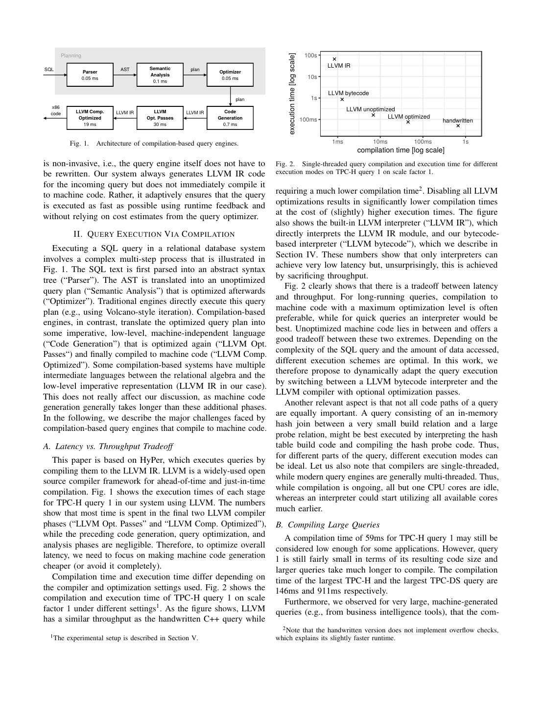
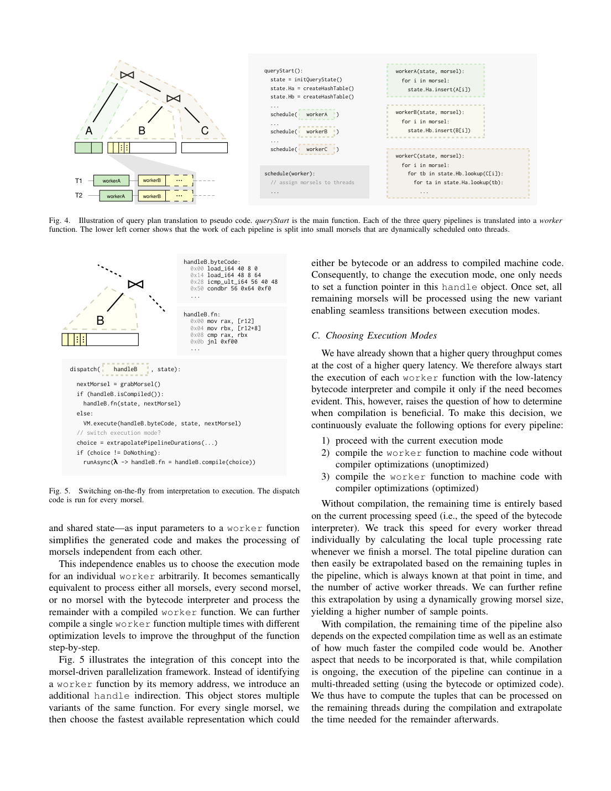

> 本组第 20 篇 · 查询执行引擎 · [全部论文]() · [上一篇]() · [下一篇]()

本文在HyPer中实现了pipeline粒度的自适应执行：保留现有LLVM IR生成器，以专用字节码VM启动每个pipeline，根据morsel边界的实际处理速率、已知剩余工作和经验编译成本/加速比，决定保持解释、编译未优化机器码或编译优化机器码。编译占用一个worker资源，其余线程继续当前模式；新代码完成后，后续morsel通过handle采用新变体，不重跑已完成工作，也不在指令中途迁移栈帧。共享数据布局、相同函数调用/内存写入、兼容调用约定及非重叠工作分配是语义前提。TPC-H全部22条查询、8线程、SF0.01-30的端到端几何平均显示它能匹配或优于最佳静态模式；这是所测配置的经验结果，不是每条查询或任意负载的最优性保证。大查询实验的0.9秒是字节码翻译时间，而非SQL运行时间。跨次执行的计划缓存结合与NULL宏指令仍是扩展讨论，不能当作已实现机制。

本文保留论文陈述、读者推断与待验证方案的区别；实验数字只适用于原文条件。原文和翻译来自已有 AI 辅助精读报告，已做来源匹配与编辑复核，不等于人工逐项核验或独立实验复现。所有页码均为 PDF 物理页。

## 论文与阅读范围

André Kohn, Viktor Leis, Thomas Neumann；Technische Universität München；Adaptive Execution of Compiled Queries。提供的PDF未明确印出其出版会议、年份和正式页码范围，故不从创建时间或参考文献推断书目信息。本次按PDF物理页1-12阅读全文，并渲染核对物理页2-12的图、表与公式；文本来自原生PDF提取，未使用OCR。

[论文集中的原始 PDF](https://github.com/lonng/db-papers/blob/4ff1331069c7cf52ac97dd769e5f484c1c35c200/papers/execution-engine/adaptive-execution-of-compiled-queries.pdf) · 本地来源：`execution-engine/adaptive-execution-of-compiled-queries.pdf`，共 12 页。

本篇保留 10 组原文精读和 57 条证据。截图为原始 PDF 的局部页选，不是重新生成的图表；未将整份 PDF 复制到博客。

## 研究问题与适用边界

研究问题是把编译型数据库的首次响应延迟与机器码吞吐量结合起来，而不是重新选择连接顺序或在执行中重优化关系计划。论文针对生成LLVM IR的查询引擎，在既有优化物理计划上切换其执行表示。

第1页的pgAdmin元数据查询只访问少量元组，HyPer执行不足1 ms，但优化LLVM编译需54 ms。作者用约50倍、频繁相似查询下98%时间用于编译说明问题；这些是该动机示例的近似比例，不应反推精确的1.08 ms执行时间。最大TPC-DS查询编译接近1秒；BI工具还可能生成MB级SQL。

长时ad hoc查询或预编译存储过程更容易摊销编译成本。计划/机器码缓存与prepared statements可以降低后续执行成本，但不能消除首次查询的编译等待。选择常量变化也带来复用与常量特化之间的取舍，论文没有给出缓存命中率测量。作者避免维护两套独立关系执行器，而以同一LLVM IR和数据结构支持解释及本机代码。

依据：论文陈述；PDF 物理页 1, 2, 11。证据：[C001N01](#evidence-c001n01), [C001N02](#evidence-c001n02), [C003N11](#evidence-c003n11), [SRC_SC17](#evidence-src_sc17)。

## 系统架构与关键组件

三个可选执行模式分别为专用VM字节码解释、未优化机器码、优化机器码。LLVM自带的IR解释器是低效对照，不是adaptive的起始执行器。系统仍进行SQL解析、语义分析、查询优化和LLVM IR生成；避免的是一开始就支付本机代码生成开销，而非完全不编译任何中间表示。

代码结构（第3-4页、图4）：queryStart负责一次性的C++初始化、共享哈希表创建和pipeline调度。由于只运行一次，本文设计不对其做本机编译。数据相关循环由worker(state,morsel)承担，一个worker对应一个pipeline。state包括共享中间状态，morsel指定互不重叠的输入范围。work stealing分配工作，文中的10,000 tuples是小morsel的例子，不是固定模式切换阈值。pipeline开始时记录输入关系/哈希表等总工作量，线程在每个morsel结束时记录处理速率。

同一worker的handle保存字节码与可用机器码变体。每次领取新morsel时，dispatch选择最快可用表示；编译完成后更新handle中的函数指针，已经运行的morsel仍在原模式完成，后续morsel使用新变体。决策粒度是pipeline，切换安全边界是morsel，二者不能混为同一个概念。每个pipeline先解释，可直接升级或分阶段经过两种本机模式，不要求每次都走完三档。

复用范围包括LLVM IR生成器、worker的数据布局、既有C++辅助函数及并行调度。第8-9页的互操作实现统一额外的指针参数以传递VM程序，机器码路径虽然不需要它仍接受该参数；这样更换函数指针即可互换表示。带标签指针和不同签名分派是作者讨论后未采用的方案。VM必须提供与已知导出C++签名相应的call opcode；作者可在编译时识别缺失项。

VM为定长、静态类型寄存器机，把类型烘焙到opcode中；约500种指令/类型组合、约800行解释器，LLVM IR到VM翻译器约2,400行，多数用于寄存器分配。寄存器文件优先栈分配、过大回退堆，常量0/1预置。它覆盖数据库自身产生的LLVM IR子集，不是任意LLVM程序的完整解释器。

依据：论文陈述；PDF 物理页 1, 2, 3, 4, 5, 6, 8, 9, 12。证据：[C001N02](#evidence-c001n02), [C001N06](#evidence-c001n06), [C001N07](#evidence-c001n07), [C001N10](#evidence-c001n10), [C002N03](#evidence-c002n03), [C002N05](#evidence-c002n05), [C002N07](#evidence-c002n07), [SRC_SC01](#evidence-src_sc01), [SRC_SC02](#evidence-src_sc02), [SRC_SC07](#evidence-src_sc07), [SRC_SC08](#evidence-src_sc08)。

*原论文 PDF 物理页 2，版权归原作者或出版方。点击图片可查看原尺寸。页面文本中定位到：Fig. 1.；Fig. 1. The SQL text is first parsed into an abstract syntax；Fig. 2.；Fig. 2 clearly shows that there is a tradeoff between latency。这是页面定位信息，不表示本次已复核图内所有数据。*

## 核心算法与启发式决策

1. 模式决策（第4-5页，图7）
每个线程在morsel边界记录局部tuple处理速率；只有一个worker承担外推决策，以减少同步开销。首次评估延迟1 ms，此后该线程每完成一个morsel重新评估。令n为剩余tuple数，w为活跃worker数，r0为各线程当前处理速率的平均值（每线程速率），ci为模式i的预计编译时间，ri=r0*speedupi(f)为新模式的预计每线程速率：
t0 = n / r0 / w
ti = ci + max(n - (w-1)*r0*ci, 0) / ri / w，i=1,2
比较t0、t1、t2，分别对应不编译、未优化编译、优化编译。编译期间只有w-1个worker继续当前模式，编译结束后w个worker处理余量；若w=1，不能假设仍有并行执行。编译转移后重置处理速率以收集新模式样本。

编译时间依据LLVM指令数量经验预测，加速比也来自经验数据；模式选择不依赖优化器的基数/代价估计，不等于没有估计。TPC-H/DS的300-19,000条指令观测近线性，但超大单函数查询会打破这个近似。动态增长morsel被提为可细化采样的方法，不宜写成已验证的固定必经策略。该公式是预测性启发式，没有全局最优保证。

读者构造的假设示例：w=4，r0=10,000 tuples/ms/线程，c2=50 ms，r2=100,000 tuples/ms/线程。若n=80,000，t0=80,000/(4*10,000)=2 ms，编译不划算。若n=5,000,000，t0=125 ms；编译时其余3线程处理1,500,000个，之后处理3,500,000个需8.75 ms，t2=58.75 ms，因此相对保持解释有利，仍需与t1比较。所有数字仅为读者假设，不是原论文实验。

2. SSA翻译、活跃性与虚拟寄存器复用（第6-8页）
先按逆后序组织基本块，建立支配树及pre/post编号以常数时间判断祖先关系；识别支配回边对应的循环，把函数入口当作伪循环头，并建立循环嵌套、范围及深度信息。作者使用带路径压缩的不相交集合加速关联。对每个值，收集定义/使用所在块，找到包含它们的最内层公共循环Cv；Cv中直接包含的块直接扩展live-range，嵌套循环中的块则提升到Cv内包含该块的最外层子循环。它不是无条件把寿命扩展为整个Cv。

原文图10-12的例子：值在块2定义、块5使用，块5位于[3,6]循环内，因此保守活跃区间为[2,6]而非[2,5]，也不是整个函数[1,7]。phi参数在相应前驱块末尾读取，phi紧接着在该前驱中写入，并在目标块读取。翻译时按需分配槽位、生成opcode、在前驱传播phi值并释放已死值；只有寿命不重叠的值才可共享槽位。线性时间是作者算法的复杂度主张，最优寄存器数不是其保证。

3. 宏指令折叠（第9页）
已实现把溢出检查的4条LLVM IR指令融合为1条VM操作，也融合GEP后接load/store。这里减少的是解释器opcode分派，不代表4条LLVM IR必然对应4条机器指令。大语料自动发现宏操作及NULL处理是候选未来工作，而非本文已实现、评测的机制。

依据：论文陈述；PDF 物理页 3, 4, 5, 6, 7, 8, 9, 11。证据：[C001N08](#evidence-c001n08), [C001N09](#evidence-c001n09), [C002N01](#evidence-c002n01), [C002N02](#evidence-c002n02), [C002N07](#evidence-c002n07), [C002N09](#evidence-c002n09), [C002N10](#evidence-c002n10), [C002N11](#evidence-c002n11), [C002N12](#evidence-c002n12), [C003N01](#evidence-c003n01), [C003N02](#evidence-c003n02), [SRC_SC04](#evidence-src_sc04), [SRC_SC05](#evidence-src_sc05), [SRC_SC06](#evidence-src_sc06), [SRC_SC09](#evidence-src_sc09), [SRC_SC10](#evidence-src_sc10), [SRC_SC15](#evidence-src_sc15)。

## 正确性保证与不变量

论文给出工程不变量和实现说明，而不是任意SQL、任意LLVM IR或任意并发调度的形式化正确性证明。性能预测误差与查询语义正确性也是两类不同问题。

切换的前提是各执行模式实现同一worker对同一数据结构的操作，保留所有函数调用、内存写入及错误语义；morsel范围不能重复或遗漏，共享state必须保持有效。切换只影响后续worker调用，不把正在解释的指令或栈帧中途转为本机状态。若这些条件成立，已完成工作无需重放；这不意味着编译不花时间，也不表示无条件不会出现数据损坏。

ABI互操作也是前提：统一额外指针参数，兼容返回/参数类型，VM的call opcode覆盖实际导出的C++函数签名。论文没有完整交代函数指针并发发布的原子性、内存序或异常切换细节；移植时需单独验证，不可从图5伪代码虚构已实现的同步协议。

寄存器分配的近似对象是寿命精度和所需槽位数量，不是允许程序结果近似。循环寿命延长必须保守覆盖所有使用，phi入边处理必须正确，只有不相交寿命可复用寄存器。L1驻留是减少寄存器文件的性能目标，不是能由算法保证的硬件事实。第7页Q55的36/21/6 KB是具体比较，不是所有查询均缩小到6 KB的界限。

VM只实现HyPer生成的LLVM子集；代码生成器扩大指令集合或改变调用签名时需补齐支持。溢出检查融合不能省略错误检测；第2页特别说明手写C++基线未实现溢出检查，所以它并不是与HyPer完全同语义的性能基线。

依据：论文陈述；PDF 物理页 2, 3, 4, 5, 6, 7, 8, 9, 12。证据：[C001N06](#evidence-c001n06), [C001N07](#evidence-c001n07), [C002N04](#evidence-c002n04), [C002N09](#evidence-c002n09), [C002N11](#evidence-c002n11), [C002N12](#evidence-c002n12), [C004N05](#evidence-c004n05), [SRC_SC02](#evidence-src_sc02), [SRC_SC07](#evidence-src_sc07), [SRC_SC08](#evidence-src_sc08), [SRC_SC09](#evidence-src_sc09), [SRC_SC18](#evidence-src_sc18)。

## 实验评估与数据分析

实验环境（第9页）：HyPer；8核AMD Ryzen 7 1700X、32 GB RAM、LLVM 3.8、Linux 4.11。作者称Intel CPU上重复得到相似结果，但没有给出该Intel型号和独立数字表。对照为PostgreSQL 9.6和MonetDB 1.7（按原文版本记录）。optimized执行手选LLVM IR passes后启用机器相关后端优化；unoptimized启用fast instruction selection、不运行LLVM IR passes并采用低后端优化级别，不能理解为完全没有任何后端处理。

阶段成本（第2-3、10页，已核对原图）：图1的Q1解析0.05、语义分析0.1、优化器0.05、IR生成0.7、LLVM passes 30、本机代码生成19 ms。图3/表I则给出IR生成0.7、字节码0.4、未优化编译6、优化passes 25加后端17=42 ms。第2页正文另述Q1 59 ms及最大TPC-H/DS 146/911 ms；表I最大优化编译为149 ms。论文不同位置数值有差异，不能把这些并成同一测量。表I各列独立最大值：PG plan 1.9、Monet plan 1.0、HyPer plan 0.8、cdg 1.5、bc 1.2、unopt 23、opt 149 ms。本文不是没有提供具体数值。

全查询端到端结果（第9页，图13）：TPC-H全部22条，8线程，SF0.01-30，约10 MB-30 GB；指标是包含规划、编译和执行的几何平均。SF0.01/0.1不选择编译，与纯bytecode相当；从SF1起部分pipeline值得编译；SF30优化本机模式更有竞争力，adaptive仍因便宜pipeline可直接解释而优于两种静态编译。这些模式选择也在正文明确描述，不只是图像推测。图中未标注的精确交点/数值不做数字化推断；更大SF的优势只是作者预期。

动态轨迹（第9-10页，图14）：Q11、SF1、4线程、7个pipeline，约1 ms后为其中2个大pipeline选择编译，其余5个保持解释。optimized静态模式编译需103 ms，所以未画在短时轨迹中。作者报告相对于unoptimized、bytecode、optimized分别快10%、40%、80%，这些属于该单查询情形，不能当成全TPC-H平均改进。

执行时间与吞吐量（第10-11页，表II）：SF1且不计规划/编译。全部22条的单线程几何均值，PG/Monet/HyPer-bc/unopt/opt依次497/57/232/60/46 ms；8线程HyPer-bc/unopt/opt为45/15/12 ms，表中没有8线程PG/Monet列。以Q1为例，相应单线程为4908/484/858/161/77 ms，8线程HyPer为170/34/16 ms。第11页正文报告bytecode比未优化机器码慢3.6倍、比优化码慢5.0倍，却比PostgreSQL快2.1倍。其中3.6倍与表II单线程几何均值232/60约3.87并不一致，单纯整数舍入不足以解释；原文未说明原因，应分别保留，不推造统一比率。执行阶段比较也不能称作端到端加速。表II中的Monet单线程均值57 ms仍优于bytecode 232 ms，本文不证明全面超越所有解释/列式引擎。

超大查询（第11页，图15）：单表扫描加10-1,900个聚合表达式，形成1,000-160,000条LLVM指令，主要集中在一个大函数。优化编译在约10,000条指令已超过4 s；最大查询未优化编译4.4 s，字节码翻译0.9 s。图的纵轴明确是compilation time；0.9 s不是扫描/聚合端到端时间，也不是解释速度接近机器码的证据。此实验说明常规TPC-H/DS上的近线性LLVM编译预测不能外推到巨大单函数。

寄存器文件（第7页，TPC-DS Q55）：无复用36 KB、固定邻块窗口贪心21 KB、本文算法6 KB。TPC-DS还用于指令数/编译成本模型；不能因此称本文提供了全部TPC-DS查询的端到端性能对比。论文未充分报告方差、置信区间、所有系统参数和Intel细节，因此不保证在任意环境精确复现这些比率。

依据：论文陈述；PDF 物理页 2, 3, 5, 7, 9, 10, 11。证据：[C001N03](#evidence-c001n03), [C001N04](#evidence-c001n04), [C002N02](#evidence-c002n02), [C002N09](#evidence-c002n09), [C003N03](#evidence-c003n03), [C003N04](#evidence-c003n04), [C003N05](#evidence-c003n05), [C003N07](#evidence-c003n07), [C003N09](#evidence-c003n09), [C003N10](#evidence-c003n10), [SRC_SC11](#evidence-src_sc11), [SRC_SC12](#evidence-src_sc12), [SRC_SC13](#evidence-src_sc13), [SRC_SC14](#evidence-src_sc14), [SRC_SC15](#evidence-src_sc15), [SRC_SC16](#evidence-src_sc16), [SRC_SC18](#evidence-src_sc18)。

*原论文 PDF 物理页 4，版权归原作者或出版方。点击图片可查看原尺寸。页面文本中定位到：Fig. 4.；Fig. 5.；Fig. 5 illustrates the integration of this concept into the。这是页面定位信息，不表示本次已复核图内所有数据。*

## 设计权衡与局限性

以下为基于原文的读者分析，不是额外测得的结论。

延迟与吞吐：专用bytecode仍有翻译及分派开销，但比本机编译更快启动。编译型表示执行更快，却可能在短pipeline上永远无法偿还生成成本；先解释也会在长pipeline上暂时损失吞吐。每个pipeline独立选择以及编译/执行重叠减轻该矛盾，不意味着开销为零。

模型与资源：剩余输入工作已知并不等于每个tuple后续代价相同。数据倾斜、输出基数差异、缓存冷启动等可能使已观测速率不能代表剩余工作。论文延迟1 ms采样并每morsel重评估，但没有给出最坏决策误差保证。图7已扣除一个编译worker；共享缓存/内存带宽干扰及跨查询竞争可能仍使外推失准，论文没有提供完整的并发编译预算、队列优先级或多租户隔离机制。

空间与翻译复杂度：虚拟寄存器越少越有利于缓存，保守延长寿命却可能增加槽位。作者选择可扩展的近似分配而非最优槽位数；固定长度bytecode较本机代码更占空间，但比指针密集LLVM IR紧凑。不同内存表示之间的比较基准不能混淆。

维护与可移植性：共享IR、C++辅助函数及数据结构减少两套执行器语义漂移的风险；仍需维护VM、翻译器、签名适配及指令融合模式。大查询的线性bytecode翻译不会使LLVM本机编译也线性。移植到不同IR、并行模型或LLVM版本，需要重新测量编译/加速比并验证语义，不能只更换模式选择函数。

依据：读者推断；PDF 物理页 4, 5, 6, 7, 8, 9, 11。证据：[C001N09](#evidence-c001n09), [C002N01](#evidence-c002n01), [C002N05](#evidence-c002n05), [C002N08](#evidence-c002n08), [C002N09](#evidence-c002n09), [SRC_SC04](#evidence-src_sc04), [SRC_SC06](#evidence-src_sc06), [SRC_SC08](#evidence-src_sc08), [SRC_SC15](#evidence-src_sc15)。

## 与现有技术的对比分析

与传统引擎：PostgreSQL/MonetDB可直接执行其计划，不支付HyPer式本机编译，但表I仍有规划开销。表II确有bytecode与PostgreSQL的执行时间对照，不能说该比较不存在：本实验报告bytecode约快2.1倍。另一方面MonetDB单线程执行几何均值更低，不能泛化为bytecode总优于Volcano、向量化或column-at-a-time引擎。

与LLVM自带解释器：图2所示Q1 SF1中，原生LLVM IR解释器比对应本机代码慢800倍以上。专用VM以紧凑、类型化bytecode及宏指令减少解释成本，但表II中它仍慢于两种本机代码。这是不同表示与实现的比较，不是解释和编译的一般定理。手写C++的缺少溢出检查也需保留为语义差异。

与其他编译数据库：第11页讨论HyPer/Peloton式直接LLVM IR生成，MemSQL的可解释Bit Code层，及LegoBase/JVM与C两条路径的潜在适配方式。这些是作者的可移植性分析，不表示论文已经在这些系统实现、验证同样的自适应框架。此处只报告论文当时的讨论，不声称它们今天的架构状态。

与托管语言JIT：第12页以HotSpot/CLR/V8等先解释后编译的思想作类比，数据库可利用已知生成指令、数据结构和pipeline工作量。本文的实际触发条件是剩余时间外推，不是通用热点计数器；低级代码对内存控制的需求也不构成“任何数据库都不能使用托管语言”的证明。

与缓存复用：计划缓存是正交路线；可结合自适应策略跨多次执行记录pipeline次数，使频繁查询最终优化编译，但第11页明确以one could extend表述。本文没有实现跨查询机器码缓存、失效/淘汰策略或跨次热点计数。

依据：论文陈述；PDF 物理页 1, 2, 5, 10, 11, 12。证据：[C001N04](#evidence-c001n04), [C002N03](#evidence-c002n03), [C003N07](#evidence-c003n07), [C003N11](#evidence-c003n11), [C003N12](#evidence-c003n12), [C004N04](#evidence-c004n04), [C004N05](#evidence-c004n05), [C004N06](#evidence-c004n06), [SRC_SC14](#evidence-src_sc14), [SRC_SC17](#evidence-src_sc17), [SRC_SC18](#evidence-src_sc18)。

## 复现指南与待验证问题

以下是读者提出的复现计划，未在本次审核中执行，也不等于作者提供了开源可直接运行的HyPer构件。

1. 获得合法可用的原HyPer实现或实现语义等价的原型。精确复现优先匹配Ryzen 7 1700X八核、32 GB、LLVM 3.8、Linux 4.11；使用现代系统应作为独立移植实验记录，不能把结果视为原环境复测。配置四种执行策略并明确IR passes、fast instruction selection和后端优化级别。

2. 运行TPC-H全部22条，SF0.01、0.1、1、10、30，8线程，分别记录规划、IR生成、bytecode翻译、本机编译、执行及总时间。按图13计算逐查询时间的几何平均；按表II另列SF1纯执行数据，不能混用。记录重复次数、冷热状态、误差和数据驻留条件；这些补充控制项是本复现建议。

3. 复刻Q11 SF1四线程轨迹：记录pipeline、morsel、模式、开始/结束时间、编译占用线程与handle生效边界；核对是否仅两条重pipeline值得编译，且已完成morsel不重放。记录实际ci、速率和预测t0/t1/t2以定位误判，不把1 ms当作通用最佳阈值。

4. 正确性先于性能：对解释、两种本机模式和强制不同morsel切换序列比较结果、溢出错误与可观察副作用。加入嵌套循环、分支、phi、外部C++调用及大寄存器文件用例。验证槽位复用不覆盖活值，统一额外参数与返回ABI兼容；并发指针发布及异常处理需专门测试，而非假设伪代码已经解决。

5. 构造单扫描加10-1,900个聚合表达式，记录LLVM指令数、本机编译时间与bytecode翻译时间，对照图15而非把0.9 s当运行目标。重做Q55的36/21/6 KB比较需要相同IR和分配策略；记录实际寄存器文件大小，不能只比较查询总内存。

6. 移植研究分别验证向量批次是否可作为安全调用边界、不同LLVM版本是否改变ci/加速比、倾斜工作及多查询编译竞争如何影响预测。批次不自动等价于morsel，通用优化器也不自动负责生成LLVM IR。模式切换只改变同一计划的执行表示，不能自动纠正错误的连接顺序；运行时重优化、缓存结合和并发编译限额均须作为新方案单独实现评估。

依据：待验证的工程设想；PDF 物理页 2, 3, 4, 5, 6, 7, 8, 9, 10, 11, 12。证据：[C001N06](#evidence-c001n06), [C001N07](#evidence-c001n07), [C002N09](#evidence-c002n09), [C002N12](#evidence-c002n12), [C003N03](#evidence-c003n03), [C003N04](#evidence-c003n04), [C003N05](#evidence-c003n05), [C003N10](#evidence-c003n10), [SRC_SC06](#evidence-src_sc06), [SRC_SC08](#evidence-src_sc08), [SRC_SC13](#evidence-src_sc13), [SRC_SC16](#evidence-src_sc16), [SRC_SC18](#evidence-src_sc18)。

## 结论与工程启示

本文实际实现的是HyPer内共享LLVM IR和数据结构的三种执行表示，以pipeline级剩余时间预测决定编译，以morsel边界替换后续worker调用。专用VM、快速翻译和现有LLVM编译器共同支撑低启动延迟与后期吞吐，而不是两套关系执行器或任意位置的OSR。

TPC-H 8线程、SF0.01-30的端到端几何平均、Q11四线程轨迹、SF1执行时间及合成大查询翻译开销共同构成实验依据。论文既提供具体数字也提供环境；不能因总结页不重复细节就说全篇缺少数据。0.9 s只对应最大合成查询的bytecode翻译；解释执行本身仍慢于本机代码。经验上匹配/优于最佳静态模式，不代表逐查询、任意硬件或多租户负载全局最优。

工程收益来自复用、可安全交换的工作单元及可控翻译开销；前提是共享状态和调用语义一致、工作范围不重叠、支持的IR子集完整、寿命分析保守。近似的是寄存器利用率和时间预测，不是查询结果。线性bytecode算法不保证LLVM编译成本线性，也没有给出所有控制流和并发情况的形式化证明。跨执行缓存、NULL宏指令、其他系统移植和资源隔离仍属扩展或待验证问题。

依据：论文陈述；PDF 物理页 2, 3, 4, 5, 6, 7, 8, 9, 10, 11, 12。证据：[C001N07](#evidence-c001n07), [C002N01](#evidence-c002n01), [C002N09](#evidence-c002n09), [C003N03](#evidence-c003n03), [C003N05](#evidence-c003n05), [C003N09](#evidence-c003n09), [C003N10](#evidence-c003n10), [C004N01](#evidence-c004n01), [C004N02](#evidence-c004n02), [C004N03](#evidence-c004n03), [SRC_SC08](#evidence-src_sc08), [SRC_SC10](#evidence-src_sc10), [SRC_SC12](#evidence-src_sc12), [SRC_SC14](#evidence-src_sc14), [SRC_SC16](#evidence-src_sc16), [SRC_SC17](#evidence-src_sc17), [SRC_SC18](#evidence-src_sc18)。

## 原文精读：从句子回到机制

以下保留原文、忠实翻译、含义与边界；假设示例不作为论文实验结果。

### P001 · PDF 物理页 1

**原文**

<blockquote class="paper-source-quote"><pre><code>However, before HyPer can execute&#10;this query, it needs to compile it to machine code. With&#10;optimizations enabled, LLVM takes 54ms to compile this&#10;query. In other words, compilation takes 50 times longer&#10;than execution. Assuming a workload where similar queries&#10;are executed frequently, 98% of the time will be wasted on&#10;compilation.</code></pre></blockquote>

**忠实翻译**

> 然而，在 HyPer 能够执行该查询之前，它需要将其编译为机器码。在启用优化的情况下，LLVM 花费 54ms 来编译该查询。换言之，编译耗时是执行耗时的 50 倍。假设一个频繁执行相似查询的工作负载，98% 的时间将被浪费在编译上。

**技术含义与边界**

> 该示例说明54 ms编译可远大于不足1 ms的执行时间。作者的“50倍”和98%是近似动机描述，不能精确反推执行为1.08 ms并与前文不足1 ms矛盾。这里没有证明所有查询的编译占比相同。

**常见误读**

> 容易误读为所有查询的编译时间都是执行时间的 50 倍。原文明确限定了这是针对“this query”以及“assuming a workload where similar queries are executed frequently”的假设场景，不能泛化为全局性能特征。

**读者构造的假设示例**

> 读者构造的假设示例：假设某查询执行耗时 2ms，而 LLVM 优化编译耗时 100ms，若该查询只执行一次，则编译占比极高；若同一编译结果被缓存并复用 1000 次，则单次分摊编译开销可忽略。此例仅为帮助理解原文的比例关系，不代表作者的实验数据。

### P002 · PDF 物理页 12

**原文**

<blockquote class="paper-source-quote"><pre><code>We also presented an adaptive execution&#10;framework that dynamically and automatically adjusts the&#10;execution mode of a query to minimize its overall execution&#10;time. In this approach, all decisions are made at a pipeline&#10;granularity and are based on runtime feedback instead of&#10;having to decide up-front. We further proposed a bytecode&#10;interpreter that features a linear-time translation of LLVM IR&#10;into efficient bytecode.</code></pre></blockquote>

**忠实翻译**

> 我们还提出了一个自适应执行框架，该框架动态且自动地调整查询的执行模式以最小化其总体执行时间。在该方法中，所有决策都在 pipeline 粒度上做出，并基于运行时反馈，而不是必须预先决定。我们进一步提出了一种字节码解释器，其特征是将 LLVM IR 线性时间翻译为高效的字节码。

**技术含义与边界**

> 作者总结pipeline粒度模式选择、运行时反馈与快速LLVM IR到bytecode翻译。具体模式决策还使用经验编译成本/加速比，详见图7；线性主张限于翻译算法和数据库生成的IR子集，不是全查询运行时间或任意LLVM程序的复杂度保证。

**常见误读**

> 容易将“线性时间翻译”误解为查询整体执行时间是线性的，或将“pipeline 粒度决策”误解为算子粒度或语句粒度。原文明确限定翻译对象是 LLVM IR，决策粒度是 pipeline。

**读者构造的假设示例**

> 读者构造的假设示例：假设一个查询包含两个 pipeline，第一个 pipeline 处理小数据集，第二个处理大数据集。系统在运行时观察到第一个 pipeline 数据量小，可能选择解释执行；观察到第二个 pipeline 数据量大，可能触发编译执行。此例用于说明 pipeline 粒度与运行时反馈的含义，非作者实验。

### P003 · PDF 物理页 7

**原文**

<blockquote class="paper-source-quote"><pre><code>Finding the optimal register&#10;allocation for a program in SSA form with an unbounded&#10;number of registers is super-linear. Instead, our register allocator&#10;may sometimes needlessly extend the lifetime of a variable&#10;within the bounds of the innermost loop that contains all uses of&#10;that value. In practice, however, this only occurs with complex&#10;control flows, has imperceptible effects and serves as reasonable&#10;trade off for the linear worst-case behavior.</code></pre></blockquote>

**忠实翻译**

> 在具有无界数量寄存器的 SSA 形式程序中寻找最优寄存器分配是超线性的。相反，我们的寄存器分配器有时可能会不必要地延长变量的生命周期，但限制在包含该值所有使用的最内层循环的范围内。然而在实践中，这只发生在复杂的控制流中，影响微乎其微，并且是为获得线性最坏情况行为而做出的合理权衡。

**技术含义与边界**

> 原文陈述了自定义寄存器分配器的设计取舍：放弃求解超线性的最优寄存器分配问题，转而采用一种在最内层循环边界内可能延长变量生命周期的启发式方法，从而保证线性最坏情况时间复杂度。适用边界：作者指出这种妥协仅在复杂控制流中出现且影响微小，但这属于作者的工程经验判断。

**常见误读**

> 容易误读为该寄存器分配器在所有情况下都能产生最优代码，或者认为延长变量生命周期会导致严重的性能退化。原文明确说明这是一种“trade off”，且强调“in practice... has imperceptible effects”，即承认存在次优情况但认为可接受。

**读者构造的假设示例**

> 读者构造的假设示例：假设在一个包含多个分支的最内层循环中，变量 X 在分支 A 和分支 B 中被使用。为了保持线性时间复杂度，分配器可能让 X 的寄存器占用贯穿整个循环体，即使它在分支 A 之后就不再需要。这可能导致寄存器压力略微增加，但不改变算法的线性最坏情况界限。此为帮助理解的假设，非原文复现。

### P004 · PDF 物理页 3

**原文**

<blockquote class="paper-source-quote"><pre><code>One possible way to decide between the different execution&#10;modes is to rely on the cost estimates computed by the query&#10;optimizer. Cardinality estimates as well as cost models are&#10;often inaccurate [17], [18], which may result in unnecessary&#10;compilations or long-running queries being executed in the&#10;interpreter. The effects of a wrong decision can be severe as the&#10;bytecode interpreter can be slower by an order of magnitude&#10;and compilation can easily take hundreds of milliseconds.</code></pre></blockquote>

**忠实翻译**

> 在不同执行模式之间进行决策的一种可能方法是依赖查询优化器计算的成本估计。基数估计以及成本模型通常是不准确的 [17], [18]，这可能导致不必要的编译，或者长时间运行的查询在解释器中执行。错误决策的影响可能是严重的，因为字节码解释器可能慢一个数量级，而编译很容易花费数百毫秒。

**技术含义与边界**

> 原文说明纯静态选择的误判风险，并用文献[17][18]支撑其背景陈述；本次未独立阅读这些引用。can表示可能慢一个数量级，而非固定10倍。本框架改用实际速率和剩余工作，但仍需要经验编译时间与加速比。

**常见误读**

> 容易误读为字节码解释器总是比编译代码慢一个数量级，或者编译总是需要数百毫秒。原文使用的是“can be slower by an order of magnitude”和“can easily take hundreds of milliseconds”，表示的是潜在风险和最坏情况下的可能性，而非绝对常数。

**读者构造的假设示例**

> 读者构造的假设示例：某扫描pipeline实际要处理100万输入行，静态估计却认为只有少量输入，可能选解释并低估总耗时；反过来，高估剩余工作会为短pipeline支付不划算的200 ms编译。这里指输入工作而非只看聚合输出行数；数字不是作者测量。

### P005 · PDF 物理页 5

**原文**

<blockquote class="paper-source-quote"><pre><code>As Fig. 6 shows, the number of&#10;LLVM instructions of a query correlates very well with its&#10;compilation time for all TPC-H and TPC-DS queries. The&#10;generated plans contain between 300 and 19,000 instructions&#10;for which we observe a near-linear compilation time. For&#10;the speed-ups between different execution modes, we use&#10;empirical data (cf. Section V-D).</code></pre></blockquote>

**忠实翻译**

> 如图 6 所示，对于所有 TPC-H 和 TPC-DS 查询，查询的 LLVM 指令数量与其编译时间高度相关。生成的计划包含 300 到 19,000 条指令，对此我们观察到近乎线性的编译时间。对于不同执行模式之间的加速比，我们使用经验数据（参见第 V-D 节）。

**技术含义与边界**

> 原文在TPC-H/DS生成计划300-19,000条LLVM指令范围内观察近线性编译成本；模式间加速比也来自经验数据。本次已视觉核对第5页图6，不对未标注散点臆造精确数值；第11页给出大单函数失效边界。

**常见误读**

> 容易将“TPC-H 和 TPC-DS 中的近线性关系”泛化为所有可能查询的全局保证。原文明确限定了观察范围是“for all TPC-H and TPC-DS queries”，且后续段落（如 P008）明确指出机器生成的超大查询可能不具备此性质。

**读者构造的假设示例**

> 读者构造的假设示例：假设某 TPC-H 查询生成了 5000 条 LLVM 指令，编译耗时 15ms；另一查询生成了 10000 条指令，编译耗时约 30ms，呈现近线性增长。但如果指令数达到 50 万条（超出原文 19,000 的范围），线性关系是否成立则未知。此例用于说明原文数据的适用范围，非作者实验。

### P006 · PDF 物理页 9

**原文**

<blockquote class="paper-source-quote"><pre><code>Any arithmetic that occurs within&#10;a query is checked for overflows in order to report overflow&#10;errors to the user. With LLVM, this check boils down to 4&#10;instructions that are always executed in sequence. With the&#10;bytecode interpreter, our translator recognizes this sequence,&#10;and replaces it with a single VM bytecode that performs all four&#10;steps at once. This greatly reduces the number of instructions&#10;for some queries and decreases their execution time.</code></pre></blockquote>

**忠实翻译**

> 查询中发生的任何算术运算都会被检查是否溢出，以便向用户报告溢出错误。使用 LLVM 时，该检查归结为始终按顺序执行的 4 条指令。使用字节码解释器时，我们的翻译器会识别该序列，并将其替换为一次性执行所有四个步骤的单个 VM 字节码。这大大减少了某些查询的指令数量并缩短了它们的执行时间。

**技术含义与边界**

> 已实现的优化是将4条LLVM IR构成的溢出检查序列融合为1条VM操作，减少bytecode分派，同时必须保留错误检测语义。比较对象是逐条解释IR式操作，不是声称比优化本机码更快；LLVM IR条数也不等于机器指令条数。

**常见误读**

> 容易误读为字节码解释器在所有方面都比 LLVM 编译代码快。原文仅指出在“溢出检查”这一特定模式下，字节码通过指令折叠减少了开销，这是解释器层面的宏指令优化，不代表整体执行速度超越编译代码。

**读者构造的假设示例**

> 读者构造的假设示例：1000次受检查的加法若各需解释4个IR层面的操作，可通过融合为每次1个VM宏操作减少分派。ADD_CHECK_OVERFLOW只是示意名称，不是论文公布的真实opcode；本机编译后的指令数不能从该例推导。

### P007 · PDF 物理页 2

**原文**

<blockquote class="paper-source-quote"><pre><code>LLVM is a widely-used open&#10;source compiler framework for ahead-of-time and just-in-time&#10;compilation. Fig. 1 shows the execution times of each stage&#10;for TPC-H query 1 in our system using LLVM. The numbers&#10;show that most time is spent in the final two LLVM compiler&#10;phases (“LLVM Opt. Passes” and “LLVM Comp. Optimized”),&#10;while the preceding code generation, query optimization, and&#10;analysis phases are negligible.</code></pre></blockquote>

**忠实翻译**

> LLVM 是一个广泛使用的开源编译器框架，用于提前编译和即时编译。图 1 显示了在我们的系统中使用 LLVM 执行 TPC-H 查询 1 时各个阶段的执行时间。这些数字表明，大部分时间花费在最后两个 LLVM 编译器阶段（“LLVM Opt. Passes”和“LLVM Comp. Optimized”），而之前的代码生成、查询优化和分析阶段是可以忽略的。

**技术含义与边界**

> 图1对应Q1编译前端与LLVM阶段的具体测量：解析0.05、语义0.1、优化器0.05、IR生成0.7、LLVM passes 30、本机生成19 ms。本次已核对原图。图3/表I的优化阶段另为25+17=42 ms，不应将不同位置测量混成统一成本；结论仅是此处LLVM阶段主导。

**常见误读**

> 容易误读为数据库的查询优化器不重要或不耗时。原文比较的是“JIT 编译流程中”各阶段的相对耗时，指出 LLVM 后端阶段主导了编译延迟，并未否定查询优化器在整体查询处理中的重要性。

**读者构造的假设示例**

> 读者构造的假设示例：假设 TPC-H Q1 的总编译时间为 60ms，其中数据库解析和优化耗时 1ms，生成 LLVM IR 耗时 2ms，而 LLVM 优化 Pass 耗时 30ms，LLVM 机器码生成耗时 27ms。这说明瓶颈在 LLVM 后端。此例用于辅助理解阶段耗时分布，不代表原文的具体测量数字。

### P008 · PDF 物理页 11

**原文**

<blockquote class="paper-source-quote"><pre><code>Compiling Very Large Queries&#10;In Section III, we introduced a linear cost function that&#10;estimates the compilation time based on the number of&#10;instructions in the pipeline. However, we derived this function&#10;from the TPC-H and TPC-DS benchmarks which do not contain&#10;particularly complex queries. Machine-generated queries, on&#10;the other hand, can easily comprise multiple MB of SQL text&#10;with very unpleasant properties for the query compiler.</code></pre></blockquote>

**忠实翻译**

> 编译非常大的查询
> 在第三节中，我们引入了一个线性成本函数，根据 pipeline 中的指令数量来估计编译时间。然而，我们是从 TPC-H 和 TPC-DS 基准测试推导出该函数的，这些基准测试不包含特别复杂的查询。另一方面，机器生成的查询很容易包含多 MB 的 SQL 文本，这对查询编译器来说具有非常不利的属性。

**技术含义与边界**

> 该段限制的是经验线性LLVM编译成本模型的可外推性，而不是断言TPC-H/DS外所有查询都失败。第11页单扫描多聚合实验展示大函数恶化；它与作者线性bytecode翻译算法是不同层面的复杂度。

**常见误读**

> 容易忽视此段对前文线性模型的否定性补充，错误地将线性估计应用于任意规模的查询。原文使用了“However”和“do not contain particularly complex queries”来明确限制先前结论的泛化能力。

**读者构造的假设示例**

> 读者构造的假设示例：假设 BI 工具自动生成了一条包含 5000 个 UNION ALL 分支的 SQL，文本大小为 3MB。此时指令数可能远超 19,000，LLVM 的内存消耗或编译时间可能呈现超线性增长，导致原先基于 TPC-H 推导的线性预测公式严重低估实际编译时间。此例用于说明超大查询的挑战，非作者实验。

### P009 · PDF 物理页 4

**原文**

<blockquote class="paper-source-quote"><pre><code>Fig. 5 illustrates the integration of this concept into the&#10;morsel-driven parallelization framework. Instead of identifying&#10;a worker function by its memory address, we introduce an&#10;additional handle indirection. This object stores multiple&#10;variants of the same function. For every single morsel, we&#10;then choose the fastest available representation which could&#10;either be bytecode or an address to compiled machine code.</code></pre></blockquote>

**忠实翻译**

> 图 5 说明了将该概念集成到 morsel-driven 并行化框架中。我们通过引入额外的句柄间接层来代替通过内存地址标识 worker 函数。该对象存储同一函数的多个变体。然后，对于每一个单独的 morsel，我们选择最快的可用表示形式，它可以是字节码，也可以是指向已编译机器码的地址。

**技术含义与边界**

> handle保存同一worker的不同表示，并在下一morsel分派时采用最快可用版本；本次已核对第4页图5。它不是在运行中的morsel内部迁移指令或栈帧；第8页统一额外参数解释了调用兼容性。

**常见误读**

> 容易误读为整个查询只能统一选择一种执行模式。原文明确指出“For every single morsel, we then choose...”，这意味着在同一个查询的不同 morsel 甚至不同 pipeline 中，可以混合使用解释执行和编译执行。

**读者构造的假设示例**

> 读者构造的假设示例：假设一个扫描算子将数据分为 4 个 morsel 交给 4 个线程。当第一个 morsel 到达时，机器码尚未编译完成，句柄指向字节码，线程使用解释器执行；当第三个 morsel 到达时，后台编译已完成，句柄更新为指向机器码地址，线程直接使用编译后的代码执行。此例用于说明句柄间接层和 morsel 级切换的机制，非作者实验。

### P010 · PDF 物理页 10

**原文**

<blockquote class="paper-source-quote"><pre><code>The&#10;table shows, that even unoptimized machine code compilation is&#10;generally around 10x slower than planning and code generation.&#10;Optimized compilation is even slower and takes up to 150 ms&#10;for TPC-H. Bytecode generation, on the other hand, is very&#10;fast and is always finished in less than 2 ms.&#10;D. Performance of Interpreted and Compiled Code&#10;Let us next compare the execution times of the bytecode&#10;interpreter and the compiled machine code.</code></pre></blockquote>

**忠实翻译**

> 该表显示，即使是未优化的机器码编译通常也比规划和代码生成慢约 10 倍。优化后的编译更慢，对于 TPC-H 最多需要 150 ms。另一方面，字节码生成非常快，总是在不到 2 ms 内完成。
> D. 解释代码与编译代码的性能
> 接下来让我们比较字节码解释器和已编译机器码的执行时间。

**技术含义与边界**

> 此处讨论规划、IR生成及编译/翻译阶段，不是执行速度。本次已核对第10页表I：全部22条TPC-H中HyPer plan/cdg/bc/unopt/opt各列最大值为0.8/1.5/1.2/23/149 ms。约10倍是正文概括，不是每行精确恒等式；下一节表II才比较执行时间。

**常见误读**

> 容易将“字节码生成 < 2ms”与“字节码执行速度快”混淆。原文此处仅讨论“生成（generation/compilation）”阶段的耗时，字节码生成极快是其优势，但其执行速度（在下一节讨论）通常慢于编译后的机器码。此外，“up to 150 ms”限定于 TPC-H 基准。

**读者构造的假设示例**

> 读者构造的假设示例：假设查询规划和生成 LLVM IR 耗时 3ms。那么未优化机器码编译大约耗时 30ms（10 倍），优化编译可能耗时 100ms，而将同样的 LLVM IR 翻译为字节码仅需 1.5ms（< 2ms）。这说明如果查询只需执行一次且数据量小，字节码生成的低延迟可能使其总体响应时间优于等待 100ms 的优化编译。此例用于说明生成时间的差异，非作者实验数据。

## 尚未解决的问题

1. 当剩余tuple的单条处理成本受倾斜、分支选择或输出规模影响时，如何量化图7的预测误差与错误编译成本？
2. 在不同LLVM版本和CPU环境下，如何重新标定经验编译成本/加速比，并在巨大单函数上识别近线性模型失效？
3. 现有引擎的工作批次是否具备与worker(state,morsel)相同的状态与调用边界，如何证明交换表示不重放或遗漏工作？
4. 多查询同时触发编译时，如何限制编译CPU/内存、组织队列并维持可预测延迟？本文没有评测这套机制。
5. 在单个不可快速本机编译的巨大worker内部进一步切分编译单元，是新的设计问题；不能把已有pipeline级编译当作缺失功能。
6. 跨执行的缓存策略、失效规则与pipeline执行次数累计，以及新宏指令的发现与维护，如何作为独立扩展进行正确性和性能验证？

## 证据索引

证据编号沿用原报告，便于将上文判断追溯到原句。引文匹配只验证位置，不证明解读正确。

**C001N01 · PDF 物理页 1**

编译型数据库引擎面临的核心问题是编译延迟与执行效率的权衡。对于仅访问少量元组的查询，编译时间远超执行时间。文中给出具体证据：一个涉及 pg_inherits 等系统表的元数据查询在 HyPer 中执行不到1毫秒，但 LLVM 开启优化后编译需54毫秒，编译时间是执行的约50倍。若此类查询频繁执行，98%的时间浪费在编译上。适用边界：该问题主要针对大量短查询、交互式应用或BI工具生成的超大查询；对长时间运行的 ad hoc 查询或预编译存储过程，编译开销可接受。

<blockquote class="paper-source-quote"><pre><code>With optimizations enabled, LLVM takes 54ms to compile this query. In other words, compilation takes 50 times longer than execution.</code></pre></blockquote>

**C001N02 · PDF 物理页 1**

自适应执行框架的三个关键组件：(1) 专为数据库查询设计的快速字节码解释器；(2) 准确跟踪查询进度的方法；(3) 在解释与编译之间动态切换的机制。该框架是非侵入式的，不需要重写查询引擎本身。系统始终为传入查询生成 LLVM IR，但不立即编译为机器码，而是利用运行时反馈自适应选择最快执行方式，不依赖查询优化器的代价估计。前提假设：所有执行模式在语义上对相同数据结构执行相同指令，因此切换时不会丢失已完成的工作。

<blockquote class="paper-source-quote"><pre><code>The key components of our design are a (i) fast bytecode interpreter specialized for database queries, (ii) a method of accurately tracking query progress, and (iii) a way to dynamically switch</code></pre></blockquote>

**C001N03 · PDF 物理页 2**

图1的Q1阶段时间为Parser 0.05、Semantic Analysis 0.1、Optimizer 0.05、Code Generation 0.7、LLVM passes 30、本机生成19 ms。图3/表I另给passes 25及后端17=42 ms，未优化6、bytecode 0.4 ms。已视觉核对；保留不同位置测量差异，不合并成一个统一Q1编译值。

<blockquote class="paper-source-quote"><pre><code>Fig. 1 shows the execution times of each stage for TPC-H query 1 in our system using LLVM. The numbers show that most time is spent in the final two LLVM compiler phases</code></pre></blockquote>

**C001N04 · PDF 物理页 2**

图2展示了 TPC-H Q1 在 scale factor 1 下不同执行模式的编译时间与执行时间的权衡关系（对数坐标）。对比基线包括：handwritten C++、LLVM optimized、LLVM unoptimized、LLVM bytecode（本文提出的解释器）、LLVM IR（内置解释器）。结论：只有解释器能实现极低延迟，但以牺牲吞吐量为代价；LLVM optimized 吞吐量接近手写 C++ 且编译时间低一个数量级；unoptimized 机器码处于两者之间的折中。注意：手写版本未实现溢出检查，因此运行略快。缺少具体数值，仅有图表趋势。

<blockquote class="paper-source-quote"><pre><code>These numbers show that only interpreters can achieve very low latency but, unsurprisingly, this is achieved by sacrificing throughput.</code></pre></blockquote>

**C001N06 · PDF 物理页 3**

查询进度跟踪基于 morsel（块）粒度的并行化模型。每个 worker 函数接收 state（共享中间状态如哈希表）和 morsel（要处理的值范围）两个参数。线程通过 work stealing 调度，每次调用的范围较小（例如10,000个元组）以避免线程不平衡。在每个 morsel 处理完毕后，工作线程本来就要查询 work-stealing 数据结构，作者在此处增加了监控代码和计时信息，记录每个 pipeline 已处理的 morsel 数量，并在 pipeline 启动时记录总工作量（如扫描的关系或哈希表大小）。不变量：morsel 之间相互独立，这保证了执行模式切换的语义等价性。

<blockquote class="paper-source-quote"><pre><code>In our parallelization framework, the threads use work stealing and the range for each invocation is fairly small (e.g., 10,000 tuples), which avoids thread imbalances.</code></pre></blockquote>

**C001N07 · PDF 物理页 4**

执行模式切换通过引入 handle 间接层实现（图5）。不再直接用内存地址标识 worker 函数，而是使用一个 handle 对象存储同一函数的多个变体（字节码、未优化机器码、优化机器码）。对于每个 morsel，dispatch 代码选择当前最快的表示形式。切换执行模式只需修改 handle 对象中的函数指针，此后所有剩余 morsel 将使用新变体处理。算法步骤：grabMorsel -> 检查 isCompiled() -> 若是则调用 fn(state, nextMorsel)，否则 VM.execute(byteCode, state, nextMorsel) -> extrapolatePipelineDurations 决定是否异步编译。正确性保证：因为所有模式操作相同的共享 state 和非重叠 morsel，切换无工作丢失。

<blockquote class="paper-source-quote"><pre><code>Instead of identifying a worker function by its memory address, we introduce an additional handle indirection. This object stores multiple variants of the same function.</code></pre></blockquote>

**C001N08 · PDF 物理页 3**

模式选择用实际每线程处理速率、剩余tuple数和活跃线程外推，不用优化器的基数/成本估计；编译时间和模式加速比仍是经验估计。动态增长morsel只是可细化外推的方法。样本冷启动造成不稳定是读者推断，非已测结论。

<blockquote class="paper-source-quote"><pre><code>Cardinality estimates as well as cost models are often inaccurate [17], [18], which may result in unnecessary compilations or long-running queries being executed in the interpreter.</code></pre></blockquote>

**C001N09 · PDF 物理页 4**

比较保持当前模式、未优化编译、优化编译的预计剩余时间；计入编译耗时和编译期间其余线程处理的工作。这是时间外推启发式，不是搜索剪枝或全局最优算法。

<blockquote class="paper-source-quote"><pre><code>We thus have to compute the tuples that can be processed on the remaining threads during the compilation and extrapolate the time needed for the remainder afterwards.</code></pre></blockquote>

**C001N10 · PDF 物理页 2**

细粒度自适应的一个核心前提是：同一个查询的不同 pipeline 可能需要不同的执行模式。例如，构建侧极小、探测侧极大的内存哈希连接，最佳策略可能是解释执行哈希表构建代码，而编译执行哈希探测代码。更进一步，在多线程设置下，对同一个 pipeline 连续运行全部3种模式（解释->未优化->优化）往往也是有益的。这意味着系统不仅要支持跨 pipeline 的异构执行，还要支持同一 pipeline 随时间推移的模式升级。

<blockquote class="paper-source-quote"><pre><code>A query consisting of an in-memory hash join between a very small build relation and a large probe relation, might be best executed by interpreting the hash table build code</code></pre></blockquote>

**C002N01 · PDF 物理页 5**

图7比较t0/t1/t2；每线程速率由各worker采集，只有一个worker执行外推决策。首次评估延迟1 ms，此后每morsel重评估，转移后重置速率。编译成本与加速比依赖经验数据，没有全局最优性证明。

<blockquote class="paper-source-quote"><pre><code>In order to reduce the synchronization overhead, the extrapolation is only performed by a single worker thread.</code></pre></blockquote>

**C002N02 · PDF 物理页 5**

图6中TPC-H/TPC-DS计划含300-19,000条LLVM指令，观察到编译成本近线性。该经验关联不保证所有查询可准确预测，尤其不能外推到第11页的大单函数；图中不支持所有模式都限定在10 ms以上。

<blockquote class="paper-source-quote"><pre><code>The generated plans contain between 300 and 19,000 instructions for which we observe a near-linear compilation time.</code></pre></blockquote>

**C002N03 · PDF 物理页 5**

直接使用 LLVM 内置解释器执行 LLVM IR 极其缓慢，比对应的机器码慢 800 倍以上。原因在于 LLVM IR 被设计为通用的优化中间表示，其基于指针的内存表示对缓存极不友好；此外，指令执行涉及昂贵的运行时分派，因为同一种指令（如整数加法）需要处理所有操作数宽度（8, 16, 32, 64位）。因此必须将其翻译为优化的字节码格式供自定义虚拟机解释执行。

<blockquote class="paper-source-quote"><pre><code>the built-in interpreter is extremely slow (over 800 times slower than the corresponding machine code).</code></pre></blockquote>

**C002N04 · PDF 物理页 5**

自定义虚拟机的正确性前提是：VM 的行为必须与原生机器码 100% 一致，以便在解释执行的 VM 代码和原生机器码之间无缝切换。VM 程序执行的工作与原生代码完全相同，包括所有函数调用和内存写入。这是实现自适应执行模式切换的基础不变量。

<blockquote class="paper-source-quote"><pre><code>the VM must behave 100% identical to native machine code as we want to seamlessly switch between interpreted VM code and native machine code.</code></pre></blockquote>

**C002N05 · PDF 物理页 6**

虚拟机采用寄存器机架构。调用解释函数时分配一个寄存器文件保存计算过程中的所有值，优先在栈上分配，过大时回退到堆分配。寄存器文件的前两个条目分别初始化为常量 0 和 1。指令集为定长编码、静态类型，大部分模仿 LLVM IR，但将类型信息烘焙到操作码中（例如 add 扩展为 add_i32, add_i64 等），且有时会将多条 LLVM 指令折叠为一条 VM 指令。定长编码提高了解码速度，虽然增加了内存占用，但仍比指针密集的 LLVM IR 紧凑得多。

<blockquote class="paper-source-quote"><pre><code>We use a fixed length encoding for the opcodes to improve the decoding speed.</code></pre></blockquote>

**C002N07 · PDF 物理页 6**

图9展示了将 LLVM IR 翻译为 VM 代码的步骤。首先计算活跃性信息用于寄存器分配，然后按活跃性计算确定的顺序遍历基本块。利用 LLVM 程序的 SSA（静态单赋值）形式特性（每个值恰好产生一次且生命周期内不变），按需分配寄存器并在最后一个使用者消失时释放。仅在控制流迫使值生命周期跨越块边界时才考虑块边界（如在块首部分配跨块存活的值，在末尾向 φ 节点传播值）。翻译器约 2400 行代码，大部分用于寄存器分配。

<blockquote class="paper-source-quote"><pre><code>Note that the transformation exploits the fact the LLVM programs are in Single Static Assignment (SSA) form</code></pre></blockquote>

**C002N08 · PDF 物理页 7**

寄存器文件频繁访问，尽可能适合L1是性能目标，并非保证硬件缓存驻留。传统超线性活跃性算法对巨大函数过贵；额外spilling也不能自动解决内存局部性，局部窗口分配虽简单却可能需要更大寄存器文件。

<blockquote class="paper-source-quote"><pre><code>computing this liveness information has super-linear runtime in the number of basic blocks, which can make these algorithms prohibitively expensive</code></pre></blockquote>

**C002N09 · PDF 物理页 7**

提出了一种线性时间的寄存器分配算法，通过识别和利用循环结构来快速近似最优寄存器分配。寻找无界寄存器的 SSA 程序的最优分配是超线性的，该算法作为妥协，可能会在最内层循环边界内不必要地延长变量的生命周期，但这在实践中仅发生在复杂控制流中，影响微乎其微。文中给出了 TPC-DS query 55 的具体实验数据：不进行复用的分配需要 36 KB（大于 L1 缓存），贪心窗口策略需要 21 KB，而本文算法将其降至 6 KB。

<blockquote class="paper-source-quote"><pre><code>If we just allocate values to registers without reuse we need 36 KB, which is larger than our L1 cache.</code></pre></blockquote>

**C002N10 · PDF 物理页 8**

算法建立逆后序、支配树pre/post编号及循环嵌套。每个值找到定义/使用所在块及最内层公共循环Cv；直接位于Cv的块直接扩展寿命，嵌套块提升到Cv内包含它的最外层子循环，不是无条件覆盖整个Cv。图示区间是[2,6]。

<blockquote class="paper-source-quote"><pre><code>We use a disjoint set data structure with path compression here to make this computation fast.</code></pre></blockquote>

**C002N11 · PDF 物理页 7**

线性分配算法可能保守延长寿命并增加槽位，牺牲最优利用率而不牺牲语义。作者称复杂控制流中额外影响很小。涉及300,000个值和数千基本块的巨大函数说明快速翻译的必要性，不是各查询的统一规模。

<blockquote class="paper-source-quote"><pre><code>our register allocator may sometimes needlessly extend the lifetime of a variable within the bounds of the innermost loop</code></pre></blockquote>

**C002N12 · PDF 物理页 8**

处理 LLVM φ 节点的活跃性计算需要特殊规则：φ 节点的参数被视为在对应入边的基本块末尾被“读取”，φ 节点本身在同一块中紧随其后被“写入”，然后在包含 φ 节点的块中被“读取”。这保证了 SSA 形式下跨控制流合并点时生命周期计算的准确性。

<blockquote class="paper-source-quote"><pre><code>For the purpose of lifetime computations, the arguments of φ are “read” at end of the corresponding incoming block</code></pre></blockquote>

**C003N01 · PDF 物理页 9**

LLVM IR 翻译为字节码时并非逐条独立翻译。溢出检查在 LLVM 中固定由4条指令组成，翻译器识别该序列后将其合并为单条 VM 字节码一次性执行，从而减少指令数并降低执行时间。这是一种基于模式匹配的启发式优化，前提是溢出检查的指令序列结构固定且可预测。

<blockquote class="paper-source-quote"><pre><code>With the bytecode interpreter, our translator recognizes this sequence, and replaces it with a single VM bytecode that performs all four steps at once.</code></pre></blockquote>

**C003N02 · PDF 物理页 9**

翻译器已实现GEP后接load/store的VM宏操作融合；它是代码转换，不是搜索剪枝。大语料高频序列发现和NULL处理只是作者建议的未来扩展。

<blockquote class="paper-source-quote"><pre><code>Another frequently occurring pattern is the GetElementPtr (i.e., pointer arithmetic) instruction followed by a load or store.</code></pre></blockquote>

**C003N03 · PDF 物理页 9**

实验环境为 HyPer 数据库系统，硬件使用8核 AMD Ryzen 7 1700X CPU、32 GB RAM，软件栈为 LLVM 3.8 和 Linux 4.11。作者在 Intel CPU 上重复实验并观察到类似结果。测试了四种执行模式：bytecode 解释、optimized 编译、unoptimized 编译、adaptive 自适应执行。

<blockquote class="paper-source-quote"><pre><code>The experiments have been performed on a desktop system with an 8 core AMD Ryzen 7 1700X CPU, 32 GB of RAM, LLVM 3.8 and Linux 4.11.</code></pre></blockquote>

**C003N04 · PDF 物理页 9**

Optimized 编译模式在执行若干手工挑选的 LLVM IR 优化 pass（peephole、reassociate、CSE、CFG 简化、激进死代码消除）后启用所有机器相关后端优化。Unoptimized 编译模式生成机器码但禁用大部分编译器优化以缩短编译时间，具体为启用快速指令选择、不执行任何 LLVM IR 优化 pass、使用低后端优化级别。这是评估中区分两种编译代价的前提假设。

<blockquote class="paper-source-quote"><pre><code>Specifically, this mode enables fast instruction selection, does not execute any LLVM IR optimization passes, and uses a low backend optimization level.</code></pre></blockquote>

**C003N05 · PDF 物理页 9**

图13展示 TPC-H 全部22个查询在不同 scale factor（0.01至30，约10MB至30GB）下的几何平均执行时间（含规划、编译和执行），使用8线程。结果表明：scale factor 0.01和0.1时解释模式最优，adaptive 从不选择编译；scale factor 1起 unoptimized 编译变得有竞争力，但 adaptive 仍优于它；scale factor 30时 optimized 编译成为最佳静态策略，adaptive 按 pipeline 选择最优模式并明显优于两种静态编译。

<blockquote class="paper-source-quote"><pre><code>Without having prior knowledge about the exact data size, adaptive execution is able to always compete with the best statically chosen execution mode.</code></pre></blockquote>

**C003N07 · PDF 物理页 10**

表I对比 PostgreSQL 9.6（Volcano 解释）、MonetDB 1.7（列式一次一列）和 HyPer 的规划与编译时间（TPC-H Q1-Q5及最大值）。HyPer 的 LLVM IR 代码生成（cdg.）通常略慢于规划但仍很快（22个查询均小于2ms）。字节码生成（bc.）始终在2ms内完成。Unoptimized 编译一般比规划和代码生成慢约10倍，optimized 编译最长达150ms。这证明字节码翻译的延迟极低。

<blockquote class="paper-source-quote"><pre><code>Bytecode generation, on the other hand, is very fast and is always finished in less than 2 ms.</code></pre></blockquote>

**C003N09 · PDF 物理页 11**

合成单扫描查询含10-1,900个聚合表达式，产生1,000-160,000条LLVM指令，主要在一个大函数。图15的纵轴是编译时间：优化生成约10,000条指令即超过4 s，最大未优化编译4.4 s、bytecode翻译0.9 s。0.9 s不是查询执行时间。

<blockquote class="paper-source-quote"><pre><code>Its compilation times are characterized by an explosive growth and exceed the 4 seconds mark already for 10,000 LLVM instructions.</code></pre></blockquote>

**C003N10 · PDF 物理页 11**

第III节引入的线性编译代价函数是基于 TPC-H 和 TPC-DS 基准推导的，这两个基准不包含特别复杂的查询。机器生成的查询可达数 MB SQL 文本，具有对编译器极不友好的特性。因此该线性模型的适用边界限于常规复杂度的查询，对于超大单函数查询，optimized 编译不再是可行方案。文中未提供该线性函数的具体系数或形式化定义。

<blockquote class="paper-source-quote"><pre><code>we derived this function from the TPC-H and TPC-DS benchmarks which do not contain particularly complex queries.</code></pre></blockquote>

**C003N11 · PDF 物理页 11**

计划缓存/prepared statements不能消除首次编译。作者允许每次执行重新优化以暴露常量，并讨论与缓存结合及跨次累计pipeline执行次数的可能扩展；不是已实现缓存机制或命中率实验。

<blockquote class="paper-source-quote"><pre><code>plan caching, like explicit prepared statements, cannot hide the compilation time of the first incoming query.</code></pre></blockquote>

**C003N12 · PDF 物理页 11**

自适应执行框架设计目标是直接编译查询到 LLVM IR 的系统（如 HyPer、Peloton）。MemSQL 从模板繁重的 C++ 编译转向 MemSQL Plan Language 再到 MemSQL Bit Code（可解释的中间层）最后降至 LLVM IR，因此可在 Bit Code 层实现解释与执行的切换。LegoBase 及其后继系统支持 JVM 执行或编译到 C，也可应用类似方法。传统 Volcano 系统若用编译特化引擎代码也可受益。前提假设是系统存在可解释的中间表示或能快速生成字节码。

<blockquote class="paper-source-quote"><pre><code>Since the MemSQL Bit Code can be interpreted, switching between interpretation and execution could easily be implemented at that level.</code></pre></blockquote>

**C004N01 · PDF 物理页 12**

总结重申pipeline粒度、运行时反馈决定执行表示。第5页图7已给出决策成本公式，不能称全篇没有代价模型；缺少的是全局最优性的形式化证明。切换安全边界是morsel，不是pipeline之间任意状态迁移。

<blockquote class="paper-source-quote"><pre><code>all decisions are made at a pipeline granularity and are based on runtime feedback instead of having to decide up-front.</code></pre></blockquote>

**C004N02 · PDF 物理页 12**

线性时间主张限于LLVM IR到bytecode的翻译算法，不涵盖机器码生成或SQL执行。第12页明确只实现数据库实际生成的LLVM指令子集，不是所有LLVM IR。复杂度不保证实测每一点严格按固定比例增长。

<blockquote class="paper-source-quote"><pre><code>a bytecode interpreter that features a linear-time translation of LLVM IR into efficient bytecode.</code></pre></blockquote>

**C004N03 · PDF 物理页 12**

总结报告TPC-H数据10 MB-30 GB的自适应结果。全篇第9页给出实验环境，第10页有Tables I/II和Q11数据，第11页有大查询实验；不能说此句是唯一量化证据或全文缺少具体时间。总结的优势需按前述实验条件理解。

<blockquote class="paper-source-quote"><pre><code>dynamically adapt to data sizes ranging from 10MB to 30GB and outperform all statically chosen execution modes for queries in the TPC-H benchmark</code></pre></blockquote>

**C004N04 · PDF 物理页 12**

作者说明低级代码便于精确控制内存，并以此解释为何不直接套用其所知的托管语言自动JIT方案。这是本文设计背景，不是任何数据库都不可能使用托管语言的证明。

<blockquote class="paper-source-quote"><pre><code>database systems require precise control over memory management and are therefore generally written in (or generate) low-level languages</code></pre></blockquote>

**C004N05 · PDF 物理页 12**

数据库只需支持自身生成的LLVM子集，并可为溢出检查等常见模式提供宏操作。这是领域限定的指令集选择和代码融合，不是查询优化搜索剪枝。

<blockquote class="paper-source-quote"><pre><code>we do not implement LLVM IR instructions that we do not generate</code></pre></blockquote>

**C004N06 · PDF 物理页 12**

作者将先解释后编译类比HotSpot/CLR/V8等托管语言引擎。数据库可利用已知代码结构和生成指令；本文实际以pipeline剩余时间外推决策，未实现通用跨执行热点计数器。

<blockquote class="paper-source-quote"><pre><code>Adaptive execution bears similarities with the execution engines of modern managed languages like Java (HotSpot), C# (CLR), and JavaScript (V8, J¨agerMonkey)</code></pre></blockquote>

**C004N07 · PDF 物理页 12**

总结强调解释与编译互补。前文图2/13、表I/II和图7已给出权衡与模式决策依据，不应把总结页未重述数据误认成全文没有证据或阈值模型；未给出全局最优定理。

<blockquote class="paper-source-quote"><pre><code>interpretation and compilation are both important building blocks for achieving low query latency and high throughput</code></pre></blockquote>

**C004N08 · PDF 物理页 12**

参考文献列出Hekaton、HyPer查询编译、morsel-driven parallelism、SSA寄存器分配、linear scan及dominator算法等背景。本次仅核对引用在原PDF存在，没有独立阅读或验证这些外部论文。

<blockquote class="paper-source-quote"><pre><code>M. Poletto and V. Sarkar, “Linear scan register allocation,” ACM Trans. Program. Lang. Syst., vol. 21, no. 5, pp. 895–913, Sep. 1999.</code></pre></blockquote>

**C004N09 · PDF 物理页 12**

本文将既有LLVM可选优化后端与自定义VM组合。第5页决策计入预计编译时间，第11页专门展示巨大函数的非线性成本；没有完整报告编译方差及高并发资源竞争实验，不意味着全文忽略编译代价。

<blockquote class="paper-source-quote"><pre><code>Using this interpreter and the existing LLVM compiler with optional optimization passes, our system was able to dynamically adapt</code></pre></blockquote>

**SRC_SC01 · PDF 物理页 3**

区分三种adaptive表示与LLVM自带IR解释器；每个pipeline先解释，不强制走完三档。

<blockquote class="paper-source-quote"><pre><code>Instead, we always&#10;start executing every query using the bytecode interpreter and&#10;all available threads.</code></pre></blockquote>

**SRC_SC02 · PDF 物理页 4**

模式只在后续morsel调用边界交换；共享state、非重叠输入和等价操作使已完成工作无需重放，不是指令级OSR。

<blockquote class="paper-source-quote"><pre><code>For every single morsel, we&#10;then choose the fastest available representation which could&#10;either be bytecode or an address to compiled machine code.</code></pre></blockquote>

**SRC_SC03 · PDF 物理页 3**

启动pipeline时记录总输入工作；每线程在morsel边界测处理速率，10,000 tuples只是示例。

<blockquote class="paper-source-quote"><pre><code>Additionally, we also record the total amount of work&#10;whenever a pipeline starts (e.g., the size of the relation or hash&#10;table being scanned).</code></pre></blockquote>

**SRC_SC04 · PDF 物理页 5**

决策不使用优化器成本，但仍使用经验编译时间与加速比，不是无估计策略。

<blockquote class="paper-source-quote"><pre><code>For&#10;the speed-ups between different execution modes, we use&#10;empirical data (cf. Section V-D).</code></pre></blockquote>

**SRC_SC05 · PDF 物理页 5**

单worker做外推，首次延迟1 ms，之后每morsel重新评估，转移后重置速率。

<blockquote class="paper-source-quote"><pre><code>We delay the first evaluation by 1 millisecond&#10;to increase the accuracy of the estimates and reevaluate after&#10;every processed morsel thereafter.</code></pre></blockquote>

**SRC_SC06 · PDF 物理页 5**

图7计入编译占用一个worker，其余w-1线程继续处理；编译完后w线程处理剩余量。

<blockquote class="paper-source-quote"><pre><code>t1 = c1 + max(n - (w-1)*r0*c1, 0) / r1 / w</code></pre></blockquote>

**SRC_SC07 · PDF 物理页 12**

复用生成LLVM IR及数据结构；仅支持数据库实际产生的IR子集，不是完整通用LLVM VM。

<blockquote class="paper-source-quote"><pre><code>we do not&#10;implement LLVM IR instructions that we do not generate</code></pre></blockquote>

**SRC_SC08 · PDF 物理页 8**

统一额外指针参数实现VM/本机函数签名兼容；tagged pointer是未采用的备选方案。

<blockquote class="paper-source-quote"><pre><code>we always pass an extra pointer argument to the function even&#10;though it is redundant in the machine code case.</code></pre></blockquote>

**SRC_SC09 · PDF 物理页 7**

寄存器分配近似的是最优槽位数量，寿命必须保守；循环例子为[2,6]，phi需按入边处理。

<blockquote class="paper-source-quote"><pre><code>We developed a new linear-time register algorithm that&#10;recognizes and utilizes loop structures to quickly approximate&#10;the optimal register allocation.</code></pre></blockquote>

**SRC_SC10 · PDF 物理页 9**

溢出检查和GEP+load/store融合已实现；NULL宏指令与语料发现仍是未来工作。

<blockquote class="paper-source-quote"><pre><code>One candidate for that could, for example, be NULL handling,&#10;which also tends to create similar instruction sequences. In&#10;future work, we will expand this mechanism to recognize more&#10;of these constructs.</code></pre></blockquote>

**SRC_SC11 · PDF 物理页 9**

环境为8核Ryzen 7 1700X、32 GB、LLVM 3.8、Linux 4.11；Intel相似结果未附完整环境数字。

<blockquote class="paper-source-quote"><pre><code>with an 8 core AMD Ryzen 7 1700X CPU, 32 GB of RAM,&#10;LLVM 3.8 and Linux 4.11.</code></pre></blockquote>

**SRC_SC12 · PDF 物理页 9**

图13是TPC-H全部22条、8线程、SF0.01-30的端到端几何平均，不是表II的纯执行指标。

<blockquote class="paper-source-quote"><pre><code>Geometric mean of all TPC-H queries including planning, compilation,&#10;and execution using 8 threads for different scale factors and execution modes.</code></pre></blockquote>

**SRC_SC13 · PDF 物理页 10**

Q11 SF1四线程仅编译七个pipeline中的两个；10/40/80%分别对unopt/bytecode/opt，非全负载均值。

<blockquote class="paper-source-quote"><pre><code>our framework processes the&#10;remaining pipelines using the bytecode interpreter and finishes&#10;the query 10%, 40% and 80% faster than the competitors (i.e.,&#10;unoptimized compilation, bytecode interpreter and optimized&#10;compilation).</code></pre></blockquote>

**SRC_SC14 · PDF 物理页 11**

表II执行阶段：bytecode比未优化/优化本机码慢3.6/5.0倍，作者报告比PostgreSQL快2.1倍；保留实验范围。

<blockquote class="paper-source-quote"><pre><code>22 queries, the bytecode interpreter is 3.6 times slower than&#10;unoptimized machine code and 5.0 times slower than optimized&#10;machine code.</code></pre></blockquote>

**SRC_SC15 · PDF 物理页 11**

标准TPC-H/DS近线性成本模型不能无条件外推到巨大单函数；优化编译在合成负载显著恶化。

<blockquote class="paper-source-quote"><pre><code>Above all, the measurements show that optimized LLVM&#10;compilation is no longer a viable approach for larger query&#10;sizes.</code></pre></blockquote>

**SRC_SC16 · PDF 物理页 11**

图15测编译/翻译时间；0.9秒不是SQL运行时间或端到端延迟。

<blockquote class="paper-source-quote"><pre><code>Fig. 15 shows the compilation&#10;times of these queries with the different execution modes.</code></pre></blockquote>

**SRC_SC17 · PDF 物理页 11**

跨次查询累计pipeline执行次数及缓存结合是possible extension，不是已实现机器码缓存。

<blockquote class="paper-source-quote"><pre><code>one could&#10;extend adaptive execution to incorporate multiple executions of&#10;the same query by keeping track of how often each pipeline is&#10;executed.</code></pre></blockquote>

**SRC_SC18 · PDF 物理页 2**

等价行为是工程前提而非通用证明；手写C++省略溢出检查，性能比较需保留语义差别。

<blockquote class="paper-source-quote"><pre><code>Note that the handwritten version does not implement overflow checks,&#10;which explains its slightly faster runtime.</code></pre></blockquote>

## 版本与使用边界

- 原 PDF SHA256：`22c52605219990006a75f88477ccf41103a078776bbfe385e2635d81212dd658`。
- 报告来源：`qwen3.8-max`；此处按已完成报告整理，没有重新请求模型。
- OCR 记录页：[]；低文本页：[]。
- 本次新增页面截图，未据此自动重写原报告的数值、公式或实验结论；原有“未进行图像识别”限制仍适用于分析生成过程。
- 截图与短引仅服务于论文评论，版权归原作者或出版方；正式发布前复查转载范围和授权。
- 本文保留未核实的书目信息及研究问题，不用现代产品行为替代历史论文的证据。
