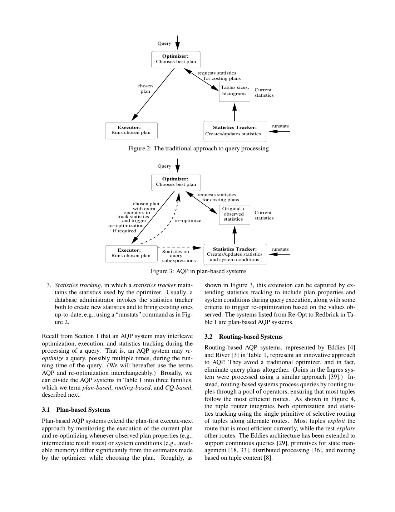
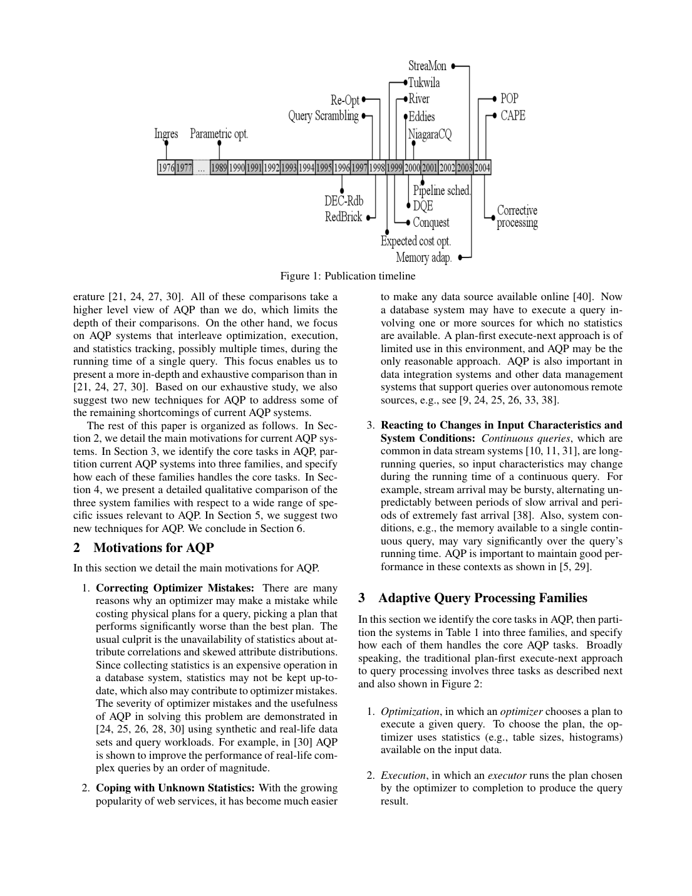

> 本组第 7 篇 · 统计与基数估计 · [全部论文]() · [上一篇]() · [下一篇]()

本文是对单查询运行期间 AQP 的定性比较，不是三类系统的性能跑分或结果正确性定理。作者按优化、执行、统计跟踪的组织方式分为 Plan-based、CQ-based、Routing-based：前两者保留计划和优化器，后者由元组路由器整合优化决策与统计跟踪，省去的是传统优化器而不是优化任务。CQ 与 routing 都可服务连续查询，适应性粒度也不只是一种整计划切换。作者提出 proactive re-optimization（选计划时考虑未来重优化）与 plan logging（为同一连续查询记录统计量和计划历史）；均未在本文给出实现与性能评测。全文有对既有工作 [30] 的一个数量级收益转述，也有随机存储前提下扫描 5% 的说明场景；二者都不能当作本文新测得或普适的收益。

本文保留论文陈述、读者推断与待验证方案的区别；实验数字只适用于原文条件。原文和翻译来自已有 AI 辅助精读报告，已做来源匹配与编辑复核，不等于人工逐项核验或独立实验复现。所有页码均为 PDF 物理页。

## 论文与阅读范围

Shivnath Babu (Stanford University), Pedro Bizarro (University of Wisconsin, Madison). Proceedings of the 2005 CIDR Conference. 出版信息仅基于首页摘录核实，完整页码范围、DOI等字段未提供。来源为本地单篇PDF（statistics/adaptive-query-processing-in-the-looking-glass.pdf），非联网多来源文献综述。OCR仅在显式开启时用于低文本页；引文匹配转写文本，不代表已核对扫描原图。未对图表/公式图像进行视觉识别。

[论文集中的原始 PDF](https://github.com/lonng/db-papers/blob/4ff1331069c7cf52ac97dd769e5f484c1c35c200/papers/statistics/adaptive-query-processing-in-the-looking-glass.pdf) · 本地来源：`statistics/adaptive-query-processing-in-the-looking-glass.pdf`，共 12 页。

本篇保留 10 组原文精读和 39 条证据。截图为原始 PDF 的局部页选，不是重新生成的图表；未将整份 PDF 复制到博客。

## 研究问题与适用边界

传统 plan-first execute-next 先选计划再执行到结束，易受过时统计、属性独立性等错误假设、未知远程源统计和运行条件变化影响。作者把 AQP 描述为在单个查询运行期间交错进行优化、执行与统计跟踪，可能发生多次；其比较排除了只用当前查询统计去优化未来查询的工作。这里的单查询也包括长时间运行的连续查询，不等于仅限一次性批查询。

本文的主要贡献是定性比较三类 AQP 家族在计划质量、统计监控与重优化、计划迁移、可扩展性上的特征和算法。第 2 页明确说目的不是系统间的跑分对决；第 1 页所述已有实际负载验证和商业原型，是对相关工作的概括，而非本文新做的实验。

适应性范围包括访问方法、计划形状、流水线化、算子间内存分配；Table 1 也涉及算子调度和计算共享。不能把 AQP 缩成仅在阻塞点更换整棵连接树，也不能把这三种家族当作按 SQL/CQ 或磁盘/流数据源互斥划分的技术清单。

依据：论文陈述；PDF 物理页 1, 2, 4, 5, 10。证据：[C001N02](#evidence-c001n02), [ER001](#evidence-er001), [ER002](#evidence-er002), [ER004](#evidence-er004), [ER005](#evidence-er005), [ER018](#evidence-er018), [ER021](#evidence-er021), [ER025](#evidence-er025)。

## 系统分类、适应性粒度与优化执行边界

三类家族是作者对当时系统组织方式的概括，而非结果正确性或搜索完备性的三个等级。Table 2 的假设应读作计划效率的前提，不是形式化的结果正确性证明。

**Plan-based**：保留传统优化器和执行计划，运行时监控当前计划的属性与系统条件，当实际值显著偏离选计划时的估计便重优化。假设给定正确统计与条件估计，优化器能找到高效计划。它既可用流水线也可用非流水线计划；重优化机会受具体实现限制，而不是整个家族都只能在阻塞算子处切换。

**CQ-based**：同样保留计划与优化器，重点是持续查询期间输入特征和系统条件的任意变化，而不只纠正当前计划估计错误。它还假设所需统计量能在执行期间估计。优化器可要求 tracker 监控考虑替代计划时使用的相关统计量，并用采样及与执行结合来降低开销。Table 2 说可以用传统优化器，或采用保证近优的近似算法；不能据此给所有 CQ 系统无条件近优保证。论文模型中的 CQ 执行计划要求非阻塞/流水线化，但这不表示任意普通 Hash Join 自动适用于无限流。

**Routing-based**：作者以 Eddies、River 为例，省去传统优化器和固定查询计划，元组通过算子池的合法路径处理。路由器把优化决策和统计跟踪整合到选择性路由：多数元组利用当前高效路径，少数探索其他路径。重优化因此隐含在元组路由变化中，不是完全取消优化。其假设是探索能找到高效路径；Table 3 指出通常采用贪心且面向较小、较简单的计划空间，并仍须确保路由对应合法计划。

**粒度与边界**：Plan/CQ 的计划选择与执行交错但模块仍可分离；routing 把决策嵌入细粒度元组执行。CQ 和 routing 都支持连续查询，不能把 routing 定义为分布式、多租户或去中心化方案。访问方法、调度、内存、计划形状等是可适应的维度，与这三类组织方式不是同一条分类轴。

依据：论文陈述；PDF 物理页 4, 5, 6, 7, 10。证据：[C001N06](#evidence-c001n06), [ER004](#evidence-er004), [ER005](#evidence-er005), [ER006](#evidence-er006), [ER008](#evidence-er008), [ER018](#evidence-er018), [ER020](#evidence-er020), [ER021](#evidence-er021)。

*原论文 PDF 物理页 4，版权归原作者或出版方。点击图片可查看原尺寸。页面文本中定位到：Figure 2: The traditional approach to query processing；Figure 3: AQP in plan-based systems。这是页面定位信息，不表示本次已复核图内所有数据。*

## 统计跟踪、重优化、状态切换与新建议

**四种统计跟踪手段**
Observation 在计划选定点收集实际经过元组的统计量，原文说明常用于 plan-based。Exploration 把部分元组送到不同于当前最佳路径的路线，原文关联 routing-based。Competition 把同一组输入送到多个竞争路线或计划。Profiling 让部分元组经所有算子处理，专用于收集统计量；不是枚举所有可能的算子组合，也不只是更新直方图。四者是技术分类，可跨家族使用。Competition 与 Profiling 的侵入性指为避免最终查询结果错漏而需要修改算子；Observation 与 Exploration 为非侵入式，不等于没有监控或调度开销。原文“当前实现仅支持流水线计划”适用于 Exploration 和 Profiling，不是 Competition 和 Profiling。

**何时、如何重优化**
第 4.3.1 节明确给出：Plan/CQ 显式调用优化器；当观测统计显著偏离估计，或超出当前计划最优的统计范围时触发，也可以比较由统计量算出的计划代价。重优化使用新统计量，包括当前执行采集到的统计。Routing 则随统计变化调整路线，隐式完成重优化，例如优先经过当前选择性最低的算子。不能把某些系统的阻塞点限制泛化为全部 AQP 的必要条件。

**作者原例 Example 4.1**
四表 R、S、T、U 中，作者设 R 与 T 的连接产生很多元组、R 与 U 的连接更有过滤效果，但二者选择性未知；好顺序为 ((R join U) join S) join T，误估可能选 ((R join S) join T) join U。观察三表中间结果偏大可触发重优化，却仍未测到 R join T 和 R join U 的准确选择性，所以新计划仍可能不好。这说明可观测性不足，不是结果错误或证明系统收敛到局部最优。原文此例以 low selectivity 描述产出多的连接，阅读时应保留其上下文，不能机械套用其他选择率术语习惯。

**切换与状态**
原文先要求不能重复输出或遗漏结果，再讨论按代价重用。状态含基关系/流窗口、物化子表达式、in-flight 元组、哈希表或排序子列表等临时结构。Table 5 分别列出缓冲/输出记录去重、流上一遍扫描的语义前提、routing constraints、成本化重用物化结果、迁移临时结构、软缓存与细粒度迁移原语等。新计划处理新输入并延后组合旧新分区是所列技术之一，不是 CQ/routing 的统一协议；旧新数据的交叉结果仍必须补齐。

读者构造的假设示例：若已完整物化 M=R join S，候选新计划可将 M 作为输入，但须比较复用与重算代价，并记录哪些结果已输出。不能仅丢弃旧 Hash Join、让新计划读取“剩余元组”就宣称结果完整；跨旧新分区的连接、在途元组及重复输出必须单独核验。

**抖动与保护**
第 9 页定义 thrashing 为大部分资源耗于自适应、查询推进不足。作者列举限制重优化点、限制总调用次数、设置最小元组处理数或时间间隔。它们是保护措施，本文没有由此证明全局最优或任意负载下无抖动。

**Proactive re-optimization**
作者针对 plan-based/CQ-based 提议，在选计划时就考虑统计跟踪与切换开销、已做工作复用、尽早识别次优性、尽早降低统计不确定性四项因素，而非只选完计划后加统计断言。第 10 页 INLJ/HHJ 原例说明：R 小、S 大且有聚簇索引时 INLJ 可能更好，但 R 大小未知时 HHJ 可能更安全；若高置信度知道 R 很小，则仍偏好 INLJ。缩短流水线、增加物化点只是一种利于复用的办法；全流水线又能更早监测下游选择性，二者可能冲突。作者还提出先估计相关谓词的联合选择性，细节见实验数值辨析。

**Plan logging**
针对同一连续查询 Q 记录 <t,S,P>：时刻 t 的统计量 S 及据此选择的计划 P。历史可用于识别同计划有效的统计区域、免完整重优化复用计划、降低不重要统计量的跟踪率、在线 what-if 分析不自适应时的最佳单计划表现与自适应收益、识别瞬态变化以降低抖动概率。它是 CQ 复杂计划空间扩展的建议，不是仅供未来查询事后诊断的日志。作者说与 proactive 正交兼容、可能结合使用；本文未实现和量化其效果。

依据：论文陈述；PDF 物理页 7, 8, 9, 10, 11。证据：[C002N01](#evidence-c002n01), [C002N05](#evidence-c002n05), [C002N08](#evidence-c002n08), [C002N11](#evidence-c002n11), [C003N07](#evidence-c003n07), [ER007](#evidence-er007), [ER008](#evidence-er008), [ER009](#evidence-er009), [ER010](#evidence-er010), [ER011](#evidence-er011), [ER014](#evidence-er014), [ER015](#evidence-er015), [ER016](#evidence-er016), [ER017](#evidence-er017), [ER019](#evidence-er019), [ER020](#evidence-er020), [ER022](#evidence-er022), [ER026](#evidence-er026)。

## 结果正确性、计划质量与保证边界

**不能把计划质量当成结果正确性**
第 4.3.2 节对 correctness 的要求是：切换后的计划不能再次输出已输出的结果，也不能遗漏结果，流水线情况下尤其要注意。统计收集中的 competition/profiling 也须修改算子以免产生结果假阳性/假阴性。Routing 系统仍须保证路线对应合法计划。这些是语义正确性的要求，和是否找到全局最佳计划是两回事。

**Table 6 比较的是重优化质量**
Plan-based 只能直接发现当前计划可观测的统计错误；未测全不确定统计时可能继续选不到最佳计划。这不说明已返回的 SQL 结果不完整，也不构成陷入局部最优的数学证明。CQ 的广覆盖监控和某些近似算法是表中优势；结合 Table 2，近优保证来自所采用的算法及其适用假设，不是 CQ 家族或任意变化负载的无条件保证。Routing 的贪心策略可能找不到最佳路径/计划，也可能探索过慢；原文没有把它的结果正确性改定义为“收敛到可接受稳定状态”，也没有证明这种收敛。

**建议的模型与证明缺口**
Plan logging 以相关统计量空间中的 S 和目标代价下的最优计划 P 描述理想映射；实际日志记录的是优化器据 S 选出的 P，不能自动保证每条日志就是全局最优解。作者建议按同计划分组识别有效区域，但没有给出区域推断、估计误差或精度保证算法。读者工程问题是如何验证区域命中和状态复用的安全性；这些不是本文已证明的结果。

本文没有对三个家族提供统一的正确性/搜索完备性定理、竞争比或复杂度界，也没有证明防抖动保护可保证最优。读取缓存中的匹配引文只能证明文字出处，不能替代上述语义与算法条件核验。

依据：论文陈述；PDF 物理页 6, 7, 8, 9, 11。证据：[C001N06](#evidence-c001n06), [C002N01](#evidence-c002n01), [C002N06](#evidence-c002n06), [C003N02](#evidence-c003n02), [ER006](#evidence-er006), [ER010](#evidence-er010), [ER011](#evidence-er011), [ER019](#evidence-er019), [ER020](#evidence-er020)。

## 实验缺口、转述收益与示例数字

完整读完 12 页后，可确认本文是定性比较和研究方向建议，没有作者新做的统一性能评测，也没有给出两项新建议的实现、硬件配置、工作负载、基线和测量表。不能从中生成家族性能排名或声称 proactive/plan logging 已获实证验证。这里的“没有评测”不等于论文没有讨论指标、没有任何数字或没有引用以往实验。

**实际出现的定量表述及归属**
第 3 页在动机中转述参考文献 [30]：AQP 对真实复杂查询有一个数量级的性能提升。[30] 的书目信息位于第 12 页，对应 progressive optimization 相关工作。本文没有在此重现其硬件、具体查询、测量表或完整实验协议；该数值仅是单篇综述对既有研究的转述，不是本文新测得，也不适用于所有 AQP 或全部查询。

第 10 页 5.1.4 的“扫描 5%”是作者说明如何把随机采样融入查询执行的例子：R 在磁盘上按随机顺序存储，p1 与 p2 可能相关，可通过扫描的一部分估计联合选择性；若缓冲样本中被选择谓词保留的 R 元组，扫描可能无需重启。“无显式排序”并不等于随机存储，5% 也不是作者测得的普适采样率、误差界或置信保证。该例是在选择 join 算法前降低不确定性的设想，不是一份实验建议协议或已完成实验结果。

**讨论过的指标**
第 2 页 Table 1 提到 response time；第 9-11 页明确以 time to completion、response time、跟踪开销、切换代价和自适应收益等讨论设计。因此应说“无统一的实测评估协议”，不能说“未定义任何指标”。Table 4、6、7 的加减号和定性优劣也不是实验测量。

报告中的任何读者假设数值、复现计划或现代系统联想，都不能被计入作者实验；本文无法支持具体的加速百分比、绝对时延、样本量保证或跨系统量化结论。

依据：论文陈述；PDF 物理页 2, 3, 9, 10, 11, 12。证据：[ER002](#evidence-er002), [ER003](#evidence-er003), [C002N12](#evidence-c002n12), [ER014](#evidence-er014), [ER015](#evidence-er015), [ER017](#evidence-er017), [ER019](#evidence-er019), [ER023](#evidence-er023), [ER027](#evidence-er027)。

*原论文 PDF 物理页 3，版权归原作者或出版方。点击图片可查看原尺寸。页面文本中定位到：Figure 1: Publication timeline。这是页面定位信息，不表示本次已复核图内所有数据。*

## 设计权衡与适用条件

**监控精度、开销与覆盖是不同维度**
Table 4 把 observation 的精度归于实际观测，但覆盖受当前计划限制；exploration 的开销随偏离高效路径的元组比例而变，估计会受路由偏差和相关性影响，路线多时覆盖受限；competition 对相同输入做冗余处理，实际观测精度高，但只能同时竞争有限计划；profiling 对随机样本做额外工作，精度取决于采样比例，给出无偏估计及较广覆盖。不能用“侵入式因此更准确、更全面”概括，也不能把仅支持流水线的实现限制错配给 competition。

**更早发现次优性与工作重用**
第 10 页直接说明全流水线可维护所有算子的运行期选择性，在上游完成前便观察下游；更多物化点和短流水线段又可能利于重用。这是作者明确的目标冲突。读者工程推断：物化可能增加内存写入或 I/O，但并非每个物化点都落盘，也不能由本文推出一定降低正常执行效率或给出成本数值。

**切换启动速度与整体成本**
第 8 页强调 plan-based 会按代价考虑复用物化子表达式；连续输入场景常更重视新计划尽快开始处理。Table 5 的软缓存、并行迁移、延迟组合分区等是不同系统中的技术，不能合并成“CQ/routing 都丢弃旧状态”的统一行为。只有可丢弃并重建的软状态才能这样处理；语义必需状态及跨分区结果仍须保证。

**响应变化、开销和抖动**
Table 7 按变化率给出定性比较：低变化率时 plan-based 自适应开销很低，CQ 可能主要耗在跟踪；高变化率时 plan-based 的有限重优化机会和 routing 探索收敛耗时可能造成低效，profiling 更完整的统计有助于 CQ。第 9 页又强调过快适应可能抖动。读者推断：限频可能延迟响应，日志也有存储分析成本；论文没有为这类额外成本给数字，更没有证明日志完全消除抖动。

依据：论文陈述；PDF 物理页 7, 8, 9, 10, 11。证据：[C002N01](#evidence-c002n01), [C002N06](#evidence-c002n06), [C002N08](#evidence-c002n08), [C003N06](#evidence-c003n06), [ER011](#evidence-er011), [ER012](#evidence-er012), [ER016](#evidence-er016), [ER019](#evidence-er019), [ER022](#evidence-er022), [ER023](#evidence-er023)。

## 横向比较与可扩展性边界

**优化与执行组织**
Plan/CQ 有传统计划与优化器，显式重优化；routing 由路由器整合决策与统计，隐式改变处理路线。计划级与元组级决策粒度不同，但 routing 仍须守住合法路由和结果语义。CQ/routing 的连续查询支持有交叉，不能用数据源种类替代架构分类。

**统计监控与触发**
Observation 常用于 plan-based、Exploration 用于 routing，是第 4.2 节原文事实，不应因原有短笔记缺漏而写成“只能推断映射”。CQ 可用采样估计相关统计；四种技术可跨家族迁移，不能断言 routing 必须依赖 Competition。第 4.3.1 节明确给出偏离估计/离开最优区间后的显式重优化与随统计更新路由的隐式重优化，因此“触发细节未知”应删除。

**计划质量和迁移**
Table 6 的优缺点是检测变化、找到高效计划、切换三个子任务上的概括，并非某类系统的完备性或收敛证明。近似算法的保证要加上算法适用前提。Table 5 把不同系统的去重、复用和迁移技术分别列出，没有宣称同一家族中的每个实现都使用同一协议。

**可扩展性**
第 4.4.4 节明确说作者当时未见专门研究 AQP 可扩展性的工作。除数据量、查询复杂度、并发数、到达/更新速率外，未知统计数量与统计变化速率也是维度；作者把扩展性与重优化质量、自适应开销、抗抖动联系起来。第 5.2 节说当时大多数 CQ/routing 仅在 SPJ 块内适应，希望进一步联合处理访问方法、计划形状、内存、并行和共享；扩大空间同时加重搜索、统计/探索和状态切换开销。不能据此声称 routing 因“去中心化”而水平扩展更好，或宣称本文证明 plan-based 搜索的指数复杂度界。

**现代系统**
本文发表于 2005 年。StarRocks、DuckDB、Calcite 是否采用相同机制，必须另查源码或官方资料，本次仅做本地单篇原文核对，不作实现归属或当前产品能力断言。

依据：论文陈述；PDF 物理页 4, 5, 6, 7, 8, 9, 10。证据：[ER004](#evidence-er004), [ER005](#evidence-er005), [ER006](#evidence-er006), [ER007](#evidence-er007), [ER008](#evidence-er008), [ER011](#evidence-er011), [ER013](#evidence-er013), [ER018](#evidence-er018), [ER020](#evidence-er020), [ER023](#evidence-er023), [ER026](#evidence-er026)。

## 读者验证方案与未决工程问题

本节是读者提出的验证方案，不是作者已完成实验，也不声称已找到可直接运行的统一实现。目标应是检验具体机制，而非先给三大家族排优劣。

1. 在一个固定语义的小型批处理原型中比较静态计划与显式重优化，构造相关谓词及误估基数；逐行对照结果多重集，记录总完成时间、统计采集/优化/切换成本和已做工作复用量。用作者四表例子检验“发现中间结果偏大但仍缺少关键统计”的情形。
2. 对有明确窗口语义的连续查询，比较变化负载下的统计覆盖、检测延迟、响应时间和实际处理进度。若实现 routing，先限定合法算子路线，并区分输出正确性与路径效率；不能把任意强化学习模型当成 routing-based 的代表。
3. 检验 proactive 的四项目标，而不强制“更多物化总是好”：比较普通选计划后加断言，与把采集/切换/复用成本纳入选计划的方案；覆盖小 R 高置信度、R 不确定和联合谓词相关场景。成本模型及物化策略均需自行实现和校准。
4. 对同一连续查询实现 <t,S,P> 日志，分别测历史区域复用是否减少优化成本、降低统计跟踪频率是否漏掉关键变化、在线 what-if 的估算偏差、瞬态变化下的抖动与收益。区域识别、索引、过期与误差处理是未解决的工程选择，不是本文算法。
5. 针对 competition/profiling 检查统计专用元组与正式输出是否隔离，并验证没有重复或漏结果。测试应覆盖旧新输入分区之间的连接、in-flight 元组及状态迁移；“只继续读取剩余数据”不是正确性协议。

任何现代执行引擎接口、日志降维/距离函数、平滑阈值或计时预算都是读者设计。本文没有提供统一代价公式、代码改动量、复杂度界、置信区间或已完成的复现结果。

依据：待验证的工程设想；PDF 物理页 7, 8, 9, 10, 11。证据：[ER009](#evidence-er009), [ER010](#evidence-er010), [ER013](#evidence-er013), [ER014](#evidence-er014), [ER015](#evidence-er015), [ER017](#evidence-er017), [ER019](#evidence-er019)。

## 结论与未解决问题

论文的贡献是三类 AQP 架构的定性比较及两个研究方向，而不是建立某个家族的统一性能或正确性等级。优化与执行可以显式交错，也可以由路由原语整合；其适应性涉及访问方法、计划形状、内存、流水线和调度等多个层次，连续查询并非 CQ 家族独有。

Proactive re-optimization 在选计划时考虑未来适应的开销、复用、发现次优性和降低不确定性；增加物化点只是一种选择，不是容错机制。Plan logging 面向同一连续查询的统计/计划历史，用于复用、选择跟踪重点、在线收益分析和降低抖动风险，而非仅仅事后记录。两者正交兼容是作者建议，不是已获组合收益或完全互不干扰的实验证明。

本文没有新做的统一评测；已有工作 [30] 的一个数量级收益转述与 5% 随机扫描示例必须分别归属，不能变成本文测得的普适数字。结果正确性要求防止错漏输出，计划最优性则受可观测统计、搜索算法和切换代价约束，二者不能混为一谈。

作者结尾真正提出的问题包括：一个系统的自适应技术能否迁移到另一个系统；访问方法、形状、内存、调度各自收益能否量化；是否存在跨适用域都有效的 AQP；是否存在现有技术均无效的工作负载。现代系统归属、日志索引结构等问题是读者延伸，尚未在本次单篇来源审核中验证。

依据：论文陈述；PDF 物理页 1, 3, 9, 10, 11。证据：[ER001](#evidence-er001), [ER003](#evidence-er003), [ER014](#evidence-er014), [ER015](#evidence-er015), [ER017](#evidence-er017), [ER018](#evidence-er018), [ER019](#evidence-er019), [C003N07](#evidence-c003n07), [C003N08](#evidence-c003n08), [ER021](#evidence-er021), [ER024](#evidence-er024)。

## 原文精读：从句子回到机制

以下保留原文、忠实翻译、含义与边界；假设示例不作为论文实验结果。

### P001 · PDF 物理页 1

**原文**

<blockquote class="paper-source-quote"><pre><code>Numerous techniques have been proposed for AQP, and&#10;some have been prototyped in database systems. To the&#10;best of our knowledge, Table 1 lists all techniques that have&#10;been proposed for adaptive processing of a single query&#10;(as opposed to techniques that use the statistics collected&#10;during the execution of the current query change to better&#10;optimize future queries, e.g., [35]). Figure 1 shows a time-&#10;line listing the year in which the first paper describing each&#10;general technique was published.</code></pre></blockquote>

**忠实翻译**

> 已经为 AQP（自适应查询处理）提出了许多技术，其中一些已在数据库系统中进行了原型实现。据我们所知，表 1 列出了所有已提出的用于单个查询自适应处理的技术（与那些利用当前查询执行期间收集的统计信息来更好地优化未来查询的技术相反，例如 [35]）。图 1 展示了一个时间线，列出了描述每种通用技术的首篇论文发表的年份。

**技术含义与边界**

> 此段界定本文比较的是单查询运行期的适应，不比较仅用本次统计优化未来查询的技术。单查询可以是持续很久的 continuous query；第 11 页 plan logging 正是在同一连续查询内利用历史统计和计划，不能因出现历史日志就把它排除在范围外。表 1 和图 1 是当时文献梳理，不是本文新做的性能实验。

**常见误读**

> 不能把单查询误读为只含一次性批处理，也不能把跨时刻利用同一 continuous query 的日志等同于跨查询优化。作者以 [35] 为排除对象，指的是利用当前执行统计优化未来查询的技术；不表示系统绝不能同时具备两类能力。

**读者构造的假设示例**

> 读者构造的假设示例：假设一个查询正在执行 Hash Join，运行时发现左表实际行数远超估计，系统在执行中途切换为 Merge Join，这属于本文定义的单查询自适应；而如果系统记录本次行数偏差，用于下次执行相同查询时选择 Merge Join，则属于被排除的跨查询优化。

### P002 · PDF 物理页 11

**原文**

<blockquote class="paper-source-quote"><pre><code>This information can be used to track the return-of-&#10;investment on adaptive processing, so the system can&#10;control the run-time resources allocated to maintain&#10;adaptivity.&#10;• The AQP system can identify statistics that are prone&#10;to transient changes, so that it can reduce chances of&#10;thrashing on such changes.&#10;Note that plan logging and proactive re-optimization are&#10;orthogonal and compatible ideas, so the best approach may&#10;be to do both.</code></pre></blockquote>

**忠实翻译**

> 这些信息可用于跟踪自适应处理的投资回报率（return-of-investment），从而使系统能够控制分配给维持自适应性的运行时资源。
> • AQP 系统可以识别容易发生瞬态变化的统计信息，从而降低在此类变化上发生抖动（thrashing）的几率。
> 请注意，计划日志记录（plan logging）和主动重优化（proactive re-optimization）是正交且兼容的想法，因此最佳方法可能是两者都做。

**技术含义与边界**

> 这是第 5.2 节 plan logging 的建议用途，而非已实现的两个独立机制或测得收益：用同一连续查询的统计/计划历史作在线 what-if 和自适应投资回报分析，并识别易瞬变统计以降低抖动风险。作者认为它与 proactive 正交兼容，可能结合使用，没有证明收益或工程上完全互不干扰。

**常见误读**

> 不能将“最佳方法可能是两者都做”理解为在所有场景下都必须同时启用两者。原文使用了“may be”，表明这是一种可能性或建议，而非绝对保证。此外，不能将“识别容易发生瞬态变化的统计信息”等同于系统能完全消除抖动，原文仅表述为“reduce chances”。

**读者构造的假设示例**

> 读者构造的假设示例：同一连续查询的某统计量在短时间内多次往返变化，系统可尝试利用日志降低对此统计量的跟踪率或调整重优化决策。如何识别瞬态、是否暂缓切换、会否漏掉持久变化，都需自行设计验证；原文没有给算法和阈值。

### P003 · PDF 物理页 9

**原文**

<blockquote class="paper-source-quote"><pre><code>Re-optimization Aspect&#10;Plan-based&#10;CQ-based&#10;Routing-based&#10;Detecting a change or&#10;mistake&#10;(-) Can only detect mistakes&#10;that can be observed in plan&#10;(+) Monitors all statistics, so&#10;will detect change quickly&#10;(-) Exploration may take&#10;time to detect change&#10;Finding an efficient plan&#10;after a change or mis-&#10;take&#10;(-) May not find best plan&#10;unless all uncertain statistics&#10;were measured at run-time&#10;(+)&#10;Approximation&#10;algo-&#10;rithms guaranteed to find&#10;near-optimal plans&#10;(-) Greedy optimization may&#10;not find best plan&#10;Switching to the new&#10;plan&#10;(+) Reuse of work consid-&#10;ered during re-optimization&#10;(+) Fast switching, e.g., be-&#10;cause caches are used [6]&#10;(+) Fine-grained primitives&#10;to migrate state [18]&#10;Table 6: Advantages (“+”) and disadvantages (“-”) of the families with respect to the various aspects of re-optimization&#10;Rate of Change&#10;Plan-based&#10;CQ-based&#10;Routing-based&#10;Low&#10;(+) Very low overhead&#10;(-) Overhead is</code></pre></blockquote>

**忠实翻译**

> 重优化方面
> 基于计划的（Plan-based）
> 基于连续查询的（CQ-based）
> 基于路由的（Routing-based）
> 检测变化或错误
> (-) 只能检测在计划中可观察到的错误
> (+) 监控所有统计信息，因此能快速检测变化
> (-) 探索可能需要时间来检测变化
> 在变化或错误后找到高效计划
> (-) 除非在运行时测量了所有不确定的统计信息，否则可能找不到最佳计划
> (+) 近似算法保证能找到接近最优的计划
> (-) 贪心优化可能找不到最佳计划
> 切换到新计划
> (+) 重优化期间考虑了工作重用
> (+) 快速切换，例如因为使用了缓存 [6]
> (+) 细粒度的原语来迁移状态 [18]
> 表 6：各家族在重优化各个方面上的优势（“+”）和劣势（“-”）
> 变化率
> 基于计划的
> 基于连续查询的
> 基于路由的
> 低
> (+) 非常低的开销
> (-) 开销是

**技术含义与边界**

> Table 6 按检测、寻找高效计划、切换三个任务比较重优化质量，不是查询结果正确性或搜索完备性定理。CQ 的近优项须结合 Table 2：CQ 可以用传统优化器，也可以用有保证的近似算法；保证来自具体算法及适用前提，不属于整个家族的无条件性质。片段末尾是 Table 7 的开头，完整表位于同页，本次已读，但此引文保持原样。

**常见误读**

> 不能把加减号当作所有实现、任意负载的保证，或把贪心找不到最佳计划解释成结果有错。CQ 的 all statistics 应按优化所需相关统计理解，不是数据库一切统计。末尾 Table 7 的断句不能单独作为完整比较结论，须查同页全文及新增 ER023。

**读者构造的假设示例**

> 读者构造的假设示例：当前计划没有物化 R join U，因而观察三表中间结果偏大仍未得到 R join U 的选择性，重优化仍可能选错顺序；返回结果却可以完全正确。若另一实现另行采样相关统计并使用满足条件的近似算法，才能讨论该算法的近优保证，不能只凭 CQ 标签下结论。

### P004 · PDF 物理页 10

**原文**

<blockquote class="paper-source-quote"><pre><code>An&#10;interesting avenue for work would be to merge such ran-&#10;dom sample processing alongside regular query execution&#10;to hide the extra overhead. For example, if R tuples are&#10;stored in random order on disk, then after 5% of R tuples&#10;have been scanned as part of a table scan, a fairly accurate&#10;estimate of the combined selectivity of p1 and p2 can be ob-&#10;tained. Furthermore, the scan may not need to be restarted&#10;if the selected R tuples in the sample are buffered.</code></pre></blockquote>

**忠实翻译**

> 一个有趣的研究方向是将这种随机样本处理与常规查询执行合并，以隐藏额外的开销。例如，如果关系 R 的元组在磁盘上以随机顺序存储，那么在作为表扫描的一部分扫描了 R 的 5% 元组之后，就可以获得 p1 和 p2 组合选择率的相当准确的估计。此外，如果样本中选定的 R 元组被缓冲，那么扫描可能不需要重新开始。

**技术含义与边界**

> 作者提出把随机样本处理与常规扫描结合以隐藏额外开销的方向。前文语境是先估计可能相关的 p1/p2 联合选择性，再选 join 算法。5% 是随机磁盘顺序前提下的说明，不是实验测量或通用样本量保证。缓冲对象是样本中被选择谓词保留的 R 元组，扫描也只是可能不必重启。

**常见误读**

> 随机顺序不是仅仅没有声明 ORDER BY 或看起来无序；后者可能仍按相关属性聚集。原文没有为 5% 给出置信区间和误差界，不能把 may not need to be restarted 翻成保证不重启，也不能说必须缓存所有已扫描元组。

**读者构造的假设示例**

> 读者构造的假设示例：设 R 有 100 万个元组，且确实按随机顺序存储。正常扫描前 5 万个时估计 p1 AND p2 的联合选择性，并缓存其中满足选择条件的 R 元组；后续 join 算法可尝试利用这些元组和继续扫描的输入。例子不保证估计精度、性能收益或任意切换都能安全继续。

### P005 · PDF 物理页 6

**原文**

<blockquote class="paper-source-quote"><pre><code>time&#10;Objectives&#10;Detect&#10;and&#10;correct&#10;situations&#10;where optimizer picks an ineffi-&#10;cient plan&#10;Ensure that plan is efficient for&#10;current input statistics and system&#10;conditions&#10;Ensure that tuples follow efficient&#10;routes&#10;Assumptions Given correct estimates of statis-&#10;tics and system conditions, opti-&#10;mizer can find an efficient plan&#10;(i) Statistics required by optimizer&#10;can be estimated during execu-&#10;tion (ii) Given correct estimates of&#10;statistics and system conditions,&#10;optimizer can find an efficient plan&#10;Efficient routes can be found by&#10;exploring different routes&#10;Executor&#10;(i) Pipelined and non-pipelined&#10;plans (ii) Plans contain operators&#10;to track statistics and trigger re-&#10;optimization if required&#10;Pipelined plans only (because op-&#10;erators in continuous query plans&#10;must be non-blocking [2])&#10;Routes through operators simu-&#10;late pipelined plans&#10;Optimizer&#10;Conventional&#10;optimizer&#10;that&#10;also&#10;adds&#10;additional&#10;o</code></pre></blockquote>

**忠实翻译**

> 时间
> 目标
> 检测并纠正优化器选择低效计划的情况
> 确保计划对当前输入统计信息和系统条件是高效的
> 确保元组遵循高效的路由
> 假设
> 给定正确的统计信息和系统条件估计，优化器能找到高效计划
> (i) 优化器所需的统计信息可以在执行期间估计 (ii) 给定正确的统计信息和系统条件估计，优化器能找到高效计划
> 可以通过探索不同的路由来找到高效路由
> 执行器
> (i) 流水线和非流水线计划 (ii) 计划包含用于跟踪统计信息并在需要时触发重优化的算子
> 仅限流水线计划（因为连续查询计划中的算子必须是非阻塞的 [2]）
> 通过算子的路由模拟流水线计划
> 优化器
> 传统优化器，同时还添加额外的 o

**技术含义与边界**

> Table 2 是家族模型对照：Plan-based 支持流水线与非流水线计划；CQ 的本文模型要求 continuous-query 算子非阻塞；routing 通过算子路线模拟流水线。片段在优化器栏截断，完整内容在同页，已由 ER020 补入：CQ 可用传统优化器或有近优保证的近似算法。这里不能据算法名称断言任意实现适用于无限流。

**常见误读**

> 不能把 CQ 非阻塞要求错误推广成“只能用普通 Hash Join/Nested Loop Join”，因为算法名不能保证具体实现非阻塞、流输入有限或状态有界。也不能把本文模型的流水线限制推广成所有现代持续查询系统的定理。截断引文保持原样，完整信息只能另引同页原文。

**读者构造的假设示例**

> 读者构造的假设示例：对无终点的流，全输入到齐才输出的普通排序不能直接使用；一个必须先完整构建无限输入哈希表的普通 Hash Join 同样会阻塞。若使用有窗口语义、可增量输出的连接，仍须说明状态保留和过期规则。有限批处理中的 Sort 则可在结束后提供实际基数供重优化。

### P006 · PDF 物理页 7

**原文**

<blockquote class="paper-source-quote"><pre><code>The coverage of a technique character-&#10;izes the number of different statistics that can be estimated&#10;simultaneously using that technique. While competition&#10;and profiling are intrusive techniques in the sense that they&#10;require changes to the operators to avoid generating false&#10;positives or false negatives in the query result, both obser-&#10;vation and exploration are nonintrusive techniques.</code></pre></blockquote>

**忠实翻译**

> 一项技术的覆盖度（coverage）表征了使用该技术的可以同时估计的不同统计信息的数量。虽然竞争（competition）和分析（profiling）是侵入式（intrusive）技术，因为它们需要修改算子以避免在查询结果中产生假阳性或假阴性，但观察（observation）和探索（exploration）都是非侵入式（nonintrusive）技术。

**技术含义与边界**

> 原文定义了统计信息收集技术的两个属性：覆盖度（能同时估计多少种统计信息）和侵入性（是否需要修改算子内部逻辑）。作者明确将 competition 和 profiling 归类为侵入式，原因是它们如果不修改算子可能会导致查询结果出错（假阳性/假阴性）；而 observation 和 exploration 被归类为非侵入式。这是作者对技术特性的分类事实。

**常见误读**

> 不能将“侵入式”误解为“会破坏系统稳定性”或“性能差”。原文对侵入式的严格定义是“require changes to the operators to avoid generating false positives or false negatives in the query result”，即需要改动算子代码以保证结果正确性。此外，不能推断非侵入式技术的覆盖度一定低或高，原文未建立这两者之间的必然联系。

**读者构造的假设示例**

> 读者构造的假设示例：同一元组为 profiling 被额外送到某些算子，若这些统计专用处理与正式执行共用输出通道，就可能把额外产物当成正式结果，造成重复或无效结果；若错误改变状态，也可能漏掉应有输出。修改算子须隔离这两类处理。Observation 则在计划选定位置观测实际经过的元组，不需要为了探测而额外生成查询结果。

### P007 · PDF 物理页 8

**原文**

<blockquote class="paper-source-quote"><pre><code>However, it may not always be benefi-&#10;cial to reuse work, so reuse must be considered in a&#10;cost-based manner.&#10;• Plan state: Techniques for switching between plans&#10;must account for the state captured by a plan, which&#10;has four components:&#10;– Base relations in the query (these may be win-&#10;dows over streams in a continuous query)&#10;– Intermediate materialized subexpressions&#10;– In-flight tuples in pipelined segments&#10;– Temporary structures like hash tables and sorted&#10;sublists&#10;Table 5 summarizes the techniques and assumptions used&#10;in the three system families to address the above issues.</code></pre></blockquote>

**忠实翻译**

> 然而，重用工作并不总是有益的，因此必须以基于成本的方式考虑重用。
> • 计划状态：在计划之间切换的技术必须考虑计划所捕获的状态，该状态包含四个组成部分：
> – 查询中的基关系（在连续查询中，这些可能是流上的窗口）
> – 中间物化的子表达式
> – 流水线段中的飞行中元组（In-flight tuples）
> – 临时结构，如哈希表和已排序的子列表
> 表 5 总结了这三个系统家族用于解决上述问题的技术和假设。

**技术含义与边界**

> 原文讨论了计划切换时的两个关键问题：工作重用的成本效益分析，以及计划状态的组成。作者明确列出了计划状态的四个组件，强调任何切换机制都必须妥善处理这些已产生的中间结果或内存结构。这是作者对 AQP 状态管理复杂性的客观陈述。

**常见误读**

> 不能将“重用工作并不总是有益的”解读为“不应该重用工作”。原文强调的是“must be considered in a cost-based manner”，即需要计算重用旧状态的成本与从头开始的成本哪个更低。此外，不能遗漏“在连续查询中，基关系可能是流上的窗口”这一限定条件，它在流处理语境下至关重要。

**读者构造的假设示例**

> 读者构造的假设示例：旧计划已完整物化 R join S，新计划若仍需该子表达式，可比较复用和重算代价；旧 Hash Join 的内部哈希表则不自动等于新 Merge Join 可用的排序输入。切换协议还须处理 in-flight 元组、已输出记录和旧新输入分区间的交叉连接，否则即使新计划更快也可能错漏结果。

### P008 · PDF 物理页 9

**原文**

<blockquote class="paper-source-quote"><pre><code>4.4.3&#10;Thrashing&#10;We say that an AQP system is thrashing if it is spending&#10;most of its resources in adaptivity-related overhead, e.g.,&#10;plan switching, and is not making enough progress in query&#10;execution. For example, if a CQ-based system adapts too&#10;rapidly, then a series of short-lived changes may make the&#10;system spend all its resources re-optimizing.</code></pre></blockquote>

**忠实翻译**

> 4.4.3 抖动（Thrashing）
> 如果一个 AQP 系统将其大部分资源花费在与自适应性相关的开销上（例如计划切换），并且在查询执行中没有取得足够的进展，我们就说该系统正在发生抖动。例如，如果一个基于连续查询（CQ-based）的系统适应得太快，那么一系列短暂的变化可能会使系统将所有资源都花在重优化上。

**技术含义与边界**

> 作者将 thrashing 定义为主要资源耗在适应开销上，查询推进不足，不要求进度严格降到零。CQ 适应过快只是例子，不是家族独有问题。该片段没有提供检测阈值或测量结果。

**常见误读**

> 不能将“抖动”简单等同于“频繁重优化”。原文的定义核心在于资源分配的失衡（“spending most of its resources in adaptivity-related overhead... and is not making enough progress”）。如果系统频繁重优化但每次开销极小且查询仍在快速推进，则不符合原文对抖动的定义。此外，不能将 CQ-based 的例子泛化为只有 CQ-based 系统才会抖动，原文只是用它作为“例如（For example）”。

**读者构造的假设示例**

> 读者构造的假设示例：设一个原型每 10 毫秒检查一次速率，超过 10% 的变化便重优化；速率反复在 1000 与 1200 之间变化，两个方向都超过阈值。如果优化和迁移占据大部分资源、执行推进不足，便符合此处定义。数字和规则仅为说明，不是论文实验或建议阈值。

### P009 · PDF 物理页 11

**原文**

<blockquote class="paper-source-quote"><pre><code>Note that plan logging and proactive re-optimization are&#10;orthogonal and compatible ideas, so the best approach may&#10;be to do both.&#10;6&#10;Conclusions&#10;Our main contribution in this paper is the identification&#10;of three families of AQP systems (plan-based, CQ-based,&#10;and routing-based), and the detailed comparison of these&#10;system families with respect to the most important as-&#10;pects of AQP: plan quality, statistics monitoring and re-&#10;optimization, plan migration, and scalability.</code></pre></blockquote>

**忠实翻译**

> 请注意，计划日志记录和主动重优化是正交且兼容的想法，因此最佳方法可能是两者都做。
> 6 结论
> 我们在本文中的主要贡献是识别了 AQP 系统的三个家族（基于计划的、基于连续查询的和基于路由的），并就 AQP 最重要的方面对这些系统家族进行了详细比较：计划质量、统计信息监控和重优化、计划迁移以及可扩展性。

**技术含义与边界**

> 原文第一句重申了 P002 中关于 plan logging 和 proactive re-optimization 正交兼容的观点。第二段是论文的结论部分，作者陈述了本文的核心贡献：提出三大家族分类法，并从四个维度（计划质量、监控与重优化、迁移、可扩展性）进行了对比。这是作者对自身工作的总结事实。

**常见误读**

> 不能将“最佳方法可能是两者都做”视为经过严格实验证明的结论，原文使用的是“may be”，属于作者的推断或建议。此外，结论中提到的四个比较维度必须在正文中有对应论述，不能凭空捏造这四个维度的具体比较结果。

**读者构造的假设示例**

> 读者构造的假设示例：在同一连续查询中，日志可能帮助识别重现的统计区域并复用计划；proactive 优化器则在选择候选计划时考虑监控、切换和复用潜力。两个思路可以共同研究，但日志命中规则、过期处理和组合收益仍须验证，不能从正交兼容直接推出没有相互影响，也不能用多租户特性替代 routing-based 定义。

### P010 · PDF 物理页 10

**原文**

<blockquote class="paper-source-quote"><pre><code>In&#10;general, it is hard to keep track of and reuse the work done&#10;by a pipelined plan if the query needs to be re-optimized&#10;during the execution of the pipeline. Therefore, one simple&#10;approach that a proactive optimizer can use to increase the&#10;potential for reusing work is to generate plans with shorter&#10;pipelined segments and more materialization points.&#10;5.1.3&#10;Identifying Plan Suboptimality Faster&#10;Recall that re-optimization is triggered by the violation of&#10;an assertion about statistics in the current plan during exe-&#10;cution.</code></pre></blockquote>

**忠实翻译**

> 通常，如果查询需要在流水线执行期间进行重优化，很难跟踪并重用流水线计划已完成的工作。因此，主动优化器可以用来增加重用工作潜力的一种简单方法是：生成具有更短流水线段和更多物化点的计划。
> 5.1.3 更快地识别计划次优性
> 回想一下，重优化是由执行期间违反当前计划中关于统计信息的断言所触发的。

**技术含义与边界**

> 原文陈述了一个工程难题：流水线执行中的中间状态难以保存和重用。作者提出了一种应对策略：主动优化器（proactive optimizer）可以有意识地生成包含更多物化点（materialization points）、流水线段更短的计划，以此作为状态保存的天然边界，便于重用时减少损失。随后引出了下一节主题：通过断言违规来触发重优化。这是作者陈述的机制与设计建议。

**常见误读**

> 不能把更多物化点当成免费优化、强制落盘、任意系统都应采用的策略或容错机制。原文只说增加复用潜力，并在同页说明全流水线可更早检测次优性，目标会冲突。物化可能增加写入/I/O 是读者工程推断，不是本文测得的速度变化；断言触发也不代表 routing 系统必须显式调用优化器。

**读者构造的假设示例**

> 读者构造的假设示例：若 A -> B 的完整输出 M 已物化，新计划可在语义与状态兼容时复用 M，从而避免重算该子表达式；仍须核对已输出结果、在途元组和 M 之外的数据。新增物化可能有内存或 I/O 成本，不能仅看到 M 就保证任意切换结果正确或总执行更快。

## 尚未解决的问题

1. 作者问题（第 11 页）：一个系统的自适应技术能否用于其他系统？
2. 作者问题（第 11 页）：访问方法、计划形状、内存分配、算子调度各项自适应的收益能否分别量化？
3. 作者问题（第 11 页）：能否设计在所有适用域都有效的 AQP；若不能，是否存在根本性权衡？
4. 作者问题（第 11 页）：是否有 Table 1 中所有系统都表现不好的工作负载，应如何处理？
5. 读者延伸：怎样对统计不确定性、复用潜力、监控与切换开销共同建模，而不把额外物化当成必需策略？
6. 读者延伸：怎样识别 plan-log 的有效统计区域，控制日志过期、估计误差及在线 what-if 分析偏差？
7. 读者延伸：怎样在具体连续查询语义下迁移状态、处理旧新分区交叉结果，并防止重复或遗漏？
8. 读者延伸：现代 OLAP/流系统是否采用这些具体机制？需另行查阅源码和官方资料，本次未验证。

## 证据索引

证据编号沿用原报告，便于将上文判断追溯到原句。引文匹配只验证位置，不证明解读正确。

**C001N02 · PDF 物理页 1**

本文的比较范围有明确前提：仅关注在单个查询运行期间交错执行优化、执行和统计信息追踪的 AQP 系统，排除了利用当前查询收集的统计信息来优化未来查询的技术。这种界定决定了后续所有机制对比的适用边界。

<blockquote class="paper-source-quote"><pre><code>techniques that have been proposed for adaptive processing of a single query (as opposed to techniques that use the statistics collected during the execution of the current query change to better optimize future queries</code></pre></blockquote>

**C001N06 · PDF 物理页 6**

Table 2 的效率前提为：Plan-based 假设正确统计与条件估计下优化器能找到高效计划；CQ-based 还假设所需统计可在执行中估计；Routing-based 假设探索可找到高效路线。这些不是结果正确性/搜索完备性定理。CQ 可使用传统优化器或有特定近优保证的近似算法，不能泛化为家族保证；见新增 ER006。

<blockquote class="paper-source-quote"><pre><code>Given correct estimates of statistics and system conditions, optimizer can find an efficient plan</code></pre></blockquote>

**C002N01 · PDF 物理页 7**

论文将统计信息跟踪技术分为四类：Observation（在计划中选定点收集实际元组的统计信息）、Exploration（将部分输入元组路由到非最优路径以跟踪 selectivity 和 cost）、Competition（将同一批元组沿多条竞争路径路由以使用相同输入数据跟踪统计信息）、Profiling（抽取部分元组由所有算子处理仅用于收集统计信息）。Table 4 从计算开销、估计准确性和统计覆盖率三个维度进行了对比。其中 Competition 和 Profiling 是侵入式（intrusive）技术，需要修改算子以避免产生假阳性或假阴性结果；Observation 和 Exploration 是非侵入式的。此外，Exploration 和 Profiling 的当前实现仅支持流水线（pipelined）计划。

<blockquote class="paper-source-quote"><pre><code>While competition and profiling are intrusive techniques in the sense that they require changes to the operators</code></pre></blockquote>

**C002N05 · PDF 物理页 8**

计划切换需要考虑重用已完成的工作以及处理计划状态。计划状态包含四个组件：查询中的基关系（连续查询中可能是流上的窗口）、中间物化子表达式、流水线段中的飞行中（in-flight）元组、以及临时结构（如哈希表和排序子列表）。Plan-based 系统在重优化期间考虑重用之前计划物化的查询子表达式以降低切换代价。CQ-based 和 Routing-based 系统主要处理连续到达的数据（如数据流），最小化响应时间是重要目标，因此尽快启动新计划往往比最小化整体切换代价更重要。一种技术是让新计划处理新到达的数据，旧数据和新数据的组合结果稍后计算。另一种技术是将状态仅存储在可随时丢弃并能增量创建的缓存中。

<blockquote class="paper-source-quote"><pre><code>Plan state: Techniques for switching between plans must account for the state captured by a plan, which has four components:</code></pre></blockquote>

**C002N06 · PDF 物理页 9**

Table 6 比较重优化质量：Plan-based 的可观测性受当前计划限制，未测全不确定统计可能找不到最佳计划；CQ 的相关统计监控与近似算法可有优势，但近优保证须结合具体算法前提；Routing 的探索可能较慢，贪心可能找不到最佳计划。这些是效率与优化质量局限，不是返回结果正确性或完备性的权衡。

<blockquote class="paper-source-quote"><pre><code>(-) May not find best plan unless all uncertain statistics were measured at run-time</code></pre></blockquote>

**C002N08 · PDF 物理页 9**

Thrashing 指大部分资源耗于自适应开销而查询推进不足。第 9 页列举限制重优化点、调用次数、最小处理元组数或时间间隔作为保护手段；“工程剪枝”不是作者定义，本文也未由这些保护推导最优性或无抖动定理。

<blockquote class="paper-source-quote"><pre><code>We say that an AQP system is thrashing if it is spending most of its resources in adaptivity-related overhead, e.g., plan switching</code></pre></blockquote>

**C002N11 · PDF 物理页 10**

为了增加重用工作的潜力，proactive 优化器可以采用一种简单的策略：生成具有更短流水线段（shorter pipelined segments）和更多物化点（more materialization points）的计划。这是因为在流水线执行期间如果需要重优化，通常很难跟踪和重用流水线计划已完成的工作。但这与 5.1.3 节中提到的“全流水线计划可以并发维护所有算子的运行期 selectivity 从而更快发现次优性”的目标相冲突，体现了主动优化中不同设计目标的内在矛盾。

<blockquote class="paper-source-quote"><pre><code>one simple approach that a proactive optimizer can use to increase the potential for reusing work is to generate plans with shorter pipelined segments</code></pre></blockquote>

**C002N12 · PDF 物理页 10**

第 5.1.4 节的 5% 是作者说明随机采样与执行结合的条件性例子，不是实测实验：R 必须按随机顺序存储，可估计相关谓词 p1/p2 的联合选择性；若缓冲样本中满足选择谓词的 R 元组，扫描可能无需重启。原文未给通用阈值、误差界或性能收益。

<blockquote class="paper-source-quote"><pre><code>if R tuples are stored in random order on disk, then after 5% of R tuples have been scanned as part of a table scan</code></pre></blockquote>

**C003N02 · PDF 物理页 11**

Plan logging 以相关统计量的高维空间描述每个 S 对应目标代价下最优 P 的理想映射，但日志实际记录优化器据 S 选出的计划；这不证明日志中的每个 P 都是全局最优。作者未给区域识别、估计误差处理或最优保证算法。

<blockquote class="paper-source-quote"><pre><code>For each point S in the space of statistics relevant to Q, there is a plan P that is optimal for Q with respect to the desired cost metric</code></pre></blockquote>

**C003N06 · PDF 物理页 11**

Plan-log 可用于检测易发生瞬态变化的统计量，从而降低系统因短暂波动而频繁切换计划（thrashing）的概率。这是一种稳定性保护启发式，但文中未给出区分瞬态变化与真实趋势变化的算法细节或判定标准。

<blockquote class="paper-source-quote"><pre><code>The AQP system can identify statistics that are prone to transient changes, so that it can reduce chances of thrashing on such changes.</code></pre></blockquote>

**C003N07 · PDF 物理页 11**

文中明确指出 plan logging 与 proactive re-optimization 是正交且兼容的思想，建议两者结合使用。这意味着 plan-logging 本身不替代主动重优化，而是作为辅助信息源；两者的组合效果未在本文中通过实验验证。

<blockquote class="paper-source-quote"><pre><code>Note that plan logging and proactive re-optimization are orthogonal and compatible ideas, so the best approach may be to do both.</code></pre></blockquote>

**C003N08 · PDF 物理页 11**

论文的主要贡献被定义为识别三类 AQP 系统族（plan-based、CQ-based、routing-based），并在计划质量、统计量监控与重优化、计划迁移、可扩展性四个维度上进行详细比较。这是本文的问题框架和适用边界声明。

<blockquote class="paper-source-quote"><pre><code>Our main contribution in this paper is the identification of three families of AQP systems (plan-based, CQ-based, and routing-based), and the detailed comparison of these system families</code></pre></blockquote>

**ER001 · PDF 物理页 1**

作者将 AQP 定义为单个查询运行期间交错进行优化与执行；这不要求优化器与执行器在架构上合并。

<blockquote class="paper-source-quote"><pre><code>With AQP, the optimiza-&#10;tion and execution stages of processing a query are inter-&#10;leaved, possibly multiple times over the running time of&#10;the query.</code></pre></blockquote>

**ER002 · PDF 物理页 2**

本文主贡献是详细定性比较，作者明确不以各系统跑分对决为目的。

<blockquote class="paper-source-quote"><pre><code>The main contribution of this paper is a detailed qualita-&#10;tive comparison of the systems in Table 1 with respect to&#10;a wide range of issues related to AQP. To our knowledge,&#10;no previous attempt at comparing different AQP systems&#10;[21, 24, 27, 30] is as exhaustive as the one we present.&#10;Our purpose is not to “bake off” these systems against one&#10;another; instead, we want to bring out their characteris-&#10;tic features and algorithms.</code></pre></blockquote>

**ER003 · PDF 物理页 3**

本文转述参考文献 [30] 对真实复杂查询获得一个数量级性能提升；这不是本文新做的实验，也不是对所有 AQP 的保证。

<blockquote class="paper-source-quote"><pre><code>The severity of optimizer mistakes and the usefulness&#10;of AQP in solving this problem are demonstrated in&#10;[24, 25, 26, 28, 30] using synthetic and real-life data&#10;sets and query workloads. For example, in [30] AQP&#10;is shown to improve the performance of real-life com-&#10;plex queries by an order of magnitude.</code></pre></blockquote>

**ER004 · PDF 物理页 4**

Routing-based 省去传统优化器和固定查询计划，但路由器集成优化决策与统计跟踪，以多数元组利用高效路径、其余元组探索替代路径。

<blockquote class="paper-source-quote"><pre><code>Routing-based AQP systems, represented by Eddies [4]&#10;and River [3] in Table 1, represent an innovative approach&#10;to AQP. They avoid a traditional optimizer, and in fact,&#10;eliminate query plans altogether. (Joins in the Ingres sys-&#10;tem were processed using a similar approach [39].) In-&#10;stead, routing-based systems process queries by routing tu-&#10;ples through a pool of operators, ensuring that most tuples&#10;follow the most efficient routes. As shown in Figure 4,&#10;the tuple router integrates both optimization and statis-&#10;tics tracking using the single primitive of selective routing&#10;of tuples along alternate routes. Most tuples exploit the&#10;route that is most efficient currently, while the rest explore&#10;other routes.</code></pre></blockquote>

**ER005 · PDF 物理页 5**

CQ-based 与 routing-based 都可支持连续查询，分类不是批处理/流处理的互斥划分；CQ-based 保留计划及优化器，关注输入与条件任意变化，可监控考虑候选计划时使用的统计量，并用采样降低开销。

<blockquote class="paper-source-quote"><pre><code>Continuous-Query-based, or CQ-based, AQP systems sup-&#10;port AQP for continuous queries, prevalent in data stream&#10;systems. (Routing-based systems also support continuous&#10;queries [12, 29].) CAPE [41], NiagaraCQ [13], and Strea-&#10;Mon [7] are the CQ-based systems in Table 1. AQP in CQ-&#10;based systems is shown in Figure 5. Like plan-based sys-&#10;tems, CQ-based systems use query plans and an optimizer.&#10;However, their focus is on arbitrary changes in stream char-&#10;acteristics and system conditions during the running time&#10;of a continuous query, rather than mistakes in statistics for&#10;a given query plan. For example, the optimizer may in-&#10;form the statistics tracker about all statistics that it used&#10;when considering alternative plans, and the tracker mon-&#10;itors for changes in these statistics [5]. To minimize the&#10;run-time overhead, CQ-based systems use sampling-based&#10;techniques for statistics tracking, and combine statistics&#10;tracking with query execution whenever possible [5, 6, 7].</code></pre></blockquote>

**ER006 · PDF 物理页 6**

Table 2 中 CQ-based 可使用传统优化器，或能保证近优的近似算法；近优保证不是 CQ 家族无条件拥有的性质。

<blockquote class="paper-source-quote"><pre><code>May use conventional optimizer&#10;or&#10;approximation&#10;algorithms&#10;that&#10;are&#10;guaranteed&#10;to&#10;find&#10;near-optimal plans</code></pre></blockquote>

**ER007 · PDF 物理页 7**

原文直接关联 Observation 与 plan-based、Exploration 与 routing-based；Competition 使用相同输入竞争，Profiling 使抽样元组经过所有算子以收集统计量。该列举不把每种技术永久绑定到一个家族。

<blockquote class="paper-source-quote"><pre><code>2. Exploration: [4] Exploration is used in routing-based&#10;systems where a fraction of input tuples are routed&#10;along routes different from the current best route&#10;to track operator selectivities and costs along these&#10;routes.&#10;3. Competition: [1] Competition is similar to explo-&#10;ration, but it routes the same set of tuples along multi-&#10;ple competing routes (or plans) in order to track oper-&#10;ator selectivities and costs using the same input data.&#10;4. Profiling: [5] Profiling differs from exploration and&#10;competition in that a fraction of tuples are processed&#10;by all operators solely to collect statistics.</code></pre></blockquote>

**ER008 · PDF 物理页 7**

Plan/CQ-based 显式重优化；观测值显著偏离估计或超出当前计划最优范围时重新调用优化器，也可比较由统计量计算的估计计划代价。Routing-based 基于当前统计改变路由而隐式重优化。

<blockquote class="paper-source-quote"><pre><code>Re-optimization is invoked explicitly in plan-based and&#10;CQ-based systems, while it happens implicitly in routing-&#10;based systems.&#10;During execution, plan-based and CQ-&#10;based systems track some or all of the statistics that the&#10;optimizer estimated while picking the current plan. The op-&#10;timizer is re-invoked whenever an observed value is found&#10;to be either significantly different from the optimizer’s es-&#10;timate or outside the range of values for which the current&#10;plan is optimal [30]. (Instead of comparing at the level&#10;of statistics, e.g., cardinalities, sometimes the comparison&#10;is done at the level of estimated plan costs, e.g., time to&#10;completion, computed from these statistics [28].) When&#10;invoked for re-optimization, the optimizer is given the new&#10;set of statistics which includes those tracked by the current&#10;plan. In a routing-based system, the scheme used to route&#10;tuples to operators is based on current statistics. For exam-&#10;ple, most tuples may be routed first to the operator with the&#10;current lowest selectivity. Thus, re-optimization happens&#10;automatically when statistics change [4].</code></pre></blockquote>

**ER009 · PDF 物理页 7**

作者 Example 4.1 为 R、S、T、U 四表连接：当前计划不能直接观察 R 与 T、R 与 U 的连接选择性，即使检测到三表中间结果偏大并重优化，仍可能选错计划。原文 low/high selectivity 的用法须结合其产出元组多少阅读。

<blockquote class="paper-source-quote"><pre><code>Example 4.1 We use an example to illustrate some of&#10;the subtleties that arise in statistics tracking and re-&#10;optimization. Consider a query that contains a four-way&#10;join of relations R, S, T, and U. (Each relation could be a&#10;window over a stream in a data stream processing system,&#10;in which case the query semantics is similar to that of a ma-&#10;terialized view [2].) Assume that R ▷◁T has low selectiv-&#10;ity, i.e., R ▷◁T produces many joined tuples, and R ▷◁U&#10;has high selectivity, but both these statistics are unknown.&#10;The optimal join order is ((R ▷◁U) ▷◁S) ▷◁T. An op-&#10;timizer may estimate the unknown selectivities incorrectly,&#10;and pick the join order ((R ▷◁S) ▷◁T) ▷◁U. A plan-based&#10;system will not notice these mistakes during execution be-&#10;cause the selectivities of R ▷◁T and R ▷◁U cannot be ob-&#10;served directly from the join order ((R ▷◁S) ▷◁T) ▷◁U.&#10;If the system monitors the size of R ▷◁S ▷◁T during&#10;execution, it will find that this size is larger than the es-&#10;timated value, and trigger re-optimization. However, re-&#10;optimization may not improve the situation—the optimizer&#10;may pick a suboptimal plan again—because the system has&#10;not learned the accurate values of the selectivities of R ▷◁T&#10;and R ▷◁U.</code></pre></blockquote>

**ER010 · PDF 物理页 8**

切换必须避免已输出结果重复或遗漏；工作重用须按代价判断，不能仅处理剩余输入就假定跨旧新分区结果齐全。

<blockquote class="paper-source-quote"><pre><code>• Correctness: The new plan must not output result tu-&#10;ples that have already been output by previous plans&#10;(or miss tuples), particularly in pipelined plans.&#10;• Reuse of work: The current plan and plans before it&#10;may have processed a substantial part of the query.&#10;It is important to consider whether the new plan can&#10;reuse this work instead of restarting query processing&#10;from scratch. However, it may not always be benefi-&#10;cial to reuse work, so reuse must be considered in a&#10;cost-based manner.</code></pre></blockquote>

**ER011 · PDF 物理页 8**

Table 5 区分各家族的去重、重用和降切换延迟技术：新计划处理新输入并末尾合并分区列于 plan-based；软缓存列于 CQ；路由约束与细粒度迁移原语列于 routing-based，不能一概归为 CQ/routing 通用方案。

<blockquote class="paper-source-quote"><pre><code>Concern&#10;Plan-based&#10;CQ-based&#10;Routing-based&#10;Avoiding dupli-&#10;cate results&#10;(i) No result output until pro-&#10;cessing is complete (e.g., by&#10;buffering) (ii) Keep track of&#10;tuples output so far to elimi-&#10;nate duplicates in future&#10;Access methods over streams&#10;are one-pass scans, so dupli-&#10;cate results are never gener-&#10;ated&#10;Routing constraints are en-&#10;forced to avoid generating du-&#10;plicate results [33]&#10;Reusing&#10;work&#10;done so far&#10;Materialized&#10;subexpressions&#10;reused on a cost basis&#10;Migrate state in temporary&#10;structures (e.g., hash tables)&#10;to new plan [41]&#10;Migrate state in temporary&#10;structures (e.g., hash tables)&#10;to new plan [18]&#10;Reducing&#10;switching time&#10;Start new plan on new input;&#10;combine data partitions pro-&#10;cessed by different plans only&#10;after all sources are exhausted&#10;[24]&#10;(i) Caches (soft state) that can&#10;be dropped quickly and built&#10;incrementally [6] (ii) Tech-&#10;niques to migrate state in par-&#10;allel with processing [41]&#10;(i) Pipelined processing tech-&#10;niques that do not maintain&#10;extra state [33] (ii) Fine-&#10;grained primitives for tuple&#10;router to migrate state [18]&#10;Table 5: Techniques used by AQP systems to address issues in plan switching</code></pre></blockquote>

**ER012 · PDF 物理页 7**

Table 4 分别比较四种跟踪技术的开销、精度与覆盖：Observation 和 Competition 均为实际观测；Exploration 易受路由偏差与相关性影响；Profiling 的无偏估计精度取决于采样比例。侵入性并不等同于更高精度与覆盖。

<blockquote class="paper-source-quote"><pre><code>Technique&#10;Computational Overhead&#10;Accuracy of Estimation&#10;Coverage of Statistics&#10;Observation&#10;Depends what statistics are&#10;collected&#10;High because statistics col-&#10;lected are actual observations&#10;Restricted to what can be ob-&#10;served from plan&#10;Exploration&#10;Depends on fraction of tuples&#10;sent along less efficient paths&#10;Susceptible to bias in routing&#10;decisions and to correlations&#10;Limited by the large number&#10;of alternative routes&#10;Competition&#10;Redundant processing of data&#10;High because statistics col-&#10;lected are actual observations&#10;Low, only limited number of&#10;competing plans can be run&#10;Profiling&#10;Extra work on a random sam-&#10;ple of the data&#10;(i) Depends on sampling frac-&#10;tion (ii) Unbiased estimates&#10;Broad coverage of statistics&#10;based on a sample of the data&#10;(e.g., conditional selectivities&#10;can be estimated)&#10;Table 4: Analysis of the four common techniques for tracking statistics, with respect to three key properties</code></pre></blockquote>

**ER013 · PDF 物理页 9**

作者未见系统研究 AQP 可扩展性的工作；除了数据量、复杂度、并发、到达/更新速率，还须考虑未知统计量数量与变化率。此处不是路由架构水平扩展优势的实证或理论证明。

<blockquote class="paper-source-quote"><pre><code>4.4.4&#10;Scalability&#10;AQP systems need to scale in all the traditional dimen-&#10;sions such as data size, query complexity, number of con-&#10;current queries, and data arrival/update rate. In addition,&#10;AQP systems must scale in the number of unknown statis-&#10;tics or the rate at which statistics can change. (Techniques&#10;such as parametric optimization [16, 22] and expected-&#10;cost-based optimization [15], which are alternatives to re-&#10;optimization, do not scale in the number of unknown statis-&#10;tics.) While we are not aware of any work that studies scal-&#10;ability of AQP systems, it is clear that scalability depends&#10;on the quality of re-optimization (Section 4.4.1), the run-&#10;time overhead for adaptivity (Section 4.4.2), and also on&#10;the robustness to thrashing (Section 4.4.3).</code></pre></blockquote>

**ER014 · PDF 物理页 9**

Proactive re-optimization 针对 plan-based 和 CQ-based；plan logging 针对 CQ 的复杂计划空间。Reactive 先选计划再加断言；proactive 在选计划时考虑重优化，但仍以完成时间或响应时间等指标为目标。

<blockquote class="paper-source-quote"><pre><code>5&#10;New Approaches to AQP&#10;In this section we identify two fresh approaches for AQP&#10;and explain how shortcomings of existing AQP systems&#10;lead to these new approaches. The first one, which we call&#10;proactive re-optimization, is an AQP technique targeted at&#10;improving plan-based and CQ-based systems. The second&#10;one, which we call plan logging, is a technique for scaling&#10;CQ-based systems to handle large and complex plan spaces&#10;adaptively.&#10;5.1&#10;Proactive Re-optimization&#10;Current plan-based systems use an optimizer to generate&#10;a plan, and then detect and respond to suboptimalities in&#10;this plan during execution. We call this approach reactive&#10;re-optimization. Specifically, these systems use a conven-&#10;tional optimizer that can produce an efficient plan for a de-&#10;sired cost metric using statistics about the input data, then&#10;add a post-processing phase. The post-processing phase&#10;adds assertions to the chosen plan to track actual statistics&#10;values during execution and verify that these values match&#10;the optimizer’s estimates and are within the range of values&#10;for which the current plan is efficient [28, 30].&#10;Reactive re-optimization is handicapped by its use of&#10;a conventional optimizer, which is blind to issues affect-&#10;ing re-optimization. As we will show in Sections 5.1.1–&#10;5.1.4, the benefits, costs, and flexibility of re-optimization&#10;depend strongly on the query plan used for execution. To&#10;solve this problem, we propose proactive re-optimization&#10;in which query plans are selected with re-optimization in&#10;mind. Like a conventional optimizer, the overall goal of a&#10;proactive optimizer is to minimize the desired performance&#10;metric, e.g., time to completion or response time. However,&#10;while choosing plans, a proactive optimizer also considers&#10;four issues relevant to re-optimization:</code></pre></blockquote>

**ER015 · PDF 物理页 10**

Proactive 选计划时考虑统计跟踪与切换开销、工作重用、发现次优性、降低统计不确定性四项目标。作者 INLJ/HHJ 例子说明不确定性与计划安全性的权衡，不是实测两种算法的数值比较。

<blockquote class="paper-source-quote"><pre><code>1. The potential overhead of tracking statistics during ex-&#10;ecution and the chances of needing re-optimization&#10;and plan switching&#10;2. The potential for reuse of work in case a plan switch&#10;is required&#10;3. The ability to identify quickly whether the current ex-&#10;ecution plan is suboptimal&#10;4. The ability to decrease uncertainty in input statistics&#10;quickly during execution&#10;Some of these issues are conflicting, which makes proac-&#10;tive re-optimization a challenging problem and an interest-&#10;ing avenue for future work. These four issues are discussed&#10;next.&#10;5.1.1&#10;Potential Run-time Overhead for Adaptivity&#10;We use an example to motivate the need for consider-&#10;ing adaptivity overhead when selecting an execution plan.&#10;Consider the join of relations R and S. An indexed nested-&#10;loop join (INLJ) with R as the outer may outperform a hy-&#10;brid hash join (HHJ) if R is small, S is large, and S has a&#10;clustered index on the join attribute. As the size of R in-&#10;creases, the performance of HHJ quickly starts to dominate&#10;that of INLJ. Suppose the size of R is unknown. Then, it&#10;may be better to use the safe HHJ instead of the risky INLJ&#10;because using the INLJ will require the system to incur run-&#10;time overhead to track statistics on R during execution, and&#10;in the worst case, an expensive re-optimization and a plan&#10;switch will occur. However, if the size of R is known with&#10;high confidence to be small, then we prefer INLJ to HHJ.&#10;This simple example shows how a proactive optimizer&#10;can explore the tradeoff between plan safety and the risk of&#10;incurring higher run-time overhead, based on knowledge&#10;of uncertainty in statistics. (Technically, plan safety may&#10;be specified in terms of the expected cost of the plan [15].)&#10;To achieve this goal, a proactive optimizer needs to take&#10;into account uncertainties in statistics. Some initial work&#10;in this direction was done by Re-Opt [28] which quantified&#10;the uncertainty in a statistic using a discrete-valued catego-&#10;rization.</code></pre></blockquote>

**ER016 · PDF 物理页 10**

短流水线段/更多物化点有利于重用；全流水线可并发维护各算子选择性、更早发现下游次优性。这是原文明确说明的目标冲突，不是凭空推断。

<blockquote class="paper-source-quote"><pre><code>5.1.2&#10;Potential Reuse of Work&#10;In the previous section, we saw an example of a plan P that&#10;is risky because the chances of triggering re-optimization&#10;are high if P is used. A plan P may also be risky because&#10;the system may not be able to reuse any of the work done&#10;by P if re-optimization and a plan switch is required. In&#10;general, it is hard to keep track of and reuse the work done&#10;by a pipelined plan if the query needs to be re-optimized&#10;during the execution of the pipeline. Therefore, one simple&#10;approach that a proactive optimizer can use to increase the&#10;potential for reusing work is to generate plans with shorter&#10;pipelined segments and more materialization points.&#10;5.1.3&#10;Identifying Plan Suboptimality Faster&#10;Recall that re-optimization is triggered by the violation of&#10;an assertion about statistics in the current plan during exe-&#10;cution. Some plans allow for more assertions to be checked&#10;concurrently, or to be checked sooner, thereby enabling&#10;faster detection and correction of suboptimality. For ex-&#10;ample, in a fully pipelined plan, we can maintain running&#10;selectivities for all operators in the plan. So, the system&#10;can discover suboptimalities involving unknown selectiv-&#10;ities of downstream operators in the plan long before the&#10;upstream operators have finished execution. Note that the&#10;goal of picking a plan that enables suboptimality to be de-&#10;tected quickly may conflict with the goal of maximizing&#10;potential reuse of work.</code></pre></blockquote>

**ER017 · PDF 物理页 10**

5% 是作者在随机磁盘顺序前提下的采样说明，未给置信区间或通用阈值；缓存的是样本中被谓词选中的 R 元组，扫描可能不必重启。

<blockquote class="paper-source-quote"><pre><code>5.1.4&#10;Decreasing Uncertainty in Statistics&#10;A proactive optimizer may want to reduce the uncertainty&#10;in some statistics as quickly as possible, even at the cost of&#10;delaying query execution. For example, consider the join of&#10;relations R and S from Section 5.1.1, and suppose that the&#10;uncertainty in the size of R comes from the presence of se-&#10;lection predicates p1 and p2 on R that may be correlated. In&#10;this situation, the optimizer can choose to first estimate the&#10;combined selectivity of p1 and p2 from a random sample of&#10;R before choosing the join algorithm to use for R ▷◁S. An&#10;interesting avenue for work would be to merge such ran-&#10;dom sample processing alongside regular query execution&#10;to hide the extra overhead. For example, if R tuples are&#10;stored in random order on disk, then after 5% of R tuples&#10;have been scanned as part of a table scan, a fairly accurate&#10;estimate of the combined selectivity of p1 and p2 can be ob-&#10;tained. Furthermore, the scan may not need to be restarted&#10;if the selected R tuples in the sample are buffered.</code></pre></blockquote>

**ER018 · PDF 物理页 10**

当时大多数 CQ/routing 自适应限于 SPJ 块；作者希望联合扩展至访问方法、计划形状、内存、并行及共享，但指出搜索、统计跟踪/探索、切换状态和抖动开销会随之增加。

<blockquote class="paper-source-quote"><pre><code>Most current CQ-based and routing-based systems adapt&#10;execution only within Select-Project-Join blocks [5, 7, 18].&#10;It is important to scale these systems to handle larger and&#10;more complex queries and plan spaces adaptively: to si-&#10;multaneously consider access methods and plan shapes,&#10;memory allocation to operators, parallelism, and sharing&#10;of data and computation.&#10;However, run-time overhead&#10;to support adaptive processing increases significantly as&#10;plan spaces expand: the optimizer must search through the&#10;larger plan space, more statistics need to be tracked or more&#10;routes need to be explored, and plan-switching costs in-&#10;crease because of increased plan state. Furthermore, larger&#10;plan-switching costs exaggerate the effect of thrashing if&#10;the system reacts rapidly to changes.</code></pre></blockquote>

**ER019 · PDF 物理页 11**

Plan logging 对同一连续查询 Q 记录 <t,S,P>；四项用途为历史统计区域复用计划、降低不重要统计量的跟踪率、在线 what-if/自适应收益分析、识别瞬态变化以降低抖动概率。不是仅用于跨查询事后诊断。

<blockquote class="paper-source-quote"><pre><code>With plan-logging for a continuous query Q, the statis-&#10;tics tracker continuously logs the statistics relevant to Q&#10;that it collects, and the optimizer logs the corresponding&#10;plan that it picked for Q based on these statistics. For ex-&#10;ample, entries in the log for query Q may have the form&#10;⟨t, S, P⟩indicating that the optimizer picked plan P for Q&#10;based on statistics S observed at time t.&#10;Over time, the entries for Q in the log capture the path&#10;traversed by the system in the space of statistics relevant&#10;to Q. That is, we can consider a high-dimensional space&#10;containing a dimension for each independent input statistic&#10;relevant to Q, e.g., the rate of each input stream in Q. For&#10;each point S in the space of statistics relevant to Q, there&#10;is a plan P that is optimal for Q with respect to the desired&#10;cost metric, e.g., query completion time. (If the properties&#10;of the input data are as specified by S, then plan P has the&#10;minimum cost among all plans for Q.) The information in&#10;the log for Q, which captures the space of statistics relevant&#10;to Q, can be used in an AQP system as follows:&#10;• By grouping together log entries that contain the same&#10;plan P for query Q, the AQP system can identify re-&#10;gions in the space of statistics relevant to Q where P&#10;is efficient. This information can be used to pick plans&#10;without full optimization when Q is re-optimized un-&#10;der statistical conditions that fall in regions seen pre-&#10;viously.&#10;• The AQP system can identify those statistics whose&#10;changes most contribute to significant changes in plan&#10;performance.&#10;This information can be used to re-&#10;duce run-time overhead by reducing the rate at which&#10;“unimportant” statistics are tracked.&#10;• The history captured by the log can be used to do an&#10;online what-if analysis. For example, the AQP sys-&#10;tem can identify the performance that it could have&#10;achieved without adaptivity, e.g., the average perfor-&#10;mance of the single best plan over a time interval.&#10;This information can be used to track the return-of-&#10;investment on adaptive processing, so the system can&#10;control the run-time resources allocated to maintain&#10;adaptivity.&#10;• The AQP system can identify statistics that are prone&#10;to transient changes, so that it can reduce chances of&#10;thrashing on such changes.</code></pre></blockquote>

**ER020 · PDF 物理页 6**

Table 2 的完整模型对照含目标、假设、执行器、优化器及跟踪统计范围；CQ 的流水线限定是本文模型语境，非任意 join 实现对无限流的安全保证。

<blockquote class="paper-source-quote"><pre><code>Plan-based&#10;CQ-based&#10;Routing-based&#10;Problem&#10;addressed&#10;(i) Not all input statistics are&#10;known initially (ii) System con-&#10;ditions (e.g., memory availability)&#10;may change over time&#10;(i) No input statistics known ini-&#10;tially (ii) Input statistics and sys-&#10;tem conditions may change over&#10;time&#10;(i) No input statistics known ini-&#10;tially (ii) Input statistics and sys-&#10;tem conditions may change over&#10;time&#10;Objectives&#10;Detect&#10;and&#10;correct&#10;situations&#10;where optimizer picks an ineffi-&#10;cient plan&#10;Ensure that plan is efficient for&#10;current input statistics and system&#10;conditions&#10;Ensure that tuples follow efficient&#10;routes&#10;Assumptions Given correct estimates of statis-&#10;tics and system conditions, opti-&#10;mizer can find an efficient plan&#10;(i) Statistics required by optimizer&#10;can be estimated during execu-&#10;tion (ii) Given correct estimates of&#10;statistics and system conditions,&#10;optimizer can find an efficient plan&#10;Efficient routes can be found by&#10;exploring different routes&#10;Executor&#10;(i) Pipelined and non-pipelined&#10;plans (ii) Plans contain operators&#10;to track statistics and trigger re-&#10;optimization if required&#10;Pipelined plans only (because op-&#10;erators in continuous query plans&#10;must be non-blocking [2])&#10;Routes through operators simu-&#10;late pipelined plans&#10;Optimizer&#10;Conventional&#10;optimizer&#10;that&#10;also&#10;adds&#10;additional&#10;operators&#10;to&#10;track&#10;statistics&#10;and&#10;trigger&#10;re-optimization if required&#10;May use conventional optimizer&#10;or&#10;approximation&#10;algorithms&#10;that&#10;are&#10;guaranteed&#10;to&#10;find&#10;near-optimal plans&#10;(i) No conventional optimizer (ii)&#10;Greedy optimization via selective&#10;tuple routing&#10;Statistics&#10;Tracker&#10;Conventional statistics along with&#10;statistics on query subexpressions&#10;collected during execution&#10;Estimate all statistics (e.g., opera-&#10;tor selectivities, costs) relevant to&#10;current optimization&#10;Operator-level selectivities and&#10;costs maintained during execu-&#10;tion&#10;Table 2: Model, goals, assumptions, and approach of the three system families</code></pre></blockquote>

**ER021 · PDF 物理页 1**

作者列举技术在语义、数据源、代价/优化框架、访问方法、计划形状、流水线和算子内存分配等适应维度上的差异。

<blockquote class="paper-source-quote"><pre><code>• There are significant differences among the proposed&#10;systems and techniques for AQP: different query se-&#10;mantics, different types of data sources, different cost&#10;metrics and optimization frameworks, and different&#10;scopes of adaptivity including choice of access meth-&#10;ods, plan shapes, pipelining, and memory allocation&#10;across operators.</code></pre></blockquote>

**ER022 · PDF 物理页 9**

作者列举三种抗抖动措施：限制重优化点（如阻塞算子）、限制总次数、限制两次调用间最小元组数或时间；不是只对 CQ 的规定，也非无抖动证明。

<blockquote class="paper-source-quote"><pre><code>A number of&#10;safeguards have been proposed to minimize thrashing in&#10;AQP systems:&#10;1. Limiting&#10;re-optimization&#10;points,&#10;e.g.,&#10;only&#10;re-&#10;optimizing at blocking operators in plans [28]&#10;2. Limiting the number of times re-optimization can be&#10;invoked during query execution [30]&#10;3. Setting a minimum number of tuples processed or&#10;time interval between any two invocations of re-&#10;optimization [6, 18]</code></pre></blockquote>

**ER023 · PDF 物理页 9**

Table 7 按低/高变化率定性比较开销与响应：plan-based 机会受限、routing 探索耗时、CQ profiling 覆盖较快；这里没有性能测量数据。

<blockquote class="paper-source-quote"><pre><code>Rate of Change&#10;Plan-based&#10;CQ-based&#10;Routing-based&#10;Low&#10;(+) Very low overhead&#10;(-) Overhead is dominated by&#10;tracking statistics&#10;(+) Low overhead of exploring&#10;alternative paths&#10;High&#10;(-)&#10;May&#10;use&#10;inefficient&#10;plans&#10;because&#10;of&#10;limited&#10;re-optimization opportunities&#10;(+)&#10;More&#10;resilient&#10;because&#10;profiling enables faster, more&#10;complete statistics tracking&#10;(-) Inefficient routes may be&#10;used always because explo-&#10;ration takes time to converge&#10;Table 7: Run-time overhead with respect to the rate at which system conditions change, or with respect to the number of&#10;unknown statistics in a plan-based system</code></pre></blockquote>

**ER024 · PDF 物理页 11**

结论的作者问题涉及技术跨系统迁移、各自适应维度收益、是否可覆盖所有适用域及现有技术失效负载。

<blockquote class="paper-source-quote"><pre><code>• Given some fundamental differences among the sys-&#10;tems that support AQP, will adaptive techniques de-&#10;veloped for one system be useful on another system?&#10;• AQP considers many aspects of a physical plan, e.g.,&#10;access methods, plan shapes, memory allocation, and&#10;scheduling of operators. Can we quantify the bene-&#10;fits of AQP with respect to each of these aspects? For&#10;example, which of these aspects would degrade per-&#10;formance most if it is not considered for adaptive op-&#10;timization?&#10;• Each AQP system in Table 1 has its applicable do-&#10;main, i.e., the data and query workloads for which it is&#10;the most effective compared to the plan-first execute-&#10;next approach. Can we build an AQP system that can&#10;perform well in all domains? If not, are there funda-&#10;mental tradeoffs among the domains that prevents us&#10;from doing so?&#10;• Are there data and query workloads for which no AQP&#10;system listed in Table 1 works well? If so, how can we&#10;build AQP systems that are effective for these work-&#10;loads?</code></pre></blockquote>

**ER025 · PDF 物理页 2**

Table 1 列出的 DEC-Rdb 同时运行多个 access methods、再选优停止其他路径，以及算子内存适应，说明适应性不只是一种整计划切换。

<blockquote class="paper-source-quote"><pre><code>DEC-Rdb&#10;[1]&#10;SQL; D&#10;Starts multiple access methods competi-&#10;tively, chooses best, and stops others&#10;First to explore optimization based on competing&#10;plan choices against each other&#10;Memory&#10;adap. [17]&#10;SQL; D&#10;Adaptive allocation of memory to opera-&#10;tors&#10;Prototyped in a commercial system</code></pre></blockquote>

**ER026 · PDF 物理页 6**

Observation 常用于 plan-based 是原文直接陈述，定义跨物理页继续在第 7 页。

<blockquote class="paper-source-quote"><pre><code>1. Observation: [28, 30] Observation is used commonly&#10;in plan-based systems where statistics (e.g., cardinali-</code></pre></blockquote>

**ER027 · PDF 物理页 12**

原文 [30] 为 Markl 等人的 Robust query processing through progressive optimization，SIGMOD 2004；第 3 页数量级收益是对该工作的转述。

<blockquote class="paper-source-quote"><pre><code>[30] V. Markl, V. Raman, D. Simmen, G. Lohman, and H. Pi-&#10;rahesh. Robust query processing through progressive opti-&#10;mization. In Proc. of the 2004 ACM SIGMOD Intl. Conf. on&#10;Management of Data, pages 659–670, June 2004.</code></pre></blockquote>

## 版本与使用边界

- 原 PDF SHA256：`e09083b3b6818ab4ad3c7d123e924e654ca2bee556ba73a9f838b0f4ddba669c`。
- 报告来源：`qwen3.8-max`；此处按已完成报告整理，没有重新请求模型。
- OCR 记录页：[]；低文本页：[]。
- 本次新增页面截图，未据此自动重写原报告的数值、公式或实验结论；原有“未进行图像识别”限制仍适用于分析生成过程。
- 截图与短引仅服务于论文评论，版权归原作者或出版方；正式发布前复查转载范围和授权。
- 本文保留未核实的书目信息及研究问题，不用现代产品行为替代历史论文的证据。
