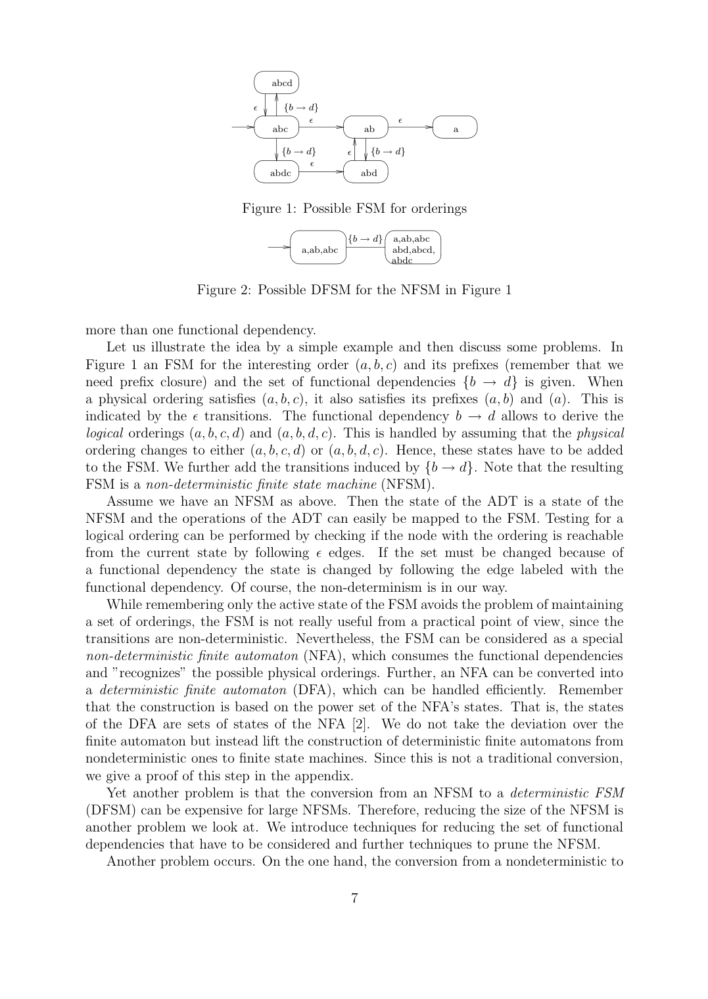
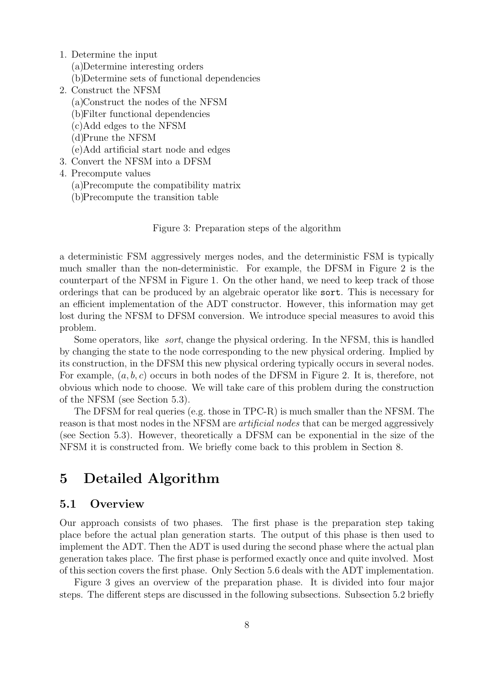

> 本组第 13 篇 · 属性与函数依赖 · [全部论文]() · [上一篇]() · [下一篇]()

本文把查询优化器内的 interesting-order 推导和测试编译为有限状态机：按查询做一次准备，构建并剪枝 NFSM、以子集构造确定化，再预计算兼容与转移表。计划节点只保存整数状态，contains 和以已登记 FD 集合作输入的 inferNewLogicalOrderings 可查表 O(1)，作者实现的每节点状态为4字节；预处理及整个优化器并非 O(1)，DFSM 理论上可指数膨胀。本文正式属性是有序序列，group/merge-join 利用顺序，但没有给出另一个无序 grouping 属性算法。一般 FD 只能在 determinant 之后插入 dependent，等式另有属性替换能力，不能把双向 FD 等同于等式。TPC-R Q8 总计划生成时间262→52ms、子计划200536→123954，作者明确将较少子计划归因于只保留查询相关顺序信息后更积极的计划剪枝，而非直接归因于基线 contains 假阴性。实验加速不是查询执行加速或所有查询保证。

本文保留论文陈述、读者推断与待验证方案的区别；实验数字只适用于原文条件。原文和翻译来自已有 AI 辅助精读报告，已做来源匹配与编辑复核，不等于人工逐项核验或独立实验复现。所有页码均为 PDF 物理页。

## 论文与阅读范围

Thomas Neumann, Guido Moerkotte. An Efficient Framework for Order Optimization. 封面：Reihe Informatik 11/2003；正文首页日期：July 3, 2003。当前 PDF 共24个物理页：封面、空白第2页，以及印刷页1–22。书目信息仅依据该原文，不补造会议/期刊出处。本次完整阅读 SHA 匹配的 extracted，并核对其24页文字与源PDF逐页一致；另视觉核对物理页14、19、20、22、24的表格和证明表述。

[论文集中的原始 PDF](https://github.com/lonng/db-papers/blob/4ff1331069c7cf52ac97dd769e5f484c1c35c200/papers/functional-dependencies/an-efficient-framework-for-order-optimization.pdf) · 本地来源：`functional-dependencies/an-efficient-framework-for-order-optimization.pdf`，共 24 页。

本篇保留 10 组原文精读和 54 条证据。截图为原始 PDF 的局部页选，不是重新生成的图表；未将整份 PDF 复制到博客。

## 研究问题与适用边界

【原文问题】计划生成会高频调用 contains（子计划输出是否满足所需顺序）和 inferNewLogicalOrderings（应用算子引入的 FD 后可满足哪些顺序）。每计划节点的属性表示空间也很重要。本文优化的是这些属性操作及其对计划搜索的影响，不是数据执行期排序算法。
Interesting orders 包括物理算子可产生或可利用的顺序，也包括查询 ORDER BY 所需的顺序。physical ordering 指元组流实际先后次序；logical ordering 是该流满足的有序属性序列，一个流可满足多个逻辑顺序。select 可不改变元组相对顺序而增加可推导性质，sort 则改变实际顺序。
【order 与 grouping】group、merge join 是消费顺序的算子例子；TPC-R Q8 把 group by 与连接相关属性加入 interesting orders。本文未单独定义无序 grouping 属性、其等价类或另一套 grouping 规约/状态转换，不能把后续系统的 grouping 框架倒填为本文算法。
准备前假设优化器已知可用索引、可用物理算子及其顺序/FD 输入。说明采用 bottom-up 作例子，但作者说方法不限于该生成器类型；这不是已有现代框架集成的实证。contains 的非合流反例针对所述 Simmen 规约，并不否定全部既有 order 推理框架。

依据：论文陈述；PDF 物理页 3, 4, 5, 6, 7, 8, 11, 19。证据：[C001N01](#evidence-c001n01), [C001N04](#evidence-c001n04), [C001N07](#evidence-c001n07), [C002N03](#evidence-c002n03), [OR02](#evidence-or02), [OR03](#evidence-or03), [OR05](#evidence-or05), [OR08](#evidence-or08), [OR13](#evidence-or13), [OR32](#evidence-or32)。

## 系统架构与数据结构设计

【原文接口】LogicalOrderings 隐式表示一个逻辑顺序集合，无需完整枚举/重建，仅需成员测试、按 FD 推导和物理顺序重建构造器。准备只在实际计划生成前做一次：确定输入→构造/剪枝 NFSM→确定化→预计算；之后每计划节点保存 DFSM 的一个整数状态，作者说明实现占4字节。
输入区分可由算子产生的 OP 和仅被测试的 OT。可产生顺序当然也可作为测试目标，但放在 OP 一类；OT 指不被直接产生的那部分。OI=OP∪OT。每算子可引入一个 FD 集合，输入字母表处理这些集合，不能把多条同时生效的约束擅自拆成不同的语义事件。
NFSM 状态有 interesting-order 节点 QI、仅为推导所需的人工节点 QA、人工 start q0；QA 不是“最终输出节点”，q0 也不是执行计划根。epsilon 边承载前缀兼容，FD 集合标签边承载推导。另从 q0 向可产生顺序节点添加人工入口边；仅测试顺序不设这种入口。它们不是每次物理 sort 的执行路径记录，而是构造器的编译期映射。
子集构造把 NFSM 的可达节点集合表示为单个 DFSM 状态，并保留 start/人工入口结构，解决同一产生顺序可能出现在多个 DFSM 状态时如何初始化的问题；本文已给出该措施，不需要猜测额外标志位。
预计算用 handles 对顺序/FD输入作常数比较；一张兼容矩阵（可压成 bit vector）记录 DFSM 状态含哪些 QI，另一张转移表记录按输入 FD 集合转向哪个状态。contains 查第一表，infer 查第二表。扫描按 start 与产生顺序入口初始化；sort 按新物理顺序入口初始化，再施加仍成立的 FD 集合。
【界限】这不是任意新 SQL 属性或任意未登记 FD 的即席常数时间推理；代价转移、未知输入扩展及表大小均不由每节点4字节代表。第10页明确 DFSM 可相对 NFSM 指数膨胀。

依据：论文陈述；PDF 物理页 5, 7, 8, 9, 10, 11, 12, 13, 14, 15, 23。证据：[C001N08](#evidence-c001n08), [C001N09](#evidence-c001n09), [C002N01](#evidence-c002n01), [C002N04](#evidence-c002n04), [C002N05](#evidence-c002n05), [C002N07](#evidence-c002n07), [C002N08](#evidence-c002n08), [C003N07](#evidence-c003n07), [OR04](#evidence-or04), [OR08](#evidence-or08), [OR10](#evidence-or10), [OR11](#evidence-or11), [OR12](#evidence-or12), [OR13](#evidence-or13), [OR14](#evidence-or14), [OR15](#evidence-or15), [OR16](#evidence-or16), [OR17](#evidence-or17)。

*原论文 PDF 物理页 9，版权归原作者或出版方。点击图片可查看原尺寸。页面文本中定位到：Figure 1: Possible FSM for orderings；Figure 2: Possible DFSM for the NFSM in Figure 1；Figure 1 an FSM for the interesting order (a, b, c) and its prefixes (remember that we。这是页面定位信息，不表示本次已复核图内所有数据。*

## 核心算法与执行步骤

【1. 原文推导规则】顺序 p 满足其所有前缀。对 B1,...,Bk→B，在一个已满足的顺序中，只可在所有 determinant 已出现在左边的位置插入 B，再取前缀闭包；迭代到 Ω。不能仅凭 a→b 从 (a) 推成单独 (b)，因为 FD 不保证 b 值随 a 单调。Ai=Aj 除双向 FD 推导外还允许用一个属性替换另一个；A=const 相当于 ∅→A，可任意位置插入。等式强于双向 FD，正文简单查询明确强调这一点。
【2. 原文规约反例】已有 (a)，要求 (a,b,c)，FD 为 a→b 与 a,b→c。先用 a,b→c 删除 c，再用 a→b 删除 b，可规约为 (a)；反序先删 b 得 (a,c)，不能再用缺 b 的 determinant 删除 c。因此简单规约可能假阴性。第8页某句一般性说明的 left/right 与此例方向疑似倒置；此处依完整例子解释移除 dependent，不据那一句另造反向规则。
【3. 生成状态与入口】准备阶段收集 OI 与各算子 FD 集合，构造 QI、由推导需用的 QA 和前缀/FD 边。按 OP 增加人工 start 入口，使构造器在确定化后仍能定位。正文贯穿例为 OP={(b),(a,b)}、OT={(a,b,c)}、F={{b→c},{b→d}}；d 无助于新 interesting order 时删其相关 FD/人工节点；(b,c) 人工节点也可规约；(a,b,c) 仅测试，故无人工入口。
【4. 剪枝不止单条 FD 检查】作者定义 ΩN 为单 f 相对原 epsilon/前缀闭包的新增顺序；对每个 interesting order，再用全体 F 从这些新增顺序推导，扣除原已知前缀后若仍无新 interesting order，f 才可剪。不能简化成“f 的直接结果不在 OI 就删除”，否则可能丢掉通向目标的中间链。
人工节点可合并相同输入下行为相同者，或把仅经 epsilon 到重要节点的可替换人工节点换为对应链接，不是删除所有 QA。第16页另给长度与前缀启发式：截到最长 interesting order；插入前检查是否仍匹配某 interesting-order 前缀，并按最长匹配长度限制；属性等式可能改写前缀，因此检查时用等式类代表。不能把一般双向 FD 当作这些等式类。
【5. 确定化与查表】以 epsilon 闭包和子集构造形成 DFSM，保留 start/入口；预计算 membership 与 transition。正文示例 start 经 (a,b) 入口到状态2，满足 (a)/(a,b)；再输入 {b→c} 到状态3，新增满足 (a,b,c)。这是原文例子，不是读者补造。
【6. 尚未给出的内容】本文把完整 SQL→FD/interesting-order 提取细节交给引用文献；未给单独 grouping 算法、一般 SQL NULL/排序方向/排序规则处理、全套工程容器和任意动态新输入扩展算法。不能把臆测伪代码写成作者实现。

依据：论文陈述；PDF 物理页 6, 7, 8, 11, 12, 13, 14, 15, 16, 17, 18。证据：[C001N07](#evidence-c001n07), [C002N03](#evidence-c002n03), [C002N04](#evidence-c002n04), [C002N05](#evidence-c002n05), [C002N07](#evidence-c002n07), [C002N08](#evidence-c002n08), [C002N09](#evidence-c002n09), [C002N10](#evidence-c002n10), [OR06](#evidence-or06), [OR07](#evidence-or07), [OR08](#evidence-or08), [OR09](#evidence-or09), [OR13](#evidence-or13), [OR14](#evidence-or14), [OR15](#evidence-or15), [OR16](#evidence-or16), [OR17](#evidence-or17), [OR18](#evidence-or18), [OR19](#evidence-or19), [OR20](#evidence-or20), [OR21](#evidence-or21), [OR22](#evidence-or22)。

## 正确性论证与边界条件

【原文主张】作者指出基线规约非合流，提出保留可推导逻辑顺序的 NFSM，并在附录 A 论证 NFSM→DFSM 的转换等价。关键是子集状态覆盖相同输入下的可达集合；“DFSM 每输入只有唯一下一状态”本身并不能证明语义完备，也不能自动修复任意错误推理规则。
FD 必须在当前元组流上确实成立，推导须遵守 determinant 出现位置；a=b 的替换规则不能退化为一般双向 FD。输入 OP/OT 和人工入口是正文已说明的构造正确性条件，不是缺失待猜的物理标志。
【完备性范围】第5.7节称其规则/启发式保留与本查询 interesting orders 有关的信息；附录证明对象是确定化，不是所有剪枝的独立完备性证明，更不是全部 SQL/全物理属性域的全局最优性定理。附录 A.3 第二式按原图印成对各成员节点的较强量词表述，本次审核不将该字面强命题视为已独立验证的定理；采用其意图中的集合状态可达性解释，不篡改原文公式。
简单 salary 例子中该顺序仅测试且不可产生，依赖“为 selection 排序不划算、没有 salary 索引”的假设；并非所有 selection 都不会利用 order。作者观察实验中两方法都选同一最优计划，是有限测试事实，不是对任意查询的形式保证。
【读者审慎判断】只保留已登记查询属性的摘要，需由调用方维持有效 FD 和输入一致性。本文未提供新增/撤销 FD 的增量维护协议，也未说明如何把统计相关性当作逻辑 FD；不能把统计估计变化直接等同于 FD 真值变化。DFSM 可指数增长，剪枝的经验成效不构成资源上界。

依据：读者推断；PDF 物理页 7, 8, 10, 12, 13, 15, 16, 17, 18, 20, 23, 24。证据：[C001N07](#evidence-c001n07), [C002N02](#evidence-c002n02), [C002N05](#evidence-c002n05), [C002N09](#evidence-c002n09), [C002N10](#evidence-c002n10), [C003N06](#evidence-c003n06), [C003N07](#evidence-c003n07), [OR07](#evidence-or07), [OR09](#evidence-or09), [OR12](#evidence-or12), [OR14](#evidence-or14), [OR15](#evidence-or15), [OR18](#evidence-or18), [OR19](#evidence-or19), [OR20](#evidence-or20), [OR21](#evidence-or21), [OR22](#evidence-or22), [OR25](#evidence-or25), [OR29](#evidence-or29), [OR30](#evidence-or30)。

## 实验设计与数据分析

【环境与测量对象】第6.2节用 AMD Athlon XP 1800+、gcc 3.2 给出 TPC-R Query8 准备开销。第7节把两框架集成于基于[3]的 bottom-up 计划生成器，比的是总计划生成，不是 SQL 执行。没有在此补造操作系统、RAM、数据规模、现代多核/分布式环境或编译优化旗标。
【基线处理】缓存 Simmen 的 reduce 结果、定制内存管理、profiling 并分别重编译；“This alone ... factor of three”接的是定制内存管理，不是缓存。作者称已尽力调优并观察所有测试选到同一最优计划，不能称已证明这是所有可能实现中的绝对最佳基线。
【Q8 准备消融，物理页19】无剪枝/有剪枝：NFSM 376/38节点，DFSM 80/24节点，准备时间16/0.2ms，预计算数据3040/912 bytes。16/0.2=80倍是此例准备阶段的读者计算，0.2ms 不是所有查询的固定准备成本。
【Q8 总计划生成，物理页20】Simmen/本文：262/52ms，200536/123954个子计划，1.31/0.42µs 每子计划，329/136KB 的 order-optimization 算法内存。按标签计算时间约5.04倍，计划数减少约38.19%。论文明确解释：约简 FSM 只保留查询相关信息，使不同计划更可比较、剪枝更积极；Simmen 表示还比较可能无关的顺序/FD 集合。不能把减少计划数归因于 contains 假阴性或编造额外 Sort/Join 的实测因果链。
【合成查询，图13，物理页20–21】5–10个关系，从链图随机加边，三组边数 n−1/n/n+1；小查询对100个查询取平均，大查询对10个取平均，不是同一查询重复100/10次，分界未说明。总计划生成时间包括 DFSM 构建。最后标 % 的三列实际是 Simmen/本文比值，不是百分比。
5关系链图：2→1ms，1541→1274子计划，1.29→0.78µs/plan，时间改善2.00倍。10关系链图：11920→1984ms，3284381→2071035子计划，3.62→0.95µs/plan，时间6.01倍。10关系 n+1边：202832→3021ms，7779662→3400945子计划，26.07→0.88µs/plan，打印比值67.14、2.29、29.62。不能把“约60倍”泛化为每个10表链查询。
作者文字概括“多数低于1秒、最坏3秒、基线最高200秒”是近似；表中实际最大3021ms和202832ms，不能改成严格≤3秒。完整18行数据与单位保存于本次 QA。
【内存，图14，物理页22】单位KB，Our Algorithm 已包含 DFSM，不能再加一次；是 order框架内存，不是整个优化器/执行查询内存。10关系链：3307→1972KB，其中 DFSM4KB；10关系 n+1边：8736→3003KB，其中DFSM5KB。作者概括约一半是总体观察，各行比例不同；每节点4字节也不等于整体只用4字节。
【限制】未给方差/置信区间、随机种子、小/大分界和完整原始实验实现；没有独立测出 order函数时间占总时间的比例。所测上限10关系，不保证更大查询、其他拓扑或现代硬件仍有同加速比。

依据：论文陈述；PDF 物理页 19, 20, 21, 22。证据：[C002N11](#evidence-c002n11), [C002N12](#evidence-c002n12), [C003N01](#evidence-c003n01), [C003N02](#evidence-c003n02), [C003N03](#evidence-c003n03), [OR23](#evidence-or23), [OR24](#evidence-or24), [OR25](#evidence-or25), [OR26](#evidence-or26), [OR27](#evidence-or27), [OR28](#evidence-or28), [OR31](#evidence-or31)。

*原论文 PDF 物理页 10，版权归原作者或出版方。点击图片可查看原尺寸。页面文本中定位到：Figure 3: Preparation steps of the algorithm；Figure 3 gives an overview of the preparation phase. It is divided into four major。这是页面定位信息，不表示本次已复核图内所有数据。*

## 工程权衡与设计取舍

【原文】以一次准备和查询级共享矩阵，换取每子计划的整数状态及查表；只保留相关顺序信息同时减少操作代价与待生成计划。原文已明确人工入口解决构造器定位，不能再把“额外标志位或分离跟踪路径”猜成缺失的作者措施。
【读者推断】收益取决于准备开销能否被大量属性操作摊销；短查询可能不划算，但论文未给启用阈值或点查实验。Q8 的0.2ms 是单例结果，不是固定启动税或统一保证。
handle寻址的 O(1) 属算法模型，不代表现代缓存未命中/内存访问延迟固定。全局表随状态、输入和目标顺序增大，理论指数状态增长仍可能使准备与内存昂贵；不能把每节点状态小误写成空间换时间毫无成本。
ADT 不要求完整枚举当前所有逻辑顺序。若别的组件需要未登记属性或显式枚举，可能要扩展接口或重编译；本文没有给具体协议。将同样思路用于 unordered grouping、分布或分区属性只可作为后续提案，不能据此声称本文已有完备转移规则。
本文以已有成本模型选择便宜计划，减少不必要 Sort 是顺序利用的目标之一；未给新的 Sort/Join 成本公式，也未给“什么时候启用FSM”的成本阈值。实验中时间改善还包含计划数量减少，不能把5倍总加速全计为 contains 单次更快。

依据：读者推断；PDF 物理页 5, 8, 9, 10, 14, 15, 16, 19, 20, 21, 22。证据：[C001N08](#evidence-c001n08), [C001N11](#evidence-c001n11), [C002N01](#evidence-c002n01), [C002N07](#evidence-c002n07), [C002N08](#evidence-c002n08), [OR04](#evidence-or04), [OR12](#evidence-or12), [OR16](#evidence-or16), [OR17](#evidence-or17), [OR18](#evidence-or18), [OR19](#evidence-or19), [OR20](#evidence-or20), [OR23](#evidence-or23), [OR26](#evidence-or26), [OR27](#evidence-or27), [OR28](#evidence-or28)。

## 相关工作对比分析

【原文定位】本文沿用 Simmen 等人的 FD-based order推导框架，贡献在更高效的表示/操作及丢弃与查询无关的信息，不是首次引入 FD 或 cost-based interesting orders。Selinger 提出成本选择、动态规划和 interesting orders；文中另引 Lohman bottom-up 及 Volcano memoization，不提供所有现代优化器的实现比较。
作者给基线 contains/新增FD维护至少 Ω(n) 的下界分析（n为相关FD数），并指出所述规约非合流；本文预处理后用整数状态和查表 O(1)。两者比较必须保留预处理边界，不能只用“确定性”替代正确性论证。
Q8 上262→52ms等数字来自调优后的基线比较。计划数减少的原文解释是相关性约简后更积极的计划剪枝，不是非合流假阴性已被证明制造了无效计划。缓存、定制内存和profiling增强基线实现，但不能宣称已排除所有其他实现差异。
对外部系统只限原文引用范围；没有读取当代源码，不断言某产品都采用 Cascades/Memo、同一属性模型或本文方法。

依据：论文陈述；PDF 物理页 3, 4, 7, 8, 19, 20, 21。证据：[C001N01](#evidence-c001n01), [C001N07](#evidence-c001n07), [OR02](#evidence-or02), [OR08](#evidence-or08), [OR09](#evidence-or09), [OR24](#evidence-or24), [OR25](#evidence-or25), [OR26](#evidence-or26), [OR27](#evidence-or27)。

## 复现指南与验证缺口

以下均是尚未执行的读者建议，不是论文已经提供的代码或已完成复现。
1. 先按本文有序序列域实现前缀与FD推导。区分一般FD、等式替换和常量FD；回放(a,b,c)的规约反例。用小规模穷举可达顺序作 oracle，与剪枝前/后NFSM及DFSM的 contains/转移结果比较，不把唯一状态转移当成证明。
2. 实现 OP/OT 分类、QI/QA/start与人工入口，使用论文(b)、(a,b)、(a,b,c)例验证状态2→3。sort按新顺序入口重建后再应用有效FD；不自行设计作者未说的“防丢失标志位”。SQL输入提取的具体工程实现仍需另行定义并标为本地选择。
3. 分开验证 FD相关性过滤、人工节点合并/epsilon替换、最长长度截断、前缀匹配及等式类代表，记录每一步节点/边数。附录的确定化等价与这些剪枝的语义保持须分别检验。不要把双向FD误当等式类，也不要增加来源没有的grouping规约算法。
4. 对TPC-R Q8与5–10关系的链图加边负载，记录准备时间和总计划生成时间、计划数、µs/plan、order框架KB、DFSM大小；包含构建开销，并避免把DFSM内存二次相加。记录硬件/编译器/旗标、随机种子、运行次数和分布；相对加速比也需要重新测量，不保证与2003年一致。
5. 基线应单独记录reduce缓存、定制内存管理和profiling的影响，不能将作者归给内存管理的三倍收益写给缓存。保证两方法使用相同输入/成本模型并比较最终计划；对齐论文绝对子计划数仍依赖完整枚举器实现。
6. 评估指数增长与未登记输入时的拒绝/回退策略，明确这是本地工程方案，本文未给具体增量算法。若尝试unordered grouping、方向/NULL/排序规则、分布式属性或并发共享表，先定义语义再检验，不借外部产品名称宣称已集成。
复现缺口是完整代码、生成器细节及统计测量材料，而不是人工入口方案、子计划数减少原因或所有剪枝描述均未提供。

依据：待验证的工程设想；PDF 物理页 6, 7, 8, 10, 11, 12, 13, 14, 15, 16, 19, 20, 21, 22, 23, 24。证据：[C001N07](#evidence-c001n07), [C001N11](#evidence-c001n11), [C002N03](#evidence-c002n03), [C002N07](#evidence-c002n07), [C002N09](#evidence-c002n09), [C002N10](#evidence-c002n10), [C003N06](#evidence-c003n06), [OR06](#evidence-or06), [OR07](#evidence-or07), [OR08](#evidence-or08), [OR09](#evidence-or09), [OR12](#evidence-or12), [OR13](#evidence-or13), [OR14](#evidence-or14), [OR15](#evidence-or15), [OR16](#evidence-or16), [OR17](#evidence-or17), [OR18](#evidence-or18), [OR19](#evidence-or19), [OR20](#evidence-or20), [OR23](#evidence-or23), [OR24](#evidence-or24), [OR25](#evidence-or25), [OR26](#evidence-or26), [OR27](#evidence-or27), [OR28](#evidence-or28), [OR29](#evidence-or29), [OR30](#evidence-or30)。

## 总结与内核工程启示

本文将查询相关 order推理编译为共享自动机和查表，准备后每子计划只需整数状态，降低属性维护成本并使与查询无关的信息不再妨碍计划剪枝。原文明确给出人工start/入口和子计划数减少机制，不能误写成材料缺失。
一般FD、属性等式与常量FD具有不同推导能力；grouping仅作为消费order的场景出现，不构成另一套已给出的属性算法。附录针对NFSM确定化，不能被扩写成任意剪枝或全部SQL域的完备性证明。
Q8的262→52ms和376→38个NFSM节点等是各自测量范围内的结果；10关系 n+1边的总生成时间202832→3021ms约67.14倍，不是查询执行加速或普适保证。每节点4字节、共享表大小与整体算法内存须分开；DFSM最坏指数膨胀仍存在。
本次为Codex基于完整单篇原文的AI语义审核，非独立人工审核。历史模型critique和原始引文保留；本次QA纠正原稿的未知项、猜测实现、误归因与数值边界，未运行复现实验或查阅外部系统源码。

依据：论文陈述；PDF 物理页 3, 5, 10, 14, 15, 16, 19, 20, 21, 22, 23, 24。证据：[C001N01](#evidence-c001n01), [C001N08](#evidence-c001n08), [C001N11](#evidence-c001n11), [C002N07](#evidence-c002n07), [C002N08](#evidence-c002n08), [C002N09](#evidence-c002n09), [C002N10](#evidence-c002n10), [C003N06](#evidence-c003n06), [OR04](#evidence-or04), [OR12](#evidence-or12), [OR16](#evidence-or16), [OR17](#evidence-or17), [OR20](#evidence-or20), [OR23](#evidence-or23), [OR26](#evidence-or26), [OR27](#evidence-or27), [OR28](#evidence-or28), [OR29](#evidence-or29), [OR30](#evidence-or30)。

## 原文精读：从句子回到机制

以下保留原文、忠实翻译、含义与边界；假设示例不作为论文实验结果。

### P001 · PDF 物理页 3

**原文**

<blockquote class="paper-source-quote"><pre><code>Since&#10;these two operations are called millions of times during plan generation, they are&#10;highly performance-critical. The third crucial parameter is the space requirement&#10;for annotating every plan node with its output order.</code></pre></blockquote>

**忠实翻译**

> 由于这两个操作在计划生成期间被调用数百万次，它们对性能至关重要。第三个关键参数是为每个计划节点标注其输出顺序所需的空间。

**技术含义与边界**

> 结合完整上下文，两个操作就是 contains 与 inferNewLogicalOrderings，分别测试顺序兼容性及按算子FD推导新逻辑顺序。它们发生于计划生成而非SQL执行；空间参数是每节点的order状态，不是整个执行计划的内存。

**常见误读**

> 容易错误地将‘这两个操作’泛化为所有数据库操作，但原文明确限定为‘在计划生成期间’被调用的特定操作。此外，不能将空间需求理解为整个执行计划的内存占用，原文仅指‘为每个计划节点标注其输出顺序’的空间。

**读者构造的假设示例**

> 读者构造的假设示例：一个枚举器对许多候选子计划调用contains判断是否可直接接merge join，另在选择谓词生效后调用infer更新逻辑顺序。函数被高频调用时，预处理后查表可能减少优化耗时；这不是作者报告的调用次数实测。

### P002 · PDF 物理页 23

**原文**

<blockquote class="paper-source-quote"><pre><code>A&#10;Proof of correctness&#10;The algorithm described in this paper first constructs a non-deterministic FSM and con-&#10;verts it to a deterministic FSM. For this conversion, the NFSM is treated like an NFA&#10;which is converted to a DFA. It has to be shown that the DFSM resulting from the&#10;conversion is equivalent to the initial NFSM:&#10;A.1&#10;Definitions&#10;An NFA [2] consists of a tuple (Σ, Q, D, qo, F), where Σ is the input alphabet, Q the set&#10;of possible states, D ⊆Q×(Σ∪{ϵ})×Q the transition relation, q0 the initial state and F&#10;the set of accepting states.</code></pre></blockquote>

**忠实翻译**

> A 正确性证明
> 本文描述的算法首先构造一个非确定性有限状态机（FSM），并将其转换为确定性有限状态机。对于这种转换，NFSM被视为一个NFA，该NFA被转换为DFA。必须证明由转换产生的DFSM与初始的NFSM等价：
> A.1 定义
> 一个NFA [2] 由一个元组 (Σ, Q, D, qo, F) 组成，其中 Σ 是输入字母表，Q 是可能状态的集合，D ⊆Q×(Σ∪{ϵ})×Q 是转移关系，q0 是初始状态，F 是接受状态的集合。

**技术含义与边界**

> 本段界定附录证明对象为NFSM到DFSM转换。结合正文，NFSM节点表示顺序，DFSM状态表示其可达子集，通常输入是算子引入的FD集合，另有用于构造器的人工入口符号。不是把传统正则匹配直接拿来执行SQL。

**常见误读**

> 不能把确定化等价扩成全部剪枝启发式、所有SQL语义或最优计划的形式证明；也不能将所有输入符号说成物理sort操作。正文已给状态和标签含义，不应因本段只列通用定义就说全文未知。

**读者构造的假设示例**

> 读者构造的假设示例：一个DFSM状态聚合满足(a)与(a,b)的NFSM节点；输入已登记的{b→c}后，目标集合可能新增(a,b,c)等可达节点。这里输入FD信息并不实际重排元组。

### P003 · PDF 物理页 12

**原文**

<blockquote class="paper-source-quote"><pre><code>Additionally, we have an&#10;artificial start node q0. Summarizing, we define Q = QI ∪QA ∪{q0} with QI ∩QA = ∅&#10;and q0̸ ∈QI ∪QA.&#10;The interesting orders have been partitioned into those orderings which can be di-&#10;rectly produced by an operator (OP) and those which are only tested for (OT).</code></pre></blockquote>

**忠实翻译**

> 此外，我们有一个人工起始节点 q0。总结来说，我们定义 Q = QI ∪QA ∪{q0}，其中 QI ∩QA = ∅ 且 q0̸ ∈QI ∪QA。
> 有趣的顺序已被划分为那些可以由算子直接产生的排序（OP）和那些仅用于测试的排序（OT）。

**技术含义与边界**

> QI是interesting-order节点，QA是仅算法内部所需的人工推导节点，q0是人工起点，三者不是中间结果、最终结果和计划根的划分。OP是可产生顺序（也可被测试），OT是仅测试而不可直接产生的顺序；人工入口只连OP。

**常见误读**

> 不能把QA说成最终输出顺序集合，也不能因为ORDER BY是需求就必放OT；若Sort可直接产生它，应归OP。OP/OT是顺序分类，而非算子分类。

**读者构造的假设示例**

> 读者构造的假设示例：假设算子能产生(a,b)，另只测试(a,b,c)，前者进入OP并有人工入口，后者进入OT而没有入口；由FD产生的非interesting中间顺序可放QA。某个顺序即便最终输出要求也不因此自动属于QA。

### P004 · PDF 物理页 8

**原文**

<blockquote class="paper-source-quote"><pre><code>Note that if we applied a →b first, then (a, b, c) would reduce&#10;to (a, c) and no further reduction is possible. Hence, the rewrite system induced by their&#10;reduction process is not confluent.&#10;This problem is not mentioned by Simmen et al.,&#10;but can have the effect that contains returns false whereas it should return true.</code></pre></blockquote>

**忠实翻译**

> 注意，如果我们先应用 a →b，那么 (a, b, c) 将归约为 (a, c)，并且无法进一步归约。因此，由其归约过程导出的重写系统不是合流的（confluent）。
> Simmen等人没有提到这个问题，但它可能导致 contains 返回 false，而实际上它应该返回 true。

**技术含义与边界**

> 原文反例显示对有序序列应用规约的先后可能造成不同结果与contains假阴性。完整上下文用a→b和a,b→c，不是把顺序当作无序属性集合。作者方法意在保留可推导顺序；仅凭DFSM转移唯一还不能推出语义正确。

**常见误读**

> 不要把非合流误写为相同输入的随机结果，也不要把计划数减少直接归因于该假阴性。第20页另给相关信息约简使计划更可剪枝的明确解释。

**读者构造的假设示例**

> 读者构造的假设示例：用顺序(x,y,z)和FD x→y、x,y→z，先删z再删y得到(x)；反序先删y得到(x,z)后第二条不能直接应用。该例只说明规约次序，未声称已完成实现或基准测试。

### P005 · PDF 物理页 19

**原文**

<blockquote class="paper-source-quote"><pre><code>The set of functional dependencies (and equations) contains all join conditions and&#10;constant conditions:&#10;F&#10;=&#10;{{p partkey = l partkey}, {∅→p type},&#10;{o custkey = c custkey}, {∅→r name},&#10;{c nationkey = n nationkey},&#10;{s nationkey = n2.n nationkey},&#10;{l orderkey = o orderkey},&#10;{s suppkey = l suppkey},&#10;{n regionkey = r regionkey}}&#10;On an AMD Athlon XP 1800+ using the gcc 3.2, the complete preparation step has the&#10;following space and time requirements, the results with and without pruning techniques&#10;(see section 5.7) are shown.</code></pre></blockquote>

**忠实翻译**

> 函数依赖（和等式）的集合包含所有连接条件和常量条件：
> F = {{p partkey = l partkey}, {∅→p type}, {o custkey = c custkey}, {∅→r name}, {c nationkey = n nationkey}, {s nationkey = n2.n nationkey}, {l orderkey = o orderkey}, {s suppkey = l suppkey}, {n regionkey = r regionkey}}
> 在使用 gcc 3.2 的 AMD Athlon XP 1800+ 上，完整的准备步骤具有以下空间和时间需求，显示了使用和不使用剪枝技术（见第5.7节）的结果。

**技术含义与边界**

> 完整原文第6.2节明确是TPC-R Query8，而不是靠别名猜测的TPC-H。F含该例的连接等式与常量条件；硬件/编译器用于所述准备阶段比较，16/0.2ms等数字在后面的表。等式与一般FD的能力不能混同。

**常见误读**

> F针对该查询，不是所有SQL条件的通用提取规则；常量FD也不表示可以不问目标顺序就删去属性。该段硬件事实不能补出RAM、操作系统或现代平台加速保证。

**读者构造的假设示例**

> 读者构造的假设示例：WHERE x='A'成立后有∅→x，若输入按(a)有序，可推导(x,a)或(a,x)等逻辑顺序，因为x在流上为常量；并不是无需再考虑任何含x的排序需求。

### P006 · PDF 物理页 15

**原文**

<blockquote class="paper-source-quote"><pre><code>For convenience, we extend the&#10;definition of Ω(O, F) and define&#10;Ω(O, ϵ)&#10;:=&#10;Ω(O, ∅)&#10;Then the set of prunable functional dependencies FP can be described by&#10;ΩN(o, f)&#10;:=&#10;Ω({o}, {f}) \ Ω({o}, ϵ)&#10;FP&#10;:=&#10;{f|f ∈F ∧∀o ∈OI :&#10;(Ω(ΩN(o, f), F) \ Ω({o}, ϵ)) ∩OI = ∅}&#10;Pruning functional dependencies is especially useful since it also prunes artificial nodes&#10;that would be created because of the dependencies.</code></pre></blockquote>

**忠实翻译**

> 为了方便起见，我们扩展 Ω(O, F) 的定义并定义
> Ω(O, ϵ) := Ω(O, ∅)
> 那么可剪枝的函数依赖集合 FP 可以描述为
> ΩN(o, f) := Ω({o}, {f}) \ Ω({o}, ϵ)
> FP := {f|f ∈F ∧∀o ∈OI : (Ω(ΩN(o, f), F) \ Ω({o}, ϵ)) ∩OI = ∅}
> 剪枝函数依赖特别有用，因为它还会剪枝掉因这些依赖而创建的人工节点。

**技术含义与边界**

> ΩN先计算f相对既有epsilon/前缀闭包带来的新增顺序，FP条件随后还用全体F继续推导并扣除原已知前缀，要求对所有OI起点均不能得到新的interesting order。不能省略第二层Ω，只检查单条f的直接结果。原公式的集合差符号保持原始提取形式。

**常见误读**

> 必须保留“所有起点”“新增而非已有”“结合其他FD继续推导”三个条件；不应只看某一次无收益或依赖两端是否直接在目标属性中。原文给形式条件，不等于给了其完整高效工程实现。

**读者构造的假设示例**

> 读者构造的假设示例：OI只要求(a)和(a,b,c)，f为a→b，另有a,b→c。从(a)经f得到(a,b)，虽不在OI中，但继续应用另一FD可到(a,b,c)，因此不能仅凭第一步产物不在OI就剪f。

### P007 · PDF 物理页 5

**原文**

<blockquote class="paper-source-quote"><pre><code>Note that the latter also includes the orderings demanded e.g. by the order by clause of a&#10;SQL query, since this ordering can potentially be produced by a sort operator. We treat&#10;interesting orders as logical orderings. This means that they specify a condition a tuple&#10;stream must meet to satisfy the given ordering. This condition is formally stated below.&#10;In contrast, the physical ordering of a tuple stream is the actual succession of tuples in&#10;the stream.</code></pre></blockquote>

**忠实翻译**

> 注意，后者也包括例如SQL查询的 order by 子句所要求的排序，因为这种排序可能由 sort 算子产生。我们将有趣的顺序视为逻辑排序。这意味着它们指定了元组流必须满足的条件，以满足给定的排序。该条件在下面正式陈述。
> 相比之下，元组流的物理排序是流中元组的实际先后顺序。

**技术含义与边界**

> physical ordering在这里是元组流的实际先后，而不是磁盘布局或内存存放的同义词。Logical order是流满足的顺序条件，一个物理顺序满足其前缀且在合法FD下还可满足其他顺序；ORDER BY需求也可能由Sort产生，故可属OP。

**常见误读**

> 不能把逻辑顺序仅当作未实现目标，也不能说实际流必然可以不满足任何逻辑顺序；其自身及前缀就是基本满足关系。索引存在也不保证任意上层算子仍保持其输出流顺序。

**读者构造的假设示例**

> 读者构造的假设示例：若某索引扫描实际输出按(a,b)有序且后续算子保序，它可满足ORDER BY a,b及前缀(a)；是否可省Sort要由调用者验证实际输出属性，而不是只看磁盘上有索引。

### P008 · PDF 物理页 10

**原文**

<blockquote class="paper-source-quote"><pre><code>On the other hand, we need to keep track of those&#10;orderings that can be produced by an algebraic operator like sort. This is necessary for&#10;an efficient implementation of the ADT constructor. However, this information may get&#10;lost during the NFSM to DFSM conversion. We introduce special measures to avoid this&#10;problem.&#10;Some operators, like sort, change the physical ordering. In the NFSM, this is handled&#10;by changing the state to the node corresponding to the new physical ordering.</code></pre></blockquote>

**忠实翻译**

> 另一方面，我们需要跟踪那些可以由代数算子（如 sort）产生的排序。这对于 ADT 构造函数的高效实现是必要的。然而，这些信息可能在 NFSM 到 DFSM 的转换过程中丢失。我们引入了特殊措施来避免这个问题。
> 某些算子（如 sort）会改变物理排序。在 NFSM 中，这是通过将状态更改为对应于新物理排序的节点来处理的。

**技术含义与边界**

> 完整正文给出的特殊措施就是人工start及通往OP节点的入口边，确定化时保留；scan/sort构造器由入口定位，sort随后施加仍成立FD。不需臆测额外物理标志位或从DFSM还原执行计划路径。

**常见误读**

> 这里的问题是构造器如何选择初始DFSM状态，并非确定化让执行数据顺序丢失，也不是ADT负责重建整棵执行计划。仅本片段没有细节，不等于全文没有，第5.3–5.6节已经解释。

**读者构造的假设示例**

> 读者构造的假设示例：同一个(a,b)可能出现在多个聚合DFSM状态中，不能任挑一个；从人工start沿(a,b)入口定位，随后应用当前有效FD。OT中的(a,b,c)若不被直接产生，则没有该人工入口。

### P009 · PDF 物理页 21

**原文**

<blockquote class="paper-source-quote"><pre><code>In order to show the influence of the query on the possible gains of our algorithm,&#10;we generated queries with 5-10 relations and a varying number of join predicates —that&#10;is, edges in the join graph. We always started from a chain query and then randomly&#10;added some edges. For small queries we averaged the results of 100 queries and averaged&#10;10 queries for large queries. The results of the experiment can be found in Fig. 13.</code></pre></blockquote>

**忠实翻译**

> 为了展示查询对我们算法可能收益的影响，我们生成了包含5-10个关系以及数量不等的连接谓词（即连接图中的边）的查询。我们总是从一个链式查询开始，然后随机添加一些边。对于小查询，我们对100个查询的结果取平均；对于大查询，我们对10个查询取平均。实验结果可在图13中找到。

**技术含义与边界**

> 实验生成5–10关系、从链图随机加边的不同查询；小查询平均100个查询，大查询平均10个查询，不是同一个查询重复100/10次。正文没给大小分界、随机种子或置信区间。总计划生成时间包括DFSM构建。

**常见误读**

> 不能泛化到百表或任意拓扑，不能把平均查询个数改成重复运行次数。图13实际数据已在第20页并由本次视觉核对；最后标%列是倍数而非百分比，10关系n+1边结果不能替代链图结果。

**读者构造的假设示例**

> 读者构造的假设示例：五关系链R1–R2–R3–R4–R5有四条边；再加R1–R3成为五边图。对多个这样生成的不同查询取平均，与对同一SQL重复计时是不同实验设计。此例未赋予作者未测出的收益因果。

### P010 · PDF 物理页 9

**原文**

<blockquote class="paper-source-quote"><pre><code>Since this is not a traditional conversion,&#10;we give a proof of this step in the appendix.&#10;Yet another problem is that the conversion from an NFSM to a deterministic FSM&#10;(DFSM) can be expensive for large NFSMs. Therefore, reducing the size of the NFSM is&#10;another problem we look at. We introduce techniques for reducing the set of functional&#10;dependencies that have to be considered and further techniques to prune the NFSM.</code></pre></blockquote>

**忠实翻译**

> 由于这不是传统的转换，我们在附录中给出了这一步骤的证明。
> 另一个问题是，对于大型 NFSM，从 NFSM 到确定性 FSM（DFSM）的转换可能代价高昂。因此，减小 NFSM 的规模是我们关注的另一个问题。我们引入了用于减少必须考虑的函数依赖集合的技术，以及进一步剪枝 NFSM 的技术。

**技术含义与边界**

> 作者在这里强调确定化和缩小NFSM。完整第10页还明说DFSM理论上可能相对NFSM指数增大，不只是读者借外部理论猜测。剪FD和剪状态可关联，但削减FD数量不按固定比例决定状态数。

**常见误读**

> 不能将“昂贵”理解为算法语义错误，也不能将经验剪枝结果当作消除理论指数风险。附录对象是转换本身；完整SQL属性/分组扩展仍不在证明范围内。

**读者构造的假设示例**

> 读者构造的假设示例：含N个NFSM状态的子集空间最多有2^N个候选集合，但可达集合可能少很多。某次剪掉半数FD不意味着状态数必缩至某个值；需要实际记录剪枝后NFSM/DFSM大小，不能补造1000→100的实验。

## 尚未解决的问题

1. SQL到合法FD与interesting-order输入的完整提取实现如何补齐，特别是NULL、ASC/DESC和排序规则边界？本文未给这些完整规则。
2. 前缀/长度与人工节点剪枝在完整实现中如何逐项建立语义保持测试，而不把确定化附录误作全部剪枝的独立证明？
3. 更大关系数、密集FD与其他连接拓扑下，共享状态/表的增长和准备摊销点如何实测？
4. 当输入集合变化或有效FD需要重编译时，怎样设计明确标为本地扩展的拒绝/回退协议？统计相关性不能直接当成逻辑FD。
5. 能否取得完整计划生成器、随机查询生成参数与测量记录，以复核绝对子计划数、内存和加速比？
6. 如何在不混同order和unordered grouping的前提下定义后者的扩展？这是后续研究问题，不是本文现有算法。

## 证据索引

证据编号沿用原报告，便于将上文判断追溯到原句。引文匹配只验证位置，不证明解读正确。

**C001N01 · PDF 物理页 3**

查询优化器在计划生成期间需要数百万次执行两个核心操作：判断子计划输出是否满足某排序要求（contains），以及应用算子后逻辑排序集合如何变化（inferNewLogicalOrderings）。这两个操作的性能直接影响整体优化时间。此外，为每个计划节点标注输出排序的空间开销也是关键参数。

<blockquote class="paper-source-quote"><pre><code>Since these two operations are called millions of times during plan generation, they are highly performance-critical.</code></pre></blockquote>

**C001N04 · PDF 物理页 5**

本文将interesting orders视为逻辑排序（logical orderings），即元组流必须满足的条件，而非物理排列顺序。物理排序是元组流中元组的实际先后顺序。逻辑排序可因选择算子等改变，即使物理排序不变。相关技术不局限于特定类型的计划生成器（如bottom-up或top-down memoization）。

<blockquote class="paper-source-quote"><pre><code>We treat interesting orders as logical orderings. This means that they specify a condition a tuple stream must meet to satisfy the given ordering.</code></pre></blockquote>

**C001N07 · PDF 物理页 8**

Simmen等人的contains操作使用归约算法，但该归约重写系统不合流（not confluent）。例如对排序(a,b,c)先应用a,b→c得(a,b)再应用a→b得(a)；但若先应用a→b则得(a,c)且无法继续归约。这导致contains可能错误返回false，使某些可用排序未被利用。本文方法不存在此问题。

<blockquote class="paper-source-quote"><pre><code>Hence, the rewrite system induced by their reduction process is not confluent. This problem is not mentioned by Simmen et al.</code></pre></blockquote>

**C001N08 · PDF 物理页 8**

ADT LogicalOrderings不需要提供对逻辑排序集合的完整访问或重建能力，只需支持成员测试（contains）和根据新FD变更集合（inferNewLogicalOrderings）。因此无需显式表示该集合，隐式表示即可，这为基于FSM的优化提供了空间。

<blockquote class="paper-source-quote"><pre><code>it is not required to explicitly represent this set; an implicit representation is sufficient as long as the ADT operations can be implemented atop of it.</code></pre></blockquote>

**C001N09 · PDF 物理页 9**

初始构造为非确定性有限状态机（NFSM），其中ε转移表示前缀闭包关系，带标签边表示应用FD集合后的状态转移。由于单个代数算子可能引入多个FD，边标签必须是FD集合。随后通过将NFA确定化构造提升为DFSM，以消除非确定性带来的实用性障碍。附录给出了该提升的正确性证明。

<blockquote class="paper-source-quote"><pre><code>We do not take the deviation over the finite automaton but instead lift the construction of deterministic finite automatons from nondeterministic ones</code></pre></blockquote>

**C001N11 · PDF 物理页 9**

NFSM到DFSM的转换对大型NFSM而言代价高昂。因此需要引入缩减必须考虑的FD集合的技术，以及进一步剪枝NFSM的技术来控制状态空间爆炸。这些缩减和剪枝技术的具体实现在后续章节描述。

<blockquote class="paper-source-quote"><pre><code>the conversion from an NFSM to a deterministic FSM (DFSM) can be expensive for large NFSMs.</code></pre></blockquote>

**C002N01 · PDF 物理页 10**

算法分为两个阶段：准备阶段（preparation step）在计划生成前执行一次，输出用于实现ADT；第二阶段是实际的计划生成。准备阶段包含确定输入、构建NFSM、转换为DFSM、预计算四个主要步骤。

<blockquote class="paper-source-quote"><pre><code>The first phase is the preparation step taking place before the actual plan generation starts. The output of this phase is then used to implement the ADT.</code></pre></blockquote>

**C002N02 · PDF 物理页 10**

将NFSM转换为DFSM时，由代数算子（如sort）产生的物理排序信息可能会丢失，因为在DFSM中同一个新物理排序可能出现在多个节点中。必须在NFSM构建阶段采取特殊措施来避免此问题。

<blockquote class="paper-source-quote"><pre><code>this information may get lost during the NFSM to DFSM conversion. We introduce special measures to avoid this problem.</code></pre></blockquote>

**C002N03 · PDF 物理页 11**

算法假设在构建NFSM之前，查询优化器已经确定了适用的索引以及可用于构建执行计划的代数算子。同时必须区分哪些interesting orders是由算子产生的（OP），哪些仅是被测试的（OT）。

<blockquote class="paper-source-quote"><pre><code>it is assumed that the query optimizer already has determined which indices are applicable and which algebraic operators can possibly be used</code></pre></blockquote>

**C002N04 · PDF 物理页 12**

NFSM的状态集Q被划分为代表interesting orders的状态QI（进一步分为QP_I和QT_I）、仅算法需要的人工状态QA，以及人工起始节点q0。转移关系D包含由函数依赖构成的边DFD和从q0指向产生型排序节点的边DA。

<blockquote class="paper-source-quote"><pre><code>we define Q = QI ∪QA ∪{q0} with QI ∩QA = ∅ and q0̸ ∈QI ∪QA.</code></pre></blockquote>

**C002N05 · PDF 物理页 12**

为了高效实现ADT构造函数，引入了人工边（artificial edges）作为入口点，这些边从起始节点q0直接连接到代表可由算子产生的interesting orders的状态QP_I。仅在OT中的排序（如只被测试不被产生的排序）不会有人工边连接。

<blockquote class="paper-source-quote"><pre><code>We will use artificial edges as entry points to allow a fast constructor implementation for the ADT.</code></pre></blockquote>

**C002N07 · PDF 物理页 14**

预计算阶段将每个interesting order或函数依赖替换为句柄（handle），使得比较操作可在常数时间内完成。DFSM用邻接矩阵表示。预计算两个矩阵：一个是紧凑位向量，表示NFSM中的QI节点是否包含在特定DFSM节点中；另一个是DFSM的转移表，支持O(1)时间的边遍历。

<blockquote class="paper-source-quote"><pre><code>every occurrence of an interesting order or functional dependency is replaced by a handle. This allows comparisons in constant time</code></pre></blockquote>

**C002N08 · PDF 物理页 14**

在计划生成期间，子计划的排序状态由DFSM中的一个简单整数表示。应用算子时，通过查第一个预计算矩阵来测试是否满足排序要求；若算子引入新的函数依赖，则通过查第二个预计算矩阵（转移表）来计算ADT的新状态。

<blockquote class="paper-source-quote"><pre><code>the state of the DFSM, a simple integer, is the state of our ADT LogicalOrderings.</code></pre></blockquote>

**C002N09 · PDF 物理页 15**

作者按完整相关性条件过滤 FD：对每个 interesting order，从 f 引入的新增顺序出发再结合整个 F 推导，扣除原先 epsilon/前缀闭包后，不产生新的 interesting order 才属于可剪枝集合 FP。不能简化成只看单条 f 的直接产物或 RHS 名字。原引文公式保持不变。

<blockquote class="paper-source-quote"><pre><code>FP := {f|f ∈F ∧∀o ∈OI : (Ω(ΩN(o, f), F) \ Ω({o}, ϵ)) ∩OI = ∅}</code></pre></blockquote>

**C002N10 · PDF 物理页 15**

NFSM剪枝技术二：合并行为完全相同的人工节点（给定相同输入其边指向相同节点）；剪除只能通过ε边到达重要节点的人工节点，并用直接链接替换。此外，利用启发式规则截断排序长度：由于排序条目只能影响其右侧的条目，因此超过最长interesting order长度的部分可以被截断。

<blockquote class="paper-source-quote"><pre><code>All artificial nodes that behave exactly the same (that is their edges lead to the same nodes given the same input) are merged</code></pre></blockquote>

**C002N11 · PDF 物理页 19**

实验环境为AMD Athlon XP 1800+处理器，使用gcc 3.2编译。针对TPC-R Query 8，未剪枝时NFSM有376个节点，DFSM有80个节点，总耗时16ms，预计算数据3040 bytes；应用剪枝后NFSM降至38个节点，DFSM降至24个节点，总耗时0.2ms，预计算数据912 bytes。

<blockquote class="paper-source-quote"><pre><code>On an AMD Athlon XP 1800+ using the gcc 3.2, the complete preparation step has the following space and time requirements</code></pre></blockquote>

**C002N12 · PDF 物理页 20**

两方法集成于基于[3]的 bottom-up 计划生成器。Simmen 基线缓存 reduce 结果、定制内存管理（作者将约三倍提升归于后者）、profiling 后分别重编译。TPC-R Q8 总计划生成时间 262/52ms，子计划 200536/123954，t/plan 1.31/0.42µs，order 框架内存329/136KB。详见新增 OR24–OR26，不把这些数字当查询执行性能。

<blockquote class="paper-source-quote"><pre><code>t (ms) 262 52 #Plans 200536 123954 t/plan (µs) 1.31 0.42 Memory (KB) 329 136</code></pre></blockquote>

**C003N01 · PDF 物理页 21**

实验使用 5-10 个 relation 的查询，从 chain query 出发随机添加边以改变 join graph 密度。小查询取 100 个查询的平均值，大查询取 10 个查询的平均值。该设计用于展示查询结构对算法收益的影响。

<blockquote class="paper-source-quote"><pre><code>We always started from a chain query and then randomly added some edges. For small queries we averaged the results of 100 queries</code></pre></blockquote>

**C003N02 · PDF 物理页 21**

实验指标包括：总 plan generation 时间（ms）、生成的 (sub-) plans 数量、生成单个 subplan 的时间（µs）。对比基线为 Simmen 算法。改进因子通过将 Simmen 对应列除以本文算法对应列计算得出。本文算法的总时间包含构建 DFSM 的开销。

<blockquote class="paper-source-quote"><pre><code>The total plan generation time includes building the DFSM when our algorithm is used.</code></pre></blockquote>

**C003N03 · PDF 物理页 21**

作者将表中结果概述为多数低于一秒、最坏约三秒，对照基线约200秒。不能当成严格≤3秒：图13实际最大为3021ms，基线为202832ms。此为测试查询结果，不是全查询时间上界。

<blockquote class="paper-source-quote"><pre><code>we are able to keep the plan generation time below one second in most cases and three seconds in the worst case</code></pre></blockquote>

**C003N06 · PDF 物理页 23**

附录正确性证明的前提是：算法首先构造一个 non-deterministic FSM (NFSM)，然后将其转换为 deterministic FSM (DFSM)。转换时将 NFSM 视为 NFA 并转换为 DFA。需要证明转换后的 DFSM 与初始 NFSM 等价。

<blockquote class="paper-source-quote"><pre><code>the NFSM is treated like an NFA which is converted to a DFA. It has to be shown that the DFSM resulting</code></pre></blockquote>

**C003N07 · PDF 物理页 23**

形式化定义中，NFSM 是一个没有 accepting states 的 NFA，表示为元组 (Σ, Q, D, qo)。虽然没有接受状态，但需要知道给定输入后哪个状态是 active 的，因此某种意义上每个状态都是 accepting 的。DFSM 同理是没有接受状态的 DFA。

<blockquote class="paper-source-quote"><pre><code>An NFSM is basically an NFA without accepting states. It consists of a tuple (Σ, Q, D, qo)</code></pre></blockquote>

**OR01 · PDF 物理页 3**

本文首页为 Thomas Neumann、Guido Moerkotte，日期 July 3, 2003；封面另标 Reihe Informatik 11/2003。不能凭外部记忆补写会议/期刊出处。

<blockquote class="paper-source-quote"><pre><code>An Efficient Framework for Order Optimization&#10;Thomas Neumann, Guido Moerkotte&#10;July 3, 2003</code></pre></blockquote>

**OR02 · PDF 物理页 4**

Interesting orders 包含可能算子产生、可利用及查询要求的顺序；group/merge-join 是利用顺序的算子例子，不是单独的 grouping 属性形式系统。

<blockquote class="paper-source-quote"><pre><code>An ordering is interesting for the query optimizer if it is generated&#10;by some algebraic operator (e.g. a (clustered) index scan or a sort operator) or if it can be&#10;beneficially exploited by some algebraic operator (like a group or merge-join operator).&#10;Last, an ordering is interesting if it is the result ordering demanded by the query. Keeping&#10;track of interesting orders can greatly reduce query execution costs since the plan gener-&#10;ator can economize on sort operators. Let us call the subarea of plan generation that is&#10;concerned with handling interesting orders order optimization.</code></pre></blockquote>

**OR03 · PDF 物理页 4**

physical ordering 是元组流实际次序；logical orderings 是其满足的可推导顺序。选择 a=b 不重排元组，却能改变逻辑顺序集合。

<blockquote class="paper-source-quote"><pre><code>To see that there are more intricacies in order optimization than plain bookkeeping&#10;of produced and consumed orderings, consider a tuple stream that is sorted on some&#10;attribute a. After a selection with predicate a = b has been applied, we can infer that the&#10;tuple stream is also ordered on the attribute sequence (a, b) and (b, a) or even on the single&#10;attribute b. We call the first ordering on (a) the physical ordering of the tuple stream.&#10;The inferred orderings are called logical orderings. As we have seen, algebraic operators&#10;(e.g. select operators) are able to change the set of logical orderings implied by a given&#10;physical ordering. Order optimization now involves not only bookkeeping of orderings,&#10;but also order inference. Simmen et al. introduced a powerful and flexible framework&#10;for order inference [6]. It is based on functional dependencies and proved to be quite&#10;powerful. Hence, we will adopt it here.</code></pre></blockquote>

**OR04 · PDF 物理页 5**

作者主张一次准备后两 ADT 操作 O(1)，每计划节点 O(1)，实现为 4 字节状态；不是自动机或全优化器总空间仅 4 字节。

<blockquote class="paper-source-quote"><pre><code>least Ω(n) storage per plan node. Our contributions are implementations for both algo-&#10;rithms that after a perparationn step have time bounds O(1) and a representation for&#10;the set of logical orderings for a plan node that consumes only O(1) (4 bytes) storage.&#10;At the core of our approach is an algorithm that transforms the order inference problem&#10;into state transitions of a deterministic finite state machine (DFSM) where every state&#10;represents a set of logical orderings. Hence, plans only need to be annotated by a state.&#10;Another advantage of our transformation approach is that it prunes ’ordering’ which are&#10;not relevant for the query. This reduces the search space of the plan generator.</code></pre></blockquote>

**OR05 · PDF 物理页 6**

ADT 表示逻辑顺序集合，contains 做成员检查，inferNewLogicalOrderings 按新 FD 推导；不是执行期 sorting 算法。

<blockquote class="paper-source-quote"><pre><code>The two main operations the abstract data type LogicalOrderings&#10;must provide are&#10;1. a membership test (called contains(LogicalOrdering)) which tests whether the&#10;set contains the logical ordering given as a parameter and&#10;2. an inference operation (called inferNewLogicalOrderings(set&lt;FD&gt;)). Given a&#10;set of functional dependencies, it computes a new set of logical orderings a tuple&#10;stream satisfies.&#10;The intuitive approach is to explicitly maintain the set of all logical orderings compat-&#10;ible with the given physical ordering, and to update this set according to new algebraic&#10;operators applied to a tuple stream. For example, if a sort operator sorts a tuple stream&#10;by (a, b), the result is compatible with logical orderings {(a, b), (a)}. After a selection op-&#10;erator with selection predicate x = const is applied, the set of logical orderings changes to&#10;{(x, a, b), (a, x, b), (a, b, x), (x, a), (a, x), (x)}. Since the size of the set increases quadrat-&#10;ically with every additional selection predicate of the form v = const, a naive represen-&#10;tation as a set of logical orderings is not useful in practice.</code></pre></blockquote>

**OR06 · PDF 物理页 6**

物理顺序满足所有前缀；一般 FD B1,...,Bk→Bk+1 只允许在所有 determinant 已出现的位置右侧插入 dependent，不能任意置换成仅 dependent 排序。定义跨页续接第 7 页。

<blockquote class="paper-source-quote"><pre><code>Given a physical ordering p =&#10;(Ao1, . . . , Aom) of a tuple stream R, then R obviously satisfies any logical ordering that is&#10;a prefix of p including p itself.&#10;Let R be a tuple stream satisfying both the logical ordering o = (A1, . . . , An) and the&#10;functional dependency f = B1, . . . , Bk →Bk+12. Then R also satisfies any logical ordering&#10;derived from o as follows: add Bk+1 to o at any position such that all of B1, . . . , Bk occurred</code></pre></blockquote>

**OR07 · PDF 物理页 7**

FD determinant 必须在插入位置之前；等式 Ai=Aj 还允许属性替换，强于只有双向 FD；A=const 等价空 determinant FD，可在任意位置插入 A。

<blockquote class="paper-source-quote"><pre><code>before this position in o. Let O′ be the set of all logical orderings that can be constructed&#10;this way from o and f after prefix closure. Then, we use the following notation: o ⊢f O′.&#10;Let e be the equation Ai = Aj. Then o ⊢e O′ where O′ is the prefix closure of the union&#10;of the following three sets. The first set is O1 defined as o ⊢Ai→Aj O1, the second is O2&#10;defined as o ⊢Aj→Ai O2, and the third is the set of logical orderings derived from o where&#10;a possible occurrence of Ai is replaced by Aj or vice versa. Let e be an equation of the&#10;form A = const. Then O′ (o ⊢e O′) is derived from o by inserting A at any position in o.&#10;This is equivalent to o ⊢∅→A O′.</code></pre></blockquote>

**OR08 · PDF 物理页 7**

Ω 是反复推导与前缀闭包；contains 检查集合成员。改变物理顺序 p 时重建 Ω({p},F)，构造器亦依赖预处理后的常数时间映射。

<blockquote class="paper-source-quote"><pre><code>Let O be a set of logical orderings and F be a set of functional dependencies (and&#10;possibly equations). We define the sets of inferred logical orderings Ωi(O, F) as follows:&#10;Ω0(O, F)&#10;:=&#10;O&#10;Ωi(O, F)&#10;:=&#10;Ωi−1(O, F) ∪&#10;[&#10;f∈F,o∈Ωi−1(O,F )&#10;o′ with o ⊢f o′&#10;Let Ω(O, F) be the prefix closure of S∞&#10;i=0 Ωi(O, F).&#10;We write o ⊢F o′ if and only if&#10;o′ ∈Ω(O, F).&#10;Assuming that the ADT represents a set of logical orderings O, contains(o) for a&#10;single logical ordering must check whether o ∈O. And inferNewLogicalOrderings(F)&#10;must compute a representation for O′ = Ω(O, F).&#10;Last, let us see why we do not need an extra operation in case the physical ordering&#10;changes. Assume an operator changes the physical ordering of a tuple stream to p. Then&#10;the ADT must compute the set of logical orderings derivable from p, that is Ω({p}, F)&#10;where F is the set of functional dependencies the tuple stream satisfies. That is, the ADT&#10;also needs an efficient constructor. However, this constructor is far less often called than&#10;the other two operations. Nonetheless, our constructor works in O(1).</code></pre></blockquote>

**OR09 · PDF 物理页 8**

原文用 (a,b,c)、a→b、a,b→c 展示规约顺序不同可得到 (a) 或卡在 (a,c)，导致非合流及假阴性。其一般性描述中的 left/right 与例子疑似倒置，不能照该句另造算法。

<blockquote class="paper-source-quote"><pre><code>Let us briefly&#10;illustrate the reduction by means of an example. Assume the physical ordering a tuple&#10;stream satisfies is (a) and the required ordering is (a, b, c). Further assume that there are&#10;two functional dependencies available: a →b and a, b →c. The reduction algorithm is&#10;performed on both orderings. Since (a) is already minimal, nothing changes. Let us now&#10;reduce (a, b, c). We apply the second functional dependency first. Using a, b →c, the&#10;reduction algorithm yields (a, b) because c appears in (a, b, c) after a and b. Hence, c is&#10;removed. In general, every occurrence of an attribute on the left-hand side of a functional&#10;dependency is removed if all attributes of the right-hand side of the functional dependency&#10;precede the occurrence. Reduction of (a, b) by a →b yields (a). After both orderings&#10;are reduced, the algorithm tests whether the reduced required ordering is a prefix of the&#10;reduced physical ordering. Note that if we applied a →b first, then (a, b, c) would reduce&#10;to (a, c) and no further reduction is possible. Hence, the rewrite system induced by their&#10;reduction process is not confluent.&#10;This problem is not mentioned by Simmen et al.,&#10;but can have the effect that contains returns false whereas it should return true. The&#10;result is that some orderings remain unexploited; this could be avoided by maintaining&#10;a minimal set of functional dependencies, but the computation costs would probably be&#10;prohibitive. This problems does not occur with out approach. On the complexity side,&#10;every functional dependency has to be applied by the reduction algorithm at least once.&#10;Hence, the lower time bound is Ω(n).</code></pre></blockquote>

**OR10 · PDF 物理页 8**

FSM 状态代表隐式逻辑顺序集合，边标记一个算子引入的 FD 集合；一个算子可同时引入多条 FD，不能强行简化为只识别单 FD。

<blockquote class="paper-source-quote"><pre><code>The idea of our approach is to represent sets of logical orderings as states of a finite&#10;state machine (FSM). Roughly, a state of the FSM represents a current physical order-&#10;ing and the set of logical orderings that can be inferred from it given a set of functional&#10;dependencies. The edges (transitions) in the FSM are labeled by sets of functional depen-&#10;dencies. They lead from one state to another, if the target state of the edge represents the&#10;set of logical orderings that can be derived from the orderings the edge’s source node rep-&#10;resents by applying the set of functional dependencies the edge is labeled with. We have&#10;to use sets of functional dependencies, since a single algebraic operator may introduce</code></pre></blockquote>

**OR11 · PDF 物理页 9**

NFSM 以 epsilon 表达前缀兼容，非确定边按 FD 推导。借子集构造获得 DFSM，active state 是 NFSM 状态集合，contains 不是运行时每次遍历 NFSM。

<blockquote class="paper-source-quote"><pre><code>Assume we have an NFSM as above. Then the state of the ADT is a state of the&#10;NFSM and the operations of the ADT can easily be mapped to the FSM. Testing for a&#10;logical ordering can be performed by checking if the node with the ordering is reachable&#10;from the current state by following ϵ edges.&#10;If the set must be changed because of&#10;a functional dependency the state is changed by following the edge labeled with the&#10;functional dependency. Of course, the non-determinism is in our way.&#10;While remembering only the active state of the FSM avoids the problem of maintaining&#10;a set of orderings, the FSM is not really useful from a practical point of view, since the&#10;transitions are non-deterministic. Nevertheless, the FSM can be considered as a special&#10;non-deterministic finite automaton (NFA), which consumes the functional dependencies&#10;and ”recognizes” the possible physical orderings. Further, an NFA can be converted into&#10;a deterministic finite automaton (DFA), which can be handled efficiently.&#10;Remember&#10;that the construction is based on the power set of the NFA’s states. That is, the states&#10;of the DFA are sets of states of the NFA [2]. We do not take the deviation over the&#10;finite automaton but instead lift the construction of deterministic finite automatons from&#10;nondeterministic ones to finite state machines. Since this is not a traditional conversion,&#10;we give a proof of this step in the appendix.</code></pre></blockquote>

**OR12 · PDF 物理页 10**

实际例子 DFSM 可缩小，但理论上可相对 NFSM 指数膨胀；不能声称预处理多项式或总体 O(1)。

<blockquote class="paper-source-quote"><pre><code>The DFSM for real queries (e.g. those in TPC-R) is much smaller than the NFSM. The&#10;reason is that most nodes in the NFSM are artificial nodes that can be merged aggressively&#10;(see Section 5.3). However, theoretically a DFSM can be exponential in the size of the&#10;NFSM it is constructed from. We briefly come back to this problem in Section 8.</code></pre></blockquote>

**OR13 · PDF 物理页 11**

准备前已知可用索引/物理算子。区分可产生顺序 OP 与仅测试 OT，可产生者也可被测试。FD/interesting-order 输入提取细节引用前人，本文未给完整 SQL 分析器实现。

<blockquote class="paper-source-quote"><pre><code>Since the preparation step is performed immediately before plan generation, it is assumed&#10;that the query optimizer already has determined which indices are applicable and which&#10;algebraic operators can possibly be used to construct the query execution plan.&#10;Before constructing the NFSM, the set of interesting orders and the sets of functional&#10;dependencies for each algebraic operator are determined. We denote the set of sets of&#10;functional dependencies by F. It is important for our algorithms to work that we note&#10;which of the interesting orders are (1) produced by some algebraic operator or (2) just&#10;tested for. Note that the interesting orders which satisfy (1) may additionally be tested&#10;for as well. We denote those orderings under (1) by OP, those under (2) by OT. The total&#10;set of interesting orders is defined as OI = OP ∪OT. The orders produced are treated&#10;slightly differently in the following steps. For details on this step we refer to [5, 6].</code></pre></blockquote>

**OR14 · PDF 物理页 12**

建立 interesting/artificial 节点并区分 produced/test-only；添加人工 start 及入口标签以在确定化后仍能由产生的物理顺序定位初始状态。

<blockquote class="paper-source-quote"><pre><code>The interesting orders have been partitioned into those orderings which can be di-&#10;rectly produced by an operator (OP) and those which are only tested for (OT). For each&#10;interesting order, we introduce a state representing that order. The resulting state sets&#10;are called QP&#10;I and QT&#10;I , respectively. Then QI = QP&#10;I ∪QT&#10;I where QP&#10;I ∩QT&#10;I = ∅. The FSM&#10;constructed for the example so far is shown in Figure 4.&#10;The artificial nodes are constructed by considering functional dependencies&#10;QA = (Ω(OI, F) \ OI).&#10;The input alphabet Σ consists of the sets of functional dependencies and the labels of&#10;the artificial edges which link to the states QP&#10;I that represent the (produced) interesting&#10;orders OP:&#10;Σ = F ∪QP&#10;I .&#10;We will use artificial edges as entry points to allow a fast constructor implementation&#10;for the ADT. In order to support artificial edges, we define the domain of the transition&#10;relation D as&#10;D ⊆&#10;((Q \ {q0}) × (F ∪{ϵ}) × (Q \ {q0}))&#10;∪&#10;({qo} × QP&#10;I × QP&#10;I )&#10;The edges are formed by the functional dependencies and the artificial edges:&#10;DF D&#10;=&#10;{(o, f, o′) | o ∈Q, f ∈F ∪{ϵ}, o′ ∈Q, o ⊢fo′}&#10;DA&#10;=&#10;{(q0, o, o) | o ∈QP&#10;I }&#10;D&#10;=&#10;DF D ∪DA</code></pre></blockquote>

**OR15 · PDF 物理页 13**

例子移除 b→d（d 不出现在 interesting orders）及只经前缀返回的人工 (b,c)；只测试的 (a,b,c) 没有人工入口，不能把它当可产生顺序初始化。

<blockquote class="paper-source-quote"><pre><code>First, edges corresponding to functional dependencies are added. In our example, this&#10;results in the NFSM shown in Figure 5. Note that the functional dependency b →d has&#10;been pruned, since d does not occur in any interesting order. The NFSM can be further&#10;simplified by pruning the artificial node (b, c) which cannot lead to a new interesting order.&#10;The result is shown in Figure 6. A detailed description of both pruning techniques can&#10;be found in Section 5.7.&#10;The artificial start node q0 has emanating edges incident to all nodes representing&#10;interesting orders in OP&#10;I . The final NFSM for the example is shown in Figure 7. Note&#10;that the node representing (a, b, c) is not linked by an artificial edge since it is only tested&#10;for, as it is in QT&#10;I .</code></pre></blockquote>

**OR16 · PDF 物理页 14**

预处理以 handle 替换等价顺序/FD、预计算 membership bit vector 和 transition table；运行时 simple integer state 与查表实现 contains/infer。

<blockquote class="paper-source-quote"><pre><code>To allow for an efficient precomputation of values, every occurrence of an interesting order&#10;or functional dependency is replaced by a handle. This allows comparisons in constant&#10;time (equivalent entries get the same handle). Further, the DFSM is represented by an&#10;adjacency matrix.&#10;The precomputation step itself computes two matrices.&#10;The first matrix denotes&#10;whether an NFSM node in QI, i.e. an interesting order, is contained in a specific DFSM&#10;node. This matrix can be represented as a compact bit vector. For our running example,&#10;it is given (in a more readable form) in Figure 9. The second matrix contains the tran-&#10;sition table for the DFSM relation ∆. Using it, edges in the DFSM can be followed in&#10;O(1). For this example, the transition matrix is given in Figure 10.&#10;5.6&#10;During Plan Generation&#10;During plan generation, larger plans are constructed by adding algebraic operators to&#10;existing (sub-)plans. Each subplan contains the available orderings in the form of the&#10;corresponding state in the DFSM. Hence, the state of the DFSM, a simple integer, is the&#10;state of our ADT LogicalOrderings.&#10;When applying an operator to subplans the ordering requirements are tested by check-&#10;ing whether the DFSM state of the subplan contains the required ordering of the operator.&#10;This is done by a simple lookup in the first precomputed matrix.&#10;If the operator introduces a new set of functional dependencies, the new state of the&#10;ADT is computed by following the according edge in the DFSM. This is performed by a&#10;quick lookup in the second precomputed matrix.&#10;For “atomic” subplans like table or index scans the ordering is determined explicitly&#10;by the operator (either an empty ordering or the ordering resulting from the operator).</code></pre></blockquote>

**OR17 · PDF 物理页 15**

scan 按人工 start 与产生顺序入口定位，sort 先按新物理顺序重建，再施加当前仍成立 FD；例子 (a,b)→状态2，b→c 后→状态3满足(a,b,c)。

<blockquote class="paper-source-quote"><pre><code>The state of the DFSM is determined by a lookup in the transition matrix with start state&#10;∗and the edge annotated by the produced ordering. For sort operators the state of the&#10;DFSM is determined by following the edge as before and then another edge corresponding&#10;to the set of functional dependencies that currently hold.&#10;In the example, a sort by (a, b) results in a subplan with ordering 2 (the node 2 is&#10;active in the DFSM), which satisfies (a) and (a, b). After applying an operator which&#10;induces b →c, the ordering changes to 3, which also satisfies (a, b, c). The transitions and&#10;tests can easily be computed using the tables in Figure 9 and Figure 10.</code></pre></blockquote>

**OR18 · PDF 物理页 15**

依据是否能最终新增 interesting order 过滤 FD；不是只因 RHS 未直接出现就任意删所有相关依赖。示例 b→d 被删且 d 相关人工节点不再生成。

<blockquote class="paper-source-quote"><pre><code>At first, the functional dependencies are pruned. These functional dependencies that&#10;can never lead to a new interesting order are removed. For convenience, we extend the&#10;definition of Ω(O, F) and define&#10;Ω(O, ϵ)&#10;:=&#10;Ω(O, ∅)&#10;Then the set of prunable functional dependencies FP can be described by&#10;ΩN(o, f)&#10;:=&#10;Ω({o}, {f}) \ Ω({o}, ϵ)&#10;FP&#10;:=&#10;{f|f ∈F ∧∀o ∈OI :&#10;(Ω(ΩN(o, f), F) \ Ω({o}, ϵ)) ∩OI = ∅}&#10;Pruning functional dependencies is especially useful since it also prunes artificial nodes&#10;that would be created because of the dependencies. In the example, this removed the&#10;functional dependency b →d, since d does not appear in any interesting order. This step&#10;also removes the artificial nodes containing d.</code></pre></blockquote>

**OR19 · PDF 物理页 15**

人工节点规约先合并相同输入下行为相同者，再把仅经 epsilon 到重要节点的人工节点替换为相应链接；不是把所有人工节点直接删除或全图随意最小化。

<blockquote class="paper-source-quote"><pre><code>Two heuristics are used to reduce the set of artificial nodes:&#10;1. All artificial nodes that behave exactly the same (that is their edges lead to the&#10;same nodes given the same input) are merged and&#10;2. all artificial nodes that can reach important nodes only through ϵ edges are pruned&#10;and replaced with corresponding links to the important nodes.</code></pre></blockquote>

**OR20 · PDF 物理页 16**

长度剪枝按最长 interesting order 截断；更强剪枝按匹配前缀和最长匹配长度限制插入，等式类代表用于前缀检查。作者称启发式同时声称保留相关节点；没有提供独立 grouping/SQL 表达式域的完备算法。

<blockquote class="paper-source-quote"><pre><code>Ideally, the NFSM should only contain nodes which are relevant for the query; since&#10;this is difficult to ensure, a heuristic can be used which greatly reduces the size of the&#10;NFSM and still guarantees that all relevant nodes are available: When considering a&#10;functional dependency of the form a →b and an ordering o1, o2, . . . , on with oi = a for&#10;some i (1 ≤i ≤n), the b can be inserted at any position j with i &lt; j ≤n + 1 (for the&#10;special case of a condition a = b i = j is also possible). So, an entry of an ordering can&#10;only affect entries on the right of its own position. This means that it is unnecessary to&#10;consider those parts of an ordering which are behind the length of the longest interesting&#10;order; since that part cannot influence any entries relevant for plan generation, it can be&#10;omitted. Therefore, the orderings created by functional dependencies can be cut offafter&#10;the maximum length of interesting orders, which results in less possible combinations and&#10;a smaller NFSM.&#10;The space of possible orderings can be limited further by taking into account the&#10;prefix of the ordering: before inserting an entry b in an ordering o1, o2, . . . , on at the&#10;position i, check if there is actually an interesting order with the prefix o1, o2, ...oi−1, b&#10;and stop inserting if not interesting order is found. Also limit the new ordering to the&#10;length of the longest matching interesting order; further attributes will never be used. If&#10;functional dependencies of the form a = b occur, they might influence the prefix of the&#10;ordering and the simple test described above is not enough. Therefore a representative&#10;is chosen for each equivalence class created by these dependencies and for the prefix test&#10;the attributes are replaced with their representatives. Since the set of interesting orders&#10;with a prefix of o1, . . . , on is a superset of the set for the prefix o1, ...on, on+1 this heuristic&#10;can be implemented very efficiently by iterating over i and reducing the set as needed.</code></pre></blockquote>

**OR21 · PDF 物理页 17**

简单示例显式指出等式 jobid=id 强于两个单向 FD，可将 (id) 替换为 (jobid)；salary 仅测试，故没有 start 人工入口。

<blockquote class="paper-source-quote"><pre><code>The set of functional dependencies consists of&#10;F = {{jobid →id, id →jobid}}.&#10;Figure 11 shows the NFSM for the query. Note that the NFSM takes into account that&#10;a = b is stronger than {a →b, b →a}, e.g. the edge (id)&#10;id=jobid&#10;→&#10;(jobid) is added, which is&#10;not possible if only the functional dependencies are considered. Also note that the state&#10;for salary cannot be reached; since the ordering (salary) is only in QT&#10;I (no operator will&#10;generate (salary)), no edge from the start node is added.</code></pre></blockquote>

**OR22 · PDF 物理页 18**

salary 状态消失依赖于本例假设：为 selection 排序不划算，且没有 salary 索引，不能泛化为所有 selection 不利用 order。

<blockquote class="paper-source-quote"><pre><code>not appear. Here, we assumed that sorting for a selection does not pay offand that there&#10;is no index on salary.</code></pre></blockquote>

**OR23 · PDF 物理页 19**

AMD Athlon XP 1800+、gcc 3.2；TPC-R Q8 准备阶段无/有剪枝 NFSM376/38、DFSM80/24、时间16/0.2ms、预计算数据3040/912bytes；这是预处理消融，不是整个优化时间或查询执行速度。

<blockquote class="paper-source-quote"><pre><code>On an AMD Athlon XP 1800+ using the gcc 3.2, the complete preparation step has the&#10;following space and time requirements, the results with and without pruning techniques&#10;(see section 5.7) are shown.&#10;w/o pruning&#10;with pruning&#10;NFSM size&#10;376 nodes&#10;38 nodes&#10;DFSM size&#10;80 nodes&#10;24 nodes&#10;total time&#10;16ms&#10;0.2ms&#10;precomputed data&#10;3040 bytes&#10;912 bytes</code></pre></blockquote>

**OR24 · PDF 物理页 19**

基线 Simmen 实现缓存 reduce 结果、定制内存管理；后一措施的加速结论跨第20页。

<blockquote class="paper-source-quote"><pre><code>To get a fair comparison, we tuned Simmen’s algorithm as much as possible. The most&#10;important measure was to cache results in order to eliminate repeated calls to the very&#10;expensive reduce operation. Second, since Simmen’s algorithm requires dynamic memory,&#10;we implemented a specially tailored memory management. This alone gave us a speed</code></pre></blockquote>

**OR25 · PDF 物理页 20**

基线定制内存管理本身约加速3倍，并做 profiling、分别重编译；作者观察所有实验两方法选出相同最优计划，属于实证不是所有查询全局定理。

<blockquote class="paper-source-quote"><pre><code>up by a factor of three. We further tuned the algorithm by thoroughly profiling it until&#10;no more improvements were possible. For each order optimization framework the plan&#10;generator was recompiled to allow for as many compiler optimizations as possible. We&#10;also carefully observed that in all cases both order optimization algorithms produced the&#10;same optimal plan.</code></pre></blockquote>

**OR26 · PDF 物理页 20**

TPC-R Q8 测量总计划生成时间（不是单独order函数或查询执行）：262→52ms；生成子计划200536→123954；t/plan1.31→0.42微秒；order优化算法内存329→136KB。较少计划来自只保留查询相关信息，可更积极剪枝。

<blockquote class="paper-source-quote"><pre><code>We first measured the plan generation times and memory usage for TPC-R Query&#10;8. The result of this experiment is summarized in the following table. Since order op-&#10;timization is tightly integrated with plan generation, it is impossible to exactly measure&#10;the time spend just for order optimization during plan generation. Hence, we decided to&#10;measure the impact of order optimization on the total plan generation time. This has the&#10;advantage that we can also (for the first time) measure the impact order optimization has&#10;on plan generation time. This is important since one could argue that we are optimizing a&#10;problem with no significant impact on plan generation time, hence solving a non-problem.&#10;As we will see, this is definitely not the case.&#10;In subsequent tables, we denote by t(ms) the total execution time for plan generation&#10;measured in milliseconds, by #Plans the total number of subplans generated, by t/plan the&#10;time (in microseconds) needed to introduce one plan operator, i.e. the time to produce&#10;a single subplan, and by Memory the total memory (in KB) consumed by the order&#10;optimization algorithms.&#10;Simmen&#10;Our algorithm&#10;t (ms)&#10;262&#10;52&#10;#Plans&#10;200536&#10;123954&#10;t/plan (µs)&#10;1.31&#10;0.42&#10;Memory (KB)&#10;329&#10;136&#10;From these numbers, it becomes obvious that order optimization has a significant influence&#10;on total plan generation time. It may come as a surprise that fewer plans need to be&#10;generated by our approach. This is due to the fact the (reduced) FSM only contains the&#10;information relevant to the query, resulting in fewer states. With Simmen’s approach, the&#10;plan generator can only discard plans if the ordering is the same and the set of functional&#10;dependencies is equal (respectively a subset).</code></pre></blockquote>

**OR27 · PDF 物理页 21**

合成负载为5–10关系，从链图随机加边，图13三组为n−1/n/n+1边；小查询平均100条、大查询平均10条。总计划生成时间包含DFSM构建；最后%列实际为Simmen/本文倍数，不是百分比。图14内存含DFSM，单位KB。

<blockquote class="paper-source-quote"><pre><code>In order to show the influence of the query on the possible gains of our algorithm,&#10;we generated queries with 5-10 relations and a varying number of join predicates —that&#10;is, edges in the join graph. We always started from a chain query and then randomly&#10;added some edges. For small queries we averaged the results of 100 queries and averaged&#10;10 queries for large queries. The results of the experiment can be found in Fig. 13. In&#10;the second column, we denote the number of edges in terms of the number of relations&#10;(n) given in the first column. The next six columns contain (1) the total time needed&#10;for plan generation (in ms), (2) the number of (sub-) plans generated, and (3) the time&#10;needed to generate a subplan (in µs), i.e. to add a single plan operator, for (a) Simmen’s&#10;algorithm (columns 3-5) and our algorithm (columns 6-8). The total plan generation&#10;time includes building the DFSM when our algorithm is used. The last three columns&#10;contain the improvement factors for these three measures achieved by our algorithm.&#10;More specifically, column % x contains the result of dividing the x column of Simmen’s&#10;algorithm by the corresponding x column entry of our algorithm.&#10;Note that we are able to keep the plan generation time below one second in most cases&#10;and three seconds in the worst case whereas when Simmen’s algorithm is applied, plan&#10;generation time can be as high as 200 seconds. A lot more could be said about these&#10;numbers, but for space reasons we restrict ourselves to draw two important conclusions:&#10;1. Order optimization has a significant impact on total plan generation time.&#10;2. By using our algorithm, significant performance gains are possible.&#10;For completeness, we also give the memory consumption during plan generation for&#10;the two order optimization algorithms (see Fig. 14). For our approach, we also give the&#10;sizes of the DFSM which are included in the total memory consumption. All memory&#10;sizes are in KB. As one can see, our approach consumes about half as much memory as</code></pre></blockquote>

**OR28 · PDF 物理页 22**

图14给出18组内存数，单位KB；DFSM列已包含在Our Algorithm内，不能二次相加。链图10关系3307/1972KB，n+1边10关系8736/3003KB，其中DFSM5KB。

<blockquote class="paper-source-quote"><pre><code>n&#10;#Edges&#10;Simmen&#10;Our Algorithm&#10;DFSM&#10;5&#10;n-1&#10;14&#10;10&#10;2&#10;6&#10;n-1&#10;44&#10;28&#10;2&#10;7&#10;n-1&#10;123&#10;77&#10;2&#10;8&#10;n-1&#10;383&#10;241&#10;3&#10;9&#10;n-1&#10;1092&#10;668&#10;3&#10;10&#10;n-1&#10;3307&#10;1972&#10;4&#10;5&#10;n+0&#10;27&#10;12&#10;2&#10;6&#10;n+0&#10;68&#10;36&#10;2&#10;7&#10;n+0&#10;238&#10;98&#10;3&#10;8&#10;n+0&#10;688&#10;317&#10;3&#10;9&#10;n+0&#10;1854&#10;855&#10;4&#10;10&#10;n+0&#10;5294&#10;2266&#10;4&#10;5&#10;n+1&#10;53&#10;15&#10;2&#10;6&#10;n+1&#10;146&#10;49&#10;3&#10;7&#10;n+1&#10;404&#10;118&#10;3&#10;8&#10;n+1&#10;1247&#10;346&#10;4&#10;9&#10;n+1&#10;2641&#10;1051&#10;4&#10;10&#10;n+1&#10;8736&#10;3003&#10;5&#10;Figure 14</code></pre></blockquote>

**OR29 · PDF 物理页 23**

附录A的证明目标是NFSM→DFSM转换等价，不是对全部SQL物理属性、所有剪枝启发式、全查询最优性的证明。

<blockquote class="paper-source-quote"><pre><code>The algorithm described in this paper first constructs a non-deterministic FSM and con-&#10;verts it to a deterministic FSM. For this conversion, the NFSM is treated like an NFA&#10;which is converted to a DFA. It has to be shown that the DFSM resulting from the&#10;conversion is equivalent to the initial NFSM:&#10;A.1</code></pre></blockquote>

**OR30 · PDF 物理页 24**

附录给epsilon闭包与子集构造，并主张NFSM/DFSM行为相同；表述应按集合状态可达性理解，不能升级为任意成员节点对的路径一一对应。

<blockquote class="paper-source-quote"><pre><code>A.2&#10;The transformation algorithm&#10;The commonly used algorithm to convert an NFA into a DFA (see [2]) can also be used&#10;to convert an NFSM into a DFSM. Since the accepting states are not required for the&#10;algorithm, the NFSM can be regarded as an NFA and converted into a ”DFA”, which is&#10;really a DFSM. The correctness of this transformation is shown in the next section.&#10;The algorithm converts an NFSM (Σ, Q, D, qo) in a DFSM (Σ, Q′, ∆, q′&#10;0) with Q′ ⊆2Q.&#10;It first constructs a start node q′&#10;0 = ED({q0}) and then determines for all DFSM nodes q′&#10;all outgoing edges δ′ by expanding all edges in the contained NFSM nodes:&#10;δ(q′)&#10;=&#10;{(q′, σ, q′&#10;2|σ ∈Σ, q′&#10;2̸ = ∅,&#10;q′&#10;2 = {ED(q2)|(q, σ, q2) ∈D, q ∈q′}}.&#10;This results in the DFSM (Σ, Q′, ∆, q′&#10;o) with&#10;Q′&#10;0&#10;=&#10;{q′&#10;0}&#10;Q′&#10;i&#10;=&#10;[&#10;q′∈Q′&#10;i−1{q′&#10;2|∃σ ∈Σ : (q′, σ, q′&#10;2) ∈δ(q′)}&#10;Q′&#10;=&#10;[&#10;∞&#10;i=0Q′&#10;i&#10;∆&#10;=&#10;[&#10;q′∈Q′δ(q).&#10;A.3&#10;Correctness of the FSM transformation&#10;Proposition: Given an NFSM (Σ, Q, D, qo), the DFSM (Σ, Q′ ⊆2Q, ∆, q′&#10;0) constructed by&#10;using the transformation algorithm for NFA to DFA described in [2] behaves exactly like&#10;the NFSM, i.e.&#10;1)&#10;∀w ∈Σ∗, q ∈Q, q0&#10;w→q ∃q′ ∈Q′ : q′&#10;0&#10;w→q′ ∧q ∈q′&#10;2)&#10;∀w ∈Σ∗, q′&#10;a ∈Q′, q′&#10;b ∈Q′, qa ∈q′&#10;a, qb ∈q′&#10;b :&#10;(qa&#10;w→qb) iff(q′&#10;a&#10;w→q′&#10;b)&#10;Proof: Proposition 1) trivially follows from the definition of the transformation algo-&#10;rithm, see the definition of δ′ and Q′ in Section A.2.&#10;The proof for proposition 2) can be derived from the proof in [2], Chapter 2.3: there, it&#10;is shown that for all w ∈Σ∗, given a node q in the NFA and a node q′ in the transformed&#10;DFA with q ∈q′, a node f ′ in the DFA contains a node f in the NFA if and only if q&#10;w→f&#10;and q′&#10;w→f ′. Since the DFSM is constructed using the same algorithm, this results in&#10;proposition 2).&#10;Therefore, the conversion algorithm used to convert an NFA into a DFA can be used&#10;to convert the NFSM describing the ordering transitions to a DFSM that behaves the&#10;same way as the NFSM.</code></pre></blockquote>

**OR31 · PDF 物理页 20**

图13记录18组总生成时间、子计划数、每子计划耗时和各自改善倍数；10关系链图11920→1984ms约6.01倍，10关系n+1边202832→3021ms约67.14倍。

<blockquote class="paper-source-quote"><pre><code>n&#10;#Edges&#10;t (ms)&#10;#Plans&#10;t/plan&#10;t (ms)&#10;#Plans&#10;t/plan&#10;% t&#10;% #Plans&#10;%. t/plan&#10;5&#10;n-1&#10;2&#10;1541&#10;1.29&#10;1&#10;1274&#10;0.78&#10;2.00&#10;1.21&#10;1.65&#10;6&#10;n-1&#10;9&#10;7692&#10;1.17&#10;2&#10;5994&#10;0.33&#10;4.50&#10;1.28&#10;3.55&#10;7&#10;n-1&#10;45&#10;36195&#10;1.24&#10;12&#10;26980&#10;0.44&#10;3.75&#10;1.34&#10;2.82&#10;8&#10;n-1&#10;289&#10;164192&#10;1.76&#10;74&#10;116562&#10;0.63&#10;3.91&#10;1.41&#10;2.79&#10;9&#10;n-1&#10;1741&#10;734092&#10;2.37&#10;390&#10;493594&#10;0.79&#10;4.46&#10;1.49&#10;3.00&#10;10&#10;n-1&#10;11920&#10;3284381&#10;3.62&#10;1984&#10;2071035&#10;0.95&#10;6.01&#10;1.59&#10;3.81&#10;5&#10;n&#10;4&#10;3060&#10;1.30&#10;1&#10;2051&#10;0.48&#10;4.00&#10;1.49&#10;2.71&#10;6&#10;n&#10;21&#10;14733&#10;1.42&#10;4&#10;9213&#10;0.43&#10;5.25&#10;1.60&#10;3.30&#10;7&#10;n&#10;98&#10;64686&#10;1.51&#10;20&#10;39734&#10;0.50&#10;4.90&#10;1.63&#10;3.02&#10;8&#10;n&#10;583&#10;272101&#10;2.14&#10;95&#10;149451&#10;0.63&#10;6.14&#10;1.82&#10;3.40&#10;9&#10;n&#10;4132&#10;1204958&#10;3.42&#10;504&#10;666087&#10;0.75&#10;8.20&#10;1.81&#10;4.56&#10;10&#10;n&#10;26764&#10;4928984&#10;5.42&#10;2024&#10;2465646&#10;0.82&#10;13.22&#10;2.00&#10;6.61&#10;5&#10;n+1&#10;12&#10;5974&#10;2.00&#10;1&#10;3016&#10;0.33&#10;12.00&#10;1.98&#10;6.06&#10;6&#10;n+1&#10;69&#10;26819&#10;2.57&#10;6&#10;12759&#10;0.47&#10;11.50&#10;2.10&#10;5.47&#10;7&#10;n+1&#10;370&#10;119358&#10;3.09&#10;28&#10;54121&#10;0.51&#10;13.21&#10;2.21&#10;6.06&#10;8&#10;n+1&#10;2613&#10;509895&#10;5.12&#10;145&#10;208351&#10;0.69&#10;18.02&#10;2.45&#10;7.42&#10;9&#10;n+1&#10;27765&#10;2097842&#10;13.23&#10;631&#10;827910&#10;0.76&#10;44.00&#10;2.53&#10;17.41&#10;10&#10;n+1&#10;202832&#10;7779662&#10;26.07&#10;3021&#10;3400945&#10;0.88&#10;67.14&#10;2.29&#10;29.62&#10;Figure 13: Plan generation for different join graphs, Simmen’s algorithm (left) vs. our&#10;algorithm (middle)</code></pre></blockquote>

**OR32 · PDF 物理页 19**

TPC-R Q8 把连接和group by涉及的属性加入interesting orders，表明grouping算子利用order；没有另设无序grouping属性状态或grouping FD规约算法。

<blockquote class="paper-source-quote"><pre><code>When considering this query, all attributes used in joins and group by clauses are&#10;added to the set of interesting orders. This results in the sets&#10;OP&#10;I&#10;=&#10;{(o year), (o partkey), (p partkey),&#10;(l partkey), (l suppkey), (l orderkey),&#10;(o orderkey), (o custkey), (c custkey),&#10;(c nationkey), (n1.n nationkey),&#10;(n2.n nationkey), (n regionkey),&#10;(r regionkey), (s suppkey), (s nationkey)}&#10;QT&#10;I&#10;=&#10;∅&#10;If appropriate operators</code></pre></blockquote>

## 版本与使用边界

- 原 PDF SHA256：`559da591c0ba95c08f9b5e7784829e5ea66c07481849c3cf4be23a654a5cdd6e`。
- 报告来源：`qwen3.8-max`；此处按已完成报告整理，没有重新请求模型。
- OCR 记录页：[]；低文本页：[2]。
- 本次新增页面截图，未据此自动重写原报告的数值、公式或实验结论；原有“未进行图像识别”限制仍适用于分析生成过程。
- 截图与短引仅服务于论文评论，版权归原作者或出版方；正式发布前复查转载范围和授权。
- 本文保留未核实的书目信息及研究问题，不用现代产品行为替代历史论文的证据。
