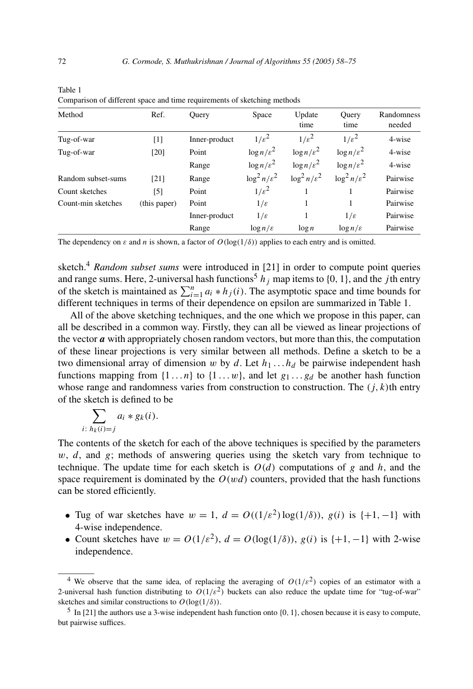
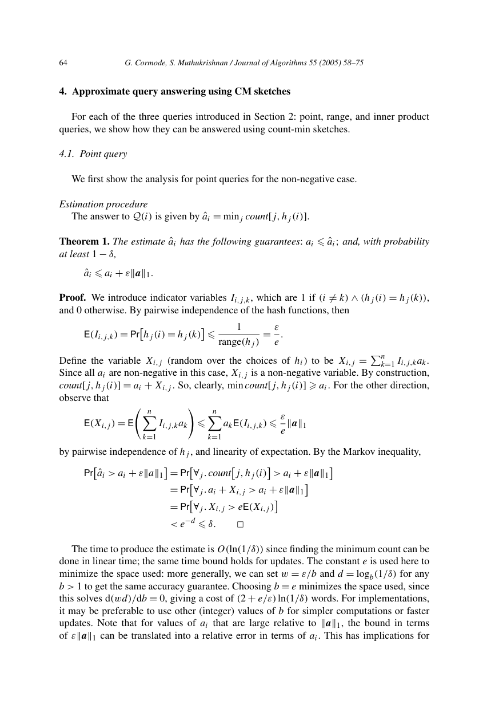

> 本组第 47 篇 · 概率计数与抽样 · [全部论文]() · [上一篇]() · [下一篇]()

Count-Min用d行w列计数阵列把频率向量压成可更新摘要。每次更新每行一个桶，非负向量点查取各行桶最小值，利用碰撞噪声非负与Markov界得到不低估及ε||a||1加性误差。它不是distinct计数器，也不普遍给稀有键相对ε精度。

报告保留三个分界：删除更新但当前向量非负，仍可用一侧min界；一般signed向量改median后是3ε及δ^(1/4)的不同保证；范围、内积、heavy hitters与分位数需要额外结构、代价和失败预算。原文有宽度参数倒置以及范围查询汇总表与正文的张力，按原页列出，不静默修成作者已经证明的结果。

本文保留论文陈述、读者推断与待验证方案的区别；实验数字只适用于原文条件。原文和翻译来自已有 AI 辅助精读报告，已做来源匹配与编辑复核，不等于人工逐项核验或独立实验复现。所有页码均为 PDF 物理页。

## 论文与阅读范围

Graham Cormode, S. Muthukrishnan. An Improved Data Stream Summary: The Count-Min Sketch and its Applications. Journal of Algorithms 55 (2005), pp.58-75. DOI:10.1016/j.jalgor.2003.12.001。本地18页，印刷页=物理页+57；2003接收、2004在线信息不等于本期刊卷年。

[论文集中的原始 PDF](https://github.com/lonng/db-papers/blob/4ff1331069c7cf52ac97dd769e5f484c1c35c200/papers/probabilistic-counting/an-improved-data-stream-summary%3A-the-count-min-sketch-and-its-applications%2C-journal-of-algorithms.pdf) · 本地来源：`probabilistic-counting/an-improved-data-stream-summary_-the-count-min-sketch-and-its-applications,-journal-of-algorithms.pdf`，共 18 页。

本篇保留 30 组原文精读和 54 条证据。截图为原始 PDF 的局部页选，不是重新生成的图表；未将整份 PDF 复制到博客。

## 研究问题与适用边界

**目标是频率向量查询，不是所有概率计数任务**
数据流以(i,c)更新隐含频率向量a，目标是在远小于完整向量的空间里，快速更新并近似点值、范围和内积。分位数与heavy hitters通过这些基本查询再构造。输入可以是正更新，也可以有负更新；必须额外区分当前a是否始终非负。

主要空间改进是某些L1加性误差任务从1/ε²依赖降到1/ε，但不是在完全相同误差标尺上无条件支配所有摘要。作者明确CM并不有效估计所需的输入范数，NDV也不是本文CM的直接输出。文件归于probabilistic-counting目录不应掩盖任务差异。

单个小频数可能远小于ε||a||1，绝对误差界因此不能解读为每键相对误差ε。给总量一百万、ε=.01，允许加性误差一万并不意味着真值1会估得很准。

依据：论文陈述；PDF 物理页 3, 4, 7, 16。证据：[CM01](#evidence-cm01), [CM02](#evidence-cm02), [CM06](#evidence-cm06), [CM20](#evidence-cm20)。

## 数据结构架构与计算模型

**矩阵、随机性与计数字长**
主构造设w=ceil(e/ε)、d=ceil(ln(1/δ))，各桶初始0；每行从pairwise-independent家族取哈希，将键映到一个桶。一次更新给每行相应桶加c，工作量O(d)，存储wd个计数及各行hash描述。行内的碰撞概率控制与跨行独立重复是两层条件；把同一哈希重复d行不产生失败概率放大。

论文采用RAM word模型，一字能容纳至max{||a||1,n}的整数。word数量不是bit数量，固定矩阵也不意味着真实固定宽计数器能处理无限流不溢出。实现必须另选宽度、溢出和非法删除策略。

原计数阵列是a的线性投影，可在完全对齐的hash、宽深与键编码下逐格合并。min/median是非线性查询步骤，不能用各分片标量min的和代替merge后查询。矩阵相减也可能进入signed情形，失去非负一侧界。

依据：论文陈述；PDF 物理页 5, 6, 7, 15。证据：[CM03](#evidence-cm03), [CM04](#evidence-cm04), [CM05](#evidence-cm05), [CM07](#evidence-cm07), [CM19](#evidence-cm19)。

*原论文 PDF 物理页 15，版权归原作者或出版方。点击图片可查看原尺寸。页面文本中定位到：Table 1。这是页面定位信息，不表示本次已复核图内所有数据。*

## 核心算法与查询机制

**点、内积和范围不是同一代价**
点查只取每行hj(i)一个计数，再min，更新与查询均O(log(1/δ))。读者固定toy例a=[5,3,2]构造三行桶，第一键桶值8、7、8，min为7而真值5；删去第二键的3后，仍非负，min可降到5。此例展示碰撞与删除，不验证任何随机概率。

对非负向量内积，两个摘要必须用同一组hj；每行对w个对应桶做点积，再取行间min。加性误差为ε||a||1||b||1，查询O((1/ε)log(1/δ))，并非点查O(d)。当a、b分别为连接键的频率，内积才表示这一属性等值join的配对数。

范围算法另保留log2 n层dyadic摘要。每次更新各层对应区间；查询区间拆成最多2log2 n个不重叠dyadic区间，再作点查询求和。它不是平面CM自动完成任意快范围查询，也不同于把区间每个键估计后累加。

heavy hitters需要候选heap或分层搜索以恢复键名；矩阵自己不会列出所有键。分位数再用范围和二分查找，误差是rank误差，不是数值距离。

依据：论文陈述；PDF 物理页 6, 9, 10, 12, 13, 14。证据：[CM05](#evidence-cm05), [CM10](#evidence-cm10), [CM11](#evidence-cm11), [CM12](#evidence-cm12), [CM13](#evidence-cm13), [CM16](#evidence-cm16), [CM17](#evidence-cm17), [CM18](#evidence-cm18)。

## 正确性论证与理论边界

**非负噪声是min保证的关键**
每行桶值为ai加其他碰撞频数，当前向量非负时噪声非负，所以任意hash选择都不低估。pairwise碰撞概率限制期望噪声，Markov给单行失败上界，独立行重复降至δ。定理1是ai≤估计≤ai+ε||a||1（上界至少1−δ），不是所有未来自适应查询同时成功的无条件保证。

允许c<0但a各项仍非负的strict/non-negative turnstile满足该条件；若允许a中负项，碰撞可抵消真值。读者例真值5、碰撞−10会得到−5，直接反驳“不论有符号仍永不低估”。原文一般情形改median，定理2给3ε||a||1双侧界及成功1−δ^(1/4)。若目标参数为ε0、δ0，按定理可重标为内部ε=ε0/3、δ=δ0^4，不能只改聚合器而保留原保证。

第7页通用b段印作w=ε/b，与第6页主构造、碰撞分析和后文空间式不协调；原图确认不是提取倒置。按推导重建b/ε应标读者修正式，不能直接篡改引文。

范围基本界含2ε log n，总目标ε′需重标定；多次应用的失败事件还要做union bound。原定理不会自动承诺无限期在线自适应或恶意输入的安全性。

依据：读者推断；PDF 物理页 4, 6, 7, 8, 10, 11, 12。证据：[CM02](#evidence-cm02), [CM04](#evidence-cm04), [CM06](#evidence-cm06), [CM07](#evidence-cm07), [CM08](#evidence-cm08), [CM09](#evidence-cm09), [CM13](#evidence-cm13), [CM14](#evidence-cm14), [CM16](#evidence-cm16)。

## 实验评估与工作负载分析

**理论界比较不是吞吐基准**
本文主要给定理、算法及已知结果的渐近比较，没有自有硬件吞吐曲线、尾延迟、真实键分布基准、重复次数或误差分位统计。34/ε等改善因子与常数表不是实测速度倍数，也不能替代现代实现评测。

本报告已运行qa/count-min-reader-tests.json的固定toy数组：非负删除前后第一键估计7→5；对齐原计数合并等于集中更新；signed碰撞可把5估为−5。没有采样真实pairwise家族，没有验证概率，也没有运行数据库或网络流量系统。

视觉核对9页，重点为w/d、两个点估计定理、内积、范围复杂度、阈值与Table1。正文第11页范围查询O(log n log(1/δ))，表1第15页却列log n/ε再省略置信因子，这处差异明确保留，不能混搭成未经说明的新复杂度。

依据：读者推断；PDF 物理页 7, 8, 9, 11, 15。证据：[CM08](#evidence-cm08), [CM09](#evidence-cm09), [CM11](#evidence-cm11), [CM15](#evidence-cm15), [CM19](#evidence-cm19)。

*原论文 PDF 物理页 7，版权归原作者或出版方。点击图片可查看原尺寸。这是页面定位信息，不表示本次已复核图内所有数据。*

## 工程权衡与设计取舍

**统一最终误差标尺后才比较空间**
范围基本宽度ε对应2ε log n||a||1误差。要总误差ε′||a||1，原文设ε=ε′/(2log n)，空间变O((log²n/ε′)log(1/δ))。不能拿基础空间的ε和最终误差的ε′当同一个参数，得出少一层log n的更强结论。

内积误差按L1乘积而非join真值缩放，在输出很小或频数分散时可能很松。既有L2类保证与CM的L1类保证是不同标尺；更多桶换精度，也增加内积整行扫描工作。真正应用还需计入hash描述、计数位宽和缓存代价，这些未在本次基准测量。

cash-register heavy hitters保证输出所有>φ总量项，并以高概率排除<(φ−ε)项；非负turnstile层次版本是≥(φ+ε)必输出、高概率排除<φ。模糊带不同，候选与失败预算也不同，不能用一句“无假阳性且无漏报”抹平。

依据：论文陈述；PDF 物理页 3, 5, 9, 10, 11, 13, 14。证据：[CM01](#evidence-cm01), [CM03](#evidence-cm03), [CM10](#evidence-cm10), [CM11](#evidence-cm11), [CM13](#evidence-cm13), [CM14](#evidence-cm14), [CM17](#evidence-cm17), [CM18](#evidence-cm18)。

## 与现有技术的对比分析

**不要把频率、distinct与成员测试混成一个任务**
CM估计频率向量上的量；distinct任务关注有多少不同键，阈值过滤只回答是否越过阈值，它们不是可因名字含count/sketch就直接替换的相同接口。本文第16页区分了相近的二值过滤结构，也明确指出输入范数等任务不是其有效目标。

与Count Sketch/tug-of-war比较时，应列出更新模型、单侧/双侧、L1/L2标尺、查询类型及置信参数，而不是只比较1/ε与1/ε²。表1省略公共log(1/δ)，且范围行与正文有差异，读者应回到具体算法，不截一张表作普遍优越性宣告。

若用于当前数据库基数估算，还需明确连接属性、频率摘要的新鲜度、删除合法性、join键编码及多属性依赖；本次未读任何现行优化器源码，不声称具体产品采用或满足这些前提。

依据：读者推断；PDF 物理页 3, 4, 8, 9, 11, 15, 16。证据：[CM01](#evidence-cm01), [CM02](#evidence-cm02), [CM09](#evidence-cm09), [CM10](#evidence-cm10), [CM15](#evidence-cm15), [CM19](#evidence-cm19), [CM20](#evidence-cm20)。

## 复现指南与待验证问题

**从语义测试到统计测试分层**
第一层固定小hash，检查逐行更新、min、signed失败、对齐merge和溢出守卫，与完整频率向量作确定性对照。现有toy例只覆盖其中一部分，不构成概率检验。

第二层实现可证明满足条件的hash家族、独立行种子和稳定键编码，在固定数据与查询上重复独立种子，记录加性误差及失败频率；同时区分word空间与实际bytes。不能拿一组随机数据的平均相对误差替代最坏数据上的定理条件。目标失败预算还须覆盖本次要检查的查询集合，不任意承诺适应性对手保证。

第三层分别实现dyadic范围、候选heap、层次heavy hitters与分位数，统一最终误差ε′和总失败δ再比较。记录访问桶数及与原文正文/表差异的解释。除toy数组外，以上均未运行，原论文及现代数据库性能仍未复现。

依据：待验证的工程设想；PDF 物理页 5, 6, 7, 8, 10, 11, 12, 13, 14, 15。证据：[CM03](#evidence-cm03), [CM04](#evidence-cm04), [CM06](#evidence-cm06), [CM07](#evidence-cm07), [CM09](#evidence-cm09), [CM12](#evidence-cm12), [CM13](#evidence-cm13), [CM14](#evidence-cm14), [CM15](#evidence-cm15), [CM16](#evidence-cm16), [CM17](#evidence-cm17), [CM18](#evidence-cm18), [CM19](#evidence-cm19)。

## 结论与内核工程启示

Count-Min的简洁来自愿意接受明确的L1加性误差，并利用非负碰撞噪声把点估计写成计数后取min；它不是免费且普适的相对精度保证。signed、范围、内积与键发现任务各有额外结构和条件，保留这些条件才有工程价值。

报告增加20段精读和固定数组读者测试，明确标出δ重标定、word/bit、原计数线性与查询非线性，以及宽度印刷式和范围汇总表的局部张力。未知或未跑的随机/系统实验不冒充已验证结果，最终仍为待人工复核稿。

依据：读者推断；PDF 物理页 3, 7, 8, 11, 15, 16。证据：[CM01](#evidence-cm01), [CM06](#evidence-cm06), [CM08](#evidence-cm08), [CM09](#evidence-cm09), [CM14](#evidence-cm14), [CM15](#evidence-cm15), [CM19](#evidence-cm19), [CM20](#evidence-cm20)。

## 原文精读：从句子回到机制

以下保留原文、忠实翻译、含义与边界；假设示例不作为论文实验结果。

原文中形如 `[U+0000]` 的标记表示 PDF 提取文本中的不可见控制字符，不是论文中的变量，也不是补写的公式；原始报告不变，字形需对照原 PDF。

### P001 · PDF 物理页 2

**原文**

<blockquote class="paper-source-quote"><pre><code>Typically, accuracy guarantees will be made in terms of a pair of user specified parameters,&#10;ε and δ, meaning that the error in answering a query is within a factor of ε with&#10;probability 1 −δ. The space and update time will consequently depend on ε and δ; our&#10;goal will be limit this dependence as much as is possible.</code></pre></blockquote>

**忠实翻译**

> 通常，准确性保证将以一对用户指定参数 ε 和 δ 的形式给出，意味着回答查询的误差在 ε 因子以内，概率为 1−δ。因此，空间与更新时间将依赖于 ε 和 δ；我们的目标是尽可能限制这种依赖。

**技术含义与边界**

> 作者陈述了流式算法中常见的 (ε, δ)-近似保证框架：以至少 1−δ 的概率使误差不超过 ε 因子。同时明确了设计目标是最小化数据结构的空间开销和更新操作时间对这两个参数的依赖程度。这是后续所有 sketch 结构分析的基础前提。

**常见误读**

> 容易将“误差在 ε 因子以内”误解为绝对误差或相对误差的统一形式。原文未明确此处是加性还是乘性误差，具体含义需结合上下文中的查询类型确定。不能将此处的通用描述直接等同于某一种特定查询的误差定义。

**读者构造的假设示例**

> 读者参数例：ε=.01、δ=.05是一个固定查询的误差/失败预算。具体点查界为加性.01||a||1，不是所有键相对1%；多次或自适应查询还须另看概率条件。

### P002 · PDF 物理页 18

**原文**

<blockquote class="paper-source-quote"><pre><code>G. Cormode, S. Muthukrishnan / Journal of Algorithms 55 (2005) 58–75&#10;75&#10;[22] M. Greenwald, S. Khanna, Space-efficient online computation of quantile summaries, SIGMOD Record&#10;(ACM Special Interest Group on Management of Data) 30 (2) (2001) 58–66.&#10;[23] P.</code></pre></blockquote>

**忠实翻译**

> G. Cormode, S. Muthukrishnan / Journal of Algorithms 55 (2005) 58–75
> 75
> [22] M. Greenwald, S. Khanna, Space-efficient online computation of quantile summaries, SIGMOD Record
> (ACM Special Interest Group on Management of Data) 30 (2) (2001) 58–66.
> [23] P.

**技术含义与边界**

> 此段为论文参考文献列表的片段（PDF 物理页码第 18 页），列出了 Greenwald 与 Khanna 关于分位数摘要的在线计算工作等引用条目。该段不包含正文技术论述，仅提供文献索引信息。

**常见误读**

> 不可从参考文献列表推断本文采用了 [22] 的方法或得出了与其相同的结论。引用仅表示相关工作背景，不代表技术实现细节或实验对比结果。

**读者构造的假设示例**

> 读者构造的假设示例：若研究者希望了解分位数摘要的节省空间在线计算方法，可依据此引用去查阅 Greenwald 和 Khanna 在 SIGMOD Record 2001 年发表的原始文献，但这并不意味着当前论文复现了该方法。

### P003 · PDF 物理页 10

**原文**

<blockquote class="paper-source-quote"><pre><code>Instead, we adopt the&#10;use of dyadic ranges from [21]: a dyadic range is a range of the form [x2y +1...(x +1)2y]&#10;for parameters x and y.&#10;Estimation procedure&#10;Keep log2 n CM sketches, in order to answer range queries Q(l,r) approximately. Any&#10;range query can be reduced to at most 2log2 n dyadic range queries, which in turn can each&#10;be reduced to a single point query. Each point in the range [1...n] is a member of log2 n&#10;dyadic ranges, one for each y in the range 0...log2 n −1.</code></pre></blockquote>

**忠实翻译**

> 相反，我们采用来自 [21] 的二叉范围（dyadic ranges）的使用：一个二叉范围是形式为 [x2^y +1...(x +1)2^y] 的范围，其中 x 和 y 为参数。
> 估计过程
> 保留 log2 n 个 CM sketches，以便近似回答范围查询 Q(l,r)。任何范围查询都可以被归约为最多 2log2 n 个二叉范围查询，而这些查询又可以各自被归约为单个点查询。范围 [1...n] 中的每个点都是 log2 n 个二叉范围的成员，对应于范围 0...log2 n −1 中的每一个 y。

**技术含义与边界**

> 作者陈述了一种利用二叉范围分解来处理一维范围查询的技术。通过维护 log2 n 个不同粒度的 Count-Min Sketch，将任意区间查询拆分为 O(log n) 个对齐的二叉区间，进而转化为点查询。这利用了二叉区间的层次覆盖性质：每个点恰好属于每个层级（由 y 决定）的一个二叉区间。

**常见误读**

> 范围点估计累加的基本界是2εlog n||a||1。本文定理4采用按行估计/期望与Markov放大的分析；不能只说每次套同一δ就自动得到总δ。重标总误差需增大空间，多个应用查询另分配失败预算。

**读者构造的假设示例**

> 读者例：n=8、1-based dyadic定义下，[2,7]可拆为[2,2]、[3,4]、[5,6]、[7,7]。原API例的[2,3]和[4,7]不满足[x·2^y+1,(x+1)·2^y]的对齐规则，已纠正。

### P004 · PDF 物理页 5

**原文**

<blockquote class="paper-source-quote"><pre><code>There can be between 0 and 1/φ heavy hitters&#10;in any given sequence of items. Approximation comes by accepting any i such that&#10;ai ⩾(φ −ε)∥a∥1 for some specified ε &lt; φ.&#10;We will assume the RAM model, where each machine word can store integers up to&#10;max{∥a∥1,n}. Standard word operations take constant time and so we count space in terms&#10;of number of words and we count time in terms of the number of word operations.</code></pre></blockquote>

**忠实翻译**

> 在任何给定的项序列中，heavy hitters 的数量可以在 0 到 1/φ 之间。近似方法是通过接受任何满足 ai ⩾(φ −ε)∥a∥1 的 i，其中指定的 ε < φ。
> 我们将假设 RAM 模型，其中每个机器字可以存储最大为 max{∥a∥1,n} 的整数。标准字操作花费常数时间，因此我们以字的数量来计算空间，以字操作的数量来计算时间。

**技术含义与边界**

> 作者陈述了 heavy hitters（频繁项）问题的定义及近似放宽条件：精确阈值是 φ∥a∥1，但允许输出频率略低于该阈值的项（下界放宽至 (φ−ε)∥a∥1）。同时明确了计算模型为标准 RAM 模型，字长足以容纳总频次 ∥a∥1 或域大小 n，空间和时间复杂度均以字为单位度量。

**常见误读**

> 不要将“0 到 1/φ 之间”误解为 heavy hitters 数量的期望值或平均值，这是一个严格的上界。此外，RAM 模型的假设意味着不考虑大数运算的位级复杂度，如果实际系统中字长不足以存储 ∥a∥1，则常数时间操作的假设不成立。

**读者构造的假设示例**

> 读者例：总量1000、φ=.1、ε=.01时，真heavy阈值约100，保证排除低于90的项，90到100的模糊带不承诺全部输出或全部排除。真heavy数量上界10不等于允许输出集合在所有失败情况下仍恰好最多10。

### P005 · PDF 物理页 8

**原文**

<blockquote class="paper-source-quote"><pre><code>This allows a simple calculation of the&#10;failure probability, without recourse to Chernoff bounds. This significantly improves&#10;the constants involved: in [5], for example, the constant factors within the big-Oh&#10;notation is at least 256; here, the constant factor is less than 3.&#10;• The error bound here is one-sided, as opposed to all previous constructions which gave&#10;two-sided errors. This brings benefits for many applications which use sketches.</code></pre></blockquote>

**忠实翻译**

> 这允许在不求助于 Chernoff 界的情况下简单计算失败概率。这显著改善了所涉及的常数：例如在 [5] 中，大 O 符号内的常数因子至少为 256；在这里，常数因子小于 3。
> • 这里的误差界是单侧的，而之前所有的构造给出的都是双侧误差。这为许多使用 sketches 的应用带来了好处。

**技术含义与边界**

> 这是理论构造常数与非负点查询的一侧界比较，不是实测速度比。非负频数下min不低估，允许删除但保持当前向量非负仍可成立；任意signed向量则不适用。

**常见误读**

> 不能把构造常数小于3当成运行时间恒快或所有查询更准。L1/L2标尺、hash假设、查询类型和位宽都需统一；一般signed改median后也不再具有同一侧界。

**读者构造的假设示例**

> 读者构造的假设示例：在估算某商品销量时，单侧误差保证意味着 sketch 返回的估计值可能是 105（真实值为 100），但绝不会是 95。这对于需要确保资源分配不低于实际需求的应用（如库存预警）非常有利。

### P006 · PDF 物理页 16

**原文**

<blockquote class="paper-source-quote"><pre><code>Also, the CM sketch can also be naturally extended to solve problems on streams that&#10;describe multidimensional arrays rather than the unidimensional array problems we have&#10;discussed so far.&#10;Our CM sketch is not effective when one wants to compute the norms of data stream&#10;inputs. These have applications to computing correlations between data streams and&#10;tracking the number of distinct elements in streams, both of which are of great interest.</code></pre></blockquote>

**忠实翻译**

> 此外，CM sketch 也可以自然扩展以解决描述多维数组的流上的问题，而不是我们迄今为止讨论的一维数组问题。
> 当想要计算数据流输入的范数（norms）时，我们的 CM sketch 并不有效。这些在计算数据流之间的相关性以及跟踪流中不同元素的数量方面有应用，这两者都具有极大的意义。

**技术含义与边界**

> 作者说CM不能有效解决所述输入范数估计任务，并指出这些量对相关性与distinct统计有用。这不证明所有此类任务只能经同一范数路线完成，也不因为CM能估内积就自动得到完整相关系数或NDV算法。

**常见误读**

> 容易因为 CM sketch 在频数估计上的成功而错误地将其应用于所有流式统计问题。原文明确否定了其在范数计算上的有效性。不能将一维数组上的空间保证直接平移到多维扩展中而不考虑维度灾难。

**读者构造的假设示例**

> 读者问题：相关性指标还依赖哪些范数、归一化和更新前提？若缺少这些量的合适摘要，单有CM内积界不够。选具体替代算法前需独立核查其误差模型，本报告不作未经来源核对的库推荐。

### P007 · PDF 物理页 13

**原文**

<blockquote class="paper-source-quote"><pre><code>Every item which occurs with count more than φ∥a∥1 time is output, and with&#10;probability 1 −δ, no item whose count is less than (φ −ε)∥a∥1 is output.&#10;Proof. This procedure relies on the fact that the threshold value increases monotonically:&#10;therefore, if an item did not pass the threshold in the past, it cannot do so in the future&#10;without its count increasing. By checking the estimated value every time an items value&#10;increases, no heavy hitters will be omitted.</code></pre></blockquote>

**忠实翻译**

> 出现次数超过 φ∥a∥1 的每个项都会被输出，并且以 1−δ 的概率，不会出现计数小于 (φ−ε)∥a∥1 的项。
> 证明。该过程依赖于阈值单调递增的事实：因此，如果一个项在过去没有通过阈值，那么在其计数增加之前，它在未来也不可能通过。通过在每次项的值增加时检查其估计值，不会遗漏任何 heavy hitters。

**技术含义与边界**

> 作者陈述并证明了基于 CM sketch 提取 heavy hitters 的正确性。核心机制是利用 cash register 模型下计数的单调非递减性质：阈值随总频次单调递增，因此只需在项的计数发生更新时进行阈值检查，即可保证不漏报真正的 heavy hitters，同时以 1−δ 的概率控制误报率在 (φ−ε)∥a∥1 之下。

**常见误读**

> 这个候选维护论证依赖cash-register的单调总阈值；删除后不可直接沿用。全程输出概率还需按被检查次数缩放失败参数，原文在证明里用union bound处理，不是原始单键δ自动同时管住整段流。

**读者构造的假设示例**

> 读者构造的假设示例：设 φ=0.1，当前总频次 ∥a∥1=100，阈值为 10。项 A 当前频次为 8，未达标。随后流中新增若干项使 ∥a∥1 增至 200，阈值升至 20。在此期间项 A 未再出现，其频次仍为 8，依然低于新阈值 20。只有当 A 再次出现使其频次增加时，才需要重新检查。

### P008 · PDF 物理页 3

**原文**

<blockquote class="paper-source-quote"><pre><code>We believe that&#10;this approach moves some of the fundamental data stream algorithms from the theoretical&#10;realm to the practical.&#10;Our results have some technical nuances:&#10;• The accuracy estimates for individual queries depend on the L1 norm of a(t) in&#10;contrast to the previous works that depend on the L2 norm. This is a consequence of&#10;working with simple counts.</code></pre></blockquote>

**忠实翻译**

> 我们相信这种方法将一些基本的数据流算法从理论领域推向了实用。
> 我们的结果有一些技术上的细微差别：
> • 单个查询的准确性估计依赖于 a(t) 的 L1 范数，而之前的工作依赖于 L2 范数。这是使用简单计数的结果。

**技术含义与边界**

> 作者陈述了 CM sketch 的工程价值及其与以往工作（如基于 L2 范数的 AMS sketch）的理论差异。误差界由 L1 范数（即所有频次的绝对值之和）决定，这是因为 CM sketch 的底层机制是基于计数的线性叠加，而非平方和。

**常见误读**

> 同一非负向量有||a||2≤||a||1；在相同ε下，单纯L1数值界不会比L2更紧，但两种构造空间等代价不同。固定总量时，集中在少数项通常让两范数更接近，分散到很多项则差距可更大，不能说“越倾斜越必然差得远”。

**读者构造的假设示例**

> 读者算例：[1,1,1,1]的L1=4、L2=2；[4,0,0,0]的L1=L2=4。它说明范数标尺随分布变化，不是对具体实现精度的随机测试。

### P009 · PDF 物理页 4

**原文**

<blockquote class="paper-source-quote"><pre><code>In some cases, cts will be strictly positive, meaning that entries only increase; in other&#10;cases, cts are allowed to be negative also. The former is known as the cash register case&#10;and the latter the turnstile case [28]. There are two important variations of the turnstile&#10;case to consider: whether ais may become negative, or whether the application generating&#10;the updates guarantees that this will never be the case.</code></pre></blockquote>

**忠实翻译**

> 在某些情况下，cts 将严格为正，意味着条目只增加；在其他情况下，cts 也被允许为负。前者被称为收银机（cash register）情况，后者被称为转门（turnstile）情况 [28]。turnstile 情况有两个重要的变体需要考虑：ais 是否可能变为负数，或者生成更新的应用是否保证永远不会出现这种情况。

**技术含义与边界**

> 作者陈述了数据流模型的两种经典分类：cash register 模型（仅支持插入，频次非负且单调递增）和 turnstile 模型（支持插入和删除，频次更新可为负）。进一步指出 turnstile 模型需区分“严格非负”（频次本身不允许降至零以下）和“一般情况”（频次可为负）两个变体，这直接影响 sketch 的设计与误差分析。

**常见误读**

> 容易混淆 turnstile 模型的两个变体。如果应用保证了频次不会为负（如库存系统），某些针对一般 turnstile 模型的悲观误差界可以被收紧。不可将适用于一般 turnstile 模型的下界直接套用于严格非负的 turnstile 变体。

**读者构造的假设示例**

> 读者构造的假设示例：在网络流量监控中，记录数据包到达属于 cash register 模型；而在银行账户余额追踪中，存款和取款分别对应正负更新，属于 turnstile 模型。如果账户不允许透支，则属于严格非负的 turnstile 变体。

### P010 · PDF 物理页 11

**原文**

<blockquote class="paper-source-quote"><pre><code>(4) The worst case space bound depends on O((1/ε)log(∥a∥1/ε)), which can grow&#10;indefinitely. The sketch based solution works in fixed space that is independent of&#10;∥a∥1.&#10;The best previous bounds for this problem in the turnstile model are given in [21], where&#10;range queries are answered by keeping O(logn) sketches, each of size O((1/ε′2)logn ×&#10;log(logn/δ)) to give approximations with additive error ε∥a∥1 with probability 1 −δ′.</code></pre></blockquote>

**忠实翻译**

> (4) 最坏情况空间界依赖于 O((1/ε)log(∥a∥1/ε))，这可能无限增长。基于 sketch 的解决方案在固定空间中工作，该空间独立于 ∥a∥1。
> 在 turnstile 模型中解决此问题的最佳先前界由 [21] 给出，其中通过保留 O(log n) 个 sketches 来回答范围查询，每个大小为 O((1/ε′^2)log n × log(log n/δ))，以 1−δ′ 的概率给出加性误差为 ε∥a∥1 的近似。

**技术含义与边界**

> 这里固定空间指给定n、精度和置信条件下计数器字数不随总频数增长。RAM字长允许容纳当前总量；真实bit或bytes空间及溢出策略不能自动忽略。范围方案还含多层摘要，不只是一个平面d×w。

**常见误读**

> 不可将“空间独立于 ∥a∥1”误解为空间是绝对常数。Sketch 的空间仍然依赖于精度参数 ε 和失败概率 δ，以及值域大小 n。此外，对比基线中的 ε′ 和 δ′ 可能与本文的 ε 和 δ 定义存在缩放关系，不能直接将两者的空间表达式进行数值比较而不统一参数语义。

**读者构造的假设示例**

> 读者例：预分配矩阵可固定计数器个数，但若流量超出64位范围，就必须拒绝、扩宽或采用明确语义；静默回绕会破坏证明。dyadic范围另有log n层及精度重标定成本。

### CM-REVIEW-01 · PDF 物理页 3

**原文**

<blockquote class="paper-source-quote"><pre><code>The accuracy estimates for individual queries depend on the L1 norm of a(t) in&#10;contrast to the previous works that depend on the L2 norm. This is a consequence of&#10;working with simple counts. The resulting estimates are often not as tight on individual&#10;queries since L2 norm is never greater than the L1 norm. But nevertheless, our&#10;estimates for individual queries suffice to give improved bounds for the applications&#10;here where it is desired to state results in terms of L1.</code></pre></blockquote>

**忠实翻译**

> 单次查询精度依赖L1而非既有方法的L2；L2不大于L1，所以单项保证往往不那么紧，但对以L1表达的应用仍可改善界。

**技术含义与边界**

> 1/ε空间改进伴随不同误差标尺，不能只比一个大O。

**常见误读**

> 不是CM对所有输入和所有任务都支配Count Sketch或L2估计。

**读者构造的假设示例**

> 读者例：很小的join真值可能被ε||a||1||b||1加性项淹没。

### CM-REVIEW-02 · PDF 物理页 4

**原文**

<blockquote class="paper-source-quote"><pre><code>whether ais may become negative, or whether the application generating&#10;the updates guarantees that this will never be the case. We refer to the first of these as&#10;the general case, and the second as the non-negative case.</code></pre></blockquote>

**忠实翻译**

> turnstile分两类：ai是否可变成负数；前者称general，保证不变负者称non-negative。

**技术含义与边界**

> 删除更新可为负，但当前各项仍非负时，点min的一侧界仍适用。

**常见误读**

> 不应说支持删除就必失去一侧界，也不能说任意signed都不低估。

**读者构造的假设示例**

> 已运行读者例：从非负[5,3,2]删去第二项3，第一项min可从7降到真值5。

### CM-REVIEW-03 · PDF 物理页 5

**原文**

<blockquote class="paper-source-quote"><pre><code>each machine word can store integers up to&#10;max{∥a∥1,n}. Standard word operations take constant time and so we count space in terms&#10;of number of words and we count time in terms of the number of word operations. So, if&#10;one estimates our space and time bounds in terms of number of bits instead, a multiplicative&#10;factor logmax{∥a∥1,n} is needed.</code></pre></blockquote>

**忠实翻译**

> RAM模型每字可存到max{||a||1,n}的整数，标准字操作常数时间；若按bit计空间时间，还需log max{||a||1,n}因子。

**技术含义与边界**

> word空间不能无条件称为bit空间；机器实现需考虑计数溢出和哈希计算。

**常见误读**

> 固定数组格数不等于在无限流上计数器永不溢出。

**读者构造的假设示例**

> 读者例：32位计数器达到上限后的回绕会破坏非负证明。

### CM-REVIEW-04 · PDF 物理页 6

**原文**

<blockquote class="paper-source-quote"><pre><code>Given parameters&#10;(ε,δ), set w = ⌈e/ε⌉and d = ⌈ln(1/δ)⌉. Each entry of the array is initially zero.</code></pre></blockquote>

**忠实翻译**

> 给定ε、δ，设w=ceil(e/ε)，d=ceil(ln(1/δ))，数组各项初始为零。

**技术含义与边界**

> 每行选一个桶，宽度控制碰撞，深度控制失败概率。

**常见误读**

> 不能漏掉ceil或把δ当成功概率。

**读者构造的假设示例**

> 读者例：实现时同时存哈希种子和参数，合并前必须一致。

### CM-REVIEW-05 · PDF 物理页 6

**原文**

<blockquote class="paper-source-quote"><pre><code>ct is added to one count in each row; the counter is determined by hj.</code></pre></blockquote>

**忠实翻译**

> 更新ct加到每一行的一个计数器，位置由该行hj决定。

**技术含义与边界**

> 矩阵是对频率向量的线性投影；更新触及d项，而不是wd所有桶。

**常见误读**

> 线性的是原计数，不是随后取min的标量查询结果。

**读者构造的假设示例**

> 读者例：对齐矩阵可逐格相加，但两边的min估计不能一般直接相加代替合并查询。

### CM-REVIEW-06 · PDF 物理页 7

**原文**

<blockquote class="paper-source-quote"><pre><code>Theorem 1. The estimate ˆai has the following guarantees: ai ⩽ˆai; and, with probability&#10;at least 1 −δ,&#10;ˆai ⩽ai + ε∥a∥1.</code></pre></blockquote>

**忠实翻译**

> 定理1：ai≤估计值；并以至少1−δ概率，估计值≤ai+ε||a||1。

**技术含义与边界**

> 前文限定non-negative case，保证是绝对加性误差和单次查询概率。

**常见误读**

> 不是每个稀有键的相对误差ε，也不是无限自适应查询同时成立。

**读者构造的假设示例**

> 读者例：总量100万、ε=0.01给加性一万，不保证真值1只误差0.01。

### CM-REVIEW-07 · PDF 物理页 7

**原文**

<blockquote class="paper-source-quote"><pre><code>Since all ai are non-negative in this case, Xi,j is a non-negative variable.</code></pre></blockquote>

**忠实翻译**

> 本情形所有ai非负，因此碰撞噪声Xi,j为非负随机变量。

**技术含义与边界**

> 这是不低估与Markov步骤的支点；各行独立取样用于放大成功概率。

**常见误读**

> 同一哈希家族pairwise性质与不同行独立抽取是两层要求，别用同一行重复d次冒充放大。

**读者构造的假设示例**

> 已运行读者例：真值5与碰撞−10会让所有桶为−5，直接破坏min不低估。

### CM-REVIEW-08 · PDF 物理页 7

**原文**

<blockquote class="paper-source-quote"><pre><code>more generally, we can set w = ε/b and d = logb(1/δ) for any&#10;b &gt; 1</code></pre></blockquote>

**忠实翻译**

> 更一般地，原页印作w=ε/b、d=log_b(1/δ)，b>1。（此处保持印刷式。）

**技术含义与边界**

> 第6页主构造为w=e/ε；此处宽度倒置与碰撞分析及后文空间式不协调，原图已核对。

**常见误读**

> 不能照印刷式实现小于1的桶数；按相同推导重建通常需b/ε，但这是读者修正式，不静默当原文。

**读者构造的假设示例**

> 读者例：ε=0.01,b=2时ε/b=.005无法作为有用的桶宽度；重建与原页须分别记录。

### CM-REVIEW-09 · PDF 物理页 8

**原文**

<blockquote class="paper-source-quote"><pre><code>Theorem 2. With probability 1 −δ1/4,&#10;ai −3ε∥a∥1 ⩽ˆai ⩽ai + 3ε∥a∥1.</code></pre></blockquote>

**忠实翻译**

> 定理2：以1−δ^(1/4)概率，ai−3ε||a||1≤median估计≤ai+3ε||a||1。

**技术含义与边界**

> 一般signed向量改用median，并有不同常数和置信参数。

**常见误读**

> 不能只把min换median仍声称不低估、误差ε和失败δ原封不动。

**读者构造的假设示例**

> 读者推导：目标误差ε0、失败δ0可取内部ε=ε0/3、δ=δ0^4；这只是按定理重标定。

### CM-REVIEW-10 · PDF 物理页 9

**原文**

<blockquote class="paper-source-quote"><pre><code>Theorem 3. a ⊙b ⩽[U+0001]&#10;a ⊙b and, with probability 1 −δ, [U+0001]&#10;a ⊙b ⩽a ⊙b + ε∥a∥1∥b∥1.</code></pre></blockquote>

**忠实翻译**

> 定理3：非负向量的内积不大于估计值；以1−δ概率，估计最多高出ε||a||1||b||1。

**技术含义与边界**

> 对齐相同行哈希，逐行桶点积再取min，得到join频数向量的加性估计。

**常见误读**

> 不是任意两个独立种子矩阵都能做正确join，也不是join真值的相对ε界。

**读者构造的假设示例**

> 读者例：频率向量点积表示一列等值join的配对数；多个属性依赖不由此自动解决。

### CM-REVIEW-11 · PDF 物理页 9

**原文**

<blockquote class="paper-source-quote"><pre><code>The space and time to produce the estimate is O((1/ε)log(1/δ)). Updates are&#10;performed in time O(log(1/δ)).</code></pre></blockquote>

**忠实翻译**

> 产生内积估计的空间和时间为O((1/ε)log(1/δ))，更新为O(log(1/δ))。

**技术含义与边界**

> 内积查询要扫桶宽w，不像点查询只取每行一个位置。

**常见误读**

> 不要把点查O(d)推广到所有CM查询。

**读者构造的假设示例**

> 读者例：w放大100倍以提高误差界，内积查询工作量也会随桶数增加。

### CM-REVIEW-12 · PDF 物理页 10

**原文**

<blockquote class="paper-source-quote"><pre><code>Any&#10;range query can be reduced to at most 2log2 n dyadic range queries, which in turn can each&#10;be reduced to a single point query.</code></pre></blockquote>

**忠实翻译**

> 任意区间可分解成最多2log2 n个dyadic区间查询，每个再化作点查询。

**技术含义与边界**

> 各层分别维护sketch，每次更新触及log n层；不是一个平面CM自动具有快速范围查询。

**常见误读**

> 给每个点做查询再求和会引入区间长度依赖，不能混为同一算法。

**读者构造的假设示例**

> 读者例：原范围[48,107]被覆盖为六个不重叠二进制区间。

### CM-REVIEW-13 · PDF 物理页 10

**原文**

<blockquote class="paper-source-quote"><pre><code>Theorem 4. a[l,r] ⩽ˆa[l,r] and with probability at least 1 −δ,&#10;ˆa[l,r] ⩽a[l,r] + 2ε logn∥a∥1.</code></pre></blockquote>

**忠实翻译**

> 定理4：范围真值≤估计；以至少1−δ概率，误差≤2ε log n||a||1。

**技术含义与边界**

> 这是未重标定的基本参数界。

**常见误读**

> 不能忽略log n就声称同一宽度给范围ε||a||1误差。

**读者构造的假设示例**

> 读者推导：若目标ε′总误差，需将每层ε缩为ε′/(2log n)。

### CM-REVIEW-14 · PDF 物理页 11

**原文**

<blockquote class="paper-source-quote"><pre><code>if we want to estimate a range sum correct up to ε′∥a∥1 with probability&#10;1 −δ then set ε = ε′/(2logn). The space used is O((log2 n/ε′)log(1/δ)).</code></pre></blockquote>

**忠实翻译**

> 若目标范围误差ε′||a||1且成功概率1−δ，取ε=ε′/(2log n)，空间O((log²n/ε′)log(1/δ))。

**技术含义与边界**

> 提高总精度要支付额外一层log n空间，不是免费重命名参数。

**常见误读**

> 不能混用基础空间log n/ε与重标定误差ε′得出更强结论。

**读者构造的假设示例**

> 读者例：比较摘要大小时先统一最终误差标尺。

### CM-REVIEW-15 · PDF 物理页 11

**原文**

<blockquote class="paper-source-quote"><pre><code>The time to compute the estimate or to make an update is O(lognlog(1/δ)). The space&#10;used is O((logn/ε)log(1/δ)).</code></pre></blockquote>

**忠实翻译**

> 正文称估计与更新时间O(log n log(1/δ))，空间O((log n/ε)log(1/δ))。

**技术含义与边界**

> 第15页表1却给Range query额外1/ε，须保留正文/汇总表的不协调；已视觉核对两页。

**常见误读**

> 不静默混合两处数字或据表宣称正文没说过查询时间。

**读者构造的假设示例**

> 读者例：明确实际算法访问的dyadic点查询数后计数，再标注这是读者分析不是原表被修复。

### CM-REVIEW-16 · PDF 物理页 12

**原文**

<blockquote class="paper-source-quote"><pre><code>the probability guarantee to δφ/logn, the overall&#10;probability guarantee for all 1/φ quantiles is achieved.</code></pre></blockquote>

**忠实翻译**

> 把每次失败参数调为δφ/log n，以取得全部1/φ分位数的总体概率保证。（摘录从句中开始。）

**技术含义与边界**

> 多次查询需单独分配失败预算；分位数误差是rank误差，不是数值距离。

**常见误读**

> 不能拿一个固定键的1−δ定理直接担保任意长查询流和自适应对手。

**读者构造的假设示例**

> 读者例：错误概率预算须覆盖二分查找中实际检查的事件集合。

### CM-REVIEW-17 · PDF 物理页 13

**原文**

<blockquote class="paper-source-quote"><pre><code>Every item which occurs with count more than φ∥a∥1 time is output, and with&#10;probability 1 −δ, no item whose count is less than (φ −ε)∥a∥1 is output.</code></pre></blockquote>

**忠实翻译**

> 所有计数超过φ||a||1的项都会输出；以1−δ概率，不输出计数小于(φ−ε)||a||1的项。

**技术含义与边界**

> 这是cash-register加heap候选的阈值间隙，不是sketch矩阵自己枚举键。

**常见误读**

> 不能忽略heap与union bound，也不能和strict-turnstile另一组阈值互换。

**读者构造的假设示例**

> 读者例：频率落在[(φ−ε),φ]总量之间的项属于允许模糊区。

### CM-REVIEW-18 · PDF 物理页 14

**原文**

<blockquote class="paper-source-quote"><pre><code>Every item with frequency at least (φ + ε)∥a∥1 is output,&#10;and with probability 1 −δ no item whose frequency is less than φ∥a∥1 is output.</code></pre></blockquote>

**忠实翻译**

> 每个频率至少(φ+ε)||a||1的项会输出；以1−δ概率，不输出频率小于φ||a||1的项。

**技术含义与边界**

> 这是非负turnstile分层搜索的另一组保证。

**常见误读**

> 其模糊带与cash-register的φ/φ−ε不同；删除也须保持当前频数非负。

**读者构造的假设示例**

> 读者例：不要把该阈值表抄成所有≥φ都必输出且无任何假阳性。

### CM-REVIEW-19 · PDF 物理页 15

**原文**

<blockquote class="paper-source-quote"><pre><code>All of the above sketching techniques, and the one which we propose in this paper, can&#10;all be described in a common way. Firstly, they can all be viewed as linear projections of&#10;the vector a with appropriately chosen random vectors</code></pre></blockquote>

**忠实翻译**

> 这些sketch可视为频率向量相对适当随机向量的线性投影。

**技术含义与边界**

> 可合并性要求参数、哈希与索引映射对齐，min/median查询并非线性。

**常见误读**

> 相减后可能转入signed情形，不能继续套非负一侧界。

**读者构造的假设示例**

> 已运行读者例：对齐矩阵逐格merge等于中央更新；这只是固定小哈希数组例，不是随机误差实验。

### CM-REVIEW-20 · PDF 物理页 16

**原文**

<blockquote class="paper-source-quote"><pre><code>Our CM sketch is not effective when one wants to compute the norms of data stream&#10;inputs.</code></pre></blockquote>

**忠实翻译**

> 若要计算数据流输入的范数，本文CM方法并不有效。

**技术含义与边界**

> 本文任务是点、范围、内积等及其应用，不是NDV或任意L2范数估计器。

**常见误读**

> 不能因目录在probabilistic-counting就把CM当FM/HLL distinct计数。

**读者构造的假设示例**

> 读者例：同一个键出现一万次与一万个不同键各一次，频率与NDV问题不同。

## 尚未解决的问题

1. 第7页通用b宽度倒置及第15页范围query项是否有正式勘误？本次未外部核查。
2. 实际独立哈希、计数溢出及跨进程键编码怎样维持理论前提？
3. 给定应用的多次查询/更新模型，需要怎样分配总体失败预算？
4. 当前数据库具体join任务的L1误差是否足够有用，需独立工作负载验证。

## 证据索引

证据编号沿用原报告，便于将上文判断追溯到原句。引文匹配只验证位置，不证明解读正确。

**C001N01 · PDF 物理页 2**

数据流模型将隐式向量 a(t) 的更新表示为增量对 (i_t, c_t)，其中 a_{i_t}(t) = a_{i_t}(t-1) + c_t。要求算法空间至多为 n 的多对数级别，因此只能做近似计算。精度由参数 ε 和 δ 控制，即误差在 ε 因子内的概率至少为 1−δ。

<blockquote class="paper-source-quote"><pre><code>the error in answering a query is within a factor of ε with probability 1 −δ.</code></pre></blockquote>

**C001N03 · PDF 物理页 6**

CM sketch 数据结构是一个宽 w=⌈e/ε⌉、深 d=⌈ln(1/δ)⌉ 的二维数组 count[1..d, 1..w]，初始全零。使用 d 个从两两独立哈希族中均匀随机选取的哈希函数 h_j: {1..n}→{1..w}。更新 (i_t, c_t) 时，对所有 j∈[1,d] 执行 count[j, h_j(i_t)] += c_t。

<blockquote class="paper-source-quote"><pre><code>set w = ⌈e/ε⌉and d = ⌈ln(1/δ)⌉. Each entry of the array is initially zero.</code></pre></blockquote>

**C001N04 · PDF 物理页 4**

区分两种数据流模型：cash register 模型中 c_t 严格为正（条目只增不减）；turnstile 模型允许 c_t 为负。turnstile 进一步分为 general case（a_i 可能变负）和 non-negative case（应用保证 a_i 永不为负）。非负假设是 Theorem 1 取 min 操作正确性的前提。

<blockquote class="paper-source-quote"><pre><code>The former is known as the cash register case and the latter the turnstile case</code></pre></blockquote>

**C001N05 · PDF 物理页 7**

在非负模型下，点查询 Q(i) 的估计值为 â_i = min_j count[j, h_j(i)]。由于所有 a_k ≥ 0，每个 count[j, h_j(i)] = a_i + X_{i,j} ≥ a_i，因此估计值具有单侧误差保证（不会低估）。这是 CM sketch 区别于以往双侧误差 sketch 的关键特性。

<blockquote class="paper-source-quote"><pre><code>The answer to Q(i) is given by ˆai = minj count[j,hj(i)].</code></pre></blockquote>

**C001N07 · PDF 物理页 7**

选择 b=e 作为底数可最小化空间代价。一般地设 w=ε/b, d=log_b(1/δ)，总空间为 w·d 个字。对 b 求导令 d(wd)/db=0 可得最优 b=e，此时空间代价为 (2+e/ε)ln(1/δ) 个字（含哈希函数存储）。实践中可选整数 b 以加速计算。

<blockquote class="paper-source-quote"><pre><code>Choosing b = e minimizes the space used, since this solves d(wd)/db = 0</code></pre></blockquote>

**C001N08 · PDF 物理页 8**

在 general case（turnstile 且允许负值）下，点查询改用中位数估计：â_i = median_j count[j, h_j(i)]。Theorem 2 证明单个计数器偏差超过 3ε||a||_1 的概率小于 1/8，然后对 ln(1/δ) 个副本应用中位数的 Chernoff 界，得到成功概率至少 1−δ^{1/4}。误差变为双侧 ±3ε||a||_1。

<blockquote class="paper-source-quote"><pre><code>This time Q(i) is answered with ˆai = medianj count[j,hj(i)].</code></pre></blockquote>

**C001N09 · PDF 物理页 8**

本文未提供实验评估。但在理论对比中指出：先前工作 [5] 的大 O 常数至少为 256，而 CM sketch 的常数因子小于 3。这一改进源于避免方差分析和 Chernoff 界的嵌套使用，仅依赖 Markov 不等式和 min 操作。

<blockquote class="paper-source-quote"><pre><code>in [5], for example, the constant factors within the big-Oh notation is at least 256; here, the constant factor is less than 3.</code></pre></blockquote>

**C001N11 · PDF 物理页 3**

CM sketch 的误差界依赖于 L1 范数 ||a||_1，而此前基于 Johnson-Lindenstrauss 嵌入的方法依赖 L2 范数。由于 ||a||_2 ≤ ||a||_1，CM sketch 在单个查询上的界可能不如 L2-based 方法紧。但作者指出对于 heavy hitters 等应用，L1 界已足够且能带来 1/ε 的空间优势。

<blockquote class="paper-source-quote"><pre><code>The accuracy estimates for individual queries depend on the L1 norm of a(t)</code></pre></blockquote>

**C001N12 · PDF 物理页 5**

计算模型假设为 RAM 模型，每个机器字可存储最大为 max{||a||_1, n} 的整数，标准字操作耗时 O(1)。空间按字数计量，时间按字操作数计量。若按比特计量，则需乘以 log(max{||a||_1, n}) 因子。

<blockquote class="paper-source-quote"><pre><code>We will assume the RAM model, where each machine word can store integers up to max{∥a∥1,n}.</code></pre></blockquote>

**C002N01 · PDF 物理页 10**

Range query采用dyadic ranges技术：维护log2 n个CM sketches，每个对应一层长度为2^y的dyadic range。任意range query Q(l,r)可被分解为至多2log2 n个不重叠的dyadic range，每个dyadic range退化为一个point query。估计值为这些point query结果之和。该结构保证估计值不小于真实值（a[l,r] <= â[l,r]），且以至少1-δ概率满足â[l,r] <= a[l,r] + 2ε log n ||a||_1。

<blockquote class="paper-source-quote"><pre><code>Keep log2 n CM sketches, in order to answer range queries Q(l,r) approximately. Any range query can be reduced to at most 2log2 n dyadic range queries</code></pre></blockquote>

**C002N02 · PDF 物理页 10**

直接对range query使用χ(l,r)向量做内积存在两个缺陷：误差界依赖||a||_1 * ||χ(l,r)||_1导致长区间误差线性增长；计算χ(l,r)的sketch时间随区间长度r-l+1线性增加。因此必须引入dyadic ranges来避免这两个问题。

<blockquote class="paper-source-quote"><pre><code>the error guarantee is in terms of ∥a∥1∥χ(l,r)∥1 and therefore large range sums have an error guarantee which increases linearly with the length of the range</code></pre></blockquote>

**C002N03 · PDF 物理页 11**

若要将range sum的加性误差从2ε log n ||a||_1降低到ε'||a||_1，需将每个sketch的精度参数设为ε = ε'/(2 log n)。此时空间复杂度变为O((log^2 n / ε') log(1/δ))。实践中可对层级结构中前几层（dyadic range数量少）保留精确计数以改善实际性能，但不改变渐近界。

<blockquote class="paper-source-quote"><pre><code>if we want to estimate a range sum correct up to ε′∥a∥1 with probability 1 −δ then set ε = ε′/(2logn). The space used is O((log2 n/ε′)log(1/δ)).</code></pre></blockquote>

**C002N04 · PDF 物理页 11**

基于近似分位数的range sum方法存在四个劣势：(1)仅在cash register模型有效，不支持turnstile模型的删除；(2)更新时间可能随数据结构大小线性增长；(3)假设单项逐个到达，无法处理分数值或大值批量添加；(4)最坏情况空间界依赖O((1/ε)log(||a||_1/ε))，会随||a||_1无限增长，而sketch方案空间固定且独立于||a||_1。

<blockquote class="paper-source-quote"><pre><code>The worst case space bound depends on O((1/ε)log(∥a∥1/ε)), which can grow indefinitely. The sketch based solution works in fixed space that is independent of ∥a∥1.</code></pre></blockquote>

**C002N05 · PDF 物理页 11**

与[21]中turnstile模型下range query的最佳已知界相比：[21]使用O(log n)个sketch，每个大小为O((1/ε'^2) log n * log(log n/δ))，总空间O((log^2 n/ε'^2) log(log n/δ))，更新时间与空间成线性关系。CM sketch将空间中的1/ε'^2因子改进为1/ε'，且每次更新仅修改少量entry而非线性数量，同时改善了常数因子和渐近行为。此处无实测数据，仅为理论复杂度对比。

<blockquote class="paper-source-quote"><pre><code>The best previous bounds for this problem in the turnstile model are given in [21], where range queries are answered by keeping O(logn) sketches</code></pre></blockquote>

**C002N06 · PDF 物理页 12**

Turnstile模型下的φ-quantiles问题通过二分搜索range sum实现：搜索范围1...r使得a[1,r] = kφ||a||_1。维护log n个CM sketches（每层dyadic range一个），每个sketch精度设为ε/log n，失败概率设为δφ/log n，通过union bound保证所有1/φ个分位数的整体成功概率≥1-δ。空间O((1/ε)log^2 n log(log n/(φδ)))，每次插入/删除和查询时间为O(log n log(log n/(φδ)))。

<blockquote class="paper-source-quote"><pre><code>By keeping logn sketches, one for each dyadic range and setting the accuracy parameter for each to be ε/logn and the probability guarantee to δφ/logn</code></pre></blockquote>

**C002N07 · PDF 物理页 13**

Cash register模型下的heavy hitters算法：持续维护当前||a(t)||_1。收到item (it, ct)时更新sketch并做point query Q(it)，若估计值超过阈值φ||a(t)||_1则加入heap。heap中最小估计值低于阈值时被删除。正确性依赖于阈值单调递增的不变量：过去未达阈值的item未来不可能在不增加计数的情况下达到阈值。输出阶段扫描heap，仅输出估计值仍高于φ||a||_1的item。

<blockquote class="paper-source-quote"><pre><code>This procedure relies on the fact that the threshold value increases monotonically: therefore, if an item did not pass the threshold in the past, it cannot do so in the future without its count increasing.</code></pre></blockquote>

**C002N08 · PDF 物理页 13**

Cash register heavy hitters的空间为O((1/ε)log(||a||_1/δ))，每项处理时间O(log(||a||_1/δ))。保证输出所有count > φ||a||_1的item，且以1-δ概率不输出count < (φ-ε)||a||_1的item。与Count sketches的O((1/ε^2)log(||a||_1/δ))空间相比有严格改进。但[26]中随机化算法期望空间O((1/ε)log(1/(φδ)))略优，确定性算法最坏空间O((1/ε)log(||a||_1/ε))相当，然而[26]两项算法的每项插入时间代价可达Ω(1/ε)。

<blockquote class="paper-source-quote"><pre><code>Every item which occurs with count more than φ∥a∥1 time is output, and with probability 1 −δ, no item whose count is less than (φ −ε)∥a∥1 is output.</code></pre></blockquote>

**C002N09 · PDF 物理页 13**

Turnstile模型下的heavy hitters采用分层二分搜索：维护log n个dyadic range的sketch。搜索时逐层下降，估计权重超过(φ+ε)||a||_1的节点被拆分为两个子range递归调查。为控制假阳性，每层最多有1/φ个频率>φ的item，每层最多做2/φ次query，共log n层。将每个sketch的失败概率设为δφ/(2 log n)，通过union bound保证所有query总体失败概率≤δ。

<blockquote class="paper-source-quote"><pre><code>Nodes in the hierarchy (corresponding to dyadic ranges) whose estimated weight exceeds the threshold of (φ + ε)∥a∥1 are split into two ranges, and investigated recursively.</code></pre></blockquote>

**C002N10 · PDF 物理页 14**

Turnstile heavy hitters的关键正确性优势：由于CM sketch从不高估（原文表述为never underestimate counts，即估计值>=真实值），因此绝对保证能找到并输出所有真正的heavy hitter（完备性）。同时以1-δ概率保证不输出频率<φ||a||_1的非heavy hitter（正确性的概率保证）。此前[8]的方法仅给出概率性的heavy hitter输出保证。空间O((1/ε)log n log(2 log n/(δφ)))，每次更新时间O(log n * log(2 log n/(δφ)))。

<blockquote class="paper-source-quote"><pre><code>there is absolute certainty that this procedure will find and output every heavy hitter, because the CM sketches never underestimate counts</code></pre></blockquote>

**C002N11 · PDF 物理页 14**

Hierarchical heavy hitters问题假设items是深度为h的层次结构的叶子节点，目标是找到扣除后代heavy hitter贡献后仍为heavy hitter的所有节点。使用CM sketch可将turnstile模型下[7]的方案从O((h/ε^2)log(1/δ))空间和改进为O((h/ε)log(1/δ))空间，更新时间从O((h/ε^2)log(1/δ))改进为O(h log(1/δ))。

<blockquote class="paper-source-quote"><pre><code>the cost of the solution given in [7] for the turnstile model can be improved from O((h/ε2)log(1/δ)) space and time per update to O((h/ε)log(1/δ)) space</code></pre></blockquote>

**C002N12 · PDF 物理页 15**

统一sketch框架：所有sketch可视为w×d二维数组，由pairwise independent hash functions h_k: {1...n}->{1...w}和另一组hash function g_k定义。(j,k) entry = Σ_{i:h_k(i)=j} a_i * g_k(i)。Tug-of-war: w=1, d=O((1/ε^2)log(1/δ)), g(i)∈{+1,-1}需4-wise independence。Count sketches: w=O(1/ε^2), d=O(log(1/δ)), g(i)∈{+1,-1}需2-wise。Random subset sums: w=2, d=(24/ε^2)log(1/δ), g(i)=1。CM sketches: w=e/ε, d=ln(1/δ), g(i)=1仅需pairwise independence。

<blockquote class="paper-source-quote"><pre><code>Define a sketch to be a two dimensional array of dimension w by d. Let h1 ...hd be pairwise independent hash functions mapping from {1...n} to {1...w}</code></pre></blockquote>

**C002N13 · PDF 物理页 16**

CM sketch不适用于计算数据流的范数(norms)，如L_p范数估计、流间相关性计算和distinct elements计数。此外，uniscan算法[13]和parallel multistage filters[11]虽结构类似，但它们不是sketch（只返回是否超阈值的二值答案而非近似值）、要求更新全为正数、且分析中未考虑有限独立性哈希（似乎使用完全独立哈希，理论上代价过高），而CM sketch仅需pairwise independence。

<blockquote class="paper-source-quote"><pre><code>Our CM sketch is not effective when one wants to compute the norms of data stream inputs. These have applications to computing correlations between data streams</code></pre></blockquote>

**C003N01 · PDF 物理页 17**

引用[1] Alon等人(PODS '99)研究在有限存储下追踪 join 和 self-join 大小的问题。这表明本文所讨论的 sketch 技术可用于关系型查询中连接结果集规模的近似估计，适用边界为需要在亚线性空间内处理连接聚合的场景。

<blockquote class="paper-source-quote"><pre><code>Tracking join and self-join sizes in limited storage</code></pre></blockquote>

**C003N02 · PDF 物理页 17**

引用[2] Alon, Matias, Szegedy (STOC 1996 / JCSS 1999) 提出了近似频率矩(frequency moments)的空间复杂度理论。这是数据流领域的基础性工作，界定了不同阶频率矩估计所需空间的上下界，为后续 sketch 数据结构的设计提供了理论前提。

<blockquote class="paper-source-quote"><pre><code>The space complexity of approximating the frequency moments</code></pre></blockquote>

**C003N03 · PDF 物理页 17**

引用[3] Babcock等人(PODS 2002)系统总结了数据流系统中的模型与问题。该文献通常用于界定数据流计算的基本假设：单次遍历(one-pass)、内存受限、数据到达速率高且不可控。这些前提构成了本文所有算法设计的约束条件。

<blockquote class="paper-source-quote"><pre><code>Models and issues in data stream systems</code></pre></blockquote>

**C003N04 · PDF 物理页 17**

引用[4] Bar-Yossef等人(RANDOM 2002)研究了数据流中不重复元素(distinct elements)的计数问题。这属于 F0 频率矩估计范畴，是 sketch 技术在基数估计上的直接应用，其正确性通常依赖于哈希函数的随机性假设。

<blockquote class="paper-source-quote"><pre><code>Counting distinct elements in a data stream</code></pre></blockquote>

**C003N05 · PDF 物理页 17**

引用[5] Charikar, Chen, Farach-Colton (ICALP 2002) 关注在数据流中寻找频繁项(frequent items)。这与本文的主题密切相关，频繁项发现通常需要区分精确计数启发式与具有误差保证的近似算法，涉及剪枝策略以淘汰低频项。

<blockquote class="paper-source-quote"><pre><code>Finding frequent items in data streams</code></pre></blockquote>

**C003N06 · PDF 物理页 17**

引用[6] Cormode等人(VLDB 2002 / IEEE TKDE 2003) 提出使用 Hamming 范数比较数据流。Hamming 距离的计算可转化为特定频率矩或 sketch 内积问题，表明本文的底层数据结构可能支持多种差异度量指标。

<blockquote class="paper-source-quote"><pre><code>Comparing data streams using Hamming norms</code></pre></blockquote>

**C003N07 · PDF 物理页 17**

引用[11] Estan, Varghese (SIGCOMM 2002) 探讨了网络流量测量与统计的新方向。这说明本文提出的数据流算法不仅具有理论价值，其适用边界还明确包含网络监控场景，如识别大流(elephant flows)或异常流量检测。

<blockquote class="paper-source-quote"><pre><code>New directions in traffic measurement and accounting</code></pre></blockquote>

**C003N08 · PDF 物理页 17**

引用[15] Flajolet, Martin (FOCS 1983 / JCSS 1985) 提出了概率计数(probabilistic counting)方法。这是最早的基于随机化进行基数估计的工作之一，其核心机制是利用哈希值尾随零的分布来推断集合大小，是后续 LogLog/HyperLogLog 的前置基础。

<blockquote class="paper-source-quote"><pre><code>Probabilistic counting</code></pre></blockquote>

**C003N09 · PDF 物理页 18**

引用[22] Greenwald, Khanna (SIGMOD Record 2001) 提出了空间高效的在线分位数摘要计算。分位数摘要是数据流中维护有序统计量的关键数据结构，其不变量在于保证任意查询分位数的排名误差在可控范围内。

<blockquote class="paper-source-quote"><pre><code>Space-efficient online computation of quantile summaries</code></pre></blockquote>

**C003N10 · PDF 物理页 18**

引用[24] Johnson, Lindenstrauss (Contemp. Math. 1984) 提出了将 Lipschitz 映射扩展到 Hilbert 空间的定理(JL引理)。JL引理是随机投影(random projection)和高维数据降维的理论基石，为 sketch 保持向量间欧氏距离提供了数学前提。

<blockquote class="paper-source-quote"><pre><code>Extensions of Lipshitz mapping into Hilbert space</code></pre></blockquote>

**C003N11 · PDF 物理页 18**

引用[26] Manku, Motwani (VLDB 2002) 研究了数据流上的近似频率计数。该工作通常涉及基于计数的剪枝策略，在保证不漏报超过阈值频率项的前提下，通过牺牲一定精度来降低内存消耗，属于排序启发式与误差界限结合的典型。

<blockquote class="paper-source-quote"><pre><code>Approximate frequency counts over data streams</code></pre></blockquote>

**C003N12 · PDF 物理页 18**

引用[30] Woodruff (SODA 2004) 给出了所有频率矩的最优空间下界(optimal space lower bounds)。该文献从信息论角度证明了近似特定频率矩所需的最小空间，为评估本文及其他 sketch 算法的空间复杂度是否达到理论最优提供了基准。

<blockquote class="paper-source-quote"><pre><code>Optimal space lower bounds for all frequency moments</code></pre></blockquote>

**CM01 · PDF 物理页 3**

1/ε空间改进伴随不同误差标尺，不能只比一个大O。 不是CM对所有输入和所有任务都支配Count Sketch或L2估计。

<blockquote class="paper-source-quote"><pre><code>The accuracy estimates for individual queries depend on the L1 norm of a(t) in&#10;contrast to the previous works that depend on the L2 norm. This is a consequence of&#10;working with simple counts. The resulting estimates are often not as tight on individual&#10;queries since L2 norm is never greater than the L1 norm. But nevertheless, our&#10;estimates for individual queries suffice to give improved bounds for the applications&#10;here where it is desired to state results in terms of L1.</code></pre></blockquote>

**CM02 · PDF 物理页 4**

删除更新可为负，但当前各项仍非负时，点min的一侧界仍适用。 不应说支持删除就必失去一侧界，也不能说任意signed都不低估。

<blockquote class="paper-source-quote"><pre><code>whether ais may become negative, or whether the application generating&#10;the updates guarantees that this will never be the case. We refer to the first of these as&#10;the general case, and the second as the non-negative case.</code></pre></blockquote>

**CM03 · PDF 物理页 5**

word空间不能无条件称为bit空间；机器实现需考虑计数溢出和哈希计算。 固定数组格数不等于在无限流上计数器永不溢出。

<blockquote class="paper-source-quote"><pre><code>each machine word can store integers up to&#10;max{∥a∥1,n}. Standard word operations take constant time and so we count space in terms&#10;of number of words and we count time in terms of the number of word operations. So, if&#10;one estimates our space and time bounds in terms of number of bits instead, a multiplicative&#10;factor logmax{∥a∥1,n} is needed.</code></pre></blockquote>

**CM04 · PDF 物理页 6**

每行选一个桶，宽度控制碰撞，深度控制失败概率。 不能漏掉ceil或把δ当成功概率。

<blockquote class="paper-source-quote"><pre><code>Given parameters&#10;(ε,δ), set w = ⌈e/ε⌉and d = ⌈ln(1/δ)⌉. Each entry of the array is initially zero.</code></pre></blockquote>

**CM05 · PDF 物理页 6**

矩阵是对频率向量的线性投影；更新触及d项，而不是wd所有桶。 线性的是原计数，不是随后取min的标量查询结果。

<blockquote class="paper-source-quote"><pre><code>ct is added to one count in each row; the counter is determined by hj.</code></pre></blockquote>

**CM06 · PDF 物理页 7**

前文限定non-negative case，保证是绝对加性误差和单次查询概率。 不是每个稀有键的相对误差ε，也不是无限自适应查询同时成立。

<blockquote class="paper-source-quote"><pre><code>Theorem 1. The estimate ˆai has the following guarantees: ai ⩽ˆai; and, with probability&#10;at least 1 −δ,&#10;ˆai ⩽ai + ε∥a∥1.</code></pre></blockquote>

**CM07 · PDF 物理页 7**

这是不低估与Markov步骤的支点；各行独立取样用于放大成功概率。 同一哈希家族pairwise性质与不同行独立抽取是两层要求，别用同一行重复d次冒充放大。

<blockquote class="paper-source-quote"><pre><code>Since all ai are non-negative in this case, Xi,j is a non-negative variable.</code></pre></blockquote>

**CM08 · PDF 物理页 7**

第6页主构造为w=e/ε；此处宽度倒置与碰撞分析及后文空间式不协调，原图已核对。 不能照印刷式实现小于1的桶数；按相同推导重建通常需b/ε，但这是读者修正式，不静默当原文。

<blockquote class="paper-source-quote"><pre><code>more generally, we can set w = ε/b and d = logb(1/δ) for any&#10;b &gt; 1</code></pre></blockquote>

**CM09 · PDF 物理页 8**

一般signed向量改用median，并有不同常数和置信参数。 不能只把min换median仍声称不低估、误差ε和失败δ原封不动。

<blockquote class="paper-source-quote"><pre><code>Theorem 2. With probability 1 −δ1/4,&#10;ai −3ε∥a∥1 ⩽ˆai ⩽ai + 3ε∥a∥1.</code></pre></blockquote>

**CM10 · PDF 物理页 9**

对齐相同行哈希，逐行桶点积再取min，得到join频数向量的加性估计。 不是任意两个独立种子矩阵都能做正确join，也不是join真值的相对ε界。

<blockquote class="paper-source-quote"><pre><code>Theorem 3. a ⊙b ⩽[U+0001]&#10;a ⊙b and, with probability 1 −δ, [U+0001]&#10;a ⊙b ⩽a ⊙b + ε∥a∥1∥b∥1.</code></pre></blockquote>

**CM11 · PDF 物理页 9**

内积查询要扫桶宽w，不像点查询只取每行一个位置。 不要把点查O(d)推广到所有CM查询。

<blockquote class="paper-source-quote"><pre><code>The space and time to produce the estimate is O((1/ε)log(1/δ)). Updates are&#10;performed in time O(log(1/δ)).</code></pre></blockquote>

**CM12 · PDF 物理页 10**

各层分别维护sketch，每次更新触及log n层；不是一个平面CM自动具有快速范围查询。 给每个点做查询再求和会引入区间长度依赖，不能混为同一算法。

<blockquote class="paper-source-quote"><pre><code>Any&#10;range query can be reduced to at most 2log2 n dyadic range queries, which in turn can each&#10;be reduced to a single point query.</code></pre></blockquote>

**CM13 · PDF 物理页 10**

这是未重标定的基本参数界。 不能忽略log n就声称同一宽度给范围ε||a||1误差。

<blockquote class="paper-source-quote"><pre><code>Theorem 4. a[l,r] ⩽ˆa[l,r] and with probability at least 1 −δ,&#10;ˆa[l,r] ⩽a[l,r] + 2ε logn∥a∥1.</code></pre></blockquote>

**CM14 · PDF 物理页 11**

提高总精度要支付额外一层log n空间，不是免费重命名参数。 不能混用基础空间log n/ε与重标定误差ε′得出更强结论。

<blockquote class="paper-source-quote"><pre><code>if we want to estimate a range sum correct up to ε′∥a∥1 with probability&#10;1 −δ then set ε = ε′/(2logn). The space used is O((log2 n/ε′)log(1/δ)).</code></pre></blockquote>

**CM15 · PDF 物理页 11**

第15页表1却给Range query额外1/ε，须保留正文/汇总表的不协调；已视觉核对两页。 不静默混合两处数字或据表宣称正文没说过查询时间。

<blockquote class="paper-source-quote"><pre><code>The time to compute the estimate or to make an update is O(lognlog(1/δ)). The space&#10;used is O((logn/ε)log(1/δ)).</code></pre></blockquote>

**CM16 · PDF 物理页 12**

多次查询需单独分配失败预算；分位数误差是rank误差，不是数值距离。 不能拿一个固定键的1−δ定理直接担保任意长查询流和自适应对手。

<blockquote class="paper-source-quote"><pre><code>the probability guarantee to δφ/logn, the overall&#10;probability guarantee for all 1/φ quantiles is achieved.</code></pre></blockquote>

**CM17 · PDF 物理页 13**

这是cash-register加heap候选的阈值间隙，不是sketch矩阵自己枚举键。 不能忽略heap与union bound，也不能和strict-turnstile另一组阈值互换。

<blockquote class="paper-source-quote"><pre><code>Every item which occurs with count more than φ∥a∥1 time is output, and with&#10;probability 1 −δ, no item whose count is less than (φ −ε)∥a∥1 is output.</code></pre></blockquote>

**CM18 · PDF 物理页 14**

这是非负turnstile分层搜索的另一组保证。 其模糊带与cash-register的φ/φ−ε不同；删除也须保持当前频数非负。

<blockquote class="paper-source-quote"><pre><code>Every item with frequency at least (φ + ε)∥a∥1 is output,&#10;and with probability 1 −δ no item whose frequency is less than φ∥a∥1 is output.</code></pre></blockquote>

**CM19 · PDF 物理页 15**

可合并性要求参数、哈希与索引映射对齐，min/median查询并非线性。 相减后可能转入signed情形，不能继续套非负一侧界。

<blockquote class="paper-source-quote"><pre><code>All of the above sketching techniques, and the one which we propose in this paper, can&#10;all be described in a common way. Firstly, they can all be viewed as linear projections of&#10;the vector a with appropriately chosen random vectors</code></pre></blockquote>

**CM20 · PDF 物理页 16**

本文任务是点、范围、内积等及其应用，不是NDV或任意L2范数估计器。 不能因目录在probabilistic-counting就把CM当FM/HLL distinct计数。

<blockquote class="paper-source-quote"><pre><code>Our CM sketch is not effective when one wants to compute the norms of data stream&#10;inputs.</code></pre></blockquote>

## 版本与使用边界

- 原 PDF SHA256：`abc881cc07ecb2e5d5babc88b4e8f77bfc8cb29e3a245b9a4ed363bf5058d808`。
- 报告来源：`qwen3.8-max`；此处按已完成报告整理，没有重新请求模型。
- OCR 记录页：[]；低文本页：[]。
- 本次新增页面截图，未据此自动重写原报告的数值、公式或实验结论；原有“未进行图像识别”限制仍适用于分析生成过程。
- 截图与短引仅服务于论文评论，版权归原作者或出版方；正式发布前复查转载范围和授权。
- 本文保留未核实的书目信息及研究问题，不用现代产品行为替代历史论文的证据。

前序报告保留的书目与阅读过程记录

Graham Cormode, S. Muthukrishnan. An Improved Data Stream Summary: The Count-Min Sketch and its Applications. Journal of Algorithms 55 (2005), pp.58-75. DOI:10.1016/j.jalgor.2003.12.001。本地18页，印刷页=物理页+57；2003接收、2004在线信息不等于本期刊卷年。

Codex实读物理1-18页，视觉核对6、7、8、9、11、12、13、14、15页。只运行固定toy哈希的Python数组示例，没有随机误差实验、真实hash-family验证或数据库基准；未独立核查被引证明和当前实现。API已读全文，来源、模型、用量、原引文与审查结果原样保留；Codex编辑用量未测量。这是AI来源复核稿，非独立人工认证，仍需复核。

