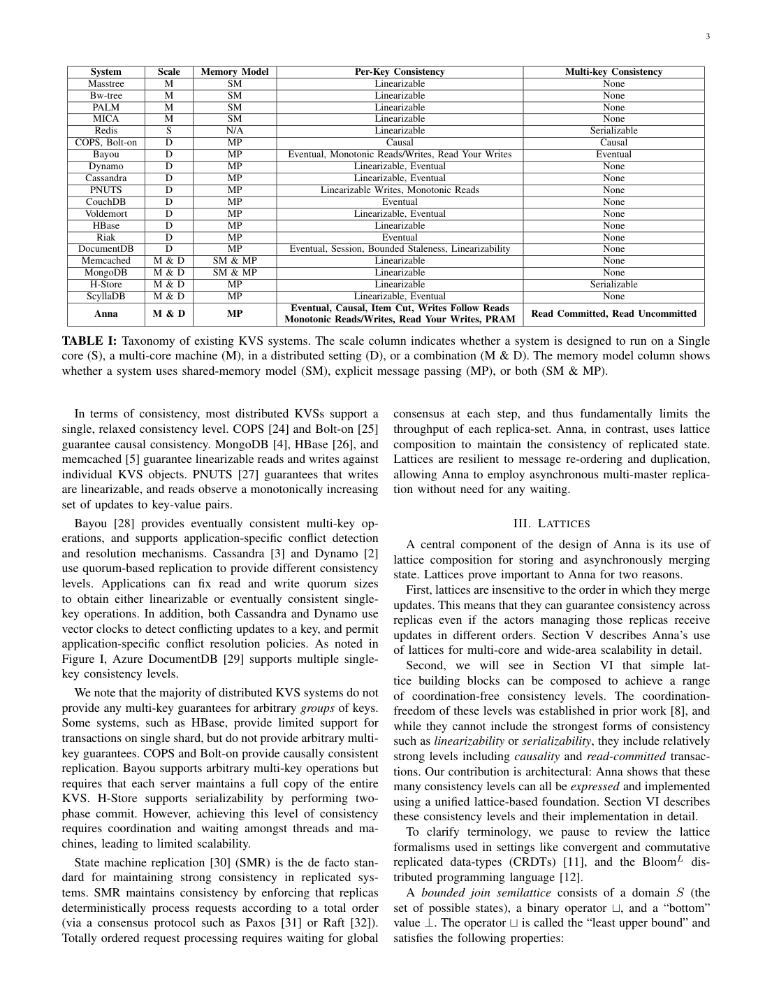
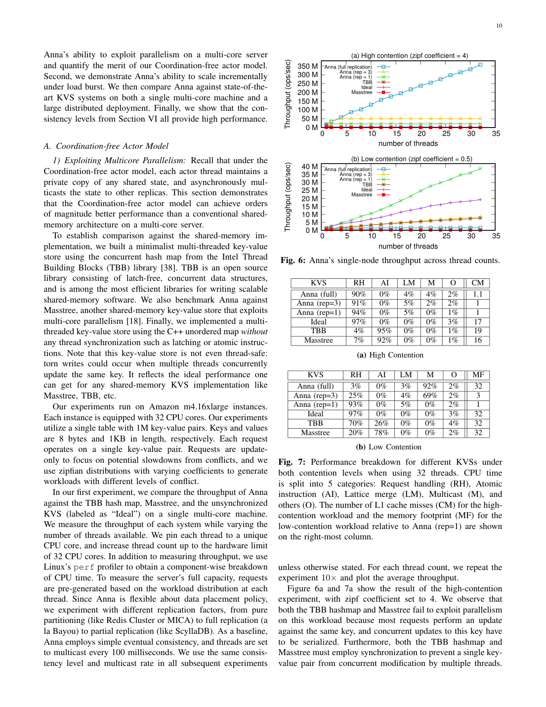

> 本组第 34 篇 · 分布式一致性 · [全部论文]() · [上一篇]() · [下一篇]()

Anna尝试以同一套机制贯穿单核、多核、多机与跨地域：每核actor拥有私有KVS状态，键空间分片且可多主复制，客户端请求先在本地处理，更新通过周期消息传播，再用满足ACI的格状态合并。真正的设计支点不是“用了CRDT就万事无忧”，而是私有状态减少共享写争用、发送端合并压缩热键更新、以及客户端代理与值格共同承载特定的一致性语义。

三条边界不可省略：无协调级别不包括线性一致和可串行化；wait-free是本文避免语义协调等待的设计目标，并非任意网络/系统调用的有界步证明；吞吐比较必须区分本地预生成update-only微基准与带客户端网络的YCSB。本报告还给出代码清单2字面转写的结合律反例，明确其仅是可复现的清单语义疑问，未验证为原软件缺陷。

本文保留论文陈述、读者推断与待验证方案的区别；实验数字只适用于原文条件。原文和翻译来自已有 AI 辅助精读报告，已做来源匹配与编辑复核，不等于人工逐项核验或独立实验复现。所有页码均为 PDF 物理页。

## 论文与阅读范围

Chenggang Wu, Jose M. Faleiro, Yihan Lin, Joseph M. Hellerstein. Anna: A KVS For Any Scale. 本地副本为UC Berkeley UCB/EECS-2019-122，2019年8月16日，含硕士研究项目前置页。以下页码均为PDF物理页；论文内部印刷页=物理页-3。不要把这份副本与其他Anna版本混为一谈。

[论文集中的原始 PDF](https://github.com/lonng/db-papers/blob/4ff1331069c7cf52ac97dd769e5f484c1c35c200/papers/consistency/anna%3A-a-kvs-for-any-scale.pdf) · 本地来源：`consistency/anna_-a-kvs-for-any-scale.pdf`，共 18 页。

本篇保留 20 组原文精读和 60 条证据。截图为原始 PDF 的局部页选，不是重新生成的图表；未将整份 PDF 复制到博客。

## 研究问题与适用边界

**跨尺度，而不是只追求某一个吞吐数字**
论文希望一个KVS架构既能利用单机多核，又能扩展到多机和地域复制。键分片解决数据量扩展；多主复制让同一热键的请求可分散到不同actor。两者缺一不可：只有单主分片时，偏斜负载仍会把一个热键压在一个处理单元上；全面复制则可能把低冲突工作负载的传播开销放大。

**第四个条件是语义边界，不是无限制保证**
作者选择支持一组无协调一致性模型，而不是在不付出协调成本的同时实现任意强一致。物理第6页明确排除linearizability与serializability。读者判断这种方案是否适用，应先问应用允许怎样的陈旧读、冲突合并与会话状态，再问节点数和吞吐。

**如何理解wait-free**
第4页用“线程持续服务请求、不为一致性语义等待其他线程”解释目标，并排除锁、共识和lock-free重试等协调机制。本文没有给出每个操作在任意调度下有界步完成的形式化进展证明；第12页代理仍会超时和重试。不能据此承诺客户端零等待、网络零延迟或完全不使用同步设施。

依据：论文陈述；PDF 物理页 4, 6, 12, 14, 18。证据：[AN01](#evidence-an01), [AN02](#evidence-an02), [AN16](#evidence-an16), [AN20](#evidence-an20), [AN27](#evidence-an27)。

## 系统架构与执行模型

**Actor拥有状态，消息负责传播**
每个actor线程绑定一个CPU核，线程数不超过可用核数；每个actor有私有哈希表和事件循环。它处理来自代理的GET/PUT及其他actor的消息。键通过一致性哈希分片，复制因子决定一个键有多少可独立服务的主副本。

“不共享KVS可变状态”并不等于“物理上从不共享内存”。第12页描述同机传播：发送方把消息放入共享buffer，经ZeroMQ inproc发送地址，接收方读取、合并并回收；跨机则经Protocol Buffers序列化与TCP传送。共享的是通信介质，不是允许所有线程直接并发改写同一键状态。

**类型与代理共同实现语义**
顶层MapLattice按键存值格；每个值格提供merge。向量时钟可由proxy-id到MaxInt的MapLattice表达，再与负载组成PairLattice。Read committed把版本元数据换成事务时间戳，同时依赖代理缓冲；item cut依赖读缓存；RYW依赖会话写缓存。不能只看服务端格类型，忽略客户端协议和元数据生命周期。

**结构、调度与策略应分开**
周期changeset包含本周期更新过的键；传播周期调节开销与观察到的新鲜度。加入节点涉及哈希环更新、状态传输及旧所有者重定向，离开也有预先转交步骤。这是文中描述的动态成员流程，不是完整的任意崩溃、磁盘持久化和分区恢复协议。按键动态复制属于此副本的后续工作，现有实现仍对所有键采用统一复制因子。

依据：论文陈述；PDF 物理页 7, 9, 10, 11, 12, 18。证据：[AN04](#evidence-an04), [AN08](#evidence-an08), [AN09](#evidence-an09), [AN10](#evidence-an10), [AN11](#evidence-an11), [AN12](#evidence-an12), [AN13](#evidence-an13), [AN14](#evidence-an14), [AN15](#evidence-an15), [AN16](#evidence-an16), [AN27](#evidence-an27)。

*原论文 PDF 物理页 6，版权归原作者或出版方。点击图片可查看原尺寸。页面文本中定位到：TABLE I: Taxonomy of existing KVS systems. The scale column indicates whether a system is designed to run on a Single；Figure I, Azure DocumentDB \[29\] supports multiple single-。这是页面定位信息，不表示本次已复核图内所有数据。*

## 核心算法与数据结构机制

**1. 本地更新与发送端合并**
actor先修改自己的值格，把变化加入changeset；周期结束时向负责相同键的其他actor发送，并合并收到的更新。对同一热键的多次更新，若merge真正满足结合律，则先在发送方合成一次结果，与接收方逐次合并具有相同最终效果。这是第8页merge-at-sender的依据，不是无条件丢弃中间事件的许可；若应用需要每次事件的副作用，还要另建语义。

**2. 同一对象的因果版本**
第9-10页以向量时钟区分先后与并发。若新版本在因果上支配旧版本，则覆盖；若向量不可比较，则合并负载并合并时钟。Alice写{a}后Bob观察并写{b}，作者例子最终覆盖为{b}；若二者并发，则用集合并得到{a,b}。这里讨论的是同一对象的版本，并未仅凭这段代码建立任意跨键因果读协议。

**3. 对清单2做一次更强的读者检查**
已将其字面分支转写为Python，负载merge取集合并。设a=((1,0),{a})、b=((0,1),{b})、c=((2,0),{c})。先合并a与b得到((1,1),{a,b})，再合并c得到((2,1),{a,b,c})；先合并b与c再与a合并，得到((2,1),{b,c})。汇总时钟相同，负载却随括号分组不同。

这个有限例子说明：不能把“组合了几个格类”直接当成该字面组合已具结合律的证明。它是对代码清单的可复现语义疑问，不是已确认的原C++实现漏洞；原仓库版本和运行行为并未检查。修复也不能简单把覆盖全改成集合并，否则会改变作者希望的因果覆盖语义。需要核对实现是否保留更丰富的版本/因果上下文，并重新验证ACI。

**4. 事务与会话的具体步骤**
RC在代理缓存未提交写，提交时一次批次发给一个actor，再按哈希环分发；时间戳使不同副本对事务写形成一致的版本优先关系。item cut把第一次读的记录缓存，后续同键读直接使用；RYW把返回值与本会话缓存写合并。它们针对不同异常，不是同一种全局快照算法。

**5. 删除是状态回收问题**
DELETE用带时间戳的特殊PUT表示；真正释放状态，要等有关actor的已知时间或键向量时钟前进到删除之后，并依赖有序点对点消息条件。不能只删除本地哈希项，就宣称迟到旧消息不会使数据复活。

依据：论文陈述；PDF 物理页 8, 9, 10, 11, 12。证据：[AN05](#evidence-an05), [AN06](#evidence-an06), [AN07](#evidence-an07), [AN08](#evidence-an08), [AN09](#evidence-an09), [AN10](#evidence-an10), [AN11](#evidence-an11), [AN12](#evidence-an12), [AN15](#evidence-an15), [AN28](#evidence-an28)。

## 正确性论证与边界条件

**ACI的责任要落实到状态与组合**
交换律处理乱序，结合律允许不同分组，幂等性处理重复消息。收敛论证还要求更新和状态表示与这些代数条件相容，并且相关更新最终传播；它不是对丢失全部消息、任意永久分区或无效自定义merge的保证。第8页明确要求组件与组合逻辑都满足ACI，读者清单测试正是对这一要求的检查，而非额外的性能测试。

**不同层次的“原子”不可混同**
第10页把批次一次送达单actor用作写入原子性的设计说明；随后仍是异步跨actor分发。未提交值不发布、事务写的版本排序、所有键在所有副本同时可见、崩溃后持久恢复、串行等价，是不同承诺。本文的RC采用所引无协调定义，不能据此推断其已提供后面几种更强性质，也不能拿普通SQL名称替代实际协议。

**缓存不是免费语义**
item cut只固定已读的同一记录；RYW依赖代理记住本会话写及其版本。代理换绑、缓存丢失、会话重建、向量时钟回收，都需要明确的协议。快照隔离、跨键因果闭包及事务可串行化均不能从本地缓存几行代码自动推出。

**新鲜度与回收有故障前提**
作者说GET陈旧度受multicast周期约束；但网络传输、排队、过载与分区的上界没有在这段机制里给出。100ms周期不能直接成为无条件100ms freshness SLA。同理，删除回收的有序通道与各actor进展条件不能省略；“线程不为一致性等待”并不等于这些故障条件已消失。

依据：论文陈述；PDF 物理页 4, 6, 8, 10, 11, 12。证据：[AN01](#evidence-an01), [AN02](#evidence-an02), [AN06](#evidence-an06), [AN09](#evidence-an09), [AN10](#evidence-an10), [AN11](#evidence-an11), [AN12](#evidence-an12), [AN14](#evidence-an14), [AN15](#evidence-an15), [AN16](#evidence-an16), [AN28](#evidence-an28)。

## 实验评估与工作负载分析

**本地微基准：测的是冲突与核心执行路径**
第13-14页使用Amazon m4.16xlarge、32核、1M键，8B键与1KB值，update-only预生成请求。高冲突Zipf系数4，低冲突0.5；基线simple eventual、100ms传播，每种线程数重复10次后取平均。Ideal无同步版本明确不是线程安全实现。论文报告的700倍等数字属于这些设置，也伴随与线性一致共享内存基线不同的语义，不能改写为所有场景下的等语义优势。

**复制收益与代价由冲突结构决定**
热点很集中时，发送端合并把许多更新缩成较少传播，复制可分摊请求；低冲突时大量不同键都要传播，rep3的gossip占69% CPU，全复制可达92%。图7高冲突最右列是相对cache misses，低冲突最右列是memory footprint，不可混成同一指标。

**弹性测试不是自动策略测试**
第14-15页明确假设omniscient策略。10秒处把负载增至三倍，同时加64线程；20秒处撤回。作者文字报告吞吐约增2倍，延迟总体相近且扩缩时有短暂峰值。它验证机制能快速调整，不证明已实现可靠的负载预测器或任意三倍资源都带来三倍吞吐。

**端到端网络实验是另一条路径**
Redis/Redis Cluster比较使用客户端代理发YCSB请求，25B键与1KB值；图10低冲突用uniform，而不是前述Zipf0.5。其吞吐纵轴比本地微基准低若干数量级。分布式Cassandra实验用ONE、双方复制因子3、四个EC2地域；32核配置下约10倍的结果是当时配置下的作者实测，不是当前版本排名。

**一致性实验有代码路径混杂因素**
第16页每6次操作组成事务。RC批量发送减少往返，item cut缓存减少重复读，绿色柱段展示这类收益；作者指出其他一致性模式也可以用这些优化。因此不能从柱高推断“更强一致性天然更快”。原文没提供本报告所需的现代版本、P99分布、故障后恢复和等优化基线，本地也未重跑这些性能实验。

依据：论文陈述；PDF 物理页 13, 14, 15, 16。证据：[AN17](#evidence-an17), [AN18](#evidence-an18), [AN19](#evidence-an19), [AN20](#evidence-an20), [AN21](#evidence-an21), [AN22](#evidence-an22), [AN23](#evidence-an23), [AN24](#evidence-an24), [AN25](#evidence-an25), [AN26](#evidence-an26)。

*原论文 PDF 物理页 13，版权归原作者或出版方。点击图片可查看原尺寸。页面文本中定位到：Fig. 6: Anna’s single-node throughput across thread counts.；Fig. 7: Performance breakdown for different KVSs under；Figure 6a and 7a show the result of the high-contention。这是页面定位信息，不表示本次已复核图内所有数据。*

## 设计权衡与局限性

**复制不是单调有利的旋钮**
高复制可以分散热键流量，却增加驻留内存和传播集合；低冲突时可使系统主要忙于gossip。此版本全键统一复制因子使这个折衷尤其明显；附录提出按键区分冷热，是未来方向而非已经提供的自适应功能。

**传播周期在效率与可见性之间移动成本**
长周期可增加发送端合并机会，但通常增加对其他副本的观察滞后；短周期增加消息和合并工作。两者都不能代替对队列、网络故障和缓存状态的测量。向量时钟的维度随访问该键的代理集合增长，也需要回收策略。

**统一机制降低代码差异，不等于降低语义验证难度**
相同Map/Pair/Max结构让实现可复用，但每种一致性还需要相应的代理规则和有效merge。代码量差异小是维护线索，不是正确性证书；清单2的字面结合律测试就是需要继续深入的具体问题。

**可用的应用语义才是入口**
适合对冲突有明确定义且能容忍异步副本观察的应用；不能把银行级串行约束、跨键唯一性或任意外部副作用直接塞入ValueLattice，便期待系统自动维持它们。这里只是基于本文约束的适用性判断，未评价任何现实业务或当前产品。

依据：读者推断；PDF 物理页 6, 8, 9, 10, 12, 14, 18。证据：[AN02](#evidence-an02), [AN05](#evidence-an05), [AN06](#evidence-an06), [AN08](#evidence-an08), [AN14](#evidence-an14), [AN20](#evidence-an20), [AN27](#evidence-an27), [AN28](#evidence-an28)。

## 与现有系统的对比分析

**与共享内存结构比：比较的是设计点，不只是函数速度**
本文TBB/Masstree路径为同一共享键同步，Anna则把可合并更新放到多个私有副本。争用成本和读写语义一起变化；应保留“弱一致、后台传播、负载偏斜”的比较前提。Ideal只是非线程安全参照，不是可投入生产的替代方案。

**与单主分片比：复制改变了热点上限，也改变了工作总量**
分片可利用多核处理不同键，却不能仅靠增加分片让同一热键的单主处理能力无限扩展。Anna多主复制利用允许合并的语义分担同键负载，但低冲突下传播与内存成本会反过来占主导。

**与强一致复制比：不要把被排除的目标当作已替代**
第6页明确不提供线性一致与可串行化。减少前台协调并不消除应用对全局约束的需求；若需求确实需要一致决策，应另行查证相应协议，而不是把后台最终合并说成等价于Raft/Paxos提交。

**现代系统只列为核查问题**
本报告未查当前Redis、Cassandra、ScyllaDB、Akka或Anna后续版本。可继续研究：当前系统如何保持跨键依赖、如何管理代理元数据、如何把持久化与成员变更接入收敛模型、如何提供等语义且等优化的基线。本文的历史表格不构成这些系统2026年的功能说明。

依据：读者推断；PDF 物理页 6, 7, 13, 14, 16, 18。证据：[AN02](#evidence-an02), [AN03](#evidence-an03), [AN04](#evidence-an04), [AN17](#evidence-an17), [AN20](#evidence-an20), [AN24](#evidence-an24), [AN26](#evidence-an26), [AN27](#evidence-an27)。

## 复现指南与工程考量

**已经做的读者测试**
`qa/anna-reader-tests.json`记录清单2按字面转写的Python结果：a=((1,0),{a})、b=((0,1),{b})、c=((2,0),{c})，左右两种分组分别产生{a,b,c}与{b,c}。它只验证这个有限状态例子，不是运行原Anna、完整证明所有合法状态，或确认当前实现存在缺陷。

**下一步正确性检查，尚未执行**
1. 固定原实现commit与格类型约束，确认每个可达状态携带哪些版本上下文；枚举小状态的交换律、结合律、幂等性以及因果覆盖语义。不要为通过ACI测试而悄悄改变应用merge语义。
2. 对两actor、两键、一个代理构造乱序/重复/延迟消息与代理重连，分别检查RC未提交可见性、item cut同键重复读、RYW及跨键依赖。每种性质单独写断言；没有写入协议的性质不得默认必须成立或已经成立。
3. 删除后延迟旧消息，分别满足/破坏文中有序通道与已知时间前进条件，记录状态是否复活及何时可安全回收。只在隔离测试数据上模拟失败，不改真实笔记或数据库。

**下一步性能检查，尚未执行**
4. 分开测本地预生成微基准与客户端网络路径；固定值大小、线程绑定、语义、复制因子和传播周期，再改变Zipf/热键比例。同时记录吞吐、P50/P95/P99、传播字节、gossip CPU、代理缓存命中和版本元数据大小。
5. 等优化比较：让所有可用模式获得相同批次与缓存机会；用相同确认/持久化语义比较基线。扩缩容把策略选择与机制开销分开，避免把全知时刻注入实验说成已经实现的自动控制器。

这些是复现计划，不是已经跑出的性能与故障结论。原文来源核对及字面清单算例，与完整系统复现的证据等级不同。

依据：待验证的工程设想；PDF 物理页 8, 10, 11, 12, 13, 14, 16。证据：[AN06](#evidence-an06), [AN10](#evidence-an10), [AN11](#evidence-an11), [AN12](#evidence-an12), [AN15](#evidence-an15), [AN18](#evidence-an18), [AN19](#evidence-an19), [AN21](#evidence-an21), [AN25](#evidence-an25), [AN26](#evidence-an26), [AN28](#evidence-an28)。

## 总结与开放问题

Anna的价值在于把跨尺度执行和应用可接受的一致性语义一同设计：私有状态减少共享写争用，异步消息传播更新，发送端合并利用热键重复，代理与格组合落实特定的可见性规则。它不是通过“取消一致性”获得性能，也不是用一个类模板自动解决所有一致性问题。

阅读这篇论文，至少应带走四个可检验问题：负载是否足够偏斜以抵偿复制传播？merge在实际可达状态上是否真满足ACI？所需保证究竟是同键因果覆盖、会话读己之写，还是跨键更强约束？实验数字测的是哪条请求路径、哪种确认与缓存策略？

本报告保留原API证据与用量，并补充28条精确原页引文、更多逐段解读和清单2读者测试。方法与范围见书目信息；没有执行原C++系统、独立验证当前产品，或完成分布式故障复现。局部源码清单问题保持为待核查问题，最终仍为generated_needs_review，不能将结构/引文检查通过理解成所有解释已被证明。

依据：读者推断；PDF 物理页 4, 6, 8, 10, 13, 14, 16, 18。证据：[AN01](#evidence-an01), [AN02](#evidence-an02), [AN05](#evidence-an05), [AN06](#evidence-an06), [AN17](#evidence-an17), [AN20](#evidence-an20), [AN21](#evidence-an21), [AN26](#evidence-an26), [AN27](#evidence-an27), [AN28](#evidence-an28)。

## 原文精读：从句子回到机制

以下保留原文、忠实翻译、含义与边界；假设示例不作为论文实验结果。

### P001 · PDF 物理页 4

**原文**

<blockquote class="paper-source-quote"><pre><code>This raises the challenge of implementing high-performance&#10;software systems that can effectively scale from a single core to&#10;multicore to the globe. Conventional wisdom says that software&#10;designed for one scale point needs to be rewritten when scaling&#10;up by 10−100⇥[1]. In contrast, we explore how a system can be&#10;architected to scale across many orders of magnitude by design.</code></pre></blockquote>

**忠实翻译**

> 这提出了实现高性能软件系统的挑战，该系统能够有效地从单核扩展到多核再到全球规模。传统观点认为，为某一规模点设计的软件在扩展 10 到 100 倍时需要重写[1]。相比之下，我们探索如何通过设计使系统架构能够在多个数量级上进行扩展。

**技术含义与边界**

> 原文陈述了作者的研究动机：打破传统软件在跨越数量级扩展时必须重写的限制。作者主张通过架构设计（而非重写）来实现从单核到分布式的全尺度扩展。这是作者的探索目标，读者可推断其后续章节将提出具体的架构机制，但本段未给出具体技术细节。

**常见误读**

> 容易误读为作者已经证明了在所有场景下都不需要重写代码。原文仅表示“探索如何架构”，并未声称该设计在所有工作负载或硬件拓扑下均无需修改即可完美扩展。不应将这一设计愿景泛化为全局保证。

**读者构造的假设示例**

> 读者构造的假设示例：假设一个键值存储系统在单核上运行良好，当部署到 64 核机器时，传统做法是重写锁机制；而作者设想的设计可能通过无共享架构或特定的并发控制使得同一套代码能直接利用多核。

### P002 · PDF 物理页 18

**原文**

<blockquote class="paper-source-quote"><pre><code>However, as we increase the contention level, access to keys&#10;become more concentrated. In Figure 13b, we observe that&#10;with zipf coefficient 1.5, all accesses are on 1% (13286/1M)&#10;of the keys, and 2 keys get accessed more than 100K times.&#10;Under coefficient 4, only 34 keys are ever accessed among&#10;the 1M requests, with one key being extremely hot.</code></pre></blockquote>

**忠实翻译**

> 然而，随着我们增加争用级别，对键的访问变得更加集中。在图 13b 中，我们观察到在 zipf 系数为 1.5 时，所有访问都集中在 1%（13286/1M）的键上，并且有 2 个键被访问超过 10 万次。在系数为 4 的情况下，100 万个请求中只有 34 个键被访问过，其中一个键极其热点。

**技术含义与边界**

> 这是图13对有限的100万次请求样本的观察，不是Zipf分布的普遍常数。13286/100万实际为1.3286%，原文用1%作近似；系数4下样本触及34个键，不能推出无限时间内只访问这些键。

**常见误读**

> 不能将这些特定系数下的具体数字（如 13286、34）泛化为所有 Zipfian 工作负载的普遍规律。这些数值严格依赖于总键数（1M）和请求总数（1M）。此外，原文未说明这种集中度对系统吞吐量的最终影响，读者不应自行补充因果结论。

**读者构造的假设示例**

> 读者示例：在这100万次生成请求中，未被触及的键不表示概率为零，也不表示之后永远无人访问。

### P003 · PDF 物理页 11

**原文**

<blockquote class="paper-source-quote"><pre><code>Both transactions issue the buffered write requests&#10;only after receiving the responses of the read requests and&#10;determining that the transactions are safe to commit.&#10;Buffering writes on the client proxy prevents dirty reads.&#10;For example, if T1 failed after w1[k1], this uncommitted write&#10;is not visible to other transactions since it is buffered at the&#10;proxy.&#10;Anna avoids dirty writes by using transaction timestamps to&#10;consistently order writes.</code></pre></blockquote>

**忠实翻译**

> 两个事务都仅在收到读请求的响应并确定事务可以安全提交之后，才发出缓冲的写请求。在客户端代理上缓冲写操作可以防止脏读。例如，如果 T1 在 w1[k1] 之后失败，这个未提交的写操作对其他事务不可见，因为它被缓冲在代理处。Anna 通过使用事务时间戳来一致地对写操作进行排序，从而避免脏写。

**技术含义与边界**

> 防脏读依赖客户端代理在提交前缓冲写；防脏写用事务时间戳一致地确定版本先后。这里不是要求网络按时间戳排序交付：格合并本来就应容忍消息乱序。批次入口与多副本全局原子可见性也不是同一命题。

**常见误读**

> 容易误认为缓冲写操作是在服务器端进行的，原文明确指出是“on the client proxy”（在客户端代理上）。另外，原文仅说明了防止脏读和脏写的方法，并未声称这解决了所有并发异常（如幻读），不应过度推断其隔离级别。

**读者构造的假设示例**

> 读者构造的假设示例：假设事务 T1 试图更新键 k1，它先将写操作缓存在本地代理中。如果 T1 此时崩溃，由于写操作未发送到服务器，其他事务 T2 读取 k1 时不会看到 T1 的中间状态，从而避免了脏读。

### P004 · PDF 物理页 14

**原文**

<blockquote class="paper-source-quote"><pre><code>Although TBB and Masstree do not incur&#10;gossip overhead, they suffer from larger memory footprint&#10;and high cost of (conservative) synchronization operations as&#10;shown by our profiler measurements in Figure 7b. The lesson&#10;learned from this experiment is that for systems that support&#10;multi-master replication, having a high replication factor under&#10;low contention workloads can hurt performance. Instead, we&#10;want to dynamically monitor the data’s contention level and&#10;  0 M&#10;  5 M&#10; 10 M&#10; 15 M&#10; 20 M&#10; 0&#10; 10&#10; 20&#10; 30&#10; 40&#10; 50&#10; 60&#10; 70&#10;Throughput (ops/sec)&#10;number of threads&#10;One Server &#10;Two Servers &#10;Three Servers &#10;Fig.</code></pre></blockquote>

**忠实翻译**

> 尽管 TBB 和 Masstree 不产生 gossip 开销，但它们遭受更大的内存占用以及高昂的（保守的）同步操作成本，正如我们在图 7b 中的分析器测量所示。从这个实验中学到的教训是，对于支持多主复制的系统，在低争用工作负载下拥有高复制因子会损害性能。相反，我们希望动态监控数据的争用级别，并且 [图表文字：吞吐量(ops/sec)与线程数的关系，包含一台服务器、两台服务器、三台服务器的曲线]

**技术含义与边界**

> 该摘录混入图8坐标标签并在句中截断；完整后文提出按争用程度调整选择性复制。第18页明确这是未来工作，不是当前已经实现的自动控制策略。高复制因子在此低争用实验中增加传播成本，不能脱离负载推广。

**常见误读**

> 图表提取文字不完整且缺乏坐标轴详细上下文，不能声称已看懂图像趋势。此外，“高复制因子在低争用下损害性能”是该特定实验的结论，不应泛化为所有多主复制系统在所有配置下的绝对规律。

**读者构造的假设示例**

> 读者示例：把冷键也复制到5个actor，后台传播和合并工作可能超过分摊请求的收益。这里的传播不是要求五副本同步确认。

### P005 · PDF 物理页 6

**原文**

<blockquote class="paper-source-quote"><pre><code>al&#10;None&#10;DocumentDB&#10;D&#10;MP&#10;Eventual, Session, Bounded Staleness, Linearizability&#10;None&#10;Memcached&#10;M &amp; D&#10;SM &amp; MP&#10;Linearizable&#10;None&#10;MongoDB&#10;M &amp; D&#10;SM &amp; MP&#10;Linearizable&#10;None&#10;H-Store&#10;M &amp; D&#10;MP&#10;Linearizable&#10;Serializable&#10;ScyllaDB&#10;M &amp; D&#10;MP&#10;Linearizable, Eventual&#10;None&#10;Anna&#10;M &amp; D&#10;MP&#10;Eventual, Causal, Item Cut, Writes Follow Reads&#10;Monotonic Reads/Writes, Read Your Writes, PRAM&#10;Read Committed, Read Uncommitted&#10;TABLE I: Taxonomy of existing KVS systems. The scale column indicates whether a system is designed to run on a Single&#10;core (S), a multi-core machine (M), in a distributed setting (D), or a combination (M &amp; D).</code></pre></blockquote>

**忠实翻译**

> 表I摘录：DocumentDB为D、MP，列出最终/会话/有界陈旧/线性一致，多键列None；Memcached和MongoDB为M&D、SM&MP，单键线性一致、多键None；H-Store为M&D、MP，单键线性一致、多键可串行化；ScyllaDB为M&D、MP，单键线性/最终、多键None。Anna为M&D、MP；单键列列出最终、因果、item cut、writes-follow-reads、单调读写、read-your-writes、PRAM，多键列为read committed/read uncommitted。图注：S=单核，M=单机多核，D=分布式；SM=共享内存，MP=显式消息传递。

**技术含义与边界**

> 已直接核对物理第6页表格。四个维度是扩展尺度、内存/通信模型、单键一致性、多键一致性；MP并非分区方式，M并非多机。表中Anna两列的实际排版不能仅按文本层换行猜测。

**常见误读**

> 这些是该2019技术报告的历史分类，不是对当前产品版本和配置的独立认证。不能把Memory Model一列误称为分区策略，也不能据一个线性一致标签推导跨键事务。

**读者构造的假设示例**

> 读者示例：一个M&D、MP系统可以在单机多核与多机间都用消息传递，但这两个标签本身不决定其分片算法或复制协议。

### P006 · PDF 物理页 12

**原文**

<blockquote class="paper-source-quote"><pre><code>Actors free the memory for a key only when the&#10;minimum timestamp within the vector-clock becomes greater&#10;than the DELETE’s timestamp. After that time, because Anna&#10;uses ordered point-to-point network channels, we can be sure&#10;no old updates to the key will arrive. This technique extends&#10;naturally to consistency levels that require per-key vector-&#10;clocks (such as causal consistency) instead of timestamp.</code></pre></blockquote>

**忠实翻译**

> actor只有在向量时钟内的最小时间戳超过DELETE时间戳后才释放键内存；之后依靠有序点对点通道排除旧更新晚到。这项技术可自然推广到每键需要向量时钟、而非标量时间戳的一致性级别，例如因果一致性。

**技术含义与边界**

> 原文陈述了 Anna 中安全回收已删除键内存的机制：依赖向量时钟的最小值与有序网络通道的结合。前提条件是网络通道必须保证点对点有序。作者指出该机制可推广到基于向量时钟的因果一致性。

**常见误读**

> 这是带进度条件的回收论述：有序点对点通道和所有相关进度越过删除点不能省略。消息合并容忍乱序，不等于删除状态回收也可无条件丢掉通道前提；本文并未实测所有故障组合下的回收成本。

**读者构造的假设示例**

> 读者构造的假设示例：假设键 k 被删除，其 DELETE 操作带有时间戳 t=10。Actor 会等待直到所有相关节点的向量时钟分量都大于 10，此时才释放 k 占用的内存，因为有序通道保证了时间戳小于等于 10 的更新不可能再晚于此时到达。

### P007 · PDF 物理页 8

**原文**

<blockquote class="paper-source-quote"><pre><code>Formally, denote s as the state of key&#10;k on another replica, we have&#10;t(... t (t(s, u1), u2), ...un) = t(s, t(... t (u1, u2), ...un))&#10;by associativity. Hence batches of associative updates can be&#10;merged at a sending replica without affecting results; merging&#10;at the sender can dramatically reduce communication overhead&#10;for frequently-updated hot keys, and reduces the amount of&#10;computation performed on a receiving replica, which only&#10;processes the merged result of updates to a key, as opposed&#10;to every individual update.</code></pre></blockquote>

**忠实翻译**

> 形式上，将 s 表示为另一个副本上键 k 的状态，由结合律我们有 t(... t (t(s, u1), u2), ...un) = t(s, t(... t (u1, u2), ...un))。因此，关联更新的批次可以在发送副本处合并而不影响结果；在发送方合并可以显著降低频繁更新的热点键的通信开销，并减少接收副本上执行的计算量，接收副本只需处理键更新的合并结果，而不是每个单独的更新。

**技术含义与边界**

> 原文陈述了基于结合律（associativity）的更新合并优化。数学公式表明，只要更新操作满足结合律，发送方就可以将多个更新预先合并为一个，接收方应用一次合并结果与应用多次单独结果等价。这降低了网络和计算开销。

**常见误读**

> 该优化的适用边界严格受限于“满足结合律的更新操作”。如果某个数据类型或操作的 merge 函数不满足结合律，则不能在发送方安全合并。不应将此局部优化泛化为所有类型更新均可合并。

**读者构造的假设示例**

> 读者示例：集合状态依次并入{a}、{b}、{a}，可先在发送端合成{a,b}再发送；集合并满足ACI，重复传输也不增加成员。普通整数加法虽然结合，但不幂等，不能直接当成可重复状态合并的CRDT例子。

### P008 · PDF 物理页 16

**原文**

<blockquote class="paper-source-quote"><pre><code>As&#10;explained in Section VI-C, client-side buffering and caching&#10;requirement sometimes lead to higher throughput for Anna,&#10;which we show using green bars in Figure 12.&#10;For causal consistency, we observe a slight degradation in&#10;throughput as Anna has to maintain the vector clock associated&#10;with each key-value pair, requiring more sophisticated lattice&#10;merge logic. In addition, the size of the vector clock for a&#10;given key is proportional to the number of client proxies&#10;that access the key.</code></pre></blockquote>

**忠实翻译**

> 如第 VI-C 节所解释的，客户端缓冲和缓存需求有时会导致 Anna 获得更高的吞吐量，我们在图 12 中使用绿色柱状图展示了这一点。对于因果一致性，我们观察到吞吐量略有下降，因为 Anna 必须维护与每个键值对关联的向量时钟，这需要更复杂的格合并逻辑。此外，给定键的向量时钟大小与访问该键的客户端代理数量成正比。

**技术含义与边界**

> 原文陈述了两个实验观察：一是客户端缓冲/缓存有时能提升 Anna 的吞吐量；二是因果一致性相比更低级别的一致性会带来轻微的性能下降，原因在于向量时钟的维护成本和格合并逻辑的复杂性，且向量时钟大小随访问该键的代理数线性增长。

**常见误读**

> 原文使用了“有时（sometimes）”和“略有下降（slight degradation）”等限定词。不应将“有时提升”解读为“总是提升”，也不应将“略有下降”解读为“严重性能瓶颈”。向量时钟大小的正比关系是理论事实，但实际内存消耗取决于具体代理数量。

**读者构造的假设示例**

> 读者示例：若一个键仍保留100个活跃、未回收的代理维度，时钟元数据及部分合并路径可能比少量维度更贵。但不能从“曾被100个代理访问”断言永久保留100项，也不能未看具体算法就声称每次必遍历全部100项。实际开销仍需测量。

### P009 · PDF 物理页 5

**原文**

<blockquote class="paper-source-quote"><pre><code>Furthermore,&#10;with the exception of Redis, which is single-threaded, none&#10;of the single-node KVS systems provide any consistency&#10;guarantees for multi-key operations for groups of keys. Hence,&#10;these systems choose a different design point than we explore:&#10;they offer strong consistency at the expense of performance&#10;and scalability.</code></pre></blockquote>

**忠实翻译**

> 此外，除了单线程的 Redis 之外，没有任何单节点 KVS 系统为键组的多键操作提供任何一致性保证。因此，这些系统选择了与我们探索的不同的设计点：它们以牺牲性能和可扩展性为代价提供强一致性。

**技术含义与边界**

> 原文陈述了作者对现有单节点 KVS 系统的观察：除 Redis 外，均不提供多键一致性保证。作者据此指出，那些提供强一致性的系统选择了不同的设计权衡（牺牲性能和可扩展性）。这是作者对其研究定位的辩护。

**常见误读**

> 原句是写作时期与所比较系统范围内的定位，不是当前所有版本的能力清单。单键强一致与多键事务不同，本文的性能权衡评价也不是适用于所有实现的普遍性能定理。

**读者构造的假设示例**

> 读者示例：需要原子修改A和B时，应检查具体事务API、原子可见性与崩溃恢复语义；不能假定应用自行增加两阶段提交就能补足不具备相应参与者接口和恢复机制的KVS。

### P010 · PDF 物理页 17

**原文**

<blockquote class="paper-source-quote"><pre><code>Workload Skew and Replication Strategy&#10;To motivate our future work on selective replication, we&#10;review concrete numbers for the kind of skew that arises from&#10;typical workloads. Since many workloads are well-modeled&#10;by Zipfian distributions [46], [47], we first look at the key&#10;access statistics under various Zipfian workloads to see how&#10;many keys are hot, cold, or somewhere in between, and then&#10;discuss the implication on the optimal replication strategy.</code></pre></blockquote>

**忠实翻译**

> 工作负载倾斜与复制策略
> 为了激发我们未来关于选择性复制的工作，我们回顾了典型工作负载产生的倾斜的具体数字。由于许多工作负载可以通过 Zipfian 分布很好地建模 [46], [47]，我们首先查看各种 Zipfian 工作负载下的键访问统计数据，以了解有多少键是热点、冷点或介于两者之间，然后讨论对最佳复制策略的影响。

**技术含义与边界**

> 原文陈述了本节的目的：通过分析 Zipfian 分布下的键访问统计，量化工作负载倾斜程度，从而为未来的“选择性复制”研究提供动机。这是一个过渡段落，指明了后续分析的方向。

**常见误读**

> 原文明确指出这是为了“motivate our future work”（激发我们未来的工作），因此不应将此处提到的“最佳复制策略”误解为本文已经实现或评估的功能。本段仅提出问题和分析框架，未给出具体结论。

**读者构造的假设示例**

> 读者构造的假设示例：假设分析显示 90% 的请求集中在 5% 的键上，那么未来的选择性复制策略可能只对这 5% 的热键进行多副本复制，而对剩余 95% 的冷键仅保留单副本，以节省资源。

### ANNA-REVIEW-01 · PDF 物理页 4

**原文**

<blockquote class="paper-source-quote"><pre><code>each thread is always doing useful&#10;work (serving requests), and never waiting for other threads for&#10;reasons of consistency or semantics. To that end, coordination&#10;techniques such as locking, consensus protocols or even “lock-&#10;free” retries [7] need to be avoided.</code></pre></blockquote>

**忠实翻译**

> 每个线程持续做服务请求的有效工作，不因一致性或语义等待其他线程；因此避免锁、共识乃至lock-free重试。

**技术含义与边界**

> 这里的目标是消除前台语义协调，必须与操作系统和客户端层次分开。

**常见误读**

> 不能把这种工程描述提升为整个网络服务的形式化wait-free完成定理。

**读者构造的假设示例**

> 客户端因网络延迟超时重试，不与服务端选择无协调更新的设计目标矛盾。

### ANNA-REVIEW-02 · PDF 物理页 8

**原文**

<blockquote class="paper-source-quote"><pre><code>it is sufficient to verify that each of its simple&#10;building blocks is a valid lattice (has ACI properties), and the&#10;composition logic is ACI</code></pre></blockquote>

**忠实翻译**

> 验证系统ACI，需要验证简单组件有效，并且组合逻辑也满足ACI。

**技术含义与边界**

> 组合本身承担证明责任；元数据摘要可能丢掉正确解决因果覆盖所需的信息。

**常见误读**

> 使用Max/Map/Pair类型名不等于组合天然成立。

**读者构造的假设示例**

> 检查三个输入的左右括号分组，能发现单一两输入示例遗漏的问题。

### ANNA-REVIEW-03 · PDF 物理页 10

**原文**

<blockquote class="paper-source-quote"><pre><code>template &lt;typename T&gt;&#10;2 class CausalPairLattice {&#10;3&#10;protected:&#10;4&#10;VersionValuePair&lt;T&gt; element;&#10;5&#10;public:&#10;6&#10;void merge(const VersionValuePair&lt;T&gt; &amp;p)&#10;7&#10;{&#10;8&#10;// store the previous vector clock&#10;9&#10;// before merging&#10;10&#10;MapLattice&lt;int, MaxLattice&lt;int&gt;&gt; prev&#10;11&#10;= this-&gt;element.vector_clock;&#10;12&#10;// merge the current and&#10;13&#10;// the input vector clocks&#10;14&#10;this-&gt;element.vector_clock&#10;15&#10;.merge(p.vector_clock);&#10;16&#10;if (this-&gt;element.vector_clock == prev)&#10;17&#10;{&#10;18&#10;// do nothing, as the new&#10;19&#10;// vector clock is dominated&#10;20&#10;}&#10;21&#10;else if (this-&gt;element.vector_clock&#10;22&#10;== p.vector_clock)&#10;23&#10;{&#10;24&#10;// overwrite the current value with&#10;25&#10;// the new one, as its vector clock&#10;26&#10;// is dominated&#10;27&#10;this-&gt;element.value.assign(p.value);&#10;28&#10;}&#10;29&#10;else&#10;30&#10;{&#10;31&#10;// merge the two values, as&#10;32&#10;// the vector clocks are not&#10;33&#10;// comparable&#10;34&#10;this-&gt;element.value.merge(p.value);&#10;35&#10;}&#10;36&#10;}&#10;37 };&#10;Listing 2:</code></pre></blockquote>

**忠实翻译**

> 代码先保存旧时钟，再合并输入时钟；若时钟不变则忽略输入，若合并后等于输入则覆盖值，其余情况合并值。

**技术含义与边界**

> 按此字面规则及集合并负载，a、b、c三状态可给出相同汇总时钟、不同最终值的分组结果。

**常见误读**

> 这是读者Python转写，不是执行原始实现；应核查真实类型约束与可达状态，而非直接宣告整个Anna错误。

**读者构造的假设示例**

> a=(1,0){a}、b=(0,1){b}、c=(2,0){c}：左分组{a,b,c}，右分组{b,c}，均为(2,1)。

### ANNA-REVIEW-04 · PDF 物理页 10

**原文**

<blockquote class="paper-source-quote"><pre><code>To guarantee atomicity of&#10;writes, the client sends all writes in one batch to a single&#10;Anna actor, ensuring that either all writes reach the Anna&#10;server or none. The actor then distributes writes to other actors&#10;following the consistent hash ring.</code></pre></blockquote>

**忠实翻译**

> 为使一批写要么全部到达服务器、要么都不到达，客户端把全部写一次发给单个actor，再由它按哈希环分发。

**技术含义与边界**

> 这一句描述批次入口，不同时建立所有副本多键原子可见性、持久恢复或可串行化。

**常见误读**

> 不要把同一单词atomicity跨投递、可见性与持久化层次直接套用。

**读者构造的假设示例**

> 检查入口收齐批次后、各副本尚未全部接收更新时，不同观察者到底能读到什么。

### ANNA-REVIEW-05 · PDF 物理页 11

**原文**

<blockquote class="paper-source-quote"><pre><code>Item cut isolation requires that if a transaction reads the&#10;same record more than once, it has to read the same value.&#10;To provide this guarantee, we buffer the record read at the&#10;client side, and when the transaction attempts to read the same&#10;record, it invokes the client-side cache instead of querying the&#10;server.</code></pre></blockquote>

**忠实翻译**

> item cut要求事务多次读取同一记录得到相同值；客户端缓存已读记录，后续从缓存返回。

**技术含义与边界**

> 保证的是该事务已读过的记录，不是给所有键固定统一时间截面。

**常见误读**

> 不能把逐键缓存简单命名为完整snapshot isolation。

**读者构造的假设示例**

> 先读k1再等远端更新后读k2，各自稳定不说明两值来自同一数据库快照。

### ANNA-REVIEW-06 · PDF 物理页 12

**原文**

<blockquote class="paper-source-quote"><pre><code>The GET response may&#10;be stale; the staleness is bounded by the multicast period,&#10;which is an adjustable parameter to balance performance and&#10;staleness.</code></pre></blockquote>

**忠实翻译**

> GET可能陈旧，作者把陈旧程度与可调整的multicast周期联系，以平衡性能与新鲜度。

**技术含义与边界**

> 周期规定发送时机，网络传输和排队的额外延迟仍需单独建模。

**常见误读**

> 100ms传播周期不自动证明分区时也有100ms返回新值的上界。

**读者构造的假设示例**

> 增加网络延迟而保持传播周期不变，测量观察到的版本滞后。

### ANNA-REVIEW-07 · PDF 物理页 13

**原文**

<blockquote class="paper-source-quote"><pre><code>this key-value store is not even thread-safe:&#10;torn writes could occur when multiple threads concurrently&#10;update the same key.</code></pre></blockquote>

**忠实翻译**

> 这个无同步键值存储甚至不是线程安全的；多个线程改同一键时可能发生torn writes。

**技术含义与边界**

> Ideal基线用于讨论开销来源，而不是可部署的正确性等价竞品。

**常见误读**

> 不能忽略这个条件，把其吞吐当成同语义生产方案。

**读者构造的假设示例**

> 比较同步、分片、多主三种方案时，在结果旁同时列出各自可保证的操作语义。

### ANNA-REVIEW-08 · PDF 物理页 14

**原文**

<blockquote class="paper-source-quote"><pre><code>69% of the CPU time is devoted to processing gossip for Anna&#10;(rep=3).</code></pre></blockquote>

**忠实翻译**

> 低冲突时，Anna复制因子3配置有69%的CPU时间用于处理gossip。

**技术含义与边界**

> 不同键更新很多时，发送端合并不再像集中热键那样有效，传播工作开始占主导。

**常见误读**

> 增加复制因子可能降低绝对吞吐，并非总能带来扩展性。

**读者构造的假设示例**

> 固定请求总量，从集中一个热键改为均匀更新大量键，比较变化集大小。

### ANNA-REVIEW-09 · PDF 物理页 14

**原文**

<blockquote class="paper-source-quote"><pre><code>we focus on Anna’s reaction&#10;time, assuming an omniscient policy.</code></pre></blockquote>

**忠实翻译**

> 这里关注Anna的反应时间，并假设一个全知的策略。

**技术含义与边界**

> 实验把分配决策当作已给定输入，测的是执行层如何响应。

**常见误读**

> 不能据此声称预测负载、判断扩缩时刻和选资源量的控制算法已完成。

**读者构造的假设示例**

> 把负载注入时刻与扩容时刻同时设定，是机制评估，不是自动检测实验。

### ANNA-REVIEW-10 · PDF 物理页 16

**原文**

<blockquote class="paper-source-quote"><pre><code>although other&#10;consistency levels does not require client-side buffering or&#10;caching, it is possible to use these techniques to improve&#10;throughput.</code></pre></blockquote>

**忠实翻译**

> 其他一致性级别虽不要求客户端缓冲或缓存，也可以采用这些技术提高吞吐。

**技术含义与边界**

> 柱状图的绿色收益包含减少网络往返的优化因素。

**常见误读**

> 更强一致性柱子更高不等于语义强度本身产生加速。

**读者构造的假设示例**

> 为所有模式打开同样批次与读缓存，再检查剩余协议开销差异。

## 尚未解决的问题

1. 如何在不引入协调的前提下，动态调整复制因子以适应工作负载冲突级别的变化？论文提到了动机但未提供具体算法。
2. 读已提交事务中，负责分发写批次的单个 Anna actor 发生故障时，如何保证事务的原子性和系统的可用性？
3. 在单节点实验中，消息序列化和 ZeroMQ inproc transport 的具体开销占比是多少？是否有比 Protocol Buffers 更轻量级的序列化方案能突破 10Gbps 的带宽瓶颈？
4. Anna 的 lattice composition 思想是否能应用于关系型数据库的查询优化器状态管理或分布式执行引擎的算子状态同步？例如与 StarRocks、Calcite 或 DuckDB 的内部机制是否存在理论映射？
5. DELETE 操作依赖有序点对点网络的假设在广域网（WAN）丢包重传场景下如何严格保证？是否需要应用层的序列号确认机制？
6. Vector clock 的大小随 client proxy 数量线性增长，在大规模集群中如何进行高效的垃圾回收而不影响 wait-free 属性？

## 证据索引

证据编号沿用原报告，便于将上文判断追溯到原句。引文匹配只验证位置，不证明解读正确。

**C001N01 · PDF 物理页 4**

问题定义：现代云硬件同时提供多核大内存单机和全球分布平台，传统观点认为为某一尺度设计的软件在扩展10-100倍时需要重写。本文目标是设计一个能从单核平滑扩展到多核再到全球分布的KVS，无需重写。适用边界：针对key-value存储场景，不涵盖通用数据库查询优化。

<blockquote class="paper-source-quote"><pre><code>Conventional wisdom says that software designed for one scale point needs to be rewritten when scaling up by 10−100⇥</code></pre></blockquote>

**C001N02 · PDF 物理页 4**

架构机制：Anna采用partitioned, multi-mastered架构，核心是coordination-free actors。每个actor拥有私有内存和一个映射到单核的执行线程。Actor之间通过显式消息传递通信（跨节点用网络，多核机器内用message queues），仅为了惰性交换更新或重分区状态而通信，绝不进行协调。这保证了wait-free execution，即线程永远不需要为了语义或一致性等待其他线程。

<blockquote class="paper-source-quote"><pre><code>The architecture of Anna is based on a simple design pattern of coordination-free actors</code></pre></blockquote>

**C001N03 · PDF 物理页 4**

前提假设与设计约束：为实现数据扩展，必须对key空间进行分片（shard），不仅在云规模跨节点分片，还要在多核机器内跨核心分片。为实现工作负载扩展，必须采用multi-master replication以允许多线程并发处理同一key的put/get。为避免锁、共识协议甚至lock-free重试带来的开销，要求wait-free execution。最后，要求使用统一的lattice-based实现来支持多种coordination-free consistency models。

<blockquote class="paper-source-quote"><pre><code>To ensure data scaling, we assumed from the outset that we need to partition (shard) the key space</code></pre></blockquote>

**C001N05 · PDF 物理页 6**

局限性与反例：基于lattice的coordination-free consistency models不能包含最强形式的一致性，如linearizability或serializability。它们能支持的相对较强的一致性包括causality和read-committed transactions。这意味着如果应用强依赖线性一致性，Anna不适用。

<blockquote class="paper-source-quote"><pre><code>they cannot include the strongest forms of consistency such as linearizability or serializability</code></pre></blockquote>

**C001N07 · PDF 物理页 5**

相关工作中的单机KVS内存模型分析：Masstree和Bw-tree采用shared-memory设计；memcached和MongoDB的单节点机制也使用shared-memory。Shared-memory架构使用latches或原子指令保护共享数据结构完整性，这在竞争下会显著抑制多核可扩展性。PALM和MICA采用partitioned架构将非重叠分片分配给各线程以避免同步，但在workload skew时单master处理会导致线程利用率不足。MICA作为缓解，仅对写操作分区，允许任意线程处理读操作。

<blockquote class="paper-source-quote"><pre><code>Shared-memory architectures use synchronization mechanisms such as latches or atomic instructions to protect the integrity</code></pre></blockquote>

**C001N08 · PDF 物理页 5**

单机KVS的局限性：除Redis外，现有单机KVS系统均不提供针对任意key组的多key操作一致性保证。且这些系统通常只提供单一形式的一致性（通常是linearizability或serializability）。它们的shared-memory模型与wait-free execution目标相冲突，因此无法满足any-scale KVS的性能要求。

<blockquote class="paper-source-quote"><pre><code>none of the single-node KVS systems provide any consistency guarantees for multi-key operations for groups of keys</code></pre></blockquote>

**C001N09 · PDF 物理页 6**

分布式KVS的一致性机制对比：大多数分布式KVS支持单一的宽松一致性级别。COPS和Bolt-on保证causal consistency；PNUTS保证写linearizable且读单调递增；Cassandra和Dynamo使用quorum-based replication和vector clocks检测冲突，允许应用自定义冲突解决策略。Bayou支持任意多key操作但要求每台服务器维护整个KVS的完整副本。H-Store通过two-phase commit支持serializability，但这需要线程和机器间的协调与等待，限制了可扩展性。

<blockquote class="paper-source-quote"><pre><code>Cassandra [3] and Dynamo [2] use quorum-based replication to provide different consistency levels.</code></pre></blockquote>

**C001N10 · PDF 物理页 6**

分类学表格证据：Table I总结了现有KVS系统的Scale（S/M/D/M&D）、Memory Model（SM/MP/SM&MP）、Per-Key Consistency和Multi-key Consistency。Anna被标记为支持M&D Scale，MP Memory Model，Per-Key支持Eventual/Causal/Item Cut/Writes Follow Reads，Multi-key支持Monotonic Reads/Writes, Read Your Writes, PRAM, Read Committed, Read Uncommitted。该表是推断各系统适用边界的重要依据。

<blockquote class="paper-source-quote"><pre><code>TABLE I: Taxonomy of existing KVS systems. The scale column indicates whether a system is designed to run on</code></pre></blockquote>

**C001N11 · PDF 物理页 5**

编程模型渊源：Anna的coordination-free actor model是分布式事件循环编程的扩展，源自Hewitt的Actor model以及Erlang/Akka。与标准Actor模型的区别在于，Anna使用了Bloom风格的monotonic programming和CRDTs，为分布式一致性推理提供了形式化基础。与SEDA不同，SEDA关注可抢占线程池和消息队列，而Anna的actors针对thread-per-core模型并使用lattices确保一致性和性能。Anna不改变用户API，仅暴露简单的key/value API。

<blockquote class="paper-source-quote"><pre><code>Anna follows the Actor spirit of independent local agents communicating asynchronously, but differs from Actors in its use of monotonic programming</code></pre></blockquote>

**C001N12 · PDF 物理页 6**

Lattice数据结构基础：Anna使用bounded join semilattice存储和异步合并状态。它由domain S（可能状态的集合）、二元运算符t（least upper bound）和bottom值?组成。Lattice的核心价值在于其对合并更新的顺序不敏感，这使得即使管理副本的actors以不同顺序接收更新，也能保证副本间的一致性。这是实现跨多核和广域网可扩展性的数学基础。

<blockquote class="paper-source-quote"><pre><code>A bounded join semilattice consists of a domain S (the set of possible states), a binary operator t</code></pre></blockquote>

**C002N02 · PDF 物理页 7**

Anna采用消息传递架构替代共享内存：每个actor运行在独立CPU核心上，维护其他actor不可访问的私有状态，通过输入队列处理客户端请求和核间消息。由于actor仅更新本地状态，消除了对共享内存位置的并发修改，从而无需同步。为管理键，Anna选择无协调的多主复制（coordination-free multi-master），更新不在请求关键路径上引入actor间通信，而是通过定时器触发或负载降低时周期性传播。

<blockquote class="paper-source-quote"><pre><code>Because an actor can update only its own local state, concurrent modification of shared memory locations is eliminated, which in turn eliminates the need for synchronization.</code></pre></blockquote>

**C002N03 · PDF 物理页 7**

在无协调多主复制中，副本可能以不同顺序观察和处理消息导致不一致。Anna利用格的ACI属性保证副本收敛：无论消息重排还是重复，最终状态一致。架构上，每个Anna服务器由多个独立线程组成，每个线程绑定唯一CPU核心（1:1映射避免过度订阅带来的抢占开销），使用一致性哈希划分键空间，并通过多主复制和可调复制因子跨actor复制数据分区。

<blockquote class="paper-source-quote"><pre><code>This 1:1 correspondence between threads and cores avoids the overhead of preemption due to oversubscription of CPU cores.</code></pre></blockquote>

**C002N05 · PDF 物理页 8**

merge-at-sender优化：利用格的结合律，若热键k在一个epoch内收到更新序列{u1, u2, ..., un}，发送方只需发送合并后的单一结果t(...t(u1, u2), ...un)，而非所有单独更新。形式化证明：对于另一副本的状态s，有t(...t(t(s, u1), u2), ...un) = t(s, t(...t(u1, u2), ...un))。这显著降低了网络通信开销和接收方的计算量。此优化依赖结合律，属于正确性保证而非启发式剪枝。

<blockquote class="paper-source-quote"><pre><code>Hence batches of associative updates can be merged at a sending replica without affecting results; merging at the sender can dramatically reduce communication overhead</code></pre></blockquote>

**C002N07 · PDF 物理页 8**

Anna采用自底向上的格组合（lattice composition）模式构建系统，源自Bloom语言的设计。优势有二：第一，验证系统具备ACI属性只需验证每个简单构建块是有效格且组合逻辑是ACI的，比直接验证复杂数据结构更可靠；第二，产生模块化系统设计，便于维护和更新时定位需修改的组件。这是一种正确性验证策略，通过归纳法保证整体ACI性质。

<blockquote class="paper-source-quote"><pre><code>in order to verify that a system is ACI, it is sufficient to verify that each of its simple building blocks is a valid lattice</code></pre></blockquote>

**C002N08 · PDF 物理页 8**

Anna的数据结构核心是C++模板类MapLattice<K, L>，其中K是不可变键类型，L是继承自Lattice的值类型。任何Lattice的后代必须实现满足ACI的merge方法。GET请求通过MapLattice.reveal返回当前值；PUT请求通过MapLattice.merge将新键值对合并入MapLattice。若键不存在则直接存储，否则调用类型L的merge函数合并值。

<blockquote class="paper-source-quote"><pre><code>the main data member in an Anna instance is represented as a C++ template of type MapLattice, which is a hash map parameterized by an immutable key type K</code></pre></blockquote>

**C002N09 · PDF 物理页 9**

因果一致性的格组合实现：向量时钟被实现为MapLattice<int, MaxLattice<int>>，键为客户端代理ID，值为单调递增的版本号（MaxIntLattice取最大值）。PairLattice的merge按字典序工作：第一元素为向量时钟，第二元素为实际值格。若P.a ≻ Q.a（P的时钟支配Q），结果为P(a,b)即覆盖；若不可比较（并发写），则分别对时钟和值调用merge（如集合求并）。

<blockquote class="paper-source-quote"><pre><code>if P.a ≻Q.a, then P(a, b) causally follows Q(a, b), and the result is simply P(a, b)</code></pre></blockquote>

**C002N11 · PDF 物理页 10**

读已提交（Read Committed）隔离级别的无协调实现：为防止脏写，为每个事务及事务内的每次写附加时间戳（MaxIntLattice），在每个副本应用“较大时间戳获胜”的冲突解决策略，确保对每个键的写关于事务呈现全序。为防止脏读，在客户端代理缓冲事务的所有写直到提交时刻。为保证原子性，客户端将所有写作为一个批次发送给单个Anna actor，该actor再按一致性哈希环分发给其他actor。

<blockquote class="paper-source-quote"><pre><code>In order to prevent dirty writes in a weakly consistent system, it is sufficient to ensure that writes to each key exhibit a total ordering with respect to transactions.</code></pre></blockquote>

**C002N12 · PDF 物理页 9**

当程序员以ad hoc风格自定义ValueLattice的merge逻辑时，Anna仅提供简单的最终一致性（simple eventual consistency），即仅保证副本收敛，不自动保证应用级语义的正确性。此外，读已提交方案中为保证写原子性，要求客户端将所有写批量发送给单个actor再由其分发，这在单actor故障或成为瓶颈时可能影响可用性，文中未讨论此反例或容错机制。

<blockquote class="paper-source-quote"><pre><code>Anna gives the programmer the freedom to program their ValueLattices in this ad hoc style, and in these cases guarantees only replica convergence.</code></pre></blockquote>

**C003N02 · PDF 物理页 11**

Anna 在 Client Proxy 端缓冲事务的所有写请求，直到收到读请求响应并确定事务可以安全提交后才发出。这种客户端缓冲机制防止了脏读（dirty reads），因为未提交的写入对其他事务不可见。这属于正确性保证机制，而非剪枝或启发式优化。

<blockquote class="paper-source-quote"><pre><code>Buffering writes on the client proxy prevents dirty reads. For example, if T1 failed after w1[k1], this uncommitted write is not visible to other transactions</code></pre></blockquote>

**C003N03 · PDF 物理页 12**

Anna 依赖网络通道是有序点对点（ordered point-to-point）的这一前提来安全地释放已删除键的内存。只有在向量时钟中的最小时间戳大于 DELETE 的时间戳后，才释放内存，以确保不会有旧的更新到达。如果网络不满足此假设，可能导致过早释放和状态不一致。

<blockquote class="paper-source-quote"><pre><code>After that time, because Anna uses ordered point-to-point network channels, we can be sure no old updates to the key will arrive.</code></pre></blockquote>

**C003N04 · PDF 物理页 12**

Actor 内部存储使用 C++ 标准库的 unordered map。跨机器通信使用 ZeroMQ 的 tcp transport 配合 Protocol Buffers 序列化；同机器内 Actor 间通信则将消息移入共享内存缓冲区，通过 ZeroMQ 的 inproc transport 发送缓冲区地址，接收方读取后负责垃圾回收。

<blockquote class="paper-source-quote"><pre><code>When two actors communicate within a single machine, the sender first moves the message into a shared memory buffer, and then sends the address of the buffer</code></pre></blockquote>

**C003N05 · PDF 物理页 12**

DELETE 操作被实现为带有空 value 字段的特殊 PUT 请求。为了完全释放键的堆内存，每个 Actor 维护一个向量时钟（vector clock），记录所有 Actor 的最新已知时间戳。仅当向量时钟内的最小时间戳大于 DELETE 的时间戳时才释放内存。对于因果一致性等需要逐键向量时钟的级别，Actor 会异步查询其他副本以确认其向量时钟不小于 DELETE 的向量时钟。

<blockquote class="paper-source-quote"><pre><code>Actors free the memory for a key only when the minimum timestamp within the vector-clock becomes greater than the DELETE’s timestamp.</code></pre></blockquote>

**C003N06 · PDF 物理页 13**

多核并行实验在 Amazon m4.16xlarge（32 核）上进行，单表 1M 键值对，键长 8 字节，值长 1KB。工作负载为纯更新（update-only），使用不同系数的 Zipfian 分布生成高冲突（系数 4）和低冲突（系数 0.5）场景。基线包括 Intel TBB concurrent hash map、Masstree 以及无同步的 unordered map（Ideal）。指标为吞吐量和 perf profiler 获取的 CPU 时间分解。

<blockquote class="paper-source-quote"><pre><code>Our experiments run on Amazon m4.16xlarge instances. Each instance is equipped with 32 CPU cores. Our experiments utilize a single table with 1M key-value pairs.</code></pre></blockquote>

**C003N07 · PDF 物理页 14**

在高冲突（Zipf 系数 4）下，TBB 和 Masstree 的 CPU 时间有 92%-95% 消耗在原子指令（Atomic instruction, AI）上，仅 4%-7% 用于请求处理（RH）。相比之下，Anna (full replication) 将 90% 的 CPU 时间用于请求处理，AI 开销为 0%。TBB 和 Masstree 的吞吐量比 Anna (rep=1) 慢 50 倍，比 Anna (full replication) 慢 700 倍。无同步的 Ideal KVS 虽无锁开销，但 L1 缓存未命中数（CM）是 Anna (rep=1) 的 17 倍。

<blockquote class="paper-source-quote"><pre><code>Figure 7a shows that TBB and Masstree spend 92% - 95% of the CPU time on atomic instructions under high contention, and only 4% - 7% of the CPU time is devoted to request handling.</code></pre></blockquote>

**C003N09 · PDF 物理页 14**

实验揭示了多主复制系统的一个局限：在低冲突工作负载下，较高的复制因子（如 rep=3 或 full replication）会因 gossip 开销过大而严重损害性能。论文指出需要根据数据的冲突级别动态监控并有选择地在多线程间复制高冲突键，但这部分实现在第九节才讨论，本块未提供具体算法。

<blockquote class="paper-source-quote"><pre><code>The lesson learned from this experiment is that for systems that support multi-master replication, having a high replication factor under low contention workloads can hurt performance.</code></pre></blockquote>

**C003N10 · PDF 物理页 14**

跨规模扩展实验使用低冲突工作负载和复制因子 3。前 32 个线程在单节点，第 33-64 个线程在第二节点，65 个以上在第三节点。结果显示吞吐量随线程数增加呈近线性增长。但在增加到第 33 个线程时出现小幅性能下降，因为这是首个触发跨网络分布式 multicast 的线程。增加到第 65 个线程时未观察到类似下降，因为分布式 multicast 开销已在 33-64 线程配置中体现。

<blockquote class="paper-source-quote"><pre><code>We observe a small drop in performance as we add a 33rd thread because this is the first thread that resides on the second node, and therefore triggers distributed multicast across the network.</code></pre></blockquote>

**C004N03 · PDF 物理页 15**

低竞争（uniform分布）实验中，Anna(rep=3)和Anna(full replication)均能良好扩展，gossip带来的性能惩罚远小于跨节点实验。原因是单节点内gossip通过共享内存缓冲区完成，不产生网络包处理与消息序列化/反序列化的开销。这表明Anna的gossip机制在单机内与分布式环境下的代价模型有本质差异。

<blockquote class="paper-source-quote"><pre><code>Within a single node, gossip is performed using the shared memory buffer, and does not incur network overhead. Therefore, the overhead becomes far less significant.</code></pre></blockquote>

**C004N04 · PDF 物理页 15**

单节点实验中Anna未呈现线性可扩展性，纵轴吞吐量比跨节点实验低了数量级。作者将此归因于消息开销：在请求长度为1KB时，由于消息开销无法期望产生远超10Gbps的带宽。尝试通过改变请求大小和批量请求来提升绝对吞吐，虽然有所改善但可扩展性趋势不变，瓶颈仍在网络。此处缺少具体带宽测量数据支撑。

<blockquote class="paper-source-quote"><pre><code>at a request length of 1KB we cannot expect to generate much more than 10Gbps of bandwidth due to message overheads.</code></pre></blockquote>

**C004N06 · PDF 物理页 16**

不同一致性级别性能实验中，Anna使用32核、replication factor=3、低竞争请求。事务型一致性级别将YCSB客户端每6个操作组成一个事务。因果一致性因需维护每个key-value对的vector clock及更复杂的lattice merge逻辑而吞吐略有下降；vector clock大小与访问该key的client proxy数量成正比，需定期垃圾回收。Read uncommitted因时间戳管理也有类似下降。Read committed和item cut isolation反而吞吐提升，分别因为客户端批量发送写请求减少往返次数、以及客户端缓存避免重复读。

<blockquote class="paper-source-quote"><pre><code>For causal consistency, we observe a slight degradation in throughput as Anna has to maintain the vector clock associated with each key-value pair</code></pre></blockquote>

**C004N07 · PDF 物理页 17**

附录A中关于工作负载偏斜的分析假设许多工作负载可由Zipfian分布良好建模。作者在包含1M key-value对的数据库中生成1M次请求，统计不同Zipf系数下访问频率超过特定阈值的key数量，以此论证选择性复制的动机。这是一个前提假设而非对所有真实工作负载的保证。

<blockquote class="paper-source-quote"><pre><code>Since many workloads are well-modeled by Zipfian distributions [46], [47], we first look at the key access statistics under various Zipfian workloads</code></pre></blockquote>

**C004N08 · PDF 物理页 17**

Zipf系数0.5-0.8的低到中等竞争场景中，1M请求下绝大多数key访问极少。例如zipf=0.5时仅25个key被访问超过100次；zipf=0.8时仅24个key被访问超过1K次、1个key超过10K次。作者据此推断在这些情况下无需在机器内的actor之间复制key来提升性能。这是基于特定数据规模的观察，不能直接推广到其他数据库大小。

<blockquote class="paper-source-quote"><pre><code>only 25 keys are accessed more than 100 times. Even with moderate contention (zipf coefficient 0.8), only 24 keys are accessed more than 1K times</code></pre></blockquote>

**C004N09 · PDF 物理页 18**

Zipf系数1.0-4.0的高竞争场景中，访问高度集中。zipf=1.5时所有访问集中在1%（13286/1M）的key上，2个key被访问超100K次。zipf=4.0时1M请求中仅有34个key被访问，其中5个为热key。这些数据表明在高竞争下复制确实有助于将热key访问分散到多副本。

<blockquote class="paper-source-quote"><pre><code>with zipf coefficient 1.5, all accesses are on 1% (13286/1M) of the keys, and 2 keys get accessed more than 100K times.</code></pre></blockquote>

**AN01 · PDF 物理页 4**

作者所说wait-free着眼于避免一致性语义造成的线程等待，不等于给任意OS与网络操作证明有界步完成。

<blockquote class="paper-source-quote"><pre><code>each thread is always doing useful&#10;work (serving requests), and never waiting for other threads for&#10;reasons of consistency or semantics. To that end, coordination&#10;techniques such as locking, consensus protocols or even “lock-&#10;free” retries [7] need to be avoided.</code></pre></blockquote>

**AN02 · PDF 物理页 6**

无协调模型明确不包括线性一致和可串行化；不要因列出多种一致性就推成任意强一致。

<blockquote class="paper-source-quote"><pre><code>while they cannot include the strongest forms of consistency&#10;such as linearizability or serializability, they include relatively&#10;strong levels including causality</code></pre></blockquote>

**AN03 · PDF 物理页 7**

ACI抽象不能免除共享内存实现的同步；私有状态架构与格合并承担不同责任。

<blockquote class="paper-source-quote"><pre><code>Lattices do not change the above discussion; any shared-&#10;memory lattice implementation is subject to the same synchro-&#10;nization overheads.</code></pre></blockquote>

**AN04 · PDF 物理页 7**

actor只修改自己的键值状态，通过消息交换；这是共享无可变KVS状态，不是完全不使用物理共享内存。

<blockquote class="paper-source-quote"><pre><code>Each actor maintains private state&#10;that is inaccessible to other actors, and runs a tight loop in&#10;which it continuously processes client requests and inter-core&#10;messages from an input queue.</code></pre></blockquote>

**AN05 · PDF 物理页 8**

先在发送端合并同一热键的多次更新，降低传播量，正确性依赖真实的结合律。

<blockquote class="paper-source-quote"><pre><code>Anna exploits the associativity of lattices to minimize com-&#10;munication via a merge-at-sender scheme.</code></pre></blockquote>

**AN06 · PDF 物理页 8**

有效的格组件和有效的组合逻辑都必须满足ACI；C++类名本身不提供证明。

<blockquote class="paper-source-quote"><pre><code>it is sufficient to verify that each of its simple&#10;building blocks is a valid lattice (has ACI properties), and the&#10;composition logic is ACI</code></pre></blockquote>

**AN07 · PDF 物理页 9**

本段因果版本示例聚焦同一对象，不能自动扩展成跨键因果可见性保证。

<blockquote class="paper-source-quote"><pre><code>Causal consistency keeps track of&#10;the causal relationship between different versions of the same&#10;object.</code></pre></blockquote>

**AN08 · PDF 物理页 9**

向量时钟按客户端代理ID维度递增，成本会随访问代理集合增长。

<blockquote class="paper-source-quote"><pre><code>keys are client proxy ids and&#10;values are version numbers associated with each proxy id.</code></pre></blockquote>

**AN09 · PDF 物理页 10**

RC先在客户端缓存未提交写入，避免未提交值直接进入KVS。

<blockquote class="paper-source-quote"><pre><code>To prevent dirty reads, we buffer all writes of a transaction at&#10;the client proxy until commit time, ensuring that uncommitted&#10;writes never appear in the KVS.</code></pre></blockquote>

**AN10 · PDF 物理页 10**

作者通过一次批次投递到单actor再异步分发来描述写入原子性；这段并未给出跨副本原子可见性或崩溃恢复协议。

<blockquote class="paper-source-quote"><pre><code>To guarantee atomicity of&#10;writes, the client sends all writes in one batch to a single&#10;Anna actor, ensuring that either all writes reach the Anna&#10;server or none. The actor then distributes writes to other actors&#10;following the consistent hash ring.</code></pre></blockquote>

**AN11 · PDF 物理页 11**

item cut缓存同一事务读过的记录，不等于所有键同一时刻的快照隔离。

<blockquote class="paper-source-quote"><pre><code>Item cut isolation requires that if a transaction reads the&#10;same record more than once, it has to read the same value.&#10;To provide this guarantee, we buffer the record read at the&#10;client side, and when the transaction attempts to read the same&#10;record, it invokes the client-side cache instead of querying the&#10;server.</code></pre></blockquote>

**AN12 · PDF 物理页 11**

RYW通过代理缓存自己的写入并与返回值合并实现，需要保留相应会话状态。

<blockquote class="paper-source-quote"><pre><code>The client also caches all the writes performed within&#10;the session. After it retrieves the value of a previously updated&#10;key, it merges the value with the cached value before returning&#10;the result.</code></pre></blockquote>

**AN13 · PDF 物理页 12**

同机消息可经共享内存buffer和ZeroMQ inproc传指针，与私有KVS状态不矛盾。

<blockquote class="paper-source-quote"><pre><code>When two actors&#10;communicate within a single machine, the sender first moves&#10;the message into a shared memory buffer, and then sends the&#10;address of the buffer to the receiver using ZeroMQ’s inproc&#10;transport, which is optimized for intra-process communica-&#10;tion. The receiver, after getting the address, reads the shared&#10;buffer, updates its local KVS replica, and garbage collects the&#10;shared buffer.</code></pre></blockquote>

**AN14 · PDF 物理页 12**

multicast周期是作者描述的新鲜度调节项；未知网络/队列故障条件下不能据此承诺无条件100ms上界。

<blockquote class="paper-source-quote"><pre><code>The GET response may&#10;be stale; the staleness is bounded by the multicast period,&#10;which is an adjustable parameter to balance performance and&#10;staleness.</code></pre></blockquote>

**AN15 · PDF 物理页 12**

删除后的回收等待所有actor的已知时间前进，并依赖后述有序点对点通道条件。

<blockquote class="paper-source-quote"><pre><code>Actors free the memory for a key only when the&#10;minimum timestamp within the vector-clock becomes greater&#10;than the DELETE’s timestamp.</code></pre></blockquote>

**AN16 · PDF 物理页 12**

代理会因失败/网络延迟而超时重试，因此不能把wait-free描述成客户端永不等待或重试。

<blockquote class="paper-source-quote"><pre><code>In case of failure&#10;and network delay, the client proxy times out and retries the&#10;request on other actors.</code></pre></blockquote>

**AN17 · PDF 物理页 13**

Ideal基线明确不是线程安全实现，只是讨论共享内存开销的对照，不是等语义生产系统。

<blockquote class="paper-source-quote"><pre><code>this key-value store is not even thread-safe:&#10;torn writes could occur when multiple threads concurrently&#10;update the same key.</code></pre></blockquote>

**AN18 · PDF 物理页 13**

本地更新微基准是32核、1M键、8B键/1KB值、update-only、Zipf冲突，不是端到端网络请求吞吐。

<blockquote class="paper-source-quote"><pre><code>Our experiments run on Amazon m4.16xlarge instances.&#10;Each instance is equipped with 32 CPU cores. Our experiments&#10;utilize a single table with 1M key-value pairs. Keys and values&#10;are 8 bytes and 1KB in length, respectively. Each request&#10;operates on a single key-value pair. Requests are update-&#10;only to focus on potential slowdowns from conflicts, and we&#10;use zipfian distributions with varying coefficients to generate&#10;workloads with different levels of conflict.</code></pre></blockquote>

**AN19 · PDF 物理页 13**

最大处理能力微基准在线程预生成请求，不能与后续客户端网络YCSB吞吐直接混比。

<blockquote class="paper-source-quote"><pre><code>requests&#10;are pre-generated based on the workload distribution at each&#10;thread.</code></pre></blockquote>

**AN20 · PDF 物理页 14**

低冲突下rep3的gossip成本可达69%；复制因子不是越大越快。

<blockquote class="paper-source-quote"><pre><code>69% of the CPU time is devoted to processing gossip for Anna&#10;(rep=3).</code></pre></blockquote>

**AN21 · PDF 物理页 14**

弹性实验假定全知资源分配策略，评测的是执行机制反应，不是已经实现的自动负载预测控制器。

<blockquote class="paper-source-quote"><pre><code>we focus on Anna’s reaction&#10;time, assuming an omniscient policy.</code></pre></blockquote>

**AN22 · PDF 物理页 15**

原文增加64线程后的文字结果为约2倍吞吐，不可改写成资源三倍必然吞吐三倍。

<blockquote class="paper-source-quote"><pre><code>Anna’s throughput increases by 2⇥&#10;at the 10-second mark when we add in 64 additional threads,&#10;and drops to the original throughput at the 20-second mark&#10;when we remove the same number of threads.</code></pre></blockquote>

**AN23 · PDF 物理页 15**

作者明确提示网络实验纵轴数量级下降，不能把350M本地updates/s当成对外服务吞吐。

<blockquote class="paper-source-quote"><pre><code>the y axis&#10;has reduced by orders of magnitude.</code></pre></blockquote>

**AN24 · PDF 物理页 16**

Cassandra历史基线用ONE返回确认，仍需区分后台传播与等强度一致性语义。

<blockquote class="paper-source-quote"><pre><code>weakest consistency level (ONE), which only requires that an&#10;update is reflected on a single node before returning success.</code></pre></blockquote>

**AN25 · PDF 物理页 16**

一致性模式实验按6次操作成一事务，客户端批次/缓存会改变往返次数。

<blockquote class="paper-source-quote"><pre><code>every six oper-&#10;ations into one transaction at the YCSB client side.</code></pre></blockquote>

**AN26 · PDF 物理页 16**

作者承认其他一致性模式也可使用缓存/批次，不能把优化收益归结为更强语义天然更快。

<blockquote class="paper-source-quote"><pre><code>although other&#10;consistency levels does not require client-side buffering or&#10;caching, it is possible to use these techniques to improve&#10;throughput.</code></pre></blockquote>

**AN27 · PDF 物理页 18**

此版本采用所有键统一复制因子，按热键动态调整的粒度仍属后续工作。

<blockquote class="paper-source-quote"><pre><code>Anna currently employs a single replication&#10;factor across all keys</code></pre></blockquote>

**AN28 · PDF 物理页 10**

代码清单2可供逐分支复现；下文的结合律算例是读者按字面规则转写，未执行原始C++实现。

<blockquote class="paper-source-quote"><pre><code>template &lt;typename T&gt;&#10;2 class CausalPairLattice {&#10;3&#10;protected:&#10;4&#10;VersionValuePair&lt;T&gt; element;&#10;5&#10;public:&#10;6&#10;void merge(const VersionValuePair&lt;T&gt; &amp;p)&#10;7&#10;{&#10;8&#10;// store the previous vector clock&#10;9&#10;// before merging&#10;10&#10;MapLattice&lt;int, MaxLattice&lt;int&gt;&gt; prev&#10;11&#10;= this-&gt;element.vector_clock;&#10;12&#10;// merge the current and&#10;13&#10;// the input vector clocks&#10;14&#10;this-&gt;element.vector_clock&#10;15&#10;.merge(p.vector_clock);&#10;16&#10;if (this-&gt;element.vector_clock == prev)&#10;17&#10;{&#10;18&#10;// do nothing, as the new&#10;19&#10;// vector clock is dominated&#10;20&#10;}&#10;21&#10;else if (this-&gt;element.vector_clock&#10;22&#10;== p.vector_clock)&#10;23&#10;{&#10;24&#10;// overwrite the current value with&#10;25&#10;// the new one, as its vector clock&#10;26&#10;// is dominated&#10;27&#10;this-&gt;element.value.assign(p.value);&#10;28&#10;}&#10;29&#10;else&#10;30&#10;{&#10;31&#10;// merge the two values, as&#10;32&#10;// the vector clocks are not&#10;33&#10;// comparable&#10;34&#10;this-&gt;element.value.merge(p.value);&#10;35&#10;}&#10;36&#10;}&#10;37 };&#10;Listing 2:</code></pre></blockquote>

## 版本与使用边界

- 原 PDF SHA256：`1e58855bcf74aa845028390e1ab0b3e19d413a3c0100f47bb7d16be0228926ba`。
- 报告来源：`qwen3.8-max`；此处按已完成报告整理，没有重新请求模型。
- OCR 记录页：[]；低文本页：[]。
- 本次新增页面截图，未据此自动重写原报告的数值、公式或实验结论；原有“未进行图像识别”限制仍适用于分析生成过程。
- 截图与短引仅服务于论文评论，版权归原作者或出版方；正式发布前复查转载范围和授权。
- 本文保留未核实的书目信息及研究问题，不用现代产品行为替代历史论文的证据。

前序报告保留的书目与阅读过程记录

Chenggang Wu, Jose M. Faleiro, Yihan Lin, Joseph M. Hellerstein. Anna: A KVS For Any Scale. 本地副本为UC Berkeley UCB/EECS-2019-122，2019年8月16日，含硕士研究项目前置页。以下页码均为PDF物理页；论文内部印刷页=物理页-3。不要把这份副本与其他Anna版本混为一谈。

API已读全文4块；本次Codex实读物理1-18页，其中1-3是技术报告前置页、4-18是论文15页。视觉核对6、8、9、10、13、15、16、18页共8页，不声称全部图形或被引论文均已核验。按代码清单2转写的Python读者测试已运行；原Anna C++实现、现代产品及真实分布式故障实验未运行或核查。API模型和usage原样保留，Codex编辑用量未测量；这是AI来源复核稿，非独立人工认证。

