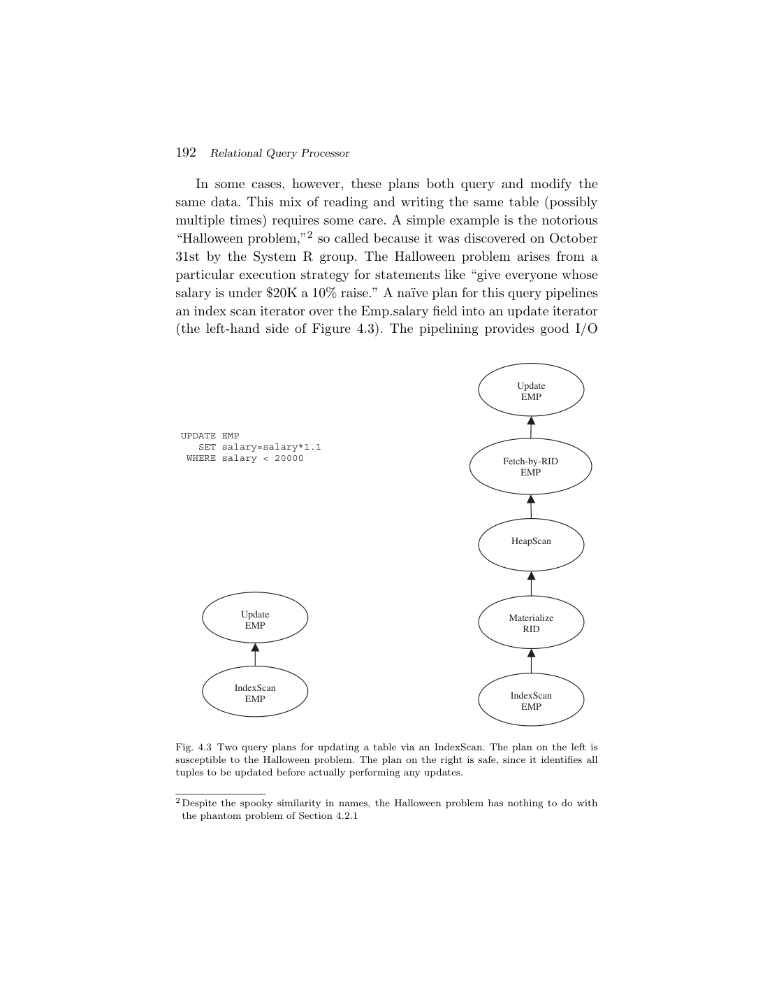
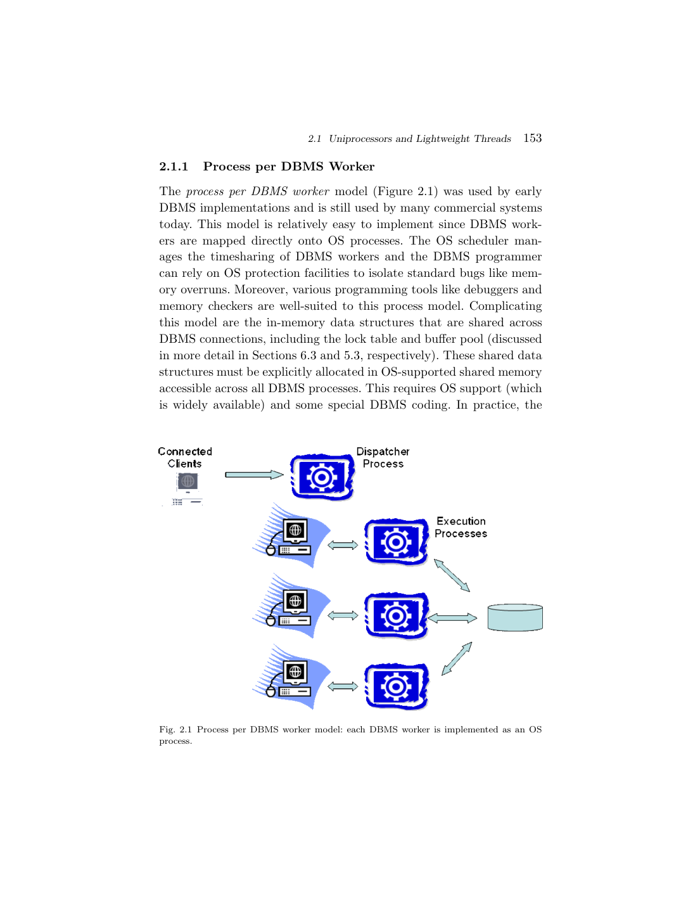

> 本组第 29 篇 · 数据库架构 · [全部论文]() · [上一篇]() · [下一篇]()

这篇综述的核心不是孤立算法清单，而是说明 RDBMS 的控制流、数据流、资源生命周期与恢复协议如何组合。Client Communications Manager 维护协议与连接；Process Manager 安排 worker，但执行准入还依赖优化后的资源估计；查询处理器负责授权、语义重写、物理计划选择和算子执行；Transactional Storage Manager 内部的 access methods、buffer、lock、log 则深度耦合。pin 保护驻留，latch 保护短期内部结构访问，transaction lock 保护事务可见性，三者不能互换。STEAL/NOT-FORCE 把运行路径自由度换为 undo/redo 和正确 WAL 时序的责任；fuzzy checkpoint 与 nested top actions 又有各自边界。第 96 页 WAL/strict-2PL 依赖必须放回作者的持锁 undo 模型，不推广成任意 WAL 系统的唯一组合；MVCC 也不等于零写锁或自动可串行化。产品例子均按 2007 年作者陈述引用，不作为现代版本已核事实。第 72 页 6% 观察与 DB2 1% 转述不是同机新实验。

本文保留论文陈述、读者推断与待验证方案的区别；实验数字只适用于原文条件。原文和翻译来自已有 AI 辅助精读报告，已做来源匹配与编辑复核，不等于人工逐项核验或独立实验复现。所有页码均为 PDF 物理页。

## 论文与阅读范围

Joseph M. Hellerstein, Michael Stonebraker, James Hamilton. Architecture of a Database System. Foundations and Trends in Databases 1(2), 2007, pp.141-259. DOI:10.1561/1900000002。本地 PDF 119 物理页；书目信息取自第 1 页。本文是历史架构综述，不是统一平台产品基准论文。

[论文集中的原始 PDF](https://github.com/lonng/db-papers/blob/4ff1331069c7cf52ac97dd769e5f484c1c35c200/papers/architecture/architecture-of-a-database-system.-foundations-and-trends-in-databases.pdf) · 本地来源：`architecture/architecture-of-a-database-system.-foundations-and-trends-in-databases.pdf`，共 119 页。

本篇保留 26 组原文精读和 109 条证据。截图为原始 PDF 的局部页选，不是重新生成的图表；未将整份 PDF 复制到博客。

## 研究问题与适用边界

本论文旨在解决一个长期存在于数据库文献中的空白：尽管DBMS算法和抽象已是教科书内容，但使DBMS真正运转的系统设计问题（systems design issues）却鲜有系统性覆盖。论文明确假设读者已熟悉教材级数据库系统知识和现代操作系统（UNIX/Linux/Windows）基本设施，这界定了文章不覆盖入门概念，直接讨论系统设计层面的前提条件（C001N02）。

作者将典型RDBMS划分为五个核心组件：Client Communications Manager、Process Manager、Relational Query Processor、Transactional Storage Manager，以及共享组件与工具（catalog、memory manager等）。这是跨层协作的逻辑分区，不是五个组件严格依次执行的调用栈；Process Manager 与共享组件贯穿查询生命周期（C001N03，原图1.1）。

适用边界方面，作者明确声明由于篇幅限制，无法枚举这些拥有数百万行代码、大多超过十年历史的商业和开源系统中的例外情况和细微差别。因此本文提供的是架构主干而非完备的实现细节清单（C001N09）。这意味着报告中提及的机制代表了当时的工程共识，但不排除特定系统在边缘场景下的特殊处理。对于内核工程师而言，理解这一边界有助于区分“通用架构模式”与“特定系统hack”。

逻辑分层并不是将五块画成五个顺序调用的网络服务。图 1.1 的 Process Manager 和 Shared Components 位于侧边，跨越查询生命周期；目录与内存管理器也会反复被调用。图示在物理第 4 页已视觉检查。

依据：论文陈述；PDF 物理页 3, 4。证据：[C001N02](#evidence-c001n02), [C001N03](#evidence-c001n03), [C001N09](#evidence-c001n09)。

## 系统架构与组件交互

DBMS的架构设计围绕计算资源调度、内存共享与I/O流水线展开。Process Manager在收到首个SQL命令后分配计算线程，并将该线程的数据和控制输出连接到communications manager。此阶段最关键的决策是admission control：决定立即处理查询还是推迟到资源充足时执行。这是防止系统过载的核心机制（C001N05）。

Transactional Storage Manager管理所有数据访问与操作，包含磁盘数据组织与访问的access methods（表和索引）、决定磁盘与内存缓冲区之间数据传输时机与内容的buffer management模块，以及保证ACID属性的事务管理代码（lock manager获取锁、log manager保证持久性与回滚）（C001N07）。

查询结果的返回路径体现了组件间的解耦：结果通过逐层unwind stack返回，access methods将控制交还query executor operators，生成的result tuples放入communications manager的缓冲区发回客户端。大结果集时客户端增量fetch，导致communications manager、query executor、storage manager多次迭代。查询结束时transaction manager清理事务状态、process manager释放控制结构、communications manager清理连接状态（C001N08）。

在进程模型层面，论文严格区分了三种执行单元：OS Process（含私有地址空间和安全上下文，由内核调度）、OS Thread/Kernel Thread（无私有地址空间，共享同进程内存，由内核调度）、Lightweight Thread Package（用户态调度，切换无需内核模式转换因而更快，但任何阻塞操作会阻塞整个进程的所有轻量线程，因此必须只使用异步I/O和非阻塞操作）（C001N11）。

跨worker的数据共享依赖buffer pool、log tail和lock table。在thread per worker模型中，buffer pool是堆上数据结构，所有线程可直接访问；在其他模型中则分配在共享内存中。当线程需要从数据库读入页面时，生成包含磁盘地址和buffer pool空闲frame句柄的I/O请求；刷出页面时则指定当前frame和目标磁盘地址（C002N03）。Log tail是事务处理期间生成的日志条目暂存的内存队列，按FIFO顺序定期刷入日志磁盘。提交事务时必须等commit log record刷盘后才能向客户端报告成功，期间需持有锁等资源。可通过group commit批量合并刷盘（C002N04）。

客户端通信缓冲区支持SQL的pull模型：客户端通过反复发送FETCH请求消费游标中的元组。多数DBMS尝试提前于FETCH流预取结果并入队（C002N05）。许多广泛使用的DBMS不依赖操作系统线程，原因包括历史遗留、可移植性和可扩展性。直到1990年代OS线程才被广泛实现，且实现差异大；作者写作时的某些OS线程实现仍无法良好扩展以支撑其讨论的DBMS负载；这不是本报告对当前内核线程的测评（C002N06）。

责任边界图解（源文物理页 4-7、23、36-55、70-99、100-110）：
1. 通信层管理调用者连接状态、身份凭据与数据/控制消息，不负责选择 join 顺序。Process Manager 管 worker 的 dispatch/scheduling 和资源释放；连接数限制与解析优化后的 execution admission 是两层，后者需要估算 sort/hash 内存，不能用连接池大小替代（R02）。
2. Parser/authorization 解析名字和类型、收集权限信息；部分授权必须或适宜延迟到执行时。Rewriter 做保语义的规范化与视图展开，是逻辑边界，不保证独立模块（R05）。Optimizer 搜索物理计划并估算代价/资源；Executor 消费已具体化计划，组织 operators。迭代器的 get_next 同时返回数据与控制（R06）；exchange 可在保持普通 pull API 的同时封装并行 push（R07）。
3. Access method 管 heap/index 访问结构，接受 SARG，按页过滤以减少 CPU 交互（R08），不是只提供一个无事务语义的文件读取器。它还必须知道何时申请锁、闩和生成恢复日志。Buffer manager 管 page-to-frame 映射、dirty/pin 元数据、替换与 I/O；不负责 SQL join 语义。Log manager 管持久日志、回滚及崩溃恢复，与 buffer flush 顺序配套（R01、R09-R13）。
4. Lock manager 按事务和逻辑/物理对象名管理兼容性、等待及死锁；latch 是短期内部互斥；pin 是被引用页面不可被替换的生命周期承诺，既不是 latch，也不是事务锁。第 78 页明确四个存储组件深度交织（R01），第 97 页说 buffer 相对可封装仍有 pin 与 WAL 前提，不能据此任意调换 flush 协议。
5. Catalog 本身是表，另缓存为适于 parser/optimizer 的内存对象（R18）；通用 memory allocator 管 optimizer/executor 等 context，与 buffer frame 替换不是同一职责。统计收集、在线重组、备份、复制和 bulk load 是跨子系统服务，仍须保持可见性与恢复契约。
线程/进程映射必须保留原文限定：第 11-12 页的 client-worker 1:1 是简化起点；第 15-16 页 pool 复用 worker，第 22 页查询内并行又让一连接拥有多 worker（R03）。轻量线程需在承载它的内核执行上下文不被阻塞的前提下协作让出，不能把这种限制写成所有单进程天然不能利用多核。
并行分类看共享资源，不看进程数：shared-memory 共享 RAM/盘；shared-nothing 分区本地 RAM/盘但仍有分布式事务协调；shared-disk 共享盘不共享内存，需分布式锁及缓存一致性（R04）；NUMA 则保留共享内存编程抽象但访问成本不均。图 3.1-3.3 只画连接关系，没有性能优劣曲线。

依据：论文陈述；PDF 物理页 5, 6, 7, 9, 10, 17, 18, 19, 22, 23, 28, 31, 39, 49, 50, 54, 75, 78, 83, 84, 89, 91, 93, 96, 97, 100, 101, 102, 103, 104。证据：[C001N05](#evidence-c001n05), [C001N07](#evidence-c001n07), [C001N08](#evidence-c001n08), [C001N11](#evidence-c001n11), [C002N03](#evidence-c002n03), [C002N04](#evidence-c002n04), [C002N05](#evidence-c002n05), [C002N06](#evidence-c002n06), [C003N02](#evidence-c003n02), [C004N01](#evidence-c004n01), [C005N06](#evidence-c005n06), [C008N03](#evidence-c008n03), [C009N08](#evidence-c009n08), [C009N11](#evidence-c009n11), [C009N12](#evidence-c009n12), [R01](#evidence-r01), [R02](#evidence-r02), [R03](#evidence-r03), [R04](#evidence-r04), [R05](#evidence-r05), [R06](#evidence-r06), [R07](#evidence-r07), [R08](#evidence-r08), [R09](#evidence-r09), [R10](#evidence-r10), [R11](#evidence-r11), [R12](#evidence-r12), [R13](#evidence-r13), [R18](#evidence-r18)。

*原论文 PDF 物理页 52，版权归原作者或出版方。点击图片可查看原尺寸。页面文本中定位到：Fig. 4.3 Two query plans for updating a table via an IndexScan. The plan on the left is。这是页面定位信息，不表示本次已复核图内所有数据。*

## 核心算法与机制步骤

本节梳理论文中描述的关键算法与机制。

**重要声明**：本节中标注为“读者构造示例”的段落均为基于原文规则的推演，而非原文复述。原文仅给出规则定义，未提供下述具体数值示例。

**1. 查询重写与语义优化**
查询重写模块的适用边界被严格限定：只能依赖查询本身和catalog中的元数据，不能访问表中的实际数据。大多数重写器操作的是内部表示而非原始SQL文本（C004N01）。视图展开是传统主要职责，递归替换直到查询仅包含表（C004N02）。利用谓词的传递性可以推导出新谓词，增加优化器选择尽早过滤数据的执行计划的能力（C004N04）。
语义优化利用catalog中存储的完整性约束来重写查询，典型例子是冗余连接消除。例如（读者构造示例，非原文内容）：假设有表Emp(emp_id, deptno)和Dept(dept_id, name)，外键约束Emp.deptno引用Dept.dept_id且非空。若查询为`SELECT Emp.emp_id FROM Emp JOIN Dept ON Emp.deptno = Dept.dept_id`，由于未使用Dept的列且外键保证匹配，重写器可将其简化为`SELECT emp_id FROM Emp`。前提条件是被外键约束的列必须非空（C004N05）。

**2. Next-Key Locking 解决幻象问题**
Phantom problem的本质是锁可见性问题：在无表级锁时，其他事务可插入落入查询谓词值域的新元组。Predicate locking代价高昂，因为需要比较任意谓词是否重叠，且无法使用基于hash的lock table实现（C009N02）。
Next-key locking算法规则（原文事实）：插入键k时，必须对index中大于k的最小键所在元组（next-key tuple）获取exclusive lock；读事务也需对不满足查询谓词的最小键元组获取shared lock，以防止在已返回最高键之上插入新元组（C009N03）。
Next-key locking应用示例（读者构造示例，非原文内容）：沿用作者第95页用于解释过度加锁的键值{1, 5, 100}，另构造T1/T2调度。事务T1执行范围扫描`WHERE key BETWEEN 1 AND 10`。T1读取键1和5，满足谓词。T1遇到键100，不满足谓词（>10）。根据算法规则，T1必须对该next-key tuple（键100所在元组）获取shared lock。此时若事务T2尝试插入键8，它需要对大于8的最小键获取exclusive lock。由于T1已持有100的shared lock，T2被阻塞，从而防止了幻象插入。
局限性：原文指出，若扫描key 1到10，但索引列仅存1、5、100，则1到100的整个范围都会被read-locked，这在某些workload下会导致over-locking性能问题（C009N04）。

**3. ARIES 恢复与 Nested Top Actions**
WAL协议由三条规则组成且三者缺一不可：(1)页面修改生成的日志记录必须在数据页刷盘前刷入日志设备；(2)日志记录必须按序刷盘；(3)事务提交请求返回前，commit日志记录必须刷盘。许多人只记住第一条，但三条都是正确性的前提（C008N08）。
恢复起点不必从第一条日志开始，而是取缓冲池中最旧脏页最早修改对应的日志记录与系统中最旧事务的起始日志记录的较旧者，该序号称为recovery LSN，在checkpoint周期性计算（C008N11）。
对于B+树页面分裂等物理结构变更，ARIES通过nested top actions机制处理，使恢复过程能在不编写特殊代码的情况下在UNDO阶段跳过相关物理结构变更的撤销（redo-only），而REDO仍须重放必要的结构修改，因为这些变更在事务中止时无需undo（C008N14）。本文所讨论的right-link恢复方案依赖分裂不因事务回滚而重新合并；这不是对所有树合并算法的普遍禁令（C009N07）。

**4. 内存上下文（Memory Context）**
Memory context是一种内存分配器数据结构，维护一组连续虚拟内存区域的列表。API包括Create、Allocate、Delete chunk、Delete context和Reset。它利用context type的语义知识决定分配粒度，通过一次性删除整个context避免逐个free小对象的OS开销，并提供比GC更精确的空间和时间局部性控制（C009N11）。

**复杂度说明**：论文指出无论Selinger动态规划还是Cascades自顶向下搜索，其运行时间和内存需求在最坏情况下随查询中表的数量呈指数增长（C004N11）。此为论文论证的最坏情况复杂度。

执行路径补充：第 49-50 页的串行 iterator 利用函数调用栈传递 tuple descriptor 与控制；第 50-51 页 BP-tuple 的 page 必须保持 pinned，M-tuple 则把内容拷出后可尽早 unpin。第 52 页图 4.3 的 RID materialization 先固定要更新的记录再取行更新，解决同一语句重读已右移索引项的 Halloween 问题；它不是用于解决另一事务插入新行的 phantom。第 54 页 SARG 将不命中记录的过滤留在访问方法内部（R08），不能据此把整个 SQL 执行器塞入存储层。
存储恢复步骤补充：DIRECT STEAL/NOT-FORCE 使未提交修改可先落数据页，故回滚必须能 undo；已提交数据页可尚未落盘，故崩溃必须能 redo（R10）。提交确认依赖持久 commit log，不要求所有数据页 force。fuzzy checkpoint 不同步写尽全部脏页（R11）；第 90 页 recovery LSN 是本文概述的安全起点说明，不足以代替完整 ARIES 的 analysis/redo/undo 数据结构与算法规格。
物化视图补充：第 59-60 页分别提出选择物化对象、刷新维护、查询重写使用三个任务（R17）；宽表少列访问的列存利益与位置对应/重建成本见第 62 页，不能把这些讨论扩成本文已完成的 IVM 或 HTAP 实验。

依据：论文陈述；PDF 物理页 39, 40, 41, 45, 51, 52, 53, 54, 59, 62, 75, 88, 89, 90, 91, 93, 94, 95, 97, 101, 102, 103。证据：[C004N01](#evidence-c004n01), [C004N02](#evidence-c004n02), [C004N04](#evidence-c004n04), [C004N05](#evidence-c004n05), [C004N11](#evidence-c004n11), [C005N02](#evidence-c005n02), [C005N04](#evidence-c005n04), [C005N06](#evidence-c005n06), [C006N02](#evidence-c006n02), [C008N08](#evidence-c008n08), [C008N11](#evidence-c008n11), [C008N14](#evidence-c008n14), [C009N02](#evidence-c009n02), [C009N03](#evidence-c009n03), [C009N04](#evidence-c009n04), [C009N07](#evidence-c009n07), [C009N11](#evidence-c009n11), [R08](#evidence-r08), [R09](#evidence-r09), [R10](#evidence-r10), [R11](#evidence-r11), [R12](#evidence-r12), [R17](#evidence-r17)。

## 正确性保证与前提假设

DBMS的正确性建立在多个相互依赖的协议与假设之上，内核工程师必须明确这些前提的边界。

**ACID的非公理化本质**：ACID术语由Haerder和Reuter提出，但文中明确指出这些术语未被形式化定义，也不是组合起来保证事务一致性的数学公理。在作者重点讨论的锁实现中，Isolation通过锁协议实现，Durability通过日志与恢复实现，Consistency由查询执行器运行时检查SQL完整性约束来管理（违反则中止事务）（C007N10）。

**作者所述恢复模型中的WAL/Strict 2PL依赖**：WAL隐式假设使用strict two-phase locking (S2PL)。前提模型：在非strict 2PL下，事务若在abort前释放了锁，rollback时recovery code处理log records并undo修改时，可能无法重新获取所需page/tuple上的锁来完成回滚。这是作者在原地更新、以受锁保护对象完成undo的模型中的依赖说明（C009N05、R13），不是任何WAL都只能配strict 2PL的一般定理；源文本身第81、87、98页也讨论MVCC与锁共存。审核不能把这个上下文丢掉。

**闩锁（Latch）与锁（Lock）的正确性边界**：闩锁驻留在被保护资源的内存附近并通过直接寻址访问，而锁存放在通过哈希表定位的锁表中；作者当时给出“几十周期/数百周期”的量级说明，非本报告当前机器的计时，也非所有实现的上界。最关键的正确性区别在于：闩锁死锁必须避免（出现即代表代码bug），而锁死锁允许发生并通过事务重启解决；闩锁不被跟踪，异常时需手动清理（C008N03）。

**隔离级别的语义鸿沟**：REPEATABLE READ隔离级别并不等价于可串行化。System R项目早期发现的“幻象问题”表明：元组粒度的两阶段锁无法阻止新元组插入，导致同一事务内用相同谓词重复访问关系时会看到首次访问时不存在的“幻象”元组（C008N04）。CURSOR STABILITY旨在解决READ COMMITTED下的丢失更新问题，通过持有最近读取项的锁并在游标移动时释放来实现（C008N06）。

**MVCC与Snapshot Isolation**：SNAPSHOT ISOLATION依赖MVCC实现，仅当没有其他时间区间重叠的事务写入了本事务也写入的数据时才允许提交（first committer wins）。这与Oracle的READ CONSISTENCY（first writer wins）形成对比（C008N07）。

**Buffer Management的封装代价**：Buffer management相对隔离于storage manager其余组件。只要pages被正确pinned，buffer manager可自由封装其替换策略（STEAL属性）和flush调度（NOT FORCE属性）。但这种隔离正是导致并发与恢复复杂性的直接原因（C009N08）。

MVCC 的精确边界：原文第 81 页先简化说“不持锁”，随后限定为无需读锁且通常与 2PL 并存（R14）；第 87 页 READ CONSISTENCY 仍有长写锁，并区分语句开始快照与事务开始快照（R15）。因此快照稳定、写写冲突处理与可串行化是不同承诺。第 85-86 页的 REPEATABLE READ 讨论是本文锁实现及其 SQL 隔离级别语义批评，不可未经核查套用到每个现代同名产品级别。
WAL 与持久介质契约：第 88-89 页三条规则是先日志后数据、持久有序日志前缀、持久提交记录后再确认；buffer replacement 的自由度不包含违反这些时序。第 73-74 页强调 OS buffer 的重排/延迟与 double buffering，但本文列举 mmap/DIO/CIO 不能当作任意当前文件系统或设备已经正确提供 durable flush 的独立证据。
恢复与索引不变量：结构分裂不随用户事务 undo，并非所有日志都可跳过，更不是可忽略结构崩溃一致性（R12）。第 91 页还指出 rollback 自身需要日志空间，故日志耗尽时必须预留撤销资源；checkpoint 也不等于全量备份或复制确认。

依据：论文陈述；PDF 物理页 75, 79, 80, 81, 82, 83, 84, 85, 86, 87, 88, 89, 91, 93, 94, 96, 97。证据：[C007N10](#evidence-c007n10), [C007N11](#evidence-c007n11), [C007N12](#evidence-c007n12), [C008N03](#evidence-c008n03), [C008N04](#evidence-c008n04), [C008N06](#evidence-c008n06), [C008N07](#evidence-c008n07), [C008N08](#evidence-c008n08), [C009N02](#evidence-c009n02), [C009N05](#evidence-c009n05), [C009N08](#evidence-c009n08), [R09](#evidence-r09), [R10](#evidence-r10), [R11](#evidence-r11), [R12](#evidence-r12), [R13](#evidence-r13), [R14](#evidence-r14), [R15](#evidence-r15)。

## 实验评估与实证数据

作为一篇架构综述，本文的实验数据多为定性观察或特定环境下的孤立数据点，缺乏系统性基准测试。内核工程师在引用这些数据时必须注意其缺失的上下文。

**进程模型的工业部署统计**：IBM DB2支持四种进程模型（thread per worker、thread pool、process per worker、process pool）；Oracle默认process per worker可选process pool；PostgreSQL在所有支持的OS上仅使用process per worker；Microsoft SQL Server默认worker多路复用到线程池，超过99%的安装以此运行（C002N08）。此为作者当时的部署描述，未由本报告独立核查，不是性能对比实验。

**Raw Device vs File System I/O**：在一台中型系统上使用某主流商业DBMS运行TPC-C基准测试，大文件访问相对于direct raw access约有6%的性能退化；在I/O密集型较低的工作负载上几乎没有负面影响。DB2报告使用Direct I/O (DIO) 及其变体Concurrent I/O (CIO) 时文件系统开销低至1%。因此厂商通常不再推荐raw storage（C007N01）。
*缺失信息*：未给出具体硬件配置（CPU型号、磁盘类型、RAM大小）、TPC-C的scale factor、具体DBMS名称及版本号。不能得出的结论：不能据此推断所有现代NVMe SSD环境下文件系统开销同样低于6%。

**Bulk Loader性能断言**：文中称bulk loader比SQL insert快一个数量级。必须强调，原文使用了“in round numbers”这一限定语，表明这是一个粗略的经验估计（order of magnitude estimate），不是本文给出完整测量方法的精确实验数据点。不应将其作为工程优化的定量目标（C005N11）。
*缺失信息*：未给出具体基准测试环境、数据量、吞吐量数字或对比的SQL insert模式（单条vs批量）。不能得出的结论：不能在未经测试的情况下假定特定系统的bulk load必然达到10倍加速。

**Thrashing与Admission Control**：良好的准入控制策略使系统在过载时优雅降级：事务延迟随到达率成比例增加，但吞吐量保持在峰值（C002N10）。此为理论行为描述，未附带具体压测曲线。

**磁盘带宽趋势**：磁盘顺序带宽比随机访问快10到100倍，且该比率正在增大。磁盘密度每18个月翻倍，带宽约随密度的平方根增长，而磁盘臂移动每年仅改善约7%（C006N11）。此为2007年的硬件物理前提，不适用于现代全闪存阵列。

**近似聚合的市场采用**：Oracle和DB2仅提供简单的基表采样技术，不提供涉及多表查询的统计稳健估计。厂商转而丰富OLAP特性（C006N10）。此为作者在2007年的功能现状陈述，非当前产品事实核查或实验评估。

证据分级：第 72 页第一组 6% 是作者未具名商业系统的有限观察；紧接着的 DB2 1% 是另一个来源陈述，不能拼接成 DB2 在同一机器胜出的表格。第 58 页 bulk load 的数量级和第 65 页全文搜索差距分别是粗略经验与 common belief；第 84 页 latch/lock 周期量级同样不是本次测量。本地没有运行 TPC-C、TPC-H、产品比较、故障注入或源码级实现验证。本文没有提供足以复现这些数值的统一配置、重复次数或误差条；也不能因此否认原文确实含那条有限 6% 观察。
第 70 页磁盘顺序/随机带宽关系与第 32 页 NUMA 阈值均保留历史硬件背景。图 4.1 是物理计划、图 4.2 是接口伪代码、图 4.3 是正确性示意，均不是实测性能图。

依据：论文陈述；PDF 物理页 20, 21, 22, 23, 49, 50, 58, 59, 61, 65, 68, 70, 72, 83, 84。证据：[C002N08](#evidence-c002n08), [C002N10](#evidence-c002n10), [C005N11](#evidence-c005n11), [C006N01](#evidence-c006n01), [C006N07](#evidence-c006n07), [C006N10](#evidence-c006n10), [C006N11](#evidence-c006n11), [C007N01](#evidence-c007n01), [C008N03](#evidence-c008n03), [R06](#evidence-r06), [R07](#evidence-r07)。

*原论文 PDF 物理页 13，版权归原作者或出版方。点击图片可查看原尺寸。页面文本中定位到：Fig. 2.1 Process per DBMS worker model: each DBMS worker is implemented as an OS。这是页面定位信息，不表示本次已复核图内所有数据。*

## 架构权衡与设计取舍

DBMS内核设计充满了相互制约的权衡，本文详细剖析了多个关键维度的取舍。

**进程模型的扩展性与隔离性**：Process per DBMS Worker模型优势在于实现简单、利用OS保护隔离内存越界bug、兼容调试工具。代价是跨连接共享数据结构（lock table、buffer pool）必须显式分配在OS共享内存中，削弱了地址空间隔离的优势。且在扩展到大量并发连接时表现不佳，因为进程比线程携带更多状态，消耗更多内存，切换开销更大（C001N13, C001N14）。

**轻量级线程的多核利用率**：对第32-33页承接第10页的单一内核执行上下文用户态LWT模型，一次只能使用一个处理器；单个多OS线程进程不受此结论限制。为解决负载不均，DBMS必须实现进程间的线程迁移（thread migration），但并非所有使用该模型的系统都实现了这一点（C002N09, C003N07）。经验法则是每个物理处理器对应一个OS进程（C003N07）。

**Tuple存储：BP-tuple vs M-tuple**：驻留在buffer pool页面中的BP-tuple和在堆上分配的M-tuple各有优劣。全用M-tuple可简化代码并避免buffer leak，但内存拷贝成为性能瓶颈；全用BP-tuple则长时间引用会占用整个页面并束缚替换策略。最高效的方案是descriptor同时支持引用两者（C005N02）。

**二级索引的物理RID与主键**：物理RID查找快，但行移动时需更新所有二级索引，代价极高。DB2使用forwarding pointer避免更新索引但增加一次I/O；作者在B+树作为基表存储的讨论中描述SQL Server/Oracle以主键而非物理RID引用的办法；不可扩成这些产品所有表组织与索引的唯一形式。Oracle甚至同时保留两者，并允许heap文件中行跨页存储以避免行移动（C005N08, C005N09）。

**Shared-Nothing的协调代价**：简单的水平分区无法解决所有DBMS问题。事务完成、负载均衡和部分维护任务需要显式的跨处理器协调（如分布式死锁检测和两阶段提交）。如果实现不当，这些额外逻辑会成为性能瓶颈（C003N02）。部分故障处理面临可用性与结果完备性的权衡，best-effort结果缺乏明确定义的语义（C003N03）。

**计划缓存与重编译哲学**：IBM倾向于提供跨调用的可预测性能，除非计划无法执行否则不重新优化，适应熟练DBA；Microsoft则更积极地重新优化，追求自调优以适应低端市场客户（C004N14）。查询预编译假设变量取“典型”值，若不具代表性会导致极差计划（C004N13）。

**安全检查的时机**：将部分安全验证延迟到执行阶段，使得查询计划可以在用户间共享且在安全策略变更时无需重新编译。这是一种为了计划缓存复用率而牺牲部分编译期静态验证能力的架构假设（注：“剪枝能力”一词为读者的类比推断，原文并未使用“pruning”来描述安全检查的编译期行为）（C003N12）。

**内存分配哲学**：DB2 for zSeries允许DBA静态控制RAM用量，性能稳定但需手动平衡；MS SQL Server自动管理，算子直接从buffer pool获取内存，可自适应改变负载（C009N12）。

历史设计哲学应加双重限定：第 47-48、103-104 页的 IBM 可预测性与 Microsoft 自调优，是作者对特定产品线/客户历史的解释，且第 48 页自己强调双方客户群与策略正在趋同；不是厂商永久性格或今天的选择建议。Raw device 的空间控制收益还被 RAID/SAN 虚拟化稀释（第 71、105-106 页），与时间控制和 durable flush 是不同轴。

依据：论文陈述；PDF 物理页 13, 14, 21, 22, 28, 29, 32, 33, 38, 47, 48, 51, 55, 71, 103, 104。证据：[C001N13](#evidence-c001n13), [C001N14](#evidence-c001n14), [C002N09](#evidence-c002n09), [C003N02](#evidence-c003n02), [C003N03](#evidence-c003n03), [C003N07](#evidence-c003n07), [C003N12](#evidence-c003n12), [C004N13](#evidence-c004n13), [C004N14](#evidence-c004n14), [C005N02](#evidence-c005n02), [C005N08](#evidence-c005n08), [C005N09](#evidence-c005n09), [C006N12](#evidence-c006n12), [C009N12](#evidence-c009n12), [R03](#evidence-r03)。

## 系统对比与相关技术联系

比较对象与证据边界：以下只报告作者2007年前后的系统例子，不把历史名称、默认配置、市场占比或功能覆盖写成今天已核事实。未访问当前产品文档或源码，未做统一机器测试。
进程模型：DB2 产品/OS 支持多个模型；Oracle 以每worker进程为默认、可选pool；PostgreSQL用每worker进程；SQL Server默认worker复用线程池。这些是作者部署描述（C002N08）。第21页只说Sybase与Informix支持DBMS线程在OS进程上的调度，并明确不是全部实现都支持迁移；第33页具体肯定Informix 6.0，不能补成两者都已证明支持迁移（C002N09、C003N07、R03）。
并行系统：第28页shared-nothing将本地访问/锁/日志分配给数据所属节点，但分布式死锁与2PC仍需协调（C003N02）。第30-31页shared-disk免去某些分区管理但引入分布式锁和缓存一致性（R04），不能笼统说共享盘免协调。
优化与执行：第45页对比Selinger DP与Cascades式top-down，作者认为两者均有成功产品，但代价和空间搜索不相同，不能推成任意输入性能相等（C004N11）。第42-43页编译机器码与解释计划的历史反转体现可移植性/工程复杂度，不能据此判定现代JIT永远更差。第49-50页iterator与exchange是两层关系（R06、R07），不是串行和并行的二选一。
事务：第81、87页MVCC/2PL共存，语句快照与事务快照不同；第92-93页比较latch-coupling与right-link，各自依赖结构和恢复规则（R14、R15、C008N13）。不把本文的轻量概述当成每个当前产品的可串行化证明。
复制：第107页physical replication是周期全库复制（R16），第107-108页另外描述日志生成SQL与持续重放两路。源文对SQL Server Log Shipping/Database Mirroring的名称对应未经独立核查，报告不照搬成产品事实；增量、事务一致副本也不自动推出同步确认、零数据丢失或共识协议（C010N05、C010N06、C010N07）。
现代联系仅列为待验证问题：向量化/JIT、HTAP、存算分离、现代SSD持久化接口、Raft/Paxos复制与本地WAL如何配套，需要各自原始文献和实现证据。本文没有阅读StarRocks、DuckDB、Calcite当前源码，因而不声称它们采用何种架构，也不把它们作为已证实对照组。

依据：论文陈述；PDF 物理页 20, 21, 22, 28, 31, 32, 33, 39, 45, 49, 50, 62, 80, 81, 87, 92, 93, 107, 108。证据：[C002N08](#evidence-c002n08), [C002N09](#evidence-c002n09), [C003N02](#evidence-c003n02), [C003N07](#evidence-c003n07), [C004N01](#evidence-c004n01), [C004N11](#evidence-c004n11), [C006N02](#evidence-c006n02), [C007N11](#evidence-c007n11), [C008N07](#evidence-c008n07), [C008N13](#evidence-c008n13), [C010N05](#evidence-c010n05), [C010N06](#evidence-c010n06), [C010N07](#evidence-c010n07), [R03](#evidence-r03), [R04](#evidence-r04), [R06](#evidence-r06), [R07](#evidence-r07), [R14](#evidence-r14), [R15](#evidence-r15), [R16](#evidence-r16)。

## 复现指南与工程验证

工程验证提案，未执行：综述没有可直接运行的统一artifact。下面是读者构造的机制验证计划，不是本次或作者已完成的实验；更不能把新平台测试命名为原文6%结果的精确复现。
1. 调度/准入：在可控测试引擎中分别限制连接数和并发执行内存，构造hash/sort压力，记录吞吐、排队/服务时间、P99、内存、临时I/O、锁等待和拒绝数（C002N10、C002N11、R02）。包含关闭准入的基线、固定资源预算、负载递增/降载、重复试验；吞吐是否保持、长查询是否饥饿均为待测，不把原文理想描述作为必得曲线。
2. tuple生命周期：固定同一计划和结果集合，对比BP引用、M拷贝、混合descriptor，计量CPU、拷贝字节、pin持续时间、buffer驻留与异常清理；用正确性断言/泄漏检测，而非虚构“内存泄漏发生率”（C005N02、R09）。同时测试slow client和异常退出，不预先宣称混合方案总是最快。
3. Halloween/phantom：分别构造同语句更新索引键导致重访，以及并发事务在范围内插入的新行。验证RID materialization与范围保护各自解决对应问题；两者不可互相替代（C005N04、C009N02、C009N03）。沿用作者{1,5,100}稀疏键示例时，只测next-key冲突与额外阻塞，不伪称这些数是新发明（C009N04）。
4. WAL/恢复：仅在可丢弃的隔离测试数据上模拟崩溃，不向真实设备发断电操作。分别设置日志持久化、数据刷页、提交确认边界并重启，检查已确认事务、未提交事务、索引结构和再恢复幂等性（C008N08、R10-R13）。同步checkpoint与fuzzy checkpoint对照应量化停顿/恢复时间；测试nested top actions时区分保留分裂与撤销用户插入。
5. 文件/设备I/O：先确认测试引擎确实支持候选路径；不假定任意现成PostgreSQL/MySQL均有raw-device可切换实现。固定机器、存储、版本、数据/缓存状态、事务规模、持久化语义，分离raw/文件布局、direct/buffered、flush策略这些变量，记录吞吐、延迟、恢复结果与重复分布。不得把原文未给配置的6%/1%当验收阈值（C007N01、C007N03）。
6. 复制与维护：把周期全库copy、日志生成SQL、日志直接重放分别定义，测事务一致性、延迟、落后/断连和恢复，不默认相同RPO或故障模型。在线备份/重组同时施加更新，核对恢复及可见性而不只比较速度（R16、C010N06、C010N07）。
全部所需代码、数据集、配置与环境需另外提供；本报告仅完成来源阅读、解释修订和本地结构/引文校验。

依据：待验证的工程设想；PDF 物理页 22, 23, 51, 52, 53, 72, 73, 75, 83, 88, 89, 91, 93, 94, 95, 96, 107, 108。证据：[C002N10](#evidence-c002n10), [C002N11](#evidence-c002n11), [C005N02](#evidence-c005n02), [C005N04](#evidence-c005n04), [C007N01](#evidence-c007n01), [C007N03](#evidence-c007n03), [C008N01](#evidence-c008n01), [C008N08](#evidence-c008n08), [C009N02](#evidence-c009n02), [C009N03](#evidence-c009n03), [C009N04](#evidence-c009n04), [C010N06](#evidence-c010n06), [C010N07](#evidence-c010n07), [R02](#evidence-r02), [R09](#evidence-r09), [R10](#evidence-r10), [R11](#evidence-r11), [R12](#evidence-r12), [R13](#evidence-r13), [R16](#evidence-r16)。

## 总结与内核工程启示

原文层面的结论：这篇2007年综述将数据库的算法教材与长期工业工程经验连接起来。关系查询处理器和事务存储之间可以有清晰接口，但事务存储内部access methods、lock、log和buffer并非自由插拔（R01、R08-R13）。资源管理也不是附属问题：worker映射、执行准入、tuple驻留、通用memory context和在线维护一起决定系统行为。
读者推断：重构组件时，应先列出外部承诺和跨层不变量：哪个实体拥有连接/任务/快照/页引用；锁何时释放；latch异常时如何清理；pin结束后descriptor是否仍被引用；数据页和日志何时真正持久；结构变化哪些需要redo、哪些不应被undo。它们比把图1.1机械拆成五个服务更有工程价值，但这是一种基于本文的评审方法，不是作者完成的新形式化证明。
历史与现代边界：OS线程/文件系统限制、厂商客户群、MyISAM默认、SQL Server占比、NUMA阈值、盘臂和bulk-load数量级都保留作者时间背景。未核现代产品事实应写成问题，不宜用2007综述证明2026实现。尤其不能把共识日志简单称为“替代WAL”：跨副本一致性与本地崩溃恢复的契约必须分别查证，本报告未建立替代关系。
完成范围与方法：已实读SHA匹配extracted物理1-119页，15段连续7-8页阅读，含致谢/参考文献；已视觉看过4、13、14、16、26、27、30、43、49、52页全部编号图，其余页面仅文本阅读。没有联网查产品、跑性能/故障实验或独立证明ARIES。本次产物为已有API报告的Codex来源编辑版，API模型与usage保留，编辑token用量未知。严格引文匹配和schema通过只说明可追溯性/结构有效，不自动证明所有解释正确；最终仍保持generated_needs_review，供父流程正式登记和人工复核。

依据：读者推断；PDF 物理页 54, 62, 70, 74, 75, 78, 89, 91, 93, 96, 97, 101, 102, 103, 105, 106。证据：[C006N02](#evidence-c006n02), [C006N11](#evidence-c006n11), [C007N06](#evidence-c007n06), [C009N07](#evidence-c009n07), [C009N08](#evidence-c009n08), [C009N11](#evidence-c009n11), [C010N01](#evidence-c010n01), [C010N02](#evidence-c010n02), [C010N03](#evidence-c010n03), [R01](#evidence-r01), [R08](#evidence-r08), [R09](#evidence-r09), [R10](#evidence-r10), [R11](#evidence-r11), [R12](#evidence-r12), [R13](#evidence-r13)。

## 原文精读：从句子回到机制

以下保留原文、忠实翻译、含义与边界；假设示例不作为论文实验结果。

### P001 · PDF 物理页 3

**原文**

<blockquote class="paper-source-quote"><pre><code>Our goal here is to focus on overall system design and stress issues&#10;not typically discussed in textbooks, providing useful context for more&#10;widely known algorithms and concepts. We assume that the reader&#10;is familiar with textbook database systems material (e.g., [72] or [83])&#10;and with the basic facilities of modern operating systems such as UNIX,&#10;Linux, or Windows. After introducing the high-level architecture of a&#10;DBMS in the next section, we provide a number of references to back-&#10;ground reading on each of the components in Section 1.2.</code></pre></blockquote>

**忠实翻译**

> 我们的目标是聚焦整体系统设计，并着重讨论教材通常不涉及的问题，为广为人知的算法和概念提供背景。我们假设读者熟悉数据库教材材料与UNIX、Linux或Windows等现代操作系统的基本设施。在下一节介绍DBMS高层架构之后，我们在第1.2节提供了各组件背景阅读的一些参考文献。译注：末句的章节指向是原文说法，具体定位需对照实际标题。

**技术含义与边界**

> stress是动词“强调”，不是压力测试。作者提供系统架构上下文，预设教材和OS基础；不是只讨论系统负载压力。

**常见误读**

> 不能把stress issues译成“压力问题”，也不能据这段说本文提供了压力测试数据。

**读者构造的假设示例**

> 读者构造的假设示例：一名已学过《Database System Concepts》的工程师阅读此文以了解生产环境中 buffer pool 在高并发下的争用问题，这符合原文设定的读者画像。

### P002 · PDF 物理页 119

**原文**

<blockquote class="paper-source-quote"><pre><code>Zdonik, “C-store: A column oriented dbms,” in Proceedings of the Con-&#10;ference on Very Large Databases (VLDB), 2005.&#10;[90] M. Stonebraker and U. Cetintemel, “One size fits all: An idea whose time&#10;has come and gone,” in Proceedings of the International Conference on Data&#10;Engineering (ICDE), 2005.&#10;[91] Transaction Processing Performance Council 2006.</code></pre></blockquote>

**忠实翻译**

> Zdonik，“C-store: A column oriented dbms,”载于 Proceedings of the Conference on Very Large Databases (VLDB), 2005。
> [90] M. Stonebraker and U. Cetintemel，“One size fits all: An idea whose time has come and gone,”载于 Proceedings of the International Conference on Data Engineering (ICDE), 2005。
> [91] Transaction Processing Performance Council 2006.

**技术含义与边界**

> 这里只是跨页截取的参考文献末尾与条目[90]、[91]起始，不能从作者名残片重建完整作者列表。全文第62页另有列存讨论；书目自身不是机制或实验的直接证据。

**常见误读**

> 容易将这些引文标题直接等同于本文作者的观点或实验结论。原文仅为参考文献条目，不包含任何技术论证、数据或作者的直接陈述，不能从中推断出本文的具体立场。

**读者构造的假设示例**

> 读者构造的假设示例：评审报告先用第62页正文支持列存的宽表少列访问条件，再把[89]当后续阅读入口；不从论文标题推导性能倍率。

### P003 · PDF 物理页 61

**原文**

<blockquote class="paper-source-quote"><pre><code>Similar hierarchies&#10;are typical for attributes involving time (months/days/years), man-&#10;agement hierarchies, and so on. In these cases, a multi-level star, or&#10;snowflake schema results.&#10;Essentially all data warehouse queries entail filtering one or more&#10;dimensions in a snowflake schema on some attributes in these tables,&#10;then joining the result to the central fact table, grouping by some&#10;attributes in the fact table or a dimension table, and then comput-&#10;ing an SQL aggregate.</code></pre></blockquote>

**忠实翻译**

> 类似的层次结构对于涉及时间（月/日/年）、管理层次结构等的属性是典型的。在这些情况下，会产生多层次的星型或雪花模式（snowflake schema）。
> 基本上所有的数据仓库查询都需要在雪花模式中的一个或多个维度上对这些表中的某些属性进行过滤，然后将结果与中心事实表连接，按事实表或维度表中的某些属性进行分组，然后计算一个 SQL 聚合。

**技术含义与边界**

> 原文陈述了数据仓库中雪花模式的成因（属性的自然层次结构）以及数据仓库查询的典型执行模式：过滤维度 -> 连接事实表 -> 分组 -> 聚合。适用边界限定于“数据仓库查询”，不涵盖 OLTP 或其他类型的查询。

**常见误读**

> 容易将“Essentially all data warehouse queries”泛化为所有数据库查询的通用模式。原文明确限定了这是数据仓库查询的特征，OLTP 查询通常是点查或短事务，不涉及这种多维度的过滤-连接-聚合流水线。

**读者构造的假设示例**

> 读者构造的假设示例：在一个零售数据仓库中，查询“2023年各省份的总销售额”，会先在时间维度过滤2023年，在地域维度获取省份信息，连接销售事实表，按省份分组并计算 SUM(sales)。这符合原文描述的查询模式。

### P004 · PDF 物理页 90

**原文**

<blockquote class="paper-source-quote"><pre><code>This can&#10;severely degrade performance during transaction abort and database&#10;recovery.2 In practice, a mixture of physical and logical logging (so-&#10;called “physiological” logging) is used. In ARIES, physical logging is&#10;generally used to support REDO, and logical logging is used to support&#10;UNDO. This is part of the ARIES rule of “repeating history” during&#10;recovery to reach the crash state, and then rolling back transactions&#10;from that point.</code></pre></blockquote>

**忠实翻译**

> 这在事务中止和数据库恢复期间可能会严重降低性能。在实践中，使用物理日志和逻辑日志的混合（所谓的“生理”日志记录，physiological logging）。在 ARIES 中，物理日志记录通常用于支持 REDO，而逻辑日志记录用于支持 UNDO。这是 ARIES 在恢复期间“重复历史”规则的一部分，以达到崩溃状态，然后从该点回滚事务。

**技术含义与边界**

> 作者概述physiological logging与ARIES通常的REDO/UNDO分工，以及先重复历史再撤销未完成事务的思路。这不是完整ARIES规格，generally不能删掉；索引结构变更又有第93页nested top actions的特殊处理。

**常见误读**

> 容易误认为 ARIES 在所有情况下都严格区分物理 REDO 和逻辑 UNDO。原文使用了“generally used”（通常用于），表明存在例外情况。此外，不能将“physiological logging”简单理解为物理和逻辑的随意拼接，它特指在页面级别（物理）进行操作级别的日志记录（逻辑）。

**读者构造的假设示例**

> 读者构造的假设示例：一条用户插入引起树页分裂，恢复可能需要redo分裂使结构可搜索，而abort撤销用户插入不必把树重新合并。这个例子只说明结构动作与用户逻辑动作分开，非作者原始实验或完整日志格式。

### P005 · PDF 物理页 28

**原文**

<blockquote class="paper-source-quote"><pre><code>This simple partitioning solution does not handle all issues in the&#10;DBMS. For example, explicit cross-processor coordination must take&#10;place to handle transaction completion, provide load balancing, and&#10;support certain maintenance tasks. For example, the processors must&#10;exchange explicit control messages for issues like distributed deadlock&#10;detection and two-phase commit [30].</code></pre></blockquote>

**忠实翻译**

> 这种简单的分区解决方案并不能处理 DBMS 中的所有问题。例如，必须进行显式的跨处理器协调来处理事务完成、提供负载均衡以及支持某些维护任务。例如，处理器必须交换显式的控制消息来处理诸如分布式死锁检测和两阶段提交 [30] 等问题。

**技术含义与边界**

> 原文陈述了在共享无（shared-nothing）或类似分区架构中，单纯的数据分区不足以解决所有系统问题。跨节点的全局性操作（事务提交、负载均衡、死锁检测、2PC）必须依赖显式的控制消息传递和协调机制。适用边界是针对“simple partitioning solution”的局限性说明。

**常见误读**

> 容易误读为分区架构本身是无效的或不可用的。原文并未否定分区，而是指出分区后仍需额外的协调机制（explicit cross-processor coordination）来处理全局一致性和管理问题。不能将局部协调开销推断为分区方案的整体失败。

**读者构造的假设示例**

> 读者构造的假设示例：在一个按用户 ID 分区的分布式数据库中，一个转账事务涉及两个不同节点上的账户。仅靠分区无法完成此事务，节点间必须通过两阶段提交（2PC）协议交换 prepare 和 commit 消息以确保原子性。此为读者构造的假设示例。

### P006 · PDF 物理页 72

**原文**

<blockquote class="paper-source-quote"><pre><code>212&#10;Storage Management&#10;As a data point, we recently compared direct raw access with large&#10;file access on a mid-sized system using one of the major commercial&#10;DBMSs and found only a 6% degradation when running the TPC-C&#10;benchmark [91], and almost no negative impact on less I/O-intensive&#10;workloads.</code></pre></blockquote>

**忠实翻译**

> 212
> 存储管理
> 作为一个数据点，我们最近在一个中型系统上使用主要商业 DBMS 之一比较了直接原始访问（direct raw access）与大文件访问（large file access），发现在运行 TPC-C 基准测试 [91] 时仅有 6% 的性能下降，而在 I/O 密集度较低的工作负载上几乎没有负面影响。

**技术含义与边界**

> 作者称某未具名商业DBMS在中型系统上，大文件相对raw访问的TPC-C性能下降约6%。212是期刊页码，映射物理页72，不是实验编号。未给配置、版本、重复次数和误差。

**常见误读**

> 极易将这 6% 的数字泛化为所有数据库、所有硬件配置下的普遍规律。原文明确限定了前提：“mid-sized system”、“one of the major commercial DBMSs”、“as a data point”。这只是一个孤立的数据点，不能作为放弃裸设备或强制使用文件系统的绝对依据。

**读者构造的假设示例**

> 读者构造的假设示例：团队在自有隔离环境比较相同持久性下的两种访问路径，测出一个差异值；该值需要自己的配置与重复试验支持，不能直接填成作者的6%。

### P007 · PDF 物理页 45

**原文**

<blockquote class="paper-source-quote"><pre><code>If practical success is an indication of quality,&#10;then the choice between top-down search and dynamic pro-&#10;gramming is irrelevant. Each has been shown to work well in&#10;state-of-the-art optimizers, and both still have runtimes and&#10;memory requirements that are, unfortunately, exponential in&#10;the number of tables in a query.&#10;Some systems fall back on heuristic search schemes for&#10;queries with “too many” tables.</code></pre></blockquote>

**忠实翻译**

> 如果实际的成功是质量的标志，那么自顶向下搜索和动态规划之间的选择是无关紧要的。每一种都已被证明在最先进的优化器中运作良好，并且不幸的是，两者的运行时间和内存需求在查询中的表数量上都是指数级的。
> 一些系统在查询包含“过多”表时退回到启发式搜索方案。

**技术含义与边界**

> 原文陈述了查询优化器中两种经典搜索策略（自顶向下搜索与动态规划）的现状：在实际系统中两者均有效，但都无法逃脱随表数量增加而产生的指数级复杂度（时间与空间）。作为应对，当表数量超过阈值时，系统会采用启发式方法。

**常见误读**

> 容易误认为“选择是无关紧要的”意味着两者在任何查询规模下表现完全相同。原文的前提是“If practical success is an indication of quality”，且紧接着指出了它们共同的致命弱点（指数级复杂度）。对于超多表查询，两者的原生形式都会失效，此时必须依赖后文提到的启发式方案。

**读者构造的假设示例**

> 读者构造的假设示例：给两种优化器相同计划空间和成本模型，逐步增加join表数，记录状态数、时间和内存，再检查何时触发搜索预算。这里没有假设测得毫秒数、最优性或固定表数阈值。

### P008 · PDF 物理页 105

**原文**

<blockquote class="paper-source-quote"><pre><code>7.3 Disk Management Subsystems&#10;245&#10;considered bad form, since the OS typically only allowed a few open&#10;file descriptors, and many OS utilities for directory management and&#10;backup did not scale to very large numbers of files. Finally, many early&#10;file systems limited file size to 2 GB. This is clearly an unacceptably&#10;small table limit.</code></pre></blockquote>

**忠实翻译**

> 7.3 磁盘管理子系统
> 245
> 被认为是不好的做法，因为操作系统通常只允许少量的打开文件描述符，而且许多用于目录管理和备份的操作系统实用程序无法扩展到非常大量的文件。最后，许多早期文件系统将文件大小限制为 2 GB。这显然是一个小得无法接受的表限制。

**技术含义与边界**

> 原文陈述了早期数据库系统避免“一表一文件”设计的原因：OS 层面的文件描述符数量限制、OS 工具在海量文件下的扩展性问题，以及早期文件系统 2GB 的单文件大小上限。这些因素迫使 DBMS 实现自己的磁盘管理子系统（如使用少量大文件或裸设备来管理多个表的数据）。页码标注为 PDF 物理页码 105，文本含“245”。

**常见误读**

> 这是作者关于早期OS的历史说明，不是声称当前系统仍普遍限2GB。原文后续也说多数OS文件系统已越过这些限制；不能从本段推出所有现代数据库必须用裸设备。

**读者构造的假设示例**

> 读者构造的假设示例：假设某旧环境的文件大小上限小于目标表大小，设计者可以把一表映射到多文件；限制是示例前提，不是当前操作系统实测结论。

### P009 · PDF 物理页 14

**原文**

<blockquote class="paper-source-quote"><pre><code>154&#10;Process Models&#10;required extensive use of shared memory in this model reduces some of&#10;the advantages of address space separation, given that a good fraction&#10;of “interesting” memory is shared across processes.&#10;In terms of scaling to very large numbers of concurrent connections,&#10;process per DBMS worker is not the most attractive process model. The&#10;scaling issues arise because a process has more state than a thread and&#10;consequently consumes more memory.</code></pre></blockquote>

**忠实翻译**

> 154
> 进程模型
> 在此模型中广泛使用共享内存减少了地址空间分离的一些优势，因为相当一部分“有趣的”内存是在进程之间共享的。
> 就扩展到极大量并发连接而言，每个 DBMS worker 一个 OS 进程并不是最具吸引力的进程模型。扩展问题的出现是因为进程比线程拥有更多的状态，因此消耗更多的内存。

**技术含义与边界**

> 原文陈述了多进程模型（Process-per-worker）的两个缺点：第一，为了共享数据（如 buffer pool）必须大量使用共享内存，削弱了进程隔离带来的安全性/稳定性优势；第二，进程的上下文状态比线程大，导致内存占用高，难以扩展到极高并发连接数。页码标注为 PDF 物理页码 14，文本含“154 Process Models”。

**常见误读**

> 容易将此解读为对多进程模型的全面否定。原文仅指出其在“扩展到极大量并发连接”时“不是最具吸引力的”，并指出了共享内存使用的副作用。对于并发量适中且极度看重故障隔离的场景，多进程模型仍有其价值，原文并未否认这一点。

**读者构造的假设示例**

> 读者构造的假设示例：若连接数为N，每连接额外私有状态为S，则仅这项占用约N*S；池化把活动执行单元数限制为P，但仍需保存连接状态。没有给N、S填入实测内存数字。

### P010 · PDF 物理页 38

**原文**

<blockquote class="paper-source-quote"><pre><code>Even&#10;when authorization could theoretically be statically validated at com-&#10;pilation time, deferring some of this work to query plan execution time&#10;has advantages. Query plans that defer security checking to execution&#10;time can be shared between users and do not require recompilation&#10;when security changes. As a consequence, some portion of security val-&#10;idation is typically deferred to query plan execution.&#10;It is possible to constraint-check constant expressions during compi-&#10;lation as well.</code></pre></blockquote>

**忠实翻译**

> 即使在理论上可以在编译时静态验证授权的情况下，将部分此类工作推迟到查询计划执行时也有优势。将安全检查推迟到执行时的查询计划可以在用户之间共享，并且在安全策略更改时不需要重新编译。因此，通常将安全验证的一部分推迟到查询计划执行时。
> 也可以在编译期间对常量表达式进行约束检查。

**技术含义与边界**

> 原文陈述了数据库查询编译与执行中安全验证时机选择的权衡。将安全检查推迟到运行时（execution time）的核心收益是：生成的查询计划具有通用性，可被不同用户缓存和共享，且在权限变更时无需触发代价高昂的重编译。同时指出常量表达式的约束检查可以在编译期完成。

**常见误读**

> some强调部分检查可延迟；常量表达式的完整性约束检查与权限验证也不应混同。共享计划不意味着可以静默删去用户无权读取的列来改变SELECT语义。

**读者构造的假设示例**

> 读者构造的假设示例：A和B复用同一计划，执行前分别按当前身份重新做所需授权；若B缺少权限则拒绝该次请求。这里不假设通过自动过滤salary列来替代权限错误。

### P011 · PDF 物理页 78

**原文**

<blockquote class="paper-source-quote"><pre><code>1. A lock manager for concurrency control.&#10;2. A log manager for recovery.&#10;3. A buffer pool for staging database I/Os.&#10;4. Access methods for organizing data on disk.</code></pre></blockquote>

**忠实翻译**

> 四部分依次是并发控制的锁管理器、恢复的日志管理器、暂存数据库I/O的缓冲池、组织磁盘数据的访问方法。

**技术含义与边界**

> 这是事务存储内部的责任清单，周边段落明确强调深度交织。

**常见误读**

> 分工不等于每个组件能在不改协议时独立替换。

**读者构造的假设示例**

> 读者构造的假设示例：假设更换索引实现，则需同时核对其锁、闩、日志和页引用调用。此例未执行，不是作者实验。

### P012 · PDF 物理页 23

**原文**

<blockquote class="paper-source-quote"><pre><code>This execution&#10;admission controller runs after the query is parsed and optimized, and&#10;determines whether a query is postponed, begins execution with fewer&#10;resources, or begins execution without additional constraints.</code></pre></blockquote>

**忠实翻译**

> 执行准入在查询解析和优化之后运行，决定推迟执行、以更少资源启动或不增加约束启动。

**技术含义与边界**

> 执行资源判断需要计划信息，与接入连接数限制不同。

**常见误读**

> 不能把查询收到时的一次连接限制写成全系统唯一准入点。

**读者构造的假设示例**

> 读者构造的假设示例：假设连接已建立，但大hash join预算不足，查询仍可排队。此例未执行，不是作者实验。

### P013 · PDF 物理页 22

**原文**

<blockquote class="paper-source-quote"><pre><code>For&#10;the purposes of our discussion in this section, intra-query parallelism is&#10;the temporary assignment of multiple DBMS workers to a single SQL&#10;query. The underlying process model is not impacted by this feature&#10;in any way other than that a single client connection may have more&#10;than a single DBMS worker executing on its behalf.</code></pre></blockquote>

**忠实翻译**

> 本节所说查询内并行是临时给一个SQL查询分配多个worker；一连接可有不止一个worker为其执行。

**技术含义与边界**

> 作者在这里放宽最初client-worker一对一的简化。

**常见误读**

> 不能把第11页的定义永久推广到查询并行执行。

**读者构造的假设示例**

> 读者构造的假设示例：假设同一查询的两个分区由两个worker处理，仍只对应一个客户端请求。此例未执行，不是作者实验。

### P014 · PDF 物理页 31

**原文**

<blockquote class="paper-source-quote"><pre><code>Shared-disk systems depend&#10;upon a distributed lock manager facility, and a cache-coherency pro-&#10;tocol for managing the distributed buffer pools [8]. These are complex&#10;software components, and can be bottlenecks for workloads with sig-&#10;nificant contention.</code></pre></blockquote>

**忠实翻译**

> 共享磁盘依赖分布式锁管理和管理分布式缓冲池的缓存一致性协议；这些复杂组件会在高争用负载下成为瓶颈。

**技术含义与边界**

> 共享持久介质并不自动协调节点私有RAM中的副本。

**常见误读**

> 不能把共享盘说成不需要跨节点协调，也不是作者已测定的固定瓶颈比例。

**读者构造的假设示例**

> 读者构造的假设示例：假设两节点缓存同页，写入方必须按协议使另一方不能继续使用过期副本。此例未执行，不是作者实验。

### P015 · PDF 物理页 39

**原文**

<blockquote class="paper-source-quote"><pre><code>The rewriter in many commercial systems is a logical component&#10;whose actual implementation is in either the later phases of query pars-&#10;ing or the early phases of query optimization. In DB2, for example, the&#10;rewriter is a stand-alone component, whereas in SQL Server the query&#10;rewriting is done as an early phase of the Query Optimizer. Nonethe-&#10;less, it is useful to consider the rewriter separately, even if the explicit&#10;architectural boundary does not exist in all systems.</code></pre></blockquote>

**忠实翻译**

> 重写器在许多商业系统中是逻辑组件，可放在解析后期或优化早期；即使不是显式架构边界，分开考虑仍有用。

**技术含义与边界**

> 原文给DB2和SQL Server作为当时的实现例子，逻辑契约比组件部署形式更稳定。

**常见误读**

> 不能由架构图推导所有产品必须有独立rewriter进程。

**读者构造的假设示例**

> 读者构造的假设示例：假设一个优化器入口先作语义保真的视图展开，也符合逻辑分层。此例未执行，不是作者实验。

### P016 · PDF 物理页 49

**原文**

<blockquote class="paper-source-quote"><pre><code>An important property of iterators is that they couple dataflow with&#10;control flow. The get next() call is a standard procedure call that&#10;returns a tuple reference to the caller via the call stack. Hence a tuple&#10;is returned to a parent in the graph exactly when control is returned.&#10;This implies that only a single DBMS thread is needed to execute an&#10;entire query graph, and queues or rate-matching between iterators are&#10;not needed.</code></pre></blockquote>

**忠实翻译**

> 迭代器把数据流与控制流耦合；get_next调用通过调用栈返回tuple引用，单线程可执行整个图而无需迭代器间队列或速率匹配。

**技术含义与边界**

> 这是同步串行iterator路径的工程便利，后文还有exchange。

**常见误读**

> “只需一个线程”是能力，不是系统永远只能一个线程。

**读者构造的假设示例**

> 读者构造的假设示例：假设上层要一条结果时递归拉取下层，返回结果也同时交还控制权。此例未执行，不是作者实验。

### P017 · PDF 物理页 50

**原文**

<blockquote class="paper-source-quote"><pre><code>Parallelism and network communications can be encapsulated&#10;within special exchange iterators, as described by Graefe [23]; these also&#10;implement network-style “pushing” of data in a manner that is invisible&#10;to the DBMS iterators, which retain a “pull”-style get next() API.</code></pre></blockquote>

**忠实翻译**

> 并行和网络通信可封装在exchange迭代器内，内部按网络方式push数据，普通迭代器仍保留pull式get_next接口。

**技术含义与边界**

> 并行边界是特殊operator的职责，不必让所有operator直接管理网络。

**常见误读**

> 不能把普通pull API和整个系统的数据传输方向混为一谈。

**读者构造的假设示例**

> 读者构造的假设示例：假设两个分区producer向exchange队列送tuple，消费方仍调用get_next。此例未执行，不是作者实验。

### P018 · PDF 物理页 54

**原文**

<blockquote class="paper-source-quote"><pre><code>By contrast, if all this logic&#10;is done in the access method layer, the repeated pairs of call/return and&#10;either pin/unpin or copy/delete can be avoided by testing the SARGs&#10;a page at a time, and only returning from a get next() call for a&#10;tuple that satisfies the SARG. SARGS keep a nice clean architectural&#10;boundary between the storage engine and the relational engine while&#10;obtaining excellent performance.</code></pre></blockquote>

**忠实翻译**

> 若把逻辑放入访问方法层，可按页测试SARG，仅对满足条件的tuple返回，避免反复调用与pin/unpin或copy/delete，保持清晰的存储和关系引擎边界。

**技术含义与边界**

> 下推的是有约定的筛选，节省的是逐失败候选的接口成本。

**常见误读**

> 不应称为本文证明的现代SIMD/vectorized执行，也不意味着任意SQL皆可下推。

**读者构造的假设示例**

> 读者构造的假设示例：假设一页多数行不满足范围条件，访问方法可在内部跳过再返回首个匹配行。此例未执行，不是作者实验。

### P019 · PDF 物理页 75

**原文**

<blockquote class="paper-source-quote"><pre><code>The metadata includes a dirty&#10;bit to indicate whether the page has changed since it was read from disk,&#10;and any information needed by the page replacement policy to choose&#10;pages to evict when the buffer pool is full. Most systems also include&#10;a pin count to signal that the page is not eligible for participation in&#10;the page-replacement algorithm. When the pin count is non-zero, the&#10;page is “pinned” in memory and will not be forced to disk or stolen.</code></pre></blockquote>

**忠实翻译**

> 页元数据含dirty bit、替换策略信息及pin count；非零pin count使该页不参与替换，保持驻留。

**技术含义与边界**

> 引用有效期、是否修改与内容并发访问是三个不同维度。

**常见误读**

> pin不等于锁住逻辑行，也不能代替读写latch。

**读者构造的假设示例**

> 读者构造的假设示例：假设descriptor还引用BP-tuple所在页，即使暂不访问也须保留pin或先拷出tuple。此例未执行，不是作者实验。

### P020 · PDF 物理页 89

**原文**

<blockquote class="paper-source-quote"><pre><code>In order to maximize the speed of the fast path, most commer-&#10;cial database systems operate in a mode that Haerder and Reuter call&#10;“DIRECT, STEAL/NOT-FORCE” [34]: (a) data objects are updated&#10;in place, (b) unpinned buffer pool frames can be “stolen” (and the mod-&#10;ified data pages written back to disk) even if they contain uncommitted&#10;data, and (c) buffer pool pages need not be “forced” (flushed) to the&#10;database before a commit request returns to the user. These policies&#10;keep the data in the location chosen by the DBA, and they give the&#10;buffer manager and disk scheduler full latitude to decide on memory&#10;management and I/O policies without consideration for transactional&#10;correctness.</code></pre></blockquote>

**忠实翻译**

> 多数商业系统在作者的概述中采用原地更新、STEAL/NOT-FORCE：未提交页可被淘汰，提交前不必强制数据页落盘。

**技术含义与边界**

> 这使buffer策略有自由度，但把undo/redo义务交给恢复协议。

**常见误读**

> “不考虑事务正确性”不是允许无日志乱写；前文WAL约束仍在。

**读者构造的假设示例**

> 读者构造的假设示例：假设未提交脏页先落盘后事务中止，恢复层仍须正确撤销。此例未执行，不是作者实验。

### P021 · PDF 物理页 91

**原文**

<blockquote class="paper-source-quote"><pre><code>During an ARIES fuzzy checkpoint,&#10;the recovery LSN is computed but no buffer pool pages need to be syn-&#10;chronously written out. A separate policy is used to determine when&#10;to asynchronously write out old dirty buffer pool pages.</code></pre></blockquote>

**忠实翻译**

> ARIES模糊检查点计算恢复LSN但不要求同步写出缓冲池页，另有策略异步写出旧脏页。

**技术含义与边界**

> 检查点记录恢复信息与刷出数据页是可分离的活动。

**常见误读**

> 不能把fuzzy checkpoint说成没有持久化责任，或等于完成数据库备份。

**读者构造的假设示例**

> 读者构造的假设示例：假设检查点时仍有脏页，重启通过日志分析和重做处理它们。此例未执行，不是作者实验。

### P022 · PDF 物理页 93

**原文**

<blockquote class="paper-source-quote"><pre><code>The main idea is&#10;that structural index changes need not be undone when the associated&#10;transaction is aborted; such changes can often have no effect on the&#10;database tuples seen by other transactions. For example, if a B+-tree&#10;page is split during an inserting transaction that subsequently aborts,&#10;there is no pressing need to undo the split during the abort processing.</code></pre></blockquote>

**忠实翻译**

> 结构索引变更可在事务中止时不撤销；例如插入事务造成页分裂后中止，不急于撤销分裂。

**技术含义与边界**

> 前提是结构改变不影响其他事务可见的逻辑tuple语义。

**常见误读**

> 不撤销分裂不是不redo分裂，也不是任意结构状态都安全。

**读者构造的假设示例**

> 读者构造的假设示例：假设新键最终被撤销，而已经分开的两页保留为合法树结构。此例未执行，不是作者实验。

### P023 · PDF 物理页 96

**原文**

<blockquote class="paper-source-quote"><pre><code>One manifestation&#10;of the relationship between concurrency and recovery is that write-&#10;ahead logging makes implicit assumptions about the locking proto-&#10;col. Write-ahead logging requires strict two-phase locking, and will not&#10;operate correctly with non-strict two-phase locking. To see this, con-&#10;sider what happens during the rollback of an aborted transaction. The&#10;recovery code begins processing the log records of the aborted transac-&#10;tion, undoing its modifications. Typically this requires changing pages&#10;or tuples that the transaction previously modified. In order to make&#10;these changes, the transaction needs to have locks on those pages or&#10;tuples. In a non-strict 2PL scheme, if the transaction drops any locks&#10;before aborting, it may be unable to re-acquire the locks it needs to&#10;complete the rollback process.</code></pre></blockquote>

**忠实翻译**

> 作者说WAL隐含锁协议假设：在非strict 2PL中若事务提前放锁，abort时undo需要改原对象，可能拿不回完成回滚所需的锁。

**技术含义与边界**

> 这是本节所述原地更新、以锁保护undo的组合依赖；本段没有形式化覆盖其他所有日志/并发设计。

**常见误读**

> 不能删去回滚对象保护的上下文后宣布任何WAL只能采用strict 2PL。

**读者构造的假设示例**

> 读者构造的假设示例：假设事务放锁后另一事务占有对象，原事务回滚就面临重获锁的问题；另一恢复模型需另证。此例未执行，不是作者实验。

### P024 · PDF 物理页 87

**原文**

<blockquote class="paper-source-quote"><pre><code>each SQL statement (of which there may be&#10;many in a single transaction) sees the most recently committed&#10;values as of the start of the statement. For statements that&#10;fetch from cursors, the cursor set is based on the values as&#10;of the time it is opened.</code></pre></blockquote>

**忠实翻译**

> 一个事务可含多个SQL语句，每条语句看到其开始时最近已提交值；游标集合按打开时的值确定。

**技术含义与边界**

> 本文READ CONSISTENCY按语句定视图，不等于整事务始终同一快照。

**常见误读**

> 不能把游标打开时间、语句开始时间和事务开始时间当成同一时间点。

**读者构造的假设示例**

> 读者构造的假设示例：假设两条语句之间另一事务提交，则后一句可能看到新值；这是示例推演。此例未执行，不是作者实验。

### P025 · PDF 物理页 107

**原文**

<blockquote class="paper-source-quote"><pre><code>1. Physical Replication: The simplest scheme is to physically&#10;duplicate the entire database every replication period.</code></pre></blockquote>

**忠实翻译**

> 物理复制：最简单方案是在每个复制周期复制整个数据库。

**技术含义与边界**

> 这里先定义了窄义术语，其后对带宽/安装成本的批评依赖此定义。

**常见误读**

> 不能套到增量页复制、日志重放或所有叫physical replication的现代机制。

**读者构造的假设示例**

> 读者构造的假设示例：假设每小时全量copy一次，成本随库大小增加；增量方案必须另外分析。此例未执行，不是作者实验。

### P026 · PDF 物理页 59

**原文**

<blockquote class="paper-source-quote"><pre><code>There are three aspects to Materialized View use: (a) selecting&#10;the views to materialize, (b) maintaining the freshness of the views,&#10;and (c) considering the use of materialized views in ad-hoc queries.</code></pre></blockquote>

**忠实翻译**

> 物化视图使用包括选择要物化的视图、维护新鲜度、在临时查询中考虑使用这些视图。

**技术含义与边界**

> 选择、维护和查询改写不是同一算法问题。

**常见误读**

> 不能只实现定时刷新就宣称已解决所有物化视图优化问题。

**读者构造的假设示例**

> 读者构造的假设示例：假设一个视图已更新，优化器仍须证明某查询可由它正确回答。此例未执行，不是作者实验。

## 尚未解决的问题

1. 若要核实现代产品配置，应逐产品/版本读取官方文档与源码；本文2007的进程模型、默认隔离级别、复制命名和市场比例今天哪些仍成立？本次未做该核查。
2. 对另一种MVCC/OCC加日志恢复设计，如何替代作者持锁undo模型中的对象保护前提？需另外给出可见性、回滚和崩溃恢复证明，而非复述第96页一句话。
3. 现代SSD/虚拟存储的write、flush、cache与故障模型各有什么保证，如何验证WAL持久顺序？本文盘臂趋势和6%观察不足以回答。
4. 新的用户态调度如何映射到多个内核执行上下文，如何处理阻塞、迁移与负载均衡？不能以第33页LWT模型宣布单进程或process-per-worker普遍过时。
5. 若索引支持回收、合并或无锁访问，如何维持搜索、pin/latch生命周期、结构redo与用户undo之间的不变量？本文right-link示例不提供所有新设计的证明。
6. 复制确认、持久性、RPO、在线备份一致性应分别怎样定义和验证？本文复制综述没有给出统一的共识或跨厂商CDC协议。

## 证据索引

证据编号沿用原报告，便于将上文判断追溯到原句。引文匹配只验证位置，不证明解读正确。

**C001N02 · PDF 物理页 3**

论文明确假设读者已熟悉教材级数据库系统知识和现代操作系统（UNIX/Linux/Windows）基本设施。这界定了文章不覆盖入门概念，直接讨论系统设计层面的前提条件。

<blockquote class="paper-source-quote"><pre><code>We assume that the reader is familiar with textbook database systems material (e.g., [72] or [83]) and with the basic facilities of modern operating systems</code></pre></blockquote>

**C001N03 · PDF 物理页 4**

典型 RDBMS 被划分为五个核心组件：Client Communications Manager、Process Manager、Relational Query Processor、Transactional Storage Manager，以及右侧的共享组件与工具（catalog、memory manager 等）。查询生命周期按此顺序流转，形成从网络接入到存储访问再到结果返回的完整调用栈。

<blockquote class="paper-source-quote"><pre><code>At heart, a typical RDBMS has five main components, as illustrated in Figure 1.1.</code></pre></blockquote>

**C001N05 · PDF 物理页 5**

Process Manager 在收到首个 SQL 命令后分配计算线程，并将该线程的数据和控制输出连接到 communications manager。此阶段最关键的决策是 admission control：决定立即处理查询还是推迟到资源充足时执行。这是防止系统过载的核心机制。

<blockquote class="paper-source-quote"><pre><code>The most important decision that the DBMS needs to make at this stage in the query regards admission control: whether the system should begin processing the query immediately</code></pre></blockquote>

**C001N07 · PDF 物理页 6**

Transactional Storage Manager 管理所有数据访问与操作，包含磁盘数据组织与访问的 access methods（表和索引）、决定磁盘与内存缓冲区之间数据传输时机与内容的 buffer management 模块，以及保证 ACID 属性的事务管理代码（lock manager 获取锁、log manager 保证持久性与回滚）。

<blockquote class="paper-source-quote"><pre><code>The storage system includes algorithms and data structures for organizing and accessing data on disk (</code></pre></blockquote>

**C001N08 · PDF 物理页 7**

查询结果通过逐层 unwind stack 返回：access methods 将控制交还 query executor operators，生成的 result tuples 放入 communications manager 的缓冲区发回客户端。大结果集时客户端增量 fetch，导致 communications manager、query executor、storage manager 多次迭代。查询结束时 transaction manager 清理事务状态、process manager 释放控制结构、communications manager 清理连接状态。

<blockquote class="paper-source-quote"><pre><code>For large result sets, the client typically will make additional calls to fetch more data incrementally from the query</code></pre></blockquote>

**C001N09 · PDF 物理页 3**

作者明确声明由于篇幅限制，无法枚举这些拥有数百万行代码、大多超过十年历史的商业和开源系统中的例外情况和细微差别。因此本文提供的是架构主干而非完备的实现细节清单。

<blockquote class="paper-source-quote"><pre><code>Space prevents, however, the enumeration of the exceptions and finer nuances that have found their way into these multi-million line code bases</code></pre></blockquote>

**C001N11 · PDF 物理页 10**

论文严格区分了三种执行单元：OS Process（含私有地址空间和安全上下文，由内核调度）、OS Thread/Kernel Thread（无私有地址空间，共享同进程内存，由内核调度）、Lightweight Thread Package（用户态调度，切换无需内核模式转换因而更快，但任何阻塞操作会阻塞整个进程的所有轻量线程，因此必须只使用异步 I/O 和非阻塞操作）。

<blockquote class="paper-source-quote"><pre><code>any blocking operation such as a synchronous I/O by any thread will block all threads in the process.</code></pre></blockquote>

**C001N13 · PDF 物理页 13**

Process per DBMS Worker 模型将每个 worker 映射为一个 OS 进程。优势在于实现简单、依赖 OS 调度器分时、利用 OS 保护隔离内存越界等 bug、兼容调试工具。代价是跨连接共享数据结构（lock table、buffer pool）必须显式分配在 OS 共享内存中，削弱了地址空间隔离的优势。

<blockquote class="paper-source-quote"><pre><code>These shared data structures must be explicitly allocated in OS-supported shared memory accessible across all DBMS processes.</code></pre></blockquote>

**C001N14 · PDF 物理页 14**

Process per DBMS Worker 模型在扩展到大量并发连接时表现不佳，因为进程比线程携带更多状态（安全上下文、内存管理器状态、文件和网络句柄表），消耗更多内存，且进程切换开销大于线程切换。尽管如此，IBM DB2、PostgreSQL 和 Oracle 仍支持此模型。

<blockquote class="paper-source-quote"><pre><code>In terms of scaling to very large numbers of concurrent connections, process per DBMS worker is not the most attractive process model.</code></pre></blockquote>

**C002N03 · PDF 物理页 17**

跨 worker 的数据共享依赖 buffer pool、log tail 和 lock table。在 thread per worker 模型中，buffer pool 是堆上数据结构，所有线程可直接访问；在其他模型中则分配在共享内存中。当线程需要从数据库读入页面时，生成包含磁盘地址和 buffer pool 空闲 frame 句柄的 I/O 请求；刷出页面时则指定当前 frame 和目标磁盘地址。

<blockquote class="paper-source-quote"><pre><code>When a thread needs a page to be read in from the database, it generates an I/O request specifying the disk address, and a handle to a free memory location (frame)</code></pre></blockquote>

**C002N04 · PDF 物理页 18**

Log tail 是事务处理期间生成的日志条目暂存的内存队列，按 FIFO 顺序定期刷入日志磁盘。在 thread per worker 模型中它是堆上结构；在其他模型中有两种设计：一是独立进程管理日志，通过共享内存或 IPC 接收日志记录；二是将 log tail 直接放在共享内存中。提交事务时必须等 commit log record 刷盘后才能向客户端报告成功，期间需持有锁等资源。可通过 group commit 批量合并刷盘。

<blockquote class="paper-source-quote"><pre><code>A transaction cannot be reported as successfully committed until a commit log record is flushed to the log device.</code></pre></blockquote>

**C002N05 · PDF 物理页 18**

客户端通信缓冲区支持 SQL 的 pull 模型：客户端通过反复发送 FETCH 请求消费游标中的元组。多数 DBMS 尝试提前于 FETCH 流预取结果并入队。DBMS worker 可将客户端通信 socket 用作产出元组的队列；更复杂的方案实现客户端游标缓存，由 DBMS client 存储近期可能被 fetch 的结果，而非依赖操作系统通信缓冲区。

<blockquote class="paper-source-quote"><pre><code>Most DBMSs try to work ahead of the stream of FETCH requests to enqueue results in advance of client requests.</code></pre></blockquote>

**C002N06 · PDF 物理页 19**

许多广泛使用的 DBMS 不依赖操作系统线程，原因包括历史遗留、可移植性和可扩展性。直到 1990 年代 OS 线程才被广泛实现，且实现差异大；即使今天某些 OS 线程实现仍无法良好扩展以支撑所有 DBMS 负载。因此部分系统完全避免线程，使用 process per worker 或 process pool；另一些则实现专有的轻量级线程包替代 OS 线程。

<blockquote class="paper-source-quote"><pre><code>Even today, some OS thread implementations do not scale well enough to support all DBMS workloads well [31, 48, 93, 94].</code></pre></blockquote>

**C002N08 · PDF 物理页 22**

作者在 2007 年给出的产品进程模型及 SQL Server 超过 99% 安装使用线程池的部署描述；不是本论文受控实验，也未由本报告独立核查当前产品与比例。DB2 支持多模型，Oracle 默认每 worker 进程并可选进程池，PostgreSQL 为每 worker 进程，SQL Server 默认线程池。

<blockquote class="paper-source-quote"><pre><code>Microsoft SQL Server defaults to this model and over 99% of the SQL Server installations run this way.</code></pre></blockquote>

**C002N09 · PDF 物理页 21**

并非所有使用 DBMS threads scheduled on OS process 模型的系统都实现了线程迁移（thread migration），即将已有 DBMS 线程重新分配到不同 OS 进程的能力（例如用于负载均衡）。Sybase 和 Informix 支持此调度模型。

<blockquote class="paper-source-quote"><pre><code>not all DBMSs using this model have implemented thread migration: the ability to reassign an existing DBMS thread to a different OS process</code></pre></blockquote>

**C002N10 · PDF 物理页 23**

DBMS thrashing 可由内存压力引起：buffer pool 无法容纳工作集页面，系统不断替换页面。排序和哈希连接等查询处理技术消耗大量主存时尤为严重。此外，锁争用也可导致 thrashing：事务持续死锁、回滚和重启。良好的准入控制策略使系统在过载时优雅降级：事务延迟随到达率成比例增加，但吞吐量保持在峰值。

<blockquote class="paper-source-quote"><pre><code>transaction latencies will increase proportionally to the arrival rate, but throughput will remain at peak.</code></pre></blockquote>

**C002N11 · PDF 物理页 23**

DBMS 准入控制分两层。第一层在 dispatcher 进程中限制客户端连接数低于阈值，防止网络等基础资源过度消耗；部分 DBMS 不提供此层，假设由应用服务器或 TP monitor 处理。第二层在核心关系查询处理器内部实现，称为 execution admission controller，在查询解析和优化之后运行，决定推迟查询、以较少资源启动或无约束启动。它依赖优化器对磁盘设备访问、随机/顺序 I/O 次数、CPU 负载及内存占用的估计。

<blockquote class="paper-source-quote"><pre><code>The second layer of admission control must be implemented directly within the core DBMS relational query processor.</code></pre></blockquote>

**C002N12 · PDF 物理页 25**

Shared-memory 并行系统中所有处理器可以大致相同的性能访问同一 RAM 和磁盘。现代服务器硬件通常配备二到八个处理器，高端机器可达数十个。多核处理器在单芯片上支持多个核心并共享缓存和内存总线等基础设施，其编程模型与 shared-memory 架构非常相似。三种 DBMS 进程模型均可在现代 shared-memory 硬件上良好运行，主要挑战在于修改查询执行层以实现单查询跨多 CPU 并行化。

<blockquote class="paper-source-quote"><pre><code>most server hardware ships with between two and eight processors. High-end machines can ship with dozens of processors</code></pre></blockquote>

**C003N02 · PDF 物理页 28**

简单的水平分区无法解决所有DBMS问题。事务完成、负载均衡和部分维护任务需要显式的跨处理器协调。例如，分布式死锁检测和两阶段提交（two-phase commit）必须交换显式控制消息。如果实现不当，这些额外逻辑会成为性能瓶颈。这表明 Shared-Nothing 的“最小协调”前提在涉及全局事务语义时存在适用边界。

<blockquote class="paper-source-quote"><pre><code>explicit cross-processor coordination must take place to handle transaction completion, provide load balancing, and support certain maintenance tasks</code></pre></blockquote>

**C003N03 · PDF 物理页 29**

Shared-Nothing 系统中的部分故障处理面临可用性与结果完备性的权衡。文中列出三种方法：一是单节点故障即关闭所有节点（模拟共享内存行为）；二是 Informix 提出的“Data Skip”，跳过故障节点数据继续执行，适用于可用性优先于结果完备性的场景，但 best-effort 结果缺乏明确定义的语义，且 DBMS 通常作为多层系统的“记录库”，此类权衡往往在应用服务器层处理；三是采用冗余方案（如全量故障转移或 chained declustering）。

<blockquote class="paper-source-quote"><pre><code>best-effort results do not have well-defined semantics, and for many workloads this is not a useful choice</code></pre></blockquote>

**C003N07 · PDF 物理页 33**

第 32-33 页讨论单一 OS 执行上下文承载用户态 LWT 的限制，不是所有单进程都不能多核。作者说早期 Sybase 扩展到多 OS 进程，并肯定 Informix 6.0 的进程间线程迁移；不能据此断言所有 Sybase 版本有迁移。每物理处理器一个进程是当时该模型的经验法则。

<blockquote class="paper-source-quote"><pre><code>A good rule of thumb is to have one process per physical processor. This maximizes the physical parallelism inherent in the hardware</code></pre></blockquote>

**C003N10 · PDF 物理页 36**

关系查询处理器将声明式 SQL 语句验证并优化为过程化的数据流执行计划（dataflow execution plan），客户端程序随后逐个或以小批量“拉取”（pull）结果元组。一般而言，关系查询处理被视为单用户、单线程任务，并发控制由系统下层透明管理。唯一的例外是 DBMS 必须在短暂的关键操作期间显式地“pin”和“unpin”缓冲池页面，以确保它们驻留在内存中。此外，DDL 语句通常不经过查询优化器，而是通过静态逻辑直接调用存储引擎和目录管理器。

<blockquote class="paper-source-quote"><pre><code>relational query processing can be viewed as a single-user, single-threaded task. Concurrency control is managed transparently by lower layers of the system</code></pre></blockquote>

**C003N11 · PDF 物理页 37**

SQL 解析阶段首先将 FROM 子句中的表名规范化（canonicalize）为完全限定名，格式为 server.database.schema.table（四部分名称）。不支持跨服务器查询的系统只需规范化到 database.schema.table，单数据库系统则只需 schema.table。此步骤用于处理用户上下文相关的默认值以及表别名替换。随后调用目录管理器检查表是否注册，并利用属性的数据类型驱动重载函数表达式、比较运算符和常量表达式的消歧逻辑（例如确定乘法函数和常量的内部格式）。

<blockquote class="paper-source-quote"><pre><code>It canonicalizes table names into a fully qualified name of the form server.database.schema.table. This is also called a four part name.</code></pre></blockquote>

**C003N12 · PDF 物理页 38**

授权检查并非总是在解析阶段完成。支持行级安全（row-level security）的系统无法在编译时进行完整的安全检查，因为安全条件可能依赖于数据值。即使理论上可以在编译时静态验证，将部分安全检查延迟到查询计划执行时也有优势：延迟安全检查的查询计划可以在用户间共享，且在安全策略变更时无需重新编译。因此，部分安全验证通常被推迟到执行阶段。这是一种为了计划缓存复用率而牺牲部分编译期剪枝能力的架构假设。

<blockquote class="paper-source-quote"><pre><code>Query plans that defer security checking to execution time can be shared between users and do not require recompilation when security changes</code></pre></blockquote>

**C004N01 · PDF 物理页 39**

查询重写模块的适用边界被严格限定：只能依赖查询本身和 catalog 中的元数据，不能访问表中的实际数据。尽管称为“重写”，大多数重写器操作的是内部表示而非原始 SQL 文本。在商业系统中，重写器往往不是一个独立的物理组件，而是实现在解析后期或优化早期（如 DB2 是独立组件，SQL Server 则是优化器的早期阶段）。

<blockquote class="paper-source-quote"><pre><code>It can rely only on the query and on metadata in the catalog, and cannot access data in the tables.</code></pre></blockquote>

**C004N02 · PDF 物理页 39**

视图展开（View expansion）是重写器的传统主要职责。对于 FROM 子句中的每个视图引用，重写器从 catalog 获取视图定义，将视图替换为其引用的表和谓词，并将对视图的引用替换为对底层表的列引用。该过程递归执行直到查询仅包含表。此技术最初在 INGRES 中为 QUEL 语言提出，但在 SQL 中需要小心处理去重、嵌套查询和 NULL 等细节以保证正确性。

<blockquote class="paper-source-quote"><pre><code>This process is applied recursively until the query is expressed exclusively over tables and includes no views.</code></pre></blockquote>

**C004N04 · PDF 物理页 40**

利用谓词的传递性可以推导出新谓词（例如由 R.x < 10 AND R.x = S.y 推导出 S.y < 10）。增加这些传递谓词能提高优化器选择尽早过滤数据的执行计划的能力，特别是通过使用基于索引的访问方法。这属于一种启发式重写，旨在扩大优化器的计划选择空间。

<blockquote class="paper-source-quote"><pre><code>Adding these transitive predicates increases the ability of the optimizer to choose plans that filter data early in execution</code></pre></blockquote>

**C004N05 · PDF 物理页 41**

语义优化利用 catalog 中存储的完整性约束来重写查询，典型例子是冗余连接消除。当外键约束将一个表的列绑定到另一个表，且查询未使用被连接表的列时，可以移除该表和连接操作。前提条件是被外键约束的列必须非空（non-null）。这种场景常因视图引起，例如 Siebel 等应用使用极宽的表，若底层数据库不支持足够宽的表，会通过多表加视图实现，没有冗余连接消除会导致性能极差。

<blockquote class="paper-source-quote"><pre><code>Such queries can be rewritten to remove the Dept table (assuming Emp.deptno is constrained to be non-null), and hence the join.</code></pre></blockquote>

**C004N11 · PDF 物理页 45**

在搜索算法方面，Microsoft 和 Tandem 等商业系统放弃了 Selinger 的动态规划方法，转而使用基于 Cascades 技术的目标导向“自顶向下”搜索方案。自顶向下搜索有时能减少考虑的 plan 数量，但也可能增加优化器的内存消耗。无论哪种方法，其运行时间和内存需求在最坏情况下随查询中表的数量呈指数增长。对于表过多的查询，一些系统会退回到启发式搜索方案。

<blockquote class="paper-source-quote"><pre><code>both still have runtimes and memory requirements that are, unfortunately, exponential in the number of tables in a query.</code></pre></blockquote>

**C004N13 · PDF 物理页 47**

查询预编译（Prepare）允许将经过解析、重写和优化的执行计划存储起来供后续 execute 语句使用，即使对于带有程序变量的动态查询也支持。前提是优化器在选择率估计时假设变量取“典型”值；若选择的典型值不具代表性，会导致极差的执行计划。由于许多应用（如 Ruby on Rails）在运行时动态构建 SQL，DBMS 将这些动态查询计划存储在 plan cache 中，若后续提交相同或相似语句则复用缓存版本。

<blockquote class="paper-source-quote"><pre><code>the variables that are provided by the forms are assumed by the optimizer to take on “typical” values.</code></pre></blockquote>

**C004N14 · PDF 物理页 47**

计划重编译策略反映了厂商的哲学差异和历史客户基础。IBM 倾向于提供跨调用的可预测性能，除非计划无法执行（如索引被删除），否则不重新优化；这源于其高端客户拥有熟练的 DBA，不希望优化器不可预测地改变经过数月调优的计划。Microsoft 则更积极地重新优化（如表基数显著变化时触发重编译），追求自调优以适应 IT 预算和专业技能较低的低端市场客户。随着双方客户群趋同，两者的策略也在相互演进。

<blockquote class="paper-source-quote"><pre><code>they will not re-optimize a plan unless it will no longer execute, as in the case of dropped indexes.</code></pre></blockquote>

**C005N02 · PDF 物理页 51**

文中区分了两种in-flight tuple存储方式：驻留在buffer pool页面中的BP-tuple和在堆上分配的M-tuple。引用BP-tuple时必须增加页面的pin count以防止被替换，清除descriptor时减少pin count。全用M-tuple可简化代码并避免buffer leak，但内存拷贝成为性能瓶颈；全用BP-tuple则长时间引用会占用整个页面并束缚替换策略。最高效的方案是descriptor同时支持引用两者。

<blockquote class="paper-source-quote"><pre><code>the most efficient approach is to support tuple descriptors that can reference both BP-tuples and M-tuples.</code></pre></blockquote>

**C005N03 · PDF 物理页 50**

迭代器模型假设迭代器不会因I/O请求而阻塞。当预取无效时，阻塞会导致资源利用率下降。这在单系统数据库中通常不是问题，但在远程表查询或多系统集群中频繁出现。这表明iterator模型的适用边界受限于I/O延迟可控的场景。

<blockquote class="paper-source-quote"><pre><code>inefficiencies in the iterator model can occur due to blocking on I/O. This is typically not a problem in single-system databases</code></pre></blockquote>

**C005N04 · PDF 物理页 53**

Halloween问题出现在对同一表既读又写的UPDATE语句中。若将IndexScan直接流水线连接到Update算子，更新后的tuple可能在B+树中右移并被index scan再次发现，导致同一行被重复更新（如反复加薪直到超过阈值）。SQL语义禁止单条语句看到自身的更新。

<blockquote class="paper-source-quote"><pre><code>the index scan “rediscovering” a previously modified tuple that moved rightward in the tree after modification</code></pre></blockquote>

**C005N06 · PDF 物理页 54**

访问方法的init()接受SARG（search argument，形式为column operator constant）以支持下推过滤。将SARG检查放在访问方法层而非调用者层，可以避免每次get_next()返回后调用者检查不满足条件时反复执行pin/unpin或copy/delete操作。这种按页批量测试SARG的方式消除了大量函数调用/返回的CPU开销，是将磁盘I/O摊销思想应用于CPU性能的实例。

<blockquote class="paper-source-quote"><pre><code>testing the SARGs a page at a time, and only returning from a get next() call for a tuple that satisfies the SARG</code></pre></blockquote>

**C005N08 · PDF 物理页 55**

二级索引引用基表行的方式存在物理RID与主键的权衡。物理RID查找快，但行移动（因update变长或B+树分裂）时需更新所有二级索引，代价极高。DB2使用forwarding pointer避免更新索引但增加一次I/O，且不使用B+树作为基表主存储。SQL Server和Oracle在二级索引中使用主键代替物理RID以避免行移动问题。

<blockquote class="paper-source-quote"><pre><code>avoid using a physical row address in the secondary indexes and instead use the row primary key</code></pre></blockquote>

**C005N09 · PDF 物理页 55**

Oracle在二级索引中同时保留物理指针和主键：若行未移动则通过物理指针快速定位，若已移动则回退到较慢的主键查找。此外，Oracle允许heap文件中行跨页存储，当update使行变长无法放入原页时，将剩余部分存到下一页，从而避免行移动。

<blockquote class="paper-source-quote"><pre><code>Oracle avoids moving rows in heap files by allowing rows to span pages</code></pre></blockquote>

**C005N11 · PDF 物理页 58**

数据仓库的批量加载绕过SQL层直接将大量记录流式写入存储，并利用B+树等访问方法的特殊bulk-load方法。文中称bulk loader比SQL insert快一个数量级（in round numbers），但未给出具体基准测试环境、数据量或吞吐量数字。并发加载会与查询的读锁冲突导致仓库“冻结”，MVCC（如SNAPSHOT ISOLATION）可通过历史时间戳查询避免此问题并提供一致性答案。

<blockquote class="paper-source-quote"><pre><code>a bulk loader is an order of magnitude faster than SQL inserts</code></pre></blockquote>

**C005N12 · PDF 物理页 59**

物化视图用于加速数据仓库中多表大连接查询。其使用涉及三个问题：(a)选择哪些视图物化（属自动调优范畴）；(b)维护视图新鲜度（从每次基表更新时同步刷新到定期丢弃重建，权衡运行时开销与一致性）；(c)在ad-hoc查询中考虑使用物化视图（即使对简单单块查询理论上也有挑战，含聚合和子查询的通用SQL更难）。文中未给出具体算法或实验评估。

<blockquote class="paper-source-quote"><pre><code>the problem is theoretically challenging even for simple single-block queries [51], and moreso for generic SQL with aggregation</code></pre></blockquote>

**C006N01 · PDF 物理页 61**

数据仓库中几乎所有查询都遵循固定模式：在雪花模式的维度表上按属性过滤，将结果与中心事实表连接，再按事实表或维度表的属性分组并计算 SQL 聚合。由于这类查询运行时间长且极为普遍，厂商在优化器中对其做了特殊处理。这属于原文对适用边界的描述，表明通用优化器在此类负载下可能不足。

<blockquote class="paper-source-quote"><pre><code>Essentially all data warehouse queries entail filtering one or more dimensions in a snowflake schema on some attributes in these tables, then joining the result to the central fact table</code></pre></blockquote>

**C006N02 · PDF 物理页 62**

列式存储通过将每列单独存放，在表很宽（高元数）且访问仅涉及少数列时特别高效。同列数据类型一致使得磁盘压缩简单有效。其核心不变量是各行在所有已存储列中的位置必须保持一致，否则需要额外机制来拼接列。这在 OLTP 中是大问题，但在以追加为主的仓库或系统日志库中不是主要问题。这是原文对列存数据结构与前提的陈述。

<blockquote class="paper-source-quote"><pre><code>The challenge with column stores is that the position of rows in the table needs to remain consistent across all stored columns, or extra mechanisms are needed to join up columns.</code></pre></blockquote>

**C006N03 · PDF 物理页 63**

抽象数据类型（ADT）扩展要求 DBMS 类型系统和解析器由系统目录驱动，目录维护已知类型列表及指向操作代码（方法）的指针。DBMS 不解释类型，仅在表达式求值时调用其方法。为使 ADT 高效运行，查询优化器必须在选择和连接谓词中考虑昂贵的用户自定义代码代价，某些情况下需将选择推迟到连接之后。这是原文关于优化器代价模型适配的机制描述。

<blockquote class="paper-source-quote"><pre><code>the query optimizer has to account for “expensive” user-defined code in selection and join predicates, and in some cases postpone selections until after joins</code></pre></blockquote>

**C006N04 · PDF 物理页 63**

对于非全序关系（即除 <、>、= 之外的谓词），B+-tree 索引不足以满足 ADT 的索引需求，系统需要支持可扩展索引方案。原文提及两种文献方法：早期 Postgres 的可扩展访问方法接口和 GiST。这是对 B+-tree 适用边界的明确限制说明。

<blockquote class="paper-source-quote"><pre><code>For predicates other than linear orders (&lt;,&gt;,=), B+-trees are insufficient, and the system needs to support an extensible indexing scheme</code></pre></blockquote>

**C006N07 · PDF 物理页 65**

原文指出普遍认为在 DBMS 中朴素实现文本检索会比定制文本索引引擎慢大约一个数量级。同时指出文本数据库倾向于以数据仓库风格使用，绕过 DBMS 的事务逻辑。此外，关系查询（无序完整结果集）与关键词排名搜索（有序通常不完整结果集）之间的语义桥接仍是挑战，例如当两个关系的连接查询各自带有关键词搜索谓词时如何排序输出，目前实践中相当临时(ad hoc)。

<blockquote class="paper-source-quote"><pre><code>The common belief is that a na¨ıve implementation of text search in a DBMS like the one above runs roughly an order of magnitude slower than the custom text indexing engines.</code></pre></blockquote>

**C006N08 · PDF 物理页 67**

包装远程数据源作为本地表参与查询处理面临两个挑战：一是优化器需处理不支持扫描、仅响应变量赋值请求的数据源，这要求泛化匹配索引 SARGs 与查询谓词的优化器逻辑；二是执行器需高效处理输出缓慢或突发的远程数据源，这将异步磁盘 I/O 的设计挑战推广到访问时间变异性增加一个数量级或更多的情况。

<blockquote class="paper-source-quote"><pre><code>this requires generalizing the optimizer logic that matches index SARGs to query predicates [33]. Another challenge is for the executor to deal efficiently with remote data sources</code></pre></blockquote>

**C006N10 · PDF 物理页 68**

近似聚合查询的研究（如使用采样或摘要统计提供数值近似，或以在线方式持续改进）在市场中的采用相对缓慢。Oracle 和 DB2 仅提供简单的基表采样技术，不提供涉及多表查询的统计稳健估计。厂商转而丰富 OLAP 特性，虽然限制了能快速回答的查询族，但为用户提供百分之百正确的答案。这是原文对近似查询局限性与正确性取舍的观察。

<blockquote class="paper-source-quote"><pre><code>Oracle and DB2 both provide simple base-table sampling techniques, but do not provide statistically robust estimation of queries involving more than one table.</code></pre></blockquote>

**C006N11 · PDF 物理页 70**

磁盘顺序带宽比随机访问快 10 到 100 倍，且该比率正在增大。磁盘密度每 18 个月翻倍，带宽约随密度的平方根增长（与转速线性相关），而磁盘臂移动每年仅改善约 7%。因此 DBMS 存储管理器必须将块放置在磁盘上，使需要大量数据的查询能顺序访问。这是原文对空间控制必要性的物理前提与代价分析。

<blockquote class="paper-source-quote"><pre><code>Sequential bandwidth to and from disk is between 10 and 100 times faster than random access, and this ratio is increasing. Disk density has been doubling every 18 months</code></pre></blockquote>

**C006N12 · PDF 物理页 71**

直接写入原始磁盘设备可获得最佳空间局部性控制，因为原始设备地址通常紧密对应存储位置的物理邻近性。但其局限性包括：要求 DBA 将整个磁盘分区专用于 DBMS，导致备份等工具不可用；原始磁盘访问接口通常是操作系统特定的，增加移植难度。更重要的是，RAID、SAN 和逻辑卷管理器使得虚拟磁盘设备成为常态，原始设备接口实际上被拦截并在多个物理磁盘间积极重定位数据，削弱了 DBMS 显式物理控制的收益。

<blockquote class="paper-source-quote"><pre><code>We are now at a point where “virtual” disk devices are the norm in most scenarios today — the “raw” device interface is actually being intercepted by appliances or software</code></pre></blockquote>

**C007N01 · PDF 物理页 72**

作者称某未具名商业 DBMS 在中型系统上，大文件相对 raw access 的 TPC-C 性能下降约 6%；另转述 DB2 的 DIO/CIO 文件系统开销低至 1%。两者不是同机同配置比较，无产品版本、配置、规模、重复次数或误差范围。

<blockquote class="paper-source-quote"><pre><code>we recently compared direct raw access with large file access on a mid-sized system using one of the major commercial DBMSs and found only a 6% degradation</code></pre></blockquote>

**C007N02 · PDF 物理页 72**

若支持可调页面大小（如IBM DB2和Oracle），所选大小应为文件系统页面大小的倍数；Microsoft SQL Server因管理复杂度不支持多页面大小。当数据库页面大小与文件系统不同时，可能需要特殊接口（如POSIX mmap/msync）来写入不同大小的页面。这是实现层面的约束条件。

<blockquote class="paper-source-quote"><pre><code>If tunable page sizes are supported, the selected size should be a multiple of the page size used by the file system</code></pre></blockquote>

**C007N03 · PDF 物理页 72**

OS文件系统的内置I/O缓冲会静默地推迟或重排写操作，从而破坏DBMS对磁盘写入时序和顺序的显式控制。这直接影响ACID中的原子性恢复保证：Write-Ahead Logging (WAL) 协议要求日志设备的写入必须先于对应数据库设备的写入，且提交请求不能返回给用户直到提交日志记录被可靠写入。这是正确性问题而非仅性能问题。

<blockquote class="paper-source-quote"><pre><code>the OS buffering can confound the intention of the DBMS logic by silently postponing or reordering writes</code></pre></blockquote>

**C007N06 · PDF 物理页 74**

文中断言在高端安装中通过购买足够磁盘和RAM使重复页面请求被buffer pool吸收、磁盘I/O跨磁盘臂分摊后，I/O延迟不再是主要吞吐瓶颈，剩余的主存瓶颈成为限制因素。并指出内存拷贝正成为计算机架构中的主导瓶颈，原因是CPU每美元周期数遵循摩尔定律而RAM访问速度显著落后。此为前提假设与趋势判断，未给出具体量化实验。

<blockquote class="paper-source-quote"><pre><code>throughput in a well-tuned transaction processing DBMS is typically not I/O-bound.</code></pre></blockquote>

**C007N09 · PDF 物理页 75**

全表扫描等访问模式会清空buffer pool中常用数据，此时引用最近性（recency）是未来引用概率的差预测因子，导致LRU和CLOCK等OS替换策略表现不佳。商业系统采用简单增强方案应对全表扫描，如文献中出现并已商用的LRU-2，或根据页面类型（如B+-tree根节点与堆文件页面）采用不同替换策略，后者类似于Reiter的Domain Separation方案。

<blockquote class="paper-source-quote"><pre><code>for such access patterns, the recency of reference is a poor predictor of the probability of future reference</code></pre></blockquote>

**C007N10 · PDF 物理页 79**

ACID术语由Haerder和Reuter提出，但文中明确指出这些术语未被形式化定义，也不是组合起来保证事务一致性的数学公理。Isolation通过锁协议实现，Durability通过日志与恢复实现，Consistency由查询执行器运行时检查SQL完整性约束来管理（违反则中止事务）。这是对ACID概念边界的限定说明。

<blockquote class="paper-source-quote"><pre><code>These terms were not formally defined, and are not mathematical axioms that combine to guarantee transactional consistency.</code></pre></blockquote>

**C007N11 · PDF 物理页 80**

作者对 strict 2PL、MVCC、OCC 作简化分类。其后文明确 MVCC 避免读锁但常与 2PL 及写锁并存，快照不自动保证可串行化；OCC 把部分等待换为冲突检测与重试。原句不能支持 MVCC 无任何锁的普遍结论。

<blockquote class="paper-source-quote"><pre><code>Strict two-phase locking (2PL): Transactions acquire a shared lock on every data record before reading it</code></pre></blockquote>

**C007N12 · PDF 物理页 82**

锁管理器提供基本调用：lock(lockname, transactionID, mode)和remove_transaction(transactionID)。由于strict 2PL，不应有单独解锁调用，remove_transaction会释放该事务所有资源。但SQL标准允许较低隔离级别，因此也需要unlock调用。还有lock_upgrade用于两阶段方式升级锁模式而不先释放再获取，以及conditional_lock立即返回成功与否、不排队等待，用于索引并发控制。

<blockquote class="paper-source-quote"><pre><code>The conditional lock() call always returns immediately, and indicates whether it succeeded in acquiring the lock.</code></pre></blockquote>

**C008N01 · PDF 物理页 83**

锁管理器维护两个核心数据结构：全局锁表（global lock table）是以锁名哈希值为键的动态哈希表，每个锁关联一个模式标志和一个由 (transactionID, mode) 组成的等待队列；事务表（transaction table）以 transactionID 为键，每项包含指向 DBMS 线程状态的指针（用于获取锁后重新调度）和指向该事务所有锁请求的指针列表（便于提交或中止时批量移除）。

<blockquote class="paper-source-quote"><pre><code>A global lock table is maintained to hold lock names and their associated information. The lock table is a dynamic hash table keyed by</code></pre></blockquote>

**C008N02 · PDF 物理页 83**

死锁检测由专门的 DBMS 线程周期性扫描锁表中的 waits-for 环来实现，检测到死锁后基于启发式策略中止其中一个事务。在 shared-nothing 和 shared-disk 系统中，需要分布式死锁检测或基于超时的原始检测器。这是正确性保障机制而非排序启发式。

<blockquote class="paper-source-quote"><pre><code>the lock manager makes use of a deadlock detector DBMS thread that periodically examines the lock table to detect waits-for cycles</code></pre></blockquote>

**C008N03 · PDF 物理页 84**

闩锁（latch）与锁的关键区别：闩锁驻留在被保护资源的内存附近并通过直接寻址访问，而锁存放在通过哈希表定位的锁表中；闩锁调用最多消耗几十个 CPU 周期，锁请求则需要数百个 CPU 周期；闩锁死锁必须避免（出现即代表代码 bug），而锁死锁允许发生并通过事务重启解决；闩锁不被跟踪，异常时需手动清理。

<blockquote class="paper-source-quote"><pre><code>Latch calls take at most a few dozen CPU cycles whereas lock requests take hundreds of CPU cycles.</code></pre></blockquote>

**C008N04 · PDF 物理页 85**

REPEATABLE READ 隔离级别并不等价于可串行化。System R 项目早期发现的“幻象问题”（phantom problem）表明：元组粒度的两阶段锁无法阻止新元组插入，导致同一事务内用相同谓词重复访问关系时会看到首次访问时不存在的“幻象”元组。表级两阶段锁可以防止幻象，但在仅通过索引访问少量元组的场景下过于受限。

<blockquote class="paper-source-quote"><pre><code>two-phase locking at tuple-level granularity does not prevent the insertion of new tuples into a table.</code></pre></blockquote>

**C008N06 · PDF 物理页 86**

CURSOR STABILITY 隔离级别旨在解决 READ COMMITTED 下的丢失更新问题。其机制是事务在查询游标上持有最近读取项的锁，当游标移动（如 FETCH）或事务终止时自动释放。这允许事务在单个项上执行 read-think-write 序列而不被其他事务的更新打断。

<blockquote class="paper-source-quote"><pre><code>A transaction in CURSOR STABILITY mode holds a lock on the most recently read item on a query cursor;</code></pre></blockquote>

**C008N07 · PDF 物理页 87**

SNAPSHOT ISOLATION 依赖 MVCC 实现：事务启动时从单调递增计数器获取唯一 start-timestamp，提交时获取 end-timestamp。仅当没有其他时间区间重叠的事务写入了本事务也写入的数据时才允许提交（first committer wins）。这与 Oracle 的 READ CONSISTENCY（first writer wins，通过 undo log 回滚生成旧版本）形成对比。

<blockquote class="paper-source-quote"><pre><code>The transaction commits only if no other transaction with an overlapping start/end-transaction pair wrote data that this transaction also wrote.</code></pre></blockquote>

**C008N08 · PDF 物理页 89**

WAL 协议由三条规则组成且三者缺一不可：(1) 页面修改生成的日志记录必须在数据页刷盘前刷入日志设备（保证原子性/undo）；(2) 日志记录必须按序刷盘（r 之前的记录必须先刷）；(3) 事务提交请求返回前，commit 日志记录必须刷盘。规则 (2) 和 (3) 共同保证持久性（redo）。文中强调许多人只记住第一条，但三条都是正确性的前提。

<blockquote class="paper-source-quote"><pre><code>Many people only remember the first of these rules, but all three are required for correct behavior.</code></pre></blockquote>

**C008N10 · PDF 物理页 90**

日志记录大小直接影响日志 I/O 吞吐量。纯逻辑日志（如记录 insert 操作）体积小但 redo/undo 逻辑复杂，会严重降低中止和恢复性能；纯物理日志（记录所有修改字节的 after-image）体积大。实践中采用混合的“生理”（physiological）日志：ARIES 中物理日志一般用于支持 REDO，逻辑日志用于支持 UNDO，遵循“repeating history”原则先重放到崩溃状态再回滚。

<blockquote class="paper-source-quote"><pre><code>In ARIES, physical logging is generally used to support REDO, and logical logging is used to support UNDO.</code></pre></blockquote>

**C008N11 · PDF 物理页 90**

恢复起点不必从第一条日志开始，而是取以下两者的较旧者：(1) 缓冲池中最旧脏页最早修改对应的日志记录；(2) 系统中最旧事务的起始日志记录。该序号称为 recovery LSN。由于计算 recovery LSN 有开销且其值单调递增，系统不需要实时更新它，而是在称为 checkpoint 的周期性间隔计算。

<blockquote class="paper-source-quote"><pre><code>a correct result will be obtained by starting recovery at the oldest of these two log records:</code></pre></blockquote>

**C008N13 · PDF 物理页 93**

B+ 树索引并发控制有三种主要方案：保守方案（牺牲过多并发性）、latch-coupling（又称 crabbing，遍历时下层节点加闩后才释放上层节点，ARIES-IM 中使用，但仅适用于具有单一线性序的 B+ 树）、right-link 方案（节点增加右兄弟链接，遍历时不加闩耦合，若发现节点已分裂则沿右链找到正确位置，PostgreSQL GiST 基于此扩展实现）。索引的唯一不变量是始终返回事务一致的元组。

<blockquote class="paper-source-quote"><pre><code>latch-coupling is only applicable to B+-trees, and will not work for index trees over more complex data</code></pre></blockquote>

**C008N14 · PDF 物理页 93**

索引的物理结构变更（如 B+ 树页面分裂）在事务中止时无需 undo，因为不影响其他事务可见的数据库元组。ARIES 通过 nested top actions 机制优雅地处理此类场景，使恢复过程能在不编写特殊代码的情况下跳过物理结构修改的日志记录（标记为 redo-only）。

<blockquote class="paper-source-quote"><pre><code>ARIES provides an elegant mechanism for these scenarios, called nested top actions</code></pre></blockquote>

**C009N01 · PDF 物理页 94**

Heap 文件插入导致 extent map（记录连续 block run 的磁盘数据结构）变更时，若插入事务中止，该变更无需 undo。文件变大被视为事务不可见的副作用，可用于吸收后续插入流量。这属于一种针对结构修改的剪枝/豁免策略，而非通用正确性保证。

<blockquote class="paper-source-quote"><pre><code>These changes to the extent map need not be undone if the inserting transaction aborts. The fact that the file has become larger is a transactionally invisible side-effect</code></pre></blockquote>

**C009N02 · PDF 物理页 94**

Phantom problem 的本质是锁可见性问题而非 latch 问题：在无表级锁时，其他事务可插入落入查询谓词值域的新元组。理论上需要锁定逻辑空间（如字典序范围），但 predicate locking 代价高昂，因为需要比较任意谓词是否重叠，且无法使用基于 hash 的 lock table 实现。适用边界：next-key locking 仅用于 full serializability，在 relaxed isolation models 中不需要也不使用。

<blockquote class="paper-source-quote"><pre><code>predicate locking is expensive, since it requires a way to compare arbitrary predicates for overlap. This cannot be done with a hash-based lock table</code></pre></blockquote>

**C009N03 · PDF 物理页 95**

Next-key locking 算法步骤：插入键 k 时，必须对 index 中大于 k 的最小键所在元组（next-key tuple）获取 exclusive lock；读事务也需对不满足查询谓词的最小键元组获取 shared lock，以防止在已返回最高键之上插入新元组。Update 逻辑上视为 delete 后 insert。这是一种用物理对象（当前存储的元组）作为逻辑概念（谓词）surrogate 的方法，使得简单的 hash-based lock tables 能处理复杂语义。

<blockquote class="paper-source-quote"><pre><code>the next-key tuple is the minimum-keyed tuple that does not satisfy the query predicate. Updates behave logically as delete followed by insert</code></pre></blockquote>

**C009N04 · PDF 物理页 95**

Next-key locking 存在 over-locking 局限。反例：扫描 key 1 到 10，但索引列仅存 1、5、100，则 1 到 100 的整个范围都会被 read-locked，因为 100 是 10 之后的 next key。这在某些 workload 下会导致性能问题。

<blockquote class="paper-source-quote"><pre><code>if we were scanning records from key 1 through key 10, but the column being indexed had only the keys 1, 5, and 100 stored, the entire range from 1 to 100 would be read-locked</code></pre></blockquote>

**C009N05 · PDF 物理页 96**

原句是作者在第 96 页原地更新、锁保护 undo 回滚模型中的表述。非 strict 2PL 提前释放锁可能使回滚无法再次取得所需锁，说明并发与恢复协议必须配套；本报告不把它宣称为任何 WAL 必然只能配 strict 2PL 的一般定理。

<blockquote class="paper-source-quote"><pre><code>Write-ahead logging requires strict two-phase locking, and will not operate correctly with non-strict two-phase locking.</code></pre></blockquote>

**C009N07 · PDF 物理页 97**

第 97 页所讨论 right-link 方案假设树页分裂后不因事务中止而重合，恢复需 nested top actions 等机制保留该结构改变。这不是对所有 B+ 树实现或未来安全合并协议的永久禁令。

<blockquote class="paper-source-quote"><pre><code>the right-link scheme for B+-trees assume that pages in the tree never “re-merge” after they split. This assumption requires that the recovery scheme use a mechanism such as nested top actions</code></pre></blockquote>

**C009N08 · PDF 物理页 97**

Buffer management 相对隔离于 storage manager 其余组件。只要 pages 被正确 pinned，buffer manager 可自由封装其替换策略（STEAL 属性）和 flush 调度（NOT FORCE 属性）。但这种隔离正是导致并发与恢复复杂性的直接原因。

<blockquote class="paper-source-quote"><pre><code>As long as pages are pinned correctly, the buffer manager is free to encapsulate the rest of its logic and re-implement it as needed.</code></pre></blockquote>

**C009N11 · PDF 物理页 102**

Memory context 是一种内存分配器数据结构，维护一组连续虚拟内存区域（memory pools）的列表，每个区域头部包含 context label 或指向 context header 的指针。API 包括 Create、Allocate、Delete chunk、Delete context 和 Reset。它利用 context type 的语义知识决定分配粒度（如 optimizer 小增量增长，hashjoin 大批量分配），通过一次性删除整个 context 避免逐个 free 小对象的 OS 开销，并提供比 GC 更精确的空间和时间局部性控制。

<blockquote class="paper-source-quote"><pre><code>The most important is that they serve as a lower-level, programmer-controllable alternative to garbage collection.</code></pre></blockquote>

**C009N12 · PDF 物理页 104**

不同厂商对 space-intensive operators（如 hash joins 和 sorts）的内存分配哲学不同。DB2 for zSeries 允许 DBA 静态控制 RAM 用量并通过 admission control 保证分配，算子从 heap 分配内存，性能稳定但需手动平衡各子系统内存。MS SQL Server 自动管理，算子直接从 buffer pool 通过 DBMS 实现的分配器获取内存，仅在请求大于 buffer pool page 时使用 OS 分配器，可自适应改变负载。

<blockquote class="paper-source-quote"><pre><code>the query operators in these systems take memory from the buffer pool via a DBMS-implemented memory allocator and only use the OS allocator for contiguous requests larger than a buffer pool page.</code></pre></blockquote>

**C010N01 · PDF 物理页 105**

早期操作系统存在文件描述符数量少、目录管理与备份工具无法扩展到海量文件、文件大小限制为2GB等问题。这些限制导致单文件表容量不可接受。商业DBMS通过raw IO绕过文件系统，或将一个表分散到多个文件、将多个表存入单一数据库文件来规避。尽管现代OS文件系统已克服这些限制，但遗留影响仍在，现代DBMS仍将OS文件视为可任意映射到数据库表的抽象存储单元。

<blockquote class="paper-source-quote"><pre><code>many OS utilities for directory management and backup did not scale to very large numbers of files</code></pre></blockquote>

**C010N02 · PDF 物理页 105**

RAID和SAN等复杂存储设备对外暴露传统磁盘接口（如SCSI），实际是大型软硬件系统。它们提供大容量、易安装、位级可靠性和快速故障转移，受到管理员青睐。但其内部复杂性给DBMS实现带来困难：RAID在故障后性能表现与正常时差异很大，使DBMS的I/O代价模型复杂化；部分磁盘启用写缓存可能在硬件故障时导致数据损坏；高级SAN配备接近TB级的电池后备缓存，但伴随超过百万行微代码，引入新的难以检测和诊断的故障模式。

<blockquote class="paper-source-quote"><pre><code>RAID systems perform very differently after a fault than they do when all disks are functioning correctly</code></pre></blockquote>

**C010N03 · PDF 物理页 106**

RAID最初为面向字节流的UNIX文件存储设计，而非数据库使用的面向页的存储。因此RAID在多物理设备间分区和复制数据时，性能不如数据库专用方案。文中以Gamma系统的chained declustering方案为例，指出其大致与RAID同时期发明，但在DBMS环境下表现更好。此外，多数数据库提供DBA命令控制跨设备数据分区，但RAID将多设备隐藏在单一接口之后，破坏了这些命令的效果。

<blockquote class="paper-source-quote"><pre><code>RAID was conceived for bytestream-oriented storage (a la UNIX files), rather than the page-oriented storage used by database systems</code></pre></blockquote>

**C010N05 · PDF 物理页 107**

本文第 107 页的 Physical Replication 特指每周期复制整个数据库，作者批评其带宽、安装与一致快照代价。Trigger-Based Replication 用触发器记录差异后重放，有运行时开销。不可把前者结论套到所有物理复制。

<blockquote class="paper-source-quote"><pre><code>This scheme does not scale up to large databases, because of the bandwidth for shipping the data</code></pre></blockquote>

**C010N06 · PDF 物理页 107**

作者描述两种 log-based replication：从日志生成 SQL，或传送日志让目标持续重放。第 108 页的 SQL Server 名称是原文说法，未经本报告核对产品文档，不作为当前术语事实。低开销、增量及事务一致性是作者比较中的判断，不是已测吞吐或同步零丢失承诺。

<blockquote class="paper-source-quote"><pre><code>a log sniffer process intercepts log writes and delivers them to the remote system</code></pre></blockquote>

**C010N07 · PDF 物理页 108**

基于日志的复制在跨厂商场景下实现困难得多，因为驱动远程端厂商的重放逻辑需要理解该厂商的日志格式。这是该方案的主要适用边界限制。

<blockquote class="paper-source-quote"><pre><code>Providing log-based replication that works across vendors is much more difficult</code></pre></blockquote>

**C010N09 · PDF 物理页 108**

优化器统计收集需要扫描表构建统计信息。某些统计量（如直方图）在不淹没内存的情况下单次遍历构建并非易事。文中引用Flajolet和Martin关于计算列中不同值数量的概率计数算法工作作为示例。物理重组和索引构建方面，随着时间推移，插入和删除模式会留下未使用空间导致访问方法效率降低。在线重组文件和索引很棘手，因为必须避免长时间持有锁同时保持物理一致性，这与第5.4节描述的索引日志和锁协议有类比关系。

<blockquote class="paper-source-quote"><pre><code>some statistics, such as histograms, are non-trivial to build in one pass without flooding memory</code></pre></blockquote>

**C011N01 · PDF 物理页 117**

引用 [58]–[61] 集中列出 C. Mohan 在 ARIES 系列的工作，包括键值锁（ARIES/KVL）、细粒度锁与部分回滚的 WAL 恢复方法（ARIES）、索引管理（ARIES/IM）以及 R* 分布式事务管理。这表明本文讨论的事务或索引机制以 ARIES 体系为重要前提或对比基线。

<blockquote class="paper-source-quote"><pre><code>Aries: A transaction recovery method supporting fine-granularity locking and partial rollbacks using write-ahead logging</code></pre></blockquote>

**C011N02 · PDF 物理页 117**

引用 [64] 指向 LRU-K 页面替换算法，这是数据库磁盘缓冲管理的经典工作。若正文涉及缓冲池淘汰策略，LRU-K 是用于解决顺序扫描污染问题的关键基线。注意此处仅为书目信息，未提供正文中对该算法的具体评价或使用方式。

<blockquote class="paper-source-quote"><pre><code>The lru-k page replacement algorithm for database disk buffering</code></pre></blockquote>

**C011N03 · PDF 物理页 117**

引用 [65] 涉及 variant indexes 以提升查询性能，引用 [66] 涉及 DB2 的多维聚类（MDC）数据布局。两者均属于物理设计与访问路径优化范畴，暗示本文可能讨论了索引变体或数据物理组织对查询代价的影响。

<blockquote class="paper-source-quote"><pre><code>Multi-dimensional clustering: A new data layout scheme in db2</code></pre></blockquote>

**C011N04 · PDF 物理页 117**

参考条目 [68] 是 Starburst 可扩展/规则驱动查询重写论文。仅此书目不能证明 Starburst 与 Cascades 的继承关系；正文关于可扩展优化器的描述见物理第 66 页。

<blockquote class="paper-source-quote"><pre><code>Extensible/rule- based query rewrite optimization in starburst</code></pre></blockquote>

**C011N05 · PDF 物理页 117**

引用 [69] 讨论在不依赖属性值独立性假设下的选择率估计。这直接关联基数估计中的相关性处理问题，表明本文可能涉及多列统计信息或直方图方法以突破传统独立性假设的局限。

<blockquote class="paper-source-quote"><pre><code>Selectivity estimation without the attribute value independence assumption</code></pre></blockquote>

**C011N07 · PDF 物理页 118**

引用 [73] 讨论关系的熵压缩及压缩关系上的查询执行。这属于轻量级压缩（lightweight compression）在内存或列存数据库中直接计算的技术路线，暗示本文可能关注存储编码与执行引擎的协同设计。

<blockquote class="paper-source-quote"><pre><code>How to wring a table dry: Entropy compression of relations and querying of compressed relations</code></pre></blockquote>

**C011N10 · PDF 物理页 119**

引用 [89] 为 C-Store 列存数据库系统，引用 [90] 提出 'One size fits all' 已过时的观点。这两篇文献构成了列存与行存架构之争的核心论据，暗示本文可能在讨论特定工作负载下存储引擎的适用边界。

<blockquote class="paper-source-quote"><pre><code>One size fits all: An idea whose time has come and gone</code></pre></blockquote>

**C011N11 · PDF 物理页 119**

引用 [92] 提出 cost-based query scrambling 以应对初始延迟，这是一种自适应查询处理技术，在运行时根据数据到达情况动态调整执行计划。若正文涉及自适应执行或网络延迟容忍，该文献是关键机制参考。

<blockquote class="paper-source-quote"><pre><code>Cost based query scrambling for initial delays</code></pre></blockquote>

**R01 · PDF 物理页 78**

作者把 lock、log、buffer pool、access methods 列为事务存储中紧密交织的四部分；不是四个可任意替换的独立服务。

<blockquote class="paper-source-quote"><pre><code>1. A lock manager for concurrency control.&#10;2. A log manager for recovery.&#10;3. A buffer pool for staging database I/Os.&#10;4. Access methods for organizing data on disk.</code></pre></blockquote>

**R02 · PDF 物理页 23**

执行准入位于解析优化之后，决定延期、减少资源执行或直接执行；连接准入不能替代它。

<blockquote class="paper-source-quote"><pre><code>This execution&#10;admission controller runs after the query is parsed and optimized, and&#10;determines whether a query is postponed, begins execution with fewer&#10;resources, or begins execution without additional constraints.</code></pre></blockquote>

**R03 · PDF 物理页 22**

查询内并行允许一个客户端连接由多个 worker 执行；此前 1:1 是简化定义，不是全篇永久约束。

<blockquote class="paper-source-quote"><pre><code>For&#10;the purposes of our discussion in this section, intra-query parallelism is&#10;the temporary assignment of multiple DBMS workers to a single SQL&#10;query. The underlying process model is not impacted by this feature&#10;in any way other than that a single client connection may have more&#10;than a single DBMS worker executing on its behalf.</code></pre></blockquote>

**R04 · PDF 物理页 31**

共享磁盘不等于共享缓存：需分布式锁与 buffer pool 缓存一致性协议，争用时可能成为瓶颈。

<blockquote class="paper-source-quote"><pre><code>Shared-disk systems depend&#10;upon a distributed lock manager facility, and a cache-coherency pro-&#10;tocol for managing the distributed buffer pools [8]. These are complex&#10;software components, and can be bottlenecks for workloads with sig-&#10;nificant contention.</code></pre></blockquote>

**R05 · PDF 物理页 39**

重写器是逻辑组件；DB2 独立实现、SQL Server 在优化早期实现是作者当时举例，不是当前版本核查。

<blockquote class="paper-source-quote"><pre><code>The rewriter in many commercial systems is a logical component&#10;whose actual implementation is in either the later phases of query pars-&#10;ing or the early phases of query optimization. In DB2, for example, the&#10;rewriter is a stand-alone component, whereas in SQL Server the query&#10;rewriting is done as an early phase of the Query Optimizer. Nonethe-&#10;less, it is useful to consider the rewriter separately, even if the explicit&#10;architectural boundary does not exist in all systems.</code></pre></blockquote>

**R06 · PDF 物理页 49**

同步 iterator 用调用栈耦合数据流与控制流，从而简化串行流水线；不是否定 exchange 或并行执行。

<blockquote class="paper-source-quote"><pre><code>An important property of iterators is that they couple dataflow with&#10;control flow. The get next() call is a standard procedure call that&#10;returns a tuple reference to the caller via the call stack. Hence a tuple&#10;is returned to a parent in the graph exactly when control is returned.&#10;This implies that only a single DBMS thread is needed to execute an&#10;entire query graph, and queues or rate-matching between iterators are&#10;not needed.</code></pre></blockquote>

**R07 · PDF 物理页 50**

exchange 封装并行与网络 push，普通迭代器保留 pull API。

<blockquote class="paper-source-quote"><pre><code>Parallelism and network communications can be encapsulated&#10;within special exchange iterators, as described by Graefe [23]; these also&#10;implement network-style “pushing” of data in a manner that is invisible&#10;to the DBMS iterators, which retain a “pull”-style get next() API.</code></pre></blockquote>

**R08 · PDF 物理页 54**

SARG 在访问方法内按页过滤，减少失败候选的调用、pin/unpin 或 copy/delete；这是关系层与存储层的性能契约。

<blockquote class="paper-source-quote"><pre><code>By contrast, if all this logic&#10;is done in the access method layer, the repeated pairs of call/return and&#10;either pin/unpin or copy/delete can be avoided by testing the SARGs&#10;a page at a time, and only returning from a get next() call for a&#10;tuple that satisfies the SARG. SARGS keep a nice clean architectural&#10;boundary between the storage engine and the relational engine while&#10;obtaining excellent performance.</code></pre></blockquote>

**R09 · PDF 物理页 75**

dirty 描述是否被修改；pin count 描述引用驻留与替换资格。pin 不是事务锁，也不是访问结构的 latch。

<blockquote class="paper-source-quote"><pre><code>The metadata includes a dirty&#10;bit to indicate whether the page has changed since it was read from disk,&#10;and any information needed by the page replacement policy to choose&#10;pages to evict when the buffer pool is full. Most systems also include&#10;a pin count to signal that the page is not eligible for participation in&#10;the page-replacement algorithm. When the pin count is non-zero, the&#10;page is “pinned” in memory and will not be forced to disk or stolen.</code></pre></blockquote>

**R10 · PDF 物理页 89**

本文 DIRECT STEAL/NOT-FORCE 模型允许未提交脏页被淘汰、提交不强刷数据页；恢复承担 undo/redo 义务，仍须遵守 WAL 顺序。

<blockquote class="paper-source-quote"><pre><code>In order to maximize the speed of the fast path, most commer-&#10;cial database systems operate in a mode that Haerder and Reuter call&#10;“DIRECT, STEAL/NOT-FORCE” [34]: (a) data objects are updated&#10;in place, (b) unpinned buffer pool frames can be “stolen” (and the mod-&#10;ified data pages written back to disk) even if they contain uncommitted&#10;data, and (c) buffer pool pages need not be “forced” (flushed) to the&#10;database before a commit request returns to the user. These policies&#10;keep the data in the location chosen by the DBA, and they give the&#10;buffer manager and disk scheduler full latitude to decide on memory&#10;management and I/O policies without consideration for transactional&#10;correctness.</code></pre></blockquote>

**R11 · PDF 物理页 91**

fuzzy checkpoint 不要求同步写出全部 buffer pool 页；旧脏页异步刷写由另一策略决定。

<blockquote class="paper-source-quote"><pre><code>During an ARIES fuzzy checkpoint,&#10;the recovery LSN is computed but no buffer pool pages need to be syn-&#10;chronously written out. A separate policy is used to determine when&#10;to asynchronously write out old dirty buffer pool pages.</code></pre></blockquote>

**R12 · PDF 物理页 93**

事务中止不必撤销对逻辑元组不可见的树分裂，但恢复仍需重做必要物理结构改变；redo-only 不是不记日志。

<blockquote class="paper-source-quote"><pre><code>The main idea is&#10;that structural index changes need not be undone when the associated&#10;transaction is aborted; such changes can often have no effect on the&#10;database tuples seen by other transactions. For example, if a B+-tree&#10;page is split during an inserting transaction that subsequently aborts,&#10;there is no pressing need to undo the split during the abort processing.</code></pre></blockquote>

**R13 · PDF 物理页 96**

作者在原地更新、持锁并以 undo 回滚的模型中陈述 WAL 对 strict 2PL 的依赖；本报告不将该句推广为所有日志系统的定理。

<blockquote class="paper-source-quote"><pre><code>One manifestation&#10;of the relationship between concurrency and recovery is that write-&#10;ahead logging makes implicit assumptions about the locking proto-&#10;col. Write-ahead logging requires strict two-phase locking, and will not&#10;operate correctly with non-strict two-phase locking. To see this, con-&#10;sider what happens during the rollback of an aborted transaction. The&#10;recovery code begins processing the log records of the aborted transac-&#10;tion, undoing its modifications. Typically this requires changing pages&#10;or tuples that the transaction previously modified. In order to make&#10;these changes, the transaction needs to have locks on those pages or&#10;tuples. In a non-strict 2PL scheme, if the transaction drops any locks&#10;before aborting, it may be unable to re-acquire the locks it needs to&#10;complete the rollback process.</code></pre></blockquote>

**R14 · PDF 物理页 81**

作者说明 MVCC 可避免读锁、与 2PL 并存，并可能不提供完全可串行化；不能概括成 MVCC 没有任何锁。

<blockquote class="paper-source-quote"><pre><code>In order to reduce locking and lock conflicts some DBMSs sup-&#10;port MVCC or OCC, typically as an add-on to 2PL. In an MVCC&#10;model, read locks are not needed, but this is often implemented at the&#10;expense of not providing full serializability, as we will discuss shortly&#10;in Section 4.2.1. To avoid blocking writes behind reads, the write is&#10;allowed to proceed after the previous version of the row is either saved,&#10;or guaranteed to be quickly obtainable otherwise. The in-flight read&#10;transactions continue to use the previous row value as though it were&#10;locked and prevented from being changed. In commercial MVCC imple-&#10;mentations, this stable read value is defined to be either the value at&#10;the start of the read transaction or the value at the start of that trans-&#10;action’s most recent SQL statement.</code></pre></blockquote>

**R15 · PDF 物理页 87**

本文 Oracle read consistency 是语句开始时的快照；游标基于打开时的集合，与整事务 snapshot isolation 不同。

<blockquote class="paper-source-quote"><pre><code>each SQL statement (of which there may be&#10;many in a single transaction) sees the most recently committed&#10;values as of the start of the statement. For statements that&#10;fetch from cursors, the cursor set is based on the values as&#10;of the time it is opened.</code></pre></blockquote>

**R16 · PDF 物理页 107**

本文 physical replication 特指周期性复制整个数据库，不能将其局限泛化到所有物理增量或日志重放复制。

<blockquote class="paper-source-quote"><pre><code>1. Physical Replication: The simplest scheme is to physically&#10;duplicate the entire database every replication period.</code></pre></blockquote>

**R17 · PDF 物理页 59**

物化视图至少有选择、维护新鲜度和查询改写使用三个独立问题；综述没有为它们提供统一的新算法或评测。

<blockquote class="paper-source-quote"><pre><code>There are three aspects to Materialized View use: (a) selecting&#10;the views to materialize, (b) maintaining the freshness of the views,&#10;and (c) considering the use of materialized views in ad-hoc queries.</code></pre></blockquote>

**R18 · PDF 物理页 100**

catalog 存储对象名称、关系等元数据，本身也是数据库表；另有内存缓存，不能与 buffer pool 或通用 allocator 混为一谈。

<blockquote class="paper-source-quote"><pre><code>The catalog records the names of basic entities&#10;in the system (users, schemas, tables, columns, indexes, etc.) and their&#10;relationships, and is itself stored as a set of tables in the database.</code></pre></blockquote>

## 版本与使用边界

- 原 PDF SHA256：`f922de7ac782e8c5e075b03adf8f4bffc29bd5edb52bd19ac407c5110a7c1fc2`。
- 报告来源：`qwen3.8-max`；此处按已完成报告整理，没有重新请求模型。
- OCR 记录页：[]；低文本页：[]。
- 本次新增页面截图，未据此自动重写原报告的数值、公式或实验结论；原有“未进行图像识别”限制仍适用于分析生成过程。
- 截图与短引仅服务于论文评论，版权归原作者或出版方；正式发布前复查转载范围和授权。
- 本文保留未核实的书目信息及研究问题，不用现代产品行为替代历史论文的证据。

前序报告保留的书目与阅读过程记录

Joseph M. Hellerstein, Michael Stonebraker, James Hamilton. Architecture of a Database System. Foundations and Trends in Databases 1(2), 2007, pp.141-259. DOI:10.1561/1900000002。本地 PDF 119 物理页；书目信息取自第 1 页。本文是历史架构综述，不是统一平台产品基准论文。

方法与实际范围：当前 Codex 会话逐段实读 SHA256 匹配的 extracted 全文物理第 1-119 页，分段为 1-8、9-16、17-24、25-32、33-40、41-48、49-56、57-64、65-72、73-80、81-88、89-96、97-104、105-112、113-119；其中正文至 111、致谢 112、参考文献 113-119。期刊页 = 物理页 + 140。原 PDF 仅对物理页 4、13、14、16、26、27、30、43、49、52 作视觉复核，覆盖全部 10 幅编号图，不声称其余页均视觉检查。以既有 API 完成报告与 11 块笔记为编辑输入，原文为判断依据；未联网核查现代产品、未运行任何性能或故障实验。保留 API 的 model/usage；编辑用量未测量，不冒充 API 调用。

