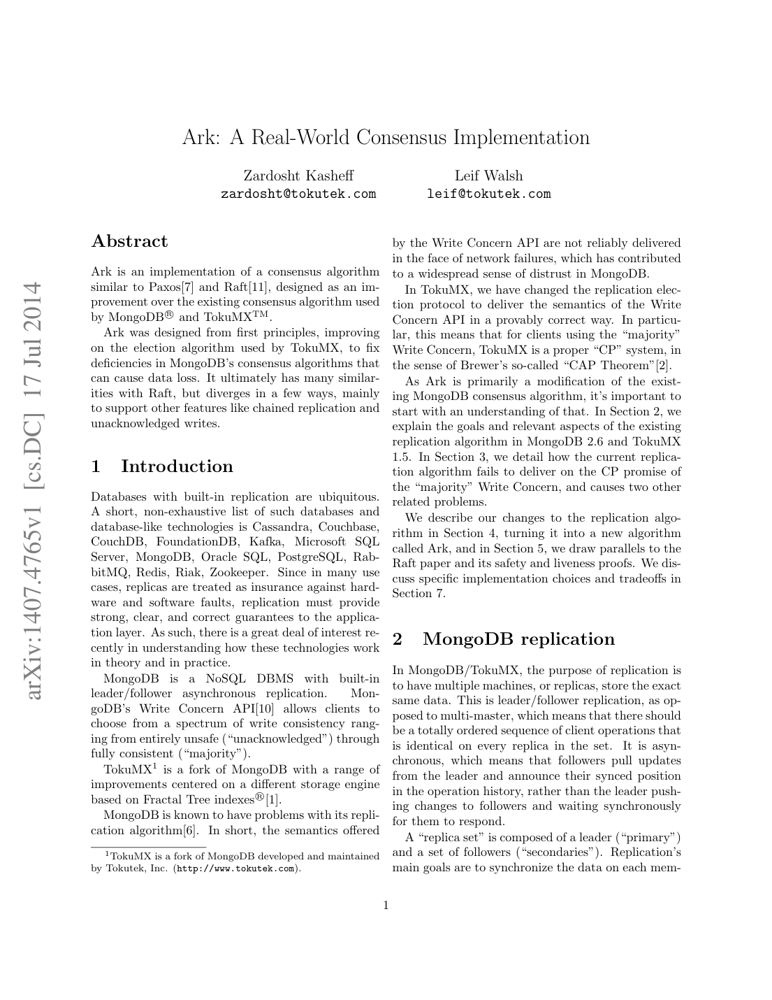

> 本组第 35 篇 · 分布式一致性 · [全部论文]() · [上一篇]() · [下一篇]()

Ark要修复的不是“异步复制会暂时产生不同日志”本身，而是客户端已经收到majority Write Concern成功确认后，更新仍可能在换主时回滚。旧协议允许副本在投票支持新主后，继续从旧主拉取、应用并确认新更新；仅有两个多数集合相交，不能约束这种时间顺序错误。Ark用GTID的term关联选举，用持久化maxVotedTermId约束投票，并禁止投过更高任期赞成票的副本继续确认旧主更新，把日志新鲜度与确认资格连接起来。[E08-E15,E34]

保证范围必须分清：majority成功确认写入的保留，不等于弱Write Concern也不回滚；已安全复制但响应丢失的假阴性，不等于写入确定失败，更不是仅弱写才有的问题；本地oplog精确应用一次，不等于客户端请求恰好执行一次。副本仍可拉取、应用随后会回滚的条目，论文也没有由此证明任意secondary读取线性一致。[E02-E06,E14-E15,E21-E22]

本报告给出协议步骤、五节点时序反例、任期安全论证的实际前提、无本地投票却获知更高term的传播例子，以及可执行但尚未运行的故障测试计划。论文以Raft性质对应解释安全性，但明确把完整异步语境证明留给读者，动态成员变更也未解决；没有受控Ark性能实验，约12秒退位和随机休眠参数不可写成实测恢复SLA。[E17-E20,E23,E26-E31]

本文保留论文陈述、读者推断与待验证方案的区别；实验数字只适用于原文条件。原文和翻译来自已有 AI 辅助精读报告，已做来源匹配与编辑复核，不等于人工逐项核验或独立实验复现。所有页码均为 PDF 物理页。

## 论文与阅读范围

Zardosht Kasheff and Leif Walsh. Ark: A Real-World Consensus Implementation. arXiv:1407.4765v1 [cs.DC], 17 July 2014，12页，PDF物理页与印刷页均为1-12。

[论文集中的原始 PDF](https://github.com/lonng/db-papers/blob/4ff1331069c7cf52ac97dd769e5f484c1c35c200/papers/consistency/ark%3A-a-real-world-consensus-implementation.pdf) · 本地来源：`consistency/ark_-a-real-world-consensus-implementation.pdf`，共 12 页。

本篇保留 16 组原文精读和 34 条证据。截图为原始 PDF 的局部页选，不是重新生成的图表；未将整份 PDF 复制到博客。

## 1. 研究问题、方法与语义边界

【方法与实际范围】本报告建立在已完成的12页全文分块阅读之上，含脚注、未来工作和参考文献；仅第7-10页做了渲染视觉核对。当前会话重新检查了API初稿356及三块READ背景，但没有重用它们的结论作为独立证据。全部独立证据均从本地原PDF/完整提取页另行定位；API原始响应和all-notes不修改。全文使用“原文事实”“读者推断”“读者提案”区分陈述来源，不声称人类复核、实现审计、完整证明或实测复现。

【原文事实】目标系统采用leader/follower异步拉取复制：客户端更新由primary接收，secondary主动从领先副本拉取oplog，来源可为另一secondary。异步描述的是传播方式，不能据此断言客户端majority写不等待确认。Write Concern控制客户端等到多少副本确认后返回；Ark关注成功返回majority后更新不会在后续换主时被撤销。[E01-E03]

旧协议的失效点在于投票与确认没有共同的历史约束：A隔离后，B可由多数选出，而尚未退位的A恢复连接后继续产生旧主条目；secondary可以从A或B拉取。若副本已支持B仍盲目确认A的新更新，两个相冲突分支都可能制造看似安全的多数确认，后来的赢家却只能保留一个分支。暂时接受旧主的未确认写入并不自动违反合同，真正的违约是已经告知客户端majority成功而又回滚。[E08]

【语义边界】弱Write Concern允许某些已接收甚至已确认更新回滚，这是另一类结果。相反，false negative是更新已复制到多数、实际安全，但成功响应没有到达客户端，majority客户端同样可能遇到；它表示结果未知，不是确定未执行。原文称oplog可逆是简化假设，因此不应把保证扩张到无法撤销的外部副作用。本报告不把“CP”口号当作所有读路由、事务与灾难性持久化损失的完整规范。[E03-E04,E15]

依据：论文陈述；PDF 物理页 1, 2, 3, 5, 7。证据：[E01](#evidence-e01), [E02](#evidence-e02), [E03](#evidence-e03), [E04](#evidence-e04), [E08](#evidence-e08), [E15](#evidence-e15)。

## 2. 架构、状态与关键不变量

【原文事实】架构保留拉取式oplog复制、链式同步和独立选举线程，不改成primary向所有secondary推送并同步提交的模型。存储层应用、复制进度、投票和客户端Write Concern确认是不同事件；工程实现必须把其安全相关部分串接，而不必合并为一条线程。[E01-E02,E06]

GTID是两个64位整数的有序对<term,opid>，按字典序比较，不是物理时间加普通长度计数。opid在同一primary上随操作增加；Ark规定新主只能使用成功选举的electionTermId作为新oplog条目的term，因此<4,0>排在<3,100>之后，不受两台机器时钟先后的直接决定。[E05,E09]

maxVotedTermId记录该副本投过yes的最大选举term，原文要求持久化并在重启后保留；它是投票与确认资格的安全状态。原文另称它不小于本地oplog任何term，但没有给出所有并发复制路径的实现代码，本报告把维持该关系的细节列为实现审计事项，不能凭描述自行补出一套持久化协议。[E10,E33]

maxKnownTermId则是该节点知道“至少有人投过yes”的最高term，不是该节点亲自投票的最高term，更不是最后成功当选的新主term。它可经心跳学习并继续传播，故即使节点从未在term 9投票，也可以从别人得知9，使known=9而自己的voted仍为7。二者不能互换。收到更高known值也不能自动宣称本地已在该term投票。[E17-E18]

原文的全互联心跳按每2秒向其他成员发送，Ark把选举状态接入该传播路径。读者推断：N个成员的完整一轮有向发送数量为N(N-1)，因此消息数为O(N²)；这不是实测带宽，也没有包含批处理、报文大小或丢包重试。存储oplog与用户集合的本地精确应用策略，与数据库客户端的请求去重和跨请求事务语义仍是不同层次。[E06,E27]

依据：论文陈述；PDF 物理页 1, 2, 3, 6, 7, 8, 11。证据：[E01](#evidence-e01), [E02](#evidence-e02), [E05](#evidence-e05), [E06](#evidence-e06), [E09](#evidence-e09), [E10](#evidence-e10), [E17](#evidence-e17), [E18](#evidence-e18), [E27](#evidence-e27), [E33](#evidence-e33)。

*原论文 PDF 物理页 1，版权归原作者或出版方。点击图片可查看原尺寸。这是页面定位信息，不表示本次已复核图内所有数据。*

## 3. 核心步骤与可核对的时序示例

【原文事实：选举】投机阶段收集响应副本的maxVotedTermId、日志位置与潜在否决；若继续权威选举，候选者用响应值的最大值加1提议electionTermId，不是读取一个全局实时计数器，也不保证同时候选者得到不同term。权威阶段保留原有资格/配置等条件，但移除30秒yes冷却限制，增加：(1) proposed term <= 本地maxVotedTermId则投no；(2) 候选者最后GTID落后于投票者日志中的GTID则拒绝，原文选择veto。投yes时更新并持久化本地投票term；成功需要多数yes及满足其否决规则，随后新primary写入使用该选举term。[E07,E09-E12,E33]

【原文事实：确认】上述选举修改本身不够。副本一旦投yes支持更高term，不再确认旧primary的更新。它仍可以拉取、保存、应用旧条目，只是不能把这种复制当成客户端的安全确认。另一方向上，已确认条目的持有者不能yes支持缺失该条目的候选者；日志新鲜度检查须与Log Matching/前缀约束一起解释，不能只靠“last GTID数值更大”独立替代完整历史包含关系。[E08,E12-E14,E34]

【读者构造的假设示例A】五成员A/B/C/D/E，A的term为4。B/C/D在term 5投yes后，C从仍自认primary的A拉取新条目x=<4,11>；C可以暂时应用x，却不能为x提供term-4写确认。对这个在投票后才产生的新更新，最多A/E仍有确认资格，2<majority=3。即使A尚未收到退位心跳，也不能新造一个majority成功写。这是确认资格阻断，不是把网络中的旧主进程瞬间消灭。若x早已由A/C/E确认，则任一后三票选举必须与A/C/E相交；相交者不得支持缺失x的候选者。两种时间顺序缺一不可。

【原文事实：退位】失败的高term选举也会使部分副本不再为原主确认；累积后可能令旧主无法满足majority。旧主见到更高voted信息即退位，可用新term重选自己；known传播是加速优化。[E16-E18,E32]

【读者构造的假设示例B】A在term 7任主，B曾yes term 8但该次选举失败，C没有参与term 8投票。C从B心跳获知known=8，保持自身voted=7，再把known=8转发给A；A应退位，不能要求先看到term-8成功新主，也不能把C视为term-8投票者。单凭转发known是否改变C的确认资格，不能拿来替代原文基于本地yes的确认规则；安全分析仍以真实投票集合为准。

依据：论文陈述；PDF 物理页 3, 4, 5, 6, 7, 8。证据：[E05](#evidence-e05), [E07](#evidence-e07), [E08](#evidence-e08), [E09](#evidence-e09), [E10](#evidence-e10), [E11](#evidence-e11), [E12](#evidence-e12), [E13](#evidence-e13), [E14](#evidence-e14), [E16](#evidence-e16), [E17](#evidence-e17), [E18](#evidence-e18), [E32](#evidence-e32), [E33](#evidence-e33), [E34](#evidence-e34)。

## 4. 安全论证、任期重叠与证明边界

【原文事实与读者重构】同一term若有两个不同候选者各获多数，其yes集合必相交；交点副本必须在同term投两次yes，与持久化maxVotedTermId和<=拒绝规则矛盾。这个论证排除同一term两个成功选举，不排除不同term的primary因消息延迟暂时同时自认主。论文也明确描述不同term快速继任与客户端看到近似并发primary的情况。[E10-E11,E20]

成功选举term的递增不能无条件按墙钟上的“宣布成功时刻”排序。读者构造的假设：term 5先获得多数yes但其候选者迟收响应，term 6随后得到足够yes并先宣布；网络可令term 5候选者更晚才收到早已发出的yes。共同投票者本地投票顺序仍是5然后6，却不能保证候选者完成回调的墙钟顺序相同。本文采用“按term编号及投票历史比较领导权”的解释；更低term可能短暂自认主，但更高term投票后的确认屏障限制其新写入。不要把原文的相邻成功选举单调表述扩大为所有消息完成时刻也严格递增。

majority保留论证也不只是集合相交。若更新x的确认先于后续选举，相交持有者必须执行候选日志包含/新鲜度约束；若更高term投票先发生，其投票者必须拒绝确认旧主后来产生的x。把两个方向与日志前缀不变量结合，才支持majority确认条目进入后续获认可的领导历史。弱Write Concern不满足相同多数屏障，不能直接套用该结论。[E12-E13,E15,E21,E34]

【原文事实】论文把Election Safety、Leader Append-Only、Log Matching、Leader Completeness、State Machine Safety对应到Raft；其中Leader Completeness明确限于majority确认更新。用户集合可以先应用后回滚，因此状态机安全对应被解释为最终历史/回滚前后逻辑分离，不能照抄“任何副本从不应用冲突操作”的字面命题。oplog操作可逆是给定简化，不覆盖已发送邮件等外部效果。[E04,E21-E22]

【证明缺口】第10页明确把完整异步安全/活性证明翻译留给读者；这里给出的是受限证明草图，不是已完成形式化验证。读者提出的实现义务包括：稳定投票配置下的quorum交集、投票持久化与ack线程的原子顺序、日志/集合崩溃恢复一致性、非拜占庭参与者及最终足够通信。安全不依赖一个固定网络时限；活性则不能对永久分区、无多数存活、任意持续并发候选或无限延迟作无条件承诺。动态成员安全协议在原文仍开放。[E10,E23,E29]

依据：读者推断；PDF 物理页 3, 7, 8, 9, 10, 11。证据：[E04](#evidence-e04), [E10](#evidence-e10), [E11](#evidence-e11), [E12](#evidence-e12), [E13](#evidence-e13), [E15](#evidence-e15), [E20](#evidence-e20), [E21](#evidence-e21), [E22](#evidence-e22), [E23](#evidence-e23), [E29](#evidence-e29), [E34](#evidence-e34)。

## 5. 实验证据、参数与不能得出的数字结论

【全文阅读判断】这份12页稿件是协议设计与工程讨论，没有一个受控Ark评测章节给出硬件、读写工作负载、数据规模、重复次数、置信区间、吞吐曲线或恢复延迟分位数。不是“笔记恰好漏提实验”就可推定源文有实验；本结论来自完整阅读。第7节明说多数问题需要实验和用户反馈来回答。[E26]

【数字分类】第一类是历史实现参数：全互联心跳每2秒一次；第8页按心跳周期加超时推导旧主约12秒内退位，并称可配置；第9页讨论50-1050ms随机休眠。这些参数或条件式工程估算不是实测p99，也不保证所有网络故障都在12秒内恢复可写。[E19,E27-E28]

第二类是外部论文的转述：5-9台服务器、15ms广播时间、150-300ms推荐休眠归于Raft实验，不是Ark测得的硬件规模或恢复表现。本报告未打开该参考文献做独立核验。[E31]

第三类是分析例子：同term候选分票后可能无人获多数；不同term可以快速继任。它们解释失败模式，不量化概率。第11页“退避窗口应显著长于典型消息延迟范围”是启发式建议；本文没有可据以声称重试成功概率指数提高的独立随机性、调度或延迟分布模型。[E20,E28]

因此不能宣称Ark达到某TPS、比旧协议快若干倍、在跨数据中心必定一秒收敛，或maxKnownTermId使退位延迟下降某百分比。可比较的是移除固定30秒投票禁期、明确确认屏障、提出更敏感的退位规则这些机制；它们的实际可用性收益和额外心跳开销应另测。

依据：读者推断；PDF 物理页 8, 9, 10, 11。证据：[E19](#evidence-e19), [E20](#evidence-e20), [E26](#evidence-e26), [E27](#evidence-e27), [E28](#evidence-e28), [E31](#evidence-e31)。

## 6. 延迟、一致性、回滚与否决的工程取舍

【原文事实】异步pull和链式拓扑允许应用选择弱确认来降低等待，但相应写入可以回滚；majority选择牺牲部分故障情形中的写可用性以保护已确认历史。响应丢失时的结果未知仍然存在，不能通过更换Write Concern术语消除。[E03,E14-E15]

【确认屏障的代价】一次失败选举也会让投yes的副本暂不为旧主确认，反复失败可能逐步耗尽确认资格。更敏感的退位使旧主在见到更高投票/已知term后尽早停写并重选，但也可能增加客户端切主和主角色震荡。这是安全状态与服务连续性的耦合，而不是简单地宣布“更快退位始终更好”。12秒描述只属于文中的配置/故障检测推理。[E16,E19]

【veto与no】对于majority安全，落后候选者收到no已足够约束多数；原文选veto，希望保住部分自定义Write Concern。它的例子有三个数据中心，每处三个副本，共九个；用户只要求更新到另一个中心的一台副本。主中心失效后，若唯一持有新更新的幸存副本仅no，其他五个无该更新副本仍可能选出候选者；若该持有者能参加选举并veto，可阻止这种结果。[E24-E25]

【读者推断】veto扩大了部分失败模型下的保留机会，也扩大了阻塞选举的影响面。该例不证明任意“另一个机房确认”等同于majority：唯一持有者若不可达或没有机会返回veto，保护条件就不同。不能把该策略写成弱写无条件不回滚，更不能以此补齐动态成员协议。[E15,E24-E25,E29]

【其他成本】先应用后回滚要求可逆且恢复逻辑正确；本地非幂等oplog的精确一次应用并未解决客户端重试的幂等键。全互联心跳与主动广播能加快消息扩散，却增加平时或选举时的通信；不同心跳周期、不完全图和自适应退避仍是第7节设想，非本文完成实现的性能结论。[E04,E06,E27-E28]

依据：读者推断；PDF 物理页 2, 3, 7, 8, 10, 11。证据：[E03](#evidence-e03), [E04](#evidence-e04), [E06](#evidence-e06), [E14](#evidence-e14), [E15](#evidence-e15), [E16](#evidence-e16), [E19](#evidence-e19), [E24](#evidence-e24), [E25](#evidence-e25), [E27](#evidence-e27), [E28](#evidence-e28), [E29](#evidence-e29)。

## 7. 历史协议与Raft的有限对照

【来源限定】对照的是Ark作者在2014年稿件中描述的MongoDB 2.6/TokuMX 1.5和它引用的2013年10月Raft技术报告，不是当前MongoDB、Raft库或其他产品的源码对比。参考文献确实列出该Raft版本，但本报告未阅读外部参考文献；不能凭“受Raft启发”声称验证了完整实现等价。[E30]

旧协议把复制同步和选举过度分离，Ark保留拓扑灵活性，仅在任期、日志新鲜度、确认资格上建立必要联系。关键不是用同步push替代pull，也不是把所有低延迟弱写改成必须majority。它尝试让不同API语义继续共存，同时不破坏majority那一档的承诺。[E01-E02]

原文与Raft性质的对应有启发性：term与唯一yes支持同term选举安全；日志前缀及回滚维护匹配；majority条目获得Leader Completeness。但临时应用的弱写可能回滚，所以不能把整个用户集合的瞬时状态等同于只应用已提交条目的状态机模型。不同term的过渡重叠也不等于同term双主；不要把“Raft从不可能有过时leader自认主”作为对照前提。[E20-E22]

第10页的完整证明留白是实质边界，不因借用同名性质就消失。第11页讨论把配置变更写入日志及双配置阶段的难点，也明确安全动态成员适配尚未解决。因此不能写Ark已经实现Raft joint consensus，或在更换多数定义时继续套用固定配置的交集证明。[E23,E29]

【可迁移的读者问题】面对另一套复制实现，应逐项问：谁产生oplog；何时持久化；何时应用；何时具有ack资格；谁能投票；过时primary如何丧失majority能力；读取是否暴露未稳定尾部；配置如何改变quorum。本报告没有阅读StarRocks、DuckDB等实现，不给出这些系统的现状断言，也不借泛泛产品清单代替机制比较。

依据：读者推断；PDF 物理页 1, 2, 9, 10, 11, 12。证据：[E01](#evidence-e01), [E02](#evidence-e02), [E20](#evidence-e20), [E21](#evidence-e21), [E22](#evidence-e22), [E23](#evidence-e23), [E29](#evidence-e29), [E30](#evidence-e30)。

## 8. 可执行验证计划与通过标准（尚未运行）

【读者提案，非已完成复现】首先实现一个固定五节点的离散事件模型，再与历史实现测试对接。每个节点记录oplog、持久化投票term、已知term、primary角色、待发送响应和已发送ack；客户端记录请求ID、Write Concern、成功/超时及响应时刻。网络调度必须允许消息延迟、重排、单向断连和晚到选票，不能用一个全局同步步骤掩盖竞态。测试数据应是可逆的小操作，并把不可逆外部效果明确排除。[E03-E05,E09-E10]

T1 旧主尾部：B/C/D投更高term后，C继续从A拉取新旧term尾部。通过标准是允许copy/apply但不允许C再次发送旧primary新更新的安全ack；旧A不得为投票后新生条目收齐三票式Write Concern成功。T2 先确认后选举：令x先由A/C/E确认，再枚举所有三票候选集合；任何不含x的候选者都不应形成合法新领导历史，不能仅比较最后一个数值而跳过前缀一致性。[E12-E14]

T3 崩溃与并发：在yes持久化前后、ack发送前后交错崩溃重启；重启后不得重投同term或恢复已失效的旧主确认资格。T4 晚到成功：让较低term早获yes却晚收到响应，较高term先宣布；允许过时角色短暂存在，但必须检查不能产生冲突majority成功。该测试针对墙钟完成顺序与term逻辑顺序的差异，不预设所有回调按term排序。[E10-E13]

T5 失败选举与known转发：一名副本yes更高term但无人当选，把known经未投票节点转发给旧主；旧主应按规则退位，而中继节点自己的maxVotedTermId不应被虚构提高。T6 丢响应：把已安全多数写的成功响应丢弃，客户端必须标为未知；不得把重试变成自动精确一次，也不得在收敛后删除这条已确认历史。[E03,E16-E18]

T7 自定义WC：复现九节点三中心例，分别让唯一幸存新条目持有者可返回veto、消息被延迟、完全不可达；比较no/veto策略，明确哪些结果只在额外故障假设下成立。T8 配置边界：保持主测试固定成员；若测试成员变更，必须先提供独立重配置协议及新旧quorum规则，不能把原文开放问题伪装为已经通过的功能。[E24-E25,E29]

应输出安全反例轨迹、majority成功条目最终保留检查、弱写回滚集合、未知客户端结果、选举/退位时间分布、无多数期间的不可用时长和心跳字节。性能测试另外扫消息延迟、并发候选、退避窗、节点数与心跳拓扑；报告p50/p95/p99及重复次数，不能从定时器常数反推实验曲线。本次只做本地引文/结构检查与小型集合、数值时序算例，不运行上述模型或分布式实验。

依据：待验证的工程设想；PDF 物理页 2, 3, 6, 7, 8, 10, 11。证据：[E03](#evidence-e03), [E04](#evidence-e04), [E05](#evidence-e05), [E09](#evidence-e09), [E10](#evidence-e10), [E11](#evidence-e11), [E12](#evidence-e12), [E13](#evidence-e13), [E14](#evidence-e14), [E16](#evidence-e16), [E17](#evidence-e17), [E18](#evidence-e18), [E24](#evidence-e24), [E25](#evidence-e25), [E27](#evidence-e27), [E28](#evidence-e28), [E29](#evidence-e29)。

## 9. 结论、阅读索引与剩余缺口

【结论】Ark最值得保留的设计经验，是把复制“见到一个条目”和“有资格向客户端保证它安全”分开，再把安全确认与本地投票历史连接。逻辑term提供跨primary的排序标签；候选日志约束保护已存在的多数历史；投票后的ack屏障阻止旧主继续制造多数成功。它不要求网络立即清除所有过时primary，也不把弱Write Concern或客户端丢响应问题一起消灭。[E01-E03,E09-E15,E34]

【实际完成项】这是一份当前Codex独立撰写、待人工复核的来源报告，使用完整12页阅读和4页关键规则视觉检查。原始356只是未通过结构验证的背景稿，本报告没有通过填空引用掩盖其失败，没有伪造API critique/close-readings完成，也没有把原始API用量认作当前会话用量。独立证据、逐段解读及方法边界随提交保存。

【逐页阅读索引】第1页：异步pull定位[E01]；第2页：链式同步和响应丢失[E02-E03]；第3页：GTID、可逆回滚、本地精确应用[E04-E06]；第4页：旧权威选举缺少日志检查[E07]；第5页：盲目确认造成合同失效[E08]；第6页：选举term与GTID、本地投票状态定义[E09,E33]；第7页：持久化、拒绝条件、ack屏障、弱写与失败选举[E10-E16]；第8页：known传播、条件式退位估计及多数解释[E17-E19,E32,E34]；第9页：多term过渡、受限Leader Completeness、临时应用、引用Raft参数[E20-E22,E31]；第10页：完整证明留白、veto取舍和未来实验[E23-E26]；第11页：心跳/退避与重配置开放问题[E27-E29]；第12页：参考文献版本[E30]。

【仍未完成】没有独立形式化证明、源码级并发/崩溃审计、受控性能基准、外部论文核验或当前产品验证。尤其不能把固定quorum交集、瞬时用户状态和动态成员变更揉成一个未经限定的“完全强一致”结论。下一步最有价值的是验证ack与持久化投票的竞态、晚到选票造成的旧term自认成功，以及弱自定义确认依赖的可达性条件，而不是给未测系统增加漂亮速度比。

依据：读者推断；PDF 物理页 1, 2, 3, 4, 5, 6, 7, 8, 9, 10, 11, 12。证据：[E01](#evidence-e01), [E02](#evidence-e02), [E03](#evidence-e03), [E04](#evidence-e04), [E05](#evidence-e05), [E06](#evidence-e06), [E07](#evidence-e07), [E08](#evidence-e08), [E09](#evidence-e09), [E10](#evidence-e10), [E11](#evidence-e11), [E12](#evidence-e12), [E13](#evidence-e13), [E14](#evidence-e14), [E15](#evidence-e15), [E16](#evidence-e16), [E17](#evidence-e17), [E18](#evidence-e18), [E19](#evidence-e19), [E20](#evidence-e20), [E21](#evidence-e21), [E22](#evidence-e22), [E23](#evidence-e23), [E24](#evidence-e24), [E25](#evidence-e25), [E26](#evidence-e26), [E27](#evidence-e27), [E28](#evidence-e28), [E29](#evidence-e29), [E30](#evidence-e30), [E31](#evidence-e31), [E32](#evidence-e32), [E33](#evidence-e33), [E34](#evidence-e34)。

## 原文精读：从句子回到机制

以下保留原文、忠实翻译、含义与边界；假设示例不作为论文实验结果。

### P001 · PDF 物理页 2

**原文**

<blockquote class="paper-source-quote"><pre><code>Any secondary is allowed to pull data from any other&#10;replica in the replica set, as long as the other replica’s&#10;position is ahead of the secondary’s position.</code></pre></blockquote>

**忠实翻译**

> 任何secondary都可以从副本集内其他副本拉取数据，只要对方的日志位置领先于自己。

**技术含义与边界**

> 这是允许链式复制的来源选择条件。动作发起者是拉取方secondary，不能把它翻译成primary向任意节点推送。条目能被拉取，不代表拉取方能为其出具最终安全确认。

**常见误读**

> 把源节点领先解释为源节点必为合法新主，或把copy/apply/ack合为同一事件。本文恰好要约束这三者之间的安全关系。

**读者构造的假设示例**

> 读者构造的假设示例：C的位置为<4,8>，D已到<4,10>，C可以从D拉取后两条，即使D不是primary；C能否确认仍需查看自身投票历史。

### P002 · PDF 物理页 2

**原文**

<blockquote class="paper-source-quote"><pre><code>an update may be replicated to&#10;a majority of replicas and be safe, but the acknowl-&#10;edgement might fail to return to the client.</code></pre></blockquote>

**忠实翻译**

> 一个更新可能已经复制到多数副本并且安全，但确认消息可能未能返回客户端。

**技术含义与边界**

> 这里的false negative是API观察结果不完整：服务端事实是已安全，客户端却没有收到成功。它与弱确认写入实际可能丢失是不同轴上的问题。

**常见误读**

> 误称majority写没有假阴性，或称超时证明更新未执行；也不能因原文提及2PC就推断原子提交协议自动解决丢回复和重试去重。

**读者构造的假设示例**

> 读者构造的假设示例：x到达A/B/C三台中的两台，成功回复在网络中丢失。客户端记录x结果未知，不能直接重试扣款并声称只扣一次。

### P003 · PDF 物理页 3

**原文**

<blockquote class="paper-source-quote"><pre><code>For simplicity, assume all operations that appear&#10;in the oplog can be reversed.</code></pre></blockquote>

**忠实翻译**

> 为简化讨论，假设出现在oplog中的所有操作都能被逆转。

**技术含义与边界**

> 回滚模型需要能撤销失去合法历史地位的已应用尾部；该句不是给出通用逆操作算法或外部效果补偿协议。

**常见误读**

> 从数据库集合可回滚推导出邮件、付款网关、下游消费等外部副作用也会自动撤销；或称回滚前不可能被读取。

**读者构造的假设示例**

> 读者构造的假设示例：本地计数从10变11可撤回到10，但若应用读取11并发出了外部通知，论文没有保证收回通知。

### P004 · PDF 物理页 3

**原文**

<blockquote class="paper-source-quote"><pre><code>TokuMX’s oplog entries are not required to be&#10;idempotent, therefore the oplog entries must be ap-&#10;plied exactly once on secondaries.</code></pre></blockquote>

**忠实翻译**

> TokuMX的oplog条目不要求幂等，因此这些条目在secondary上必须精确应用一次。

**技术含义与边界**

> 论述层次是已标识oplog条目的本地应用与恢复记账，不是给业务客户端分配请求唯一标识的端到端协议。

**常见误读**

> 把相同oplog消息不重复应用写成任意业务请求恰好执行一次。客户端重试可能形成两个不同oplog条目，仍需额外去重语义。

**读者构造的假设示例**

> 读者构造的假设示例：<7,20>表示余额加1，secondary重放同一条目时避免再加；客户端若重复发出两次不同请求，生成<7,20>和<7,21>，该机制本身不会把它们合并。

### P005 · PDF 物理页 7

**原文**

<blockquote class="paper-source-quote"><pre><code>Note that this maxV otedTermId is persistent to&#10;disk and survives crashes and process restarts.</code></pre></blockquote>

**忠实翻译**

> 注意maxVotedTermId被持久化到磁盘，能够在崩溃和进程重启后保留。

**技术含义与边界**

> 同term不能再次yes的历史必须跨进程生存。若重启清零，两个时间段内的yes可能绕过同term唯一投票论证。具体持久化与回复顺序仍需实现审计。

**常见误读**

> 用内存原子变量就宣称解决崩溃后重复投票；或从这句话推断所有oplog与集合写入都已获得同样的持久化保证。

**读者构造的假设示例**

> 读者构造的假设示例：C持久化voted=8后yes给B，重启仍拒绝另一个term-8候选D。若重启恢复成7，第二次yes就会破坏该前提。

### P006 · PDF 物理页 7

**原文**

<blockquote class="paper-source-quote"><pre><code>If electionTermId ≤maxV otedTermId</code></pre></blockquote>

**忠实翻译**

> 如果提议的electionTermId小于或等于本地maxVotedTermId。

**技术含义与边界**

> 这是假设前件，接续原文的no分支。等于也被拒绝，用来限制同term重复投赞成；更大的term只是继续检查其他资格的必要条件，不意味着自动yes。

**常见误读**

> 把<=改成<，使同term第二个候选可被再次接受；或忽略日志与配置条件，认为term更高就必须投yes。

**读者构造的假设示例**

> 读者构造的假设示例：本地voted=9，候选提议8或9均no；提议10可继续检查，但如果候选日志落后仍需拒绝。

### P007 · PDF 物理页 7

**原文**

<blockquote class="paper-source-quote"><pre><code>If the last GTID in the candidate’s oplog is less&#10;than some GTID in the voter’s oplog, the voter&#10;responds with “veto”.</code></pre></blockquote>

**忠实翻译**

> 如果候选者oplog最后一个GTID小于投票者oplog中的某个GTID，投票者回复veto。

**技术含义与边界**

> 选举必须考虑候选日志新鲜度。GTID按term、opid字典序比较；要把last值检查用于历史保留论证，还要结合日志匹配/前缀不变量。

**常见误读**

> 把它降成只比条目数量或opid，或仅凭更大最后GTID就独立证明候选包含每一个已确认操作。

**读者构造的假设示例**

> 读者构造的假设示例：候选最后为<3,100>、投票者有<4,1>，即使100比1大也应拒绝；若候选最后<5,0>，仍需依赖正确的日志历史约束。

### P008 · PDF 物理页 7

**原文**

<blockquote class="paper-source-quote"><pre><code>To solve Problem 3.1, we make one more simple&#10;change: a replica never acknowledges an update from&#10;a primary after it votes “yes” in a later election.</code></pre></blockquote>

**忠实翻译**

> 为解决问题3.1，再作一个简单修改：副本在较晚的一次选举投出yes后，不再确认来自此前primary的更新。

**技术含义与边界**

> 该规则在投票历史和客户端确认资格之间建立时间屏障。后续选举是否成功不是本地yes失去旧主ack资格的前提；因此失败选举也有服务可用性影响。

**常见误读**

> 写成新主成功后才停止确认，或收到更高known就假装本地已经投了yes；也不要把“不确认”翻成“不允许拉取或应用”。

**读者构造的假设示例**

> 读者构造的假设示例：C投yes支持term 6，选举最终未过多数。C仍不可为term-5旧主新更新发安全ack，不能等到term-6真的当选才执行屏障。

### P009 · PDF 物理页 7

**原文**

<blockquote class="paper-source-quote"><pre><code>Note that a replica may still copy and apply oplog&#10;entries from any member of the set, knowing that&#10;it may roll them back at any point in the future.</code></pre></blockquote>

**忠实翻译**

> 注意，副本仍可从集合的任何成员复制并应用oplog条目，同时知道未来可能会将这些条目回滚。

**技术含义与边界**

> 复制路径保留灵活性，安全承诺则由ack与投票规则单独约束。暂时本地可见的状态并不自动构成majority稳定历史。

**常见误读**

> 把apply当成不可撤销commit，或声称Ark通过彻底禁止旧主条目到达来保证安全。

**读者构造的假设示例**

> 读者构造的假设示例：D从旧主A拉取x并暂时应用；若x没有满足majority且最终不在合法新历史里，D会撤销x。客户端若只见本地状态，不能据此推断x最终保留。

### P010 · PDF 物理页 7

**原文**

<blockquote class="paper-source-quote"><pre><code>after&#10;a failed election, all the replicas that voted “yes” will&#10;be ineligible to satisfy Write Concern from the still-&#10;legitimate primary.</code></pre></blockquote>

**忠实翻译**

> 在一次失败选举之后，所有投过yes的副本将不再有资格满足仍然合法的原primary的Write Concern。

**技术含义与边界**

> 失败也会留下持久化投票事实，不能把未选出新主理解成什么都没发生。原主即使仍有角色名义，也可能失去足够确认能力。

**常见误读**

> 认为只有成功选举才改变旧主服务条件，或恢复网络后不换term就把旧主所有确认资格自动恢复。

**读者构造的假设示例**

> 读者构造的假设示例：五节点里B/C投term 8、D/E投term 9，均未过多数；四台都不再确认term-7旧主，A必须被促退并用更新term重新组织选举。

### P011 · PDF 物理页 8

**原文**

<blockquote class="paper-source-quote"><pre><code>A&#10;replica’s&#10;maxKnownTermId&#10;is&#10;the&#10;maximum&#10;electionTermId for any election it knows of where&#10;at least one replica voted “yes”.</code></pre></blockquote>

**忠实翻译**

> 一个副本的maxKnownTermId，是它知道至少有一个副本投过yes的那些选举中最大的electionTermId。

**技术含义与边界**

> 量词是至少一个yes，不是多数yes；主语是它知道，不是它亲自投过。该字段可用于传播退位信息，但不能充当本地投票账本或已成功领导者证明。

**常见误读**

> 把known称作最高成功任期，或让中继节点收到known后直接增加maxVotedTermId并声称自己参与过选举。

**读者构造的假设示例**

> 读者构造的假设示例：B在term 10投yes但候选失败，C没投票却收到B的心跳。C可known=10、voted=8，并把10继续传给term-9旧主，促使其退位。

### P012 · PDF 物理页 9

**原文**

<blockquote class="paper-source-quote"><pre><code>Leader Completeness is ensured only for up-&#10;dates acknowledged with “majority” Write Concern.</code></pre></blockquote>

**忠实翻译**

> Leader Completeness仅对使用majority Write Concern获得确认的更新得到保证。

**技术含义与边界**

> 作者为该性质给出了明确范围。较弱确认即使对某个客户端“成功”，也不获得同样的未来领导日志保留承诺。

**常见误读**

> 删掉only限定，称任何客户端已确认写入都绝不回滚；也不能反推majority响应一定会可靠送达。

**读者构造的假设示例**

> 读者构造的假设示例：x由三票多数确认、y只由旧主本地确认。换主时必须保护x；y可以成为被回滚尾部，二者不能用同一个success标签判断。

### P013 · PDF 物理页 9

**原文**

<blockquote class="paper-source-quote"><pre><code>there&#10;may be a period of time when an update is reflected&#10;in the state machine of some replicas, before the oper-&#10;ation rolls back.</code></pre></blockquote>

**忠实翻译**

> 在操作回滚之前，可能有一段时间某些副本的状态机已经反映了该更新。

**技术含义与边界**

> 这是瞬时应用状态与最终保留历史的区别。原文随后用先回滚再同步新操作解释逻辑分离，不等于证明所有读取都避免看到暂态。

**常见误读**

> 把Raft同名状态机安全性质未经限定地套到所有已应用用户集合状态，或仅说“最终一致”就忽略majority保留的更强条件。

**读者构造的假设示例**

> 读者构造的假设示例：旧分支把余额改成11并在一个secondary可见，最终回滚到10；这说明临时可见不等于最终保留，不能单凭这次读取证明majority安全失败。

### P014 · PDF 物理页 10

**原文**

<blockquote class="paper-source-quote"><pre><code>We leave the translation of Raft’s safety and&#10;liveness arguments to our asynchronous context as a&#10;straightforward but exciting exercise for the reader.</code></pre></blockquote>

**忠实翻译**

> 作者把将Raft安全性与活性论证翻译到其异步语境的工作，作为一个直接但令人兴奋的练习留给读者。

**技术含义与边界**

> 论文提供性质对应和直觉论证，但这句话确认本文没有逐步展开全部异步证明。报告可以重构条件式论证，不能宣称作者已交付完整形式化证明或本次已独立完成。

**常见误读**

> 把结论中的provably一词当作忽略证明留白的许可，或把引文验证通过等同于协议正确性验证通过。

**读者构造的假设示例**

> 读者构造的假设示例：检查同term唯一投票可证明一个局部不变量；仍需另分析日志前缀、崩溃持久化、晚到yes和活性调度，不能凭该局部结论勾选全部安全/活性已证。

### P015 · PDF 物理页 10

**原文**

<blockquote class="paper-source-quote"><pre><code>We could theoretically vote “no” and and still have&#10;“majority” Write Concern work properly.</code></pre></blockquote>

**忠实翻译**

> 理论上这里可以投no，仍能让majority Write Concern正确工作。原句重复的and按原样保留。

**技术含义与边界**

> majority安全所需的拒绝与额外veto政策不是同一个强度；后者是为某些弱自定义确认提供更多保留机会的工程取舍。

**常见误读**

> 说veto是majority安全绝对不可缺的一条，或反过来因为no足够就认定veto对弱确认案例没有意义。

**读者构造的假设示例**

> 读者构造的假设示例：九副本中唯一幸存持有x的副本no不能阻止另外五票；它能及时返回veto时可挡住落后候选。若它完全不可达，不能再承诺相同保护。

### P016 · PDF 物理页 11

**原文**

<blockquote class="paper-source-quote"><pre><code>It is still an open&#10;question as to the right way to adapt a safe dynamic&#10;membership protocol to the existing MongoDB archi-&#10;tecture.</code></pre></blockquote>

**忠实翻译**

> 如何把安全的动态成员协议适配到现有MongoDB架构，仍然是开放问题。

**技术含义与边界**

> 固定配置的quorum交集论证不能直接替代成员变更时的新旧配置安全协议。该处明确限制了本文工程完备性。

**常见误读**

> 写成Ark已经实现日志内重配置和joint consensus，或随时改变成员列表后仍使用旧的多数定义证明安全。

**读者构造的假设示例**

> 读者构造的假设示例：旧集合A/B/C与新集合D/E/F没有公共成员，两个独立多数可同时存在；需要额外过渡协议，而不是各自满足2/3就自动安全。

## 尚未解决的问题

1. 实际实现如何把yes的持久化、ack资格改变和复制线程交错排序？崩溃恢复是否维护相同的不变量？
2. 候选者last GTID检查如何与完整日志前缀关系共同工作，特别是已复制但尚未确认的更高term尾部？
3. 更低term早获多数但晚收到yes时，过时候选者宣布成功后的退位与客户端确认行为如何建模和验证？
4. 未在更高term投票的中继节点只学习maxKnownTermId时，具体代码是否只传播/促退位，还是另有确认资格变化？需以实现证据回答。
5. 唯一持有弱自定义Write Concern更新的副本不可达时，veto策略还能提供什么保证，何时以不可用换保留？
6. 不改变固定成员安全论证的前提下，如何引入正确的新旧配置quorum协议？原文尚未完成该适配。
7. 跨中心退避、差异化心跳和不完全图传播，分别怎样影响majority写恢复、错误检测和WAN字节？需要独立实验。

## 证据索引

证据编号沿用原报告，便于将上文判断追溯到原句。引文匹配只验证位置，不证明解读正确。

**E01 · PDF 物理页 1**

原文定义异步传播为followers主动pull并通报同步位置，不是primary向followers推送的协议改写。

<blockquote class="paper-source-quote"><pre><code>It is asyn-&#10;chronous, which means that followers pull updates&#10;from the leader and announce their synced position&#10;in the operation history</code></pre></blockquote>

**E02 · PDF 物理页 2**

secondary可从任何领先副本拉取，支持链式复制；这不是允许直接客户端改写secondary。

<blockquote class="paper-source-quote"><pre><code>Any secondary is allowed to pull data from any other&#10;replica in the replica set, as long as the other replica’s&#10;position is ahead of the secondary’s position.</code></pre></blockquote>

**E03 · PDF 物理页 2**

majority已复制且安全但响应未达客户端，是可接受的结果未知/假阴性，不是仅弱写的回滚问题。

<blockquote class="paper-source-quote"><pre><code>an update may be replicated to&#10;a majority of replicas and be safe, but the acknowl-&#10;edgement might fail to return to the client.</code></pre></blockquote>

**E04 · PDF 物理页 3**

回滚叙述明确简化为oplog操作可逆，不覆盖任意外部不可撤销副作用。

<blockquote class="paper-source-quote"><pre><code>For simplicity, assume all operations that appear&#10;in the oplog can be reversed.</code></pre></blockquote>

**E05 · PDF 物理页 3**

GTID由term与opid两个64位整数构成；这不是一个物理时钟或仅日志长度。

<blockquote class="paper-source-quote"><pre><code>This is a pair of&#10;64-bit integers, ⟨term, opid⟩, where the opid is incre-&#10;mented each time an operation commits on the pri-&#10;mary</code></pre></blockquote>

**E06 · PDF 物理页 3**

TokuMX非幂等oplog要求secondary精确应用一次；不等于客户端请求恰好一次执行。

<blockquote class="paper-source-quote"><pre><code>TokuMX’s oplog entries are not required to be&#10;idempotent, therefore the oplog entries must be ap-&#10;plied exactly once on secondaries.</code></pre></blockquote>

**E07 · PDF 物理页 4**

旧权威选举规则没有在yes前检查候选日志位置，不能误写为所有阶段都做了安全新鲜度约束。

<blockquote class="paper-source-quote"><pre><code>The replica doesn’t bother looking at the&#10;oplog’s position before voting yes.</code></pre></blockquote>

**E08 · PDF 物理页 5**

旧协议能复制就确认，忽略该更新可能回滚，是majority合同失效的关键缺陷。

<blockquote class="paper-source-quote"><pre><code>The fundamental flaw in the current replication al-&#10;gorithm that leads to this behavior is that secondaries&#10;blindly acknowledge any update that they can copy,&#10;regardless of whether the update may later rollback.</code></pre></blockquote>

**E09 · PDF 物理页 6**

当选者必须用成功选举electionTermId作为后续新GTID的term。

<blockquote class="paper-source-quote"><pre><code>If elected, this replica must use the electionTermId&#10;from its successful election as the term part of the&#10;GTIDs it creates for new oplog entries during its&#10;tenure.</code></pre></blockquote>

**E10 · PDF 物理页 7**

maxVotedTermId需持久化，跨崩溃和重启保留，不能只是进程内变量。

<blockquote class="paper-source-quote"><pre><code>Note that this maxV otedTermId is persistent to&#10;disk and survives crashes and process restarts.</code></pre></blockquote>

**E11 · PDF 物理页 7**

提议term不大于本地maxVotedTermId时进入拒绝分支；等于也不能再投yes。

<blockquote class="paper-source-quote"><pre><code>If electionTermId ≤maxV otedTermId</code></pre></blockquote>

**E12 · PDF 物理页 7**

候选者last GTID落后于投票者日志时返回veto；新鲜度必须结合前缀不变量解释。

<blockquote class="paper-source-quote"><pre><code>If the last GTID in the candidate’s oplog is less&#10;than some GTID in the voter’s oplog, the voter&#10;responds with “veto”.</code></pre></blockquote>

**E13 · PDF 物理页 7**

本地投yes支持较晚选举后，不再确认旧primary更新，这是确认资格屏障。

<blockquote class="paper-source-quote"><pre><code>To solve Problem 3.1, we make one more simple&#10;change: a replica never acknowledges an update from&#10;a primary after it votes “yes” in a later election.</code></pre></blockquote>

**E14 · PDF 物理页 7**

确认受限不禁止继续copy/apply；这些条目仍可能回滚。

<blockquote class="paper-source-quote"><pre><code>Note that a replica may still copy and apply oplog&#10;entries from any member of the set, knowing that&#10;it may roll them back at any point in the future.</code></pre></blockquote>

**E15 · PDF 物理页 7**

弱于majority的Write Concern仍允许回滚，不可把所有成功返回等同于相同保留保证。

<blockquote class="paper-source-quote"><pre><code>Updates with a weaker Write Concern may&#10;still be rolled back, but this is a design principle we&#10;accept, in accordance with the Write Concern design.</code></pre></blockquote>

**E16 · PDF 物理页 7**

失败的高term选举也可能让投yes副本不能满足原主Write Concern，影响活性。

<blockquote class="paper-source-quote"><pre><code>after&#10;a failed election, all the replicas that voted “yes” will&#10;be ineligible to satisfy Write Concern from the still-&#10;legitimate primary.</code></pre></blockquote>

**E17 · PDF 物理页 8**

maxKnownTermId只要求知道某选举至少有一张yes，不要求本地投过票或选举已成功。

<blockquote class="paper-source-quote"><pre><code>A&#10;replica’s&#10;maxKnownTermId&#10;is&#10;the&#10;maximum&#10;electionTermId for any election it knows of where&#10;at least one replica voted “yes”.</code></pre></blockquote>

**E18 · PDF 物理页 8**

更高known term可经心跳学习并继续转发；不能把学习本身记作本地yes。

<blockquote class="paper-source-quote"><pre><code>If a replica receives a heart-&#10;beat with a higher maxKnownTermId than its own,&#10;it replaces its own with the higher value</code></pre></blockquote>

**E19 · PDF 物理页 8**

约12秒来自当时可配置的心跳周期加超时论述，不是独立实测p99或任意故障恢复保证。

<blockquote class="paper-source-quote"><pre><code>Thus, a deposed primary will necessarily step down&#10;after at most one heartbeat period plus the heartbeat&#10;timeout period (which as of now totals to about 12&#10;seconds, and is configurable).</code></pre></blockquote>

**E20 · PDF 物理页 9**

不同term的primary可快速继任并因延迟让客户端看到过渡重叠，同term唯一不等于瞬时全局单主视图。

<blockquote class="paper-source-quote"><pre><code>Ark can cause two replicas to be primary in quick&#10;succession, or effectively concurrently for some&#10;clients, due to delayed messages.</code></pre></blockquote>

**E21 · PDF 物理页 9**

Leader Completeness在本文限定为majority确认更新。

<blockquote class="paper-source-quote"><pre><code>Leader Completeness is ensured only for up-&#10;dates acknowledged with “majority” Write Concern.</code></pre></blockquote>

**E22 · PDF 物理页 9**

用户状态机可暂时包含随后回滚的更新；不能把apply视作最终提交。

<blockquote class="paper-source-quote"><pre><code>there&#10;may be a period of time when an update is reflected&#10;in the state machine of some replicas, before the oper-&#10;ation rolls back.</code></pre></blockquote>

**E23 · PDF 物理页 10**

作者明确未在本文展开Raft证明到异步语境的完整翻译，不能宣称完整形式化证明已交付。

<blockquote class="paper-source-quote"><pre><code>We leave the translation of Raft’s safety and&#10;liveness arguments to our asynchronous context as a&#10;straightforward but exciting exercise for the reader.</code></pre></blockquote>

**E24 · PDF 物理页 10**

对majority保证，落后候选收到no在理论上已经足够；veto是额外策略。

<blockquote class="paper-source-quote"><pre><code>We could theoretically vote “no” and and still have&#10;“majority” Write Concern work properly.</code></pre></blockquote>

**E25 · PDF 物理页 10**

跨中心弱WC例子的保护依赖持有者能参与并veto，不是任意故障下的majority等价保证。

<blockquote class="paper-source-quote"><pre><code>But with&#10;veto power, the update will not be rolled back,&#10;because the one replica in that did receive the&#10;update won’t let a primary be elected without&#10;the update.</code></pre></blockquote>

**E26 · PDF 物理页 10**

未来工作多数问题仍需实验和用户反馈，不能把拟议优化写成受控Ark性能结果。

<blockquote class="paper-source-quote"><pre><code>Likely, most of the below questions can be answered&#10;with experiments and user feedback.</code></pre></blockquote>

**E27 · PDF 物理页 11**

原文全互联心跳每2秒一次，与提出的差异化周期或不完全图方案不同。

<blockquote class="paper-source-quote"><pre><code>Currently, all members heartbeat all other mem-&#10;bers every 2 seconds regardless of role or topology.</code></pre></blockquote>

**E28 · PDF 物理页 11**

随机休眠范围应显著大于典型消息延迟范围，是参数建议而非已证明固定收敛界。

<blockquote class="paper-source-quote"><pre><code>The sleep time should not be too long, but the&#10;range should be significantly longer than the range of&#10;typical message delays in the cluster.</code></pre></blockquote>

**E29 · PDF 物理页 11**

安全动态成员变更如何适配到既有架构仍是开放问题，不能当成已实现joint consensus。

<blockquote class="paper-source-quote"><pre><code>It is still an open&#10;question as to the right way to adapt a safe dynamic&#10;membership protocol to the existing MongoDB archi-&#10;tecture.</code></pre></blockquote>

**E30 · PDF 物理页 12**

参考文献的Raft条目是2013年10月Stanford技术报告；本文不声称独立核验该外部来源。

<blockquote class="paper-source-quote"><pre><code>Diego Ongaro and John Ousterhout. In search of&#10;an understandable consensus algorithm. Techni-&#10;cal report, Stanford University, October 2013.</code></pre></blockquote>

**E31 · PDF 物理页 9**

5-9服务器、15ms广播和150-300ms休眠是Ark转述的Raft实验，不是Ark测量。

<blockquote class="paper-source-quote"><pre><code>Raft experiments with a clus-&#10;ter of 5-9 servers with a broadcast time of 15ms de-&#10;termined the recommended sleep time of 150-300ms.</code></pre></blockquote>

**E32 · PDF 物理页 8**

primary见比自身当选term更高的known term就退位，不要求先证明新主已当选。

<blockquote class="paper-source-quote"><pre><code>A&#10;primary will then step down if it sees a heart-&#10;beat&#10;with&#10;maxKnownTermId&#10;greater&#10;than&#10;its&#10;electionTermId.</code></pre></blockquote>

**E33 · PDF 物理页 6**

maxVotedTermId由本地yes历史定义，与传播得到的maxKnownTermId不同。

<blockquote class="paper-source-quote"><pre><code>A&#10;replica’s&#10;maxV otedTermId is the maximum electionTermId&#10;for any election in which it voted “yes”.</code></pre></blockquote>

**E34 · PDF 物理页 8**

作者将更新确认集合与之后选举集合的交点联到投票约束，非仅有数字相交就足够。

<blockquote class="paper-source-quote"><pre><code>Each voter that acknowledges an update will not&#10;vote “yes” in an election that will rollback the update.</code></pre></blockquote>

## 版本与使用边界

- 原 PDF SHA256：`1e5a88d44d4b936d3c8d8bf50d549f1e7f08d59ebc3eb4d7ece4fd54abb35b06`。
- 报告来源：`codex-current-session`；此处按已完成报告整理，没有重新请求模型。
- OCR 记录页：[]；低文本页：[]。
- 本次新增页面截图，未据此自动重写原报告的数值、公式或实验结论；原有“未进行图像识别”限制仍适用于分析生成过程。
- 截图与短引仅服务于论文评论，版权归原作者或出版方；正式发布前复查转载范围和授权。
- 本文保留未核实的书目信息及研究问题，不用现代产品行为替代历史论文的证据。

前序报告保留的书目与阅读过程记录

Zardosht Kasheff and Leif Walsh. Ark: A Real-World Consensus Implementation. arXiv:1407.4765v1 [cs.DC], 17 July 2014，12页，PDF物理页与印刷页均为1-12。方法声明：当前Codex会话独立撰写；前序已完整阅读12页，并渲染查看第7、8、9、10页关键规则。API READ调用351/354/355与未通过结构校验的初稿356仅作背景；356虽finish_reason=stop，但不是完成报告。本报告不冒充API反向审查、修订或精读阶段完成；usage未计量，状态为generated_needs_review。仅分析历史MongoDB 2.6/TokuMX 1.5语境，未核验当前产品、外部参考文献或实现。

