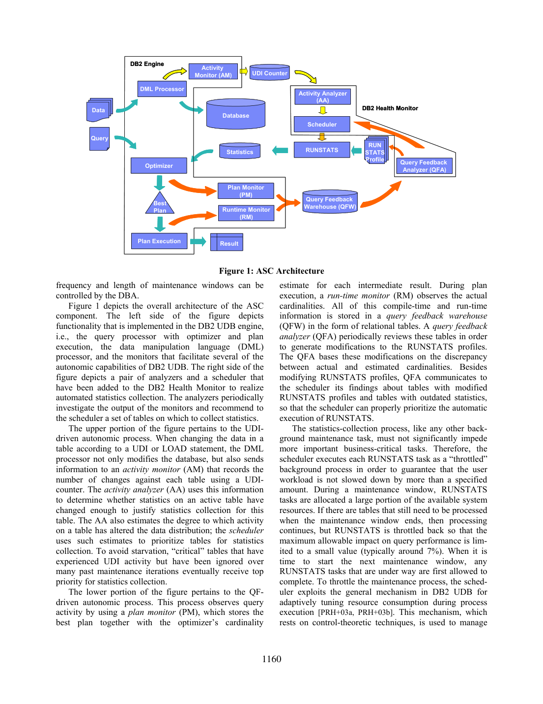
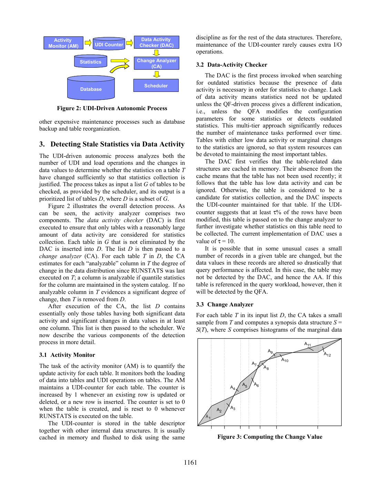

> 本组第 8 篇 · 统计与基数估计 · [全部论文]() · [上一篇]() · [下一篇]()

DB2 UDB v8.2 的 ASC 将 UDI/LOAD 活动检测与查询反馈结合：AA 筛选有数据活动且分布显著变化的表，QFA 根据估计/实际基数差异修改 RUNSTATS profile，scheduler 合并优先级并触发按表 RUNSTATS。Profile 是收集配置，不是统计结果或用户预先提交的静态 workload；当前 QFA 调整 frequent-value 数量和表内列组，自动推荐 quantile 数量仍是未来工作。DAC 当前门槛为约 10% 行修改迹象，CA 不能追回被 DAC 排除的表，QF 为负载中暴露的问题提供互补信号。维护窗口外仍可继续 RUNSTATS，以自适应节流限制查询性能影响（通常约 7%），不是固定资源利用率。11 条报表查询的 DMV 案例中有收益也有回退；1–2% 是该案例的监控主导开销，不能等同于 7% 策略值或普适保证。

本文保留论文陈述、读者推断与待验证方案的区别；实验数字只适用于原文条件。原文和翻译来自已有 AI 辅助精读报告，已做来源匹配与编辑复核，不等于人工逐项核验或独立实验复现。所有页码均为 PDF 物理页。

## 论文与阅读范围

A. Aboulnaga, P. Haas, M. Kandil, S. Lightstone, G. Lohman, V. Markl, I. Popivanov, V. Raman. Automated Statistics Collection in DB2 UDB. Proceedings of the 30th VLDB Conference, Toronto, Canada, 2004, pp. 1158–1169。以 PDF 第 1 页署名和正文为准；文件内 metadata 错列另一篇论文的题名/作者，不用作书目依据。本次完整阅读 SHA 匹配的 12 页 extracted，并视觉核对 PDF 第 8 页公式和第 10 页实验图。COA 缺失基数分支、经验阈值细节及完整复现实验材料仍未提供。

[论文集中的原始 PDF](https://github.com/lonng/db-papers/blob/4ff1331069c7cf52ac97dd769e5f484c1c35c200/papers/statistics/automated-statistics-collection-in-db2-udb.pdf) · 本地来源：`statistics/automated-statistics-collection-in-db2-udb.pdf`，共 12 页。

本篇保留 10 组原文精读和 47 条证据。截图为原始 PDF 的局部页选，不是重新生成的图表；未将整份 PDF 复制到博客。

## 研究问题与适用边界

【原文】优化器用表行数、列 distinct counts、frequent values、quantiles 及表内列组统计估计中间结果基数和计划代价。统计值陈旧与统计配置不充分是不同问题：即使刚刷新单列统计，也可能因未捕获相关性而选到较差计划；统计有误也不必然改变最优计划。
ASC 自动决定收集哪些统计、收集细度及何时收集，结合主动面向未知查询的 UDI 检测与需要学习时间的工作负载反馈。第 1 页将逐 DML 增量维护通常过贵作为背景，不是 ASC 必须禁止任何增量统计的形式化前提。
【边界】本文描述 2004 年 DB2 UDB v8.2 的组件和一个案例，不提供所有负载下的性能保证；无需 DBA 逐次配置/收集统计，不等于系统完全无需 DBA 设置维护策略。

依据：论文陈述；PDF 物理页 1, 2。证据：[C001N01](#evidence-c001n01), [C001N02](#evidence-c001n02), [SR01](#evidence-sr01)。

## 系统架构与核心组件

【原文：配置与统计分离】RUNSTATS 按表执行，将实际统计写入系统目录；profile 记录列/索引选择、frequent-value 和 quantile 数量、列组等收集参数，可通过 RUNSTATS 修改、通过 SQL 查询。原文明确写 profile 位于 SYSSTAT.PROFILE；同页另有 SYSTAT 拼写，不据此另造 schema。QFA 修改 profile 后，还需下一次 RUNSTATS 才真正收集统计，不会直接把反馈值写成统计。
UDI 路径：DML processor 将 UDI/LOAD 活动通知 AM，AM 在 table descriptor 中维护 counter；每次行插入/更新/删除加一，建表及 RUNSTATS 时归零，通常缓存并沿用原刷盘策略，故很少增加 I/O。它不是不同修改行的去重集合。
QF 路径：PM 保存计划和估计基数，RM 保存执行中观测基数及参数/宿主变量实值，周期性写入关系表形式的 QFW；QFA 依次调用 Table Cardinality Analyzer (TCA)、Simple-Predicate Analyzer (SPA)、Correlation Analyzer (COA)，给出 Q 列表和配置变更。QFW 保存查询、骨架计划、谓词及列信息和建议，会自动清理旧数据且不超过 DBA 大小上限。当前反馈谓词条目覆盖 COLUMN 与 literal 比较及单表合取；这不等于整个 DB2 不能执行更复杂 SQL。
【workload 与资源】workload 是实际执行查询及其误差反馈，不是另行提交的静态模板集合。表级误差按经历该误差的查询频率加权；needed/urgent 类再结合频率计数与聚合误差排序，频率不是 CPU utilization 或业务 SLA 权重。DBA 可限定/排除表、设置窗口、选择 AA/QFA 和 QFW 大小上限。
Scheduler 将 RUNSTATS 作为节流后台任务。窗口内分配较大份额的可用资源；窗口结束仍有待处理表时继续执行，但将查询性能影响约束到小值，通常约 7%。下一窗口开始时先允许在途任务完成。原文借用基于控制理论的自适应资源消耗机制，未给出固定 CPU/I/O 利用率阈值、反馈控制方程或本案例 utilization 曲线。7% 描述查询减速影响，不是 CPU 占用率。
当前 QFA 会增加 frequent-value 数量和表内列组统计；虽然 profile 可保存 quantile 数量，自动推荐该数量仍是第 12 页未来工作。

依据：论文陈述；PDF 物理页 2, 3, 4, 6, 8, 12。证据：[C001N03](#evidence-c001n03), [C001N04](#evidence-c001n04), [C001N06](#evidence-c001n06), [C002N01](#evidence-c002n01), [SR01](#evidence-sr01), [SR03](#evidence-sr03), [SR04](#evidence-sr04), [SR05](#evidence-sr05), [SR06](#evidence-sr06), [SR16](#evidence-sr16), [SR17](#evidence-sr17)。

*原论文 PDF 物理页 3，版权归原作者或出版方。点击图片可查看原尺寸。页面文本中定位到：Figure 1 depicts the overall architecture of the ASC；Figure 1: ASC Architecture。这是页面定位信息，不表示本次已复核图内所有数据。*

## 核心算法与执行步骤

【原文：触发链】AA 接收待检查列表 G，先 DAC 再 CA。DAC 先查表相关数据结构是否在缓存中，未缓存则视作近期不活跃并跳过；counter 表示至少 τ% 行被修改才继续，当前 τ=10（10%，不是 10 行）。Counter 逐操作累加，不能保证恰为 10% 不同行。DAC 放行不等于立即 RUNSTATS：CA 还须检查分布变化，scheduler 再决定顺序与时机；QFA 的推荐和 critical 防饥饿提供其他入队原因。
CA 从表取约 2000 页数据的页级 Bernoulli 样本，构造新边际直方图 S，与目录中的旧 R 比较。analyzable 列是目录已维护 quantiles 的列。对数值列 C，change=(1/(u-l))*∫[l,u]|e_R(C≤v)-e_S(C≤v)|dv；归一化的是值域长度，结果仍是基数误差量纲，不是 [0,1] 概率距离。合并桶边界，以分段线性曲线间梯形/三角形面积实现 line sweep。至少一列 change>θ 才保留表，优先值为最大列变化。θ 为经验值，全文未给具体数值；等于阈值、无可分析列和退化值域的全部实现分支未交代。
QFA：TCA 比较表实际/目录估计行数；SPA 使用已有 frequent values、反馈揭示的候选值及对剩余稀有值的均匀频率估计，同值多份估计取最新。SPA 从现有数目 n 起增加 K，直到 AbsError(K) 低于门槛，或 K 达 min(m+n,β)；并非无约束地将真实误差全局最小化，也不描述自动缩减 K。QFA 只考虑超出正常采样波动预期的误差记录。
COA 当前关注表内列对与简单等值合取。在 m、α1、α2、α12 均可观测的情形，以 1-Θ ≤ α12*m/(α1*α2) ≤ 1+Θ 判定独立性可接受，否则误差幅度为 |α12-α1*α2/m|。缺失实际基数时估算并调整阈值/误差，但本文未公布完整分支；不能自行指定估算法或“只放宽”阈值。
QFA 按列/列组聚合误差，对严重项改 profile；按查询出现频率加权合成表级误差，交给 scheduler。五级顺序 critical > urgent > pressing > needed > useful：useful 严格为 (0%,50%)，pressing 为至少 50%，needed 为 QFA 推荐，urgent 为 needed 与 useful/pressing 交集；critical 为有 UDI 却长久未刷新或从未 RUNSTATS，强制入 P 最高优先，同表只出现一次。useful/pressing 内按修改比例，needed/urgent 按频率和误差，critical 按变化率且缺变化率者优先。
刷新后 CA 比较相邻目录统计，变化量除以间隔估计变化率，以确定下一次让 AA 检查的维护迭代；不是预测必然执行 RUNSTATS 的时间。初始 G 是纳入自动维护的全部表，之后 constructDueTables 重建 G 与 critical 列表 C。

依据：论文陈述；PDF 物理页 4, 5, 6, 7, 8, 9。证据：[C001N09](#evidence-c001n09), [C001N10](#evidence-c001n10), [C001N11](#evidence-c001n11), [C002N02](#evidence-c002n02), [C002N03](#evidence-c002n03), [C002N04](#evidence-c002n04), [C002N05](#evidence-c002n05), [C002N07](#evidence-c002n07), [C002N09](#evidence-c002n09), [SR02](#evidence-sr02), [SR05](#evidence-sr05), [SR07](#evidence-sr07), [SR08](#evidence-sr08), [SR17](#evidence-sr17)。

## 正确性论证、前提假设与局限

【原文边界】本文没有全局正确性、最优计划或完整复杂度证明。阈值、随机采样和有限反馈共同构成启发式。SPA 的 AbsError 使用已知频率与稀有值均匀性模型，并不是对所有未观测值真实误差的保证。CA 的约 2000 页是作者所需精度下的经验选择。
DAC 可能漏掉少数行发生剧烈值变化的表；CA 位于 DAC 之后，不能追回被 DAC 过滤的输入。第 4 页指出负载引用该表时 QFA 可补充检测。读者仍不能将其理解为任何执行计划都会产生全部所需反馈或第一条查询就免于回退，COA 本身也会缺失实际基数。
当前 QFA 主要面向表大小、简单等值谓词及表内列对；QFW 可记录的比较运算符范围更宽，不能把“存得下反馈”混同于“已有对应修复算法”。未支持的细粒度反馈形式不等于 SQL 执行能力受限。
【读者推断】周期检查、下一次 RUNSTATS 才落实 profile、有限 QFW 保留期会引入反馈时效与覆盖限制；这些是设计推论，不是论文测出的失败率。critical 和去重规则用于缓解饥饿，不构成有限窗口下一定完成所有表的时延定理。τ=10 的 counter 检查、50% 调度分级、θ 距离门槛、Θ 独立性容差、β frequent-value 上限是不同参数，不能混用。

依据：读者推断；PDF 物理页 4, 5, 6, 7, 8, 9。证据：[C001N08](#evidence-c001n08), [C001N09](#evidence-c001n09), [C001N10](#evidence-c001n10), [C002N04](#evidence-c002n04), [C002N05](#evidence-c002n05), [C002N07](#evidence-c002n07), [SR02](#evidence-sr02), [SR07](#evidence-sr07), [SR08](#evidence-sr08), [SR17](#evidence-sr17)。

## 实验评估与案例分析

【原文条件】DMV/ACCIDENTS 事故数据库约 1.5 GB，四张主要表 Car、Owner、Demographics、Accident。硬件为单 CPU、333 MHz PowerPC 604、512 MB 内存、两块 8.5 GB 磁盘；系统为 AIX 4.3.3 ML11。第 12 页说明 ASC 已实现于 DB2 UDB v8.2。第 10 页列出了四表属性，未提供完整 DDL、生成数据脚本或 11 条查询的完整 SQL，不能声称 schema/硬件均缺失。
每阶段计时同一组典型的 11 条报表查询，统计配置与收集由 ASC 控制，DBA 不逐次干预。A 初始加载后使用默认统计；B 仅运行 AA 后使用详细单列分布统计；C 插入加拿大事故后仍使用插入前统计；D 仅 AA，更新但不重配；E 仅 QFA，更新且重配。D/E 被刻意分离，以考察 QFA 在 AA 之外的附加收益。图 10 的 A/B 与图 11 的 C/D/E 数据量不同，原文明确不可跨图直接比较。
Owner 的 (COUNTRY3,CITY) 和 Car 的 (MAKE,MODEL) 各有函数依赖，查询 10/11 使用相关列谓词。B 后多数查询改善，但查询 10 因相关列谓词而显著回退。作者将图 11 查询 10 的主要收益归因于 E 的列组统计，将查询 11 的主要收益归因于 D 的单列分布刷新；不能写成所有查询都改善。
【本次 AI 视觉核对，图 10/11，PDF 第 10 页】纵轴仅写 Response Time（图 11 拼为 Respone Time），没有标明秒/毫秒。图 10 查询 10：A=21.8、B>100；查询 11：A=22.4、B=1.4。图 11 查询 10：C=136.4、D=130.5、E=13.1；查询 11：C>900、D=20.4、E=18.1。完整 11 查询标签表另存本次 QA。仅据标签计算，查询 10 的 D/E 约 9.96 倍、C/E 约 10.41 倍；作者正文使用 orders-of-magnitude，但这些标签不支持把该例硬写为至少 100 倍或整个 workload 总耗时同幅下降。查询 11 C/D 的标签下界约为 44.1 倍，>900 是下界，不能当成精确 900。
【开销】案例中 ASC 使查询执行时间增加 1–2%，主要为监控。作者说分析器在非高峰以节流后台方式运行，未真正影响运营 DBMS；这不是零消耗。第 10 页末与第 11 页首连续正文明确说：DBMS 已处理 20,000 次查询时，QFA 分析 QFW 并推荐统计耗时少于一分钟。该数字不是 OCR 图标签，也不是执行 RUNSTATS 的时长。
【证据限制】约 2000 页采样和 DAC 10% 是机制设定，不是本案例规模/并发度或耗时。没有其他商业系统、人工调参的受控定量对比，也没有重复次数、方差、置信区间、CPU/I/O utilization 轨迹或广泛负载覆盖；不能把该案例 1–2% 当成通用开销上限。

依据：论文陈述；PDF 物理页 5, 10, 11, 12。证据：[C001N12](#evidence-c001n12), [C002N11](#evidence-c002n11), [C002N12](#evidence-c002n12), [C003N09](#evidence-c003n09), [SR09](#evidence-sr09), [SR10](#evidence-sr10), [SR11](#evidence-sr11), [SR12](#evidence-sr12), [SR13](#evidence-sr13), [SR14](#evidence-sr14), [SR15](#evidence-sr15)。

*原论文 PDF 物理页 4，版权归原作者或出版方。点击图片可查看原尺寸。页面文本中定位到：Figure 2 illustrates the overall detection process. As；table is referenced in the query workload, however, then it；Figure 2: UDI-Driven Autonomic Process；Figure 3: Computing the Change Value。这是页面定位信息，不表示本次已复核图内所有数据。*

## 设计权衡与工程取舍

【原文】低开销 counter 先筛活动量，CA 再避免“有改动但分布变化不大”的不必要维护。CA 不修复 DAC 漏检；需要 QF 的互补信号。PM/RM 的已有执行观测提供反馈，不等于 QFA 不产生实际扫描：它修改 profile 并触发 RUNSTATS，仍要收集数据统计。
QFW 的存储上限和旧数据清理控制空间。QFA 以误差频率聚焦当前 workload，AA 面向未见查询；原文未给独立业务优先级/SLA 权重配置或严格效用优化目标。
【读者推断】资源与新鲜度之间存在取舍：窗口外持续的节流维护可减轻长时间等待，但更严格的影响目标可能拉长收集时间。7% 是文中典型的查询性能影响目标，不是固定 CPU 或内存预算；1–2% 是特定案例的监控主导测量，不能说 analyzer 调度“把监控开销控制在 1–2%”。
作者在 2004 年认为某些复杂概要方法当时似乎不易扩展，选择简单统计以便收集和使用；不能改写为现代所有复杂模型必然不可扩展。五级队列体现工程启发式与防饥饿，但论文没有给最优性或吞吐/尾延迟边界。异步刷新减少 piggybacking 的持续扫描附加负担，不消除监控成本，也不保证刷新后每条查询更快。

依据：读者推断；PDF 物理页 2, 3, 4, 5, 6, 8, 9, 10, 11。证据：[C001N02](#evidence-c001n02), [C001N06](#evidence-c001n06), [C001N08](#evidence-c001n08), [C001N09](#evidence-c001n09), [C003N06](#evidence-c003n06), [C003N07](#evidence-c003n07), [SR03](#evidence-sr03), [SR04](#evidence-sr04), [SR05](#evidence-sr05), [SR07](#evidence-sr07), [SR14](#evidence-sr14)。

## 相关工作与技术对比

以下只转述本文第 7 节的 2004 年相关工作评价，不是对当前产品版本的验证。
作者将 DB2 UDB for iSeries、SQL Server、Oracle 10g 的自动刷新概括为 UDI 比例超阈值；ASC 的扩展是增加直方图变化检查、结合 QF、按重要性调度多表。本文没有跨产品定量实验。
静态 workload 分析依据查询形式选统计，不利用运行时反馈；ASC 用实际执行反馈，偏重简单统计。LEO 的早期反馈方法以估计/实际基数差异生成调整因子，ASC 增加 QFW、profile 修改/刷新建议和 UDI 集成，强调无需大幅修改现有优化器。
作者指出既有自调优多维直方图方法要求事先给定列集合，区别于从反馈发现应维护哪些列组。CORDS 通过枚举候选、剪枝和采样发现同表或跨表相关性，可能与 ASC 结合；这里的剪枝是候选搜索空间缩减，而非声称采用查询分区剪枝。
原文认为概率关系模型、Markov/Bayesian 等复杂概要当时的扩展性有限；piggybacking 通过观察正常 DML 扫描数据收集统计，但累计开销可能显著并持续影响处理。这些是作者的历史定位，不是本文已经复现的外部系统结论。

依据：论文陈述；PDF 物理页 11。证据：[C003N01](#evidence-c003n01), [C003N02](#evidence-c003n02), [C003N03](#evidence-c003n03), [C003N04](#evidence-c003n04), [C003N05](#evidence-c003n05), [C003N06](#evidence-c003n06), [C003N07](#evidence-c003n07)。

## 复现指南与验证建议

以下均为尚未执行的读者复现建议，不是原文实验结果，也不借外部系统记忆背书。
1. 按 AM→DAC→CA 和 PM/RM→QFW→TCA/SPA/COA→profile→scheduler→RUNSTATS 建最小原型。分别验证有行操作却分布稳定、少量行剧烈变化、等值倾斜和表内相关性；确认 CA 只收到 DAC 放行表，QFA 可独立推荐。
2. 实现数值列的分段线性 L1 积分，对照高精度积分基准。按页 Bernoulli 采样，比较不同页大小、聚簇与倾斜下约 2000 页样本的误差；该规模不作普适置信保证。显式选择 θ、β、Θ、采样噪声门槛及零分母/空列分支，并标为本地假设，不能称论文公布值。页内行相关性存在时，不能未经检验套用逐行独立二项置信区间。
3. SPA 验证从 n 起增加 K 的阈值/上限停止规则；COA 先仅实现实际基数齐全分支，缺失基数策略作为独立实验。量化未观测稀有值偏态导致的模型误差，不混同于真实误差必单调。
4. 调度测试 critical > urgent > pressing > needed > useful、同表去重及 critical 缺变化率者优先；区分预测“下次检查”与“下次必收集”。模拟窗口内较多资源和窗口外继续节流，测量前台查询影响、CPU/I/O utilization 和维护完成延迟，不把 CPU 固定 7% 当作实现。
5. 重建四表及相关列工作负载，按 A/B、C/D/E 同数据规模分组比较，不跨图做速度比。复现监控开启/关闭的开销及 QFA 分析时长，另测 RUNSTATS。论文有属性列表和硬件条件，但无完整 DDL、数据生成脚本、全套 SQL、数据规模变更细节及重复实验方法；仅凭当前材料不能声称精确复现数值，不应断言任何形式的复现都不可能。
6. 现代系统对照仅列待查问题：是否分离收集配置与统计结果？是否基于真实反馈而非静态 workload？是否区分资源预算与查询影响目标？在查阅各自源码前不宣称实现相同。

依据：待验证的工程设想；PDF 物理页 3, 4, 5, 7, 8, 9, 10, 11, 12。证据：[C001N09](#evidence-c001n09), [C001N10](#evidence-c001n10), [C002N03](#evidence-c002n03), [C002N05](#evidence-c002n05), [C002N07](#evidence-c002n07), [SR02](#evidence-sr02), [SR03](#evidence-sr03), [SR07](#evidence-sr07), [SR08](#evidence-sr08), [SR09](#evidence-sr09), [SR10](#evidence-sr10), [SR11](#evidence-sr11), [SR13](#evidence-sr13), [SR15](#evidence-sr15), [SR16](#evidence-sr16)。

## 总结与未来方向

ASC 的核心是“活动检测 + 查询反馈配置 + 统一调度”的互补闭环，不是每逢 UDI 阈值即同步收集，也不是 QFA 直接改写统计值。当前实现识别 frequent-value 配置和表内列对统计需求，再由 RUNSTATS 执行；对单条查询的收益不是无条件的，单列统计刷新后查询 10 曾明显回退。
案例支持某些查询显著加速及低监控开销：该案例测得查询耗时增加 1–2%；20,000 次已处理查询时 QFA 分析并提出建议少于一分钟。后台自适应节流的窗口外典型影响值约 7% 是另一个语义不同的设定，不可与前者混同。
第 12 页未来工作包括自动推荐 quantile 数量、有限双变量直方图、更高阶列组、直接使用反馈改统计、结合 CORDS、自动确定维护间隔及资源分配。本文没有给出这些扩展的完成实现、全面正确性证明或广泛 benchmark。
本次为 Codex 基于单篇原文的 AI 语义审核，不是独立人工审核；原模型初稿审查记录保留，其中关于 20,000 次查询无来源及 CA 能弥补 DAC 漏检的意见已由本次 QA 纠正。

依据：论文陈述；PDF 物理页 3, 10, 11, 12。证据：[C003N09](#evidence-c003n09), [C003N10](#evidence-c003n10), [C003N11](#evidence-c003n11), [SR03](#evidence-sr03), [SR13](#evidence-sr13), [SR14](#evidence-sr14), [SR15](#evidence-sr15), [SR16](#evidence-sr16)。

## 原文精读：从句子回到机制

以下保留原文、忠实翻译、含义与边界；假设示例不作为论文实验结果。

### P001 · PDF 物理页 1

**原文**

<blockquote class="paper-source-quote"><pre><code>Advanced &#10;optimizers also use joint statistics on groups of columns &#10;within a table in order to deal with possible correlations &#10;between column values. &#10;The presence of inaccurate or outdated statistics &#10;causes the optimizer to inaccurately estimate the &#10;cardinalities and costs of the steps in a query plan, which &#10;can result in a poor choice of plan and lead to &#10;unacceptably long query processing times. Unfortunately, &#10;it is all too easy for the statistics in a DBMS to deteriorate &#10;over time.</code></pre></blockquote>

**忠实翻译**

> 高级优化器还会使用表内列组上的联合统计信息，以处理列值之间可能存在的相关性。不准确或过时的统计信息的存在会导致优化器对查询计划中各步骤的基数和代价进行不准确的估计，这可能导致糟糕的计划选择并引发不可接受的长查询处理时间。不幸的是，DBMS 中的统计信息随时间推移而恶化实在太容易了。

**技术含义与边界**

> 作者陈述统计误差可导致基数/代价估计失准，进而可能选择较差计划，并介绍表内列组联合统计。读者推断：相关谓词可能需要联合信息；这不保证每个统计误差都改变计划，也不保证增加统计单调改善性能，第 10 页查询 10 曾在只刷新单列统计后回退。

**常见误读**

> 容易发生的错误解读是将‘统计信息不准确’等同于‘一定会选错计划’。原文使用的是‘can result in’（可能导致），并非必然结果。此外，不应将‘all too easy to deteriorate’泛化为所有 DBMS 在所有负载下都会快速退化，原文未给出退化的具体速率或条件。

**读者构造的假设示例**

> 读者构造的假设示例：国家与城市相关时，独立性假设可能低估联合筛选基数，改变连接计划的代价排序。这个例子未指定实测时长，也不是作者实验。

### P002 · PDF 物理页 12

**原文**

<blockquote class="paper-source-quote"><pre><code>Statistics collection takes place as a throttled background &#10;process, ensuring minimal impact on mission-critical &#10;queries.  &#10;ASC is implemented in DB2 UDB v8.2. Our case &#10;study using the ACCIDENTS database has shown ASC to &#10;be effective in improving query performance over time, in &#10;some cases by orders of magnitude.</code></pre></blockquote>

**忠实翻译**

> 统计信息收集作为受节流控制的后台进程进行，确保对关键任务查询的影响最小化。ASC 在 DB2 UDB v8.2 中实现。我们使用 ACCIDENTS 数据库的案例研究表明，ASC 能够有效地随时间推移提升查询性能，在某些情况下提升幅度可达数量级。

**技术含义与边界**

> 原文陈述受节流控制的后台收集和 ACCIDENTS 案例的局部加速。结合第 3 页，节流自适应调节资源以控制查询性能影响，窗口外仍可继续；不是固定 CPU 利用率上限，也不保证完全无干扰。

**常见误读**

> 容易发生的错误解读是将‘in some cases by orders of magnitude’（在某些情况下提升数量级）泛化为 ASC 在所有数据库、所有工作负载下的普遍保证。原文明确限定了这是基于 ACCIDENTS 数据库的案例研究结果，不能代表全局性能提升承诺。

**读者构造的假设示例**

> 读者构造的假设示例：若业务查询减速超过管理员设置的影响目标，后台维护减少资源消耗；资源闲置时再增加。这里只说明影响目标与资源调节的区别，不设定论文未给的 CPU 百分比，也不据此保证请求不超时。

### P003 · PDF 物理页 6

**原文**

<blockquote class="paper-source-quote"><pre><code>The data in the QFW is organized into relational &#10;tables. The feedback query table stores each query in its &#10;entirety, along with a skeleton query plan. &#10;The feedback predicate table stores detailed predicate &#10;information. In our current implementation, the QFW &#10;stores information for simple predicates of the form &#10;COLUMN ⊕ ‘literal’ (where ⊕ is a relational &#10;operator such as “=” or “&lt;”), as well as compound &#10;predicates that reference a single table and are &#10;conjunctions of simple predicates.</code></pre></blockquote>

**忠实翻译**

> QFW 中的数据被组织成关系表。反馈查询表完整地存储每个查询，以及一个骨架查询计划。反馈谓词表存储详细的谓词信息。在我们当前的实现中，QFW 存储形式为 COLUMN ⊕ ‘literal’（其中 ⊕ 是诸如“=”或“<”的关系运算符）的简单谓词的信息，以及引用单张表且为简单谓词合取的复合谓词的信息。

**技术含义与边界**

> QFW 是关系表组织的反馈仓库。当前细粒度谓词记录覆盖列与 literal 比较和单表合取；query table 仍记录完整查询。第 6 页说明 PM/RM 只有机会观察一个或多个子谓词，并不保证捕获所有因子及所有组合；QFA 当前重点分析简单等值和表内列对。

**常见误读**

> 不能将记录范围扩大为任意 SQL 谓词的细粒度反馈；也不能倒推出整个 DB2 不支持 JOIN、OR 或子查询。存储支持比较符 <，不等于本文为每类不等式都给出配置修复算法。

**读者构造的假设示例**

> 读者构造的假设示例：执行 emp 上 age>30 AND dept='Sales' 时，完整 SQL 和骨架计划可进入 query table；实际观测到的简单/合取谓词基数可形成条目，不能保证 age、dept 及合取三者都有独立条目。跨表连接条件不属于这里描述的单表谓词条目范围。

### P004 · PDF 物理页 4

**原文**

<blockquote class="paper-source-quote"><pre><code>The current implementation of DAC uses a &#10;value of τ = 10.  &#10;It is possible that in some unusual cases a small &#10;number of records in a given table are changed, but the &#10;data values in these records are altered so drastically that &#10;query performance is affected. In this case, the table may &#10;not be detected by the DAC, and hence the AA.</code></pre></blockquote>

**忠实翻译**

> DAC 的当前实现使用 τ = 10 的值。在某些不寻常的情况下，给定表中只有少量记录被更改，但这些记录中的数据值被改变的程度如此剧烈以至于影响了查询性能。在这种情况下，该表可能不会被 DAC 检测到，因此也不会被 AA 检测到。

**技术含义与边界**

> DAC 全称 Data-Activity Checker。前文规定 counter 表示至少 τ% 的行被修改才送后续 CA，τ=10 即 10%，不是 10 行。Counter 逐行操作累加而非去重计数。先 DAC 后 CA，因此少量行剧烈变化被 DAC 拦下时，CA 无法补救；第 4 页继续指出查询负载中的该表可由 QFA 补充检测。

**常见误读**

> 不要把 τ=10 读成修改十行就触发 RUNSTATS，或把 DAC 放行当作立即收集。CA 还需判断分布变化，scheduler 再调度。AA 内的 CA 不能检测根本未传入的表。

**读者构造的假设示例**

> 读者构造的假设示例：百万行表仅修改五行且造成关键谓词分布剧变，其 counter 远不足约 10% 的门槛，DAC 可能不送 CA；若后续查询实际暴露估计误差，QFA 才有机会提出维护建议。性能退化是否发生取决于计划，不是五行变化的必然结果。

### P005 · PDF 物理页 7

**原文**

<blockquote class="paper-source-quote"><pre><code>ƒ &#10;The frequencies cfv1 … cfvm of all values for &#10;which there is a relevant error record in the QFW. &#10;These values can be considered as candidate &#10;frequent values to maintain. &#10;ƒ &#10;An average frequency assigned to each of the &#10;remaining “rare” (i.e., infrequent) values, &#10;computed using a uniformity assumption from the &#10;estimated number of rows in the table and the &#10;number of distinct values in the column. &#10;When multiple frequency estimates are available for a &#10;given column value, the SPA uses the most recent one.</code></pre></blockquote>

**忠实翻译**

> 对于 QFW 中存在相关错误记录的所有值，其频率 cfv1 … cfvm。这些值可以被视为需要维护的候选频繁值。分配给其余每个‘稀有’（即不频繁）值的平均频率，该频率使用均匀性假设，根据表的估计行数和列中不同值的数量计算得出。当给定列值有多个频率估计可用时，SPA 使用最近的一个。

**技术含义与边界**

> SPA 全称 Simple-Predicate Analyzer。它合并当前目录 frequent values 与 QFW 中候选频率，其余未被这两类覆盖的值才用均匀平均频率；并非所有“无错误记录”的值都算稀有值。同值多估计选最新，不代表最新值无采样误差。后续按门槛和 β 上限选择 K，不是无约束误差最小化。

**常见误读**

> 容易发生的错误解读是认为均匀性假设能准确反映所有‘稀有’值的真实分布。原文明确说明这是一个‘assumption’（假设），在数据严重倾斜时该假设会产生误差。此外，‘使用最近的一个’频率估计并不意味着最近的估计一定是最准确的，原文仅陈述了 SPA 的既定策略，未对其最优性做出保证。

**读者构造的假设示例**

> 读者构造的假设示例：假设总行数 10000、distinct 值数 100，且当前目录 frequent-value 列表为空；反馈揭示 A=5000、B=3000，则其余 98 值的均匀平均为 2000/98，约 20.4。若目录还有其他已维护 frequent values，也必须先扣除，不能一概只看反馈的两项。数值只是示意，不是论文数据。

### P006 · PDF 物理页 9

**原文**

<blockquote class="paper-source-quote"><pre><code>thousands of tables and terabytes of data, selecting the &#10;wrong tables for statistics collection might mean that very &#10;needy tables will have to wait an unreasonable length of &#10;time, with detrimental effects on query performance.   &#10;The scheduler classifies tables into five distinct &#10;“urgency” classes. A table is useful with respect to &#10;statistics refresh if more than 0% but less than 50% of the &#10;rows have experienced some data change since the last &#10;statistics refresh on the table. A table is needed if it has &#10;been recommended for processing by the QFA.</code></pre></blockquote>

**忠实翻译**

> 数千张表和数 TB 的数据，选择错误的表进行统计信息收集可能意味着非常需要更新的表将不得不等待不合理长的时间，从而对查询性能产生不利影响。调度器将表分类为五个不同的‘紧急度’类别。如果自上次统计信息刷新以来，超过 0% 但少于 50% 的行经历了某些数据更改，则该表在统计信息刷新方面是有用的（useful）。如果一张表已被 QFA 推荐进行处理，则该表是被需要的（needed）。

**技术含义与边界**

> 原文先定义 useful 为修改比例严格在 (0%,50%)，needed 为 QFA 推荐。完整上下文还定义 pressing≥50%、urgent 同时 needed 且 useful/pressing、critical 为长期未刷新或从未 RUNSTATS；最终按最紧急类别归类，顺序 critical > urgent > pressing > needed > useful。

**常见误读**

> 本段只列两类不等于整篇缺失另三类。特别是被 QFA 推荐且有少量修改的表最终应归 urgent，而不是仍归 needed；0% 不能算 useful。

**读者构造的假设示例**

> 读者构造的假设示例：T1 修改 30% 且未被 QFA 推荐，可归 useful；T2 修改 1% 并被 QFA 推荐，则同时 needed 和 useful，最终归 urgent，优先于 T1。假设二者均不满足 critical；否则 critical 优先覆盖。

### P007 · PDF 物理页 5

**原文**

<blockquote class="paper-source-quote"><pre><code>distribution for each analyzable column. We have found &#10;that a sample consisting of about 2000 pages of table data, &#10;selected using page-level Bernoulli sampling, provides &#10;sufficient statistical precision for our purposes; see &#10;[PIHS96, IMHB04]. The CA also obtains an analogous &#10;synopsis R = R(T) based on the (possibly outdated) &#10;marginal data distributions that are stored in the system &#10;catalog.</code></pre></blockquote>

**忠实翻译**

> 为每个可分析列生成数据分布。我们发现，使用页级伯努利采样（page-level Bernoulli sampling）选择的约 2000 页表数据组成的样本，为我们的目的提供了足够的统计精度；参见 [PIHS96, IMHB04]。CA 还基于存储在系统目录中的（可能已过时的）边缘数据分布获取类似的概要 R = R(T)。

**技术含义与边界**

> CA 全称 Change Analyzer。它对有目录 quantiles 的可分析列比较新样本概要 S 与旧目录概要 R。约 2000 页是页级 Bernoulli 采样下作者发现适合其目的的经验样本规模，不是 DAC 阈值，也不是最终 RUNSTATS 的统一采样配置或任意数据的理论保证。

**常见误读**

> 不能把约 2000 页写成精确固定样本页数或通用精度定理；Bernoulli 采样页数本身可波动。引用 PIHS96/IMHB04 表示作者提供相关依据，但本次未审阅那些外部文献，不能称已经验证其理论。

**读者构造的假设示例**

> 读者构造的假设示例：假定表有百万页、每页 8 KiB，按页独立纳入概率约 0.002，可得到期望约 2000 页（约 15.6 MiB）的样本用于 S；R 从旧 RUNSTATS 目录读取。表大小、页大小和概率均为示意，不是作者环境。

### P008 · PDF 物理页 8

**原文**

<blockquote class="paper-source-quote"><pre><code>Otherwise, the COA declares that a correlation error of &#10;absolute magnitude &#10;12&#10;1&#10;2&#10;(&#10;/&#10;)&#10;m&#10;α&#10;α α&#10;−&#10;has occurred. &#10; The analysis becomes more complicated when one or &#10;more of the actual cardinalities are not available, as is &#10;often the case in practice. The COA deals with the &#10;problem by estimating the missing information and &#10;adjusting the error-detection threshold and estimate of the &#10;error magnitude accordingly. Details of the complete &#10;algorithm will appear in a forthcoming paper.</code></pre></blockquote>

**忠实翻译**

> 否则，COA 判定发生绝对幅度为 |α12−α1α2/m| 的相关性误差。一个或多个实际基数不可用时（实践中经常如此），分析更复杂。COA 通过估计缺失信息，并相应调整误差检测阈值和误差幅度估计来处理；完整算法细节将另文发表。（公式按 PDF 第 8 页原图核对，原始提取引文保持不变。）

**技术含义与边界**

> COA 全称 Correlation Analyzer。在实际基数可用的表内列对场景，比较联合实测选择率与边际实测选择率之积。前文独立性检验为 1−Θ≤α12*m/(α1α2)≤1+Θ。缺失基数分支只给原则，没有给定具体补值方法、调整方向或固定百分比。

**常见误读**

> 不能把“调整”写成一律放宽阈值，也不能凭空指定用边际分布推断联合基数；这反而可能把正在检测的独立性当作前提。完整分支缺失不等于上述实际基数齐全时的公式也缺失。

**读者构造的假设示例**

> 读者构造的假设示例：若反馈缺少 p1 的独立实际基数但有合取基数，应把该记录送入明确标注为本地假设的缺失信息处理分支，单独验证误报和漏报；本文不足以指定其插值方法或把阈值从 10% 改到 15%。

### P009 · PDF 物理页 11

**原文**

<blockquote class="paper-source-quote"><pre><code>These include DB2 UDB for the iSeries™ &#10;server [IBM02], Microsoft® SQL Server [MICR04], and &#10;Oracle 10g [ATLB03]. These products essentially &#10;automate statistics refresh on all tables where the &#10;percentage of UDI operations exceeds a threshold.  Our &#10;approach provides three major extensions to this &#10;technology. First, we combine UDI measurement with a &#10;histogram analysis to reduce maintenance overhead.</code></pre></blockquote>

**忠实翻译**

> 这些产品包括用于 iSeries™ 服务器的 DB2 UDB [IBM02]、Microsoft® SQL Server [MICR04] 和 Oracle 10g [ATLB03]。这些产品本质上是在 UDI 操作百分比超过阈值的表上自动化统计信息刷新。我们的方法对该技术提供了三个主要扩展。首先，我们将 UDI 测量与直方图分析相结合，以减少维护开销。

**技术含义与边界**

> 作者在 2004 年将所列商业产品概括为 UDI 比例超阈值刷新，并给出 ASC 的直方图变化过滤扩展。这里是对当时方案的描述，不是对当前产品版本的事实核验。CA 作用是过滤已通过活动筛选但边际分布变化不大的表，不是补捉被 DAC 漏掉的表。

**常见误读**

> 不能将“UDI 与直方图分析结合”说成移除 UDI 检查，也不能以字符串改大小写作为“统计不变”的当然例子：它可能改变比较语义、frequent values 及 quantiles，且没有 quantile 的列不在 CA 的该检查范围内。

**读者构造的假设示例**

> 读者构造的假设示例：对具有 quantile 统计的数值列做大量行间交换，若数值多重集合保持不变且采样差异在门槛内，counter 虽高，CA 仍可能过滤表，避免不必要 RUNSTATS。这个例子不涉及字符串排序规则，也不是作者实验。

### P010 · PDF 物理页 2

**原文**

<blockquote class="paper-source-quote"><pre><code>Neither a UDI-driven nor a QF-driven approach is &#10;sufficient by itself. UDI-driven approaches are proactive &#10;and therefore can handle unforeseen queries, but may not &#10;concentrate enough effort on maintaining statistics that &#10;are critical to the users’ workload.</code></pre></blockquote>

**忠实翻译**

> 仅靠 UDI 驱动或 QF 驱动的方法本身都不够充分。UDI 驱动的方法是主动的，因此能够处理不可预见的查询，但可能无法将足够的精力集中在维护对用户工作负载至关重要的统计信息上。

**技术含义与边界**

> UDI 是主动准备，QF 是面向已执行负载的反应式细化。原文说二者各有短板并建议结合；不是 UDI 完全不关注重要表，也不是反馈一产生就能修复当前执行。Scheduler 用误差频率及防饥饿规则协调两者。

**常见误读**

> 容易发生的错误解读是认为 UDI 驱动的方法完全无用，或者认为 QF 驱动的方法没有任何缺点。原文肯定了 UDI 方法‘能够处理不可预见的查询’这一优势，仅指出其在资源聚焦上的不足。不能将‘may not concentrate enough effort’（可能无法集中足够精力）等同于‘绝对不会关注关键统计信息’。

**读者构造的假设示例**

> 读者构造的假设示例：T1 高频更新但暂不参与报表，T2 更新较少却在报表中暴露列相关性估计误差；UDI 活动筛选可能更关注 T1，QFA 可根据 T2 的执行反馈建议列组统计。若 T2 没有数据变化，问题仍可能来自配置不足而非“必然陈旧”。

## 尚未解决的问题

1. θ、Θ、β、采样噪声门槛与 critical 等待迭代数的具体值及调参依据是什么？
2. 无 quantile 可分析列、阈值相等、退化值域和零基数分母等边界在实际实现中怎样处理？
3. COA 缺失实际基数时完整的估算与阈值调整算法是什么？
4. 约 2000 页采样在不同页大小、聚簇和稀有值倾斜条件下的精度如何？
5. 本案例缺失的完整数据、SQL、重复测量与 utilization/节流轨迹能否取得，以独立复核定量结果？
6. 在负载变化与 QFW 淘汰旧记录时，统计新鲜度、反馈覆盖和资源影响如何权衡？

## 证据索引

证据编号沿用原报告，便于将上文判断追溯到原句。引文匹配只验证位置，不证明解读正确。

**C001N01 · PDF 物理页 1**

问题：不准确或过时的统计会导致基数与代价估计失准，并可能导致较差计划。论文以传统统计不随每次 DML 增量维护为背景，不把完全禁止增量维护列作 ASC 的必要前提。

<blockquote class="paper-source-quote"><pre><code>The presence of inaccurate or outdated statistics causes the optimizer to inaccurately estimate the cardinalities and costs of the steps in a query plan</code></pre></blockquote>

**C001N02 · PDF 物理页 2**

模型与前提：ASC 同时使用 UDI-driven 和 QF-driven 两种自管理过程。UDI-driven 是主动的，能处理未预见的查询，但可能不会将足够资源集中在对用户负载关键的统计信息上；QF-driven 是被动的，需要学习时间，但聚焦最关键的统计信息，资源利用高效。两者互补的前提是单一方法不足以保证整体性能。ASC 的策略是定期主动收集每张表的基本统计信息，同时根据负载被动细化统计信息。

<blockquote class="paper-source-quote"><pre><code>Neither a UDI-driven nor a QF-driven approach is sufficient by itself. UDI-driven approaches are proactive and therefore can handle unforeseen queries</code></pre></blockquote>

**C001N03 · PDF 物理页 2**

数据结构与不变量：DB2 UDB 在 SYSTAT schema 的系统目录表中存储统计信息，包括 tables（行数）、columns（distinct values 数）、indexes（distinct keys 数、聚簇度、物理属性）、coldist（quantiles 和 frequent values）、colgroups（列组 distinct values 数）。RUNSTATS profile 记录每张表的统计收集配置参数，存储在 SYSSTAT.PROFILE 中。不变量：系统目录记录每张表最近一次执行 RUNSTATS 的时间。

<blockquote class="paper-source-quote"><pre><code>The exact configuration parameters for RUNSTATS on each table (i.e., the set of columns on which to gather statistics, the number of quantiles and frequent values to collect for a column</code></pre></blockquote>

**C001N04 · PDF 物理页 3**

架构：Health Monitor 中 AA/QFA 给 scheduler 提出表及配置建议；scheduler 调用 RUNSTATS。维护集中在窗口内，但窗口结束仍可能继续，以更严格节流限制查询影响（见 SR03）。

<blockquote class="paper-source-quote"><pre><code>The activity analyzer (AA) uses this information to determine whether statistics on an active table have changed enough to justify statistics collection for this table.</code></pre></blockquote>

**C001N06 · PDF 物理页 4**

数据结构与不变量：Activity Monitor (AM) 为每张表维护一个 UDI-counter。每当现有行被更新或删除、或新行被插入时计数器加 1；表创建时置 0；执行 RUNSTATS 后置 0。UDI-counter 存储在 table descriptor 中，通常缓存在内存并按与其他内部数据结构相同的策略刷盘，因此很少引起额外 I/O。这是 UDI-driven 路径的基础输入。

<blockquote class="paper-source-quote"><pre><code>The counter is increased by 1 whenever an existing row is updated or deleted, or a new row is inserted. The counter is set to 0 when the table is created</code></pre></blockquote>

**C001N08 · PDF 物理页 4**

局限与反例：DAC 基于变更行数比例进行过滤，存在盲区。在某些异常情况下，表中少量记录被修改，但这些记录的数据值发生剧烈变化从而影响查询性能。此时 DAC 可能无法检测到该表，AA 也会遗漏。但如果该表被查询负载引用，QFA 仍能检测到。这表明 UDI-driven 路径在极端数据分布突变场景下不完备，必须依赖 QF-driven 路径补充。

<blockquote class="paper-source-quote"><pre><code>It is possible that in some unusual cases a small number of records in a given table are changed, but the data values in these records are altered so drastically</code></pre></blockquote>

**C001N09 · PDF 物理页 4**

算法步骤与数据结构：Change Analyzer (CA) 对输入列表 D 中每张表 T 取小样本，计算 synopsis S(T)，包含每个 analyzable column 的边际分布直方图。analyzable column 定义为系统目录中维护了 quantile 统计信息的列。同时从系统目录获取基于可能过时的边际分布的 synopsis R(T)。采样方法为 page-level Bernoulli sampling，约 2000 页表数据。然后对每个 analyzable column 度量两个直方图之间的距离。仅当所有 analyzable column 的距离都低于指定阈值时，才将 T 从 D 中删除。

<blockquote class="paper-source-quote"><pre><code>a column is analyzable if quantile statistics for the column are maintained in the system catalog.</code></pre></blockquote>

**C001N10 · PDF 物理页 5**

正确性与算法细节：对于数值型 analyzable column T.C，CA 使用归一化 L1 距离度量分布变化。公式为 change(T.C,R,S) = (1/(u-l)) * ∫_l^u |e_R(T.C≤v) - e_S(T.C≤v)| dv，其中 e_Y 是基于 synopsis Y 的基数估计，l 和 u 是 R 和 S 中出现的最小和最大桶边界点。该值可解释为一族单边不等式谓词上基数估计的平均绝对偏差。当直方图由桶边界（通常为 quantiles）表示时，可用 line sweep 算法计算：取两组桶边界的并集，在每个子区间上 e_R 和 e_S 是 v 的线性非递减函数，积分区域为两条分段线性曲线之间的面积，可分解为梯形和三角形面积之和快速计算。

<blockquote class="paper-source-quote"><pre><code>can be interpreted as the average absolute discrepancy in cardinality estimates over a family of one-sided inequality predicates.</code></pre></blockquote>

**C001N11 · PDF 物理页 5**

若某可分析列 change > θ，CA 保留该表并以最大列变化值赋优先级；连续目录统计的变化值除以时间用于预测下次送 AA 考察的时机。原文没有最优调度或完整复杂度证明。

<blockquote class="paper-source-quote"><pre><code>assigns to T a priority equal to maxC change(T.C,R,S). The CA can also use the foregoing measurement technique to quantify the change</code></pre></blockquote>

**C001N12 · PDF 物理页 5**

CA 使用页级 Bernoulli 采样，约 2000 页表数据在作者目标下提供足够精度；这是经验选择，不是对任意分布的精度定理。DAC 的 10% 条件另见 SR02，不能由本引文单独支持。

<blockquote class="paper-source-quote"><pre><code>a sample consisting of about 2000 pages of table data, selected using page-level Bernoulli sampling, provides sufficient statistical precision</code></pre></blockquote>

**C002N01 · PDF 物理页 6**

QFW的数据结构由多个关系表组成：feedback query table存储完整查询和骨架计划；feedback predicate table存储谓词信息，当前实现仅支持形如COLUMN ⊕ 'literal'的简单谓词以及引用单表的合取复合谓词；feedback column table为每个Boolean factor存储列名、操作符和字面量。字面量可来自PM（硬编码）或RM（参数标记/宿主变量）。QFW还包含recommendation column table和recommendation column-group table用于存储QFA的输出。

<blockquote class="paper-source-quote"><pre><code>The feedback predicate table stores detailed predicate information. In our current implementation, the QFW stores information for simple predicates of the form COLUMN ⊕ ‘literal’</code></pre></blockquote>

**C002N02 · PDF 物理页 6**

QFA的操作流程分为测量、分类、聚合和优先级排序四个阶段。它依次执行TCA、SPA和COA来确定估计误差的原因。TCA比较反馈仓库中表的实际基数与系统目录统计信息的估计基数，差异表明统计信息过时。QFA随后按列和表聚合误差，对表进行优先级排序，并将结果发送给调度器和RUNSTATS profiles。

<blockquote class="paper-source-quote"><pre><code>The QFA proceeds by measuring, classifying, aggregating, and prioritizing the differences between optimizer-based cardinality estimates and actual cardinalities.</code></pre></blockquote>

**C002N03 · PDF 物理页 7**

SPA 从当前 frequent-value 个数 n 起递增 K，达到误差阈值或 min(m+n,β) 即停止；这是阈值与上限约束下的配置规则，不是无约束全局最小化。AbsError 基于已知频率及稀有值均匀模型。

<blockquote class="paper-source-quote"><pre><code>To determine the number of frequent values to maintain, we initially set K = n and then increase the value of K until either AbsError(K) falls below a specified threshold</code></pre></blockquote>

**C002N04 · PDF 物理页 7**

SPA在计算稀有值（infrequent values）的平均频率countrare时，使用了均匀性假设（uniformity assumption）。具体而言，countrare是通过估计的表行数C减去已知频繁值和候选频繁值的频率之和，再除以剩余的distinct values数量(d - m - n)来计算的。这意味着SPA假设未被跟踪为频繁值的列值在数据中是均匀分布的。此外，当同一列值有多个频率估计时，SPA使用最近的一个。

<blockquote class="paper-source-quote"><pre><code>An average frequency assigned to each of the remaining “rare” (i.e., infrequent) values, computed using a uniformity assumption from the estimated number of rows</code></pre></blockquote>

**C002N05 · PDF 物理页 7**

由于系统目录中的部分统计信息是使用随机采样技术收集的，QFA在处理QFW条目时会进行过滤：仅考虑那些观测误差超过正常采样波动预期误差的条目。这是一个重要的前提假设，即必须区分真实的统计信息过时/偏差与采样噪声，以避免因采样方差而触发不必要的统计信息收集。

<blockquote class="paper-source-quote"><pre><code>Because some of the statistics in the catalog are collected using random-sampling techniques, the QFA considers only those QFW entries where the observed error exceeds the expected error</code></pre></blockquote>

**C002N07 · PDF 物理页 8**

COA的算法在实际应用中面临缺失数据的限制。当一个或多个实际基数不可用时（这在实践中经常发生），分析会变得更加复杂。COA通过估计缺失信息并相应地调整误差检测阈值和误差幅度估计来处理此问题，但完整的算法细节并未在本文中给出，而是说明将在后续论文中发表。这表明本文提供的COA描述是不完备的。

<blockquote class="paper-source-quote"><pre><code>The analysis becomes more complicated when one or more of the actual cardinalities are not available, as is often the case in practice. The COA deals with the problem by estimating the missing information</code></pre></blockquote>

**C002N08 · PDF 物理页 9**

表分五类：useful 为严格大于 0% 且小于 50%；needed 为 QFA 推荐；pressing 为至少 50%；urgent 同时 needed 且 useful/pressing；critical 为有 UDI 却长期未刷新或从未执行 RUNSTATS。完整排序见 SR07。

<blockquote class="paper-source-quote"><pre><code>The scheduler classifies tables into five distinct “urgency” classes. A table is useful with respect to statistics refresh if more than 0% but less than 50% of the rows have experienced some data change</code></pre></blockquote>

**C002N09 · PDF 物理页 9**

在同一紧急度类别内的表排序启发式各不相同：useful和pressing表按行变化百分比排序；needed和urgent表按频率计数（QFW中引用该表的误差记录数，衡量工作负载中的相对重要性）和聚合估计误差（QFA计算的表级误差）的组合进行排序；critical表按其数据变化率（data change rate）排序，没有变化率信息的表（RUNSTATS执行少于两次）获得最高优先级。这种排名方案确保单个表在队列中最多出现一次。

<blockquote class="paper-source-quote"><pre><code>Tables within both the needed and urgent classes are prioritized by a combination of their frequency count and aggregated estimation error.</code></pre></blockquote>

**C002N11 · PDF 物理页 10**

实验结果表明，步骤B（仅AA）后大多数查询性能提升，但查询10经历了严重的性能回退（major regression），原因是查询10包含引用相关列的多个谓词，而单列分布统计信息无法捕获这种相关性。在步骤C插入新数据后，步骤D（仅AA）更新了单列统计信息，使查询11受益，但查询10依然缓慢。步骤E（仅QFA）检测到导致查询10回退的相关性，收集了适当的column-group统计信息，使查询10的性能获得了数量级的提升（orders-of-magnitude speedup）。这证明了结合UDI驱动（AA）和QF驱动（QFA）方法的优势。

<blockquote class="paper-source-quote"><pre><code>Note that whereas most queries experience a performance benefit, query 10 experiences a major regression. The reason behind this regression is that query 10 contains several predicates that reference correlated columns.</code></pre></blockquote>

**C002N12 · PDF 物理页 10**

案例中查询执行时间增加 1–2%，主要来自监控；分析器在非高峰节流执行。20,000 次查询及 QFA 少于一分钟来自连续两页正文（SR14/SR15），不能误称缺失或仅属图表 OCR；图中响应时间标签已由本次 AI 视觉核对。

<blockquote class="paper-source-quote"><pre><code>In our case study, the use of ASC increased query execution times by 1-2%, primarily because of monitoring overhead. As the analyzers are executed during off-peak times</code></pre></blockquote>

**C003N01 · PDF 物理页 11**

工业产品（DB2 UDB for iSeries、SQL Server、Oracle 10g）的自动化统计刷新基于检测UDI操作比例是否超过阈值。本文提出三项扩展：将UDI测量与直方图分析结合以降低维护开销；将UDI驱动与QF驱动结合以同时具备主动准备和被动响应能力；提供优先级排序方案以便在合理时间间隔内集中资源刷新最重要的表。

<blockquote class="paper-source-quote"><pre><code>These products essentially automate statistics refresh on all tables where the percentage of UDI operations exceeds a threshold.</code></pre></blockquote>

**C003N02 · PDF 物理页 11**

静态查询负载分析方法（如Chaudhuri & Narasayya的SQL Server技术、Bruno & Chaudhuri的SITS）仅依据查询形式选择要维护的统计信息（如多维直方图或查询表达式上的统计），不利用运行时反馈。与之对比，本文方法利用运行时反馈，聚焦于收集和维护代价低、易于使用的简单统计信息，但仍能有效检测和建模列间相关性。

<blockquote class="paper-source-quote"><pre><code>Static query-workload analysis is based solely on the form of the queries and does not exploit run-time feedback.</code></pre></blockquote>

**C003N03 · PDF 物理页 11**

DB2 UDB中早期的QF驱动技术（LEO）通过比较估计基数与实际基数生成调整因子以改进未来选择性估计。本文在此基础上增加：QFW机制用于聚合和优先化反馈信息；QF驱动方法用于修改RUNSTATS profile并推荐待处理表，从而无需对现有查询优化器做重大修改即可改进选择性估计；并将QF驱动方法与UDI驱动方法集成。

<blockquote class="paper-source-quote"><pre><code>Our current work builds on these ideas by (1) adding the QFW mechanism for aggregating and prioritizing the feedback information</code></pre></blockquote>

**C003N04 · PDF 物理页 11**

其他QF驱动方法（如Aboulnaga & Chaudhuri、STHoles）使用查询反馈增量构建多维直方图以估计合取谓词的选择性。但原文明确指出这些算法不能发现列之间的相关性，构建直方图的列集合必须事先指定。这是本文方法试图克服的限制。

<blockquote class="paper-source-quote"><pre><code>Unlike the current work, these algorithms do not discover correlation between columns; the set of columns over which to build the histogram must be specified a priori.</code></pre></blockquote>

**C003N05 · PDF 物理页 11**

挖掘型方法（如CORDS）通过系统枚举潜在相关列集合并统计分析数据来发现相关列。这类方法不考虑表上的变更活动量，因此比UDI驱动技术更加主动。CORDS应用候选剪枝技术和随机采样以提高检测效率和可扩展性，可检测同表或跨表的列相关性。原文认为挖掘型方法和静态负载分析方法可与本文方法结合使用。

<blockquote class="paper-source-quote"><pre><code>Mining-type approaches attempt to discover correlated columns by systematically enumerating sets of potentially correlated columns and statistically analyzing the data.</code></pre></blockquote>

**C003N06 · PDF 物理页 11**

作者在 2004 年认为所列复杂概要方法当时似乎难以扩展到很大数据库，SASH 亦有扩展问题。这是原文历史评价，不是现代系统事实或一概不可扩展的定理。

<blockquote class="paper-source-quote"><pre><code>These latter techniques, as they currently stand, do not appear to scale well to very large databases, however, which limits their potential use in commercial systems</code></pre></blockquote>

**C003N07 · PDF 物理页 11**

Piggybacking技术通过在正常DML处理期间观察被扫描的数据来收集统计信息，避免了异步后台刷新。但原文指出其严重缺陷：虽然单条SQL语句的开销可能很小，累积开销却可能很显著，且这种对查询处理的不利影响始终存在。本文的异步统计刷新方法旨在避免这些问题。

<blockquote class="paper-source-quote"><pre><code>Although the overhead for any one SQL statement may be small, the cumulative overhead can be significant, and this adverse impact on query processing is present at all times.</code></pre></blockquote>

**C003N09 · PDF 物理页 12**

ASC 实现于 DB2 UDB v8.2，ACCIDENTS 案例展示部分查询显著改善。硬件、数据库规模、11 条查询及阶段设定已在第 10 页给出；不能从本页的简短结论声称全文缺少实验条件。

<blockquote class="paper-source-quote"><pre><code>ASC is implemented in DB2 UDB v8.2. Our case study using the ACCIDENTS database has shown ASC to be effective in improving query performance over time</code></pre></blockquote>

**C003N10 · PDF 物理页 12**

未来工作计划增强QFA以推荐列的quantile数量，并可能推荐更复杂的列组统计信息（如有限的双变量直方图信息）。同时探索将技术扩展到3阶及更高阶列组，研究直接使用查询反馈修改统计信息而非触发RUNSTATS的方法，以及用CORDS等挖掘方法增强UDI/QF驱动技术。还计划通过监控系统中关键表数量来自动确定维护间隔。

<blockquote class="paper-source-quote"><pre><code>In future work, we plan to enhance QFA to also recommend the number of quantiles to maintain for a column</code></pre></blockquote>

**C003N11 · PDF 物理页 12**

参考文献列表涵盖多个研究方向的代表性工作：自调优直方图[AC99]、多维工作负载感知直方图STHoles[BCG01]、查询表达式统计[BC02]、自动化统计管理[CN01]、CORDS相关性发现[IMHB04]、自适应直方图集SASH[LWV03]、LEO学习优化器[SLMK01]、Piggybacking统计收集[ZDS+98]，以及管理工具性能影响的策略方法[PRH+03a][PRH+03b]。

<blockquote class="paper-source-quote"><pre><code>A. Aboulnaga and S. Chaudhuri. Self-tuning histograms: Building histograms without looking at data.</code></pre></blockquote>

**SR01 · PDF 物理页 2**

RUNSTATS 按表执行；profile 存储收集列、索引、quantile/frequent-value 数量和列组等配置，而非统计结果本身。原文将 profile 表明确写为 SYSSTAT.PROFILE；邻近 SYSTAT 拼写不一致，报告不据此另造 schema。

<blockquote class="paper-source-quote"><pre><code>RUNSTATS is &#10;executed on a per table basis, and for any given table the &#10;user can specify the specific columns and indexes on &#10;which statistics are to be created. For each table in a &#10;database schema, the system catalog records the most &#10;recent time that RUNSTATS has been executed on the &#10;table. &#10;The &#10;exact &#10;configuration &#10;parameters &#10;for &#10;RUNSTATS on each table (i.e., the set of columns on &#10;which to gather statistics, the number of quantiles and &#10;frequent values to collect for a column, the set of column-&#10;group statistics to maintain, etc.) are recorded in a &#10;RUNSTATS profile. RUNSTATS profiles are stored in the &#10;system catalog (in the SYSSTAT.PROFILE table) and &#10;can be modified through the RUNSTATS command and &#10;queried through SQL.</code></pre></blockquote>

**SR02 · PDF 物理页 4**

DAC 先检查表相关数据结构是否缓存，再根据 UDI-counter 判断是否至少约 10% 的行被修改，符合条件才送 CA；counter 按操作累加，不是去重行计数。

<blockquote class="paper-source-quote"><pre><code>The DAC first verifies that the table-related data &#10;structures are cached in memory. Their absence from the &#10;cache means that the table has not been used recently; it &#10;follows that the table has low data activity and can be &#10;ignored. Otherwise, the table is considered to be a &#10;candidate for statistics collection, and the DAC inspects &#10;the UDI-counter maintained for that table. If the UDI-&#10;counter suggests that at least τ% of the rows have been &#10;modified, this table is passed on to the change analyzer to &#10;further investigate whether statistics on this table need to &#10;be collected. The current implementation of DAC uses a &#10;value of τ = 10.</code></pre></blockquote>

**SR03 · PDF 物理页 3**

RUNSTATS 在窗口内获得较大比例的可用资源；窗口结束仍有待处理表时继续运行，但节流以将查询性能影响限于小值，通常约 7%；下一窗口前先让在途 RUNSTATS 完成。节流使用基于控制理论的自适应资源消耗机制，不是固定 CPU 百分比。

<blockquote class="paper-source-quote"><pre><code>The statistics-collection process, like any other back-&#10;ground maintenance task, must not significantly impede &#10;more important business-critical tasks. Therefore, the &#10;scheduler executes each RUNSTATS task as a “throttled” &#10;background process in order to guarantee that the user &#10;workload is not slowed down by more than a specified &#10;amount. During a maintenance window, RUNSTATS &#10;tasks are allocated a large portion of the available system &#10;resources. If there are tables that still need to be processed &#10;when the maintenance window ends, then processing &#10;continues, but RUNSTATS is throttled back so that the &#10;maximum allowable impact on query performance is lim-&#10;ited to a small value (typically around 7%). When it is &#10;time to start the next maintenance window, any &#10;RUNSTATS tasks that are under way are first allowed to &#10;complete. To throttle the maintenance process, the sched-&#10;uler exploits the general mechanism in DB2 UDB for &#10;adaptively tuning resource consumption during process &#10;execution [PRH+03a, PRH+03b]. This mechanism, which &#10;rests on control-theoretic techniques, is used to manage</code></pre></blockquote>

**SR04 · PDF 物理页 6**

QFW 自动清理旧数据，大小不超过 DBA 配置的上限。

<blockquote class="paper-source-quote"><pre><code>The QFW is an autonomic component of DB2 UDB in &#10;its own right. It automatically purges old data, when &#10;necessary, and it never grows beyond a DBA-specified &#10;size.</code></pre></blockquote>

**SR05 · PDF 物理页 8**

QFA 聚合列与列组的绝对误差，修改 profile，待下一次 RUNSTATS 实际增加 frequent-value 数量和列组联合统计；按出现该误差的查询频率加权形成表级误差并发送 Q 列表。

<blockquote class="paper-source-quote"><pre><code>The QFA then &#10;sums up the absolute errors for each column and column &#10;group, and records the column-wise or group-wise error in &#10;the appropriate recommendation table. Next, the QFA &#10;identifies those columns and column groups that are &#10;responsible for the most severe errors. QFA modifies the &#10;RUNSTATS profiles so that RUNSTATS will increase &#10;the number of frequent-value statistics for each identified &#10;column and create joint statistics for each identified &#10;column group when it is next executed on the table that &#10;contains the column or column group. Finally, the QFA &#10;computes the total error for each table by combining the &#10;errors for table cardinality, cardinality of simple &#10;predicates, and cardinality of pairwise conjunctive &#10;predicates, weighing each error by its frequency (number &#10;of queries experiencing this error as stored in the QFW). &#10;Based on these table-wise errors, the QFA sends to the &#10;scheduler a list Q of tables on which to execute &#10;RUNSTATS.</code></pre></blockquote>

**SR06 · PDF 物理页 8**

DBA 可控制收集范围、排除表、维护窗口、调用 AA/QFA 或二者，以及 QFW 磁盘空间上限。

<blockquote class="paper-source-quote"><pre><code>The DBA can control the behavior of autonomic &#10;background activities by configuring the scheduler. For &#10;example, the DBA can limit the scope of automated &#10;statistics collection to certain tables, or can exclude &#10;certain tables from automatic maintenance. The DBA can &#10;also specify the maintenance window.  Finally, the DBA &#10;can also control whether the scheduler should invoke &#10;QFA, AA, or both, and specify the maximum allowable &#10;disk space for the QFW. Figure 8 shows the GUI</code></pre></blockquote>

**SR07 · PDF 物理页 9**

五级优先顺序为 critical > urgent > pressing > needed > useful；useful 严格大于 0% 且小于 50%；urgent 是 needed 与 useful/pressing 的交集；critical 防饥饿且强制入队；同表只出现一次。

<blockquote class="paper-source-quote"><pre><code>The scheduler classifies tables into five distinct &#10;“urgency” classes. A table is useful with respect to &#10;statistics refresh if more than 0% but less than 50% of the &#10;rows have experienced some data change since the last &#10;statistics refresh on the table. A table is needed if it has &#10;been recommended for processing by the QFA. A &#10;pressing table has had 50% or more rows experiencing &#10;change since the last statistics refresh.  An urgent table is &#10;both needed and either pressing or useful. A critical table &#10;is a table that has been starved: either the UDI-counter is &#10;positive but an excessive number of maintenance &#10;iterations have passed since the last statistics refresh, or &#10;RUNSTATS has never been executed on the table. &#10;Critical tables are always inserted into the list P of tables &#10;to be processed in the current maintenance window and &#10;are given top priority in this list. If a table falls into &#10;multiple classes, then the most urgent of the classes &#10;defines the table’s final categorization.  &#10;The scheduler prioritizes critical tables above urgent &#10;tables, urgent tables above pressing tables, and so forth. &#10;The tables are then prioritized within each class, resulting &#10;in a priority queue that specifies the order in which tables &#10;are selected for statistics refresh; see Figure 9. &#10;Useful tables are prioritized within their class by the &#10;percentage of rows changed, and similarly for pressing &#10;tables.  Tables within both the needed and urgent classes &#10;are prioritized by a combination of their frequency count &#10;and aggregated estimation error. The frequency count of &#10;a table is the number of error records in the QFW that &#10;reference the table, and measures a table’s relative &#10;importance within the workload. Aggregated estimation &#10;error is the table-wise error that is computed by the QFA, &#10;as described in Section 4.2.4. Finally, critical tables are &#10;ranked by their data change rate, as defined in Section 5.2 &#10;below; tables with no rate-of-change information (because &#10;RUNSTATS has been executed on the table less than two &#10;times) receive top priority. This ranking scheme ensures &#10;that a single table never appears more than once in the &#10;queue.</code></pre></blockquote>

**SR08 · PDF 物理页 9**

新旧目录统计经 CA 估算变化率，据此确定下一次送 AA 考察的维护迭代，而不是保证届时必执行 RUNSTATS。G 初始覆盖纳入 ASC 的所有表，窗口结束重建 G 和 critical 列表 C。

<blockquote class="paper-source-quote"><pre><code>After RUNSTATS has been executed on a table T, the &#10;newly collected statistics N for T are stored in the system &#10;catalog. The scheduler now invokes the CA to estimate &#10;the rate of change of the statistics, using N and the &#10;previous set of statistics R for T. (See the discussion at the &#10;end of Section 3.3.) Based on this rate of change, the &#10;scheduler determines the next maintenance iteration at &#10;which T will be due for consideration by AA. &#10;Prior to the first maintenance iteration, the list G of  &#10;input tables to the AA is initialized to contain  all of the &#10;tables in the database that are subject to automatic &#10;statistics collection. (Recall that the DBA can limit the &#10;scope of ASC to a subset of the tables.)  At the end of &#10;each maintenance window, the constructDueTables &#10;procedure (see Figure 7) is invoked to create the list G of &#10;tables that are due to be checked by AA in the next &#10;iteration. This function also constructs the list C of tables &#10;that are now critical (as previously defined).</code></pre></blockquote>

**SR09 · PDF 物理页 10**

案例每阶段执行同一典型的 11 条报表查询；A 初始装载，B 仅 AA，C 插入加拿大事故记录，D 仅 AA，E 仅 QFA；D/E 特意拆开运行以考察 QFA 相对 AA 的附加收益。

<blockquote class="paper-source-quote"><pre><code>time. The study consists of running and timing a typical &#10;workload of 11 reporting queries on the database both &#10;before and after the execution of the various components &#10;of ASC. Specifically, the case study consists of running &#10;the workload after each of the following steps: &#10;A. Initial loading of the database  &#10;B. Execution of ASC (AA only)  &#10;C. Insertion of additional accidents that occurred in &#10;Canada &#10;D. Execution of ASC (AA only)  &#10;E. Execution of ASC (QFA only)  &#10;We refer to the set of queries executed after step A as &#10;“query-group A,” the queries executed after step B as &#10;“query-group B,” and so forth. We modified the operation &#10;of ASC in steps D and E above in order to investigate the &#10;benefits of QFA over and above those of AA.</code></pre></blockquote>

**SR10 · PDF 物理页 10**

案例硬件为单 CPU 333 MHz PowerPC 604、512 MB 内存、两块 8.5 GB 磁盘；AIX 4.3.3 ML11；DMV 数据库 1.5 GB，四张主要表。

<blockquote class="paper-source-quote"><pre><code>We carried out the case study using a one-CPU 333 &#10;Mhz PowerPC 604® system with 512 MB memory, two &#10;8.5 GB disks, running AIX® 4.3.3. ML11. The DMV &#10;database has a size of 1.5 GB and consists of four major &#10;tables: ACCIDENTS, CAR, OWNERS, and owner &#10;DEMO-GRAPHICS. These tables use the following &#10;schema:</code></pre></blockquote>

**SR11 · PDF 物理页 10**

论文给出 Car、Owner、Demographics、Accident 的属性列表（不是完整建表 DDL），不能声称 schema 完全缺失。

<blockquote class="paper-source-quote"><pre><code>• Car (ID, Make, Model, Color, Year, OwnerID) &#10;• Owner (ID, Name, City, State, Country1, Country2, &#10;Country3) &#10;• Demographics (ID, Age, Salary, Assets,  OwnerID) &#10;• Accident (ID, Year, SeatBeltOn, With, Driver, &#10;Damage, CarID)</code></pre></blockquote>

**SR12 · PDF 物理页 10**

Owner 的 (COUNTRY3,CITY) 和 Car 的 (MAKE,MODEL) 各具有函数依赖，查询 10/11 使用相关列谓词。B 相比 A 大多数查询改善但查询 10 回退。图 10 与图 11 数据规模不同，不可直接比较。

<blockquote class="paper-source-quote"><pre><code>Of &#10;particular &#10;interest &#10;are &#10;the &#10;column &#10;pairs &#10;(COUNTRY3, CITY) in the owner table and (MAKE, &#10;MODEL) in the car table. The columns in each pair are &#10;related by a functional dependency, and each pair is &#10;referenced in queries 10 and 11 via predicates of the form &#10;(MAKE = ‘Honda’) AND (MODEL = ‘Accord’) &#10;AND (CITY = ‘Toronto’) AND (COUNTRY3 = &#10;‘Canada’). Figure 10 shows the improvement in &#10;workload performance after statistics have been generated &#10;by ASC. Query-group A was executed using default &#10;statistics, whereas query-group B was able to take &#10;advantage of detailed distribution statistics on the &#10;individual columns. Note that whereas most queries &#10;experience a performance benefit, query 10 experiences a &#10;major regression. The reason behind this regression is that &#10;query 10 contains several predicates that reference &#10;correlated columns. &#10;Figure 11 shows query performance after inserting &#10;further accidents for Canada into the database. Note that &#10;the results in Figure 10 and Figure 11 are not comparable &#10;because the queries used to obtain Figure 11 are executed &#10;against a larger data set.</code></pre></blockquote>

**SR13 · PDF 物理页 10**

C 用插入前陈旧统计；D 刷新但不重配；E 刷新并重配。作者将查询 10 的主要收益归因于 QFA 列组统计，将查询 11 的主要收益归因于 D 阶段 AA 刷新的单列分布统计。

<blockquote class="paper-source-quote"><pre><code>Query-group C in Figure 11 uses the outdated &#10;statistics collected prior to the insertions. Query-group D &#10;uses updated statistics, but with no changes to the &#10;previous statistics configuration. Query-group E uses &#10;statistics that are both updated and reconfigured. The &#10;correlations that caused the regression for query 10 in &#10;Figure 10 are detected when the QFA is executed at Step &#10;E, appropriate column-group statistics are collected, and &#10;the performance of query 10 improves dramatically. The &#10;performance improvements displayed in Figure 11 for &#10;queries 10 and 11 illustrate the strength of combining the &#10;UDI-driven and the QF-driven approaches: the orders-of-&#10;magnitude speedup of query 10 results primarily from the &#10;collection of column-group statistics by the QFA, whereas &#10;query 11 benefits mostly from the updating of single-&#10;column distribution statistics triggered by the execution of &#10;the AA at Step D.</code></pre></blockquote>

**SR14 · PDF 物理页 10**

该案例查询执行时间增加 1–2%，主要来自监控；分析器在非高峰以节流后台方式运行。20,000 次查询出现在正文，不是图中标签；后续耗时结论接第 11 页。

<blockquote class="paper-source-quote"><pre><code>In our case study, the use of ASC &#10;increased query execution times by 1-2%, primarily &#10;because of monitoring overhead. As the analyzers are &#10;executed during off-peak times in throttled background &#10;processes, their overhead did not really impact the &#10;operational DBMS. For example, at a time when the &#10;DBMS had previously processed 20,000 queries, the QFA</code></pre></blockquote>

**SR15 · PDF 物理页 11**

承接第 10 页：DBMS 已处理 20,000 次查询时，QFA 分析 QFW 并提出统计建议耗时少于一分钟；这不是 RUNSTATS 完成时间，也不是完整 ASC 周期时间。

<blockquote class="paper-source-quote"><pre><code>required less than a minute to analyze the QFW and &#10;recommend statistics.</code></pre></blockquote>

**SR16 · PDF 物理页 12**

自动推荐 quantile 数量、更复杂双变量列组统计、三阶及以上列组、直接用反馈改统计、自动决定维护间隔等均是未来工作，不能冒充当前已实现能力。

<blockquote class="paper-source-quote"><pre><code>In future work, we plan to enhance QFA to also &#10;recommend the number of quantiles to maintain for a &#10;column, and perhaps to recommend more sophisticated &#10;column-group &#10;statistics &#10;such &#10;as &#10;limited &#10;bivariate &#10;histogram information. We are also exploring extensions &#10;of our techniques to column groups of order 3 and higher. &#10;We are also investigating approaches to directly use the &#10;query feedback to alter statistics as opposed to triggering &#10;RUNSTATS. Moreover, we are looking at ways of &#10;enhancing the UDI-driven and QF-driven techniques with &#10;mining-type methods such as CORDS [IMHB04]. A &#10;further interesting enhancement of autonomic function &#10;would be to automatically determine the maintenance &#10;intervals, perhaps by monitoring the number of critical &#10;tables in the system. Autonomic techniques for allocating &#10;and de-allocating CPU and disk resources would further</code></pre></blockquote>

**SR17 · PDF 物理页 6**

SPA 全称 Simple-Predicate Analyzer；COA 全称 Correlation Analyzer；当前 QFA 面向简单等值谓词与表内列对相关性。

<blockquote class="paper-source-quote"><pre><code>The &#10;simple-predicate analyzer (SPA) uses estimated and &#10;actual cardinalities of simple equality predicates to &#10;determine the number of frequent values that should be &#10;used when creating the statistics for a particular column. &#10;The correlation analyzer (COA) uses cardinality &#10;information about tables, simple equality predicates, and &#10;conjunctive predicates to determine the set of column- &#10;group statistics to recommend to the scheduler.</code></pre></blockquote>

## 版本与使用边界

- 原 PDF SHA256：`7b227392867b0ff3f41348ce8420025c9cdfd7211642b7ac6b1fa6fe20159986`。
- 报告来源：`qwen3.8-max`；此处按已完成报告整理，没有重新请求模型。
- OCR 记录页：[]；低文本页：[]。
- 本次新增页面截图，未据此自动重写原报告的数值、公式或实验结论；原有“未进行图像识别”限制仍适用于分析生成过程。
- 截图与短引仅服务于论文评论，版权归原作者或出版方；正式发布前复查转载范围和授权。
- 本文保留未核实的书目信息及研究问题，不用现代产品行为替代历史论文的证据。
