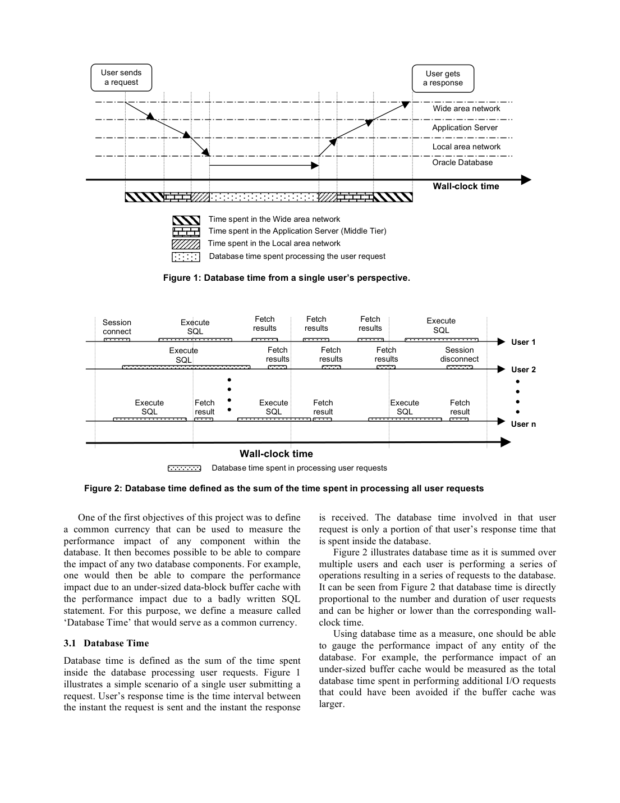
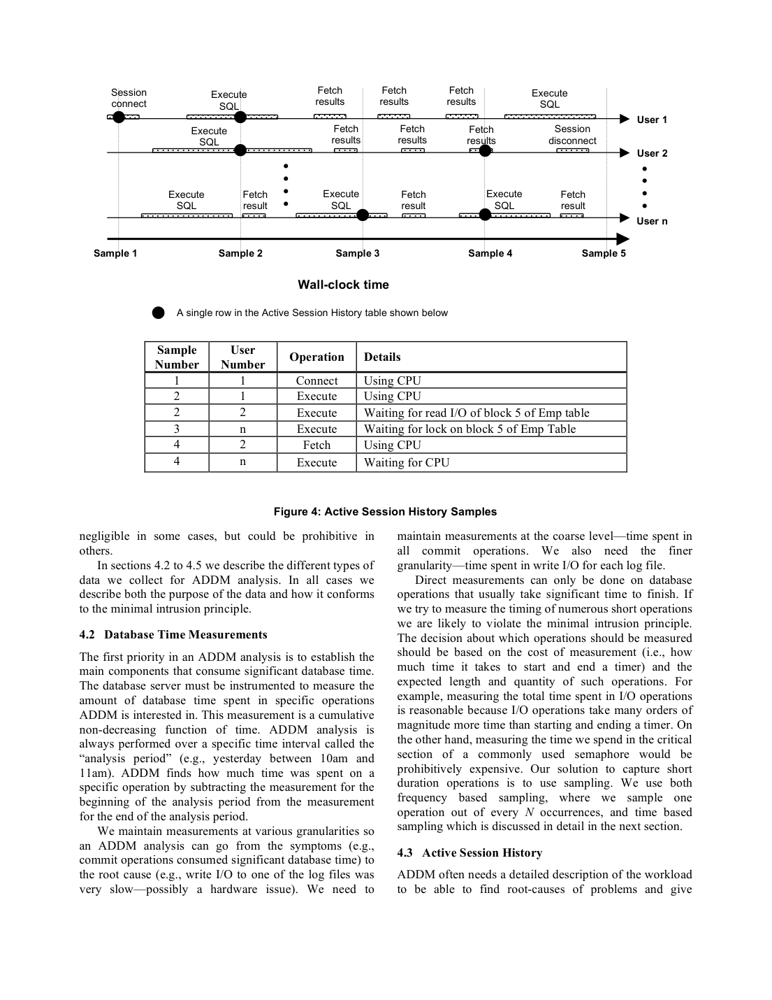

> 本组第 38 篇 · 诊断与自动调优 · [全部论文]() · [上一篇]() · [下一篇]()

ADDM 以给定工作负载在数据库内部消耗的 Database Time 为诊断货币，按请求阶段和资源使用/等待构造 DBTime-graph，并依据父子包含关系剪枝；计时、采样、ASH 和 what-if 模拟提供观测与建议依据。DBTime 不等于端到端延迟或任意负载下 TPS 的倒数；剪枝没有正式规模复杂度证明。AWR 观测、ADDM 诊断、SQL/内存等 advisor 的专项调优及人工或自动实施各有边界，不是通用 admission control。实证包括定性盲测、内部已知故障、约3%的全部管理特性吞吐开销、通常不足十秒的诊断运行及三个案例，不证明普遍完备性、自动修复或某倍加速。API 来源、模型、用量、critique、英文引文与原始精读段落保留；正文及解读由当前 Codex 全文复核修订。

本文保留论文陈述、读者推断与待验证方案的区别；实验数字只适用于原文条件。原文和翻译来自已有 AI 辅助精读报告，已做来源匹配与编辑复核，不等于人工逐项核验或独立实验复现。所有页码均为 PDF 物理页。

## 论文与阅读范围

Karl Dias, Mark Ramacher, Uri Shaft, Venkateshwaran Venkataramani, Graham Wood（Oracle Corporation），Automatic Performance Diagnosis and Tuning in Oracle，Proceedings of the 2005 CIDR Conference。所供 PDF 共11个物理页，本文页码均为物理页，不虚构会议页码范围。讨论历史 Oracle 10g；p.10记载2004年1月宣布 production。本次完整阅读 pp.1-11及全部参考文献，视觉检查8页、图1-5；未追访外部引用，不外推当前版本、许可、默认参数或竞争产品现状。

[论文集中的原始 PDF](https://github.com/lonng/db-papers/blob/4ff1331069c7cf52ac97dd769e5f484c1c35c200/papers/diagnosis-and-tuning/automatic-performance-diagnosis-and-tuning-in-oracle.pdf) · 本地来源：`diagnosis-and-tuning/automatic-performance-diagnosis-and-tuning-in-oracle.pdf`，共 11 页。

本篇保留 10 组原文精读和 45 条证据。截图为原始 PDF 的局部页选，不是重新生成的图表；未将整份 PDF 复制到博客。

## 目标与历史范围

局部指标与整体吞吐目标脱节是论文动机：buffer hit-ratio、TPS、平均 I/O 延迟各有用途，却不能直接相互换算；改善一个组件未必改善整体。p.2要求诊断器有整体视角、区别症状与根因、调查首次发生的问题，并适应技术变化。

Database Time 是所有用户请求在数据库内部消耗时间的总和。图1区分数据库内部时间和含网络等部分的响应时间；图2展示并发累计，p.4以 DBTime/second 表示数据库平均负载。作者目标是减少给定工作负载的 DBTime，不是任意条件下 TPS 与 DBTime 互为倒数，更不能靠拒绝请求降低时间就声称提高服务能力。

本文是 CIDR 2005 对早期 Oracle 10g 的机制与经验报告。单机、无后台、无并行是基础定义的简化条件，而非最终系统只能在这些条件运行；第5节给出扩展。最小侵入允许有限测量成本，是否显著由业务权衡，不保证零开销。

依据：论文陈述；PDF 物理页 1, 2, 3, 4, 5, 7, 8。证据：[C001N01](#evidence-c001n01), [C001N02](#evidence-c001n02), [C001N03](#evidence-c001n03), [C001N09](#evidence-c001n09), [C002N06](#evidence-c002n06), [OD-SRC01](#evidence-od-src01), [OD-SRC02](#evidence-od-src02), [OD-SRC08](#evidence-od-src08)。

## Observe、Diagnose、Resolve

图5是反馈流程，不意味着各阶段都自动实施。Observe 自动持续采集，AWR 持久保存内存视图中的系统/性能数据；本文描述每小时快照，任意快照对可定义分析期，自动 ADDM 使用最近两个连续快照。保留策略和空间压力影响清理；这里不补入当前默认和可配置接口。

ADDM 分析 AWR 或内存视图，SQL Tuning Advisor、Segment Advisor、Memory Advisors 各负责专项分析，提供 DBTime 影响/收益量。昂贵 advisor 可只被推荐、由用户另行调度。Resolve 中内存调整可自动应用，其他动作可能人工发起，实际结果在未来观测中反馈。整体诊断、SQL 建议、变更实施不能混为同一自动动作。

图3是请求阶段（连接、优化、执行等）和资源使用/等待（CPU、I/O、锁等）两个维度上的 DAG。分支表示症状，终端解释路径上的显著症状。图中省略一些边，不是互斥分类树；跨维度归因可能重叠，不能直接相加。

计时器累计非递减，分析窗口以两端差分获得消耗；粗粒度操作与具体日志文件等细粒度观测支持下钻。ASH 固定间隔采集活跃会话的状态/对象等上下文，不记录等待下一条命令的空闲会话，也不是完整 trace。

依据：论文陈述；PDF 物理页 4, 5, 6, 7, 8, 9。证据：[C001N04](#evidence-c001n04), [C001N06](#evidence-c001n06), [C002N01](#evidence-c002n01), [C002N03](#evidence-c002n03), [OD-SRC03](#evidence-od-src03), [OD-SRC09](#evidence-od-src09), [OD-SRC10](#evidence-od-src10)。

*原论文 PDF 物理页 3，版权归原作者或出版方。点击图片可查看原尺寸。页面文本中定位到：Figure 2 illustrates database time as it is summed over；Figure 2: Database time defined as the sum of the time spent in processing all user requests；Figure 1: Database time from a single user’s perspective.。这是页面定位信息，不表示本次已复核图内所有数据。*

## 剪枝、采样与模拟

p.5要求节点归因时间完全包含于每个父节点时间。父不显著可跳过子图；父显著则探索全部子节点，不是仅选最大分支。终端给出根因影响与建议的最大可能节省量，两者不必相等。作者据此称分析成本只依赖实际问题，而非潜在问题或负载；本文没有正式复杂度证明、阈值实现或规模实验，不能升级成渐近定理。

长操作直接计时；短而频繁的临界区逐次计时成本可能过高，采用按频次和按时间采样。ASH 间隔比分析期至少短两个数量级是文中建议；显著耗时状态较可能留样，不保证每个稀少状态都有数百样本，也未给固定一秒默认。活跃比例、状态持续时间和周期性均影响可见性。

缓存 what-if 用更大/无限缓存估计可避免的读 I/O，再估计潜在 DBTime 节省；这不是实际扩容结果或全局最优证明。并行开销分析咨询优化器获得最佳串行计划用于比较；p.8明确没有实际执行串行计划，不知道其精确 DBTime。

读者构造的假设示例：某窗口 I/O 分支显著而另一分支不显著，后者可剪掉。沿 I/O 下钻后，缓存模拟估计可省40秒；这不代表全部 I/O 归因时间都能消除。此例不是产品阈值、原图精确复刻或实际实验。

依据：论文陈述；PDF 物理页 4, 5, 6, 7, 8。证据：[C001N07](#evidence-c001n07), [C002N02](#evidence-c002n02), [C002N04](#evidence-c002n04), [C002N05](#evidence-c002n05), [C002N10](#evidence-c002n10), [OD-SRC03](#evidence-od-src03), [OD-SRC04](#evidence-od-src04), [OD-SRC06](#evidence-od-src06), [OD-SRC07](#evidence-od-src07)。

## 记账与论证边界

本文给出度量定义、包含约束和设计解释，没有证明任意故障的诊断健全性、完备性或自动变更安全性。DBTime 不是端到端关键路径延迟，也不是异构硬件等价工作量；并发累计可以超过墙钟。

异构节点仍相加 DBTime 是用户等待相关的时间记账选择，但快慢 CPU 的一秒计算量不等价。后台线程不直接计入 DBTime，因为没有用户直接等它，但必须记录资源使用，解释对前台的间接影响。并行请求计入计算线程时间，同一用户连接内部线程间等待视为空闲排除，避免重复计入协调等待。作者关于并行吞吐代价的笼统说法不能推广成所有并行算法的定理。

图包含关系支持剪枝，跨维度归因仍可能重叠，根因影响与可达收益不同。采样和模拟提供概率性线索及估计，不是干预效果的因果证明。

首次出现即可诊断依赖相关插桩/样本、历史保留及可解释问题的模型。快照之间的短事件可进入累计差分或 ASH；风险是稀释、漏样和缺乏上下文，而非天然的一小时盲区。数据清理或关键状态未被记录时，不能保证免复现。

依据：论文陈述；PDF 物理页 3, 4, 5, 6, 7, 8, 9, 10。证据：[C001N03](#evidence-c001n03), [C002N07](#evidence-c002n07), [C002N08](#evidence-c002n08), [C002N09](#evidence-c002n09), [C003N09](#evidence-c003n09), [OD-SRC02](#evidence-od-src02), [OD-SRC03](#evidence-od-src03), [OD-SRC04](#evidence-od-src04), [OD-SRC05](#evidence-od-src05), [OD-SRC06](#evidence-od-src06), [OD-SRC08](#evidence-od-src08), [OD-SRC09](#evidence-od-src09)。

## 实测与三个使用案例

第7节承认发布不久，尚无法广泛调查客户。不能说完全没有实验：p.10报告了内部测试和开销测量；但缺少完整负载、样本数、准确率/误报率、置信区间和统一前后收益表。

盲测中专家分析运行系统，作者称多数结果可比、部分 ADDM 建议收益更大，未量化样本和收益。内部注入已知 common faults/应用低效，测试集合均被正确识别；all cases 不等于未知故障100%检出。

高负载下，典型客户负载和高度调优行业标准基准启用全部 Oracle 10g manageability features 后吞吐约降3%。AWR、ADDM只是两项，不能据此分摊单独开销。每快照后 ADDM 通常不足十秒是诊断运行时间，不是修复时限或最坏界；具体基准规模/硬件等未完整披露。

Qualcomm Centauri：8.1.7.4 → 10g RAC 升级测试中变慢。ADDM指出 update 占超过90%系统负载，SQL Tuning Advisor建议索引；人工发现测试系统漏了生产补丁中的索引。90%是归因，不是加速。没有完整前后性能数字。

Oracle Bug DB：p.10确有8 CPU PA-RISC HP机器，不能因短摘录未含硬件就否定源文事实。ADDM由 free buffer waits 指向写 I/O，系统管理员发现异步 I/O 配置失败而退化同步；最终配置原因由人发现，并非 ADDM 自动修复，也无定量加速报告。

Applications QA：双方相隔12时区且用户未说明时间，历史报告定位两个一小时高解析耗时窗口，关联大量字面量 SQL/hard parse。ADDM建议 binds 或转换配置；实际后续发现 known-bad 内部构建，升级正确构建消除问题，不是已测 bind 参数改进。

这些案例支持回溯线索和诊断分工，不是受控基准，也不证明普遍自动找到并修复最终根因。

依据：论文陈述；PDF 物理页 9, 10。证据：[C002N12](#evidence-c002n12), [C003N01](#evidence-c003n01), [C003N02](#evidence-c003n02), [C003N03](#evidence-c003n03), [C003N04](#evidence-c003n04), [C003N05](#evidence-c003n05), [C003N06](#evidence-c003n06), [C003N07](#evidence-c003n07), [OD-SRC11](#evidence-od-src11), [OD-SRC12](#evidence-od-src12), [OD-SRC13](#evidence-od-src13), [OD-SRC14](#evidence-od-src14), [OD-SRC15](#evidence-od-src15)。

*原论文 PDF 物理页 6，版权归原作者或出版方。点击图片可查看原尺寸。页面文本中定位到：Figure 4: Active Session History Samples。这是页面定位信息，不表示本次已复核图内所有数据。*

## 工程取舍

以下为读者工程推断，不是作者实测结论。

缩短采样间隔通常增加采集/存储成本，但是否违反最小侵入需测量，不能一概而论。分析期3600秒时短两个数量级对应间隔至多36秒，只是比例算术，不是公开配置接口，也不保证每个状态有数百样本。

累计快照与 ASH 互补；短尖峰可能被窗口平均稀释，并非必然不记录。保留更细更多数据要付出成本。重启、计数器重置和采样别名的完整处理未在本文规定，是复现需明确的问题。

统一时间方便排序，但不能自动给出硬件投资成本、尾延迟或请求价值。跨维度重叠与建议相互作用使收益不可盲加。

what-if 减少直接生产试错需求，不代表模型维护和采集零成本、零副作用或收益准确。昂贵 advisor 可另行调度，说明诊断并非立即实施全部优化。

最小侵入的业务性不等于所有规则阈值都需人工校准。本文未描述通用学习策略、准入并发阈值或安全回滚协议，不能从反馈图补出这些实现。

依据：读者推断；PDF 物理页 5, 6, 7, 8, 9。证据：[C001N09](#evidence-c001n09), [C002N04](#evidence-c002n04), [OD-SRC03](#evidence-od-src03), [OD-SRC05](#evidence-od-src05), [OD-SRC06](#evidence-od-src06), [OD-SRC07](#evidence-od-src07), [OD-SRC08](#evidence-od-src08), [OD-SRC09](#evidence-od-src09), [OD-SRC10](#evidence-od-src10)。

## 相关工作与功能分工

p.2列举 COMFORT 在线反馈环（包括锁负载控制和动态放置）、叠加反馈机制与 RISC-style 简化方向。相关工作提到 load control 不表示本文 ADDM 实现了 admission control，也不能改写为现代 ML 控制器。

作者将 Statspack 定位为快照报表、解释留给 DBA，并列 Oracle 9i、DB2 8.1 Health Center/Configuration Assistant、SQL Server 2000 Index Tuning Wizard/Query Analyzer。此前没有整体根因诊断商业产品是作者2005年的主张，不是今日产品比较或本次独立市场调查。

p.11参考文献已完整阅读：Brown等1994年VLDB、Chaudhuri/Narasayya索引向导1997年VLDB、COMFORT1994年Information Systems、Weikum等2002年VLDB、Benoit2003年博士论文均是本文书目所列。不是本次追访了这些文献或验证其结果。

ADDM整体诊断，SQL advisor改进语句计划，空间/索引建议、内存自动调整和人工实施各有边界。统一影响量有助比较，但不把不同任务变成一次全自动优化。

依据：论文陈述；PDF 物理页 2, 8, 9, 11。证据：[C001N10](#evidence-c001n10), [C003N11](#evidence-c003n11), [OD-SRC10](#evidence-od-src10)。

## 未执行的验证方案

以下为未执行的读者方案，不含实际 DB/SQL 操作。

1. 离线构造满足每一父子包含关系的图，分别改变节点数、深度、扇出、显著节点分布及单节点分析成本，统计访问节点/边和耗时。不能只固定三个根因就预期100和10000节点同成本。

2. 生成已知活跃/空闲、状态占比的合成时间线，改变采样间隔和分析窗，量化漏样、周期别名、偏差及体积；不假设历史产品支持任意配置。

3. 同一完成工作量下区分端到端响应、前台 DBTime、并行内部等待、后台资源。构造多会话/异构节点例子核验重复记账，不用总时间下降替代完成量与延迟。

4. 实际替代计划/缓存大小验证需另行授权的隔离系统，测模型误差、干预成本及建议相互作用。本次没有串行执行、扩容、建索引或任何数据库实验。

完整规则、阈值、模拟实现与数据未公开，因此以上只验证概念假设，不宣称复现原产品。

依据：待验证的工程设想；PDF 物理页 4, 5, 6, 7, 8, 9。证据：[OD-SRC03](#evidence-od-src03), [OD-SRC04](#evidence-od-src04), [OD-SRC05](#evidence-od-src05), [OD-SRC06](#evidence-od-src06), [OD-SRC07](#evidence-od-src07), [OD-SRC08](#evidence-od-src08), [OD-SRC09](#evidence-od-src09)。

## 结论与可信度

读者综合：统一时间记账、双维度结构化诊断、低侵入观测和 advisor 分工是本文的价值。包含关系支持剪枝，但不是自动因果发现或已证明常数成本的诊断器；采样是本文对短操作的选择，不是所有系统唯一道路。

机制与模型解释支撑“怎样组织诊断”，内部测试和三个案例支持初步实用性；约3%和通常不足十秒仅在作者条件内成立。不支持普遍完备诊断、自动修复、零副作用模拟或最优配置。

工程上应分开保存观测、诊断归因、模拟收益、变更提案、实际行动和实施后实测。首次出现无需复现的总结需附采集覆盖、保留和模型能力边界。本次全文阅读并查看全部关键原图，未审计实现、追访外文献或运行 DB；是源文复核，不是独立性能验证。

依据：读者推断；PDF 物理页 3, 4, 5, 6, 7, 8, 9, 10。证据：[OD-SRC02](#evidence-od-src02), [OD-SRC03](#evidence-od-src03), [OD-SRC04](#evidence-od-src04), [OD-SRC05](#evidence-od-src05), [OD-SRC06](#evidence-od-src06), [OD-SRC07](#evidence-od-src07), [OD-SRC08](#evidence-od-src08), [OD-SRC09](#evidence-od-src09), [OD-SRC10](#evidence-od-src10), [OD-SRC11](#evidence-od-src11), [OD-SRC12](#evidence-od-src12)。

## 原文精读：从句子回到机制

以下保留原文、忠实翻译、含义与边界；假设示例不作为论文实验结果。

### P001 · PDF 物理页 2

**原文**

<blockquote class="paper-source-quote"><pre><code>One of the things that makes performance tuning &#10;difficult is that the performance of different components &#10;of the database is often measured using unrelated metrics &#10;like buffer hit-ratio, transactions per second and average &#10;I/O latency. Such unrelated metrics make it infeasible to &#10;weigh the performance impact of one component of the &#10;database with the impact of others components.</code></pre></blockquote>

**忠实翻译**

> 使性能调优变得困难的原因之一是，数据库不同组件的性能通常使用不相关的指标来衡量，例如缓冲区命中率（buffer hit-ratio）、每秒事务数（transactions per second）和平均 I/O 延迟（average I/O latency）。这种不相关的指标使得无法将数据库某一组件的性能影响与其他组件的影响进行权衡比较。

**技术含义与边界**

> 作者用局部指标不可直接权衡，解释统一影响度量的动机；不是断言局部指标无用或任何系统都不能建立映射。后文 DBTime 提供共同时间量，但不由此证明硬件投资、用户延迟和吞吐都能单一优化。

**常见误读**

> 容易错误解读为“数据库性能无法被衡量”或“这些指标本身没有价值”。原文明确指出问题在于指标之间“不相关（unrelated）”，导致无法“权衡（weigh）”不同组件之间的影响，而不是否定单个指标在各自上下文中的作用。不能将局部结论泛化为所有性能诊断都不可行。

**读者构造的假设示例**

> 读者构造的假设示例：假设某数据库系统的缓冲区命中率为 95%，而平均 I/O 延迟为 20ms。由于这两个指标单位不同且无直接换算关系，管理员无法判断提升缓冲区命中率 1% 与降低 I/O 延迟 2ms 哪个对整体系统收益更大。

### P002 · PDF 物理页 11

**原文**

<blockquote class="paper-source-quote"><pre><code>We would like to &#10;thank Connie Green for providing helpful comments on &#10;an earlier version of this paper. &#10;References &#10;[BE03] D. G. Benoit. Automatic Diagnosis of Performance &#10;Problems in Database Management Systems, PhD Thesis, &#10;Queen’s University, Canada, 2003. &#10; &#10;[BR94] K. P. Brown, M. Mehta, M.J. Carey, M. Livny: Towards &#10;Automated Performance Tuning for Complex Workloads.</code></pre></blockquote>

**忠实翻译**

> 我们要感谢 Connie Green 对本文早期版本提供的有益意见。
> 参考文献
> [BE03] D. G. Benoit. Automatic Diagnosis of Performance Problems in Database Management Systems, PhD Thesis, Queen’s University, Canada, 2003.
> 
> [BR94] K. P. Brown, M. Mehta, M.J. Carey, M. Livny: Towards Automated Performance Tuning for Complex Workloads.

**技术含义与边界**

> 原文为论文的致谢部分与参考文献列表片段。致谢提及 Connie Green 对早期版本的评论；参考文献列出了两篇关于数据库管理系统性能问题自动诊断与复杂工作负载自动性能调优的文献。这部分内容不包含技术机制的陈述，仅提供学术背景信息。

**常见误读**

> 容易将参考文献的标题误认为本文的实验结论或方法描述。原文仅列出引文条目，并未在此处说明本文采用了 [BE03] 或 [BR94] 的具体算法或得出了相同结论。不能从参考文献列表中推断本文的具体实现细节。

**读者构造的假设示例**

> 读者构造的假设示例：假设研究人员正在撰写关于数据库自动调优的综述，可能会引用 [BE03] 这篇博士论文作为该领域早期自动化诊断研究的背景参考，但这并不意味着当前论文的系统直接使用了该博士论文中的代码。

### P003 · PDF 物理页 6

**原文**

<blockquote class="paper-source-quote"><pre><code>The database server must be instrumented to measure the &#10;amount of database time spent in specific operations &#10;ADDM is interested in. This measurement is a cumulative &#10;non-decreasing function of time. ADDM analysis is &#10;always performed over a specific time interval called the &#10;“analysis period” (e.g., yesterday between 10am and &#10;11am).</code></pre></blockquote>

**忠实翻译**

> 数据库服务器必须被插桩（instrumented）以测量在 ADDM 感兴趣的特定操作中所花费的数据库时间（database time）量。此测量值是时间的累积非递减函数。ADDM 分析总是在一个特定的时间区间上执行，该区间称为“分析周期（analysis period）”（例如，昨天上午 10 点到 11 点之间）。

**技术含义与边界**

> 这里是累计计时与分析窗口的定义。后文以窗口两端差分得到消耗，计数器无需在窗口起点清零；非递减是正常计数轨迹的要求，重启/重置如何处理本文未完整规定。

**常见误读**

> 容易将“累积非递减函数”误解为瞬时值或平均值。原文明确指出它是随时间累加的总量，这意味着在分析周期内它只会增加或保持不变，不会减少。此外，不能将“分析周期”的例子（昨天 10 点到 11 点）理解为 ADDM 只能分析过去的数据，原文只是用“例如”来说明它是一个特定的时间区间。

**读者构造的假设示例**

> 读者构造的假设示例：窗口起点累计5000秒，终点6200秒，则该窗口消耗1200秒。分析窗60分钟并不要求计数器从零开始，并发时1200秒也不是响应时间或CPU工作量。

### P004 · PDF 物理页 4

**原文**

<blockquote class="paper-source-quote"><pre><code>ADDM uses database time to identify database &#10;components that require investigation and also to quantify &#10;performance bottlenecks.  &#10;Database systems often have models or mechanisms, &#10;like background processes or parallel queries, in which &#10;the definition of the database time is more complex. In &#10;Section 5 we discuss database time definitions for these &#10;models. &#10;3.2   DBTime-graph and ADDM Methodology &#10;The first step in automatic performance tuning is to &#10;correctly identify the causes of performance problems.</code></pre></blockquote>

**忠实翻译**

> ADDM 使用数据库时间来识别需要调查的数据库组件，并用于量化性能瓶颈。
> 数据库系统通常具有某些模型或机制，例如后台进程（background processes）或并行查询（parallel queries），在这些情况下数据库时间的定义更为复杂。在第 5 节中，我们将讨论针对这些模型的数据库时间定义。
> 3.2 DBTime-graph 与 ADDM 方法论
> 自动性能调优的第一步是正确识别性能问题的原因。

**技术含义与边界**

> 这段先说明 DBTime 的调查和量化用途，再提示后台/并行的定义将在第5节扩展，并给出识别原因这一方法目标。它本身不是根因识别正确性的证明。全文p.8明确后台不直接记账但记录资源，并行内部等待排除；不能止于“定义复杂”而留下任意记账。

**常见误读**

> 不能把方法论目标读成任意故障已获证明，也不能将线程累计时间等同端到端响应；后台资源虽不直接计 DBTime，仍可能拖慢前台。

**读者构造的假设示例**

> 读者构造的假设示例：4个工作线程各消耗10秒、协调线程等待它们10秒。按照后文扩展，不能再把同一请求内部协调等待重复加成50秒；40秒累计也不是该请求40秒墙钟响应。此例不是作者测量。

### P005 · PDF 物理页 9

**原文**

<blockquote class="paper-source-quote"><pre><code>Checking if ADDM &#10;meets the task, we need to survey many customers that &#10;already adapted Oracle 10g in a production or test &#10;environment.  It is too early after the release of Oracle &#10;10g to perform such a survey. However, we provide three &#10;examples of real ADDM usage in Sections 7.1 to 7.3.</code></pre></blockquote>

**忠实翻译**

> 要检查 ADDM 是否满足该任务，我们需要调查许多已经在生产或测试环境中采用 Oracle 10g 的客户。在 Oracle 10g 发布之后，现在进行此类调查还为时过早。然而，我们在第 7.1 至 7.3 节中提供了三个真实 ADDM 使用的示例。

**技术含义与边界**

> 原文陈述了评估 ADDM 有效性所需的理想方法（大规模客户调查）以及当前的客观限制（Oracle 10g 刚发布，时机未到）。作为替代，作者指出将在后续章节提供三个真实使用示例。适用边界非常明确：这三个示例不能替代大规模统计调查，它们是在特定时限约束下的妥协方案。

**常见误读**

> 容易将“提供了三个示例”误解为“已经证明了 ADDM 在所有场景下均满足任务要求”。原文明确承认目前进行全面调查“为时过早（too early）”，因此这三个示例仅是个案展示，不能作为全局有效性的统计学保证。不能把局部结果泛化为全局保证。

**读者构造的假设示例**

> 读者构造的假设示例：一个新产品报告三个客户故障排查故事，但没有统一样本、对照与收益表；这些故事能说明使用路径，不能推得全体客户的成功率。例中没有假定论文实际拥有某个客户总数。

### P006 · PDF 物理页 5

**原文**

<blockquote class="paper-source-quote"><pre><code>• &#10;Finding recommendations for alleviating root-&#10;cause problems and estimating the potential &#10;benefit of a recommendation in database time. &#10; &#10;Our second requirement is the “minimal intrusion &#10;principle”; &#10;it &#10;states &#10;that &#10;the &#10;act &#10;of &#10;collecting &#10;measurements for performance diagnostics should not &#10;cause &#10;a &#10;significant &#10;degradation &#10;in &#10;performance.</code></pre></blockquote>

**忠实翻译**

> • 寻找缓解根本原因问题的建议，并以数据库时间估算某项建议的潜在收益。
> 
> 我们的第二个要求是“最小侵入原则（minimal intrusion principle）”；它规定，为性能诊断而收集测量数据的行为不应导致性能的显著下降。

**技术含义与边界**

> 两项要求分别是估计建议潜在收益，以及采集诊断数据不造成显著性能退化。estimating/potential 都保留不确定性；“显著”的业务含义不提供固定CPU阈值，计时、采样和模拟仍有成本。

**常见误读**

> 容易将“最小侵入原则”误解为“完全没有性能开销”。原文的表述是“不应导致显著的下降（should not cause a significant degradation）”，这意味着允许存在微小的、不显著的诊断开销。此外，不能将“估算潜在收益”等同于“保证实际收益”，原文使用的是“estimating（估算）”。

**读者构造的假设示例**

> 读者构造的假设示例：模型估计某动作可省500秒DBTime，但需实际实施后以相同完成工作量核验。即便监控仅占1%CPU，也不能仅凭这一数字判断最小侵入合格，还需看吞吐、延迟及业务预算；这里的数字不是论文实测。

### P007 · PDF 物理页 3

**原文**

<blockquote class="paper-source-quote"><pre><code>For this purpose, we define a measure called &#10;‘Database Time’ that would serve as a common currency.  &#10;3.1   Database Time &#10;Database time is defined as the sum of the time spent &#10;inside the database processing user requests. Figure 1 &#10;illustrates a simple scenario of a single user submitting a &#10;request. User’s response time is the time interval between &#10;the instant the request is sent and the instant the response &#10;is received.</code></pre></blockquote>

**忠实翻译**

> 为此，我们定义了一个称为“数据库时间（Database Time）”的度量标准，它将作为一种通用货币（common currency）。
> 3.1 数据库时间
> 数据库时间被定义为在数据库内部处理用户请求所花费时间的总和。图 1 说明了一个单用户提交请求的简单场景。用户的响应时间（response time）是从发送请求的瞬间到接收到响应的瞬间之间的时间间隔。

**技术含义与边界**

> 原文正式给出了 Database Time 的定义及其设计目的。目的是将其作为解决 P001 中提到的指标不相关问题的“通用货币”。定义上，它是数据库内部处理用户请求所耗时间的总和。同时，原文区分了“数据库时间”与“用户响应时间”，后者包含了网络传输等数据库外部的时间。适用边界：此处给出的是基础定义（单用户简单场景），复杂场景的定义在后文。

**常见误读**

> 容易将“数据库时间”与“用户响应时间”混为一谈。原文明确指出响应时间是发送请求到接收响应的时间间隔，而数据库时间仅限于“在数据库内部（inside the database）”花费的时间。如果网络延迟很高，响应时间会增加，但数据库时间不一定增加。不能脱离“inside the database”这一限定条件。

**读者构造的假设示例**

> 读者构造的假设示例：假设用户发起一个查询，网络传输耗时 20ms，数据库内部解析、执行和返回结果耗时 80ms。那么该请求的用户响应时间为 100ms，而贡献给“数据库时间”度量的值为 80ms。这里的 80ms 就是用于跨组件比较的“通用货币”。

### P008 · PDF 物理页 7

**原文**

<blockquote class="paper-source-quote"><pre><code>For example, when a session is &#10;waiting for I/O we can tell which database object is read, &#10;what portion of it is read.  This amount of detail enables &#10;ADDM to drill down to very specific root-causes.  &#10;The time interval we use for ASH sampling should be &#10;at least two orders of magnitude shorter than the time &#10;interval used as an analysis period. This ensures that we &#10;have at least hundreds of samples of specific session &#10;states to analyze.</code></pre></blockquote>

**忠实翻译**

> 例如，当会话正在等待 I/O 时，我们可以分辨出正在读取哪个数据库对象，以及读取了它的哪一部分。这种详细程度使得 ADDM 能够向下钻取（drill down）到非常具体的根本原因。
> 
> 我们用于 ASH 采样的时间间隔应至少比用作分析周期的时间间隔短两个数量级。这确保了我们至少有数百个特定会话状态的样本可供分析。

**技术含义与边界**

> 原文既强调对象上下文可供下钻，也用至少两个数量级说明采样密度要求，并声称因此有数百个特定状态样本。后者是作者设计层措辞而非概率证明：采样机会数不等于任一状态的命中数。是否活跃、状态占比及时间相关性都会影响充分性。全文只称显著耗时状态较可能充分留样。

**常见误读**

> 不要把相对比例读成固定1秒默认，或把3600/36的100个采样时点说成每种状态至少数百样本。更密采样仍可能漏掉稀少短状态，无法据此保证根因识别。

**读者构造的假设示例**

> 读者构造的假设示例：3600秒分析期与36秒采样间隔的比值是100；这仅是两个数量级的算术。若某状态只占极少活跃时间，命中可很少甚至为零。此例不是产品配置建议，也不是已有实验。

### P009 · PDF 物理页 10

**原文**

<blockquote class="paper-source-quote"><pre><code>We used various scenarios to gauge the effectiveness of &#10;ADDM. &#10;Blind tests were performed in the initial testing phase; &#10;performance tuning experts were asked to analyse and &#10;make recommendations on running systems. In a majority &#10;of cases ADDM produced comparable results and in some &#10;cases ADDM’s recommendations produced greater &#10;benefit than the experts’ recommendations.</code></pre></blockquote>

**忠实翻译**

> 我们使用了各种场景来评估 ADDM 的有效性。
> 在初始测试阶段进行了盲测（Blind tests）；性能调优专家被要求对正在运行的系统进行分析并提出建议。在大多数情况下，ADDM 产生了可比的结果，并且在某些情况下，ADDM 的建议产生了比专家建议更大的收益。

**技术含义与边界**

> 作者报告初始盲测中多数结果可比、部分收益更大，但未提供测试规模、完整控制条件、量化收益或失败分布。这是定性内部比较，不应擅自补成特定样本表或全面优于专家。

**常见误读**

> 容易将“在某些情况下大于专家的收益”泛化为“ADDM 总是优于人类专家”。原文明确使用了“在大多数情况下产生可比结果”和“在某些情况下产生更大收益”的限定，说明 ADDM 并非在所有场景下都超越专家。此外，“盲测”的具体控制变量（如专家是否了解系统架构）在原文此段中未详细说明，不能过度推断实验的严谨程度。

**读者构造的假设示例**

> 读者构造的假设示例：某次排查中工具和专家都指向写I/O，另一次工具多提供了一个可用线索；即使如此，若没有统一测量和完整样本也不能据此推算成功率。该故事不是本文实测个案或数字重建。

### P010 · PDF 物理页 8

**原文**

<blockquote class="paper-source-quote"><pre><code>In that case we need to find a common &#10;currency between machines and not just between different &#10;areas in the same server. For example, we cannot consider &#10;one second of CPU usage on one machine equivalent to &#10;one second of CPU usage on another machines if the two &#10;CPUs have different computation speeds. We still sum all &#10;the database times from the different machines because &#10;this number still corresponds to the total amount time &#10;spent by users waiting for a response from the database &#10;server.</code></pre></blockquote>

**忠实翻译**

> 在那种情况下，我们需要在机器之间找到一种通用货币，而不仅仅是在同一服务器的不同区域之间。例如，如果两个 CPU 的计算速度不同，我们不能将一台机器上的一秒 CPU 使用量等同于另一台机器上的一秒 CPU 使用量。我们仍然将所有来自不同机器的数据库时间相加，因为这个数字仍然对应于用户等待数据库服务器响应所花费的总时间。

**技术含义与边界**

> 作者区分异构CPU秒的计算能力含义与 DBTime 的时间记账。仍加总是从用户等待相关时间出发的设计选择，不是将异构工作量等价化，也不意味着同一分布式请求各节点时间相加就是端到端延迟；并行内部等待另有排除规则。

**常见误读**

> 不能因时间可加便说异构算力可加成等价工作量，或把相互重叠的多节点区间相加当用户墙钟等待。数据库时间仍受硬件速度、调度和执行计划影响。

**读者构造的假设示例**

> 读者构造的假设示例：两个独立请求分别在快节点消耗3秒、慢节点消耗8秒，DBTime可累计11秒，不代表相同计算量或某个用户等待11秒。若改为同一并行请求，应先按完整记账规则处理内部等待，不能套这个独立请求例子。

## 尚未解决的问题

1. 显著性阈值、节点成本及共享子图的去重如何具体实现？
2. ASH 对稀少/短状态和周期活动的漏检与误差有多大？
3. 跨维度重叠、多建议相互作用及实施效果如何合并验证？
4. 计数器重置、重启和多节点/并行的完整记账协议是什么？
5. 盲测与故障集合规模、失败案例、误报漏报及开销拆分均未披露。
6. 缓存和串行计划模拟的误差及安全机制仍需验证。

## 证据索引

证据编号沿用原报告，便于将上文判断追溯到原句。引文匹配只验证位置，不证明解读正确。

**C001N01 · PDF 物理页 2**

传统数据库性能调优面临的核心问题是各组件使用不相关的度量指标（如buffer hit-ratio、transactions per second、average I/O latency），导致无法量化某一组件对整体吞吐量的影响。例如，无法轻易推算I/O延迟翻倍会使TPS下降多少。这种度量割裂使得DBA容易陷入修复症状而非根因的误区，甚至导致系统过度配置。

<blockquote class="paper-source-quote"><pre><code>performance of different components of the database is often measured using unrelated metrics like buffer hit-ratio</code></pre></blockquote>

**C001N02 · PDF 物理页 2**

ADDM的设计前提包括：(1) 需要一个全局视角理解数据库子组件间的复杂交互；(2) 必须能区分症状与根因；(3) 需要在问题首次发生时即具备诊断能力，而非依赖事后复现；(4) 诊断框架必须易于适应新技术和废弃旧技术。这些前提直接针对以往Statspack等工具仅生成报告而将解释工作留给DBA的局限。

<blockquote class="paper-source-quote"><pre><code>Should posses a holistic view of the database and understand the interactions between various database components.</code></pre></blockquote>

**C001N03 · PDF 物理页 3**

提出Database Time作为统一度量货币，定义为处理用户请求时在数据库内部花费时间的总和。对于单用户，它是User Response Time的一部分；对于多用户并发，它是所有用户请求在数据库中耗时的累加，可能大于或小于Wall-clock time。其消耗速率（Database Time/second）被类比为OS load average或物理学中的功率（Watt）。ADDM的目标是减少给定工作负载消耗的Database Time。

<blockquote class="paper-source-quote"><pre><code>Database time is defined as the sum of the time spent inside the database processing user requests.</code></pre></blockquote>

**C001N04 · PDF 物理页 4**

ADDM从两个独立维度观察Database Time的消耗：第一维度是处理用户请求的各个阶段（如连接、SQL优化、SQL执行）；第二维度是使用或等待的各类数据库资源（硬件如CPU、I/O设备，软件如数据库锁、应用锁）。这两个维度的交叉分析帮助ADDM判断瓶颈，例如CPU不足会在第一维度的所有阶段产生耗时，但在第二维度会明确指向CPU Capacity节点。

<blockquote class="paper-source-quote"><pre><code>The first dimension looks at the database time spent in various phases of processing user requests.</code></pre></blockquote>

**C001N06 · PDF 物理页 5**

在DBTime-graph中，分支节点（Branch nodes）识别通常表现为性能瓶颈症状的性能影响，而终端节点（Terminal nodes）识别能够解释路径上所有显著症状的具体根因。例如“I/O Capacity”是分支节点，其子节点“Undersized Buffer Cache”和“Insufficient I/O Bandwidth”是终端节点。终端节点找到根因后，不仅量化其Database Time影响，还估算建议操作所能节省的最大Database Time，该预估值不一定等于归因于根因的总时间。

<blockquote class="paper-source-quote"><pre><code>Branch nodes in this graph identify the performance impact of what is usually a symptom</code></pre></blockquote>

**C001N07 · PDF 物理页 5**

DBTime-graph 子节点时间应包含于每一父节点内；父不显著则剪枝，显著则探索全部子节点。作者称成本只依赖实际问题，是设计说明，未给正式复杂度界或规模实验；不能排除扇出、深度与单节点成本的影响。

<blockquote class="paper-source-quote"><pre><code>the cost of an ADDM analysis depends only on the number of actual performance problems</code></pre></blockquote>

**C001N08 · PDF 物理页 4**

论文指出Database Time的定义在存在后台进程（background processes）或并行查询（parallel queries）等模型时会变得更加复杂，并说明将在第5节讨论这些扩展模型。这表明基础定义（用户请求处理时间之和）在处理非同步或非单一会话架构时存在适用边界，不能直接套用。

<blockquote class="paper-source-quote"><pre><code>like background processes or parallel queries, in which the definition of the database time is more complex.</code></pre></blockquote>

**C001N09 · PDF 物理页 5**

数据采集遵循“最小侵入原则”（minimal intrusion principle），即收集诊断数据的动作本身不应引起显著的性能退化。但论文明确承认“显著”一词是主观的，由业务考量决定（客户愿意为ADDM收益承受多大的服务器开销）。任何测量都有成本，最基础的是增加计数器或内存变量，若需精确计时则可能需要操作系统调用。这构成了监控机制的前提假设。

<blockquote class="paper-source-quote"><pre><code>Our second requirement is the “minimal intrusion principle”; it states that the act of collecting measurements</code></pre></blockquote>

**C001N10 · PDF 物理页 2**

相关工作部分对比了多种方法：COMFORT项目使用在线反馈控制环解决单一调优问题；学术界有提议在目标系统上叠加反馈控制机制；另有观点认为应通过RISC式简化数据库功能来实现自动调优。商业系统中，Oracle前代工具Statspack仅提供快照报告，根因识别仍靠人工；IBM DB2 8.1提供Health Center；SQL Server 2000提供Index Tuning Wizard。作者声称在Oracle 10g之前，没有商业数据库能自动识别影响总吞吐量的根因。

<blockquote class="paper-source-quote"><pre><code>The COMFORT project used an online feedback control loop to solve individual tuning issues</code></pre></blockquote>

**C002N01 · PDF 物理页 6**

ADDM对数据库操作的计时采用累积非递减函数，分析时通过结束时刻减去起始时刻得到特定分析周期内的耗时。为支持从症状到根因的下钻，需同时维护粗粒度（如所有commit操作总耗时）和细粒度（如单个日志文件的写I/O耗时）的测量值。这属于数据采集的基础不变量设计。

<blockquote class="paper-source-quote"><pre><code>This measurement is a cumulative non-decreasing function of time. ADDM analysis is always performed over a specific time interval</code></pre></blockquote>

**C002N02 · PDF 物理页 6**

直接计时仅适用于执行时间显著长于计时器启停开销的操作。对于短操作（如常用信号量的临界区），直接计时会违反最小侵入原则。因此系统引入基于频率的采样（每N次操作采样一次）和基于时间的采样（ASH）来捕获短持续时间操作的耗时。这是区分直接测量与采样启发式的边界条件。

<blockquote class="paper-source-quote"><pre><code>measuring the time we spend in the critical section of a commonly used semaphore would be prohibitively expensive.</code></pre></blockquote>

**C002N03 · PDF 物理页 7**

Active Session History (ASH) 是基于固定时间间隔的系统级活动采样集合。每个样本仅记录采样时刻正在活跃使用数据库的会话状态，空闲等待用户命令的会话不被记录。ASH提供了详细的操作上下文（如具体读取的数据库对象及块号），使ADDM能够进行跨维度分析（例如将锁争用与特定的SQL语句类型关联）。

<blockquote class="paper-source-quote"><pre><code>We only collect data for sessions that are actively using the database during the sample time.</code></pre></blockquote>

**C002N04 · PDF 物理页 7**

论文建议 ASH 间隔比分析期至少短两个数量级，显著耗时状态较可能被捕获；不是固定一秒默认，也不保证每个稀少状态都有数百样本。

<blockquote class="paper-source-quote"><pre><code>The time interval we use for ASH sampling should be at least two orders of magnitude shorter than the time interval used as an analysis period.</code></pre></blockquote>

**C002N05 · PDF 物理页 7**

缓存 what-if 模拟估计更大或无限大缓存可避免的读 I/O 与潜在 DBTime 收益；没有实际扩容实测或全局最优配置证明。

<blockquote class="paper-source-quote"><pre><code>we need to determine how many read I/O operations could have been saved given an infinite buffer cache.</code></pre></blockquote>

**C002N06 · PDF 物理页 7**

基础Database Time计算模型依赖三个严格限制：单机环境、无后台活动、无并行计算。在实际数据库服务器中这些假设经常被打破，因此论文第5节专门讨论了在这些前提被违反时如何重新定义或调整ADDM的目标与计算方法。

<blockquote class="paper-source-quote"><pre><code>Single Machine. This means that we do not have a distributed system. Instead, we use a single host machine for the database server.</code></pre></blockquote>

**C002N07 · PDF 物理页 8**

在异构分布式系统中，不能简单地将不同机器的CPU时间等价相加（因为计算速度不同），但仍将所有机器的数据库时间求和，因为该总和仍代表用户等待响应的总时间。需要注意的是，将计算线程从慢机器迁移到快机器可能会改变总数据库时间，前提是迁移前后两台机器均未处于CPU饱和状态。

<blockquote class="paper-source-quote"><pre><code>we cannot consider one second of CPU usage on one machine equivalent to one second of CPU usage on another machines if the two CPUs have different computation speeds.</code></pre></blockquote>

**C002N08 · PDF 物理页 8**

后台活动（如异步将数据块写入磁盘）所在线程的耗时不计入Database Time，因为没有用户在等待这些线程。但必须维护后台活动的资源使用统计信息。当ADDM检测到某资源过度使用且导致前台响应变慢时，可以建议减少后台活动频率（如降低checkpoint频率）作为优化手段。

<blockquote class="paper-source-quote"><pre><code>The time spent in these threads is not counted in database time since no user waits for these threads.</code></pre></blockquote>

**C002N09 · PDF 物理页 8**

并行请求各计算线程时间计入 DBTime，但同一连接线程间等待视为空闲排除。这是吞吐导向记账，不是端到端延迟或任意并行化必然降低吞吐的定理。

<blockquote class="paper-source-quote"><pre><code>The only exception is when one thread is waiting for another thread that belongs to the same user connection.</code></pre></blockquote>

**C002N10 · PDF 物理页 8**

ADDM在评估并行计算带来的额外吞吐量开销时，需要咨询优化器以获取最佳串行执行计划，并将其与实际使用的并行执行计划进行比较。论文明确指出这是一种模拟（simulation），因为并未实际执行串行计划，也不知道其在数据库时间上的确切代价。这属于启发式评估而非精确计算。

<blockquote class="paper-source-quote"><pre><code>This is a simulation since we do not execute the serial plan and do not know the exact cost in terms of database time.</code></pre></blockquote>

**C002N11 · PDF 物理页 9**

本文历史10g流程中 AWR 每小时持久化快照，任意快照对定义分析期；自动 ADDM 每次快照后分析最近两个连续快照。保留策略及空间压力可触发清理；不补入当前配置接口或默认值。

<blockquote class="paper-source-quote"><pre><code>The database captures system and performance data from in-memory views every hour and stores it in AWR.</code></pre></blockquote>

**C002N12 · PDF 物理页 9**

论文承认测试和量化ADDM结果并非易事，因为其价值在于辅助DBA管理性能。作者表示在Oracle 10g发布后不久进行大规模客户调查为时尚早，因此第7节仅提供了三个真实ADDM使用的示例，而没有提供包含基线对比、量化指标或受控实验环境的系统性性能评估数据。缺少量化实验证据是本块的明显局限。

<blockquote class="paper-source-quote"><pre><code>It is too early after the release of Oracle 10g to perform such a survey. However, we provide three examples of real ADDM usage</code></pre></blockquote>

**C003N01 · PDF 物理页 10**

在初始测试阶段进行了盲测：由性能调优专家分析运行中的系统并给出建议，多数情况下ADDM产生可比结果，部分情况下ADDM的建议带来更大收益。该实验未给出具体工作负载类型、样本量或量化对比指标，属于定性描述。

<blockquote class="paper-source-quote"><pre><code>Blind tests were performed in the initial testing phase; performance tuning experts were asked to analyse and make recommendations on running systems.</code></pre></blockquote>

**C003N02 · PDF 物理页 10**

Oracle Server Technologies组内部测试中引入了已知的'common faults'和应用低效问题。对这些测试期间采集的数据执行ADDM分析后，ADDM在所有案例中均正确识别了故障。此处声称的完备性（所有案例）仅限于内部构造的已知故障集合，不代表对任意未知问题的完备检测能力。

<blockquote class="paper-source-quote"><pre><code>we introduced known ‘common faults’ and application inefficiencies. When ADDM analysis was performed on the data captured during these tests ADDM correctly identified the fault in all cases.</code></pre></blockquote>

**C003N03 · PDF 物理页 10**

高负载压力测试测量了启用全部Oracle 10g可管理性特性（含AWR和ADDM）的影响。在典型客户工作负载和高度调优的行业标准基准下，吞吐量下降约为3%。每次AWR快照后执行的ADDM分析通常在十秒内完成。注意3%是所有可管理性特性的总开销，并非仅ADDM或AWR单独开销；十秒是典型值而非严格上界。

<blockquote class="paper-source-quote"><pre><code>the reduction in throughput from enabling all of the manageability features was approximately 3%. AWR and ADDM were two of the features enabled.</code></pre></blockquote>

**C003N04 · PDF 物理页 10**

每次快照后运行 ADDM，通常不足十秒是分析时间，不是修复时间。诊断周期触发，但 Observe 仍持续插桩/采样，不能否认持续观测。

<blockquote class="paper-source-quote"><pre><code>ADDM runs performed after each AWR snapshot were available in a timely manner, typically under ten seconds.</code></pre></blockquote>

**C003N05 · PDF 物理页 10**

Qualcomm Centauri应用从Oracle 8.1.7.4升级到10g RAC时出现严重性能问题。ADDM建议指出一条update语句造成超过90%的系统负载。随后SQL Tuning Advisor建议创建索引，最终发现该索引因补丁未同步到测试系统而缺失。此案例展示了ADDM定位高负载SQL的能力及与SQL Tuning Advisor的协作流程，但90%这一数字来自单一案例。

<blockquote class="paper-source-quote"><pre><code>The DBA looked at the ADDM recommendations which highlighted a SQL (update statement) that was causing over 90% of the system load.</code></pre></blockquote>

**C003N06 · PDF 物理页 10**

8 CPU PA-RISC HP 的 Bug DB 案例中 ADDM 从 free buffer waits 建议检查写 I/O；系统管理员进一步发现异步 I/O 配置失败退化同步，不是 ADDM 直接自动修复。

<blockquote class="paper-source-quote"><pre><code>ADDM reported that users were spending a large proportion of their time waiting for free buffer waits and recommended examining the I/O subsystem for write performance</code></pre></blockquote>

**C003N07 · PDF 物理页 10**

QA 案例中 ADDM 发现两个高解析耗时窗口并建议 binds 或自动转换。实际后续发现 known-bad 构建，升级正确构建消除问题，不是实测 bind 参数加速。

<blockquote class="paper-source-quote"><pre><code>there were a couple of one hour periods in which the time spent in the database was significantly higher. Both of these ADDM reports showed that most of the time was spent in parsing</code></pre></blockquote>

**C003N09 · PDF 物理页 10**

作者称历史观测可避免复现故障，依赖相关计数/样本已捕获并保留且模型能解释。快照之间的短操作仍可入累计差分或 ASH，不是天然的快照间隔盲区。

<blockquote class="paper-source-quote"><pre><code>This solution also obviates the need to reproduce a problem in order to diagnose it.</code></pre></blockquote>

**C003N11 · PDF 物理页 11**

参考文献涵盖了自动调优领域的关键工作：Benoit(2003)的博士论文研究DBMS自动诊断；Brown等(VLDB 1994)的复杂工作负载自动调优；Chaudhuri和Narasayya(VLDB 1997)针对SQL Server的索引调优向导；Weikum等(1994, 2002)的COMFORT自调优项目；以及多篇Oracle白皮书（Statspack、9i/10g可管理性）。这些引用表明ADDM的设计建立在学术界和工业界已有自动调优研究基础上。

<blockquote class="paper-source-quote"><pre><code>D. G. Benoit. Automatic Diagnosis of Performance Problems in Database Management Systems, PhD Thesis, Queen’s University, Canada, 2003.</code></pre></blockquote>

**OD-SRC01 · PDF 物理页 1**

本文是 CIDR 2005 对早期 Oracle 10g 的产品机制及案例描述，不可当作当前产品默认配置或跨版本能力承诺。关于竞争产品缺少整体诊断的论断要归于当时作者视角。

<blockquote class="paper-source-quote"><pre><code>Proceedings of the 2005 CIDR Conference.</code></pre></blockquote>

**OD-SRC02 · PDF 物理页 3**

Database Time 是所有请求在数据库内部的时间之和，不是总端到端响应时间、纯 CPU 时间或墙钟时长。并发会使其大于墙钟，DBTime/second 是文中的数据库平均负载。最小化给定工作负载的 DBTime 是作者的吞吐导向目标，不是任意工作负载下 DBTime 与 TPS 互为倒数的定理；不能靠拒绝请求降低 DBTime 就声称提高服务能力。

<blockquote class="paper-source-quote"><pre><code>Database time is defined as the sum of the time spent &#10;inside the database processing user requests.</code></pre></blockquote>

**OD-SRC03 · PDF 物理页 5**

DBTime-graph 是两个观察维度上的 DAG：请求阶段与资源使用/等待，不是简单二叉规则树或学习得到的因果图。父节点显著时探索全部子节点，子节点时间包含在每个父节点时间内；图示省略部分边。不要把跨维度重叠归因直接求和成总收益，或说它严格给出无重叠的成本分解。

<blockquote class="paper-source-quote"><pre><code>Database time attributed to a particular node &#10;should be completely contained in the database &#10;time attributed to each of its parents.</code></pre></blockquote>

**OD-SRC04 · PDF 物理页 5**

分支表示症状、终端定位候选根因并估算缓解方式；缓存不足与 I/O 带宽不足是同一 I/O 症状的不同解释。根因影响量不等于建议可节省量，后者是估计的最大可能收益，不能当成已实现的加速。作者称剪枝成本依赖实际问题而非负载，这是设计说明，无形式复杂度证明、阈值实现或全面规模实验支持。

<blockquote class="paper-source-quote"><pre><code>The nodes also estimate the maximum &#10;possible database time that could be saved by the &#10;suggested tuning recommendations, which need not &#10;necessarily be equal to the database time attributed to the &#10;root-cause.</code></pre></blockquote>

**OD-SRC05 · PDF 物理页 6**

长操作直接计时，短而频繁的操作用频次或时间采样；累计时间差得到分析窗口内消耗。minimal intrusion 是需业务权衡的原则，不是零开销保证。异常计数器重置、重启和时钟处理未在本文完整规定，只能作为复现问题。

<blockquote class="paper-source-quote"><pre><code>This measurement is a cumulative &#10;non-decreasing function of time.</code></pre></blockquote>

**OD-SRC06 · PDF 物理页 7**

ASH 按固定时间间隔采集当时活跃会话，等待下一条用户命令的空闲会话不入样本。不是完整 trace 或每次执行都捕获；频率与分析期至少相差两个数量级是文中的采样设计建议，不是明确给出固定一秒默认值。对少数短事件存在漏样风险，文中仅称高概率捕捉显著时间消耗。

<blockquote class="paper-source-quote"><pre><code>If sampling is infrequent, &#10;ADDM may not be able to find the root-cause of a &#10;problem or an effective recommendation</code></pre></blockquote>

**OD-SRC07 · PDF 物理页 8**

缓存扩容通过 what-if 模拟估计可避免的 I/O；并行计划与最佳串行计划的 DBTime 比较也明确是模拟，不执行串行计划，不知道精确 DBTime。不能把模拟推荐改写成真实扩容/串行运行测得的收益。

<blockquote class="paper-source-quote"><pre><code>This is a simulation &#10;since we do not execute the serial plan and do not know &#10;the exact cost in terms of database time.</code></pre></blockquote>

**OD-SRC08 · PDF 物理页 8**

异构节点仍可加总用户等待相关 DBTime，但不同 CPU 上一秒计算能力不等价。后台线程本身不计 DBTime，却要记录资源消耗，因为可影响前台。并行请求累计所有计算线程 CPU/外部等待，排除同一请求线程之间的内部等待。作者关于并行总要牺牲吞吐的笼统措辞是源文观点，不应推广为普适并行算法定理。

<blockquote class="paper-source-quote"><pre><code>The time spent in these threads is not &#10;counted in database time since no user waits for these &#10;threads. However, statistics about resource usage by the &#10;background must be maintained.</code></pre></blockquote>

**OD-SRC09 · PDF 物理页 9**

AWR 是持久观测存储，本文描述每小时快照；任意快照对定义分析期，自动 ADDM 使用最近连续快照。first occurrence 能力依赖相关观测数据与保留策略，不是对每种未知根因无需复现的数学保证。

<blockquote class="paper-source-quote"><pre><code>ADDM runs automatically each &#10;time a snapshot is taken, the period of analysis being &#10;defined by the two most recent consecutive snapshots.</code></pre></blockquote>

**OD-SRC10 · PDF 物理页 9**

ADDM 是整体诊断与问题排序，SQL Tuning Advisor 是被调用或建议调用的 SQL 细化调优器，内存 advisor 可自动调整部分资源。昂贵分析可由用户另行调度，Resolve 可能手动也可能自动。这不是本文实现自适应 admission control、并发许可阈值或全自动在线试错；COMFORT 的 load control 只在相关工作出现。

<blockquote class="paper-source-quote"><pre><code>The recommendations may &#10;be automatically applied by the database (e.g., the &#10;memory resizing by the memory advisors) or it may be &#10;initiated manually.</code></pre></blockquote>

**OD-SRC11 · PDF 物理页 9**

盲测专家对照和注入常见故障仅定性叙述，未给样本量、准确率/误报率、置信区间或可复现配置。'all cases' 仅指内部构造测试集合；不能写成所有故障诊断正确。作者明确说发布不久，尚不能开展广泛客户调查。

<blockquote class="paper-source-quote"><pre><code>It is too early after the release of Oracle &#10;10g to perform such a survey.</code></pre></blockquote>

**OD-SRC12 · PDF 物理页 10**

约 3% 吞吐下降来自启用所有 Oracle 10g manageability features（AWR/ADDM 只是其中两项），包含典型客户负载与已调优行业基准。不是 ADDM 单独开销、所有数据库固定代价或调优后性能损失。通常小于十秒是每快照后的诊断运行时间，不是十秒内自动修复生产故障。硬件、具体基准与规模未详述。

<blockquote class="paper-source-quote"><pre><code>the reduction &#10;in throughput from enabling all of the manageability &#10;features was approximately 3%. AWR and ADDM were &#10;two of the features enabled.</code></pre></blockquote>

**OD-SRC13 · PDF 物理页 10**

Qualcomm 是从 8.1.7.4 升级至 10g RAC 的测试案例：ADDM 指出 update SQL 占系统负载超过 90%，SQL Tuning Advisor 建议建索引，后发现测试系统遗漏应用补丁中的索引。90% 是问题归因，不是建索引后速度提升；没有完整前后延迟/吞吐数据。

<blockquote class="paper-source-quote"><pre><code>highlighted a SQL &#10;(update statement) that was causing over 90% of the &#10;system load.</code></pre></blockquote>

**OD-SRC14 · PDF 物理页 10**

Oracle bug DB 为八 CPU PA-RISC HP 系统；ADDM 从 free buffer waits 指向写 I/O，系统管理员进一步发现异步 I/O 配置失败后退化为同步。不要说 ADDM 直接自动修复或明确输出了异步 I/O 配置根因。

<blockquote class="paper-source-quote"><pre><code>When the &#10;System Administrator looked at the I/O subsystem he &#10;found that the asynchronous I/O was incorrectly &#10;configured</code></pre></blockquote>

**OD-SRC15 · PDF 物理页 10**

Applications QA 发现两个一小时窗口 hard parse 较多，建议 bind 或自动转换配置；实际后来发现运行 known-bad 内部构建，升级正确构建消除问题。不能写成已实测实施 bind 参数或 cursor 配置获得某倍提升；原文未报告该受控对照。

<blockquote class="paper-source-quote"><pre><code>upgrading to the correct build removed the issue.</code></pre></blockquote>

## 版本与使用边界

- 原 PDF SHA256：`b81ff9425deabf6de50c89058d9e07595e1b79e661066279ddb353c3410a206a`。
- 报告来源：`qwen3.8-max`；此处按已完成报告整理，没有重新请求模型。
- OCR 记录页：[]；低文本页：[]。
- 本次新增页面截图，未据此自动重写原报告的数值、公式或实验结论；原有“未进行图像识别”限制仍适用于分析生成过程。
- 截图与短引仅服务于论文评论，版权归原作者或出版方；正式发布前复查转载范围和授权。
- 本文保留未核实的书目信息及研究问题，不用现代产品行为替代历史论文的证据。
