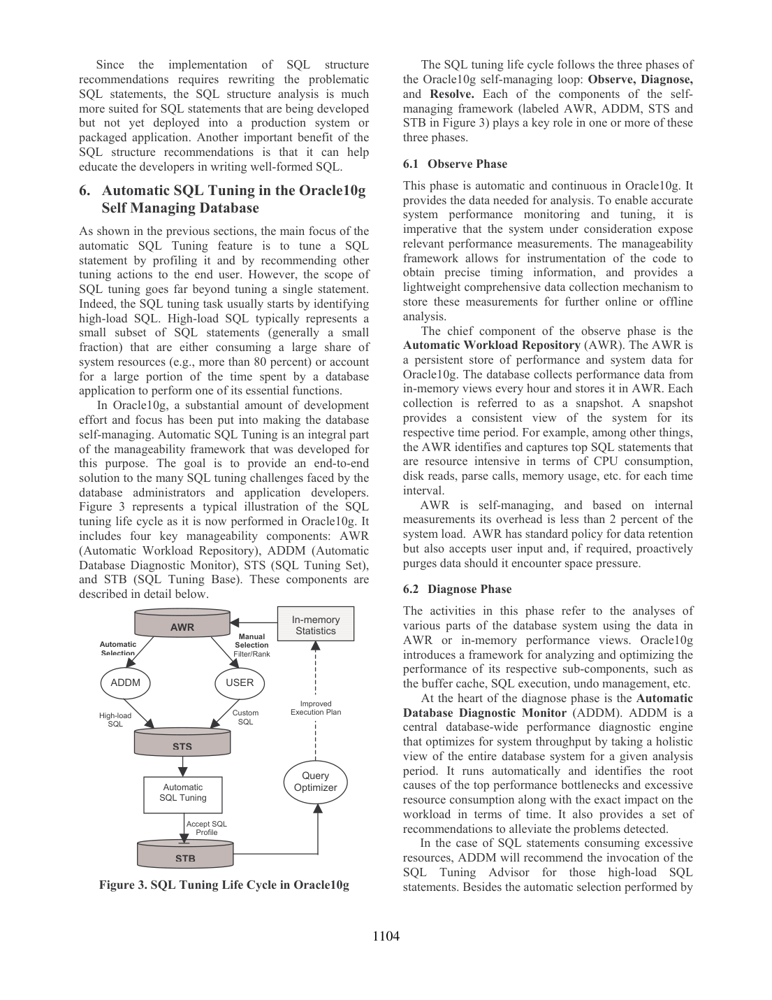
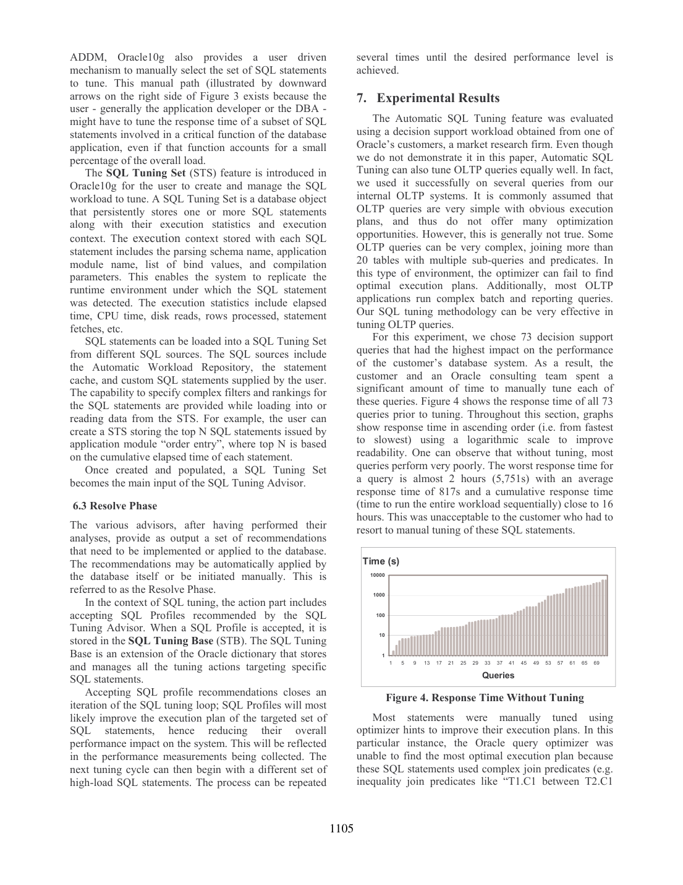

> 本组第 39 篇 · 诊断与自动调优 · [全部论文]() · [上一篇]() · [下一篇]()

本报告由当前 Codex 会话实际通读、编写，使用全部12页原图及本机OCR，不复用call371失败读稿的论断，也没有发起新API请求。原PDF文字层有损，OCR双栏曾交错；本次仅在独立detached输入中按页面坐标整理OCR词序，不猜测修复拼写，表1数值另以原图视觉转写并标注。SQL Tuning Advisor是接口，Automatic Tuning Optimizer是优化器的调优模式；SQL Profile存放辅助统计、估计校验和语句特定设置，供后续编译结合已有统计生成计划，不是固定执行计划。索引和SQL结构分析给出what-if建议，须与实际实施及用户语义判断分开。本文实测仅选单一市场研究客户的73条高影响DSS查询；自动分支只接受Profile，不改SQL或schema，报告累计执行时间由未调优58,821秒、人工2,131秒降至自动929秒，另耗74分钟进行自动调优。这些结果不是所有OLTP、工作负载或专家调优的普遍保证。引文匹配检验的是明确标注的OCR/视觉转写页，不冒称正常原生Unicode文字层或独立人工事实核查。

本文保留论文陈述、读者推断与待验证方案的区别；实验数字只适用于原文条件。原文和翻译来自已有 AI 辅助精读报告，已做来源匹配与编辑复核，不等于人工逐项核验或独立实验复现。所有页码均为 PDF 物理页。

## 论文与阅读范围

Benoit Dageville, Dinesh Das, Karl Dias, Khaled Yagoub, Mohamed Zait, Mohamed Ziauddin. Automatic SQL Tuning in Oracle 10g. Proceedings of the 30th VLDB Conference, Toronto, Canada, 2004. 本地 PDF 12 页，对应印刷页1098-1109；这是10g第一生产版本的历史论文，不是当前产品规范。

[论文集中的原始 PDF](https://github.com/lonng/db-papers/blob/4ff1331069c7cf52ac97dd769e5f484c1c35c200/papers/diagnosis-and-tuning/automatic-sql-tuning-in-oracle-10g.pdf) · 本地来源：`diagnosis-and-tuning/automatic-sql-tuning-in-oracle-10g.pdf`，共 12 页。

本篇保留 22 组原文精读和 35 条证据。截图为原始 PDF 的局部页选，不是重新生成的图表；未将整份 PDF 复制到博客。

## 研究问题、版本与来源方法

【原文事实】2004年论文把SQL调优分为识别高负载语句、寻找更好的执行方式、实施纠正措施三步。困难不仅是算子和join order搜索，还包括缺失/陈旧统计、列及跨表相关、复杂谓词、应用只消费部分结果，以及必须由DBA或开发者判断的访问结构和SQL写法。作者把调优能力嵌入Oracle优化器，以更长分析预算收集辅助信息，并由advisor向用户暴露结果。

这是Oracle10g第一生产版本的产品技术论文。文中的AWR、ADDM、SQL Tuning Set(STS)、SQL Tuning Base(STB)都按该版本解释；不把STB偷换成后来的SQL Plan Management/plan baseline，也不引用当前默认任务、许可或API行为。文中声称OLTP也适用，但所展示实验是DSS，必须分别报告。

【本次实际方法，非论文实验】已完整读取12页并逐页查看原图，覆盖图1-7及表1。PDF的原生字符映射损坏，不能将控制字符字符串当作可读原文。本机PyMuPDF英文OCR先生成转写，随后在独立detached输入内按词坐标重排左右栏，不修改词的拼写。OCR仍可能有标点、合词或图标签错误，引用仅表示指定转写中的可核验片段；表1漏识别的数值则明确使用原图视觉转写。不得把这两类引文称为原生Unicode逐字匹配。

原API call371已结束为ResearchError；其11条引文无法匹配当时原生缓存，部分还与现有OCR不符或改写了原句。该原始响应、记录和已报告用量保持不动，仅作为失败历史；本报告不是该API的成功续稿。当前Codex会话用量不可从离线bridge量出，usage保持null，不捏造token数。

依据：论文陈述；PDF 物理页 1, 2, 7, 8, 11。证据：[E001](#evidence-e001), [E002](#evidence-e002), [E018](#evidence-e018), [E028](#evidence-e028), [E032](#evidence-e032)。

## 架构与对象边界

【原文事实】Automatic SQL Tuning由两部分组成：Automatic Tuning Optimizer负责内部分析，SQL Tuning Advisor是向DBA/开发者提交语句及返回建议的服务器接口。调优模式与常规模式共享优化器基础，但前者可使用分钟级而非亚秒级预算。图1列出Statistics Analysis、SQL Profiling、Access Path Analysis、SQL Structure Analysis；不是四个彼此隔离的外置脚本，也不是每种建议都由Profile承载。

Profile把统计分析、估计校验与参数设置分析产生的语句特定辅助信息保存起来。图2区分两条路径：实线是选SQL、调用advisor、分析、提出Profile并由DBA接受保存；虚线是以后同一SQL正常优化时检索Profile，再与已有统计合用生成执行计划。Profile不是计划缓存、结果缓存或固定计划承诺，也不是在每次正常执行时重新做完整昂贵调优。

图3给出Observe-Diagnose-Resolve管理循环：AWR存储观测，ADDM从全库视角识别重要问题，用户也可自行筛选业务关键SQL；STS保存待调优语句及执行环境，accepted Profile等动作进入STB，供优化器使用。STS不是STB，AWR不是Profile，ADDM不是SQL Tuning Advisor。

原文STS上下文包括解析schema、应用模块、bind值、编译参数及elapsed/CPU/disk reads/rows/fetches等统计。保存上下文帮助重建发现语句时的条件，不等于已说明所有数据版本、并发状态或缓存状态都能确定性重放。Resolve可自动也可人工发起，Profile仍有接受步骤；不得由“automatic”推导无人审核就修改schema或源程序。

依据：论文陈述；PDF 物理页 2, 3, 4, 5, 7, 8。证据：[E002](#evidence-e002), [E003](#evidence-e003), [E007](#evidence-e007), [E008](#evidence-e008), [E015](#evidence-e015), [E016](#evidence-e016), [E017](#evidence-e017), [E028](#evidence-e028)。

*原论文 PDF 物理页 7，版权归原作者或出版方。点击图片可查看原尺寸。这是页面定位信息，不表示本次已复核图内所有数据。*

## 分析机制与读者推演

【原文事实：统计和估计】优化器先记录计划生成中实际使用或需要的统计类型，再核对相关表、索引、物化视图是否具有这些统计。对已有统计采样比较准确性/陈旧程度，迭代增大样本以达到足够可信的验证。输出一类是收集统计建议，另一类是Profile辅助信息。作者优先建议实际收集统计并重跑advisor；用户不接受时才可借辅助信息补偿，不能把Profile解释为全局替代对象统计。

估计分析针对复杂过滤/连接谓词、数据倾斜和列相关带来的中间结果误差。它可动态采样、部分执行SQL片段，必要时在有效访问路径下查看整个输入集，并把偏差补偿信息带回计划搜索。调优不只是静态EXPLAIN，也非必须完整跑完每个候选计划；文中没有给所有情况下的采样误差界、最优性证明或资源零开销保证。

参数分析利用历史行为。例如语句经常只取前n行，目标可调整为尽快产生这n行，而非最快返回全结果；n来自执行历史。它是语句特定的优化目标，不是全局并发许可阈值，历史也不能保证未来消费者永远不改变取数方式。

【原文事实：访问路径】从等值、多个谓词及ORDER BY等提出候选索引，基于表/列统计构造假想索引统计，假设索引存在重新优化并比较成本。只有较大预期收益才建议添加，因为分析单条SQL并不了解整体负载。SQL Access Advisor进一步结合代表工作负载与DML影响汇总建议，还涉及物化视图；不能把单语句的便宜计划直接叫作全库最佳物理设计，也不能把what-if成本当作已经建索引测到的秒数。

【原文事实：SQL结构】正常优化器改写必须保持语义；结构advisor则会暴露可能依赖应用约束的改写机会。分析先记录某种变换未能发生的理由、必要条件和替代选项，再检查最终计划昂贵算子上的注释提出建议。文中“大于总plan cost的10%”是昂贵算子的一种定义，不是CPU实测占比或普适阈值。

UNION换UNION ALL仅在不可能重复或应用不关心重复时才可考虑；outer/inner join的例子也依赖完整性及非空前提。NOT IN、原文写作NOT EXIST的示例，以及移动rownum，都不能当作任意NULL、重复、排序或限制语境下无条件等价的可执行SQL规则。本报告不运行或自动应用这些建议。

【读者构造的假设示例】某报表join两个存在相关过滤列的表，常规估计过小而选择不合适的join顺序。假设调优采样发现误差并形成Profile，用户接受后，同一原始SQL的未来编译可能选择不同join顺序。此例没有真实行数或加速结果，Profile也不保证强制该顺序。另一个假想索引即使使单条查询估算成本下降，仍需把更新负担和其他查询交给整体负载分析，而不是立即创建。

依据：论文陈述；PDF 物理页 3, 4, 5, 6, 7, 8。证据：[E003](#evidence-e003), [E004](#evidence-e004), [E005](#evidence-e005), [E006](#evidence-e006), [E007](#evidence-e007), [E008](#evidence-e008), [E009](#evidence-e009), [E010](#evidence-e010), [E011](#evidence-e011), [E012](#evidence-e012), [E013](#evidence-e013), [E014](#evidence-e014), [E016](#evidence-e016), [E017](#evidence-e017), [E031](#evidence-e031), [E032](#evidence-e032)。

## 正确性与语义条件

【原文给出的约束】常规计划变换保持SQL语义；索引与Profile分析的目的在于改变优化信息或访问方式，而非随意改变查询结果。Profile供优化器结合基础统计生成计划，不需要修改应用SQL；用户仍可拒绝建议。结构what-if可能跨越优化器凭数据库已知约束能够证明的等价范围，因此必须交由理解应用的用户判断，尤其是重复行、NULL、外连接和rownum情形。

【读者分析】估计修正正确与查询结果正确是两个问题。更准确的基数通常有助于cost-based选择，但不能据此证明给出的计划在所有物理条件下最快，更不能证明所有未来bind值都无退化。统计建议、Profile和SQL源代码修改必须分开验收：前两者主要改变选计划信息，后者可能改变结果语义。假想索引只做成本评估，不产生已存在的可执行物理结构。

采样必须足够准确、过去执行环境需要被恰当保留，这些是机制要求而不是本文给出的完整置信区间或形式正确性证明。本文没有端到端完备性证明、所有建议无回归保证、profile生命周期/失效/并发更新的完整规范，也未展示参数漂移下的结果。

【特别区分】本实验明确不改SQL与schema，所以可将结果归于其接受的Profile路径，但不能由此证明任意结构建议都安全。rownum、NOT IN/NOT EXIST、UNION ALL例子只是作者讨论的条件性机会，不应从片段生成可运行“修复脚本”。本报告所有示例都是纸面推演，本次没有实际DB或SQL副作用。

依据：读者推断；PDF 物理页 4, 5, 6, 8, 9, 11。证据：[E004](#evidence-e004), [E005](#evidence-e005), [E006](#evidence-e006), [E008](#evidence-e008), [E009](#evidence-e009), [E012](#evidence-e012), [E013](#evidence-e013), [E016](#evidence-e016), [E020](#evidence-e020), [E021](#evidence-e021), [E022](#evidence-e022), [E028](#evidence-e028), [E031](#evidence-e031)。

## 实际实验及数字口径

【原文实验】工作负载来自一间市场研究客户，选择73条对系统影响最大的DSS查询。客户和Oracle咨询团队先手工调优，多数语句使用optimizer hints；问题包括复杂不等值连接和跨表高度相关列，导致中间join基数及join顺序估计困难。它不是随机选择的全体SQL、标准TPC吞吐实验或多租户admission试验。OLTP效果只作声称和经验描述，作者明确本文未展示其评估。

自动分支将初始73条查询装入STS，只实施所有被接受的SQL Profile推荐，未重写SQL、未修改schema。因此本文自动收益不能归因于建索引、物化视图或SQL改写，也不能假定它是在人工hint语句之上继续叠加Profile。

【表1原图，视觉核对转写】列顺序为Average/Maximum/Cumulative Response Time：
未调优：817s / 5,751s / 58,821s。
人工调优：30s / 275s / 2131s。
自动调优：13s / 59s / 929s。
Cumulative是整组查询顺序运行时间，不是并发吞吐、单次平均或P99。原表平均数和累计数除以73不严格一致，应忠实保留而非重算替换。正文称自动累计“less than15 minutes”，但929秒超过900秒；这是源文内部近似/措辞不一致，不能静默把929改成小于15分钟。

图4-6按响应时间排序，纵轴对数，不能把不同图的第k根柱当作同一查询逐一配对。对相同累计口径，读者可计算2131/929约2.29，但它只是这组顺序执行累计时间比，不是平均逐查询speedup、通用吞吐提升或作者额外公布的指标。本报告不从柱高补造原始数据。

【调优自身成本】作者另报告整组自动调优耗74分钟，单条的描述为从少于一分钟到最大少于两分钟；这不是929秒的调优后执行时间。希望单条调优时间不超过其原始执行时间是内部目标，不能把该措辞升级为一切SQL的严格运行时上界。人工耗时仅称significant man-hours，未给可比工时总数，因此不可编造人工/自动成本加速比。

【开销和缺口】AWR低于2%系统负载只是内部测量声明，不是SQL profiling的开销；也不能与另一篇ADDM论文的整组管理特性约3%混合。本实验未充分披露硬件、数据库大小、具体版本、SQL文本、重复次数、冷暖cache或随机化，缺少误差线及回归查询统计。它支持该案例的初步效果，不证明所有OLTP/DSS、所有绑定值或所有专家调优都逊于自动方案。本次未重现实验。

依据：论文陈述；PDF 物理页 7, 8, 9。证据：[E018](#evidence-e018), [E019](#evidence-e019), [E020](#evidence-e020), [E021](#evidence-e021), [E022](#evidence-e022), [E023](#evidence-e023), [E024](#evidence-e024), [E025](#evidence-e025), [E029](#evidence-e029), [E030](#evidence-e030), [E033](#evidence-e033), [E034](#evidence-e034)。

*原论文 PDF 物理页 8，版权归原作者或出版方。点击图片可查看原尺寸。这是页面定位信息，不表示本次已复核图内所有数据。*

## 资源与工程取舍

【来自原文的机制】分钟级调优把通常来不及做的采样与估计验证放到关键语句上，从而改善后续正常编译。代价是额外CPU、I/O、统计和状态管理，不是因为不改应用文本便完全无负载。选择高影响语句是在分析成本与收益间取舍；业务关键但负载占比很低的SQL也可人工选入，不应把“top SQL”理解成只按全库总耗时排名。

Profile降低改源代码的要求，对封装应用尤其有价值，但仍需用户接受且依赖基本统计和历史环境。收集基础统计优先于把辅助修正永远当成陈旧统计替代；未来数据、bind分布或消费模式改变后如何维护Profile，本文未提供完整策略。

单SQL假想索引有显著局部收益也未计全库DML与其他语句成本，因此作者明确转交SQL Access Advisor处理代表性工作负载。SQL结构建议则把部分性能责任交回应用语义判断，开发阶段比已部署封装SQL更容易调整。避免自动误改语义并非缺少“自动化”，而是接口边界。

【读者推断】调优自身74分钟意味着短命或只运行一次的查询未必能摊销分析成本；需要以重复次数、收益持续时间和资源竞争综合决定，不以单次929秒就忽略前期成本。这里没有自动排队/准入机制或可证控制稳定性；把调优预算、资源advisor和admission tuning混为一谈会误判论文贡献。

依据：读者推断；PDF 物理页 2, 3, 4, 5, 6, 7, 8, 9。证据：[E002](#evidence-e002), [E003](#evidence-e003), [E004](#evidence-e004), [E005](#evidence-e005), [E007](#evidence-e007), [E010](#evidence-e010), [E011](#evidence-e011), [E013](#evidence-e013), [E014](#evidence-e014), [E024](#evidence-e024), [E025](#evidence-e025), [E029](#evidence-e029), [E032](#evidence-e032), [E019](#evidence-e019)。

## 相关工作与范围对照

【本文中的历史比较】第8节把SQL profiling描述为在计划搜索时检查估计，并将其与LEO从已选择计划的执行反馈中积累修正作比较。作者强调选择高影响语句、隔离验证访问路径相关谓词，以及以SQL文本signature检索Profile。这是2004年作者对当时系统的分析，不是本报告独立审计LEO、DB2或SQL Server源码，也没有给三者同环境benchmark。

讨论提到LEO可能让学习跨多条查询共享，而选择性Profile容易限定影响范围；所谓single iteration不等于内部没有迭代采样，所谓不影响应用也不能变成调优资源零开销或所有计划无退化。本文对外部工具、index advisor能力的描述应保留为历史观点，不能扩为当前产品事实。

【三个不同任务】ADDM做全库诊断和高影响问题定位；SQL Tuning Advisor/Automatic Tuning Optimizer深入单SQL优化信息与建议；SQL Access Advisor处理代表负载的访问结构与DML权衡。Admission tuning则涉及请求准入和并发控制，本篇没有实现该控制算法。AWR/STS提供数据与组织形式，并不是这三类调优器的同义词。

【读者待验证问题】未来若拿此机制和现代learned estimator比较，需要另设相同SQL、数据、参数、训练/分析成本和回退条件。本来源不包含现代ML实验，不应从“learning”或“profiling”名称推出神经模型、RL策略或当前市场性能排名。

依据：读者推断；PDF 物理页 5, 6, 7, 8, 10, 11。证据：[E010](#evidence-e010), [E011](#evidence-e011), [E015](#evidence-e015), [E017](#evidence-e017), [E018](#evidence-e018), [E026](#evidence-e026), [E027](#evidence-e027), [E028](#evidence-e028)。

## 复现计划与验收标准

【读者提出，尚未执行】本次只生成文献报告与detached文件，不连接Oracle、不创建Profile/索引、不执行查询，也不修改数据库配置。复现需要独立隔离的授权测试环境，本文未提供可直接运行的完整脚本。

1. 固定版本、schema、数据快照、SQL/bind值和统计；分别保留原始、手工hint、原始SQL加accepted Profile三组，避免把手工语句当作自动分支输入。记录正常编译与调优分析的时间预算。
2. 对采样与估计记录验证位置、输入规模、样本增长和误差。比较缺失/陈旧统计、收集新统计后重跑advisor以及仅辅助Profile三种情形，区分每种操作实际做了什么。
3. 检验Profile前后SQL文本及schema不变、优化时确实使用相应Profile，并分别记录计划和结果。覆盖不同bind值、只取前n行与完整获取结果；不能只看新plan cost下降而忽略结果或运行时回归。
4. 访问路径的what-if先记录候选索引、假想统计及估计收益，再在单独实验阶段才可能测真实索引。记录DML和整体负载影响；不得把估计收益与真实运行结果混为同一列。
5. 结构建议逐项检验重复、NULL、外连接、rownum等语义条件。任何不能证明等价或不能确认业务接受变化的例子不自动改写。记录advisor为什么没能在常规优化中进行该变换。
6. 执行时间按相同条件重复，报告均值/分布、累计顺序时间、cache状态和回归语句。调优总成本另列，人工工时须实测；不要把74分钟与929秒当同一指标。
7. 对观测/管理开销明确启用组件和基线，分别测AWR与profiling分析，不用论文内部低于2%的概述替代新环境测量。高负载识别可以由ADDM或人工给定，但不引入未经说明的admission策略。

验收应同时保留原始结果、建议、接受动作、环境与失败记录。由于缺失作者数据与SQL，本计划只能检查机制和指标口径，不能承诺复现其73条客户查询的具体数值。

依据：待验证的工程设想；PDF 物理页 3, 4, 5, 6, 7, 8, 9。证据：[E003](#evidence-e003), [E004](#evidence-e004), [E005](#evidence-e005), [E007](#evidence-e007), [E008](#evidence-e008), [E009](#evidence-e009), [E011](#evidence-e011), [E012](#evidence-e012), [E013](#evidence-e013), [E016](#evidence-e016), [E017](#evidence-e017), [E019](#evidence-e019), [E020](#evidence-e020), [E021](#evidence-e021), [E022](#evidence-e022), [E023](#evidence-e023), [E024](#evidence-e024), [E025](#evidence-e025), [E029](#evidence-e029), [E031](#evidence-e031)。

## 结论与未决问题

【基于全文的归纳】本文的价值是把优化器内部估计验证、语句特定辅助信息和条件性what-if建议放进同一调优流程。应分清三条边界：Profile不是固定计划；建议不是已实施动作；单SQL成本改善不是整个数据库负载最优。

证据最充分的实测范围是单一客户73条DSS查询的profile-only分支及其调优成本。作者关于广泛OLTP适用、优于人工和低风险部署的表述不能超出所展示案例。表1和正文的时间近似、取整不完全一致应保持可见，不用润色掩盖。

本报告的可核验性也有明确边界：原文字层损坏，逐字检查针对注明来源的OCR或原图视觉转写；词序重排没有修复词本身，图表与公式靠实际原图核对。与原API失败记录相分离的当前Codex写作、空的usage及generated_needs_review状态都必须保留，不把离线结构校验冒称独立人工审查或复现实验。

依据：读者推断；PDF 物理页 2, 4, 5, 6, 8, 9, 10, 11。证据：[E002](#evidence-e002), [E005](#evidence-e005), [E008](#evidence-e008), [E010](#evidence-e010), [E011](#evidence-e011), [E012](#evidence-e012), [E013](#evidence-e013), [E017](#evidence-e017), [E018](#evidence-e018), [E019](#evidence-e019), [E020](#evidence-e020), [E023](#evidence-e023), [E024](#evidence-e024), [E026](#evidence-e026), [E028](#evidence-e028), [E030](#evidence-e030)。

## 原文精读：从句子回到机制

以下保留原文、忠实翻译、含义与边界；假设示例不作为论文实验结果。

### P001 · PDF 物理页 2

**原文**

<blockquote class="paper-source-quote"><pre><code>The main difference is that the Automatic Tuning Optimizer is allowed to run for a much longer period of time, generally minutes versus a sub-second during the regular optimization mode. The Automatic Tuning Optimizer takes advantage of this extra time to profile the SQL statement and validate the statistics and estimates used in the process of building an execution plan.</code></pre></blockquote>

**忠实翻译**

> 主要区别在于，Automatic Tuning Optimizer获准运行更长时间，通常是分钟级，而常规优化模式通常不到一秒。它利用额外时间为SQL语句做profiling，并验证构建执行计划过程中使用的统计与估计。

**技术含义与边界**

> 这段比较同一优化器两种工作模式的预算与验证能力，不是说正常查询执行需要几分钟，也不是对每条SQL固定花同样时间。长预算用于分析，但输出仍需经建议接口进入后续使用。上下文中的最优计划是目标，不是全局最优性证明。

**常见误读**

> 把分析时间与SQL执行响应时间混成一个数；把分钟级预算当作准入排队时限；或以为所有线上SQL都同步进入调优模式，都超出这段内容。

**读者构造的假设示例**

> 读者构造的假设示例：某语句平常编译20ms，测试环境给调优器120秒预算来检查估计；这只是假设预算，不能据此断言它每次执行都要120秒或必能找到最快计划。

### P002 · PDF 物理页 3

**原文**

<blockquote class="paper-source-quote"><pre><code>The Automatic Tuning Optimizer uses dynamic sampling and partial execution (i.e. execute fragments of the SQL statement) techniques to verify its standard estimates of cardinality, cost, etc. It also uses the past execution history of the SQL statement to determine appropriate settings of the optimization parameters.</code></pre></blockquote>

**忠实翻译**

> Automatic Tuning Optimizer使用动态采样与部分执行（即执行SQL语句的片段）来校验基数、成本等常规估计。它还使用语句过去的执行历史，确定适当的优化参数设置。

**技术含义与边界**

> 这里的profiling可能实际接触数据和执行片段，不是只读一份EXPLAIN文本；校验对象不限于最终结果行数。本文没有在此规定所有算子的采样策略或全空间验证算法，本报告也没有实际执行这些SQL。

**常见误读**

> 不能把“部分执行”说成跑完每个候选计划，更不能把支持动态采样说成没有CPU/I/O成本。原文机制描述与本次文献读取是两回事。

**读者构造的假设示例**

> 读者构造的假设示例：假想过滤谓词的估计选择率过低，调优器可在样本上执行相应过滤片段进行校验；样本规模、误差和成本都需要另测，不能由此编造作者测得的行数。

### P003 · PDF 物理页 4

**原文**

<blockquote class="paper-source-quote"><pre><code>However, the sampling result must be sufficiently accurate before it can be used to verify the stored statistic. Iterative sampling with increasing sample size is used to meet this objective.</code></pre></blockquote>

**忠实翻译**

> 但是，采样结果必须足够准确，才能用于验证已存储的统计。为达到这一目标，采用逐次增加样本规模的迭代采样。

**技术含义与边界**

> 它明确给采样校验加了精度前提。迭代增样说明并不是一次任意小样本就能可靠判定统计陈旧；不过这段没有给“足够准确”的数值定义、置信区间或停止准则。

**常见误读**

> 把足够准确翻译成“完全准确”，或者从迭代采样推导确定性无误差保证，都会增加原文没有的承诺。

**读者构造的假设示例**

> 读者构造的假设示例：先抽取一批行发现估计波动很大，再增大样本才决定是否形成建议；这只是说明为何增样，不能声称某个固定样本百分比是本文默认值。

### P004 · PDF 物理页 4

**原文**

<blockquote class="paper-source-quote"><pre><code>It is preferable to implement the recommendation to gather statistics and re-run the SQL Tuning Advisor. The auxiliary information is used in case the recommendation to gather statistics is not accepted by the user.</code></pre></blockquote>

**忠实翻译**

> 更可取的做法是实施收集统计的建议，并重新运行SQL Tuning Advisor。如果用户没有接受收集统计的建议，则使用辅助信息。

**技术含义与边界**

> 原文有明确优先级：纠正基础统计与利用语句特定辅助信息并非完全可互换的两件事。这里也出现用户接受条件，不能把产生建议直接等同于已完成统计收集。

**常见误读**

> 把Profile描述成永久替代所有对象统计，或声称advisor一定自动更新统计，会抹掉该段的fallback和用户选择语义。

**读者构造的假设示例**

> 读者构造的假设示例：DBA暂时不允许某表收集统计，可能考虑该语句的辅助Profile；若后来正式更新统计，应重新分析，而不能从此例推出旧Profile必然仍最优。

### P005 · PDF 物理页 4

**原文**

<blockquote class="paper-source-quote"><pre><code>The validation process may involve running part of the query on a sample of the input dataset, or on the entire input dataset when efficient access paths are available.</code></pre></blockquote>

**忠实翻译**

> 校验过程可能在输入数据集样本上运行部分查询；当存在高效访问路径时，也可能在整个输入数据集上运行这部分查询。

**技术含义与边界**

> may保留了可选性，整个输入集还受有效访问路径条件限定。它讨论的是校验所需的数据访问范围，不是声称完整查询和所有候选计划都被执行。

**常见误读**

> 把采样机制理解成永不全量，或把整个输入理解为无条件全库扫描，都不忠实。对成本和隔离影响需要单独实验，本文片段没有给通用上限。

**读者构造的假设示例**

> 读者构造的假设示例：校验一个窄范围谓词时可借合适路径查看对应整个输入，而另一个昂贵join只用样本；两种选择的实际代价不能从这句话直接换算成秒数。

### P006 · PDF 物理页 4

**原文**

<blockquote class="paper-source-quote"><pre><code>The Automatic Tuning Optimizer uses the past execution history of a SQL statement to determine the correct optimizer settings. For example, if the execution history shows that the output ofaSQL statement is often partially consumed, the appropriate setting is to optimize it to quickly produce the first n rows, where n is derived from this execution history. This constitutes a customized parameter setting for the SQL statement.</code></pre></blockquote>

**忠实翻译**

> Automatic Tuning Optimizer依据一条SQL过去的执行历史确定优化器设置。例如，历史显示该语句输出经常只被部分消费，就适合优化为尽快产生前n行，n由该执行历史推导。这构成该SQL语句的定制参数设置。

**技术含义与边界**

> OCR中ofaSQL是合词，原图表达的是a SQL，不为该伪影增加技术含义。机制把取数目标从完整结果速度转向前n行速度，是语句特定目标选择，不是调节系统同时接受多少查询。

**常见误读**

> 历史常常部分取数不等于所有未来执行都如此。不能把first-n设置解释为只返回n行、改变结果语义，或视为全局admission控制参数。

**读者构造的假设示例**

> 读者构造的假设示例：报表UI经常只展示首屏，调优可能偏向尽快产生首屏行；如果后来批量导出完整结果，需要重新检查目标，而不是假设过去模式永远有效。

### P007 · PDF 物理页 5

**原文**

<blockquote class="paper-source-quote"><pre><code>The result of the above three analyses is stored in a SQL Profile. It is a collection of customized information for the SQL statement that is being tuned. Thus SQL Profile is to a SQL statement what statistics is to a table or index object. Once a SQL Profile is created, it is used in conjunction with the existing statistics by the Oracle query optimizer to produce a well-tuned plan for the corresponding SQL statement.</code></pre></blockquote>

**忠实翻译**

> 上述三项分析的结果存储在SQL Profile中。它是为正在调优的SQL收集的定制信息；Profile对SQL的作用可类比统计对表或索引对象的作用。Profile创建后，Oracle优化器将它与现有统计一起使用，为对应语句生成经过调优的计划。

**技术含义与边界**

> 这里的类比是优化信息，不是把Profile等同对象统计本身。关键是与现有统计合用、由优化器重新生成计划；这并未表示保存了一个不可变执行计划。三项分析指前文统计、估计与参数设置分析。

**常见误读**

> 把Profile翻译成“固定plan文件”、执行结果缓存或全库统计替代，都会改变对象性质。图2还要求接受后保存，创建建议并不自动等于在线生效。

**读者构造的假设示例**

> 读者构造的假设示例：假想一个Profile补偿某join估计，未来编译仍结合表统计选计划；数据或环境改变时，不能仅凭这个Profile就断言计划永远不变。

### P008 · PDF 物理页 5

**原文**

<blockquote class="paper-source-quote"><pre><code>Once candidate indexes are identified, the next step is to verify their effectiveness. To do that, the ‘Automatic Tuning Optimizer derives statistics for each candidate index based on the statistics of its table and relevant columns. It then optimizes the SQL statement pretending that these indexes actually exist. If the cost of a plan that uses one or more candidate indexes is cheaper bya large factor compared to the cost of best plan using no candidate indexes, then the Automatic Tuning Optimizer alerts the user that these critical indexes are missing, and recommends to add them.</code></pre></blockquote>

**忠实翻译**

> 候选索引确定后，下一步是检验其有效性。Automatic Tuning Optimizer根据相关表和列的统计推导各候选索引统计，然后假定这些索引确已存在来优化SQL。如果使用一个或多个候选索引的计划成本，比不使用候选索引的最佳计划便宜很多，它就提示用户缺少这些关键索引并建议添加。

**技术含义与边界**

> 这是what-if成本比较。OCR保留了多余引号和bya合词，原图技术含义明确，但不据此改写引文。候选统计与候选计划并不要求真实创建索引，输出仍是建议。

**常见误读**

> “检验有效性”不能偷换为已建索引测得响应时间，更不能把estimated cost的大比例下降当作实际秒数同比下降。全文还明确单语句分析不知全负载影响。

**读者构造的假设示例**

> 读者构造的假设示例：假想索引使某查询估算成本从100降至20，advisor可建议它；是否要创建仍需看写入维护和其他语句，100/20不是已测得的5倍速度。

### P009 · PDF 物理页 5

**原文**

<blockquote class="paper-source-quote"><pre><code>Since Automatic SQL Optimizer does not perform an analysis of how its index recommendations are going to affect the entire SQL workload, it also recommends running the SQL Access ‘Advisor [6] on the SQL statement along with a representative SQL workload.</code></pre></blockquote>

**忠实翻译**

> 由于Automatic SQL Optimizer不分析索引建议对整个SQL工作负载的影响，它还建议将该语句连同代表性SQL工作负载交给SQL Access Advisor。

**技术含义与边界**

> 这句话主动限制单SQL分析范围，同时给出工作负载级后续接口。代表性负载是必要输入，不能以一条语句的局部成本决定全局索引集合。

**常见误读**

> 把SQL Tuning Advisor和SQL Access Advisor当成同一作用域，或由这句话推出前者已计入全部DML成本，恰好与原文相反。

**读者构造的假设示例**

> 读者构造的假设示例：一条读查询希望建索引，而同表大量更新会承担维护代价；应把这些更新及其他读查询纳入代表负载，而非只凭该读查询立即建索引。

### P010 · PDF 物理页 6

**原文**

<blockquote class="paper-source-quote"><pre><code>The SQL Access Advisor takes into account the level of DML activity on the related objects in its global recommendations.</code></pre></blockquote>

**忠实翻译**

> SQL Access Advisor在全局建议中考虑相关对象的DML活动水平。

**技术含义与边界**

> 此处只引用连续可靠的一句，避免后续OCR图文噪声混入引文。它支持全局访问结构建议需顾及写活动的边界，并不提供具体权重或全局最优算法。原图同段还讨论物化视图，但不能把那部分当作此短引已完整引用。

**常见误读**

> 考虑DML不等于测得所有锁、日志、存储或写放大成本；也不是说明本次已运行任何DML。局部建议与全局建议仍要分开归因。

**读者构造的假设示例**

> 读者构造的假设示例：某表以更新为主时，额外索引的读收益可能被维护负担抵消；该方向性例子不设定作者未给出的DML阈值。

### P011 · PDF 物理页 6

**原文**

<blockquote class="paper-source-quote"><pre><code>However, the query optimizer applies a transformation only when the query can be rewritten into a semantically equivalent form. Semantic equivalence can be established when certain conditions are met; for example, a particular column in a table has the non-null property. However, these conditions may not exist in the database but enforced by the application. The Automatic Tuning Optimizer performs what-if analysis to recognize missed query rewrite opportunities and makes recommendations for the user to undertake.</code></pre></blockquote>

**忠实翻译**

> 但是，查询优化器只有在能够将查询改写为语义等价形式时才应用变换。满足某些条件时可建立语义等价性，例如某表列具有非空性质；这些条件可能不是数据库中声明的，而由应用保证。Automatic Tuning Optimizer用what-if分析识别错失的改写机会，并提出由用户实施的建议。

**技术含义与边界**

> 它区分优化器可证明的等价变换与依赖应用知识的条件性建议。并非数据库不知道约束就能自动假定它成立；建议把确认责任交给有应用语义知识的人。

**常见误读**

> 不能据“应用保证”就跳过验证，或把所有what-if建议当成编译器可以无条件执行的等价规则。本文不是结构改写完备性的证明。

**读者构造的假设示例**

> 读者构造的假设示例：应用声称某join key永不为NULL，但schema未声明；只有确认该约束及其维持机制后，才能评估相关改写，不能仅看预计成本。

### P012 · PDF 物理页 6

**原文**

<blockquote class="paper-source-quote"><pre><code>However, this replacement is possible only if there is no possibility of duplicate rows (e.g., a unique constraint is maintained in the application), or duplicate rows when produced do not matter to the application.</code></pre></blockquote>

**忠实翻译**

> 然而，只有在不可能出现重复行（例如唯一约束由应用维持），或出现重复行也不影响应用时，这种替换才可进行。

**技术含义与边界**

> 这里的替换指前文UNION到UNION ALL。两个条件是或关系：无重复，或业务不在意重复。后者未必在严格SQL多重集语义上等价，必须保留应用层限定。

**常见误读**

> 把UNION ALL一律替换UNION并声称更快且等价，遗漏了最核心前提；性能好不能补救结果重复所造成的业务错误。

**读者构造的假设示例**

> 读者构造的假设示例：两个结果集可能都含同一客户行，UNION会消重而UNION ALL保留两行；只有业务接受或确知不可能重叠时才讨论替换，此例不执行SQL。

### P013 · PDF 物理页 6

**原文**

<blockquote class="paper-source-quote"><pre><code>A costly operator can be defined as one whose individual cost is more than 10% of the total plan cost. Using the annotations associated to expensive plan operators, it produces appropriate recommendations. For example, if it was not possible to merge a view because of rownum predicate (.e., a limit to clause) present in the view, the recommendation would be to move rownum predicate outside of the view. With each recommendation, a rationale is given in terms of cost improvement.</code></pre></blockquote>

**忠实翻译**

> 可把单个算子成本超过计划总成本10%的算子定义为昂贵算子。利用这些算子相关的注释，系统给出建议。例如，视图内的rownum谓词使视图不能合并时，建议可能是把rownum谓词移到视图外；每项建议都给出成本改善方面的理由。

**技术含义与边界**

> 翻译依据原图理解括号中的限制子句说明，OCR的“.e., a limit to clause”仍在原引文中保留。10%是plan cost定义，不是CPU测量或统计显著性。rownum例子必须与整节应用语义前提合读。

**常见误读**

> 不要把成本理由当作已测速度，也不要把移动rownum当作任意SQL语义等价的安全自动修复；移动过滤/限制位置可能需要额外应用条件。

**读者构造的假设示例**

> 读者构造的假设示例：若限制先作用于视图再join与先join再限制会得到不同结果，仅成本下降不足以批准移动限制；应先确认语义，再考虑计划改善。

### P014 · PDF 物理页 8

**原文**

<blockquote class="paper-source-quote"><pre><code>The execution context stored with each SQL statement includes the parsing schema name, application module name, list of bind values, and compilation parameters. This enables the system to replicate the runtime environment under which the SQL statement was detected. The execution statistics include elapsed time, CPU time, disk reads, rows processed, statement fetches, etc.</code></pre></blockquote>

**忠实翻译**

> 每条SQL保存的执行上下文包括解析schema名、应用模块名、bind值列表和编译参数，使系统能够重建发现该SQL时的运行环境。执行统计包括elapsed time、CPU time、disk reads、已处理行数和语句fetches等。

**技术含义与边界**

> 这是STS输入的组成及用途，说明仅保存SQL文本不足以解释当时行为。文本中的replicate是环境重建目标，不是对数据版本、并发、缓存及外部依赖全部确定性重放的证明。

**常见误读**

> 不要把STS与保存accepted Profile的STB混同，也不能说有bind列表就可在任意当前库中无副作用地重跑原工作负载。本次没有实际重放。

**读者构造的假设示例**

> 读者构造的假设示例：同一SQL在两个schema或不同bind值下可能表现不同，STS保存这些上下文便于分析；若数据已变化，仍不能承诺复现原先运行时间。

### P015 · PDF 物理页 8

**原文**

<blockquote class="paper-source-quote"><pre><code>When a SQL Profile is accepted, it is stored in the SQL Tuning Base (STB). The SQL Tuning Base is an extension of the Oracle dictionary that stores and manages all the tuning actions targeting specific SQL statements.</code></pre></blockquote>

**忠实翻译**

> SQL Profile被接受后，存入SQL Tuning Base（STB）。STB是Oracle字典的扩展，存储并管理针对特定SQL语句的所有调优动作。

**技术含义与边界**

> 接受是明确状态转换，STB用于已接受动作管理；这与STS保存待分析工作集不同。这是10g论文中的术语，不应自动映射成后来的plan baseline机制。

**常见误读**

> 把提出建议当作已接受生效，或把STB叫作固定执行计划仓库，都超出该段。原文没有在此承诺自动接受所有Profile。

**读者构造的假设示例**

> 读者构造的假设示例：DBA拒绝一个Profile时，不能仅因advisor报告出现它就假定下次编译会使用它；接受后也应核查相应优化路径，而非假设固定plan。

### P016 · PDF 物理页 8

**原文**

<blockquote class="paper-source-quote"><pre><code>Even though we do not demonstrate it in this paper, Automatic SQL Tuning can also tune OLTP queries equally well. In fact, we used it successfully on several queries from our intemal OLTP systems.</code></pre></blockquote>

**忠实翻译**

> 尽管本文没有展示，Automatic SQL Tuning也能同样好地调优OLTP查询。事实上，我们已在内部OLTP系统的若干查询上成功使用它。

**技术含义与边界**

> 这是作者自己的声称和经验陈述，且开头明确否认本文展示对应结果。OCR的intemal与原图internal一致指内部，但不修改引文的识别错误。不能用这段填补OLTP测量条件和数据。

**常见误读**

> 把经验描述当作完整OLTP吞吐基准，或把“equally well”解释为已证明与DSS相同speedup，均不成立。文中实际表格属于客户DSS案例。

**读者构造的假设示例**

> 读者构造的假设示例：假想一个复杂OLTP查询也有估计错误，说明机制可能相关；仍须独立记录负载、延迟和分析开销，不能直接套用DSS的929秒。

### P017 · PDF 物理页 8

**原文**

<blockquote class="paper-source-quote"><pre><code>For this experiment, we chose 73 decision support queries that had the highest impact on the performance of the customer’s database system. As a result, the customer and an Oracle consulting team spent a significant amount of time to manually tune each of these queries.</code></pre></blockquote>

**忠实翻译**

> 在这次实验中，我们选择了73条对客户数据库系统性能影响最大的决策支持查询。客户和Oracle咨询团队因此花了相当多时间手工调优这些查询。

**技术含义与边界**

> 这段规定筛选方式、查询类型及人工方。它不是随机样本，也没有在此给出人工总工时。单客户高影响语句的分布可能有利于找到优化机会，不能外推所有SQL。

**常见误读**

> 把73条说成标准TPC基准，或把未给的significant amount of time换算成具体小时数，都在补造实验。它也不是线上并发请求数。

**读者构造的假设示例**

> 读者构造的假设示例：若另外选73条已经充分调好的短查询，可能缺少同样的改善空间；这里只说明样本选择影响解释，不声称做过该对照。

### P018 · PDF 物理页 9

**原文**

<blockquote class="paper-source-quote"><pre><code>For the purpose of this particular test, we decided to implement only SQL profile recommendations since our goal was to show how the execution plans for these statements could be improved without performing any SQL rewrite (i.e. altering SQL source code), and without modifying the underlying database schema.</code></pre></blockquote>

**忠实翻译**

> 为了本次特定测试，我们决定只实施SQL Profile建议，目的是展示在不做任何SQL改写（即不改SQL源代码）、也不修改底层schema的条件下，如何改善这些语句的执行计划。

**技术含义与边界**

> only和本次特定测试限定了作用归因。Profile-only实验与前文索引或结构what-if功能是不同证据层级：支持某功能存在不等于本实验实施了它。

**常见误读**

> 不能把表1的自动结果写成自动建索引、创建物化视图或改SQL的收益，也不能假定先人工hint再叠加Profile；文中说从初始查询集进行自动调优。

**读者构造的假设示例**

> 读者构造的假设示例：比较原始SQL与相同SQL加accepted Profile时保持schema不变，可检查Profile路径；若同时建新索引，则不能再把差异全部归到Profile。

### P019 · PDF 物理页 9

**原文**

<blockquote class="paper-source-quote"><pre><code>Auto Tuning 13s 59s 929s</code></pre></blockquote>

**忠实翻译**

> 自动调优：13秒、59秒、929秒。

**技术含义与边界**

> 这是从表1原图手工转写的一行，按表头分别对应Average、Maximum和Cumulative Response Time。该行不是正常原生文字或自动OCR命中，detached页中明确附有视觉转写来源。它不含调优分析时间。

**常见误读**

> 13不是全部查询耗时，59不是P99，929不是74分钟分析成本。原表取整平均和累计/73不严格相符应保留；不能据这一行反推逐条查询运行时。

**读者构造的假设示例**

> 读者构造的假设示例：阅读该表时先把列名与数值配对，再另列分析成本；若把929秒除以人工调优工时，将混合两个不同量纲，本例没有生成新实验。

### P020 · PDF 物理页 9

**原文**

<blockquote class="paper-source-quote"><pre><code>The entire workload was tuned in a little more than an hour (74 minutes) versus 16 hours to run the set of queries before tuning.</code></pre></blockquote>

**忠实翻译**

> 整个工作负载在略多于一小时（74分钟）内调优完成；相比之下，这组查询在未调优前执行需要16小时。

**技术含义与边界**

> 这里比较分析过程耗时与原查询执行成本，不能把74分钟称作调优后执行时间。表1另有929秒累计执行结果。真正的摊销还依赖重复运行次数、数据变化和分析资源竞争，本文没有完整成本模型。

**常见误读**

> 用16小时/74分钟宣布查询speedup，或在总成本中完全漏掉74分钟，都是指标混算。人工man-hours没有数值，也不能编造人工效率倍数。

**读者构造的假设示例**

> 读者构造的假设示例：一个只跑一次的任务与每天重复的任务可能对同一分析成本作不同选择；须以真实测量计算摊销，不从本段直接给出盈亏平衡次数。

### P021 · PDF 物理页 10

**原文**

<blockquote class="paper-source-quote"><pre><code>LEO detects cardinality estimate errors only in the final plan selected by the optimizer. In contrast, SQL profiling error detection is performed when the Oracle optimizer is searching for an optimal plan.</code></pre></blockquote>

**忠实翻译**

> LEO只在优化器最终选中的计划中发现基数估计错误；相比之下，SQL profiling在Oracle优化器搜索最优计划的过程中检测估计错误。

**技术含义与边界**

> 这是2004年本文作者在相关工作中的对照措辞。重点是反馈发生位置：已执行最终计划与调优搜索中的校验。它不是本报告独立审计LEO全部版本的结论，也没有同环境实验数字。

**常见误读**

> 不要将“搜索最优计划”翻译为必定得到全局最优，不要由这一句推出现代反馈系统都只能观察最终plan。与其他来源比较时需明确版本。

**读者构造的假设示例**

> 读者构造的假设示例：最终plan没用到某候选访问路径时，其运行反馈与搜索中专门验证某谓词能提供不同信息；这里只解释差别，不宣称哪种方法在任意负载都更好。

### P022 · PDF 物理页 7

**原文**

<blockquote class="paper-source-quote"><pre><code>AWR is self-managing, and based on_ internal measurements its overhead is less than 2 percent of the system load.</code></pre></blockquote>

**忠实翻译**

> AWR能够自行管理；根据内部测量，其开销低于系统负载的2%。

**技术含义与边界**

> 这是一项内部测量概述，OCR的on_下划线为保留的识别伪影，不赋予语义。对象是AWR，缺少这里的完整测量条件；不是本文73条查询profiling总成本，更不是跨版本硬上限。

**常见误读**

> 把2%转写成所有管理功能固定开销，或与另一篇ADDM文章的约3%当成同一实验相互验证，会混淆组件和条件。

**读者构造的假设示例**

> 读者构造的假设示例：新环境若启用AWR与额外profiling，应分别测基线和增量开销；不能从这段直接给整个系统承诺低于2%。

## 尚未解决的问题

1. Profile如何在数据、bind分布与结果消费模式改变后失效、重建或回退？本文没有完整生命周期规范。
2. 同一负载中单SQLProfile与全局访问路径建议如何协调，哪些收益能长期摊销调优成本？
3. 结构建议的应用层约束如何得到可审计证据，尤其是NULL、重复及rownum条件？
4. 原73条SQL、数据、硬件与重复测量缺失时，可以复现哪些机制而不能复现哪些数值？
5. 如何分别计量观测、调优分析与正常执行的开销，并记录回归语句而非只看总体累计改善？
6. Table1平均与累计/73、以及929秒与less than15minutes的源内不一致如何解释？报告保留原值，不代作者补造解释。

## 证据索引

证据编号沿用原报告，便于将上文判断追溯到原句。引文匹配只验证位置，不证明解读正确。

**E001 · PDF 物理页 1**

【OCR转写，已逐页对照原图】调优问题涵盖优化器、访问结构和SQL结构，不能缩成一个hint生成器。作者讨论的是工作负载和数据变化下的专业调优任务。

<blockquote class="paper-source-quote"><pre><code>SQL tuning is a very critical aspect of database performance tuning. It is an inherently complex activity requiring a high level of expertise in several domains: query optimization, to improve the execution plan selected by the query optimizer; access design, to identify missing access structures; and SQL design, to restructure and simplify the text of a badly written SQL statement. Furthermore, SQL tuning is a time consuming task due to the large volume and evolving nature of the SQL workload and its underlying data.</code></pre></blockquote>

**E002 · PDF 物理页 2**

【OCR转写，已对照原图】调优模式可使用分钟级分析，常规优化通常亚秒级；是预算与验证能力差别，不是执行请求的admission queue或并发控制。

<blockquote class="paper-source-quote"><pre><code>The main difference is that the Automatic Tuning Optimizer is allowed to run for a much longer period of time, generally minutes versus a sub-second during the regular optimization mode. The Automatic Tuning Optimizer takes advantage of this extra time to profile the SQL statement and validate the statistics and estimates used in the process of building an execution plan.</code></pre></blockquote>

**E003 · PDF 物理页 3**

【OCR转写，已对照原图】分析可能采样、执行片段，并利用历史设置参数；不是零I/O静态分析，也不表明本次报告执行过SQL。

<blockquote class="paper-source-quote"><pre><code>The Automatic Tuning Optimizer uses dynamic sampling and partial execution (i.e. execute fragments of the SQL statement) techniques to verify its standard estimates of cardinality, cost, etc. It also uses the past execution history of the SQL statement to determine appropriate settings of the optimization parameters.</code></pre></blockquote>

**E004 · PDF 物理页 4**

【OCR转写，已对照原图】采样需要足够准确并可迭代增大样本。本文未在此给出完整误差界、置信门限和最优停止算法。

<blockquote class="paper-source-quote"><pre><code>However, the sampling result must be sufficiently accurate before it can be used to verify the stored statistic. Iterative sampling with increasing sample size is used to meet this objective.</code></pre></blockquote>

**E005 · PDF 物理页 4**

【OCR转写，已对照原图】优先建议收集统计后重跑advisor；辅助信息可用于用户未接受该建议时，不是把Profile当作全局基础统计替代。

<blockquote class="paper-source-quote"><pre><code>It is preferable to implement the recommendation to gather statistics and re-run the SQL Tuning Advisor. The auxiliary information is used in case the recommendation to gather statistics is not accepted by the user.</code></pre></blockquote>

**E006 · PDF 物理页 4**

【OCR转写，已对照原图】验证可针对样本或在有效访问路径下针对整个输入集，不能把分析成本一律等同于小样本或无执行。

<blockquote class="paper-source-quote"><pre><code>The validation process may involve running part of the query on a sample of the input dataset, or on the entire input dataset when efficient access paths are available.</code></pre></blockquote>

**E007 · PDF 物理页 4**

【OCR转写，已对照原图；ofaSQL为OCR合词】历史部分取数可改变该SQL的first-n目标；不是全库优化目标或未来消费模式不变的保证。

<blockquote class="paper-source-quote"><pre><code>The Automatic Tuning Optimizer uses the past execution history of a SQL statement to determine the correct optimizer settings. For example, if the execution history shows that the output ofaSQL statement is often partially consumed, the appropriate setting is to optimize it to quickly produce the first n rows, where n is derived from this execution history. This constitutes a customized parameter setting for the SQL statement.</code></pre></blockquote>

**E008 · PDF 物理页 5**

【OCR转写，已对照原图】Profile是语句特定辅助信息，与现有统计一起生成计划；它不是固定计划或保存查询结果。

<blockquote class="paper-source-quote"><pre><code>The result of the above three analyses is stored in a SQL Profile. It is a collection of customized information for the SQL statement that is being tuned. Thus SQL Profile is to a SQL statement what statistics is to a table or index object. Once a SQL Profile is created, it is used in conjunction with the existing statistics by the Oracle query optimizer to produce a well-tuned plan for the corresponding SQL statement.</code></pre></blockquote>

**E009 · PDF 物理页 5**

【OCR转写，已对照原图；多余引号与bya保留】候选索引统计是假想的，建议依据估计plan cost差；未执行创建，不可把其估计直接称为实测加速。

<blockquote class="paper-source-quote"><pre><code>Once candidate indexes are identified, the next step is to verify their effectiveness. To do that, the ‘Automatic Tuning Optimizer derives statistics for each candidate index based on the statistics of its table and relevant columns. It then optimizes the SQL statement pretending that these indexes actually exist. If the cost of a plan that uses one or more candidate indexes is cheaper bya large factor compared to the cost of best plan using no candidate indexes, then the Automatic Tuning Optimizer alerts the user that these critical indexes are missing, and recommends to add them.</code></pre></blockquote>

**E010 · PDF 物理页 5**

【OCR转写，已对照原图】单SQL索引分析不估整体负载影响，因此转交代表负载给SQL Access Advisor，不能混同两种advisor。

<blockquote class="paper-source-quote"><pre><code>Since Automatic SQL Optimizer does not perform an analysis of how its index recommendations are going to affect the entire SQL workload, it also recommends running the SQL Access ‘Advisor [6] on the SQL statement along with a representative SQL workload.</code></pre></blockquote>

**E011 · PDF 物理页 6**

【OCR转写，已对照原图】SQL Access Advisor全局建议考虑DML活动，与单SQL假想访问路径分析不同。

<blockquote class="paper-source-quote"><pre><code>The SQL Access Advisor takes into account the level of DML activity on the related objects in its global recommendations.</code></pre></blockquote>

**E012 · PDF 物理页 6**

【OCR转写，已对照原图】常规改写要求语义等价，应用层约束未必在数据库声明；结构what-if把机会交由用户处理，不是直接自动改写所有SQL。

<blockquote class="paper-source-quote"><pre><code>However, the query optimizer applies a transformation only when the query can be rewritten into a semantically equivalent form. Semantic equivalence can be established when certain conditions are met; for example, a particular column in a table has the non-null property. However, these conditions may not exist in the database but enforced by the application. The Automatic Tuning Optimizer performs what-if analysis to recognize missed query rewrite opportunities and makes recommendations for the user to undertake.</code></pre></blockquote>

**E013 · PDF 物理页 6**

【OCR转写，已对照原图】UNION改UNION ALL依赖无重复或应用不关心重复的条件，不是无条件等价。

<blockquote class="paper-source-quote"><pre><code>However, this replacement is possible only if there is no possibility of duplicate rows (e.g., a unique constraint is maintained in the application), or duplicate rows when produced do not matter to the application.</code></pre></blockquote>

**E014 · PDF 物理页 6**

【OCR转写，已对照原图】大于总成本10%是昂贵算子的一个定义，rownum建议也须结合语义条件；该成本不是CPU实测时间。

<blockquote class="paper-source-quote"><pre><code>A costly operator can be defined as one whose individual cost is more than 10% of the total plan cost. Using the annotations associated to expensive plan operators, it produces appropriate recommendations. For example, if it was not possible to merge a view because of rownum predicate (.e., a limit to clause) present in the view, the recommendation would be to move rownum predicate outside of the view. With each recommendation, a rationale is given in terms of cost improvement.</code></pre></blockquote>

**E015 · PDF 物理页 7**

【OCR转写，已对照原图】本文AWR按小时从内存视图取观测，指标包括CPU、读盘、parse等；这是历史版本描述，不冒称当前默认设置。

<blockquote class="paper-source-quote"><pre><code>The database collects performance data from in-memory views every hour and stores it in AWR. Each collection is referred to as a snapshot. A snapshot provides a consistent view of the system for its respective time period. For example, among other things, the AWR identifies and captures top SQL statements that are resource intensive in terms of CPU consumption, disk reads, parse calls, memory usage, etc. for each time interval.</code></pre></blockquote>

**E016 · PDF 物理页 8**

【OCR转写，已对照原图】STS保存bind、schema、模块及编译参数等上下文，支持恢复发现环境，但并未规定完整确定性并发重放。

<blockquote class="paper-source-quote"><pre><code>The execution context stored with each SQL statement includes the parsing schema name, application module name, list of bind values, and compilation parameters. This enables the system to replicate the runtime environment under which the SQL statement was detected. The execution statistics include elapsed time, CPU time, disk reads, rows processed, statement fetches, etc.</code></pre></blockquote>

**E017 · PDF 物理页 8**

【OCR转写，已对照原图】Profile被接受之后存入STB；STS是输入工作集，STB是管理已接受调优动作的字典扩展。

<blockquote class="paper-source-quote"><pre><code>When a SQL Profile is accepted, it is stored in the SQL Tuning Base (STB). The SQL Tuning Base is an extension of the Oracle dictionary that stores and manages all the tuning actions targeting specific SQL statements.</code></pre></blockquote>

**E018 · PDF 物理页 8**

【OCR转写，已对照原图；intemal为OCR形近错误】作者声称OLTP也有效，同时明确本文没有展示对应实验；不得把该句当作OLTP对照测量。

<blockquote class="paper-source-quote"><pre><code>Even though we do not demonstrate it in this paper, Automatic SQL Tuning can also tune OLTP queries equally well. In fact, we used it successfully on several queries from our intemal OLTP systems.</code></pre></blockquote>

**E019 · PDF 物理页 8**

【OCR转写，已对照原图】展示案例仅来自单客户筛选的73条高影响DSS语句；人工调优由客户与Oracle咨询团队完成。

<blockquote class="paper-source-quote"><pre><code>For this experiment, we chose 73 decision support queries that had the highest impact on the performance of the customer’s database system. As a result, the customer and an Oracle consulting team spent a significant amount of time to manually tune each of these queries.</code></pre></blockquote>

**E020 · PDF 物理页 9**

【OCR转写，已对照原图】本次实验只实施Profile建议，不改SQL和schema，因此自动性能改善不能归为自动索引/物化视图/结构改写。

<blockquote class="paper-source-quote"><pre><code>For the purpose of this particular test, we decided to implement only SQL profile recommendations since our goal was to show how the execution plans for these statements could be improved without performing any SQL rewrite (i.e. altering SQL source code), and without modifying the underlying database schema.</code></pre></blockquote>

**E021 · PDF 物理页 9**

【OCR转写，已对照原图】图6结果在所推荐Profile全部被接受后测得，不代表单条特定Profile因果效果或无回归保证。

<blockquote class="paper-source-quote"><pre><code>Figure 6 presents the new response time after the SQL Profiles recommended by the Automatic SQL Tuning were all accepted.</code></pre></blockquote>

**E022 · PDF 物理页 9**

【OCR转写，已对照原图】案例含复杂join及相关过滤导致的估计和join order问题；不能据此证明一切性能问题都由基数造成。

<blockquote class="paper-source-quote"><pre><code>The combination of these two factors made it very hard for the Oracle query optimizer to properly estimate the cardinality of some intermediate joins. Hence, the optimizer would sometime fail to produce a good join order, leading to a sub-optimal execution plan and poor query performance.</code></pre></blockquote>

**E023 · PDF 物理页 9**

【视觉转写，非原生文字或自动OCR】表1自动行按Average/Maximum/Cumulative读取：13s、59s、929s；是该案例运行时间，非调优分析时间。

<blockquote class="paper-source-quote"><pre><code>Auto Tuning 13s 59s 929s</code></pre></blockquote>

**E024 · PDF 物理页 9**

【OCR转写，已对照原图】整组自动调优用了74分钟，另与未调优执行16小时作对照；不能把74分钟混作Profile后累计执行929秒。

<blockquote class="paper-source-quote"><pre><code>The entire workload was tuned in a little more than an hour (74 minutes) versus 16 hours to run the set of queries before tuning.</code></pre></blockquote>

**E025 · PDF 物理页 9**

【OCR转写，已对照原图；ofthat合词保留】单条调优不超过原执行时间是内部调度目标，非对所有SQL证明的严格最坏界。

<blockquote class="paper-source-quote"><pre><code>Internally, the goal of SQL profiling is to regulate its time such that, at worst, the time spent to tune a query is no more than the response time ofthat query before tuning.</code></pre></blockquote>

**E026 · PDF 物理页 10**

【OCR转写，已对照原图】此为Oracle作者对LEO最终plan反馈与搜索中验证的历史比较，没有同环境竞品实验或本次独立源码审计。

<blockquote class="paper-source-quote"><pre><code>LEO detects cardinality estimate errors only in the final plan selected by the optimizer. In contrast, SQL profiling error detection is performed when the Oracle optimizer is searching for an optimal plan.</code></pre></blockquote>

**E027 · PDF 物理页 10**

【OCR转写，已对照原图；ofa合词保留】文中说用SQL文本signature查Profile；未在此完整规定归一化、绑定值泛化或生命周期。

<blockquote class="paper-source-quote"><pre><code>Also, lookup ofa SQL Profile is simply done by computing a signature on the text of the SQL statement, making the feedback retrieval process very efficient.</code></pre></blockquote>

**E028 · PDF 物理页 11**

【OCR转写，已对照原图】建议由用户决定是否接受，Profile再供以后优化使用；自动调优不等于所有动作无审核直接实施。

<blockquote class="paper-source-quote"><pre><code>The user decides whether to accept the recommendations. Once a SQL Profile is created, the Oracle query optimizer will use it to generate a well-tuned plan for the corresponding SQL statement.</code></pre></blockquote>

**E029 · PDF 物理页 7**

【OCR转写，已对照原图；on_下划线伪影保留】AWR低于2%为内部测量概述，不是全部调优功能开销、Profile开销或当前版本SLA。

<blockquote class="paper-source-quote"><pre><code>AWR is self-managing, and based on_ internal measurements its overhead is less than 2 percent of the system load.</code></pre></blockquote>

**E030 · PDF 物理页 9**

【OCR转写，已对照原图】正文称自动累计less than15minutes，与表1的929秒不一致；忠实保留并标记，不能替作者改数。

<blockquote class="paper-source-quote"><pre><code>The cumulative SQL workload response time was less than 15 minutes instead of the 16 hours before tuning or the 35 minutes after manual tuning.</code></pre></blockquote>

**E031 · PDF 物理页 6**

【OCR转写，已对照原图】移动rownum出视图是成本建议例子，不是任意SQL结果等价规则，也不是本次运行过的改写。

<blockquote class="paper-source-quote"><pre><code>For example, if it was not possible to merge a view because of rownum predicate (.e., a limit to clause) present in the view, the recommendation would be to move rownum predicate outside of the view.</code></pre></blockquote>

**E032 · PDF 物理页 7**

【OCR转写，已对照原图；SQL_伪影保留】SQL结构建议更适合尚未部署的开发阶段，修改封装应用源SQL存在限制。

<blockquote class="paper-source-quote"><pre><code>Since the implementation of SQL_ structure recommendations requires rewriting the problematic SQL statements, the SQL structure analysis is much more suited for SQL statements that are being developed but not yet deployed into a production system or packaged application.</code></pre></blockquote>

**E033 · PDF 物理页 9**

【视觉转写，非原生文字或自动OCR】表1未调优行Average/Maximum/Cumulative为817s、5751s、58821s，保留原打印取整值。

<blockquote class="paper-source-quote"><pre><code>No Tuning 817s 5,751s 58,821s</code></pre></blockquote>

**E034 · PDF 物理页 9**

【视觉转写，非原生文字或自动OCR】表1人工行Average/Maximum/Cumulative为30s、275s、2131s；不是人工调优工时。

<blockquote class="paper-source-quote"><pre><code>Manual Tuning 30s 275s 2131s</code></pre></blockquote>

**E035 · PDF 物理页 11**

【OCR转写，已对照原图】结论称第一生产版初步案例优于人工，这是作者解释，不是超出单客户数据的普遍保证。

<blockquote class="paper-source-quote"><pre><code>Although the feature is in its first production release, initial case studies have demonstrated the superiority of Automatic SQL Tuning over manual tuning.</code></pre></blockquote>

## 版本与使用边界

- 原 PDF SHA256：`39874e02cbe85302b8d728e3567bf91c788f29456322a2bf70904ed0c8bc0d1a`。
- 报告来源：`codex-current-session`；此处按已完成报告整理，没有重新请求模型。
- OCR 记录页：[1, 2, 3, 4, 5, 6, 7, 8, 9, 10, 11, 12]；低文本页：[]。
- 本次新增页面截图，未据此自动重写原报告的数值、公式或实验结论；原有“未进行图像识别”限制仍适用于分析生成过程。
- 截图与短引仅服务于论文评论，版权归原作者或出版方；正式发布前复查转载范围和授权。
- 本文保留未核实的书目信息及研究问题，不用现代产品行为替代历史论文的证据。
