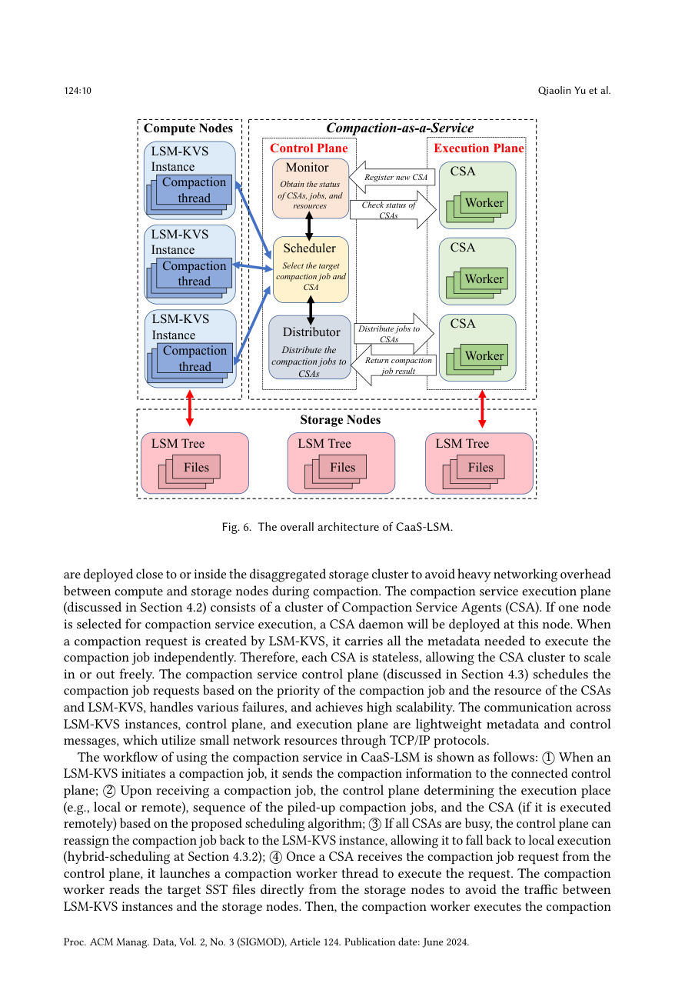
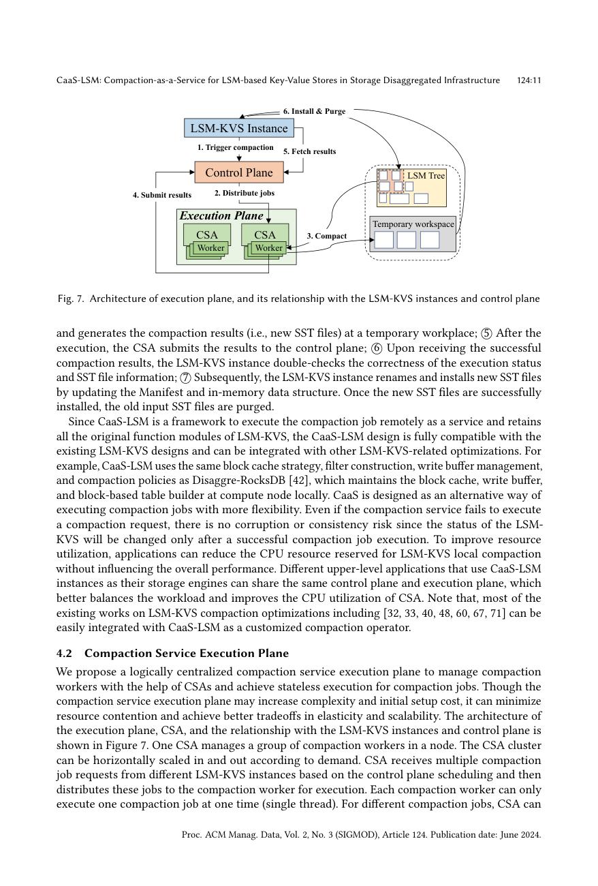

> 本组第 57 篇 · 存储结构与索引 · [全部论文]() · [上一篇]() · [下一篇]()

CaaS-LSM将压实任务封装为自包含远端服务，由控制面跨实例排序和选择CSA，并动态比较本地/远端执行。无状态是任务可独立执行，不是控制面无队列/状态，也不把最终Manifest安装交给CSA。源实例检查并安装成功后才清旧SST。p14的Rate按公式是单位文件大小耗时，alpha接近1偏重旧观测；策略不是全局最优证明。评估需分开：网络隔离实验故意禁资源调度，CPU/调度/应用实验另有资源配置；8x、61%等非普遍收益。全CSA故障无降速依赖当时本地空闲，HDFS关闭仍停止；Raft/Paxos只是可用部署建议。API原始来源、模型、用量、critique、英文引文和精读段落保留，正文与解读由本次完整源文复核修订。

本文保留论文陈述、读者推断与待验证方案的区别；实验数字只适用于原文条件。原文和翻译来自已有 AI 辅助精读报告，已做来源匹配与编辑复核，不等于人工逐项核验或独立实验复现。所有页码均为 PDF 物理页。

## 论文与阅读范围

Qiaolin Yu, Chang Guo, Jay Zhuang, Viraj Thakkar, Jianguo Wang, Zhichao Cao，CaaS-LSM: Compaction-as-a-Service for LSM-based Key-Value Stores in Storage Disaggregated Infrastructure，Proc. ACM Manag. Data 2(3), SIGMOD, Article124，June2024，28pages，DOI10.1145/3654927。收到2023-10、修订2024-01、接受2024-02。所供28物理页对应124:1-124:28，本文定位均用物理页。已完整阅读全部正文、脚注、算法、公式、参考文献，并查看17页原图覆盖图1-13、Algorithm1、公式(1)(2)；未联网核对仓库/后续版本或运行实验。

[论文集中的原始 PDF](https://github.com/lonng/db-papers/blob/4ff1331069c7cf52ac97dd769e5f484c1c35c200/papers/storage-structure/caas-lsm%3A-compaction-as-a-service-for-lsm-based-key-value-stores-in-storage-disaggregated-infrastructure.pdf) · 本地来源：`storage-structure/caas-lsm_-compaction-as-a-service-for-lsm-based-key-value-stores-in-storage-disaggregated-infrastructure.pdf`，共 28 页。

本篇保留 10 组原文精读和 74 条证据。截图为原始 PDF 的局部页选，不是重新生成的图表；未将整份 PDF 复制到博客。

## 问题与适用范围

本文面向计算节点运行LSM-KVS、数据在分离存储的部署。压实反复读写SST，会与前台读写争用跨集群带宽和CPU；图2的单Kvrocks Set测试持续三小时以上，文中描述100MB/s到10MB/s网络条件下更深的OPS下跌。90%压实I/O比例是引用的可达值，不是所有负载下限或本文普遍实测。

远端压实减少搬运，却仍有实例-worker静态绑定不均、跨实例优先级、准备成本和错误处理问题。p7针对Disaggre-RocksDB静态映射作比较；TerarkDB用通用FaaS调度、Hailstorm选择空闲实例，不宜一律说对手都固定绑定或完全不调度。关于既有工作的不足是作者此版本论述，不代表今日实现。

p8-9图5在Disaggre-RocksDB比较IR/WD/CD本地与远端，指出Open DB preparation在远端启动等待中占主导。它支持本地/远端需要权衡，不证明CaaS每次必重建整份Manifest。目标是位置、资源和服务管理，不是发明新LSM合并政策，也没有评估任意非LSM引擎的可迁移性。

依据：论文陈述；PDF 物理页 1, 2, 3, 5, 6, 7, 8, 9。证据：[C001N01](#evidence-c001n01), [C001N02](#evidence-c001n02), [C001N07](#evidence-c001n07), [C001N08](#evidence-c001n08), [C001N09](#evidence-c001n09), [C002N02](#evidence-c002n02), [C002N04](#evidence-c002n04), [C002N05](#evidence-c002n05), [CAAS-SRC01](#evidence-caas-src01), [CAAS-SRC26](#evidence-caas-src26)。

## 执行、调度与安装责任

图6/7包含源LSM实例、Control Plane和由CSA组成的Execution Plane，后两者理想上部署近/内存储。源实例发送自包含任务；ControlMetadata承载层、大小、score、优先级等，CompactionServiceInput含实例options、统计、授权及自定义算子信息。CompactionService::Start与WaitForComplete是源端新增接口，Result区分Success/Failure/UseLocal，Status提供错误类别和严重度。

CSA管理多个worker，每worker同一时刻单线程执行一个job，可为worker配置内存/I/O等资源。无状态指不与某个源DB固定绑定、请求提供独立执行上下文；CSA仍有线程、任务与资源监控，控制面仍维护队列、活跃CSA和连接。不能解释为整个系统无状态、零协调或无需任何初始化。

worker从存储读输入SST、在临时workspace生成新SST并提交结果。源LSM核验状态与SST信息，rename/install、更新Manifest和内存结构，成功后才purge旧输入。CSA不直接决定源树提交；“独立执行”也不意味着源端从一致性路径消失。

控制面按组服务KVS实例，含Monitor、Scheduler、Distributor；源端定期查状态（示例500ms），CSA有心跳与资源上报。正文p16明确使用gRPC，p10说TCP/IP轻量控制消息，二者不矛盾。该轻量通信描述不意味着前台/flush/本地回退不产生数据网络I/O。

依据：论文陈述；PDF 物理页 3, 9, 10, 11, 12, 13, 16。证据：[C001N03](#evidence-c001n03), [C002N07](#evidence-c002n07), [C002N08](#evidence-c002n08), [C002N10](#evidence-c002n10), [C002N12](#evidence-c002n12), [C003N01](#evidence-c003n01), [CAAS-SRC02](#evidence-caas-src02), [CAAS-SRC03](#evidence-caas-src03), [CAAS-SRC05](#evidence-caas-src05), [CAAS-SRC06](#evidence-caas-src06), [CAAS-SRC27](#evidence-caas-src27)。

*原论文 PDF 物理页 10，版权归原作者或出版方。点击图片可查看原尺寸。页面文本中定位到：Fig. 6. The overall architecture of CaaS-LSM.。这是页面定位信息，不表示本次已复核图内所有数据。*

## 优先级、资源选择与估时

p13优先级依次比较手工触发高于后台、靠近L0/L1的输入层高于底层、较高compaction score；可加入应用优先级等。这里higher level不是数字层号越大越优先。候选CSA过滤CPU或内存>80%，从剩余者选可用资源最多并核验任务估计资源，估计借SST大小。未给跨资源量纲综合函数、最优性、饥饿界或抢占保证；未审计源码也不把数值定性为不可配置硬编码。

Algorithm1是含OptimizedCSASelection、AgentAvailabilityCheck、MetaRetrieval、JobDispatch和AdaptiveWait的框架：空队列等待，取任务/元数据，找到可用CSA就下发，否则重新入队并等待。它提供步骤而非完整helper实现或形式复杂度证明。不能说全文没算法，也不据示意补出严格全局调度成本。

p14式(1)：Rate_new=alpha*Rate_old+(1-alpha)*CompactionTime_actual/SstFileSize；式(2)：Time_estimated=SstFileSize*Rate_new。Rate名虽如此，按式单位是时间/大小，不是字节/秒；alpha如0.9给旧估计90%权重。控制面结合本地和远端历史、源线程池利用率，比较包含排队/网络的远端时间与本地估计，未给完整排队模型或误差界。

p15列三条规则：本地线程利用率高（例>95%）则远端，CSA缺资源则本地，本地估时短则本地。没有公开同时满足冲突条件时的完备优先级；不能从列序例子断言先远端后本地必定覆盖。

读者构造的假设示例：同为后台job，L0先于底层；若本地不忙、远端有资源、本地估时1秒而远端总等待/执行5秒，则选择本地可解释混合策略。此例不是原测量，也不假设冲突规则或估时永远准确。

依据：论文陈述；PDF 物理页 12, 13, 14, 15。证据：[C003N02](#evidence-c003n02), [C003N03](#evidence-c003n03), [C003N06](#evidence-c003n06), [CAAS-SRC07](#evidence-caas-src07), [CAAS-SRC08](#evidence-caas-src08), [CAAS-SRC09](#evidence-caas-src09), [CAAS-SRC10](#evidence-caas-src10), [CAAS-SRC02](#evidence-caas-src02)。

## 提交边界与故障覆盖

作者的安全性解释是远端成功且经源实例检查后才更新LSM状态，输出暂存与安装分离。它说明提交责任位置，但不是完整并发/崩溃一致性、幂等重试、重复结果、迟到worker或自定义算子安全证明。worker单线程也不自动证明多worker/多CSA并发任务的正确性。源LSM保留原功能，不应无证据补出特定key-range协调协议。

Job级：可重试错误同CSA重试，可解决错误换CSA，不可恢复如损坏/授权失败返回源端；UseLocal是显式回退，不是所有错误都吞掉。CSA失心跳先重连，失败后移除并最高优先重排任务。Service级控制面不可达可在源端本地执行。Raft/Paxos多节点在p15是can-be方案，未展示其实现、日志复制或leader切换测试。

实际故障实验四CSA：100秒fail worker，160秒停一个CSA，320秒全部CSA离线，520秒关HDFS。少于2秒只对应这次CSA失心跳检测，不是任意故障完成恢复上界。320秒无OPS下降依赖当时local compute相对空闲，不支持源端已满载或资源被缩减时无退化；也不是控制面共识failover实验。

HDFS关闭不可恢复，Kvrocks报告错误停止。图13曲线到Storage Failure标记附近仍高，不可据图外推停存储后继续服务。论文覆盖的是特定注入序列与策略，不证明永久存储不可用、所有分区或拜占庭错误下可用性。

依据：论文陈述；PDF 物理页 10, 11, 12, 15, 22, 23。证据：[C002N08](#evidence-c002n08), [C002N10](#evidence-c002n10), [C002N12](#evidence-c002n12), [C003N07](#evidence-c003n07), [CAAS-SRC03](#evidence-caas-src03), [CAAS-SRC04](#evidence-caas-src04), [CAAS-SRC06](#evidence-caas-src06), [CAAS-SRC11](#evidence-caas-src11), [CAAS-SRC12](#evidence-caas-src12), [CAAS-SRC23](#evidence-caas-src23), [CAAS-SRC24](#evidence-caas-src24)。

## 分开阅读各项实测

平台：in-rack为Xeon Gold6330、256GB、7TB HDD、10Gbps；GCP计算16vCPU/32GB、存储8vCPU/16GB、网络1-16Gbps。所谓within-datacenter用同region，cross用两个region；后端HDFS类似Tectonic，并非直接测Meta生产存储。全部directIO；一般db_bench为16Bkey/100Bvalue，动机3.1又写100B KV size，须区分配置语境。应用用修改兼容RocksDB7.0/HDFS的Kvrocks2.2.0、Nebula3.2.0。

CPU密集：8实例、16client/8background、每实例64M random_fill，错开启动触发不同层compaction。本地各8core/8GB，远端源各6core/6GB另有4core/1GB专用容器（1control+2CSA）；不能不计远端资源。作者称比local少12cores且OPS+50%、P99-19%、stall计数-49%。相对Disaggre单实例最高+61%、八实例均值+45%；Terark-CaaS相对Native最高+42%、均值+34%。Cassandra默认RF1、自定义YCSB载入1M再插10/15M、1/2/4线程，六case最大OPS增加240%，不是复制/事务语义相同的普遍产品比较。

轻压实与混合读写：1client/4background，顺序6-30M无明显差异是该数据布局/trivial-move条件，不是所有read-heavy零开销。基于18M库50/50随机读写、32KBblock，IR/WD/CD的OPS分别提升5/66/74%，不能套8x。

网络隔离：p19故意关闭资源调度并给足CPU/内存。1client random_fill到18M时，跨region CaaS相对local约8xOPS；文中称local P99为远端78倍、stall counter6693747 vs0。这不能归功完整调度算法，更不能把stall统计当数百万独立服务故障。摘要up-to98%P99是概括，不是固定10MB/s下所有实验承诺。

调度：混跑4db_bench与Nebula SF10/12GB，给Nebula更高应用优先级，3CSA各1worker。随机CSA基线在完成前失败，5669OPS/526ms vs35682OPS/82ms为此资源/优先级条件内。单控制面约12500compaction requests/s是请求处理峰值，不是KV OPS或完成压实数；跨控制面组负载均衡留未来。

应用：Kvrocks空库400M Set/32threads/~80GB，纯远端先禁fallback；cross相对local OPS+28%、P99-65%。hybrid比local OPS+56%、P99-76%，比pure remote +22%/-30%；图11/12显示平均latency曲线，P99数字来自正文，不能混读。Nebula主测试是SF3/3.6GB数据导入；cross local在10950秒后全操作失败，CaaS报告8xOPS/89%平均延迟减少，非任意图查询。故障序列见上一节。全部数字是论文观测，本次未复现。

依据：论文陈述；PDF 物理页 3, 4, 5, 6, 16, 17, 18, 19, 20, 21, 22, 23。证据：[C001N06](#evidence-c001n06), [C001N07](#evidence-c001n07), [C001N08](#evidence-c001n08), [C003N08](#evidence-c003n08), [C003N09](#evidence-c003n09), [C003N10](#evidence-c003n10), [C003N12](#evidence-c003n12), [C004N01](#evidence-c004n01), [C004N02](#evidence-c004n02), [C004N05](#evidence-c004n05), [C004N07](#evidence-c004n07), [C004N08](#evidence-c004n08), [C004N09](#evidence-c004n09), [CAAS-SRC14](#evidence-caas-src14), [CAAS-SRC15](#evidence-caas-src15), [CAAS-SRC16](#evidence-caas-src16), [CAAS-SRC17](#evidence-caas-src17), [CAAS-SRC18](#evidence-caas-src18), [CAAS-SRC19](#evidence-caas-src19), [CAAS-SRC20](#evidence-caas-src20), [CAAS-SRC21](#evidence-caas-src21), [CAAS-SRC22](#evidence-caas-src22), [CAAS-SRC23](#evidence-caas-src23), [CAAS-SRC24](#evidence-caas-src24), [CAAS-SRC28](#evidence-caas-src28)。

*原论文 PDF 物理页 11，版权归原作者或出版方。点击图片可查看原尺寸。页面文本中定位到：Fig. 7. Architecture of execution plane, and its relationship with the LSM-KVS instances and control plane。这是页面定位信息，不表示本次已复核图内所有数据。*

## 工程取舍

以下为基于源文的工程推断，而非已完成的新实验。

服务化减少跨计算/存储的compaction数据流，却引入任务准备、控制通信、队列和失败处置。Open DB Delay测量来自Disaggre baseline，不能据此断言每个CaaS任务必重建全Manifest，也不能据无状态就认为无上下文/冷启动成本。混合策略的动态历史估时与示例阈值同时存在，不能说它完全不自适应或没有成本模型。

源端减少压实资源预留可能提高利用率，但本地fallback是否仍有容量取决负载。worker/CSA故障可重试不等于源存储故障可用；图13没有证明任何资源紧张条件下无缝回退。

逻辑集中队列便于跨实例优先级，却需关注公平、突发、状态陈旧与控制面吞吐。12500请求/秒是已测单实例点，不是无限扩展；按组部署控制面也未解决跨组负载均衡。共识建议会增加工程工作，但本文未测共识延迟，不应给出具体代价结论。

优先级偏向手工或高层任务可缓解紧急stall，也可能让低优先级等待；源文未给饥饿界/公平实验。80%与95%是策略/示例数值，不必然最优，是否可配置须代码审计。临时文件、授权和用户算子的执行边界需进一步验证，不能从“可自定义”推任意代码自动安全。

依据：读者推断；PDF 物理页 3, 7, 8, 9, 10, 11, 12, 13, 14, 15, 20, 21, 22, 23。证据：[C001N04](#evidence-c001n04), [C002N05](#evidence-c002n05), [C002N06](#evidence-c002n06), [CAAS-SRC02](#evidence-caas-src02), [CAAS-SRC04](#evidence-caas-src04), [CAAS-SRC05](#evidence-caas-src05), [CAAS-SRC07](#evidence-caas-src07), [CAAS-SRC08](#evidence-caas-src08), [CAAS-SRC09](#evidence-caas-src09), [CAAS-SRC10](#evidence-caas-src10), [CAAS-SRC12](#evidence-caas-src12), [CAAS-SRC19](#evidence-caas-src19), [CAAS-SRC20](#evidence-caas-src20), [CAAS-SRC23](#evidence-caas-src23), [CAAS-SRC24](#evidence-caas-src24), [CAAS-SRC28](#evidence-caas-src28), [C002N04](#evidence-c002n04)。

## 兼容性与历史比较

作者将CaaS定位为压实执行位置与管理层，可保留缓存、过滤器、写缓冲和原压实政策。Terark-CaaS有实现对照，说明该实例可与其压缩/表格式等优化结合；不能把“fully compatible/easily integrated”的设计表述当所有LSM变体均已测证明。

p23-24讨论LSM架构、policy、KV separation、filter和compression等正交方向，Monkey/Dostoevsky/Spooky/Maplets等属于各自背景，不应将题名或结构错嫁给PebblesDB或声称全被做了baseline。存储介质背景也不表示本文评估了NVM/NVMe全矩阵。

键值分离减少value搬运、近存储GC可能继续减少I/O；复用控制面调度GC在p24是potentially方向，不是本文已经实现并测量的GC服务。更多customizable/pluggable应用也列future work。

原型compaction封装被作者称已入RocksDB7.0+且production-ready，不能扩成完整控制面内置所有版本或生产集群已验证。本文的所有对手描述限定2024这篇来源；未审计仓库，也未引用现代外部系统来背书。

依据：论文陈述；PDF 物理页 3, 7, 11, 16, 18, 23, 24, 25, 26, 27, 28。证据：[C001N02](#evidence-c001n02), [C001N05](#evidence-c001n05), [C005N03](#evidence-c005n03), [C005N05](#evidence-c005n05), [C005N06](#evidence-c005n06), [C005N08](#evidence-c005n08), [C005N09](#evidence-c005n09), [C005N12](#evidence-c005n12), [CAAS-SRC13](#evidence-caas-src13), [CAAS-SRC16](#evidence-caas-src16), [CAAS-SRC25](#evidence-caas-src25), [C002N02](#evidence-c002n02), [C002N08](#evidence-c002n08)。

## 未执行的验证建议

以下为读者验证方案，不是复现完成记录，不含真实数据库或SQL动作。

1. 先固定源代码commit、编译选项、RocksDB/Kvrocks/Nebula/HDFS版本、directIO、容器资源总账和实际网络RTT/带宽。保留正文给出的版本与负载，不因书目[n.d.]就说全文无配置；缺少精确commit和流量整形方法仍应记录。

2. 用离线任务/资源时间线复现优先队列和CSA过滤，给相同优先级、资源不足、无候选及冲突fallback条件，观察等待/饥饿、估时误差和陈旧心跳。遵守式(1)的时间/大小单位及alpha权重，不反写成吞吐率。

3. 分开网络卸载、资源调度、hybrid、单控制面峰值和应用层实验。明确关闭调度的8xcase不能证明调度收益；SF10混跑不等于SF3主导入测试。统计完成工作量、失败基线、P99与平均延迟，不能挑瞬时峰值代表全程。

4. 故障注入须另行授权的隔离系统，区分worker/单CSA/全CSA/控制面/存储故障，并覆盖本地空闲与已满载。本文是100/160/320/520秒人为事件，不要求已测MutexTimeout/数据损坏每一类别。原文没有控制面Raft failover实测，不能当复现基线。

5. 临时输出与安装间崩溃、迟到/重复结果、旧输入保留和清理需额外用受控模型核验；不能因单worker串行就宣称全系统并发正确。本次仅做原文与视觉检查，没有启动这些系统或改动数据库。

依据：待验证的工程设想；PDF 物理页 8, 9, 10, 11, 12, 13, 14, 15, 16, 17, 18, 19, 20, 21, 22, 23, 24。证据：[C002N05](#evidence-c002n05), [C003N08](#evidence-c003n08), [C003N09](#evidence-c003n09), [C004N07](#evidence-c004n07), [C004N08](#evidence-c004n08), [C004N09](#evidence-c004n09), [CAAS-SRC03](#evidence-caas-src03), [CAAS-SRC04](#evidence-caas-src04), [CAAS-SRC07](#evidence-caas-src07), [CAAS-SRC08](#evidence-caas-src08), [CAAS-SRC09](#evidence-caas-src09), [CAAS-SRC10](#evidence-caas-src10), [CAAS-SRC12](#evidence-caas-src12), [CAAS-SRC14](#evidence-caas-src14), [CAAS-SRC15](#evidence-caas-src15), [CAAS-SRC16](#evidence-caas-src16), [CAAS-SRC18](#evidence-caas-src18), [CAAS-SRC19](#evidence-caas-src19), [CAAS-SRC20](#evidence-caas-src20), [CAAS-SRC21](#evidence-caas-src21), [CAAS-SRC22](#evidence-caas-src22), [CAAS-SRC23](#evidence-caas-src23), [CAAS-SRC24](#evidence-caas-src24), [CAAS-SRC25](#evidence-caas-src25), [CAAS-SRC28](#evidence-caas-src28), [CAAS-SRC02](#evidence-caas-src02), [CAAS-SRC26](#evidence-caas-src26)。

## 结论与可信度层级

读者综合：本文贡献在于把自包含压实执行、跨实例资源/优先级调度、混合本地远端选择与分级错误处理连在一起。保留源LSM的安装决定权是重要边界，无状态不等于无状态管理或零成本；反馈估时是启发式，而非最优调度定理。

实证包括不同网络、资源与应用设置及有限故障序列。网络隔离的8x、单实例最大61%、应用hybrid及存储失败条件必须分别引用。无明显退化、<2秒检测、12500请求/秒都不是全局保证；控制面共识和GC服务仍是建议/未来工作。

借鉴时应分开记录任务准备、排队、执行、源端检查/安装、前台影响及失败状态，统计远端资源并验证本地回退容量。本文没有给完整并发/崩溃安全证明，也没有证明所有兼容方向均可直接生产落地。

本次完整阅读28页、查看17页覆盖全部关键视觉内容，实际改写九章和继承精读，保留API来源、模型、用量、critique、英文引文及原始段落。审查是单源AI复核，不是独立人审、代码审计或基准复现。

依据：读者推断；PDF 物理页 1, 3, 5, 6, 8, 9, 10, 11, 12, 13, 14, 15, 16, 17, 18, 19, 20, 21, 22, 23, 24, 28。证据：[CAAS-SRC01](#evidence-caas-src01), [CAAS-SRC02](#evidence-caas-src02), [CAAS-SRC03](#evidence-caas-src03), [CAAS-SRC04](#evidence-caas-src04), [CAAS-SRC05](#evidence-caas-src05), [CAAS-SRC06](#evidence-caas-src06), [CAAS-SRC07](#evidence-caas-src07), [CAAS-SRC08](#evidence-caas-src08), [CAAS-SRC09](#evidence-caas-src09), [CAAS-SRC10](#evidence-caas-src10), [CAAS-SRC11](#evidence-caas-src11), [CAAS-SRC12](#evidence-caas-src12), [CAAS-SRC13](#evidence-caas-src13), [CAAS-SRC14](#evidence-caas-src14), [CAAS-SRC15](#evidence-caas-src15), [CAAS-SRC16](#evidence-caas-src16), [CAAS-SRC17](#evidence-caas-src17), [CAAS-SRC18](#evidence-caas-src18), [CAAS-SRC19](#evidence-caas-src19), [CAAS-SRC20](#evidence-caas-src20), [CAAS-SRC21](#evidence-caas-src21), [CAAS-SRC22](#evidence-caas-src22), [CAAS-SRC23](#evidence-caas-src23), [CAAS-SRC24](#evidence-caas-src24), [CAAS-SRC25](#evidence-caas-src25), [CAAS-SRC26](#evidence-caas-src26), [CAAS-SRC28](#evidence-caas-src28)。

## 原文精读：从句子回到机制

以下保留原文、忠实翻译、含义与边界；假设示例不作为论文实验结果。

### P001 · PDF 物理页 2

**原文**

<blockquote class="paper-source-quote"><pre><code>In this&#10;case, accessing the data through the network can have longer latency and unpredictable throughput&#10;compared with the locally attached SSDs. Since compaction creates most of the I/Os from LSM-KVS&#10;(e.g., can be as high as 90% [70]), achieving near- or in-storage compaction is the main focus of&#10;related studies, including Disaggre-RocksDB at Meta [42], Nova-LSM, [49], RocksDB-Cloud [63],&#10;IS-HBase [28], TerarkDB [3], and Hailstorm [27].</code></pre></blockquote>

**忠实翻译**

> 在这种情况下，与本地连接的 SSD 相比，通过网络访问数据可能具有更长的延迟和不可预测的吞吐量。由于 compaction（合并）产生了来自 LSM-KVS 的大部分 I/O（例如，可高达 90% [70]），实现近存储或存储内 compaction 是相关研究的主要关注点，包括 Meta 的 Disaggre-RocksDB [42]、Nova-LSM [49]、RocksDB-Cloud [63]、IS-HBase [28]、TerarkDB [3] 和 Hailstorm [27]。

**技术含义与边界**

> 作者以存储分离场景的网络代价及所引用研究中可达90%的compaction I/O比例，说明近/内存储执行的动机。90%不是本论文所有负载实测，也不是严格全局上界。列举系统只说明相关研究，不证明实现都相同或今日版本仍如此。

**常见误读**

> can be as high as不等于固定90%、至少90%或理论上最多90%；也不保证任何跨网络访问都慢于所有本地设备。本文实验的HDFS环境不能当作这些系统的生产实测。

**读者构造的假设示例**

> 读者构造的假设示例：一个写密集窗口有1000次I/O，其中900次来自compaction；若这些字节跨瓶颈链路，可考虑移近存储。该比例只是帮助理解的假设，不据此推算任意系统收益或保证900次都可消除。

### P002 · PDF 物理页 28

**原文**

<blockquote class="paper-source-quote"><pre><code>Pipelined&#10;Compaction for the LSM-Tree. In 2014 IEEE 28th International Parallel and Distributed Processing Symposium. https:&#10;//doi.org/10.1109/ipdps.2014.85&#10;Received October 2023; revised January 2024; accepted February 2024.&#10;Proc. ACM Manag. Data, Vol. 2, No. 3 (SIGMOD), Article 124. Publication date: June 2024.</code></pre></blockquote>

**忠实翻译**

> 《面向LSM-Tree的流水线压实》，收录于2014年IEEE第28届国际并行与分布式处理研讨会，DOI10.1109/ipdps.2014.85。
> （以下为当前CaaS-LSM论文元数据）收到：2023年10月；修订：2024年1月；接受：2024年2月。《Proceedings of the ACM on Management of Data》第2卷第3期（SIGMOD），文章124，出版日期2024年6月。

**技术含义与边界**

> 此段落为参考文献条目及当前论文的出版元数据。它记录了一篇 2014 年发表于 IPDPS 会议的关于 LSM-Tree 流水线 compaction 的论文信息，同时包含了当前所在论文（CaaS-LSM）的收稿日期（2023年10月）、修改日期（2024年1月）、接收日期（2024年2月）以及最终发表在 Proc. ACM Manag. Data, Vol. 2, No. 3 (SIGMOD) 的信息。

**常见误读**

> 2014年属于上一条被引论文，2023/2024属于本篇；不能从页脚和书目推出流水线策略已集成CaaS或本次独立验证了该引文内容。

**读者构造的假设示例**

> 读者构造的假设示例：整理书目时把引用的2014年论文记作前期工作，把2024年6月记作CaaS版本日期；仅此不判断两者代码复用或性能关系。本次没有追访DOI。

### P003 · PDF 物理页 15

**原文**

<blockquote class="paper-source-quote"><pre><code>CaaS-LSM: Compaction-as-a-Service for LSM-based Key-Value Stores in Storage Disaggregated Infrastructure&#10;124:15&#10;according to the following rules: 1) If the local thread pool utilization is too high (e.g., more than&#10;95%), execute the job remotely; 2) If a message indicating a lack of CSA resources is received,&#10;execute the job locally; 3) If the estimated execution time of the local compaction execution is&#10;shorter than remote execution, execute the job in its LSM-KVS instance.</code></pre></blockquote>

**忠实翻译**

> （页眉：CaaS-LSM：面向存储分离基础设施中LSM键值存储的压实服务；124:15。）按照以下规则：1）如果本地线程池利用率过高（例如超过95%），远程执行任务；2）如果收到CSA资源不足的消息，本地执行；3）如果本地压实的估计执行时间短于远端，则在该LSM-KVS实例本地执行。

**技术含义与边界**

> 这是本地/远端选择规则，CSA是Compaction Service Agent而不是“计算存储适配器”。95%有e.g.限定；全文p14还给历史时间与文件大小的加权估计模型。它是运行时决策，不是无成本模型，也没有规则冲突时的完整覆盖顺序或估时误差保证。

**常见误读**

> 不能从此句证明95%必硬编码或不可配置，也不能把本地高负载且远端无资源的冲突解释成已定义的规则1后被规则2覆盖。三条规则不等于任何情况下均更快。

**读者构造的假设示例**

> 读者构造的假设示例：在本地利用率不高、CSA仍有资源的无冲突条件下，本地估时1秒、远端含等待5秒，则规则3指向本地。若本地已高负载且CSA也无资源，应标为本文未详述的冲突边界，而不编造覆盖关系。

### P004 · PDF 物理页 8

**原文**

<blockquote class="paper-source-quote"><pre><code>When inserting 18 million KV-pairs, the Compaction&#10;Time of CD-Local is 9,469 s. Figure 5(b) indicates that the total delay (i.e., IR-Total, WD-Total,&#10;and CD-Total) caused by remote compaction is dominated by the delay of preparing the remote&#10;compaction execution (i.e., IR-Open, WD-Open, and CD-Open).</code></pre></blockquote>

**忠实翻译**

> 当插入 1800 万个 KV 对时，CD-Local 的 Compaction Time 为 9,469 秒。图 5(b) 表明，由远程 compaction 引起的总延迟（即 IR-Total、WD-Total 和 CD-Total）主要由准备远程 compaction 执行的延迟（即 IR-Open、WD-Open 和 CD-Open）所主导。

**技术含义与边界**

> IR/WD/CD是in-rack/within-datacenter/cross-datacenter部署，不是未知策略名。CD-Local指计算节点本地执行但数据仍在远端。9469秒是18M条件下的Compaction Time；Total Delay另定义为远端任务创建到开始执行的等待，含Open准备和网络，不含完成压实的整个端到端时间。图5有断轴，不能混同比例。该测量对象是Disaggre-RocksDB。

**常见误读**

> 不能把“Total Delay由Open主导”读成完成任务的大部分时间都在Open，或把9469秒写成准备时长；也不能将baseline的Manifest重建成本当CaaS每次必须执行的相同流程。

**读者构造的假设示例**

> 读者构造的假设示例：远端请求创建到开始执行共5秒，其中Open4秒、其他1秒；随后实际压实20秒。Open主导的是5秒启动等待，不是25秒端到端。此例不重建作者的测量数字。

### P005 · PDF 物理页 11

**原文**

<blockquote class="paper-source-quote"><pre><code>CSA receives multiple compaction&#10;job requests from different LSM-KVS instances based on the control plane scheduling and then&#10;distributes these jobs to the compaction worker for execution. Each compaction worker can only&#10;execute one compaction job at one time (single thread). For different compaction jobs, CSA can&#10;Proc. ACM Manag. Data, Vol. 2, No. 3 (SIGMOD), Article 124. Publication date: June 2024.</code></pre></blockquote>

**忠实翻译**

> CSA按控制面调度接收来自不同LSM-KVS实例的多个压实请求，再分给压实worker执行。每个worker同一时刻只能单线程执行一个任务。对于不同的压实任务，CSA可以……（所选摘录在此换页；随后混入当前论文卷期与2024年6月出版页脚。）

**技术含义与边界**

> 这段明确每worker串行，不等于一个CSA全局只有一个任务。所选摘录末句截断，全文p12继续说明CSA可给不同worker预定义内存/I/O容量；这是本次阅读全文所得上下文，不冒充此英文短段已含完整后半句。

**常见误读**

> 不能将worker单线程推成CSA单线程或系统无并发，也不能由此证明跨CSA并发任务正确性。CSA的完整名称是Compaction Service Agent，不能错译成另一种适配器。

**读者构造的假设示例**

> 读者构造的假设示例：某CSA有4个worker且资源足够时，最多4个任务可同时执行；更多任务可能在控制面等待。这个假设说明worker/agent层次，不声称4是默认配置或所有队列位置均已规定。

### P006 · PDF 物理页 25

**原文**

<blockquote class="paper-source-quote"><pre><code>Accessed 10 Jan, 2023.&#10;[3] [n. d.]. ByteDance. TerarkDB. https://github.com/bytedance/terarkdb. Accessed 10 Jan, 2023.&#10;[4] [n. d.]. CaaS-LSM. https://github.com/asu-idi/CaaS-LSM.&#10;[5] [n. d.]. Cassandra on RocksDB at Instagram. https://developers.facebook.com/videos/f8-2018/cassandra-on-rocksdb-&#10;at-instagram.&#10;[6] [n. d.].</code></pre></blockquote>

**忠实翻译**

> 访问于2023年1月10日。
> [3]（无日期）ByteDance：TerarkDB，GitHub仓库；访问于2023年1月10日。
> [4]（无日期）CaaS-LSM，GitHub仓库。
> [5]（无日期）《Instagram上的Cassandra on RocksDB》，网页/视频；访问于2023年1月10日。
> [6]（无日期；所选摘录在条目开始处结束）。原始URL保留于英文原段。

**技术含义与边界**

> 这是书目片段。[n.d.]表示未列出版日期；[4]没有单独列Accessed日期，不能把相邻条目的2023-01-10套给它。仓库URL不提供实验commit，也不构成所有引用系统都参与测试的证据；具体版本和基准要看正文。

**常见误读**

> 不要把书目访问日期当实验版本、严格文献截止日，或声称CaaS-LSM仓库条目明确访问于2023-01-10。更不能据URL存在就推断代码修改和测试范围。

**读者构造的假设示例**

> 读者构造的假设示例：复现者得到仓库URL，却仍需额外定位论文对应commit和依赖；相邻TerarkDB条目的访问日期不能替代CaaS代码版本。本次没有下载或核对外部仓库。

### P007 · PDF 物理页 20

**原文**

<blockquote class="paper-source-quote"><pre><code>As shown in Figure 10(a) and Figure 10(b), Nebula with random&#10;scheduling (Nebula-Random-Sche) has a total OPS of 5,669 and an average latency of 526 ms which&#10;are about 86% lower and 6𝑋higher than Nebula using CaaS-LSM (Nebula-CaaS-LSM) respectively.&#10;Also, Nebula-Random-Sche fails before finishing the benchmarking since too many compaction jobs&#10;are waiting for execution and it causes serious write stalls at Nebula. Differently, Nebula-CaaS-LSM&#10;achieves about 6𝑋OPS (35,682) and reduces the average latency by 84% (82 ms).&#10;Control Plane peak throughput.</code></pre></blockquote>

**忠实翻译**

> 如图10(a)(b)，随机调度的Nebula总OPS为5669、平均延迟526毫秒；原文称其相对Nebula-CaaS-LSM分别低约86%、高约6倍。随机方案因压实任务积压造成严重write stalls，在基准完成前失败。相比之下，CaaS-LSM达到约6倍OPS（35682），平均延迟减少84%至82毫秒。
> “控制面峰值吞吐”是下一段标题。

**技术含义与边界**

> 全文条件为cross部署、Nebula SF10/12GB与4个db_bench混跑，Nebula被赋更高应用优先级，3CSA各1worker。对照随机选择CSA，且未完成测试；这些条件是理解总OPS/均值延迟的必要边界。526/82约6.4、35682/5669约6.3，源文是约数，不是P99或全工作负载最优保证。

**常见误读**

> 不能将结果外推全部调度器、忽略baseline失败或把更高应用优先级解释成公平性。总OPS不是请求总数；“峰值控制面吞吐”后续另测约12500compaction requests/s，不是这一段35682。

**读者构造的假设示例**

> 读者构造的假设示例：在压实资源不足的混合应用中，优先处理某应用的高紧急任务可能缓解它的stall；仍要报告另一个应用及未完成请求，不能只挑获优先级者的收益。这不是本文增加的一组测量。

### P008 · PDF 物理页 13

**原文**

<blockquote class="paper-source-quote"><pre><code>Each control plane instance is responsible for handling the&#10;compaction job requests from a group of LSM-KVS instances.&#10;The control plane consists of three major components: Monitor, Scheduler, and Distributor.&#10;They are responsible for monitoring the CSAs’ status, determining compaction jobs’ priority and&#10;execution order, and distributing compaction jobs to the target CSAs respectively.</code></pre></blockquote>

**忠实翻译**

> 每个 control plane 实例负责处理来自一组 LSM-KVS 实例的 compaction 作业请求。control plane 由三个主要组件组成：Monitor、Scheduler 和 Distributor。它们分别负责监控 CSAs 的状态、确定 compaction 作业的优先级和执行顺序，以及将 compaction 作业分发到目标 CSAs。

**技术含义与边界**

> 这是按KVS组管理请求的控制面模块划分；Monitor观察、Scheduler排序/选资源、Distributor下发。不是三个必然独立的机器或进程，也没有证明跨控制面组的全局负载最优；后文把组间负载均衡留作未来。

**常见误读**

> 容易推断 Monitor、Scheduler 和 Distributor 是三个独立的物理进程或节点。原文仅称其为‘three major components’（三个主要组件），它们完全可能在同一个控制面进程内以不同模块或线程的形式存在。此外，原文提到‘a group of LSM-KVS instances’，但未定义‘一组’的具体规模或划分标准。

**读者构造的假设示例**

> 读者构造的假设示例：Monitor看到CSA1CPU90%、CSA2CPU20%，按本文80%策略CSA1会被过滤。Scheduler可先安排高优先任务到CSA2，其他任务等待或按混合规则处理；不能再把低优先任务随意下发到已过滤的CSA1。

### P009 · PDF 物理页 3

**原文**

<blockquote class="paper-source-quote"><pre><code>Currently, although remote compaction makes global scheduling&#10;of compactions feasible, it’s still not addressed in current work [42]. Third, the existing design&#10;overlooks the high overhead associated with preparing compaction jobs for remote execution (it&#10;can even be longer than 10 seconds, as detailed in Section 3.2.3), at times making local compaction&#10;a preferable choice. The performance and resource tradeoffs between local and in-storage com-&#10;paction must be considered.</code></pre></blockquote>

**忠实翻译**

> 目前，尽管远程 compaction 使 compaction 的全局调度变得可行，但在当前工作中仍未得到解决 [42]。第三，现有设计忽略了为远程执行准备 compaction 作业所带来的高昂开销（它甚至可能长于 10 秒，详见第 3.2.3 节），有时使得本地 compaction 成为更优的选择。必须考虑本地 compaction 与存储内 compaction 之间的性能和资源权衡。

**技术含义与边界**

> 作者以既有远端设计的全局调度和准备开销缺口为动机，说明本地/远端权衡。长于10秒是部分测量条件的可能值，不是所有RPC常量；全文3.2.3是Disaggre-RocksDB测量，不能据此断言CaaS请求必以同样方式重建Manifest。

**常见误读**

> 不能把“未被当前工作解决”推广为所有系统都没有调度，或将所有远端任务否定。更不能把长于10秒与每种网络/任务绑定成固定保证。

**读者构造的假设示例**

> 读者构造的假设示例：某baseline远端执行准备11秒、压实2秒，而资源足够时本地2秒，则这一任务本地更合算。这里的准备11秒只是示意，既不表示每次CaaS开销，也不在本地已满载时保证2秒完成。

### P010 · PDF 物理页 7

**原文**

<blockquote class="paper-source-quote"><pre><code>As shown in Figure 2, when the network condition is worse (e.g.,&#10;changing from in-rack to cross-datacenter deployment), the overall OPS drops significantly. More&#10;seriously, compaction is the main cause of storage I/Os leading to heavy network traffic, which&#10;results in a deeper OPS drop and a longer OPS recovery time. Therefore, dynamic allocating&#10;compaction job requests between LSM-KVS and remote compaction workers can effectively utilize&#10;the network resources and avoid contentions.</code></pre></blockquote>

**忠实翻译**

> 如图 2 所示，当网络状况较差时（例如，从机架内变为跨数据中心部署），整体 OPS 显著下降。更严重的是，compaction 是存储 I/O 的主要原因，会导致沉重的网络流量，进而造成更深的 OPS 下降和更长的 OPS 恢复时间。因此，在 LSM-KVS 和远程 compaction worker 之间动态分配 compaction 作业请求可以有效利用网络资源并避免争用。

**技术含义与边界**

> 这是图2观察引出的设计动机：网络受限时压实争用可能加重前台波动，因而考虑动态选择执行位置。不是所有网络拓扑都必然同幅退化，也不是任何动态策略自动消除争用。前台、flush和本地fallback仍可产生跨集群I/O。

**常见误读**

> 源文没有在这里证明TCP拥塞控制或特定恢复分钟数是因果机制，不应凭空补入。卸载减少的是压实数据搬运，不等于所有网络访问/读写流量归零。

**读者构造的假设示例**

> 读者构造的假设示例：若跨集群链路被前台和本地压实共同占用，而存储侧CSA有资源，远端压实可把相应SST搬运留在存储附近；实际收益还取决于存储侧带宽、排队和准备时间，不由这一动机句直接算出。

## 尚未解决的问题

1. 任务资源估计、多个资源维度比较、排队/网络时间的完整模型和误差有多大？
2. 高优先级连续到达时的饥饿/公平策略与本地远端规则冲突如何处理？
3. 源LSM检查/安装之间的崩溃、重复结果及迟到worker如何确保幂等与清理？
4. 控制面多副本是否实现、何种状态复制、跨控制面组如何负载均衡？本文未给实证。
5. 本地资源已满或因卸载被缩减时，全CSA失败的fallback表现如何？
6. HDFS/授权/损坏错误以及不同自定义算子的安全边界，需要哪些额外测试？
7. 源码commit、完整配置、网络设置、重复次数/误差线和成本数据仍不足以精确复现实验。

## 证据索引

证据编号沿用原报告，便于将上文判断追溯到原句。引文匹配只验证位置，不证明解读正确。

**C001N01 · PDF 物理页 2**

在存储解耦架构中，Compaction产生的I/O可占LSM-KVS总I/O高达90%，是计算节点与存储节点间网络流量和性能惩罚的主要来源。跨数据中心场景下网络带宽受限（如降至10 MB/s），会导致更深的OPS跌落和频繁的write stall。这是本文要解决的核心问题，适用边界为存储解耦或跨数据中心的LSM-KVS部署。

<blockquote class="paper-source-quote"><pre><code>Since compaction creates most of the I/Os from LSM-KVS (e.g., can be as high as 90% [70]), achieving near- or in-storage compaction is the main focus</code></pre></blockquote>

**C001N02 · PDF 物理页 3**

作者针对既有静态绑定/通用调度、远端准备和错误处理提出问题。不能说所有对手都固定绑定：p7另描述TerarkDB通用FaaS与Hailstorm空闲实例机制；差别需按具体方案表述，不把历史批评泛化今日实现。

<blockquote class="paper-source-quote"><pre><code>the existing design overlooks the high overhead associated with preparing compaction jobs for remote execution (it can even be longer than 10 seconds</code></pre></blockquote>

**C001N03 · PDF 物理页 3**

CaaS-LSM采用控制面与执行面分离的架构。执行面由部署在存储节点内或靠近存储集群的计算节点上的Compaction Service Agents (CSA) 组成（通常每节点一个）。LSM-KVS实例将Compaction信息（作业描述、数据访问授权、控制信息）封装为请求发送给控制面，再由控制面调度到执行面进行近存储或存储内执行，以避免计算与存储集群间的网络流量。该设计实现了无状态执行，解耦了Compaction逻辑与LSM-KVS实例。

<blockquote class="paper-source-quote"><pre><code>The execution plane consists of a cluster of Compaction Service Agents (CSA), which are deployed inside the storage nodes or at the compute nodes close to the storage cluster</code></pre></blockquote>

**C001N04 · PDF 物理页 3**

控制面负责三个核心功能：1) 解耦LSM-KVS实例与执行面，支持独立扩缩容；2) 提出LSM特定的调度算法，根据优先级安排Compaction作业的执行顺序和执行位置（哪个CSA），并基于可用资源和作业密集度动态分配作业到执行面或回退到本地Compaction；3) 将故障分类为服务执行失败、CSA失败和执行面失败，实现细粒度错误处理。调度算法属于启发式策略，旨在权衡性能与资源利用率。

<blockquote class="paper-source-quote"><pre><code>we propose an LSM-specific scheduling algorithm in the control plane to properly arrange the execution order and execution place</code></pre></blockquote>

**C001N05 · PDF 物理页 3**

作者称compaction独立服务封装合入RocksDB7.0+、控制面另开源；不等于完整CaaS控制面在所有7.0+产品内置生产运行。实验用HDFS、db_bench、Kvrocks与Nebula三类部署，不能当Tectonic生产实测。

<blockquote class="paper-source-quote"><pre><code>We evaluated our approach based on different disaggregated storage setups, including in-rack clusters, within the same region, and across different datacenters.</code></pre></blockquote>

**C001N06 · PDF 物理页 3**

引言/摘要的up-to8xOPS、98%P99、99%stall避免及61%/42%是不同基线/场景概括，不能合成同一实验或全部归到10MB/s。后文网络隔离测试关闭资源调度、CPU/应用实验另有条件与均值。

<blockquote class="paper-source-quote"><pre><code>CaaS-LSM can achieve up to 8X Operations Per Second (OPS) improvement, reduce up to 98% of P99 latency, and avoid 99% of write stalls</code></pre></blockquote>

**C001N07 · PDF 物理页 5**

动机实验（Figure 2）使用单个Kvrocks实例运行Redis benchmark Set查询超过3小时，分别在in-rack和cross-datacenter解耦部署下。观察到当网络带宽从100 MB/s（in-rack）降至10 MB/s（cross-datacenter）时，OPS出现更深更长的跌落（例如从37K跌至1K），并伴随周期性Compaction引起的OPS波动（in-rack下从75K到100K变化）。日志分析显示跨数据中心部署中存在反复的write stall，原因是前台操作与Compaction争用有限网络带宽导致未完成任务堆积。

<blockquote class="paper-source-quote"><pre><code>When the network bandwidth drops from 100 MB/s (in-rack) to 10 MB/s (cross-datacenter), the Kvrocks instance shows deeper and longer OPS drops (e.g., from 37K to 1K).</code></pre></blockquote>

**C001N08 · PDF 物理页 6**

瓶颈分析实验（Section 3.1）配置：RocksDB db_bench，16客户端线程，100B KV对大小，8个后台RocksDB线程，3000万随机KV对插入。RocksDB实例分配8个CPU核和8GB内存，数据写入HDFS（类似Meta的Tectonic文件系统）。使用Linux perf分析CPU函数调用占比。监控指标包括CPU、内存和网络利用率。

<blockquote class="paper-source-quote"><pre><code>configured as 16 client threads, 100B KV-pair size, 8 background RocksDB threads, 30 million random KV-pair insertion</code></pre></blockquote>

**C001N09 · PDF 物理页 2**

系统模型假设LSM-KVS部署在计算节点，所有数据存储在解耦存储中。Compaction是I/O密集型且占主导的操作。假设存储节点或近存储计算节点可以部署CSA来执行Compaction，从而避免跨计算-存储集群的大量数据传输。前提条件包括网络连接的可用性以及对存储节点的访问权限。

<blockquote class="paper-source-quote"><pre><code>In the storage disaggregated infrastructure, LSM-KVS is deployed at the compute node, and all the data is stored at the disaggregated storage.</code></pre></blockquote>

**C001N10 · PDF 物理页 3**

论文指出远程Compaction的准备开销可能超过10秒，在某些情况下使得本地Compaction成为更优选择。这意味着CaaS-LSM的控制面调度必须在远程执行和本地执行之间做性能与资源的权衡，而不是盲目将所有Compaction卸载。对于小文件或低延迟要求的Compaction任务，卸载可能反而引入额外延迟。文中未在引言部分提供该10秒开销的具体测量条件。

<blockquote class="paper-source-quote"><pre><code>overlooks the high overhead associated with preparing compaction jobs for remote execution (it can even be longer than 10 seconds, as detailed in Section 3.2.3)</code></pre></blockquote>

**C002N01 · PDF 物理页 7**

在解耦存储中，网络条件直接决定I/O吞吐和延迟。当网络变差（如从机架内变为跨数据中心部署）时，整体OPS显著下降。Compaction是产生存储I/O和网络流量的主要原因，会导致更深的OPS下降和更长的恢复时间。因此需要在LSM-KVS和远程Compaction worker之间动态分配任务以避免网络争用。

<blockquote class="paper-source-quote"><pre><code>compaction is the main cause of storage I/Os leading to heavy network traffic, which results in a deeper OPS drop and a longer OPS recovery time.</code></pre></blockquote>

**C002N02 · PDF 物理页 7**

现有研究（如Disaggre-RocksDB、IS-HBase、RocksDB-Cloud、Nova-LSM）采用静态连接将LSM-KVS实例绑定到特定远程Compaction worker。由于不同实例的Compaction强度不均衡，常导致部分worker极度繁忙而其他空闲。实验表明，在Disaggre-RocksDB中运行8个RocksDB实例和2个worker（每个负责4个实例），其中2个实例（db4和db8）的OPS下降了33%（从12K降至8K）。

<blockquote class="paper-source-quote"><pre><code>Most of the existing work uses the static connection between LSM-KVS instances and the remote compaction workers</code></pre></blockquote>

**C002N04 · PDF 物理页 7**

在生产环境中，单台主机通常部署数十至数百个LSM-KVS实例。现有方案中各实例独立调度Compaction任务（FIFO或基于优先级），这导致紧急的Compaction（如L0或L1）可能被长时间运行的底层Compaction延迟。忽略跨实例任务的优先级差异会导致整体应用性能下降。

<blockquote class="paper-source-quote"><pre><code>Urgent compactions (e.g., L0 or L1 compaction) can be delayed by long-running low-level compactions (e.g., bottom-level compaction).</code></pre></blockquote>

**C002N05 · PDF 物理页 8**

作者在Disaggre-RocksDB上评估了本地与远程Compaction的权衡，测试了机架内(IR)、数据中心内(WD)和跨数据中心(CD)三种部署。指标包括Compaction Time、Open DB Delay和Total Delay。结果表明IR-Local、IR-Remote、WD-Local、WD-Remote和CD-Remote的Compaction Time相似；但CD-Local因高延迟读取SST文件极慢（插入1800万KV对时耗时9469秒）。远程Compaction的Total Delay主要由Open DB Delay主导，且数据规模越大，从Manifest重建内存结构的准备时间越长。

<blockquote class="paper-source-quote"><pre><code>the total delay (i.e., IR-Total, WD-Total, and CD-Total) caused by remote compaction is dominated by the delay of preparing the remote compaction execution</code></pre></blockquote>

**C002N06 · PDF 物理页 8**

远程Compaction并非万能。当LSM-KVS拥有充足的网络和CPU资源且Compaction任务较少时，在本地执行比远程执行更有利。现有方案缺乏结合两者优势的灵活性。此外，远程执行涉及更多软件栈、网络栈和分布式协议（如本地文件系统、完整性检查、复制），导致瞬态错误频发，而现有研究完全忽略了全面的故障处理。

<blockquote class="paper-source-quote"><pre><code>When LSM-KVS has enough resources (i.e., enough network and CPU resources, and fewer compaction jobs), executing the compaction job locally at the LSM-KVS instance can be more advantageous</code></pre></blockquote>

**C002N07 · PDF 物理页 10**

CaaS-LSM架构包含三个核心组件：部署在计算节点的LSM-KVS实例、执行平面（由无状态的Compaction Service Agent, CSA集群组成）和控制平面。控制平面负责基于优先级和资源进行调度、处理故障并实现高扩展性。跨组件通信仅使用轻量级元数据和控制消息，通过TCP/IP传输以节省网络资源。理想情况下，执行和控制平面应部署在靠近或位于解耦存储集群内部的位置。

<blockquote class="paper-source-quote"><pre><code>The communication across LSM-KVS instances, control plane, and execution plane are lightweight metadata and control messages, which utilize small network resources through TCP/IP protocols.</code></pre></blockquote>

**C002N08 · PDF 物理页 10**

CaaS-LSM的工作流包含7步：1) LSM-KVS发送Compaction信息给控制平面；2) 控制平面决定执行位置(本地/远程)、顺序和目标CSA；3) 若所有CSA繁忙，控制平面可将任务重新分配回LSM-KVS进行本地执行(hybrid-scheduling)；4) CSA启动单线程worker直接从存储节点读取目标SST文件；5) worker在临时工作区生成新SST文件并提交结果给控制平面；6) LSM-KVS双重校验执行状态和SST信息；7) 更新Manifest和内存结构安装新SST，成功后清除旧输入SST。

<blockquote class="paper-source-quote"><pre><code>If all CSAs are busy, the control plane can reassign the compaction job back to the LSM-KVS instance, allowing it to fall back to local execution</code></pre></blockquote>

**C002N10 · PDF 物理页 11**

执行平面中的每个CSA管理一个节点上的一组Compaction worker。每个worker是单线程的，一次只能执行一个Compaction任务。CSA可为不同任务分配不同的硬件资源容量（如内存和I/O带宽，可由用户预定义）以精确控制执行速度。CSA定期收集CPU、内存、存储、网络利用率及任务状态（含SST属性、执行时间、错误信息和进度），打包为CompactionServiceOutput返回给控制平面和LSM-KVS。

<blockquote class="paper-source-quote"><pre><code>Each compaction worker can only execute one compaction job at one time (single thread).</code></pre></blockquote>

**C002N12 · PDF 物理页 12**

WaitForComplete接收Result和Status。Result包含输出路径、统计和状态(Success, Failure, UseLocal)。若状态为UseLocal而非Failure，LSM-KVS可回退到遗留逻辑在本地执行。Status包含Maincode(如Timeout)、Subcode(如MutexTimeout, NetworkTimeout)和Severity。Severity区分错误级别，例如数据损坏为UnrecoverableError，特定CSA导致的故障为SoftError，可通过重新调度到其他可用CSA解决。

<blockquote class="paper-source-quote"><pre><code>if the Result state indicates UseLocal rather than Failure, LSM-KVS instance can still use the legacy logic to execute the compaction job locally.</code></pre></blockquote>

**C002N13 · PDF 物理页 12**

引入控制平面虽然能优化CSA扩展性、资源利用率和全局调度，但也带来了单点故障的风险（论文称在第4.4节解决）以及在极端高请求场景下潜在的性能瓶颈（论文称在第5.6节评估）。控制平面本身也是一个服务，维护活跃CSA列表并缓存与LSM-KVS实例的授权连接，支持动态增删实例和CSA。

<blockquote class="paper-source-quote"><pre><code>introducing the control plane design may lead to the risk of a single point of failure (addressed in Section 4.4) and the potential performance bottleneck</code></pre></blockquote>

**C003N01 · PDF 物理页 13**

控制平面由Monitor、Scheduler和Distributor三个组件构成。LSM-KVS实例提交compaction job后，通过定期轮询（如每500ms）获取状态更新。若所有CSA均忙，控制平面将job排队以防止在CSA处阻塞。这是一个启发式调度流程，而非保证最优分配的完备算法。

<blockquote class="paper-source-quote"><pre><code>The control plane consists of three major components: Monitor, Scheduler, and Distributor.</code></pre></blockquote>

**C003N02 · PDF 物理页 13**

Compaction优先级排序采用多级启发式规则：首先比较触发原因（手动触发优先于后台调度），其次比较输入SST文件层级（高层级如L0/L1优先于底层），最后比较compaction score（由RocksDB compaction picker计算）。该启发式允许用户自定义其他因子如应用优先级或I/O估算，但不保证全局最优调度。

<blockquote class="paper-source-quote"><pre><code>We first compare the compaction job trigger reasons: manually triggered compaction jobs have higher priority</code></pre></blockquote>

**C003N03 · PDF 物理页 13**

候选CSA按CPU或内存>80%过滤，以SST文件大小估算任务资源、选剩余资源最多者并核验是否够用。80%是本文策略值，未审计代码不能断言硬编码或不可配置；不能据此否定整体动态资源调度，也未给最优性或严格复杂度证明。

<blockquote class="paper-source-quote"><pre><code>the Scheduler filters out CSAs where the current CPU or memory utilization rate exceeds 80%</code></pre></blockquote>

**C003N06 · PDF 物理页 15**

混合调度列三条规则：本地线程利用率过高（举例>95%）走远端，CSA资源不足走本地，本地估时更短走本地。p14有历史时间/大小加权模型。规则冲突时的完备优先级未公开，不能从列举顺序补出强制覆盖协议。

<blockquote class="paper-source-quote"><pre><code>If the local thread pool utilization is too high (e.g., more than 95%), execute the job remotely</code></pre></blockquote>

**C003N07 · PDF 物理页 15**

三级错误策略含同CSA重试、换CSA重排、不可恢复返回错误，失心跳后重连/移除，控制面不可达时本地回退。Raft/Paxos多节点为can-be部署建议，不证明已有实现或控制面leader切换已测。

<blockquote class="paper-source-quote"><pre><code>we propose to classify the failures in three levels (i.e., job-level, CSA-level, and Service-level)</code></pre></blockquote>

**C003N08 · PDF 物理页 16**

实验在三种存储解聚合部署下进行：in-rack（同机架10Gbps交换机，Intel Xeon Gold 6330 CPU，256GB内存，7TB HDD）、within-datacenter和cross-datacenter（均使用GCP，计算节点E2配置16 vCPU/32GB内存，存储节点8 vCPU/16GB内存）。所有部署均使用HDFS作为解聚合存储(D-Storage)。

<blockquote class="paper-source-quote"><pre><code>For the in-rack deployment, we use the cluster with all machines in the same rack and connected to a 10Gbps network switch.</code></pre></blockquote>

**C003N09 · PDF 物理页 16**

性能对比使用5个基线系统：Disaggre-RocksDB、TerarkDB本地模式(Terark-Local)、TerarkDB原生远程模式(Terark-Native)、基于TerarkDB实现的Terark-CaaS、以及Cassandra。使用Docker将机器资源划分为8个容器运行实例。本地模式下每个实例分配8核8GB，远程模式下分配6核6GB，远端专用容器配4核1GB用于执行。

<blockquote class="paper-source-quote"><pre><code>We use the following 5 systems as baselines for performance comparison with CaaS-LSM</code></pre></blockquote>

**C003N10 · PDF 物理页 17**

在CPU密集型场景下（db_bench，16 client threads，8 max_background_jobs，random_fill写入6400万KV对），CaaS-LSM相比Rocks-Local少用12个CPU核心，OPS提升50%，P99延迟降低19%，write stall次数减少49%。相比Disaggre-RocksDB，单实例OPS最高提升61%，8实例平均提升45%。

<blockquote class="paper-source-quote"><pre><code>CaaS-LSM achieves a 50% of OPS improvement, a 19% reduction in P99 latency, and a 49% decrease in write stall count.</code></pre></blockquote>

**C003N12 · PDF 物理页 18**

为验证CaaS-LSM在极少或无compaction场景下不产生负面影响，实验使用1 client thread和4 max_background_jobs，对比随机读写与顺序读写（顺序写产生极少compaction）。测试覆盖in-rack、within-datacenter和cross-datacenter三种部署组合。

<blockquote class="paper-source-quote"><pre><code>Sequential write will have much fewer or no compaction jobs compared to random write operations</code></pre></blockquote>

**C004N01 · PDF 物理页 19**

Random Read Write实验以RandomWrite基准生成的数据库（已插入1800万KV对）为基础，继续发出50%读50%写请求。Get查询触发32KB数据块读取。由于键随机分布导致block cache命中率低，跨数据中心环境下RocksDB读OPS显著下降。CaaS-LSM在in-rack、within-datacenter、cross-datacenter部署下分别提升OPS 5%、66%、74%，归因于compaction作业带来的网络带宽争用减少。具体OPS：IR-Local 13130, IR-CaaS 13855, WD-Local 6037, WD-CaaS 10071, CD-Local 141, CD-CaaS 246。

<blockquote class="paper-source-quote"><pre><code>we use the database generated by the RandomWrite benchmark as the base (already inserted 18 million key-value pairs) and continue to issue queries with 50% reads and 50% writes.</code></pre></blockquote>

**C004N02 · PDF 物理页 19**

Sequential Read and Write实验中，顺序写入理论上仅触发trivial move compaction（不实际读写SST文件）。在相同网络条件下，顺序插入600万至3000万KV对时，Rocks-Local与CaaS-LSM的OPS和P99延迟无显式差异。IR-Local/IR-CaaS OPS约340,000；WD和CD场景约200,000。顺序读通过Scan（SeekRandom加100次Next）实现，IR约180,000 OPS，WD约150,000，CD约16,000。结论为CaaS-LSM在最小化compaction的顺序读写上无性能回退。

<blockquote class="paper-source-quote"><pre><code>Theoretically, the sequential write will only trigger trivial move compactions that do not actually read and write SST files since there is no key-ranges overlap between SST files in different levels.</code></pre></blockquote>

**C004N05 · PDF 物理页 20**

混合调度实验给Nebula比db_bench更高应用优先级、SF10/12GB、3CSA各1worker。随机CSA选择基线未完成测试，5669/526ms vs35682/82ms是此条件下结果，不是任意调度器或多租户公平性最优。

<blockquote class="paper-source-quote"><pre><code>Nebula-Random-Sche fails before finishing the benchmarking since too many compaction jobs are waiting for execution and it causes serious write stalls at Nebula.</code></pre></blockquote>

**C004N07 · PDF 物理页 22**

Kvrocks-Local vs Kvrocks-CaaS实验中，禁用CaaS-LSM的local fallback调度以测试纯compaction服务模式。执行面部署1个控制面和2个CSA（每个5个worker线程）。使用Redis benchmark向集群发送Set查询，内部映射为RocksDB的Put操作。共由32个线程发出4亿次Set查询（数据集约80GB），KV对大小100字节，key-space长度100亿以确保触发compaction。初始数据库为空。In-rack和within-datacenter性能相似；Kvrocks-CaaS整体OPS比Kvrocks-Local高约20%，平均延迟改善30%。Cross-datacenter下Kvrocks-Local出现compaction堆积和严重write slowdown，Kvrocks-CaaS OPS提升28%，P99延迟改善65%。

<blockquote class="paper-source-quote"><pre><code>The benchmark issues 400 million Set queries by 32 threads in total (the whole data set is about 80 GB). We set the KV-pair size as 100 bytes and the key-space length as 10 billion</code></pre></blockquote>

**C004N08 · PDF 物理页 22**

Kvrocks-CaaS hybrid-compaction scheduling实验在cross-datacenter部署下进行，控制面决定compaction作业在本地还是CaaS执行面执行。结果显示启用hybrid-compaction调度的Kvrocks-CaaS相比Kvrocks-Local_compaction和Kvrocks-Pure-Remote分别提升整体性能56%和22%，P99延迟分别改善76%和30%。Kvrocks-Pure-Remote因所有compaction由D-Storage的CSA执行，ingress流量最低；Kvrocks-Local_compaction因compaction I/O存在明显网络流量尖峰；Kvrocks-CaaS接收数据多于Pure-Remote，说明部分compaction在本地RocksDB实例执行。

<blockquote class="paper-source-quote"><pre><code>Kvrocks-CaaS with hybrid-compaction scheduling enabled (Kvrocks-CaaS) achieves the highest overall performance (improved by 56% and 22%) and lowest latency (improved P99 by 76% and 30%)</code></pre></blockquote>

**C004N09 · PDF 物理页 22**

Nebula-Local vs Nebula-CaaS实验使用LDBC Social Network Benchmark Data Generator生成SF3 scale图数据集（3.6GB），通过Nebula importer导入。在in-rack和within-datacenter场景下，Nebula-CaaS吞吐量提升约30%，平均延迟降低约17%。在cross-datacenter场景下，Nebula-Local运行到10,950秒时因严重write stall导致所有操作开始失败，共执行52,746,687次操作。Cross-datacenter Nebula-CaaS提供8倍OPS提升，延迟降低89%。

<blockquote class="paper-source-quote"><pre><code>For cross-datacenter Nebula-Local, when the experiment proceeds to 10,950 seconds, all operations begin to fail due to serious write stalls, and a total of 52,746,687 operations are executed.</code></pre></blockquote>

**C005N01 · PDF 物理页 28**

CaaS-LSM 发表于 Proc. ACM Manag. Data, Vol. 2, No. 3 (SIGMOD), Article 124，出版日期为 June 2024。收稿时间为 October 2023，修回 January 2024，接收 February 2024。这给出了该工作所处的时间窗口和同行评审周期。

<blockquote class="paper-source-quote"><pre><code>Received October 2023; revised January 2024; accepted February 2024.</code></pre></blockquote>

**C005N02 · PDF 物理页 25**

从标题 'Compaction-as-a-Service for LSM-based Key-Value Stores in Storage Disaggregated Infrastructure' 及引用的多篇存储解聚文献（如 [27] Hailstorm, [42] Disaggregating RocksDB, [62], [74]-[76], [84]-[85]）可以推断，本文解决的核心问题是：在计算与存储分离（storage disaggregated）架构下，LSM-tree 的 compaction 操作如何以服务化方式卸载或调度。适用边界限定于 LSM-based KV store 和解聚基础设施。

<blockquote class="paper-source-quote"><pre><code>CaaS-LSM: Compaction-as-a-Service for LSM-based Key-Value Stores in Storage Disaggregated Infrastructure</code></pre></blockquote>

**C005N03 · PDF 物理页 25**

该引文只证明gRPC参考文献存在，不能据书目推断具体调用；但正文p16明确实现用gRPC，见新增CAAS-SRC27，不能维持“全文无法确认gRPC”的判断。

<blockquote class="paper-source-quote"><pre><code>[9] [n. d.]. gRPC. https://grpc.io/. Accessed 10 Jan, 2023.</code></pre></blockquote>

**C005N04 · PDF 物理页 26**

该条是YCSB书目，不是负载配置缺失的证明。正文p18明确Cassandra RF1、先载入1M再插入10/15M与1/2/4threads；p20/p22明确LDBC不同SF。应引用具体方法小节，不从参考文献空缺反推全文无信息。

<blockquote class="paper-source-quote"><pre><code>[35] Brian F Cooper, Adam Silberstein, Erwin Tam, Raghu Ramakrishnan, and Russell Sears. 2010. Benchmarking cloud serving systems with YCSB.</code></pre></blockquote>

**C005N05 · PDF 物理页 25**

大量引用工业级 LSM-tree 存储引擎（RocksDB [19], LevelDB [46], TerarkDB [3], Kvrocks [1], MyRocks [12], TiKV [14], OceanBase [13]）以及生产经验论文（如 Facebook 的 RocksDB 工作负载刻画 [29]、Meta 的 ZippyDB [22]、Instagram 的 Cassandra on RocksDB [5]），暗示本文的设计前提和目标场景紧密围绕工业界广泛使用的 LSM-tree 实现，而非纯学术原型。

<blockquote class="paper-source-quote"><pre><code>[19] [n. d.]. RocksDB. https://github.com/facebook/rocksdb. Accessed 10 Jan, 2023.</code></pre></blockquote>

**C005N06 · PDF 物理页 26**

这些参考文献显示LSM策略/粒度、Maplets、硬件和调度研究谱系，不代表本文实现了它们。PebblesDB条目应按其原题碎片化LSM背景理解，不把另一篇轻量compaction-tree标题嫁接给它。

<blockquote class="paper-source-quote"><pre><code>[34] Alex Conway, Martín Farach-Colton, and Rob Johnson. 2023. SplinterDB and Maplets: Improving the Tradeoffs in Key-Value Store Compaction Policy.</code></pre></blockquote>

**C005N07 · PDF 物理页 28**

本条引文来自文末书目/页脚，自身不含算法或实验；但不能据这个分块声称全文没有算法，p14有Algorithm1及两式，p16-23有评估。保留原引文并限定其证据范围。

<blockquote class="paper-source-quote"><pre><code>Proc. ACM Manag. Data, Vol. 2, No. 3 (SIGMOD), Article 124. Publication date: June 2024.</code></pre></blockquote>

**C005N08 · PDF 物理页 27**

参考文献包含策略/过滤/粒度等研究方向，仅表示相关背景及潜在兼容性，不能证明是CaaS调度的完整理论基础、所有均作基线或全部组合已经实测。

<blockquote class="paper-source-quote"><pre><code>[67] Subhadeep Sarkar, Dimitris Staratzis, Zichen Zhu, and Manos Athanassoulis. 2022. Constructing and Analyzing the LSM Compaction Design Space</code></pre></blockquote>

**C005N09 · PDF 物理页 27**

引用了键值分离（WiscKey [57]）、混合存储（SpanDB [32]）、持久内存（MatrixKV [82], Pacman [73]）、以及 SCM 作为易失性内存扩展 [51][52] 等工作。这表明 CaaS-LSM 的研究背景涵盖了底层存储介质的多样化，但其核心关注点（由标题可知）是解聚架构下的 compaction 服务化，而非介质本身的优化。

<blockquote class="paper-source-quote"><pre><code>[57] Lanyue Lu, ThanumalayanSankaranarayana Pillai, AndreaC. Arpaci-Dusseau, and RemziH. Arpaci-Dusseau. 2016. WiscKey: separating keys from values in SSD-conscious storage.</code></pre></blockquote>

**C005N10 · PDF 物理页 27**

书目引用Raft/Paxos自身不证明实现；正文p15明确控制面可多节点配共识，但该文没有展示共识实现/leader故障实测。执行面全CSA下线不等于控制面Raft failover。

<blockquote class="paper-source-quote"><pre><code>[59] Diego Ongaro and John Ousterhout. 2014. In search of an understandable consensus algorithm.</code></pre></blockquote>

**C005N12 · PDF 物理页 25**

[n.d.]和访问日期是在线书目元数据，不是实验commit或文献调研严格截止线。正文给RocksDB7.0、Kvrocks2.2.0、Nebula3.2.0等版本，但精确commit/全部配置仍缺。

<blockquote class="paper-source-quote"><pre><code>[4] [n. d.]. CaaS-LSM. https://github.com/asu-idi/CaaS-LSM.</code></pre></blockquote>

**CAAS-SRC01 · PDF 物理页 1**

Qiaolin Yu, Chang Guo, Jay Zhuang, Viraj Thakkar, Jianguo Wang, Zhichao Cao，Proc. ACM Manag. Data 2(3), Article124，June2024；收到2023-10、修订2024-01、接受2024-02。只用此28页版，不以最新GitHub行为替代论文。

<blockquote class="paper-source-quote"><pre><code>Publication date: June 2024.</code></pre></blockquote>

**CAAS-SRC02 · PDF 物理页 10**

stateless 指请求携带独立执行所需元数据，CSA不需恢复源DB整体实例；CSA仍有线程/资源/任务状态，控制面维护活跃CSA、连接、队列及结果，并非系统没有状态或无需任何协调。

<blockquote class="paper-source-quote"><pre><code>When a compaction request is created by LSM-KVS, it carries all the metadata needed to execute the compaction job independently.</code></pre></blockquote>

**CAAS-SRC03 · PDF 物理页 11**

远端worker读存储侧输入SST，在临时workspace写输出；原LSM检查执行状态和文件信息，rename/install并更新Manifest与内存，成功后才purge旧SST。不能写CSA直接提交Manifest或客户端完全退出一致性路径。

<blockquote class="paper-source-quote"><pre><code>Subsequently, the LSM-KVS instance renames and installs new SST files by updating the Manifest and in-memory data structure.</code></pre></blockquote>

**CAAS-SRC04 · PDF 物理页 11**

作者说失败不造成一致性风险，依据是成功后才更新LSM状态。这是设计论证，不是完整崩溃一致性/重试幂等/重复结果/租约/授权与自定义算子安全证明；存储不可用仍停止。

<blockquote class="paper-source-quote"><pre><code>the status of the LSM-&#10;KVS will be changed only after a successful compaction job execution.</code></pre></blockquote>

**CAAS-SRC05 · PDF 物理页 11**

每worker同一时刻单线程执行一个compaction；CSA管理一组workers。ControlMetadata用于调度，CompactionServiceInput携带options/statistics/authorization/custom operators；Start与WaitForComplete是新增接口。不是一个CSA只能做一个任务，也不是任意自定义算子自动可安全序列化。

<blockquote class="paper-source-quote"><pre><code>Each compaction worker can only execute one compaction job at one time (single thread).</code></pre></blockquote>

**CAAS-SRC06 · PDF 物理页 12**

Result含Success/Failure/UseLocal与路径/统计，Status含Maincode/Subcode/Severity；UseLocal是本地回退，不等于错误必须吞掉。不可恢复的数据损坏/授权失败要返回源实例。

<blockquote class="paper-source-quote"><pre><code>if the Result state indicates UseLocal rather than Failure, LSM-KVS instance can still use the legacy logic to execute the compaction job locally.</code></pre></blockquote>

**CAAS-SRC07 · PDF 物理页 13**

优先序依次手工触发优于后台、输入高位置L0/L1优于底层、较高compaction score；可加应用优先级等。这里higher level指靠近L0，不是数值层号越大优先。无公平/饥饿界、抢占完成保证。

<blockquote class="paper-source-quote"><pre><code>manually triggered compaction jobs have higher priority than background scheduled compaction jobs;</code></pre></blockquote>

**CAAS-SRC08 · PDF 物理页 13**

CSA候选过滤CPU或内存>80%，余者选可用资源最多并检查任务估计资源；估计借SST size。算法1只是抽象调度框架，OptimizedCSASelection、AdaptiveWait等无完整定义；不可伪称给出最优性或全部启发式代码。

<blockquote class="paper-source-quote"><pre><code>the Scheduler filters out CSAs where the current CPU or memory utilization rate exceeds 80%;</code></pre></blockquote>

**CAAS-SRC09 · PDF 物理页 14**

公式(1)为Rate_new=alpha*Rate_old+(1-alpha)*CompactionTime_actual/SstFileSize，(2)为Time_est=SstFileSize*Rate_new。原名Rate按公式单位是时间/字节，不是字节/秒；alpha近1（如0.9）意味着旧估计权重更大。已视觉核对，不反转分子分母或alpha权重。

<blockquote class="paper-source-quote"><pre><code>The formula (2) estimates compaction time based on the estimated compaction rate and total SST file size.</code></pre></blockquote>

**CAAS-SRC10 · PDF 物理页 15**

本地线程利用率高（示例>95%）倾向远端，CSA无资源则本地，本地估时比含排队/网络的远端短则本地。是运行时启发式，未给冲突规则的完备形式说明、估时误差界或所有情况优于纯远端的定理。

<blockquote class="paper-source-quote"><pre><code>If the local thread pool utilization is too high (e.g., more than 95%), execute the job remotely;</code></pre></blockquote>

**CAAS-SRC11 · PDF 物理页 15**

Job-level区分可重试（同CSA）、可解决（另CSA）、不可恢复（返回LSM）；CSA失心跳先重连，失败后移除并最高优先重排。这是错误类别策略，不保证所有网络分区正确隔离或所有任务有限时间完成。

<blockquote class="paper-source-quote"><pre><code>the control plane will retry the execution in the same CSA;</code></pre></blockquote>

**CAAS-SRC12 · PDF 物理页 15**

Service-level控制面不可达则源实例本地执行；Raft/Paxos多副本仅描述can be部署方案，未见实现/leader故障实验。实际测试320秒是全部CSAs离线/执行面失败，不能冒称控制面Raft failover已测。

<blockquote class="paper-source-quote"><pre><code>the control plane can be deployed at multiple nodes with consensus algorithms (such as Raft [59] and Paxos [53]).</code></pre></blockquote>

**CAAS-SRC13 · PDF 物理页 16**

作者声称compaction封装接口合入RocksDB7.0+且production-ready；不能改写成整个CaaS控制面在所有这些版本内置生产部署。本文实现gRPC，未审计源码/上游现状。

<blockquote class="paper-source-quote"><pre><code>merged to RocksDB 7.0 and above versions</code></pre></blockquote>

**CAAS-SRC14 · PDF 物理页 16**

in-rack为6330/256GB/7TB HDD/10Gbps；GCP E2计算16vCPU32GB、存储8vCPU16GB及1-16Gbps；within-datacenter实际同region，cross为两个region。存储HDFS类似Tectonic，不是直接测Meta生产Tectonic或全部NVMe。全评估directIO，16Bkey100Bvalue一般配置；小节3.1又写100B KV-size，需保留具体上下文。

<blockquote class="paper-source-quote"><pre><code>We use direct I/O in all evaluation to exclude the unpredictable influence of page cache</code></pre></blockquote>

**CAAS-SRC15 · PDF 物理页 17**

CPU密集比较8实例、16client/8background、每实例64M random_fill；本地8core8GB，远端实例6core6GB并另有4core1GB远端容器（1control+2CSA）。作者称比local少12cores；必须计远端资源，不能说远端计算免费或每实例sameCPU公平比较。

<blockquote class="paper-source-quote"><pre><code>CaaS-LSM utilizes 12 fewer CPU cores but much higher performance.</code></pre></blockquote>

**CAAS-SRC16 · PDF 物理页 18**

61%是8实例中单实例最大，相对Disaggre平均45%；Terark-CaaS相对Terark-Native最大42%、均值34%。Cassandra默认RF1、自定义YCSB载入1M后插10/15M、1/2/4线程6case最大增加240%，非通用分布式事务/副本语义等价比较。

<blockquote class="paper-source-quote"><pre><code>When evaluating the average performance across eight instances, the OPS of CaaS-LSM outperforms Disaggre-RocksDB by 45%.</code></pre></blockquote>

**CAAS-SRC17 · PDF 物理页 19**

轻压实顺序读写下未观察显著差异是特定顺序不重叠/主要trivial move、1client/4background、6-30M测试，不是任何read-heavy无开销。50/50随机读写基于18M、32KBblock/随机低cachehit，IR/WD/CD分别5/66/74%增益；不是都8倍。

<blockquote class="paper-source-quote"><pre><code>CaaS-LSM has no performance regression on the sequential read/write queries with minimal compactions.</code></pre></blockquote>

**CAAS-SRC18 · PDF 物理页 19**

8xOPS/78xP99差异来自CD random_fill、1client、18M，故意关闭资源调度且给足CPU内存以隔离网络。故8x不能归因完整调度算法。stall counter 6,693,747 vs0是文中统计，非6M个独立服务故障；摘要98%是up-to概括，不能当任意配置保证。

<blockquote class="paper-source-quote"><pre><code>deliberately disabling the resource scheduling feature of CaaS-LSM and providing ample CPU and memory resources.</code></pre></blockquote>

**CAAS-SRC19 · PDF 物理页 20**

调度测试给Nebula更高应用优先级、SF10/12GB、3CSA每个1worker，另4db_bench含15M/空库混合。随机选CSA baseline无资源优先调度且未完成benchmark；5669/526ms vs35682/82ms为条件内总OPS/均值，不是通用公平性最优证明。

<blockquote class="paper-source-quote"><pre><code>We give higher compaction priority for RocksDBs in Nebula than that of db_bench.</code></pre></blockquote>

**CAAS-SRC20 · PDF 物理页 21**

单control-plane peak约12500compaction requests/s，不是KV请求或实际压实完成吞吐。可按实例分组扩展，但跨controlplane负载均衡是future work；不能宣称控制面永不成为瓶颈或无限线性扩展。

<blockquote class="paper-source-quote"><pre><code>How to achieve better load balancing for the control plane cluster will be our future work.</code></pre></blockquote>

**CAAS-SRC21 · PDF 物理页 22**

Kvrocks2.2/Nebula3.2修改兼容RocksDB7/HDFS。Kvrocks400M Set/32threads/~80GB/100B KV/10Bkeyspace、空库；pure remote先禁本地回退，跨DC28%OPS/65%P99，hybrid对local56%OPS/76%P99、对pure22%/30%。图11/12绘制avg latency，P99值是正文结果，不混用。

<blockquote class="paper-source-quote"><pre><code>improved by 56% and 22%</code></pre></blockquote>

**CAAS-SRC22 · PDF 物理页 22**

Nebula主应用测试是LDBC生成SF3/3.6GB导入，不是完整只读图查询benchmark；SF10属于调度实验。CD local10950s后全操作失败，总52,746,687operations；8x与89%均值latency是此失败基线条件内，不是所有图查询速度。

<blockquote class="paper-source-quote"><pre><code>when the experiment proceeds to 10,950 seconds, all operations begin to fail due to serious write stalls</code></pre></blockquote>

**CAAS-SRC23 · PDF 物理页 23**

故障测试4CSA，100s人为failworker、160s停CSA、320s全CSA离线、520s停HDFS；<2s是CSA丢心跳检测此实验，不是所有故障总恢复上界。图13到存储failure标记附近仍高OPS，正文说随后错误停止，不可把图外推为存储failure后继续服务。

<blockquote class="paper-source-quote"><pre><code>less than 2 seconds</code></pre></blockquote>

**CAAS-SRC24 · PDF 物理页 23**

全CSA失败后回本地无下降，是当时local compute较空闲；这不保证原本满载、本地资源缩减、存储故障时仍无退化。HDFS关闭不可恢复，报告错误停止，不能说容忍永久存储不可用或任意fault。

<blockquote class="paper-source-quote"><pre><code>At this point, the local compute resources are relatively idle</code></pre></blockquote>

**CAAS-SRC25 · PDF 物理页 24**

兼容key/value separation、filter、compression、compaction政策等是设计可集成论述，只有TerarkDB有相应实验。借控制面调度value-GC是potential future方向，不是已实现已测GC服务；customizable/pluggable更多应用列为future work。

<blockquote class="paper-source-quote"><pre><code>can be potentially used to manage garbage collection jobs</code></pre></blockquote>

**CAAS-SRC26 · PDF 物理页 8**

动机图2网络吞吐100/10MB/s是此Kvrocks测试描述，10Gbps是实验环境链路标称，不混同。图5(a)有断轴且CD-Local18M compaction9469s；图5(b)Total含Open+network，Open dominates，不是单纯网络RTT。

<blockquote class="paper-source-quote"><pre><code>the total delay (i.e., IR-Total, WD-Total, and CD-Total) caused by remote compaction is dominated by the delay of preparing the remote compaction execution</code></pre></blockquote>

**CAAS-SRC27 · PDF 物理页 16**

正文5.2明确实现使用gRPC；与TCP/IP传输描述并不冲突，原稿依旧只凭书目说无法确认不成立。仅限本文实现，不推断当前仓库版本。

<blockquote class="paper-source-quote"><pre><code>We use gRPC [9] to achieve the&#10;communications between LSM-KVS instances, control plane, and execution plane.</code></pre></blockquote>

**CAAS-SRC28 · PDF 物理页 21**

单控制面peak约12500compaction requests/s，非KV前台OPS或实际压实完成吞吐；更大规模可按KVS组划分，跨控制面负载均衡列未来工作。

<blockquote class="paper-source-quote"><pre><code>control plane instance can reach about 12,500.</code></pre></blockquote>

## 版本与使用边界

- 原 PDF SHA256：`e414e21026b80399f1a8818a6d3e5e0adb2066f13e1478d5e0e0fa79deca0d34`。
- 报告来源：`qwen3.8-max`；此处按已完成报告整理，没有重新请求模型。
- OCR 记录页：[]；低文本页：[]。
- 本次新增页面截图，未据此自动重写原报告的数值、公式或实验结论；原有“未进行图像识别”限制仍适用于分析生成过程。
- 截图与短引仅服务于论文评论，版权归原作者或出版方；正式发布前复查转载范围和授权。
- 本文保留未核实的书目信息及研究问题，不用现代产品行为替代历史论文的证据。
