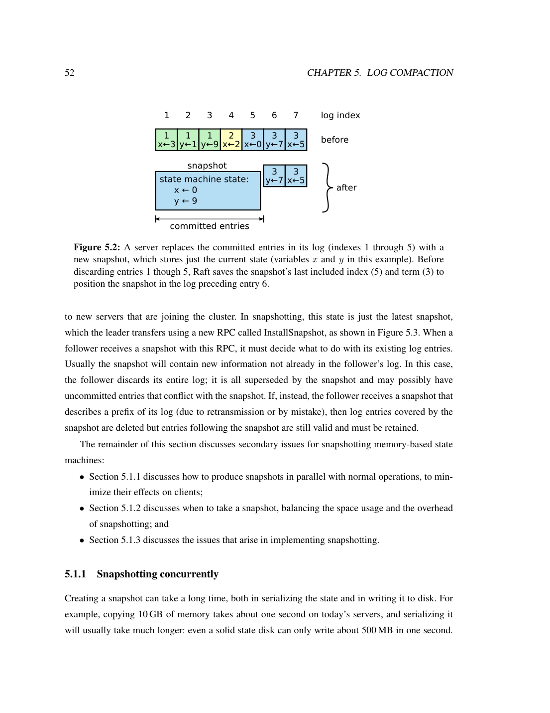
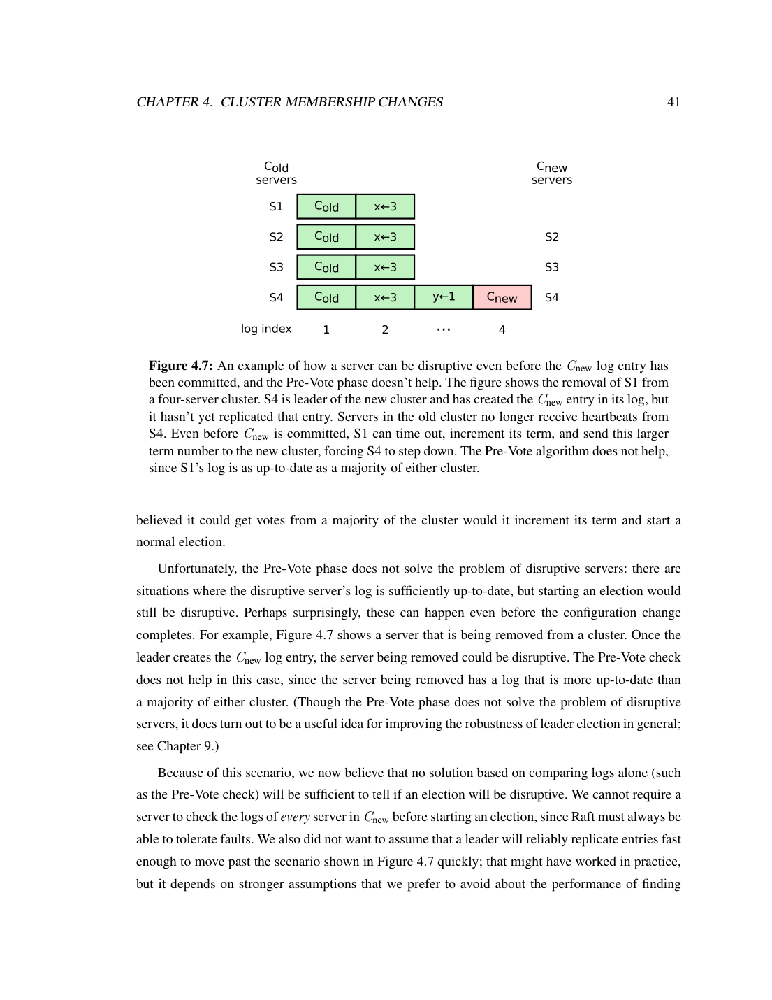

> 本组第 31 篇 · 共识协议 · [全部论文]() · [上一篇]() · [下一篇]()

Raft的贡献是以可理解性组织完整复制状态机协议：先选leader，再复制连续日志，并通过日志新旧投票限制、当前任期提交规则及多数派交集建立安全性。每任期至多一个leader，不等于跨任期绝不存在并存的旧leader；只读线性化还需要确认领导权并等待状态机应用。正文优先描述一次增删一个服务器，另列联合共识；当时LogCabin仍采用联合共识。持久状态、快照边界和客户端去重会话都是端到端保证的一部分。

论文的TLA+规约和半形式化证明覆盖基本固定成员算法的安全性，不包含成员变更、压缩、客户端协议或活性证明。选举评估包含概率模型、真实LAN测试和WAN模拟；不能把三者合成时延保证。三节点、100客户端线程、1,024字节写入的LogCabin初步吞吐约19,500次/秒，约1ms写延迟来自另一个单线程测试；没有同平台Multi-Paxos性能对照。课堂研究的配对样本43人中33人Raft得分更高，但材料等难、作者评分和难题地板效应限制了外推。以下区分论文陈述、读者推断和未执行的复现建议；审校不构成生产安全认证。

本文保留论文陈述、读者推断与待验证方案的区别；实验数字只适用于原文条件。原文和翻译来自已有 AI 辅助精读报告，已做来源匹配与编辑复核，不等于人工逐项核验或独立实验复现。所有页码均为 PDF 物理页。

## 论文与阅读范围

Diego Ongaro. Consensus: Bridging Theory and Practice. Stanford University博士论文，August 2014，258个PDF物理页。封面、版权页及参考文献[89]区分本学位论文与较短的ATC 2014论文；不据学位论文类型推断它没有学术审查。

[论文集中的原始 PDF](https://github.com/lonng/db-papers/blob/4ff1331069c7cf52ac97dd769e5f484c1c35c200/papers/consensus/consensus%3A-bridging-theory-and-practice.pdf) · 本地来源：`consensus/consensus_-bridging-theory-and-practice.pdf`，共 258 页。

本篇保留 10 组原文精读和 96 条证据。截图为原始 PDF 的局部页选，不是重新生成的图表；未将整份 PDF 复制到博客。

## 1. 研究问题与适用边界

【论文陈述】论文针对的不是单个值的抽象投票问题，而是如何把一致决定扩展为可恢复、可运维的复制状态机。第1-2章把Paxos难学、完整系统规范分散与工程扩展负担作为动机；“更易理解”是设计目标和待评估假设，不是其他协议无法正确实现的定理。一个共识组可支撑协调服务，也可作为分区存储中的一个复制单元；跨组事务不能仅由单组日志一致性自动解决。

故障模型是非拜占庭的停止故障与从稳定存储恢复：网络可延迟、丢失、重复和乱序消息，但节点不任意伪造状态，关键持久状态不能在重启后静默遗失。五节点配置在多数派可用、互通且时序允许推进时可容忍两节点停止；“还有三台活着”但彼此不可达，不足以保证及时服务。安全性在异步延迟下保持，活性和可用性需要额外时序与可达性条件。

【边界】稳定日志复制不等于客户端一次执行：超时重试会产生同一业务命令的多个日志位置，需要会话和序列号过滤。确定性状态机也不能让各副本自行读取本地时钟并独立改变业务结果；共同时间输入须纳入协议。磁盘损坏、丢失投票记录、错误身份复用均超出普通crash/restart处理，不能以“Raft容错”掩盖。

【读者推断】对数据库工程的意义是明确共识层、状态机、客户端会话与跨分区事务的责任边界。本文没有读取任何现代数据库源码，因此不对StarRocks、DuckDB或查询优化器是否使用Raft作判断，也不把通用查询框架假设成分布式DDL协调服务。

依据：论文陈述；PDF 物理页 24, 45, 87, 89。证据：[C002N02](#evidence-c002n02), [CB01](#evidence-cb01), [CB12](#evidence-cb12), [CB25](#evidence-cb25), [CB26](#evidence-cb26)。

## 2. 架构、状态与存储边界

【论文陈述】Raft分解为leader选举、日志复制、安全性三个子问题。节点是follower/candidate/leader，term是单调的逻辑任期而非物理时间；每任期最多选出一个leader，旧leader在分区中可能暂时仍自认为leader，新任期leader可同时存在。已确立leader处理写入并向外复制日志；这不是“全局任何时刻只有一个自认活跃的leader”的保证。

currentTerm、votedFor和日志需要满足稳定存储语义。commitIndex可在重启时归零并重新获知；lastApplied是否可丢失取决于状态机：内存状态机可从快照和日志重放，持久状态机必须持久保存相应应用进度以免重复应用。保有原身份却丢失关键持久状态的服务器不能直接安全重入。nextIndex是发送位置的乐观提示；matchIndex用于计数复制确认，两者不能混同。

日志条目由index和创建时term定位，不随新leader而重编号。同index、同term意味着该位置及其整个前缀相同，但不同副本尚未提交的后缀可以不同。AppendEntries依赖prevLogIndex/prevLogTerm匹配；拒绝后回退发送位置，只有发现实际条目冲突才删除冲突后缀，不能因收到短心跳就截断较长的正确后缀。协议安全不要求网络按RPC发送顺序交付。

快照把已提交且已应用前缀的恢复责任交给状态机，不是在逻辑日志中制造任意空洞。丢弃前缀前需可靠保存最后包含的index、term、当时配置及客户端去重状态。快照边界仍可提供prevLogTerm；跨过已丢弃前缀才需要快照传输。InstallSnapshot在边界index/term匹配时保留后续后缀，不能一概清空整个日志。LogCabin保存临时快照并落盘完成后重命名的过程，与并发fork/copy-on-write的内存代价同属实现责任。

物理158页的LogCabin实现采用单锁monitor以及peer/service/state-machine/timer/log-sync等线程；它是一个可选实现架构，不是协议强制每副本一个线程或必须全局单锁。leader日志落盘可与向followers复制并行，但只有真正持久化的副本才计入多数；leader自身尚未落盘也可由足够多的持久follower构成多数。

依据：论文陈述；PDF 物理页 32, 34, 37, 45, 69, 70, 74, 158, 160。证据：[CB03](#evidence-cb03), [CB04](#evidence-cb04), [CB06](#evidence-cb06), [CB10](#evidence-cb10), [CB11](#evidence-cb11), [CB12](#evidence-cb12), [CB21](#evidence-cb21), [CB22](#evidence-cb22), [CB46](#evidence-cb46), [CB72](#evidence-cb72), [C007N11](#evidence-c007n11)。

*原论文 PDF 物理页 70，版权归原作者或出版方。点击图片可查看原尺寸。页面文本中定位到：Figure 5.2: A server replaces the committed entries in its log (indexes 1 through 5) with a。这是页面定位信息，不表示本次已复核图内所有数据。*

## 3. 核心算法与逐步推演

选举：超时后增加term、投票并并行请求选票，每轮重新随机超时以降低split vote概率。投票不仅要求本任期未投给别人，还比较候选人与本地日志的最后term；term相同才比较最后index。因此“日志最长者必胜”错误，也不是要求候选人逐一传输全部日志才能投票。多数派交集、一任期一票与日志新旧限制共同支撑Leader Completeness。

提交：leader推进到N需要N属于自己当前term且持久复制确认覆盖多数。旧term条目不能仅凭当前看到的副本数直接推进；提交一个当前任期条目会通过共同前缀间接提交更早条目。该条目可以是正常业务命令，不必永远是no-op；新leader为了尽快建立已提交前缀而附加no-op，是第6章只读路径使用的策略。物理41页图3.7(c)中term-2条目虽在S1/S2/S3上，仍可在(d1)被term-3后缀替换；(d2)先使当前term-4条目达到多数，才锁定其前缀。

【读者构造的假设示例】三节点S1/S2/S3，S1在term 1创建(index=1,term=1,x)。S1和S2均持久化该条目，且S1处理S2成功响应后，2/3已满足当前任期提交条件，不能写成“未达到多数”。S1随后崩溃；空日志S3在term 2向S2请求投票会被拒绝，只获自身一票不能胜选。S2则可凭较新日志获得S3支持而当选，保有x。例子说明日志限制如何守住已提交前缀，而不是说所有未提交长日志都必须保留。

成员变更：本博士论文主体推荐一次添加或删除一个服务器，顺序变更避免不相交多数。配置作为日志条目传播，在各服务器本地追加时即生效，不等到其获知提交；未提交条目若被覆盖，要回退前一个配置。开始下一变更前，先完成前一变更；新服务器先作为非投票成员追赶，避免抬高多数门槛导致不可用。移除leader时保留其完成新配置提交所需的角色，然后退出，而不是写入配置便立即下台或一律禁止“不在本地最新配置中”的节点参与。

第4.3节另给联合共识：先提交Cold,new，再写入Cnew；选举与提交都要求majority(Cold)且majority(Cnew)，不是对两集合并集简单计多数。论文写作时LogCabin仍使用较早的联合共识实现；不能把推荐方案、备选方案和实测代码视为同一版本。以上是本文历史设计的准确呈现，不是对所有后来成员变更实现的认证。

客户端：写入使用client ID、请求序列号和缓存响应去重；并发请求需要序列号/响应集合，不是只缓存一个最新响应就充分。会话到期必须确定性处理，过期重试应报错而不是新建会话后再执行旧命令。无日志只读路径需先提交当前term条目、记录readIndex、进行新一轮多数派心跳确认、等lastApplied>=readIndex后查询。只靠“自己还是leader”或一条历史心跳不足以线性化。跟随者可借leader给出的readIndex卸载查询，但论文的LogCabin未实现follower reads；clock lease是另一种未实现且依赖漂移界的替代。

依据：论文陈述；PDF 物理页 32, 35, 40, 42, 51, 53, 55, 62, 87, 89, 90, 91, 92。证据：[CB05](#evidence-cb05), [CB07](#evidence-cb07), [CB08](#evidence-cb08), [CB09](#evidence-cb09), [CB14](#evidence-cb14), [CB15](#evidence-cb15), [CB16](#evidence-cb16), [CB19](#evidence-cb19), [CB25](#evidence-cb25), [CB26](#evidence-cb26), [CB27](#evidence-cb27), [CB28](#evidence-cb28), [CB29](#evidence-cb29), [CB30](#evidence-cb30), [CB31](#evidence-cb31), [CB32](#evidence-cb32), [C003N06](#evidence-c003n06)。

## 4. 正确性链条与保证边界

基本安全性证明的结构是：持久term与一任期一票加多数派交集给出Election Safety；leader仅追加和AppendEntries前缀检查给出Log Matching；对第一个缺失已提交条目的未来leader作反证，利用一个既存过条目又参与未来投票的交集节点以及日志比较规则，得到Leader Completeness；按index应用已提交前缀，得到State Machine Safety。Appendix B的allLogs、elections、voterLog等历史变量用于证明，不是生产RPC必须发送的全部历史状态。

必须区分规约、证明和实现。物理130-134页的TLA+模型允许消息丢失、重复、乱序、任意延迟和从稳定状态重启，没有物理时间；作者给出基本固定成员算法的半形式化安全证明。部分TLAPS工作依赖未机械证明的不变量，完整证明未机器检查。物理134页明确把成员变更、压缩、客户端交互以及基本算法活性/可用性留作未来工作。可理解性、模型检查、手工证明与实现测试是不同证据，不能互相替代。

安全性不依赖时钟，不代表包含lease的所有客户端路径都无时钟假设。第3.9节的broadcastTime << electionTimeout << MTBF是维持稳定leader的工程量级关系；物理46页给出约0.5-20ms广播和约10-500ms选举超时的讨论，第9章另有分析与实测。不能声称全文无具体参数，也不能把该关系当作所有部署的精确必要充分不等式。只有多数派存在但时序持续恶劣时，安全仍可保持而服务不能推进。

持久化约束是可恢复状态在对外承诺、投票或计入quorum前可靠保留，不限定必须调用某个POSIX API，也不否认异步I/O加完成屏障的实现。任意把未持久化日志计入matchIndex、重启遗失投票或让持久状态机遗失应用进度都不安全；但不能据此断言所有异步刷盘、批处理或共用持久化队列都错误。leader本地磁盘与复制并行的安全优化已在第10章说明。

【来源审校的未决疑点，而非协议反例】物理225页规约注释称AppendEntries至多一条，但line 209的nextIndex+1配合包含端点的SubSeq看似可形成两条；物理230页line 359赋commitIndex'，line 369又UNCHANGED logVars，而logVars包含commitIndex。渲染确认这不是纯提取错字；本次未运行规约或检查原.tla修订/勘误，故仅作为需机械审计的源码文献问题，不据此宣判Raft算法不安全。

依据：论文陈述；PDF 物理页 42, 45, 46, 130, 132, 134, 160, 219, 225, 230, 233, 234, 235。证据：[C021N08](#evidence-c021n08), [CB09](#evidence-cb09), [CB10](#evidence-cb10), [CB11](#evidence-cb11), [CB12](#evidence-cb12), [CB37](#evidence-cb37), [CB38](#evidence-cb38), [CB39](#evidence-cb39), [CB46](#evidence-cb46), [CB49](#evidence-cb49), [CB50](#evidence-cb50), [CB51](#evidence-cb51), [CB52](#evidence-cb52), [CB71](#evidence-cb71)。

## 5. 实验条件、数字与证据缺口

本论文有三类经验评估，另有选举概率分析，必须分开报告。

一、课堂可理解性研究。被试内、顺序平衡设计：49人至少做一份测验，43人做两份，42人完成测验与问卷；Paxos测验47份、Raft45份，部分偏好问题41份。满分60，Raft讲座58:18、Paxos66:34。物理111页正文直接给出非配对单侧t检验：Raft M=25.72/SD=10.33，Paxos M=20.98/SD=8.57，t(85.55)=2.39，p=.009；配对n=43，Raft M=25.73/SD=10.56、Paxos M=20.79/SD=8.64，t(42)=3.39，p=.001。总体均分差4.74分即22.6%；配对分差中位数6.5分。这些是正文数字，不是图像推断。33/43在Raft测验得分更高，33/41主观认为Raft更易实现、33/41认为更易解释。

作者承认材料等质等难无法证明；两位作者制定和修改rubric，Ongaro评分虽对身份/学校盲，但非独立算法盲评，且先接触初步分数再改rubric。难题过难产生地板效应，主要差异来自Easy/Medium；Paxos题4把chosen误写为accepted，评分时宽容处理。p值不是“Raft有99.9%概率更好”的后验概率；课堂成绩与偏好不能直接给出生产实现bug率或开发成本。本文未重分析原始学生数据。

二、选举分析和LAN实测。归一化独立均匀超时偏移下，s个可用节点最早超时CDF为1-(1-t)^s，期望1/(s+1)；几何轮次模型的期望为1/(1-p)，均有模型前提，不是故障恢复最坏时间界。LAN采用五台机器、LogCabin C++11、RHEL6/Linux2.6.32、Xeon X3470、ext4/Crucial M4 SSD、1GbE，内存状态机且无日志压缩。反复崩溃leader，测到其他节点收到新leader首个心跳；人为同步旧心跳和不同日志长度使选举不利。随机配置各1,000轮，固定150-150ms仅100轮。12-24ms超时下平均35ms、最长152ms；150-155ms约287ms中位数；50ms随机范围的1,000轮最大值513ms。这些样本最大值不是保证上界；作者推荐更保守的150-300ms。

三、WAN为AvailSim，不是真实跨洲集群。单向消息延迟均匀30-40ms，超时300-600ms，每条CDF有10,000次模拟；忽略CPU处理与写盘时间，初始fresh timer也使相对实机平均多半个心跳间隔。五节点损失一台时平均约475ms、99.9%在1.5s内；损失两台时平均约650ms、99.9%在3s内。不能把这些数字与LAN的SSD或35ms混合为一个系统结果。

四、日志复制初步性能。Table 10.1实际列出RHEL6/Linux2.6.32、Xeon X3470（4核8硬件线程）、ext4/Intel DC S3500 SSD（每服务器一块、write caching off）、Protocol Buffers/TCP/1GbE、内存状态机且无压缩；缺的是RAM容量等未列参数，不是整套CPU/磁盘/OS信息。单客户端进程、多线程共享一条TCP连接，反复set一个1,024字节值并等待状态机返回。三节点100线程约19,500写/秒；另一个单线程延迟测试约0.7ms（单节点）、约1ms（2-5节点），不等同于19,500ops/s负载下的延迟。每点五次约10s运行均值，误差棒为五次min/max，不是置信区间或p99。0.25ms持久化来自微基准；约60,000写/秒网络容量是作者估算，非已测可达值。没有同平台Multi-Paxos对照，没有混合读写、快照、重启和变更开销的全面测量。

依据：论文陈述；PDF 物理页 98, 101, 104, 111, 119, 128, 138, 147, 150, 151, 152, 162, 163, 164, 190, 205。证据：[CB33](#evidence-cb33), [CB34](#evidence-cb34), [CB35](#evidence-cb35), [CB36](#evidence-cb36), [CB40](#evidence-cb40), [CB41](#evidence-cb41), [CB42](#evidence-cb42), [CB43](#evidence-cb43), [CB44](#evidence-cb44), [CB47](#evidence-cb47), [CB48](#evidence-cb48), [CB53](#evidence-cb53), [CB54](#evidence-cb54), [CB65](#evidence-cb65), [CB67](#evidence-cb67), [CB68](#evidence-cb68), [CB69](#evidence-cb69), [CB70](#evidence-cb70), [C015N11](#evidence-c015n11), [C018N12](#evidence-c018n12)。

*原论文 PDF 物理页 59，版权归原作者或出版方。点击图片可查看原尺寸。页面文本中定位到：Figure 4.7: An example of how a server can be disruptive even before the Cnew log entry has。这是页面定位信息，不表示本次已复核图内所有数据。*

## 6. 性能、空间与工程取舍

强leader与连续日志降低推理复杂度，但leader出站带宽、批大小、管线深度和状态机应用仍可能决定吞吐。LogCabin支持AppendEntries批处理与管线化；乐观nextIndex可提前移动，但失败重试、乱序回应和稳定matchIndex要正确记账。leader日志写盘可与followers并行，不应以“永远两次串行fsync”估计基本算法最低时延。锁竞争或网络栈瓶颈在本报告未实测，不能诊断为19,500ops/s的已知根因。

快照保留空间与带宽的取舍：第5.1.2节以日志超过上次快照大小若干倍触发，扩张因子4估计约20%写带宽用于快照，峰值约需六份状态容量。这是代价估算而非20%实测开销。内存快照的copy-on-write节省停顿却有内存放大，fork与多线程/C++析构交互也有实现成本。磁盘状态机、LSM和log cleaning是可选设计；LogCabin当时只实现内存状态机快照，并未实现或测量所有压缩方案。

当前任期直接提交规则保留条目term的稳定身份，却延迟旧前缀的获知；第11.3节指出，如果换主无限成功、每次又在提交新条目前崩溃，日志可无限增长而无法压缩。作者认为普通部署中不太现实，但这仍是有界空间保证的缺口，不能宣称任意失败序列下日志永远有界。

预投票有版本差异。第4.2.3节反例只证明“日志够新”的预检查不足以挡住被移除节点；随后对最近收到有效leader心跳的服务器，暂不因RequestVote更新term/投票。第9.6节的Pre-Vote又同时要求日志条件和没有近期有效leader心跳，才允许增加term，以防隔离节点重连后用大term打断健康集群。领导权转移需要显式允许提前选举的例外；该转移方案在论文写作时未实现/评估。不能据第59页断言第155页推荐的增强Pre-Vote也无效。

时钟lease可消除每批只读的多数派往返，但额外依赖漂移界；图6.3到期点从心跳发送start起计算start+electionTimeout/driftBound，而不是收到ACK后再给完整timeout。漂移假设破坏可能返回任意陈旧结果，转移领导权前还要终止lease。论文未实现且不建议非必要使用它；默认的readIndex+心跳路径不需要该时钟保证。

依据：论文陈述；PDF 物理页 47, 59, 60, 68, 73, 78, 92, 155, 160, 173。证据：[CB13](#evidence-cb13), [CB17](#evidence-cb17), [CB18](#evidence-cb18), [CB20](#evidence-cb20), [CB23](#evidence-cb23), [CB24](#evidence-cb24), [CB32](#evidence-cb32), [CB45](#evidence-cb45), [CB46](#evidence-cb46), [CB57](#evidence-cb57)。

## 7. 与相关机制的有条件比较

【论文陈述】第11章比较的是Paxos族的常见描述而非唯一标准实现，Appendix A的Multi-Paxos教学版本还明确称未实现、未证明。VR、VRR与Zab也须区分版本；不能把某篇描述“传整个日志”泛化为所有现代实现。图11.1用不同日志演示Raft只传差异条目，这是机制说明，不是同硬件恢复时延实验。本文未读取外部论文或实现源码，以下比较只转述本论文并明确其边界。

alpha并非仅为节流任意添加的未提交计数器：其成员变更定义让entry i决定i+alpha的配置，从而限制可提前提议范围。若达到该边界后leader重启换term，它不能追加当前term条目，又需要当前term提交来获知旧前缀提交，形成第175页的循环依赖。SMART与alpha的状态转移组织不同；旧/新配置两个leader的讨论也不是Raft基本算法的正式双leader机制。不能从这一特殊冲突推导所有有界复制窗口均不安全，也不能从alpha的缺点虚构Raft设计选择的因果历史。

第4章实际优先推荐单服务器变更，联合共识是支持任意变更的更复杂备选，而当时LogCabin实现仍用联合共识。任意改写配置激活时点、leader退出条件或身份资格，都需重新论证多数派连续性和进展，不能只说集合有交集就充分。第185页讨论witness、thrifty及primary-backup的资源差别，后者故障恢复借外部共识服务；diskless模式也改变多数节点同时重启的风险。它们是条件性设计，不是已实现的Raft性能开关。

第11.6节区分命令复制的确定性RSM与先执行再复制确定性结果的primary-copy：后者必须隐藏未提交结果并可能回滚。第11.1.2节的Zab FIFO client order还要求重叠请求按客户端顺序保序；线性化对并发重叠操作本身不规定调用先后，Raft要同等保证需要额外处理网络和重试次序。

第184页把Generalized/EPaxos的交换性、就近服务器和快路径作为减少leader瓶颈的办法，但这是作者对其他工作的概述，没有本论文内同平台性能对照。两个对同一整数的纯加法仍可能交换；应以set(x,10)与set(x,20)等真正不交换的命令说明冲突，而不能把“同key”直接当作“不交换”的证明。返回值、条件更新和状态机业务语义也会改变交换性。把这些思想用于Raft将大幅改变强leader机制，必须重新建立证明与失败恢复论证，本文不宣称简单移植即可获得同等性质。

依据：读者推断；PDF 物理页 51, 62, 166, 167, 172, 175, 180, 181, 182, 184, 185, 186, 215。证据：[CB14](#evidence-cb14), [CB19](#evidence-cb19), [CB55](#evidence-cb55), [CB56](#evidence-cb56), [CB58](#evidence-cb58), [CB59](#evidence-cb59), [CB60](#evidence-cb60), [CB61](#evidence-cb61), [CB62](#evidence-cb62), [CB63](#evidence-cb63), [CB66](#evidence-cb66), [C016N09](#evidence-c016n09), [C017N03](#evidence-c017n03), [C018N02](#evidence-c018n02)。

## 8. 可执行复现计划与验收标准

本节均为尚未执行的读者方案，不声称已经实现、跑通或复现实验。

1. 固定来源与实验版本。保留本PDF SHA、LogCabin/AvailSim代码修订、编译器及运行参数；本论文给的是2014年的硬件/系统条件，不能只用一个现代库的默认配置就称复现。物理218页的Multi-Paxos摘要有裁切表达式，附录B也有待核规约疑点，先获取完整原始文件并核对勘误，不能补字符后宣称执行原规范。验收：来源、版本、配置与偏差清单齐全；未取到代码则明确停止于计划。

2. 建立小规模状态机故障测试。以3/5节点、单键set/increment、client ID和序列号构造可核对的历史；注入消息丢失/重复/乱序、选举、部分网络分区和重启，分别检查每term至多一leader、同index/term前缀一致、已提交前缀不丢、重复请求不再次产生业务效果。重点覆盖图3.7：旧term条目即使新近达到多数，未获当前term提交也不能据计数误判。验收：所有轨迹无违反不变量；模型穷举只代表选定边界，不等于一般证明。

3. 验证耐久性和恢复屏障。分别在term/vote持久化、复制确认、状态机写入、lastApplied和快照发布的前后崩溃。异步I/O可以使用，但成功外部响应或quorum自计数不能越过耐久屏障；不强制独立文件、特定API或所有字段单个原子写。验收：受支持的crash/recovery中无双重投票、无已承诺条目丢失、持久状态机无重复应用；模拟持久状态损坏应拒绝旧身份直接重入。

4. 覆盖压缩边界与成员变更。明确prevIndex等于snapshot边界时可用已保存term，不能一见历史前驱已不在数组就发送快照；真正缺失被压缩前缀时才走InstallSnapshot。测试边界匹配保留后缀、不匹配丢弃冲突日志、分块传输中断恢复、快照中的配置/会话恢复。成员变更按所选版本实现，不混用单步与联合共识；在前配置未提交时拒绝重叠变化，新节点先追赶。对移除leader测试完成提交后退出，不用一概禁止“不在本地最新配置中”的候选者来修补活锁。验收：每个切换/快照崩溃点既不越过安全前缀，也不引入可避免的永久不可用。

5. 单独验收读路径。让旧leader与多数派隔离，而新leader提交新值；旧leader不得无确认返回过时成功读。分别注入readIndex已获知但lastApplied落后的状态、客户端会话到期/重试以及并发请求返回次序。验收：历史可线性化且重试无重复业务效果；lease若启用，必须单独写明时钟假设及违背假设时的弱化保证，不能复用无时钟读路径的结论。

6. 分组复现性能。日志写入使用原Table10.1的1,024字节、共享TCP、3节点/100线程吞吐，以及独立单线程延迟设置，各做五次约10秒基线并保留原始样本。另补长时与p50/p95/p99、CPU/磁盘/网络统计和快照/变更负载，但标为新增实验。选举另按Table9.2磁盘与五节点故障方式运行1,000轮（固定150-150ms对照100轮），WAN另以30-40ms/300-600ms模拟。验收：均值/范围/分位数和计时起止点不混用；遇偏差先调查，不先将网络、锁或磁盘认定为根因。动态timeout、自适应流控属于新提案；先证明不会阻断建立当前term提交，再测其对split vote与尾延迟的影响。

依据：待验证的工程设想；PDF 物理页 42, 45, 53, 55, 62, 69, 70, 87, 89, 90, 91, 92, 150, 151, 152, 162, 163, 175, 201, 202, 225, 230。证据：[CB09](#evidence-cb09), [CB10](#evidence-cb10), [CB11](#evidence-cb11), [CB12](#evidence-cb12), [CB15](#evidence-cb15), [CB16](#evidence-cb16), [CB19](#evidence-cb19), [CB21](#evidence-cb21), [CB22](#evidence-cb22), [CB25](#evidence-cb25), [CB26](#evidence-cb26), [CB27](#evidence-cb27), [CB28](#evidence-cb28), [CB29](#evidence-cb29), [CB30](#evidence-cb30), [CB32](#evidence-cb32), [CB42](#evidence-cb42), [CB43](#evidence-cb43), [CB44](#evidence-cb44), [CB48](#evidence-cb48), [CB50](#evidence-cb50), [CB51](#evidence-cb51), [CB58](#evidence-cb58), [CB67](#evidence-cb67), [CB68](#evidence-cb68), [C019N10](#evidence-c019n10)。

## 9. 结论、未决问题与证据索引

【论文贡献】Raft把可理解性当作协议设计目标，以强leader、连续日志、任期和前缀不变量将选举、复制及安全论证连接起来，并详述成员变更、压缩和客户端交互。完整系统描述的价值不能被缩成五条性质列表，也不能把实用设计的完整性误当成所有扩展已经形式化证明。

【经来源复核的判断】实验支持该版本LogCabin在特定配置下具有实用的初步性能；没有证明它比某个同条件Multi-Paxos实现更快。课堂研究为特定教材和测验下的学习表现提供证据，不给出普遍实现正确性排名。只读线性化、客户端去重、durable quorum以及配置激活/退出时点，比“多数复制即可”这一口号更接近实现中的真正约束。

【限制】本次复核覆盖258页可读来源，并核查33页渲染；不是穷尽图表识别、程序测试、形式化证明或外部文献核验。附录的规约/排版疑点应保留为待核问题；不能当作已修复勘误，也不能从中制造最终协议不安全的结论。报告状态仍为待人工复核，原API反向审查针对原草稿，未被篡改成对本版的背书。

证据导航：CB01-CB12用于故障模型、前缀与耐久性；CB14-CB19用于配置变更及预投票；CB20-CB32用于快照、会话与读；CB33-CB48与CB67-CB71用于用户研究、选举和性能；CB49-CB52用于证明/规约疑点；CB53-CB66用于研究偏差、相关机制和附录。API原有C...证据保留，CB...是当前会话来源核对增补。逐条引文见下方证据索引，API全量210条块笔记仍保存在原all-notes文件，未改写。

依据：读者推断；PDF 物理页 24, 42, 45, 51, 62, 69, 87, 91, 104, 119, 128, 134, 162, 163, 215, 219, 225, 230。证据：[CB01](#evidence-cb01), [CB09](#evidence-cb09), [CB10](#evidence-cb10), [CB14](#evidence-cb14), [CB19](#evidence-cb19), [CB21](#evidence-cb21), [CB25](#evidence-cb25), [CB29](#evidence-cb29), [CB30](#evidence-cb30), [CB35](#evidence-cb35), [CB36](#evidence-cb36), [CB39](#evidence-cb39), [CB47](#evidence-cb47), [CB48](#evidence-cb48), [CB49](#evidence-cb49), [CB50](#evidence-cb50), [CB51](#evidence-cb51), [CB54](#evidence-cb54), [CB66](#evidence-cb66)。

## 原文精读：从句子回到机制

以下保留原文、忠实翻译、含义与边界；假设示例不作为论文实验结果。

### P001 · PDF 物理页 7

**原文**

<blockquote class="paper-source-quote"><pre><code>Many people contributed directly to this dissertation work. A special thanks goes to David&#10;Mazi`eres and Ezra Hoch for each finding a bug in earlier versions of Raft. David emailed us one&#10;night at 2:45 a.m. as he was reading through the Raft lecture slides for the user study. He wrote&#10;that he found “one thing quite hard to follow in the slides,” which turned out to be a major issue&#10;in Raft’s safety. Ezra found a liveness bug in membership changes. He posted to the Raft mailing&#10;list, “What if the following happens?” [35], and described an unfortunate series of events that could&#10;leave a cluster unable to elect a leader.</code></pre></blockquote>

**忠实翻译**

> 许多人直接参与了这篇学位论文的工作。特别感谢 David Mazières 和 Ezra Hoch，他们各自在 Raft 的早期版本中发现了一个 bug。David 在凌晨 2:45 给我们发了一封电子邮件，当时他正在阅读用于用户研究的 Raft 讲座幻灯片。他写道，他发现“幻灯片中有一件事很难理解”，结果这被证明是 Raft 安全性（safety）中的一个重大问题。Ezra 在成员变更（membership changes）中发现了一个活性（liveness）bug。他在 Raft 邮件列表中发帖说：“如果发生以下情况会怎样？”[35]，并描述了一系列不幸的事件，这些事件可能导致集群无法选举出 leader。

**技术含义与边界**

> 作者在致谢中回顾早期版本由外部读者发现安全性和成员变更活性问题。该段提供设计迭代的来源记录，不是最终版本安全性/活性的证明，也不逐一交代所有修复细节。读者推断：独立审读和明确反例有助于协议设计，但不能替代规约及实现验收。

**常见误读**

> 既不能由“早期有bug”断言最终协议不安全，也不能从此段直接得出“均已彻底修复且无其他问题”。earlier versions限定了所述事件的版本范围。

**读者构造的假设示例**

> 读者构造的假设示例：审阅者给出三节点换主轨迹，暴露投票持久化遗漏。团队修改算法后仍需重验轨迹、其他不变量与实现；发现和修改不等于完成独立验证。

### P002 · PDF 物理页 240

**原文**

<blockquote class="paper-source-quote"><pre><code>An entry ⟨index,term⟩is committed at term t if it is present in every leader’s log&#10;following t:&#10;committed(t) ≜{⟨index,term⟩:&#10;∀election ∈elections :&#10;election.eterm &gt; t ⇒&#10;⟨index,term⟩∈election.elog}&#10;Definition 2. An entry ⟨index,term⟩is immediately committed if it is acknowledged by a quorum&#10;(including the leader) during term. Lemma 8 shows that these entries are committed at term.</code></pre></blockquote>

**忠实翻译**

> 若条目<index,term>出现在任期t之后每位leader的日志中，称该条目在t时提交：committed(t)={ <index,term> : 对每个election，若election.eterm>t，则该条目在election.elog中 }。定义2：若条目<index,term>在term任期内被quorum（包括leader）确认，则称其立即提交。引理8证明这些条目在term时提交。

**技术含义与边界**

> Definition 1用未来leader日志给出要建立的安全性质，不是要求实现预知未来，也不是额外假定未来leader永不覆盖。Definition 2中确认任期与条目自身term对应；Lemma 8证明局部条件蕴含未来保持性质，Lemma 9再覆盖其前缀。后来leader简单统计旧term副本并不满足同样的立即提交条件。

**常见误读**

> 不能泛化成“任意旧条目后来复制到多数就能直接提交”；也不能把所有未来leader含条目当成循环论证的假设。新leader可提交当前term业务条目或no-op来间接提交旧前缀，no-op不是唯一选择。

**读者构造的假设示例**

> 读者构造的假设示例：term 3的leader把<5,3>持久化到五节点中的三台并得到确认，满足本任期条件。若term 4的leader仅补发<5,3>至三台，不能只凭这个计数直接推进；先提交<6,4>可使包含<5,3>的共同前缀间接提交。

### P003 · PDF 物理页 111

**原文**

<blockquote class="paper-source-quote"><pre><code>The mean Raft score is 4.74 points or 22.6% higher than the&#10;mean Paxos score. We used a statistical significance test to confirm this difference: we conducted&#10;an unpaired Student’s t-test with a one-sided hypothesis that the Raft scores were greater than the&#10;Paxos scores. This test found that the Raft scores (M = 25.72, SD = 10.33) were significantly greater&#10;than the Paxos scores (M = 20.98, SD = 8.57); t(85.55) = 2.39, p = 0.009.</code></pre></blockquote>

**忠实翻译**

> Raft 的平均分比 Paxos 的平均分高 4.74 分，即高出 22.6%。我们使用统计显著性检验来确认这一差异：我们进行了一项单侧假设的非配对 Student's t-test，假设 Raft 分数高于 Paxos 分数。该检验发现 Raft 分数（M = 25.72, SD = 10.33）显著高于 Paxos 分数（M = 20.98, SD = 8.57）；t(85.55) = 2.39, p = 0.009。

**技术含义与边界**

> 这是物理111页正文中的均分、标准差和单侧非配对检验，不是图表猜读。研究本身是被试内顺序平衡设计；因答卷不齐，非配对分析用47份Paxos和45份Raft答卷，另有43人的配对检验。这里不能把两门测验说成完全独立招募的两组。

**常见误读**

> p=.009不是Raft更易理解的后验概率，也不能证明生产实现更少出错。课堂材料、评分流程与难题地板效应限制外推；把正文确有的统计数字标成“无来源图表数字”同样错误。

**读者构造的假设示例**

> 读者构造的假设示例：同一批学生各学X和Y，部分只交一份测验。先描述两份答卷集合的均值，再对完成两份者计算成对差值；这两种统计样本口径不同，任何结果都不能自动预测生产程序缺陷数。

### P004 · PDF 物理页 175

**原文**

<blockquote class="paper-source-quote"><pre><code>With the α approach (but not with&#10;SMART), the need to maintain a leader in the old cluster results in scenarios where there are two&#10;leaders in a single Raft cluster: the leader of the old cluster replicates the log up to i +α and cannot&#10;write beyond that, and the leader of the new cluster knows the entries up to i + α are committed&#10;and replicates new log entries past i +α.</code></pre></blockquote>

**忠实翻译**

> 使用 α 方法（但 SMART 方法不会这样），由于需要在旧集群中维持一个 leader，会导致在单个 Raft 集群中出现两个 leader 的场景：旧集群的 leader 将日志复制到 i + α，并且无法写入超过该位置的日志，而新集群的 leader 知道直到 i + α 的条目已经被提交，并将新的日志条目复制到 i + α 之后。

**技术含义与边界**

> 这是第11章评估把alpha成员变更组织移植到强leader日志时的困难，不是Raft基本算法正式允许两个当前leader。alpha在i与i+alpha之间延后配置生效，导致旧leader需保留复制任务；SMART将两个leader放在不同逻辑集群。前文还指出alpha窗口与当前term提交可能构成循环依赖。

**常见误读**

> 仅因写入区间不重叠就称方案已安全或可用，超出此段。作者讨论的是需要额外机制的兼容性问题；不能把它当作已证明的迁移协议，亦不能从其不足编造Raft设计历史。

**读者构造的假设示例**

> 读者构造的假设示例：旧配置{A,B,C}只能推进到N，新配置{C,D,E}从N之后接续。若C故障，旧服务器又未把N之前的完整状态交给D/E，即便新区间与旧区间无重叠，新集群仍可能无法应用日志；需要独立证明状态转移及退出条件。

### P005 · PDF 物理页 45

**原文**

<blockquote class="paper-source-quote"><pre><code>3.9&#10;Timing and availability&#10;One of our requirements for Raft is that safety must not depend on timing: the system must not&#10;produce incorrect results just because some event happens more quickly or slowly than expected.&#10;However, availability (the ability of the system to respond to clients in a timely manner) must&#10;inevitably depend on timing.</code></pre></blockquote>

**忠实翻译**

> 3.9 计时与可用性
> 我们对 Raft 的要求之一是安全性（safety）不得依赖于计时（timing）：系统不能仅仅因为某些事件发生得比预期快或慢而产生不正确的结果。然而，可用性（availability，即系统及时响应客户端的能力）不可避免地必须依赖于计时。

**技术含义与边界**

> 本段区分异步故障下的基本安全性与及时响应所需的时序条件。任意消息延迟不应使遵守协议和持久状态前提的节点提交冲突值，但可能阻止选举和服务。第46页与第9章确实给出参数量级、分析和选举测试；不能由本短引推断全文没有数值证据。

**常见误读**

> 不能把基本日志安全的时序独立性扩展到依赖漂移界的lease读，也不能把安全与持续可用等同。近期心跳确认的readIndex路径与时钟lease必须分别评估。

**读者构造的假设示例**

> 读者构造的假设示例：五节点仍保有关键持久状态，但网络延迟远超选举超时，候选者反复换term而无稳定leader。系统应拒绝或等待请求，而非为维持可用性返回旧值；若另启用lease，其时钟前提需单独验证。

### P006 · PDF 物理页 74

**原文**

<blockquote class="paper-source-quote"><pre><code>• Eliminating unsafe log accesses and discarding log entries: We originally designed LogCabin&#10;without worrying about log compaction, so the code assumed that if entry i was present in the&#10;log, entries 1 through i −1 would also be present. This is no longer true with log compaction;&#10;for example, when determining the term for the previous entry in the AppendEntries RPC, that&#10;entry might have been discarded. Removing these assumptions throughout the code required&#10;careful reasoning and testing.</code></pre></blockquote>

**忠实翻译**

> • 消除不安全的日志访问并丢弃日志条目：我们最初设计 LogCabin 时没有考虑日志压缩（log compaction），因此代码假设如果日志中存在条目 i，那么条目 1 到 i − 1 也必定存在。在引入日志压缩后，这一假设不再成立；例如，在 AppendEntries RPC 中确定前一个条目的任期（term）时，该条目可能已经被丢弃。在整个代码库中移除这些假设需要仔细的推理和测试。

**技术含义与边界**

> 原文说的是初始LogCabin把物理存储当成从索引1开始的完整数组；压缩后仅保留后缀和快照边界，需要改写访问逻辑。这不意味着允许逻辑日志任意有洞。快照最后包含index/term可继续支持边界处一致性检查，只有需要已丢弃前缀时才需发送状态。

**常见误读**

> 不能一见prevIndex不在数组就无条件InstallSnapshot：若它恰好等于快照边界，可用保留term。也不能只保存状态机业务数据而遗失配置、应用进度或客户端会话。

**读者构造的假设示例**

> 读者构造的假设示例：快照包含到index=100、term=7，日志保留101起。发送从101起的AppendEntries时prevIndex=100，可用快照保存的term=7；若follower需要95且前缀已丢弃，才考虑快照传输。

### P007 · PDF 物理页 202

**原文**

<blockquote class="paper-source-quote"><pre><code>Answer 2 assumes a na¨ıve implementation that allows a server that is not part of its current&#10;configuration to still become candidate. In this case, the worst thing that could happen is that&#10;the leader gets elected again as soon as it steps down (its log is still complete), then steps&#10;down again, then repeats infinitely.</code></pre></blockquote>

**忠实翻译**

> 回答 2 假设了一种朴素的实现，即允许不属于其当前配置的服务器仍然成为 candidate。在这种情况下，可能发生的最坏情况是，leader 在下台后立即再次被选举出来（它的日志仍然是完整的），然后再次下台，如此无限重复。

**技术含义与边界**

> 应连同物理201-202页题干阅读：假设把“新配置提交后退出”错误改成“写入新配置立即退出”，再考察仍允许不在本地最新配置中的节点竞选的实现，就可能当选/退出循环。问题不能简化成所有非成员候选都必须禁止；第4.2.2节两节点例子说明，配置未提交前被移除leader可能仍是推进所需。

**常见误读**

> 禁止所有不在最新本地配置中的节点参选或用延长超时随意修补，可能制造新的活性问题。正确做法首先是保留所选变更协议的配置激活、完成提交和退出时点，再单独处理已移除节点的干扰。

**读者构造的假设示例**

> 读者构造的假设示例：两节点A/B由A领导，拟移除A；A先在自己日志写Cnew={B}。若立刻退出而B尚未收到该条目，B的旧配置还需A投票且日志落后，进展可能受阻。应让A完成必要复制/提交后再退出，而不是从本地Cnew一出现就禁用所有作用。

### P008 · PDF 物理页 24

**原文**

<blockquote class="paper-source-quote"><pre><code>Thus, a typical cluster of five servers&#10;can tolerate the failure of any two servers. Servers are assumed to fail by stopping; they may&#10;later recover from state on stable storage and rejoin the cluster.&#10;• They do not depend on timing to ensure the consistency of the logs: faulty clocks and extreme&#10;message delays can, at worst, cause availability problems.</code></pre></blockquote>

**忠实翻译**

> 因此，一个典型的五服务器集群可以容忍任意两台服务器的故障。假设服务器通过停止（stopping）来发生故障；它们稍后可以从稳定存储（stable storage）上的状态恢复并重新加入集群。
> • 它们不依赖于计时来确保日志的一致性：错误的时钟和极端的消息延迟，在最坏的情况下，只会导致可用性问题。

**技术含义与边界**

> 五节点可掩盖两节点停止是固定配置下的多数派容错能力；剩余三台还须能通信且时序允许选举/复制，状态机处理也需遵守确定性。停止后从保有正确持久状态恢复不同于任意磁盘/内存损坏；成员变更时多数的含义还随配置协议变化。

**常见误读**

> 不能说任意五节点状态下两故障都立即可读写，也不能以基本协议时序独立性给有漂移界的lease背书。拜占庭行为与旧身份丢失持久状态均不在这段的正常恢复保证内。

**读者构造的假设示例**

> 读者构造的假设示例：五台中两台断电，另外三台互通且能持久复制，可恢复正常多数服务；若这三台又被网络分成2+1，虽然机器仍开着，也没有可通信的三台多数，不能承诺写可用。

### P009 · PDF 物理页 162

**原文**

<blockquote class="paper-source-quote"><pre><code>Figure 10.3(a) shows the current throughput of LogCabin. Using a multi-threaded client with&#10;100 threads, a three-server cluster sustains about 19,500 kilobyte-sized writes per second. As ex-&#10;pected, performance degrades when using larger clusters, since the leader has to send each entry to&#10;a larger number of followers.</code></pre></blockquote>

**忠实翻译**

> 图 10.3(a) 显示了 LogCabin 当前的吞吐量。使用一个包含 100 个线程的多线程客户端，一个三服务器集群每秒可维持约 19,500 次千字节大小的写入。正如预期的那样，当使用更大的集群时，性能会下降，因为 leader 必须将每个条目发送给更多的 follower。

**技术含义与边界**

> 该段给出原版本LogCabin的三节点/100线程吞吐。结合Table10.1和图10.3可知是1,024字节写、单客户端进程共享TCP、内存状态机/无压缩及特定SSD和1GbE；约1ms延迟来自另一个单线程测试，不是此吞吐点的测量。副本增加的性能趋势是作者对本实现的解释，不是定位所有实现瓶颈的证据。

**常见误读**

> 不能把19,500当Raft上限、同平台胜过Multi-Paxos的结论，或与单线程约1ms组合成同一负载结果。五次短运行min/max误差棒不等于p99或置信区间。

**读者构造的假设示例**

> 读者构造的假设示例：同样写入1,024字节，从三台变五台时leader直发副本由两份增到四份，出站字节数可能上升；是否因此限制吞吐要实际测网络、磁盘和CPU，不能预先指定一组假测量值。

### P010 · PDF 物理页 184

**原文**

<blockquote class="paper-source-quote"><pre><code>Egalitarian Paxos [80] has clients send their commands to the nearest server, then any server&#10;can commit a command with just one round of communication as long as other commands that are&#10;proposed concurrently commute with it. It has a smaller fast quorum than Generalized Paxos by one&#10;server.</code></pre></blockquote>

**忠实翻译**

> Egalitarian Paxos [80] 让客户端将命令发送到最近的服务器，然后只要与其他并发提出的命令可交换（commute），任何服务器都可以在仅一轮通信中提交一个命令。它的快速法定人数（fast quorum）比 Generalized Paxos 少一个服务器。

**技术含义与边界**

> 这是Raft论文对EPaxos/Generalized Paxos的历史概述，未在本文内独立验证外部算法。就近服务器、交换性和快quorum是在相应协议前提下的快路径条件，不是随意添加到Raft就继承的性质。本次没有对EPaxos源码或原论文作新的核验。

**常见误读**

> 同一key不必然不交换：对无额外返回值/约束的整数纯加10和减5在数学上可交换。实际状态机的返回值、条件或其他业务语义也影响判定。不能仅凭快quorum小一台就声称所有部署更快。

**读者构造的假设示例**

> 读者构造的假设示例：set(x,10)与set(y,20)作用于不同键，可在该简化状态机中交换；set(x,10)与set(x,20)不交换，因为两种执行顺序最终x不同。是否走快路径仍由所用协议完整条件决定，不由这个例子证明。

## 尚未解决的问题

1. 附录B的可见规约疑点在原始2014 .tla及勘误中如何处理？需要获取对应修订并机械检查，本次没有执行。
2. 包含成员变更、快照和客户端会话的完整实现如何与基本安全规约建立细化关系，并明确证明活性所需的时序/公平条件？
3. 怎样限制未提交日志的空间消耗，同时保留新leader追加并提交当前term条目的进展路径，避免生搬alpha成员变更的循环依赖？
4. 读请求、会话过期与快照并发时，能否用失败历史检查器和小规模模型覆盖readIndex/application屏障与恰好一次业务效果？
5. 以独立授课/评分、预定rubric和实现任务重复用户研究，Raft学习优势能否在更广样本和难题中重现？
6. 在固定代码版本/硬件/故障模型下，把快照、成员变更和长时间运行加入基准后，吞吐与尾延迟怎样变化？
7. 现代系统的协议选择、实现差异与外部论文主张需另行读取源码/原文核实，本报告不对未研究系统作事实判断。

## 证据索引

证据编号沿用原报告，便于将上文判断追溯到原句。引文匹配只验证位置，不证明解读正确。

**C001N05 · PDF 物理页 7**

致谢记述两人在早期版本中分别发现安全性与成员变更活性问题。这是设计迭代背景，不单凭该段宣称每个缺陷已经充分修复或最终协议已经独立验证。

<blockquote class="paper-source-quote"><pre><code>David emailed us one night at 2:45 a.m. as he was reading through the Raft lecture slides for the user study. He wrote that he found “one thing quite hard to follow in the slides,” which turned out to be a major issue in Raft’s safety.</code></pre></blockquote>

**C002N02 · PDF 物理页 24**

Raft及其实用共识算法的安全性与可用性建立在特定的故障模型之上：假设服务器通过停止（fail by stopping）来发生故障，之后可以从稳定存储的状态中恢复并重新加入集群。该模型明确排除了拜占庭故障，适用于所有非拜占庭条件（包括网络延迟、分区、丢包、重复和乱序）。

<blockquote class="paper-source-quote"><pre><code>Servers are assumed to fail by stopping; they may later recover from state on stable storage and rejoin the cluster.</code></pre></blockquote>

**C002N06 · PDF 物理页 21**

为了评估Raft的可理解性，作者在两所大学进行了一项包含43名学生的用户研究（user study）。结果显示，在学习了两种算法后，有33名学生能够比回答Paxos问题更好地回答关于Raft的问题。作者声称这是首个基于教学和学习来评估共识算法的科学研究。

<blockquote class="paper-source-quote"><pre><code>A user study with 43 students at two universities shows that Raft is significantly easier to understand than Paxos: after learning both algorithms, 33 of these students were able to answer questions about Raft better than questions about Paxos.</code></pre></blockquote>

**C003N06 · PDF 物理页 32**

Raft定义了五个必须始终成立的核心不变量（Properties）：1. Election Safety（一个term内最多选出一个leader）；2. Leader Append-Only（leader从不覆盖或删除其日志中的条目，只追加）；3. Log Matching（如果两个日志包含相同index和term的条目，则直到该index的所有条目都相同）；4. Leader Completeness（如果在某term提交了日志条目，则该条目将存在于所有更高编号term的leader日志中）；5. State Machine Safety（如果服务器在某index应用了条目，其他服务器永远不会在同一index应用不同条目）。

<blockquote class="paper-source-quote"><pre><code>If two logs contain an entry with the same index and term, then the logs are identical in all entries up through the given index.</code></pre></blockquote>

**C004N06 · PDF 物理页 40**

仅靠选举和日志复制不足以确保每个状态机按相同顺序执行相同命令。反例场景：一个 follower 在 leader 提交若干条目期间不可用，随后该 follower 被选为新 leader 并用新条目覆盖已提交的条目，导致不同状态机执行不同命令序列。因此需要增加选举限制来确保任意 term 的 leader 从当选时刻起就包含之前所有 term 中已提交的条目（Leader Completeness Property），从而避免额外的条目传输机制。

<blockquote class="paper-source-quote"><pre><code>a follower might be unavailable while the leader commits several log entries, then it could be elected leader and overwrite these entries</code></pre></blockquote>

**C004N14 · PDF 物理页 45**

本页区分不依赖时间的安全性与依赖时间的可用性，并给出 broadcastTime << electionTimeout << MTBF。不能据此声称全文没有选举参数数值或实测；物理46页与第9章给出数值、概率分析、LAN实测和WAN模拟。

<blockquote class="paper-source-quote"><pre><code>safety must not depend on timing: the system must not produce incorrect results just because some event happens more quickly</code></pre></blockquote>

**C005N03 · PDF 物理页 47**

论文作者明确指出，截至写作时他们尚未实现或评估上述Leadership Transfer方法。这意味着该扩展的正确性论证仅停留在理论推理层面（基于Raft已有状态转换的安全性），缺乏实验数据支撑其在实际系统中的性能表现和边界行为。

<blockquote class="paper-source-quote"><pre><code>However, we have not currently implemented or evaluated this leadership transfer approach.</code></pre></blockquote>

**C006N05 · PDF 物理页 59**

第4.2.3节否定的是仅比较日志的预投票对移除节点干扰的充分性；第4.2.3节随后加入近期leader心跳抑制，第9.6节的Pre-Vote也包含心跳条件。因此并非所有Pre-Vote变体都无效。

<blockquote class="paper-source-quote"><pre><code>Unfortunately, the Pre-Vote phase does not solve the problem of disruptive servers: there are situations where the disruptive server’s log is sufficiently up-to-date, but starting an election would still be disruptive.</code></pre></blockquote>

**C007N11 · PDF 物理页 74**

LogCabin 最初设计未考虑日志压缩，代码隐含假设“若条目 i 存在，则 1 到 i-1 均存在”。引入压缩后该不变量被打破（例如 AppendEntries 查找前一条目 term 时该条目可能已被丢弃）。消除这些不安全的日志访问需要仔细的推理和测试。作者指出若类型系统能在编译期强制处理越界情况会更简单。在所有日志访问安全化之前，只能在隔离环境中测试快照的保存、加载和传输。

<blockquote class="paper-source-quote"><pre><code>the code assumed that if entry i was present in the log, entries 1 through i −1 would also be present. This is no longer true with log compaction; for example, when determining the term for the previous entry in the AppendEntries RPC, that entry might have been discarded.</code></pre></blockquote>

**C011N08 · PDF 物理页 111**

主要统计结果：非配对 t 检验显示 Raft 均分 25.72 (SD=10.33) 显著高于 Paxos 20.98 (SD=8.57)，t(85.55)=2.39, p=0.009。配对 t 检验（排除 6 名仅完成一次测验者，N=43）显示个体 Raft 均分 25.73 显著高于 Paxos 20.79，t(42)=3.39, p=0.001。43 人中有 33 人 Raft 分数更高。中位数差异为 6.5 分（31.7%）。

<blockquote class="paper-source-quote"><pre><code>we conducted an unpaired Student’s t-test with a one-sided hypothesis that the Raft scores were greater than the Paxos scores.</code></pre></blockquote>

**C013N09 · PDF 物理页 134**

形式化证明的范围存在明确边界：仅覆盖了第3章描述的基本Raft算法的安全性。集群成员变更、日志压缩、客户端交互的规约与证明，以及基本算法的活性（liveness）和可用性（availability）属性均留作未来工作。这意味着当前证明不能保证这些扩展机制的正确性。

<blockquote class="paper-source-quote"><pre><code>We leave specifying and proving cluster membership, log compaction, and client interaction to future work, along with liveness and availability properties</code></pre></blockquote>

**C015N11 · PDF 物理页 162**

吞吐量与延迟结果：使用100个客户端线程时，3节点集群可持续约19,500次每秒千字节写入。单节点集群千字节写入延迟约0.7ms，2至5节点集群约1.0ms（含约0.25ms的磁盘持久化时间，由微基准测试测得）。每个数据点为5次约10秒运行的均值，误差棒显示最小最大值。作者指出1Gbps以太网理论上限制3节点集群约60,000次/秒，当前吞吐仅为三分之一。

<blockquote class="paper-source-quote"><pre><code>a three-server cluster sustains about 19,500 kilobyte-sized writes per second.</code></pre></blockquote>

**C016N09 · PDF 物理页 172**

Raft保留条目的index和term，借此识别共同前缀并只传输缺失或冲突部分。对Paxos/VRR/Zab的比较是该论文对相关描述的概述，不是所有版本与现代实现都重传整日志的断言。

<blockquote class="paper-source-quote"><pre><code>Key to this feature is that entries are not renumbered, so the same entry will have the same index and term across logs for all time.</code></pre></blockquote>

**C017N02 · PDF 物理页 175**

论文的alpha成员变更方案用条目i确定i+alpha处的配置，因而限制可提前提议的范围。在旧条目未提交且leader重启换任期的特定状态下，它可能阻止生成用于间接提交旧前缀的当前任期条目。这不是对所有有界流控的否定。

<blockquote class="paper-source-quote"><pre><code>α requires commitment to append new entries, but Raft requires appending new entries for commitment.</code></pre></blockquote>

**C017N03 · PDF 物理页 175**

由于Raft的日志条目只能由leader发送，旧集群的leader需要将条目复制到新集群。使用α方法时，旧leader只能复制到i+α，而新leader从i+α之后开始复制，导致单个Raft集群中同时存在两个leader。即使日志不冲突，也会引入可用性问题。SMART因leader属于不同集群而在概念上更简单。

<blockquote class="paper-source-quote"><pre><code>there are two leaders in a single Raft cluster: the leader of the old cluster replicates the log up to i +α</code></pre></blockquote>

**C018N02 · PDF 物理页 184**

Egalitarian Paxos (EPaxos) 允许客户端将命令发送给最近的服务器，只要并发提出的其他命令与之可交换，任何服务器只需一轮通信即可提交命令。其 fast quorum 比 Generalized Paxos 少一个服务器。两者在 WAN 环境下因无需经过 leader 而能实现比 Raft 更低的延迟，且负载均衡更好，但代价是显著增加了 Paxos 的协议复杂度。适用边界在于 WAN 场景下对延迟敏感且操作具备高交换性的工作负载。

<blockquote class="paper-source-quote"><pre><code>any server can commit a command with just one round of communication as long as other commands that are proposed concurrently commute</code></pre></blockquote>

**C018N04 · PDF 物理页 185**

Thrifty只保持较少副本及时追赶，故障时补位副本可能缺失前缀。顺序日志算法须先补齐所需前缀才能接受后续新条目，带来恢复延迟；不应误读为加入节点必须追到不断增长的最新尾部才能接受任何日志。

<blockquote class="paper-source-quote"><pre><code>the new server’s log has to be brought entirely up-to-date before it can accept new entries</code></pre></blockquote>

**C018N12 · PDF 物理页 190**

结论部分给出了具体的实验与评估数据：用户研究中，43名学习过Raft或Paxos的学生里有33名能更好地回答关于Raft的问题；41名学生中有33名认为Raft比Paxos更容易实现或解释。随机化 leader 选举算法通常在不到一秒内选出 leader。LogCabin 的当前版本在三节点集群上可维持约每秒 20,000 次千字节级写入的吞吐量。

<blockquote class="paper-source-quote"><pre><code>33 of 43 of them were able to answer questions about Raft better, and 33 of 41 stated they thought Raft would be easier</code></pre></blockquote>

**C019N07 · PDF 物理页 199**

Follower 崩溃重启后若丢失最近投票记录（most recent vote），重新加入集群是不安全的。这会导致同一 server 在同一 term 内投两次票，从而允许同一 term 出现多个 Leader。文中给出了 3 节点反例：S1 获得 S1、S2 选票成为 term 2 Leader；S2 重启忘记投票；S3 获得 S2、S3 选票成为第二个 term 2 Leader，两者可提交相同 index 和 term 但不同值的条目。

<blockquote class="paper-source-quote"><pre><code>This would allow a server to vote twice in the same term, which would then allow multiple leaders per term</code></pre></blockquote>

**C019N10 · PDF 物理页 202**

配置变更期间，若修改协议使不在 Cnew 中的 Leader 在将 Cnew 写入日志时立即下台（而非等到 Cnew 被提交），最坏情况取决于实现解释。若不在当前配置中的 server 不能成为候选人，Cold 中最多约 |Cold|/2 个 server 可能依次当选并立即下台，之后 Cnew 中的 server 才能当选，造成可用性延迟。若朴素实现允许不在配置中的 server 仍成为候选人，则原 Leader 可能因日志仍然完整而反复当选又立即下台，形成无限循环的活锁。

<blockquote class="paper-source-quote"><pre><code>the worst thing that could happen is that the leader gets elected again as soon as it steps down (its log is still complete)</code></pre></blockquote>

**C020N06 · PDF 物理页 219**

附录B明确承认半形式化安全证明可能有错误或遗漏，并希望借机器检查提高可信度。这不是端到端实现证明，也不能把作者对机器证明的信心概述为消除所有模型、工具链和实现风险。

<blockquote class="paper-source-quote"><pre><code>However, the proof is fairly long and difficult for humans to verify and maintain; we believe it to be basically correct, but it might include errors or omissions.</code></pre></blockquote>

**C020N11 · PDF 物理页 215**

这是用户研究采用的具体Multi-Paxos教学摘要；作者称该版本未实现、未证明，并认为文献缺少统一完整描述。不能泛化成所有Multi-Paxos算法都无证明或生产实现。

<blockquote class="paper-source-quote"><pre><code>The version of Multi-Paxos described here has not been implemented or proven correct.</code></pre></blockquote>

**C021N08 · PDF 物理页 233**

Lemma 2（Election Safety）证明每任期至多一个 Leader。证明依赖于三个前提：成为 Leader 需要 Quorum 的选票；每个选民每任期只能投一票（由 votedFor 和 currentTerm 保证）；任意两个 Quorum 必然相交。通过取两个选举记录的 Quorum 交集中的任意选民，推导出两次选举的 Leader 必然是同一人。

<blockquote class="paper-source-quote"><pre><code>It takes votes from a quorum to become leader, voters may only vote once per term, and any two quorums overlap.</code></pre></blockquote>

**C022N05 · PDF 物理页 240**

Definition 2针对条目本身的term内得到quorum确认的立即提交；Lemma 8将其连接到未来leader必须含该条目的性质。不得把后来leader对任意旧term条目简单计数等同于满足此定义。

<blockquote class="paper-source-quote"><pre><code>An entry ⟨index,term⟩is immediately committed if it is acknowledged by a quorum</code></pre></blockquote>

**CB01 · PDF 物理页 24**

Failure model is non-Byzantine; timing independence concerns safety, not guaranteed progress.

<blockquote class="paper-source-quote"><pre><code>They ensure safety (never returning an incorrect result) under all non-Byzantine conditions,</code></pre></blockquote>

**CB02 · PDF 物理页 30**

State-space reduction includes contiguous logs; compaction must preserve the logical prefix boundary.

<blockquote class="paper-source-quote"><pre><code>logs are not allowed to have holes, and Raft limits the ways in which logs can become inconsistent with each other.</code></pre></blockquote>

**CB03 · PDF 物理页 32**

Election Safety is per term, not a claim that a partitioned old leader can never coexist with a newer-term leader.

<blockquote class="paper-source-quote"><pre><code>At most one leader can be elected in a given term.</code></pre></blockquote>

**CB04 · PDF 物理页 34**

Ordered network delivery is not a safety prerequisite.

<blockquote class="paper-source-quote"><pre><code>Servers issue RPCs in parallel for best performance, and Raft does not assume the network preserves ordering between RPCs.</code></pre></blockquote>

**CB05 · PDF 物理页 35**

Randomization repeats each election round; one startup random seed delay is not the described mechanism.

<blockquote class="paper-source-quote"><pre><code>Each candidate restarts its randomized election timeout at the start of an election,</code></pre></blockquote>

**CB06 · PDF 物理页 37**

Log Matching needs both index and term, not index alone.

<blockquote class="paper-source-quote"><pre><code>If two entries in different logs have the same index and term, then the logs are identical in all preceding entries.</code></pre></blockquote>

**CB07 · PDF 物理页 40**

Majority election alone is insufficient; voting has a log freshness restriction.

<blockquote class="paper-source-quote"><pre><code>the voter denies its vote if its own log is more up-to-date than that of the candidate.</code></pre></blockquote>

**CB08 · PDF 物理页 42**

Freshness compares last term first and last index only on a tie; never choose the longest log unconditionally.

<blockquote class="paper-source-quote"><pre><code>term is more up-to-date. If the logs end with the same term, then whichever log is longer is more up-to-date.</code></pre></blockquote>

**CB09 · PDF 物理页 42**

Old-term entries cannot be directly committed merely by counting replicas; current-term commitment indirectly commits their prefix.

<blockquote class="paper-source-quote"><pre><code>Only log entries from the leader’s current term are committed by counting replicas;</code></pre></blockquote>

**CB10 · PDF 物理页 45**

Only durable replicas may contribute to the commit quorum; the line-break hyphen is retained for exact matching.

<blockquote class="paper-source-quote"><pre><code>Each server also persists new log entries before they are counted towards the entries’ com- mitment;</code></pre></blockquote>

**CB11 · PDF 物理页 45**

lastApplied durability follows state-machine durability. Figure 3.1's volatile category is not a universal permission to lose it.

<blockquote class="paper-source-quote"><pre><code>A persis- tent state machine, however, has already applied most entries after a restart; to avoid reapplying them, its last applied index must also be persistent.</code></pre></blockquote>

**CB12 · PDF 物理页 45**

Stable storage loss is not ordinary restart recovery under the same identity.

<blockquote class="paper-source-quote"><pre><code>If a server loses any of its persistent state, it cannot safely rejoin the cluster with its prior identity.</code></pre></blockquote>

**CB13 · PDF 物理页 47**

Leadership transfer is a described extension, not a measured LogCabin feature in this thesis.

<blockquote class="paper-source-quote"><pre><code>However, we have not currently implemented or evaluated this leadership transfer approach.</code></pre></blockquote>

**CB14 · PDF 物理页 51**

Main membership presentation restricts changes to a single server.

<blockquote class="paper-source-quote"><pre><code>only one server can be added or removed from the cluster at a time.</code></pre></blockquote>

**CB15 · PDF 物理页 53**

Configuration activation precedes learning commitment; rollback is possible if an uncommitted configuration is overwritten.

<blockquote class="paper-source-quote"><pre><code>The new configuration takes effect on each server as soon as it is added to that server’s log:</code></pre></blockquote>

**CB16 · PDF 物理页 55**

Catch-up precedes voting-member admission; avoid quorum inflation by an empty follower.

<blockquote class="paper-source-quote"><pre><code>a new server joins the cluster as a non-voting member.</code></pre></blockquote>

**CB17 · PDF 物理页 59**

Do not conflate the log-comparison-only Pre-Vote rejected here with the later heartbeat-aware Pre-Vote in 9.6.

<blockquote class="paper-source-quote"><pre><code>Unfortunately, the Pre-Vote phase does not solve the problem of disruptive servers:</code></pre></blockquote>

**CB18 · PDF 物理页 60**

Heartbeat-aware suppression is an exception to the basic higher-term rule; leadership transfer needs an explicit bypass.

<blockquote class="paper-source-quote"><pre><code>if a server receives a RequestVote request within the minimum election timeout of hearing from a current leader, it does not update its term or grant its vote.</code></pre></blockquote>

**CB19 · PDF 物理页 62**

Joint quorum is majority(old) AND majority(new), not majority of the union.

<blockquote class="paper-source-quote"><pre><code>Agreement (for elections and entry commitment) requires separate majorities from both the old and new configurations.</code></pre></blockquote>

**CB20 · PDF 物理页 68**

Disk snapshotting, log cleaning and LSM integration are design discussions, not all implemented or benchmarked features.

<blockquote class="paper-source-quote"><pre><code>LogCabin currently only implements the memory-based snapshotting approach</code></pre></blockquote>

**CB21 · PDF 物理页 69**

A snapshot requires boundary index, term and configuration; it also includes session state as explained just before this passage.

<blockquote class="paper-source-quote"><pre><code>Raft first stores the state it needs for a restart: the index and term of the last entry included in the snapshot and the latest configuration as of that index.</code></pre></blockquote>

**CB22 · PDF 物理页 70**

InstallSnapshot does not invariably delete the entire follower log; retain a matching suffix.

<blockquote class="paper-source-quote"><pre><code>log entries covered by the snapshot are deleted but entries following the snapshot are still valid and must be retained.</code></pre></blockquote>

**CB23 · PDF 物理页 73**

20% is a model-based estimate, not an observed benchmark; the same passage estimates roughly six state copies of peak capacity.

<blockquote class="paper-source-quote"><pre><code>an expansion factor of 4 results in about 20% of the disk’s bandwidth being used towards snapshotting</code></pre></blockquote>

**CB24 · PDF 物理页 78**

Explicit speculation boundary for incremental compaction.

<blockquote class="paper-source-quote"><pre><code>We have not attempted to implement log cleaning or LSM trees in Raft, but we speculate that both would work well.</code></pre></blockquote>

**CB25 · PDF 物理页 87**

Core consensus does not automatically eliminate duplicate application-level requests.

<blockquote class="paper-source-quote"><pre><code>As described so far, Raft provides at-least-once semantics for clients;</code></pre></blockquote>

**CB26 · PDF 物理页 89**

Local wall-clock TTLs cannot independently expire duplicate-suppression state without risking divergence.

<blockquote class="paper-source-quote"><pre><code>To avoid such problems, session expiry must be deterministic, just as normal state machine operations must be.</code></pre></blockquote>

**CB27 · PDF 物理页 90**

Expired-session retries must not silently allocate a fresh session and replay the old operation.

<blockquote class="paper-source-quote"><pre><code>If a state machine encounters a command with no record of the session, it does not process the command and instead returns an error to the client.</code></pre></blockquote>

**CB28 · PDF 物理页 90**

A new leader first establishes the committed prefix through a current-term entry before serving the described log-free reads.

<blockquote class="paper-source-quote"><pre><code>Raft handles this by having each leader commit a blank no-op entry into the log at the start of its term.</code></pre></blockquote>

**CB29 · PDF 物理页 91**

Leader status alone is not a read fence; fresh majority communication is required by the clock-independent read path.

<blockquote class="paper-source-quote"><pre><code>It issues a new round of heartbeats and waits for their acknowledgments from a majority of the cluster.</code></pre></blockquote>

**CB30 · PDF 物理页 91**

Majority confirmation without waiting for application can still return stale data.

<blockquote class="paper-source-quote"><pre><code>The leader waits for its state machine to advance at least as far as the readIndex;</code></pre></blockquote>

**CB31 · PDF 物理页 91**

Follower readIndex offload is discussed, not implemented in the evaluated system.

<blockquote class="paper-source-quote"><pre><code>Followers in LogCabin do not currently serve read-only requests.</code></pre></blockquote>

**CB32 · PDF 物理页 92**

Lease reads are conditional, not the default recommended implementation; bounded drift is an additional safety assumption.

<blockquote class="paper-source-quote"><pre><code>LogCabin does not currently implement this alternative, and we do not recommend using it unless necessary to meet performance requirements.</code></pre></blockquote>

**CB33 · PDF 物理页 98**

Study denominators differ: 49 at least one quiz, 43 both quizzes, 42 full study, not 80 completed paired observations.

<blockquote class="paper-source-quote"><pre><code>number that completed both quizzes and the survey.</code></pre></blockquote>

**CB34 · PDF 物理页 111**

Paired comparison concerns classroom quiz performance, not measured implementation defect rates.

<blockquote class="paper-source-quote"><pre><code>33 of 43 of the participants scored higher on their Raft quiz than on their Paxos quiz.</code></pre></blockquote>

**CB35 · PDF 物理页 119**

Floor effects limit conclusions about deep/corner-case understanding; observed score gains mainly come from Easy/Medium questions.

<blockquote class="paper-source-quote"><pre><code>We made the hard questions too difficult:</code></pre></blockquote>

**CB36 · PDF 物理页 128**

The equivalence of teaching/test instruments is an assumption, not an experimentally proven invariant.

<blockquote class="paper-source-quote"><pre><code>The results assume that the study’s lectures are of equal quality and that its quizzes are of equal difficulty.</code></pre></blockquote>

**CB37 · PDF 物理页 130**

The proof model abstracts time; it is not a real-time availability theorem.

<blockquote class="paper-source-quote"><pre><code>The specification models an asynchronous system (it has no notion of time)</code></pre></blockquote>

**CB38 · PDF 物理页 132**

Partial TLAPS proof does not establish a fully machine-checked end-to-end proof.

<blockquote class="paper-source-quote"><pre><code>this proof relied on invariants that have not been mechanically checked</code></pre></blockquote>

**CB39 · PDF 物理页 134**

Formal assurance excludes major system extensions and progress properties.

<blockquote class="paper-source-quote"><pre><code>We leave specifying and proving cluster membership, log compaction, and client interaction to future work, along with liveness and availability properties of the basic Raft algorithm.</code></pre></blockquote>

**CB40 · PDF 物理页 138**

Analytical formulas use normalized units, not raw milliseconds.

<blockquote class="paper-source-quote"><pre><code>Times are normalized to the election timeout range (ranging from 0 to 1).</code></pre></blockquote>

**CB41 · PDF 物理页 147**

Geometric expected-term estimate depends on the approximate reset/memoryless round model, not a deterministic latency bound.

<blockquote class="paper-source-quote"><pre><code>the number of election terms required in an election can be modeled as a geometric distribution</code></pre></blockquote>

**CB42 · PDF 物理页 151**

The fixed-timeout baseline has 100 trials, unlike the randomized configurations' 1,000.

<blockquote class="paper-source-quote"><pre><code>Each line represents 1,000 trials (except for 100 trials for “150–150 ms”)</code></pre></blockquote>

**CB43 · PDF 物理页 152**

35 ms is an aggressive-configuration mean; recommended settings and tail measurements must be reported separately.

<blockquote class="paper-source-quote"><pre><code>With an election timeout of 12–24 ms, it takes only 35 ms on average to elect a leader</code></pre></blockquote>

**CB44 · PDF 物理页 152**

WAN numbers are simulations with CPU and disk costs omitted, not a transcontinental deployment measurement.

<blockquote class="paper-source-quote"><pre><code>AvailSim does not add any time for processing messages or writing to disk</code></pre></blockquote>

**CB45 · PDF 物理页 155**

Heartbeat-aware Pre-Vote includes more than log freshness, explaining the difference from 4.2.3's rejected idea.

<blockquote class="paper-source-quote"><pre><code>the voters have not received heartbeats from a valid leader for at least a baseline election timeout</code></pre></blockquote>

**CB46 · PDF 物理页 160**

Leader-local fsync is not mandatory on the critical path if a durable follower majority suffices; leader self-counting still requires durable matchIndex.

<blockquote class="paper-source-quote"><pre><code>The leader may even commit an entry before it has been written to its own disk, if a majority of followers have written it to their disks; this is still safe.</code></pre></blockquote>

**CB47 · PDF 物理页 162**

Attach the full workload and hardware conditions; no direct Multi-Paxos baseline is supplied in this experiment.

<blockquote class="paper-source-quote"><pre><code>Using a multi-threaded client with 100 threads, a three-server cluster sustains about 19,500 kilobyte-sized writes per second.</code></pre></blockquote>

**CB48 · PDF 物理页 163**

Error bars are min-max across five short runs, not confidence intervals or per-request p99 latency.

<blockquote class="paper-source-quote"><pre><code>Each data point represents the mean of five runs of approximately 10 seconds each; error bars show the minimum and maximum values across the five runs</code></pre></blockquote>

**CB49 · PDF 物理页 219**

The thesis explicitly qualifies the hand proof; preserve this caveat even when quoting its abstract's stronger wording.

<blockquote class="paper-source-quote"><pre><code>we believe it to be basically correct, but it might include errors or omissions.</code></pre></blockquote>

**CB50 · PDF 物理页 225**

Visual source check found an apparent off-by-one inconsistency with lastEntry at line 209; treat as a source/spec audit question, not a proved Raft flaw.

<blockquote class="paper-source-quote"><pre><code>Leader i sends j an AppendEntries request containing up to 1 entry.</code></pre></blockquote>

**CB51 · PDF 物理页 230**

The generalized formal specification permits behavior distinct from the monotonic commitIndex summary in Figure 3.1; do not silently identify every transition with implementation pseudocode.

<blockquote class="paper-source-quote"><pre><code>This could make our commitIndex decrease</code></pre></blockquote>

**CB52 · PDF 物理页 235**

The safety argument uses a unique prefix, not a global equality of all logs at all times.

<blockquote class="paper-source-quote"><pre><code>An ⟨index,term⟩pair identifies a log prefix:</code></pre></blockquote>

**CB53 · PDF 物理页 101**

The authors explicitly regarded an implementation-based study as a more direct measure than quizzes, but rejected it for feasibility/sample-size/measurement reasons.

<blockquote class="paper-source-quote"><pre><code>If feasible, this approach would have been bet- ter than the quizzes.</code></pre></blockquote>

**CB54 · PDF 物理页 104**

Rubric revision after viewing results and author grading are admitted bias risks; school/identity blinding does not imply algorithm-blind independent scoring.

<blockquote class="paper-source-quote"><pre><code>we exposed ourselves to preliminary scores and results prior to completing the rubric and adjusting the grading.</code></pre></blockquote>

**CB55 · PDF 物理页 166**

Chapter 11 compares common Multi-Paxos elaborations rather than one canonical, matched implementation; do not turn it into a controlled benchmark or universal protocol taxonomy.

<blockquote class="paper-source-quote"><pre><code>we did not limit our discussion to a particular algorithm.</code></pre></blockquote>

**CB56 · PDF 物理页 167**

The thesis attributes an explicit pipelined per-client FIFO guarantee to Zab. Linearizability alone does not require preserving invocation order among overlapping requests; Raft needs additional retry/network-ordering care for the same guarantee.

<blockquote class="paper-source-quote"><pre><code>this property is called FIFO client order.</code></pre></blockquote>

**CB57 · PDF 物理页 173**

Unbounded changes can keep adding entries before a current-term commit enables compaction. This is an adversarial execution boundary, not measured ordinary storage consumption.

<blockquote class="paper-source-quote"><pre><code>infinite leader changes can require infinite space in Raft.</code></pre></blockquote>

**CB58 · PDF 物理页 175**

Naively grafting alpha-limited membership onto Raft can deadlock after restart/new-term election. Quorum overlap alone is not enough to validate composition.

<blockquote class="paper-source-quote"><pre><code>α requires commitment to append new entries, but Raft requires appending new entries for commitment.</code></pre></blockquote>

**CB59 · PDF 物理页 180**

Primary-copy execution-before-commit requires hiding speculative effects and rollback. Replication of deterministic resulting changes is distinct from replication of deterministic client commands.

<blockquote class="paper-source-quote"><pre><code>the state machine must take caution not to externalize any uncommitted state, and if another server becomes the primary, the old primary’s state machine needs to roll back its recent uncommitted changes.</code></pre></blockquote>

**CB60 · PDF 物理页 181**

The author's throughput discussion favors multiple groups under its per-group replicated-state workload model. It is not an experimentally established universal 2x hardware law; cross-group synchronization must be accounted for.

<blockquote class="paper-source-quote"><pre><code>The only way to scale consensus to large clusters is to use more independent consensus groups</code></pre></blockquote>

**CB61 · PDF 物理页 182**

Mencius/Fast/Generalized/EPaxos-inspired leader bypass is not a drop-in proven Raft optimization; the thesis anticipates substantial algorithm changes.

<blockquote class="paper-source-quote"><pre><code>most of these optimizations are in conflict with Raft’s strong leader approach.</code></pre></blockquote>

**CB62 · PDF 物理页 185**

Witnesses are a proposed adaptation, not implemented standard Raft in the thesis. The primary-backup row depends on external consensus for recovery/fencing.

<blockquote class="paper-source-quote"><pre><code>We think Raft could also support witnesses in a similar way.</code></pre></blockquote>

**CB63 · PDF 物理页 186**

Diskless consensus is discussed as a conditional extension with correlated-restart availability/data-loss risks, not evidence that basic durable-state assumptions may simply be removed.

<blockquote class="paper-source-quote"><pre><code>Raft could be extended in similar ways to support disk-less operation</code></pre></blockquote>

**CB64 · PDF 物理页 200**

A deposed old leader may finish commitment of an earlier entry after a newer leader is elected. It cannot commit newly received conflicting entries; the example continues on physical 201.

<blockquote class="paper-source-quote"><pre><code>This can only happen if the new leader also contains the entry being committed, so it will not cause problems.</code></pre></blockquote>

**CB65 · PDF 物理页 205**

The Paxos quiz had a substantive wording error, discovered during grading; physical 206 describes lenient accepted/chosen interpretation when grading. Preserve this instrument limitation.

<blockquote class="paper-source-quote"><pre><code>The question should have read “marking entries chosen” instead of “marking entries accepted”.</code></pre></blockquote>

**CB66 · PDF 物理页 215**

The study's concrete Multi-Paxos summary is explicitly unimplemented/unproved. This caveat concerns this teaching variant, not all Multi-Paxos algorithms or proofs.

<blockquote class="paper-source-quote"><pre><code>The version of Multi-Paxos described here has not been implemented or proven correct.</code></pre></blockquote>

**CB67 · PDF 物理页 162**

Table 10.1明确列出Intel DC S3500 SSD、ext4及关闭写缓存；CPU/OS/网络/无日志压缩见同表，非缺失环境。

<blockquote class="paper-source-quote"><pre><code>ext4 file system on Intel DC S3500 SSDs (1 SSD per server; write caching off)</code></pre></blockquote>

**CB68 · PDF 物理页 150**

Table 9.2的LAN选举使用Crucial M4 SSD，不能与Table 10.1的吞吐测试磁盘混为一谈。

<blockquote class="paper-source-quote"><pre><code>ext4 file system on Crucial M4 SSDs (1 SSD per server)</code></pre></blockquote>

**CB69 · PDF 物理页 111**

非配对单侧检验的均值、标准差、t和p明确存在于7.4.1正文，不是图表推读。

<blockquote class="paper-source-quote"><pre><code>Raft scores (M = 25.72, SD = 10.33) were significantly greater&#10;than the Paxos scores (M = 20.98, SD = 8.57); t(85.55) = 2.39, p = 0.009.</code></pre></blockquote>

**CB70 · PDF 物理页 111**

配对单侧检验的具体数字也在正文；配对n=43，不同于两门测验各自47/45份答卷。

<blockquote class="paper-source-quote"><pre><code>Raft scores (M = 25.73, SD = 10.56) were significantly&#10;greater than their Paxos scores (M = 20.79, SD = 8.64); t(42) = 3.39, p = 0.001.</code></pre></blockquote>

**CB71 · PDF 物理页 46**

第3.9节给出具体超时量级，不能声称论文没有数值；这些是当时技术条件下的建议而非通用固定配置。

<blockquote class="paper-source-quote"><pre><code>the election timeout is likely to be somewhere between 10–500 ms.</code></pre></blockquote>

**CB72 · PDF 物理页 158**

LogCabin的monitor/单锁线程架构是该实现选择，不是Raft协议要求。

<blockquote class="paper-source-quote"><pre><code>Each server consists of a collection of shared state variables managed in a monitor style with a single&#10;lock.</code></pre></blockquote>

## 版本与使用边界

- 原 PDF SHA256：`c9b8a8141b3f3adb1e7299c3edb0f6c344b8519d25c440ae7187b3e0f6d9d0b6`。
- 报告来源：`qwen3.8-max`；此处按已完成报告整理，没有重新请求模型。
- OCR 记录页：[]；低文本页：[18]。
- 本次新增页面截图，未据此自动重写原报告的数值、公式或实验结论；原有“未进行图像识别”限制仍适用于分析生成过程。
- 截图与短引仅服务于论文评论，版权归原作者或出版方；正式发布前复查转载范围和授权。
- 本文保留未核实的书目信息及研究问题，不用现代产品行为替代历史论文的证据。

前序报告保留的书目与阅读过程记录

Diego Ongaro. Consensus: Bridging Theory and Practice. Stanford University博士论文，August 2014，258个PDF物理页。封面、版权页及参考文献[89]区分本学位论文与较短的ATC 2014论文；不据学位论文类型推断它没有学术审查。

本次来源复核：Codex当前会话已分块阅读本PDF全部258个物理页的可读提取文本；其中251页使用完整可读文本，物理27、31、51、67、71、85、214页因字体映射损坏改为整页渲染阅读。另共核看33页渲染图，而非每幅图表均已视觉核验。正文印刷页=物理页-18（自物理19页起），本报告所有机器引用均用物理页。没有重跑实验、机器检查证明、审计LogCabin源码或联网核实外部系统。API的23块阅读、原模型/用量/反向审查保留为其原始来源；Codex编辑用量未知，不并入API统计。原提取没有OCR页，不能写成“OCR转写”。API证据短引原样保留；其中3条含与PDF连字等不同的规范化字符，按程序NFKC/空白/大小写规则匹配，同时另存精确source_raw_quote；10段original_passages保持原始字节内容并逐段验证为对应物理页的直接子串。

