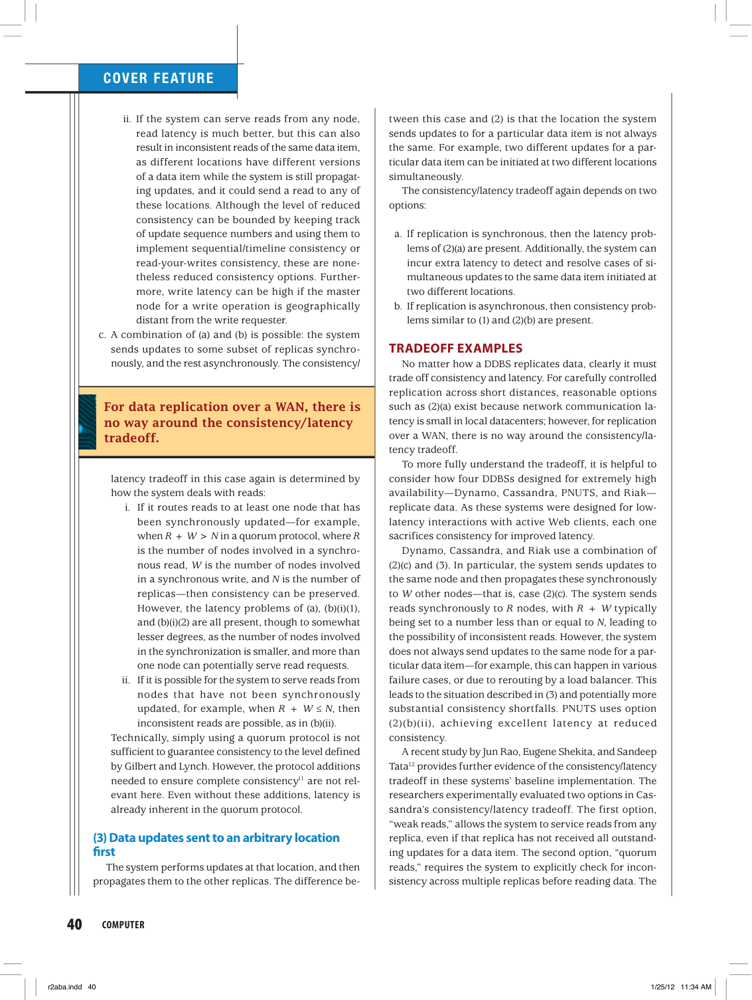
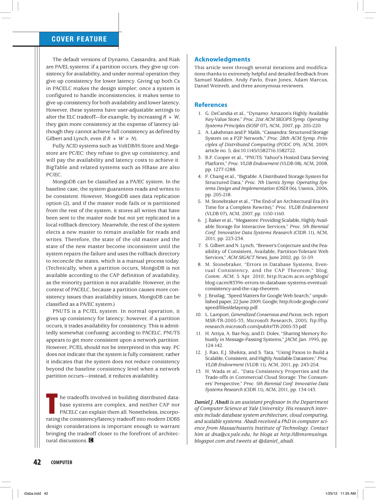

> 本组第 36 篇 · 分布式一致性 · [全部论文]() · [上一篇]() · [下一篇]()

本文最有用的贡献是纠正一种解释习惯：系统在没有分区时仍使用较弱一致性，并不能只归因于CAP；为未来故障准备的复制，本身就把网络距离、读写路由、确认与一致性放进正常路径。PACELC把分区时的可用性/一致性与正常时的延迟/一致性并列讨论。

它是设计分析框架，不是新协议、量化性能定理或独立基准。读者尤其要保留三条原文限定：C指线性一致而非ACID业务约束；quorum交集并不单独证明线性一致；历史产品标签甚至带有作者明示的非严格分类例外。

本文保留论文陈述、读者推断与待验证方案的区别；实验数字只适用于原文条件。原文和翻译来自已有 AI 辅助精读报告，已做来源匹配与编辑复核，不等于人工逐项核验或独立实验复现。所有页码均为 PDF 物理页。

## 论文与阅读范围

Daniel J. Abadi. Consistency Tradeoffs in Modern Distributed Database System Design. Computer, February 2012, pp.37-42. 本地PDF共6页；下文用物理页码，印刷页=物理页+36。

[论文集中的原始 PDF](https://github.com/lonng/db-papers/blob/4ff1331069c7cf52ac97dd769e5f484c1c35c200/papers/consistency/consistency-tradeoffs-in-modern-distributed-database-system-design.pdf) · 本地来源：`consistency/consistency-tradeoffs-in-modern-distributed-database-system-design.pdf`，共 6 页。

本篇保留 23 组原文精读和 27 条证据。截图为原始 PDF 的局部页选，不是重新生成的图表；未将整份 PDF 复制到博客。

## 研究问题与适用边界

**正常运行为什么也降低一致性？**
作者讨论的是交互式Web服务需要可扩展吞吐与低响应延迟的背景。CAP约束发生网络分区的情形，不强迫一个健康系统也降低一致性；“要容忍分区”与“此刻确有分区”必须区分。正常状态不受CAP排除，不意味着没有别的成本或物理约束。

这里C沿用被引证明的原子/线性一致含义，而非ACID中应用不变量保持的C。作者把超出典型请求超时的服务也视为不可用，是为了讨论延迟连续谱的工程约定，不是重写形式化CAP的可用性定义。

依据：论文陈述；PDF 物理页 2。证据：[PAC01](#evidence-pac01), [PAC02](#evidence-pac02), [PAC03](#evidence-pac03)。

## 系统架构与 PACELC 模型

**把复制的请求路径画出来**
全文分三类入口：更新同时到所有副本；先到约定主节点；先到任意节点。每类还要拆开操作排序、传播确认和读路由。入口相同并不决定语义相同，异步也不自动意味着每种读都陈旧。

主节点异步复制而所有读仍经主节点时，本文认为可避免相应的读一致性降低；代价是远端客户端必须绕到主、主过载无法就近分流、主失效时可能等待。相反，允许落后副本立即响应读，会把传播间隔暴露给客户端。同步到部分副本再异步传播其余副本也是一个独立设计点，不能把同步复制一律解释为等待全部副本。

**读者路径例子：同一复制方式，两种读策略**
设A为某键的主节点，B为异地副本，客户端乙靠近B。A先确认写v2、B尚持有v1。若乙可直接读B，它可能很快得到v1；若规则要求乙到A读取，它会承担远程路径，却不能再用“B尚旧”直接断言这次主读也返回旧值。这个例子只说明读路由为何必须单列，未规定主节点失效后的恢复行为，也未给出毫秒数。

把异步改成等待一部分节点确认，还要说明客户端实际等谁、读会接触谁、如何选择版本。不能用“同步/异步”两个词替代全部协议描述。

依据：论文陈述；PDF 物理页 3, 4。证据：[PAC04](#evidence-pac04), [PAC05](#evidence-pac05), [PAC06](#evidence-pac06)。

*原论文 PDF 物理页 4，版权归原作者或出版方。点击图片可查看原尺寸。这是页面定位信息，不表示本次已复核图内所有数据。*

## 复制协议与一致性控制机制

**一个可执行的阅读顺序，而不是新算法**
第一步，固定对象和操作语义：单键线性一致、会话读己之写与多键事务不能混用。第二步，画健康时写入、确认、读取各经过哪些节点，识别距离、往返、排序与排队。第三步，切断指定链路，逐侧询问哪些读写仍接受、哪些拒绝，以及恢复后怎样处理分歧。

R+W>N只告诉我们读写集合相交。作者在第4页和第6页均警告，单有quorum不足以获得Gilbert/Lynch定义的完整C；并发操作、版本选择与协议附加阶段并不会由这个不等式自动补出。N=3、R=W=2可以说明交集，但不是一份完整线性一致寄存器算法。

上述检查流程是读者整理的分析步骤，非本文发布的程序，也未实际运行。

依据：读者推断；PDF 物理页 4, 5, 6。证据：[PAC06](#evidence-pac06), [PAC09](#evidence-pac09), [PAC10](#evidence-pac10)。

## 正确性定义与理论边界

**不能从框架标签反推协议证明**
PACELC把两种运行条件下的主要取舍写成PA/EL、PC/EC等标签，但本文没有构造状态机并证明一个新系统的安全性或活性。要证明某实现线性一致，需要回到完整协议与故障假设，不能引用标签代替。

PNUTS的PC/EL尤其容易误读。作者解释PC是分区时不进一步降低基线一致性，而宁可降低可用性；并不表示它在分区后从弱一致自动变成完全线性一致。

第6页MongoDB的PA/EC又是不同的边界：作者明确承认少数分区不可用，因此不满足严格CAP可用性，只因主要权衡更偏向一致性问题才采用这个标签。报告保留这一自我限定，不把分类便利包装为定理的严格实例。

依据：论文陈述；PDF 物理页 4, 6。证据：[PAC06](#evidence-pac06), [PAC10](#evidence-pac10), [PAC11](#evidence-pac11), [PAC12](#evidence-pac12)。

## 实验证据与工作负载分析

**本文没有自己的完整实验套件**
“延迟可差四倍或更多”接续第4页介绍的Rao等人Cassandra实验，不能记为Abadi在本文自行运行，也不能推广到所有版本或网络。另一项SimpleDB研究中一致读额外延迟不明显，条件是单一US West地域、主节点近且不过载；内部主从结构也被称为研究者推测。

这两个引用展示的是路径和条件，而非彼此矛盾的普遍定律。本文未提供可重跑的硬件配置、完整请求分布、重复次数与尾延迟数据。当前报告没有独立读取其被引论文或复现实验，因此不补造缺失参数，不给出现行产品的速度排序。

依据：论文陈述；PDF 物理页 5。证据：[PAC07](#evidence-pac07), [PAC08](#evidence-pac08)。

*原论文 PDF 物理页 6，版权归原作者或出版方。点击图片可查看原尺寸。这是页面定位信息，不表示本次已复核图内所有数据。*

## 工程权衡与设计决策

**故障可能性在正常路径上收费**
为了故障后仍有数据，系统必须预先复制。故障尚未发生时，同步确认和有序处理就已经消耗网络往返；异步传播可以缩短某些请求路径，但会引入副本新鲜度、故障恢复或路由限制。靠近主节点、短距离复制与较低排队可以让代价很小，框架并没有给所有系统同一个固定延迟下界数值。

作者强调分区时的A/C与健康时的L/C，不代表除此以外没有事务范围、持久性、成本、可运维性等取舍。标签相同的两个系统仍可能有完全不同的请求路径和恢复策略。

**延迟不是单一常数**
传播距离、额外路由、顺序协商与过载排队是不同来源。减少参与节点数可能改变等待路径，也可能改变可接受的故障集合；把副本放得更近可能降低网络成本，却不能由此推出同样的灾难隔离能力。本文的分类是提醒逐项提问，而非提供可以不经测量代入的统一性能公式。

依据：论文陈述；PDF 物理页 3, 5, 6。证据：[PAC04](#evidence-pac04), [PAC05](#evidence-pac05), [PAC08](#evidence-pac08), [PAC13](#evidence-pac13)。

## 与现代数据库系统的联系及对比

**按历史讨论比较，不当成今天的选型表**
第6页把当时默认Dynamo、Cassandra、Riak归为PA/EL，把VoltDB/H-Store、Megastore、BigTable/HBase归为PC/EC，并用MongoDB与PNUTS展示两个混合类别。这些是作者对原始或默认设计的归纳，版本、读写选项与故障场景变化后需要重新检查。

对数据库内核工程师，更实用的对比表应列出：确认写在哪些节点持久化；读从何处、依据何版本返回；主节点隔离时两侧如何处理读写；恢复如何排除或合并冲突。现代产品能力与源码实现不在本次核查范围，不能用这篇2012文章替代核查。

依据：读者推断；PDF 物理页 2, 5, 6。证据：[PAC01](#evidence-pac01), [PAC09](#evidence-pac09), [PAC10](#evidence-pac10), [PAC11](#evidence-pac11), [PAC12](#evidence-pac12)。

## 复现指南与验证方法

**建议的机制实验，未运行**
先实现或选取一个明确版本的三副本对象服务，定义写完成与读返回的历史记录。分别控制近端/远端读、主读/任意副本读、确认副本数与网络延迟；记录中位与尾延迟、吞吐、超时和观察到的陈旧历史，而非只测平均延迟。

再隔离主节点，逐侧区分读可用与写可用，明确失败检测与恢复时间。线性一致检查应使用完整并发历史及可靠检查器，不用R+W>N代替。最后把健康路径与故障路径分开解释；不预设四倍结果，也不把读者实验当成本文原有数据。

依据：待验证的工程设想；PDF 物理页 2, 4, 5, 6。证据：[PAC03](#evidence-pac03), [PAC06](#evidence-pac06), [PAC07](#evidence-pac07), [PAC09](#evidence-pac09), [PAC11](#evidence-pac11)。

## 结论与内核工程启示

本文应被当成一份请求路径分析指南：没有分区，不代表复制无需付出距离与协调代价；分区发生，也必须明确是哪类请求、哪侧节点以及哪种一致性承诺受影响。PACELC的价值是把两组问题同时摆到架构讨论中，而不是把复杂协议压缩为一个足以证明正确性的标签。

本次增加13段原文精读并重写报告关键论证，保留原接口引文及来源。已核对的只是本地6页文章和其中限定，不包括被引实验、当前产品或真正的分布式复现。

依据：读者推断；PDF 物理页 4, 5, 6。证据：[PAC06](#evidence-pac06), [PAC09](#evidence-pac09), [PAC11](#evidence-pac11), [PAC12](#evidence-pac12), [PAC13](#evidence-pac13)。

## 原文精读：从句子回到机制

以下保留原文、忠实翻译、含义与边界；假设示例不作为论文实验结果。

### P001 · PDF 物理页 1

**原文**

<blockquote class="paper-source-quote"><pre><code>However, since its &#10;initial formal proof,7 CAP has become increasingly mis-&#10;understood and misapplied, potentially causing significant &#10;harm. In particular, many designers incorrectly conclude &#10;that the theorem imposes certain restrictions on a DDBS &#10;during normal system operation, and therefore imple-&#10;ment an unnecessarily limited system. In reality, CAP only &#10;posits limitations in the face of certain types of failures, &#10;and does not constrain any system capabilities during &#10;normal operation.</code></pre></blockquote>

**忠实翻译**

> 然而，自其最初的形式化证明以来，CAP 被越来越多地误解和误用，可能造成重大危害。特别是，许多设计者错误地得出结论，认为该定理在正常系统运行期间对 DDBS（分布式数据库系统）施加了某些限制，因此实现了一个不必要地受限的系统。实际上，CAP 仅在面对某些类型的故障时提出限制，并不在正常操作期间约束任何系统能力。

**技术含义与边界**

> 作者纠正用CAP解释一切常态弱一致的做法。CAP不在无分区时施加那项不可兼得限制；这不排除同步复制的延迟、资源或其他故障约束，也不证明某具体实现无需成本即可全ACID且高可用。

**常见误读**

> 容易发生的错误解读是认为 CAP 定理要求系统在任何时候都必须在一致性和可用性之间做取舍。原文不支持这种泛化，因为原文明确限定 CAP 的限制仅在“面对某些类型的故障时”生效，不约束正常操作期间的系统能力。

**读者构造的假设示例**

> 读者构造的假设示例：一个电商系统的购物车服务在无网络分区的正常运行期间，设计者因误读 CAP 而选择最终一致性模型，导致用户看到过期的购物车数据；但根据原文，CAP 并未要求在无故障时放弃强一致性。

### P002 · PDF 物理页 6

**原文**

<blockquote class="paper-source-quote"><pre><code>Fully ACID systems such as VoltDB/H-Store and Mega-&#10;store are PC/EC: they refuse to give up consistency, and &#10;will pay the availability and latency costs to achieve it. &#10;BigTable and related systems such as HBase are also &#10;PC/EC.&#10;MongoDB can be classified as a PA/EC system. In the &#10;baseline case, the system guarantees reads and writes to &#10;be consistent. However, MongoDB uses data replication &#10;option (2), and if the master node fails or is partitioned &#10;from the rest of the system, it stores all writes that have &#10;been sent to the master node but not yet replicated in a &#10;local rollback directory.</code></pre></blockquote>

**忠实翻译**

> 完全 ACID 的系统如 VoltDB/H-Store 和 Megastore 属于 PC/EC：它们拒绝放弃一致性，并愿意付出可用性和延迟的代价来实现它。BigTable 及相关系统如 HBase 也是 PC/EC。
> MongoDB 可以被归类为 PA/EC 系统。在基线情况下，该系统保证读写是一致的。然而，MongoDB 使用数据复制选项 (2)，如果主节点发生故障或与系统其余部分被分区隔离，它会将所有已发送到主节点但尚未复制的写入存储在一个本地回滚目录中。

**技术含义与边界**

> 作者陈述：VoltDB、Megastore、BigTable、HBase 被分类为优先保证一致性（PC/EC）的系统；MongoDB 被分类为 PA/EC 系统，并在主节点故障或分区时使用本地回滚目录处理未复制的写入。读者推断：PC/EC 和 PA/EC 是作者用于描述系统在一致性与可用性权衡中立场的分类标签。MongoDB 的回滚机制意味着在主节点故障时可能丢失未复制的写入。

**常见误读**

> 这是2012文章对当时设计的分类，不是现行MongoDB行为核查。第6页紧接着承认少数分区不可用，PA/EC不是严格CAP可用性的证明。回滚描述也不意味着断电瞬间必能执行写目录操作。

**读者构造的假设示例**

> 读者例：原主和新主拥有不同写入历史时，需要单独问哪一侧还能服务、哪些确认写进入新历史，不能凭标签直接推导。

### P003 · PDF 物理页 3

**原文**

<blockquote class="paper-source-quote"><pre><code>39&#10;FEBRUARY 2012&#10;data replication during normal system operation. (Note the &#10;important difference between this tradeoff and the CAP &#10;tradeoffs: while the occurrence of a failure causes the CAP &#10;tradeoffs, the failure possibility itself results in this tradeoff.)&#10;To achieve the highest possible levels of availability, a &#10;DDBS must replicate data over a WAN to protect against &#10;the failure of an entire datacenter due, for example, to a &#10;hurricane, terrorist attack, or, as in the famous April 2011 &#10;Amazon EC2 cloud outage, a single network configuration &#10;error.</code></pre></blockquote>

**忠实翻译**

> ……正常系统操作期间的数据复制。（注意这一权衡与 CAP 权衡之间的重要区别：虽然故障的发生引发了 CAP 权衡，但故障的可能性本身导致了这一权衡。）
> 为了实现尽可能高的可用性水平，DDBS 必须通过 WAN（广域网）复制数据，以防范整个数据中心发生故障，例如由于飓风、恐怖袭击，或者如著名的 2011 年 4 月 Amazon EC2 云宕机事件中那样，由单个网络配置错误引起。

**技术含义与边界**

> 作者陈述：区分了两种权衡的触发条件——CAP 权衡由“故障的发生”引发，而此处讨论的数据复制权衡由“故障的可能性”引发。为了达到最高可用性，必须跨 WAN 进行数据复制以应对数据中心级别的灾难。读者推断：即使系统当前没有发生故障，为了预防潜在的灾难（如自然灾害或配置错误），系统设计者也必须在跨 WAN 复制带来的延迟/一致性成本与可用性之间做出权衡。

**常见误读**

> 容易发生的错误解读是将“故障可能性导致的权衡”与“CAP 权衡”混为一谈。原文不支持这种混淆，因为作者特意用括号强调了两者的重要区别：前者是常态下的架构设计决策，后者是故障发生时的理论限制。不能把局部结果泛化为全局保证，即跨 WAN 复制能防范特定数据中心故障，但不代表能防范所有类型的网络分区。

**读者构造的假设示例**

> 读者构造的假设示例：假设某银行系统为了防止单一机房被飓风摧毁，选择在相距千里的两个数据中心通过 WAN 同步数据。即使当前没有飓风（无实际故障），这种基于“故障可能性”的设计也会引入跨 WAN 的同步延迟，这就是原文所述的权衡。

### P004 · PDF 物理页 2

**原文**

<blockquote class="paper-source-quote"><pre><code>CONSISTENCY/LATENCY TRADEOFF&#10;To understand modern DDBS design, it is important &#10;to realize the context in which these systems were built. &#10;Amazon originally designed Dynamo to serve data to the &#10;core services in its e-commerce platform (for example, the &#10;shopping cart). Facebook constructed Cassandra to power &#10;its Inbox Search feature. LinkedIn created Voldemort to &#10;handle online updates from various write-intensive fea-&#10;tures on its website.</code></pre></blockquote>

**忠实翻译**

> 一致性/延迟权衡
> 要理解现代 DDBS 设计，重要的是要认识到这些系统构建的背景。Amazon 最初设计 Dynamo 是为了向其电子商务平台的核心服务（例如购物车）提供数据。Facebook 构建 Cassandra 是为了支持其收件箱搜索功能。LinkedIn 创建 Voldemort 是为了处理其网站上各种写密集型功能的在线更新。

**技术含义与边界**

> 这段列举了具体业务来源，解释作者为何强调在线延迟；它不证明这些系统不能用于通用场景，也不是作者做过所有业务系统的源码审计。

**常见误读**

> 容易发生的错误解读是认为这些系统在设计之初就是为了验证某种理论模型。原文不支持此推断，原文明确指出它们是“为其核心服务/功能提供数据”而构建的，工程需求先于理论抽象。此外，不能将这三个系统的背景泛化为所有 DDBS 的设计动机。

**读者构造的假设示例**

> 读者构造的假设示例：假设一个社交网络需要支持海量用户的动态发布（类似 LinkedIn 的写密集型场景），设计者可能会参考 Voldemort 的思路，优先保证写入的低延迟和高可用性，而在读取时容忍短暂的不一致。

### P005 · PDF 物理页 4

**原文**

<blockquote class="paper-source-quote"><pre><code>This &#10;leads to the situation described in (3) and potentially more &#10;substantial consistency shortfalls. PNUTS uses option &#10;(2)(b)(ii), achieving excellent latency at reduced &#10;consistency. &#10;A recent study by Jun Rao, Eugene Shekita, and Sandeep &#10;Tata12 provides further evidence of the consistency/latency &#10;tradeoff in these systems’ baseline implementation. The &#10;researchers experimentally evaluated two options in Cas-&#10;sandra’s consistency/latency tradeoff.</code></pre></blockquote>

**忠实翻译**

> 这导致了 (3) 中描述的情况以及潜在更实质性的一致性不足。PNUTS 使用选项 (2)(b)(ii)，以降低的一致性换取了极佳的延迟。
> Jun Rao、Eugene Shekita 和 Sandeep Tata 最近的一项研究为这些系统基线实现中的一致性/延迟权衡提供了进一步的证据。研究人员通过实验评估了 Cassandra 一致性/延迟权衡中的两个选项。

**技术含义与边界**

> 结合完整上下文：(2)(b)(ii)是主节点异步复制、可从其他副本读；(3)是任意入口更新。被引Cassandra实验对比弱读与quorum读，不是本文自己测量。

**常见误读**

> 容易发生的错误解读是认为该研究证明了所有 NoSQL 系统都存在相同程度的一致性/延迟权衡。原文不支持这种泛化，因为原文明确限定了该研究评估的是“Cassandra 的一致性/延迟权衡中的两个选项”，且针对的是“这些系统的基线实现”。

**读者构造的假设示例**

> 读者例：比较任意一个副本读与向多个副本检查后读，会改变往返与版本选择；本例不把“写3个副本对写1个”误称为原文的那项读实验。

### P006 · PDF 物理页 5

**原文**

<blockquote class="paper-source-quote"><pre><code>Ignoring the consistency/latency &#10;tradeoff of replicated systems is a  &#10;major oversight, as it is present at all &#10;times during system operation.&#10;41&#10;FEBRUARY 2012&#10;second option clearly increases consistency at the cost of &#10;additional latency relative to the first option.</code></pre></blockquote>

**忠实翻译**

> 忽视复制系统的一致性/延迟权衡是一个重大的疏忽，因为它在系统运行的所有时间都存在。
> 第二个选项相对于第一个选项，显然以增加延迟为代价提高了一致性。

**技术含义与边界**

> 该摘录把页顶强调句与正文续句连在一起。第二个选项指前页Cassandra的quorum读，不是任意同步复制协议。持续存在的是需要面对的设计取舍，不是每次请求都有相同可见延迟差。

**常见误读**

> 容易发生的错误解读是认为一致性/延迟权衡只在网络拥塞或系统负载高时才出现。原文不支持此观点，因为原文明确强调该权衡“在系统运行的所有时间都存在”（present at all times during system operation）。

**读者构造的假设示例**

> 读者例：跨地域确认可能暴露额外往返；同地域低负载时差异也可能很小，不能据此预设固定四倍或每次相同增量。

### P007 · PDF 物理页 2

**原文**

<blockquote class="paper-source-quote"><pre><code>ency, availability, and latency. (Note that availability &#10;and latency are arguably the same thing: an unavailable &#10;system essentially provides extremely high latency. For pur-&#10;poses of this discussion</code></pre></blockquote>

**忠实翻译**

> ……一致性、可用性和延迟。（请注意，可用性和延迟可以说是同一回事：一个不可用的系统本质上提供了极高的延迟。为了本次讨论的目的……

**技术含义与边界**

> 完整后文用典型请求超时区分不可用与高延迟，并最终用低延迟需求覆盖两者。这是本文分析约定，不是形式化CAP可用性与有限超时在数学上等价。

**常见误读**

> 容易发生的错误解读是认为作者主张在工程中完全不需要区分可用性和延迟。原文不支持此结论，因为作者使用了“可以说是同一回事”（arguably the same thing）和“为了本次讨论的目的”这样的限定词，表明这是一种为了特定分析框架而做的概念简化，而非绝对的工程等价。

**读者构造的假设示例**

> 读者构造的假设示例：假设一个 Web 服务设置了 30 秒超时，如果某个请求因为底层存储故障卡住了 31 秒才报错，对客户端而言这与系统暂时“不可用”的体验是一致的，即表现为“极高的延迟”。

### P008 · PDF 物理页 3

**原文**

<blockquote class="paper-source-quote"><pre><code>(2) Data updates sent to an agreed-upon  &#10;location first&#10;I will refer to this agreed-upon location as a “master &#10;node” (different data items can have different master &#10;nodes). This master node resolves all requests to update &#10;the data item, and the order that it chooses to perform &#10;these updates determines the order in which all replicas &#10;perform the updates.</code></pre></blockquote>

**忠实翻译**

> (2) 数据更新首先发送到一个约定的位置
> 我将这个约定的位置称为“主节点”（不同的数据项可以有不同的主节点）。该主节点解析所有更新该数据项的请求，并且它选择执行这些更新的顺序决定了所有副本执行更新的顺序。

**技术含义与边界**

> 主节点为某一数据项决定更新顺序；不同项可以有不同主。这里不是多节点同时作为同一项写主，也没有规定跨所有键的全局事务顺序。

**常见误读**

> 容易发生的错误解读是认为整个系统只有一个全局主节点。原文不支持此推断，因为原文明确加了括号限定：“不同的数据项可以有不同的主节点”。此外，不能将此局部机制泛化为全局保证，即主节点解决了更新顺序问题，但原文未说明主节点自身故障时的处理逻辑。

**读者构造的假设示例**

> 读者例：user:1先到A、user:2先到B；A为前者排序、B为后者排序，不自动生成两键操作间的全局先后。

### P009 · PDF 物理页 6

**原文**

<blockquote class="paper-source-quote"><pre><code>Acknowledgments&#10;This article went through several iterations and modifica-&#10;tions thanks to extremely helpful and detailed feedback from &#10;Samuel Madden, Andy Pavlo, Evan Jones, Adam Marcus, &#10;Daniel Weinreb, and three anonymous reviewers.&#10;References &#10;	 1.	 G. DeCandia et al., “Dynamo: Amazon’s Highly Available &#10;Key-Value Store,” Proc. 21st ACM SIGOPS Symp. Operating &#10;Systems Principles (SOSP 07), ACM, 2007, pp. 205-220.&#10;	 2.	 A. Lakshman and P. Malik, “Cassandra: Structured Storage &#10;System on a P2P Network,” Proc.</code></pre></blockquote>

**忠实翻译**

> 致谢
> 感谢 Samuel Madden、Andy Pavlo、Evan Jones、Adam Marcus、Daniel Weinreb 以及三位匿名评审人提供的极其有用和详细的反馈，本文经过了多次迭代和修改。
> 参考文献
> 1. G. DeCandia 等人，“Dynamo: Amazon's Highly Available Key-Value Store,” Proc. 21st ACM SIGOPS Symp. Operating Systems Principles (SOSP 07), ACM, 2007, pp. 205-220.
> 2. A. Lakshman 和 P. Malik, “Cassandra: Structured Storage System on a P2P Network,” Proc.

**技术含义与边界**

> 致谢与书目有助追索论证来源，但不是被列人员对全部结论的背书，更不是已经阅读所有被引论文的证据。

**常见误读**

> 不能根据引用了一篇论文，就把该论文的每个结论和实验都算作本文亲自证明或复现。被引资料尚未在本报告中独立核查。

**读者构造的假设示例**

> 读者构造的假设示例：假设一名读者想深入了解文中提到的 Dynamo 架构细节，可以通过参考文献 1 找到 SOSP 2007 的原始论文进行扩展阅读，但这属于读者的自主行为，不代表本文直接包含了该论文的内容。

### P010 · PDF 物理页 4

**原文**

<blockquote class="paper-source-quote"><pre><code>Although the level of reduced &#10;	&#10;	 consistency can be bounded by keeping track &#10;	&#10;	 of update sequence numbers and using them to &#10;	&#10;	 implement sequential/timeline consistency or &#10;	&#10;	 read-your-writes consistency, these are none- &#10;	&#10;	 theless reduced consistency options.</code></pre></blockquote>

**忠实翻译**

> 尽管降低的一致性水平可以通过跟踪更新序列号并使用它们来实现顺序/时间线一致性或读己之所写一致性来进行界定，但这些仍然是降低的一致性选项。

**技术含义与边界**

> 第2页已明确基准为线性一致，不是仅“可能”如此。读己之写、顺序/时间线等是不同保证，不能只因名字较弱就抹去其有用语义，也不能把它们都称为因果一致。

**常见误读**

> 容易发生的错误解读是认为实现了“读己之所写一致性”就等于达到了强一致性，或者认为作者在全盘否定这些一致性模型的价值。原文不支持这种解读，因为作者承认这些机制可以“界定”（bounded）一致性降低的水平，只是坚持在分类上它们仍属于“降低的一致性选项”。不能将局部的界定能力泛化为全局的强一致性保证。

**读者构造的假设示例**

> 读者例：甲发布后总能读到自己的帖子，并不保证乙在甲完成之后开始的读也返回该帖。线性一致约束真实时间先后及操作历史，并不要求所有物理副本任何瞬间都拥有相同内容。

### PACELC-REVIEW-01 · PDF 物理页 2

**原文**

<blockquote class="paper-source-quote"><pre><code>the focus &#10;here is on their original design.)</code></pre></blockquote>

**忠实翻译**

> 这里关注的是它们最初的设计。（摘录从句中开始。）

**技术含义与边界**

> 必须把系统标签限定在作者讨论的原始设计。

**常见误读**

> 不要拿2012文章代替当前版本配置核查。

**读者构造的假设示例**

> 读者例：升级了读写确认策略的系统可能需要重新分类。

### PACELC-REVIEW-02 · PDF 物理页 2

**原文**

<blockquote class="paper-source-quote"><pre><code>It is not merely the partition toler-&#10;ance that necessitates a tradeoff between consistency and &#10;availability; rather, it is the combination of&#10;•• partition tolerance and&#10;•• the existence of a network partition itself.</code></pre></blockquote>

**忠实翻译**

> 迫使我们在一致性与可用性之间作权衡的，不仅是分区容忍；而是分区容忍与网络分区本身的实际存在两者的组合。

**技术含义与边界**

> 容忍分区的目标与分区事件造成的不可兼得不同。

**常见误读**

> 无分区时不被CAP排除，不等于免除延迟或资源约束。

**读者构造的假设示例**

> 读者例：链路健康时仍可能因同步复制等待远端。

### PACELC-REVIEW-03 · PDF 物理页 2

**原文**

<blockquote class="paper-source-quote"><pre><code>For pur-&#10;poses of this discussion, I consider systems with latencies &#10;larger than a typical request timeout, such as a few seconds, &#10;as unavailable,</code></pre></blockquote>

**忠实翻译**

> 为本次讨论起见，我把延迟超过典型请求超时（例如几秒）的系统视为不可用。（摘录在该定义处结束，后文另讨论较低但仍高的延迟。）

**技术含义与边界**

> 作者把超过典型超时的请求当不可用，以便讨论延迟连续谱。

**常见误读**

> 这不是给形式化CAP可用性定义加入几秒截止期限。

**读者构造的假设示例**

> 读者例：超时阈值500ms改为5s会改变工程成功率，不改变定理。

### PACELC-REVIEW-04 · PDF 物理页 3

**原文**

<blockquote class="paper-source-quote"><pre><code>Note the &#10;important difference between this tradeoff and the CAP &#10;tradeoffs: while the occurrence of a failure causes the CAP &#10;tradeoffs, the failure possibility itself results in this tradeoff.)</code></pre></blockquote>

**忠实翻译**

> 注意这一权衡与CAP权衡的重要区别：故障的发生引发CAP权衡，而故障的可能性本身就引发此处的权衡。

**技术含义与边界**

> 为了故障之后还读得到，正常运行时就要承担复制成本。

**常见误读**

> 不能等故障发生才复制已经丢失的唯一数据。

**读者构造的假设示例**

> 读者例：双地域复制即使今日无故障也占网络资源。

### PACELC-REVIEW-05 · PDF 物理页 3

**原文**

<blockquote class="paper-source-quote"><pre><code>If the system routes all reads to the master node &#10;	&#10;	 and serves them from there, then there is no reduc- &#10;	&#10;	 tion in consistency.</code></pre></blockquote>

**忠实翻译**

> 如果系统把所有读都路由到主节点并在那里服务，那么就没有一致性的降低。

**技术含义与边界**

> 副本延迟不直接破坏仅由主节点提供的读语义；代价转为主节点路由和故障等待。

**常见误读**

> 不能把异步复制一律等同任意读必旧，也不能省略主故障恢复条件。

**读者构造的假设示例**

> 读者例：近端副本存在，但读仍须跨地域到主节点。

### PACELC-REVIEW-06 · PDF 物理页 4

**原文**

<blockquote class="paper-source-quote"><pre><code>Technically, simply using a quorum protocol is not &#10;sufficient to guarantee consistency to the level defined &#10;by Gilbert and Lynch. However, the protocol additions &#10;needed to ensure complete consistency11 are not rel-&#10;evant here.</code></pre></blockquote>

**忠实翻译**

> 严格说来，只使用quorum协议不足以保证Gilbert与Lynch定义的那种一致性。不过，确保完整一致性所需的协议补充与这里的讨论无关。

**技术含义与边界**

> 作者明确省略达到完整线性一致还需的协议附加机制。

**常见误读**

> R+W>N保证集合相交，不独自解决并发版本排序、故障或读修复语义。

**读者构造的假设示例**

> 读者例：N=3,R=W=2说明交集非空，尚不是一个完整寄存器协议。

### PACELC-REVIEW-07 · PDF 物理页 5

**原文**

<blockquote class="paper-source-quote"><pre><code>The differ-&#10;ence in latency between these two options can be a factor &#10;of four or more.</code></pre></blockquote>

**忠实翻译**

> 这两个选项的延迟差异可以达到四倍或更多。

**技术含义与边界**

> 这句接续前页对他人Cassandra实验的介绍，不是本文自行测出的基准。

**常见误读**

> 不能说所有当前quorum读必比弱读慢四倍。

**读者构造的假设示例**

> 读者例：报告数字必须一起注明版本、网络与读选项。

### PACELC-REVIEW-08 · PDF 物理页 5

**原文**

<blockquote class="paper-source-quote"><pre><code>However, the researchers per-&#10;formed these experiments in a single Amazon region (US &#10;West), and they speculate that SimpleDB uses master-slave &#10;replication, which is possible to implement with a modest &#10;latency cost if the replication occurs over a short dis-&#10;tance.</code></pre></blockquote>

**忠实翻译**

> 不过，研究者在单一Amazon地域（US West）进行了这些实验；他们推测SimpleDB使用主从复制，如果复制距离很短，这种方式可以用较小的延迟代价实现。

**技术含义与边界**

> 同地域、主节点近且不过载时，一致读额外延迟可能不明显。

**常见误读**

> 推测的内部复制架构不是作者源码审计，局部结果不否定广域代价。

**读者构造的假设示例**

> 读者例：把客户端移到远地域，才会暴露不同路由距离。

### PACELC-REVIEW-09 · PDF 物理页 5

**原文**

<blockquote class="paper-source-quote"><pre><code>if there is a &#10;partition (P), how does the system trade off availability and &#10;consistency (A and C); else (E), when the system is running &#10;normally in the absence of partitions, how does the system &#10;trade off latency (L) and consistency (C)?</code></pre></blockquote>

**忠实翻译**

> 如果存在分区P，系统如何在可用性A与一致性C之间权衡；否则E，在没有分区的正常运行期间，系统如何在延迟L与一致性C之间权衡？

**技术含义与边界**

> P时问A/C，Else正常运行时问L/C；这是一组设计问题。

**常见误读**

> 不是选两个字母就获得完整协议或量化性能模型。

**读者构造的假设示例**

> 读者例：先画健康路径，再画隔离主节点路径，分别讨论。

### PACELC-REVIEW-10 · PDF 物理页 6

**原文**

<blockquote class="paper-source-quote"><pre><code>though they cannot achieve full consistency as defined by &#10;Gilbert and Lynch, even if R + W &gt; N).</code></pre></blockquote>

**忠实翻译**

> 即使R+W>N，它们也无法达到Gilbert与Lynch定义的完全一致性。（摘录保留原文本层断词后的句段。）

**技术含义与边界**

> 第6页重申调大读写副本数不等于自动达到形式化C。

**常见误读**

> 不要在优化建议中把数字配置当成语义证明。

**读者构造的假设示例**

> 读者例：需要检查写序、读阶段和恢复规则，而不只检查交集。

### PACELC-REVIEW-11 · PDF 物理页 6

**原文**

<blockquote class="paper-source-quote"><pre><code>Technically, when a partition occurs, MongoDB is not &#10;available according to the CAP definition of availability, &#10;as the minority partition is not available. However, in the &#10;context of PACELC, because a partition causes more con-&#10;sistency issues than availability issues, MongoDB can be &#10;classified as a PA/EC system.)</code></pre></blockquote>

**忠实翻译**

> 严格说来，分区发生时，MongoDB并不满足CAP所定义的可用性，因为少数分区不可用。但是在PACELC语境里，由于分区引起的一致性问题多于可用性问题，MongoDB可以归为PA/EC。

**技术含义与边界**

> 作者承认少数分区不可用，形式化CAP的A并未满足，却仍按主要权衡赋PA/EC标签。

**常见误读**

> 这是框架分类的松弛，不能隐去括号说明再当严格定理实例。

**读者构造的假设示例**

> 读者例：可用性应按哪一侧、哪类读写请求分别列出。

### PACELC-REVIEW-12 · PDF 物理页 6

**原文**

<blockquote class="paper-source-quote"><pre><code>does not indicate that the system is fully consistent; rather &#10;it indicates that the system does not reduce consistency &#10;beyond the baseline consistency level when a network &#10;partition occurs—instead, it reduces availability.</code></pre></blockquote>

**忠实翻译**

> 这并不表示系统完全一致；它表示网络分区时，系统不把一致性降低到基线水平以下，而改为降低可用性。（句首主语PC见原文前句。）

**技术含义与边界**

> 对PNUTS，PC表示分区时不进一步降低基线一致性，而转而降低可用性。

**常见误读**

> 不能说网络一断，原本较弱的一致性自动升级。

**读者构造的假设示例**

> 读者例：主节点隔离时拒绝更新，是守住原有单主顺序，而非补齐所有读语义。

### PACELC-REVIEW-13 · PDF 物理页 6

**原文**

<blockquote class="paper-source-quote"><pre><code>tradeoffs involved in building distributed data-&#10;base systems are complex, and neither CAP nor &#10;PACELC can explain them all.</code></pre></blockquote>

**忠实翻译**

> 构建分布式数据库系统涉及的权衡很复杂，CAP与PACELC都不能解释全部权衡。

**技术含义与边界**

> 作者承认两个框架都不能覆盖全部系统权衡。

**常见误读**

> 不要把PACELC当成事务隔离、持久性、安全和成本的完整评估表。

**读者构造的假设示例**

> 读者例：相同PC/EC标签的实现仍可能有完全不同的吞吐、恢复时间与事务范围。

## 尚未解决的问题

1. 在 RDMA 和 CXL 等新型高速互联技术普及的云原生环境下，ELC 轴上的延迟差距是否已被压缩到可以忽略不计，从而使 EC 成为所有场景的默认选择？
2. PACELC 模型能否形式化地扩展到支持多租户隔离和 Serverless 弹性伸缩场景？在这些场景中，资源争抢导致的延迟抖动如何影响一致性保证？
3. 对于 HTAP（混合事务/分析处理）系统，事务负载和分析负载对 PACELC 两个轴的诉求往往相反，内核如何在同一套存储引擎中动态调整权衡策略？
4. 论文指出 Quorum 协议不足以保证完全一致性，那么在现代基于 Multi-Raft 或 Paxos 的系统中，共识协议本身的 Leader 选举延迟如何量化并纳入 ELC 模型？
5. 将可用性等同于极端延迟的理论假设，在涉及金融交易等具有硬性超时回滚要求的系统中，是否会导致错误的架构决策？

## 证据索引

证据编号沿用原报告，便于将上文判断追溯到原句。引文匹配只验证位置，不证明解读正确。

**C001N01 · PDF 物理页 1**

作者指出CAP定理被广泛误解和误用：许多设计者错误地认为CAP在系统正常运行期间也施加限制，从而实现了不必要的受限系统。实际上CAP仅在特定类型的故障（网络分区）发生时才要求系统在可用性和一致性之间做出选择，不约束正常操作期间的系统能力。这一误解导致设计者在无分区时也放弃强一致性。

<blockquote class="paper-source-quote"><pre><code>many designers incorrectly conclude that the theorem imposes certain restrictions on a DDBS during normal system operation</code></pre></blockquote>

**C001N03 · PDF 物理页 3**

作者提出一个关键区分：CAP中的权衡是由网络分区的实际发生引起的，而一致性与延迟的权衡是由故障的可能性（possibility of failure）本身引起的。为了满足高可用性要求，系统必须在正常运行期间进行数据复制以防范未来可能的组件故障；而一旦进行数据复制，一致性与延迟的权衡就不可避免地出现，这与是否存在网络分区无关。

<blockquote class="paper-source-quote"><pre><code>while the occurrence of a failure causes the CAP tradeoffs, the failure possibility itself results in this tradeoff</code></pre></blockquote>

**C001N05 · PDF 物理页 3**

第二类复制策略是先发送到约定的主节点（master node），由主节点决定更新顺序再复制到其他副本。同步复制保证一致性但增加WAN延迟；异步复制下，若读请求全部路由到主节点则保持一致性但面临距离远和负载不均导致的延迟问题，若允许从任意节点读取则降低延迟但可能读到不一致的数据版本。

<blockquote class="paper-source-quote"><pre><code>I will refer to this agreed-upon location as a “master node” (different data items can have different master nodes).</code></pre></blockquote>

**C001N07 · PDF 物理页 4**

对于第二类(b)异步复制且允许从任意节点读取的情况，可以通过跟踪更新序列号来实现sequential/timeline consistency或read-your-writes consistency来界定一致性降低的程度，但这些仍然是降低了一致性的选项。此外，如果写操作的主节点在地理上远离写入请求者，写延迟也会很高。

<blockquote class="paper-source-quote"><pre><code>the level of reduced consistency can be bounded by keeping track of update sequence numbers and using them to implement sequential/timeline consistency</code></pre></blockquote>

**C001N08 · PDF 物理页 4**

在第二类(c)混合复制策略中，使用Quorum协议（R+W>N）可以保证一致性，但仍存在延迟问题，只是程度较轻，因为参与同步的节点数较少且多个节点可提供读服务。若R+W≤N，则可能出现不一致读取。作者特别指出，技术上仅使用Quorum协议不足以保证Gilbert和Lynch定义的完全一致性，需要额外的协议补充。

<blockquote class="paper-source-quote"><pre><code>Technically, simply using a quorum protocol is not sufficient to guarantee consistency to the level defined by Gilbert and Lynch.</code></pre></blockquote>

**C001N09 · PDF 物理页 4**

文章引用了Jun Rao等人的研究作为一致性/延迟权衡的实验证据。该研究在Cassandra中评估了两种选项：'weak reads'允许从任何副本提供读取服务（即使未收到所有待处理更新），'quorum reads'要求在读取前显式检查多个副本间的不一致性。这为系统在基线实现中面临的权衡提供了实证支持。

<blockquote class="paper-source-quote"><pre><code>A recent study by Jun Rao, Eugene Shekita, and Sandeep Tata12 provides further evidence of the consistency/latency tradeoff</code></pre></blockquote>

**C001N11 · PDF 物理页 2**

作者在讨论中将可用性和延迟视为本质上相同的事物：不可用的系统实质上提供极高的延迟。为了讨论方便，作者将延迟大于典型请求超时（如几秒）的系统视为不可用，将延迟小于超时但接近数百毫秒的视为'高延迟'。但最终作者放弃了这种区分，让低延迟要求涵盖这两种情况，从而将权衡简化为纯粹的一致性与延迟之间的权衡。

<blockquote class="paper-source-quote"><pre><code>Note that availability and latency are arguably the same thing: an unavailable system essentially provides extremely high latency.</code></pre></blockquote>

**C001N12 · PDF 物理页 2**

文中引用的系统包括SimpleDB/Dynamo/DynamoDB、Cassandra、Voldemort、Sherpa/PNUTS、Riak、HBase/BigTable、MongoDB、VoltDB/H-Store和Megastore。其中Dynamo用于Amazon电商核心服务，Cassandra用于Facebook Inbox Search，Voldemort用于LinkedIn在线更新，PNUTS用于Yahoo用户数据和购物页面，这些用例均要求动态构建网页并接收在线更新，对延迟极度敏感。

<blockquote class="paper-source-quote"><pre><code>Amazon originally designed Dynamo to serve data to the core services in its e-commerce platform (for example, the shopping cart).</code></pre></blockquote>

**C002N01 · PDF 物理页 5**

作者指出忽略复制系统中持续存在的一致性/延迟权衡是一个重大疏漏。CAP 定理仅在发生网络分区时相关，而一致性/延迟权衡在系统正常运行期间始终存在。若数据跨 WAN 复制，该权衡会被放大。因此，基线情况下降低一致性更应归因于运行时延迟，而非 CAP。

<blockquote class="paper-source-quote"><pre><code>Ignoring the consistency/latency tradeoff of replicated systems is a major oversight, as it is present at all times during system operation</code></pre></blockquote>

**C002N02 · PDF 物理页 5**

PNUTS 为每个数据项指定一个 master 节点，更新路由至 master 后异步传播到 WAN 上的副本。读请求可从任意副本服务以降低延迟（牺牲一致性）。但在网络分区导致 master 处于少数分区不可用时，默认配置下该数据项对更新不可用。因此 PNUTS 默认配置实际上是 CP 系统，其基线情况下的弱一致性是为了延迟而非应对分区。

<blockquote class="paper-source-quote"><pre><code>In PNUTS, a master node owns each data item. The system routes updates to that item to the master node</code></pre></blockquote>

**C002N04 · PDF 物理页 5**

PACELC 模型将 CAP 重写为：若发生分区（P），系统如何在可用性（A）与一致性（C）之间权衡；否则（E），系统在无分区的正常运行状态下如何在延迟（L）与一致性（C）之间权衡。延迟/一致性权衡（ELC）仅适用于复制数据的系统。由于可用性问题可视为极端延迟的实例，ELC 中的延迟部分也可涵盖是否选择复制数据的决策。

<blockquote class="paper-source-quote"><pre><code>if there is a partition (P), how does the system trade off availability and consistency (A and C); else (E)</code></pre></blockquote>

**C002N07 · PDF 物理页 6**

MongoDB 被分类为 PA/EC 系统。基线情况下保证读写一致性。它使用主从复制选项，若 master 故障或被分区隔离，已发送至 master 但尚未复制的写入会存储在本地 rollback 目录中。其余节点选举新 master 以保持读写可用。旧 master 与新 master 状态不一致，直到系统修复故障并使用 rollback 目录手动协调状态。作者注明按 CAP 严格定义 MongoDB 在分区时并非完全可用（少数分区不可用），但在 PACELC 语境下分区引发的主要是一致性问题而非可用性问题。

<blockquote class="paper-source-quote"><pre><code>MongoDB can be classified as a PA/EC system. In the baseline case, the system guarantees reads and writes to be consistent.</code></pre></blockquote>

**C002N08 · PDF 物理页 6**

PNUTS 被分类为 PC/EL 系统。正常运行时为降低延迟放弃一致性；分区发生时为保持一致性放弃可用性。作者强调 PC 不表示系统是完全一致的，而是指在网络分区发生时系统不会将一致性降低到基线一致性水平以下，转而降低可用性。

<blockquote class="paper-source-quote"><pre><code>PNUTS is a PC/EL system. In normal operation, it gives up consistency for latency; however, if a partition occurs</code></pre></blockquote>

**C002N10 · PDF 物理页 6**

参考文献列表包含多篇核心分布式系统论文：DeCandia 等人的 Dynamo（SOSP 07）、Lakshman 和 Malik 的 Cassandra（PODC 09）、Cooper 等人的 PNUTS（VLDB 08）、Chang 等人的 BigTable（OSDI 06）、Gilbert 和 Lynch 关于 CAP 的形式化证明（SIGACT News 2002）、Stonebraker 关于 H-Store/VoltDB 的架构时代终结（VLDB 07）、Baker 等人的 Megastore（CIDR 11）、Lamport 的 Generalized Consensus and Paxos（MSR-TR-2005-33）、Attiya 等人的共享内存论文（JACM 1995）、Rao 等人使用 Paxos 构建数据存储（VLDB 11）以及 Wada 等人关于云存储一致性属性的研究（CIDR 11）。

<blockquote class="paper-source-quote"><pre><code>G. DeCandia et al., “Dynamo: Amazon’s Highly Available Key-Value Store,” Proc. 21st ACM SIGOPS Symp.</code></pre></blockquote>

**PAC01 · PDF 物理页 2**

历史版本范围

<blockquote class="paper-source-quote"><pre><code>the focus &#10;here is on their original design.)</code></pre></blockquote>

**PAC02 · PDF 物理页 2**

分区发生而不只是可能性

<blockquote class="paper-source-quote"><pre><code>It is not merely the partition toler-&#10;ance that necessitates a tradeoff between consistency and &#10;availability; rather, it is the combination of&#10;•• partition tolerance and&#10;•• the existence of a network partition itself.</code></pre></blockquote>

**PAC03 · PDF 物理页 2**

作者超时约定

<blockquote class="paper-source-quote"><pre><code>For pur-&#10;poses of this discussion, I consider systems with latencies &#10;larger than a typical request timeout, such as a few seconds, &#10;as unavailable,</code></pre></blockquote>

**PAC04 · PDF 物理页 3**

故障可能性要求预先复制

<blockquote class="paper-source-quote"><pre><code>Note the &#10;important difference between this tradeoff and the CAP &#10;tradeoffs: while the occurrence of a failure causes the CAP &#10;tradeoffs, the failure possibility itself results in this tradeoff.)</code></pre></blockquote>

**PAC05 · PDF 物理页 3**

异步复制但主读

<blockquote class="paper-source-quote"><pre><code>If the system routes all reads to the master node &#10;	&#10;	 and serves them from there, then there is no reduc- &#10;	&#10;	 tion in consistency.</code></pre></blockquote>

**PAC06 · PDF 物理页 4**

quorum不充分

<blockquote class="paper-source-quote"><pre><code>Technically, simply using a quorum protocol is not &#10;sufficient to guarantee consistency to the level defined &#10;by Gilbert and Lynch. However, the protocol additions &#10;needed to ensure complete consistency11 are not rel-&#10;evant here.</code></pre></blockquote>

**PAC07 · PDF 物理页 5**

引用的四倍差异

<blockquote class="paper-source-quote"><pre><code>The differ-&#10;ence in latency between these two options can be a factor &#10;of four or more.</code></pre></blockquote>

**PAC08 · PDF 物理页 5**

SimpleDB近距离条件

<blockquote class="paper-source-quote"><pre><code>However, the researchers per-&#10;formed these experiments in a single Amazon region (US &#10;West), and they speculate that SimpleDB uses master-slave &#10;replication, which is possible to implement with a modest &#10;latency cost if the replication occurs over a short dis-&#10;tance.</code></pre></blockquote>

**PAC09 · PDF 物理页 5**

PACELC两分支

<blockquote class="paper-source-quote"><pre><code>if there is a &#10;partition (P), how does the system trade off availability and &#10;consistency (A and C); else (E), when the system is running &#10;normally in the absence of partitions, how does the system &#10;trade off latency (L) and consistency (C)?</code></pre></blockquote>

**PAC10 · PDF 物理页 6**

再次限定quorum

<blockquote class="paper-source-quote"><pre><code>though they cannot achieve full consistency as defined by &#10;Gilbert and Lynch, even if R + W &gt; N).</code></pre></blockquote>

**PAC11 · PDF 物理页 6**

MongoDB标签例外

<blockquote class="paper-source-quote"><pre><code>Technically, when a partition occurs, MongoDB is not &#10;available according to the CAP definition of availability, &#10;as the minority partition is not available. However, in the &#10;context of PACELC, because a partition causes more con-&#10;sistency issues than availability issues, MongoDB can be &#10;classified as a PA/EC system.)</code></pre></blockquote>

**PAC12 · PDF 物理页 6**

PC不是绝对线性一致

<blockquote class="paper-source-quote"><pre><code>does not indicate that the system is fully consistent; rather &#10;it indicates that the system does not reduce consistency &#10;beyond the baseline consistency level when a network &#10;partition occurs—instead, it reduces availability.</code></pre></blockquote>

**PAC13 · PDF 物理页 6**

框架的自限

<blockquote class="paper-source-quote"><pre><code>tradeoffs involved in building distributed data-&#10;base systems are complex, and neither CAP nor &#10;PACELC can explain them all.</code></pre></blockquote>

## 版本与使用边界

- 原 PDF SHA256：`ecc847f31d99f2bc63297b6b4f7f7f97dedd75f048242e831acebc4e2d2b017c`。
- 报告来源：`qwen3.8-max`；此处按已完成报告整理，没有重新请求模型。
- OCR 记录页：[]；低文本页：[]。
- 本次新增页面截图，未据此自动重写原报告的数值、公式或实验结论；原有“未进行图像识别”限制仍适用于分析生成过程。
- 截图与短引仅服务于论文评论，版权归原作者或出版方；正式发布前复查转载范围和授权。
- 本文保留未核实的书目信息及研究问题，不用现代产品行为替代历史论文的证据。

前序报告保留的书目与阅读过程记录

Daniel J. Abadi. Consistency Tradeoffs in Modern Distributed Database System Design. Computer, February 2012, pp.37-42. 本地PDF共6页；下文用物理页码，印刷页=物理页+36。

API读取完整6页的2个文本块；本次Codex实读物理1-6页，视觉核对4、6页。未独立阅读被引实验或审计现行产品，未运行分布式基准；读者示例仅为解释，不是实测。保留原API模型、用量、证据与摘录，Codex编辑用量未测量，最终仍为AI待复核稿。

