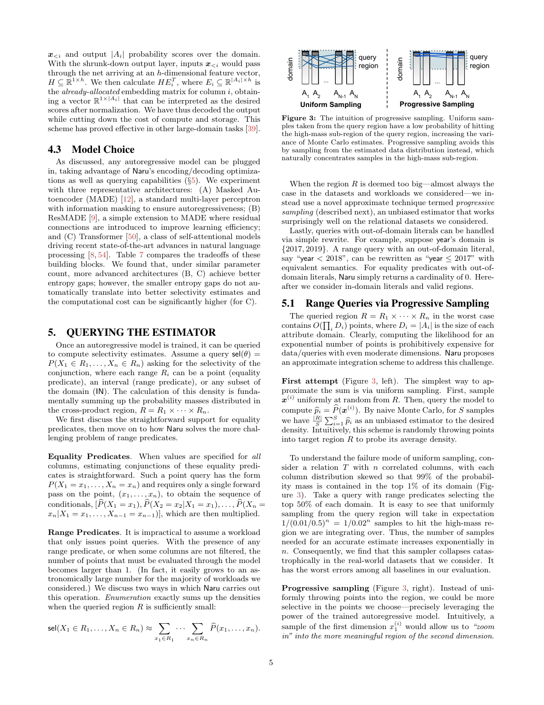
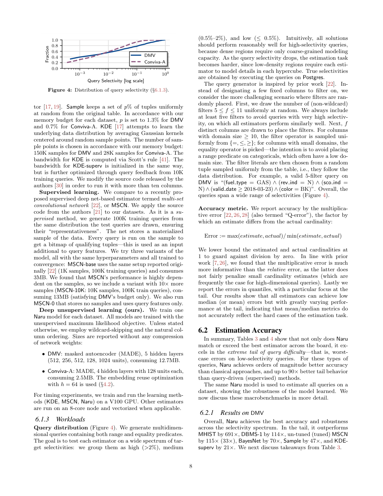

> 本组第 48 篇 · 统计与基数估计 · [全部论文]() · [上一篇]() · [下一篇]()

Naru把表的多重集行频率视为离散联合分布，用精确链式分解配合近似自回归网络按需计算条件概率，再以progressive sampling估计范围区域质量。链式分解不需要列独立性假设，但有限网络拟合与有限路径积分仍分别产生误差；“无偏”不能跨过模型偏差推广到真实表。全部列等值时可一次前向，通配或范围通常需边缘化；专门训练的MASK可减少推理与方差。DMV 2000查询上最大Q-error为8；Conviva-A的1000、2000、4000路径低选择率最大误差分别185、58、4，不能无条件宣传个位数最坏误差。约5–10ms来自V100、且DBMS对照有完整规划计时，不是本机性能或端到端SQL加速保证。

本文保留论文陈述、读者推断与待验证方案的区别；实验数字只适用于原文条件。原文和翻译来自已有 AI 辅助精读报告，已做来源匹配与编辑复核，不等于人工逐项核验或独立实验复现。所有页码均为 PDF 物理页。

## 论文与阅读范围

Zongheng Yang et al. Deep Unsupervised Cardinality Estimation. PVLDB 13(3):279–292, 2019; DOI 10.14778/3368289.3368294. Local arXiv v2, 21 November 2019; 14 physical pages numbered 1–14.

[论文集中的原始 PDF](https://github.com/lonng/db-papers/blob/4ff1331069c7cf52ac97dd769e5f484c1c35c200/papers/probabilistic-counting/deep-unsupervised-cardinality-estimation.pdf) · 本地来源：`probabilistic-counting/deep-unsupervised-cardinality-estimation.pdf`，共 14 页。

本篇保留 30 组原文精读和 47 条证据。截图为原始 PDF 的局部页选，不是重新生成的图表；未将整份 PDF 复制到博客。

## 研究问题与适用边界

**为什么每列都估准仍会数错**
选择率是满足谓词的行数除以总行数，重复元组按频数贡献概率，不是COUNT DISTINCT。一维边缘即使完美，按列独立相乘也可能对相关谓词产生严重误差；显式联合频数表又随各列域乘积膨胀。Naru探索高容量且紧凑的联合摘要，不物化指数大小空间。

基本查询是单列有效集Ri的合取，包括等值、不等式、范围与IN；OR可经容斥扩展，但不能据此声称已完整支持任意SQL NULL三值逻辑、跨列UDF或联接重排。经验域是已见值的有限集合；未知等值返回零只适用于训练快照。

“无监督”是直接读元组做最大似然，不是免数据访问或免训练。工作负载变动与数据分布变动不同：前者不需另执行标签查询，后者仍使模型陈旧。4.1节可对给定联接结果训练的建议也依赖正确联接样本，不等于已实现任意表子集的扇出校正。

依据：论文陈述；PDF 物理页 2, 3, 4。证据：[NARUREV01](#evidence-narurev01), [NARUREV02](#evidence-narurev02), [NARUREV03](#evidence-narurev03), [NARUREV04](#evidence-narurev04)。

## 系统架构与组件设计

**字典、网络、积分器**
先扫描或由用户指定各列域，字典编码成ID；有序列须保序，保证范围映射。小域默认<=64用one-hot，大域用embedding（默认h=64）。embedding reuse先输出h维特征，再与既有嵌入转置相乘，仍生成全域logits并归一化；省参数不意味着输出成本与域大小无关。

mask确保第i列只看x<i，不能看目标及未来列。输入完整元组，一次forward可得到按固定顺序的所有条件分布；MLE按多重集频率训练，不应先去重而不补权重。MADE、ResMADE、Transformer是可选构件，不等于语言聊天LLM。

固定完整点的一次前向，与未知前缀逐步采样需多次前向不矛盾；S条路径实践中批量处理，不是S*n个完全串行请求。MASK token属于专门训练的缺失上下文，不是SQL NULL或随意填零；输入被遮盖但目标仍保留原值。字典、模型、总行数与数据快照匹配是读者运维建议，不是论文已实现的事务协议。

依据：论文陈述；PDF 物理页 3, 4, 5, 6, 8。证据：[NARUREV02](#evidence-narurev02), [NARUREV05](#evidence-narurev05), [NARUREV06](#evidence-narurev06), [NARUREV07](#evidence-narurev07), [NARUREV09](#evidence-narurev09), [NARUREV20](#evidence-narurev20)。

*原论文 PDF 物理页 5，版权归原作者或出版方。点击图片可查看原尺寸。页面文本中定位到：Figure 3: The intuition of progressive sampling. Uniform sam-。这是页面定位信息，不表示本次已复核图内所有数据。*

## 核心算法：渐进采样与 Monte Carlo 积分

**每条路径到底乘什么**
对前缀s<i，网络给条件分布q_i，先求z_i=sum_{v属于Ri}q_i(v)，再在Ri内重新归一化并抽s_i，路径权重乘z_i；S条路径取平均。这是在模型上生成虚拟元组，不是从真实表抽行，也不是在长方体里均匀投点。

提议概率与重要性比值相消，使固定模型下的权重期望为该模型区域质量。Algorithm1第17行注释写sampled tuple的density，但返回值是区域质量乘积权重，不是p_model(s)。最后一维只求和即可；零区域质量需终止零贡献并避免0除0，这是复现时的读者实现检查，未核验原代码。

实际读者脚本令第一列a/b概率0.6/0.4，第二列命中概率0.1/0.8；权重期望0.6*0.1+0.4*0.8=0.38。若经验表真实质量0.5，加路径只使估计收敛0.38，不能纠正模型偏差。此精确算术不是原算法性能复现。

wildcard-skipping通过训练MASK近似边缘上下文，减少通配列forward；不能在没训练的模型中直接跳列。MutInfo根据已选集合互信息贪心，PMutInfo根据上一列，起始选最大边缘熵列；自然schema顺序也只是有效启发式，没有最优排序证明。

依据：论文陈述；PDF 物理页 6。证据：[NARUREV08](#evidence-narurev08), [NARUREV09](#evidence-narurev09), [NARUREV10](#evidence-narurev10)。

## 正确性论证与理论边界

**分清精确恒等式与近似统计**
链式法则不需列独立性，网络仍有容量、训练与分布误差。Theorem1的采样无偏性针对固定模型；证明移至在线技术报告，本次未读该证明。不能把“无偏”升级为模型对真实表总是无偏、方差小或每查询准确。

字典双射与保序只保证编码无损，不保证神经学习无损；新值、NULL、零质量、未知字面值和MASK都须单独规定语义。点密度也不能代替部分列等值的边缘概率。

特别注意6.8.1：原文由唯一元组与熵差推出f=2^(−gap)。读者认为唯一性不够：KL涉及几何平均，支持质量是算术和；对N个唯一、均匀经验点，可由Jensen得f>=2^(−gap)，等号需更强均匀似然条件。实际算术例模型在两个经验点概率0.8、0.1，其余0.1在同列定义域内但未在表中出现的组合，gap约0.8219，2^(−gap)约0.5657而f=0.9。此为局部公式适用性疑问，未核对作者技术报告，不称上游确认错误。

Q-error把estimated和actual下限设为1，因此Q-error1不能证明模型精确识别零行；例如actual0、estimate0.8也会落为1。

依据：读者推断；PDF 物理页 3, 4, 5, 6, 10, 11。证据：[NARUREV02](#evidence-narurev02), [NARUREV05](#evidence-narurev05), [NARUREV07](#evidence-narurev07), [NARUREV08](#evidence-narurev08), [NARUREV09](#evidence-narurev09), [NARUREV14](#evidence-narurev14), [NARUREV15](#evidence-narurev15)。

## 实验设置、指标与主要结果

**预算与设备**
DMV约1159万行、11列、模型12.7MB/预算13MB；Conviva-A约410万行、15列、模型2.5MB/预算3MB。Conviva-B1万行、100列用于oracle实验；10^190是域笛卡尔积大小，不是实际行数。学习方法在V100、其他方法在八核CPU，几MB模型不是训练峰值显存或完整部署内存。

**尾部不能只挑漂亮值**
表3 DMV的Naru-1000/2000低选择率最大均8；表4 Conviva-A相应1000/2000/4000路径为185/58/4。2000查询来自固定生成方式：5–11个受限列、从数据元组取字面值。增加S改善积分误差，不保证每查询单调下降或修复模型偏差。

表5 OOD2000查询中98%真实零，Naru-2000最大4，不能代表任意OOD语义变动。图10用熵差0的oracle、50查询、至多12过滤列；100列不等于100个受限谓词的真实训练实验。表7 Transformer熵差0.54/最大8.2/FLOPs35.5M，MADE0.59/8.0/6.7M，展示全局拟合更好不必尾部更好。

图6约5–10ms为GPU估计，DBMS含整计划生成；不能换算SQL加速倍数。表8五日期分区、200查询、8000路径中刷新最大2，陈旧至第5分区最大53.5，字面值仍来自第一分区。FP16、native code和细致增量更新是建议或未来工作，不能写成已测保证。

依据：论文陈述；PDF 物理页 7, 8, 9, 10, 11, 12。证据：[NARUREV11](#evidence-narurev11), [NARUREV12](#evidence-narurev12), [NARUREV13](#evidence-narurev13), [NARUREV14](#evidence-narurev14), [NARUREV16](#evidence-narurev16), [NARUREV17](#evidence-narurev17), [NARUREV18](#evidence-narurev18), [NARUREV19](#evidence-narurev19), [NARUREV20](#evidence-narurev20)。

*原论文 PDF 物理页 8，版权归原作者或出版方。点击图片可查看原尺寸。页面文本中定位到：Figure 4: Distribution of query selectivity (§6.1.3).。这是页面定位信息，不表示本次已复核图内所有数据。*

## 工程权衡与设计取舍

模型容量换相关性表达，路径数换积分方差和推理时间。更大网络可能降低熵差却不改善查询尾部；更多路径不能补回错误模型。嵌入共享省参数，高域输出、字典与训练优化器状态仍占空间。

不执行训练标签查询有成本优势，但需读取数据、训练与刷新。实时变化、大域新增值、稀有区域与严格规划时延需要独立评估。本文未核验当前上游依赖、驱动及实际显存，不能因为本机有16GB卡就承诺原2019环境开箱可用。

依据：读者推断；PDF 物理页 2, 5, 7, 8, 11, 12。证据：[NARUREV01](#evidence-narurev01), [NARUREV06](#evidence-narurev06), [NARUREV11](#evidence-narurev11), [NARUREV17](#evidence-narurev17), [NARUREV18](#evidence-narurev18), [NARUREV19](#evidence-narurev19), [NARUREV20](#evidence-narurev20)。

## 与现有技术的对比分析

一维histogram快、小、易维护，但独立性有偏；Naru表达更丰富且构建推理更重。本文BayesNet使用Chow-Liu与100桶离散，不能把其差距泛化到全部图模型。纯tuple sample在低选择率易无命中，Naru的条件提议可更有效探索模型高质量区域；生成路径不是新的真实观测。

与MSCN相比免查询标签，但本文MSCN的训练查询量、bitmap及样本预算也影响结果，不能归结为所有监督学习都不鲁棒。NeuroCard后续解决给定schema全外联接样本和子图扇出校正；不把这些功能倒写进Naru原贡献。

依据：读者推断；PDF 物理页 2, 3, 4, 9, 11。证据：[NARUREV01](#evidence-narurev01), [NARUREV02](#evidence-narurev02), [NARUREV04](#evidence-narurev04), [NARUREV12](#evidence-narurev12), [NARUREV18](#evidence-narurev18)。

## 复现指南与待验证问题

**建议，不冒充已完成复现**
固定快照、保序字典、重复频数、NULL与未知值语义。先用可穷举小表对比真实表、模型精确积分、有限路径估计，拆开模型偏差与采样方差。测试零质量、通配、IN、范围边界、所有列等值和新增值。

然后分别消融MASK、顺序、模型容量、S与训练epoch；保存seed、loss、entropy gap、固定查询的actual/estimate，报告median/p95/p99/max及失败查询而非只平均。速度明确预热、batch、拷贝与CPU/GPU边界；接优化器后需测调用次数、总规划和执行收益。

实际只运行qa/naru-reader-tests.py中的0.38重要性权重与熵差算术反例，结果在qa/naru-reader-tests.json；没有训练神经网络、下载数据、运行原系统或复现V100性能。

依据：待验证的工程设想；PDF 物理页 4, 6, 8, 9, 10, 11, 12。证据：[NARUREV05](#evidence-narurev05), [NARUREV08](#evidence-narurev08), [NARUREV09](#evidence-narurev09), [NARUREV11](#evidence-narurev11), [NARUREV12](#evidence-narurev12), [NARUREV13](#evidence-narurev13), [NARUREV14](#evidence-narurev14), [NARUREV15](#evidence-narurev15), [NARUREV16](#evidence-narurev16), [NARUREV17](#evidence-narurev17)。

## 总结与内核工程启示

可迁移的设计是：精确链式结构避独立性损失，近似条件网络压缩联合分布，再设计能提取该信息的逐步积分器。学习与积分同样重要，训练损失不是每条SQL Q-error的保证。

作者有限基准显示显著潜力，实际使用仍须独立验证模型偏差、采样方差、语义范围、新鲜度及规划成本，并为高风险查询保留回退。

依据：读者推断；PDF 物理页 2, 3, 6, 9, 12。证据：[NARUREV01](#evidence-narurev01), [NARUREV02](#evidence-narurev02), [NARUREV08](#evidence-narurev08), [NARUREV12](#evidence-narurev12), [NARUREV17](#evidence-narurev17)。

## 原文精读：从句子回到机制

以下保留原文、忠实翻译、含义与边界；假设示例不作为论文实验结果。

### P001 · PDF 物理页 1

**原文**

<blockquote class="paper-source-quote"><pre><code>Naive estimation of the range density by&#10;integrating over the query region requires summing up an&#10;enormous number of points. In an 11-dimensional table we&#10;consider, a challenging range query has 1010 points in the&#10;query region, which would take more than 1,000 hours to&#10;sum over by a naive enumeration scheme. A full-featured&#10;selectivity estimator, therefore, requires new techniques be-&#10;yond the state of the art.</code></pre></blockquote>

**忠实翻译**

> 通过对查询区域进行积分来朴素地估计范围密度，需要累加数量极其庞大的点。在我们所考虑的一个 11 维表中，一个具有挑战性的范围查询在其查询区域内包含 10^10 个点，若采用朴素的枚举方案进行累加将耗时超过 1,000 小时。因此，一个功能完备的选择率估计器需要超越现有技术水平（state of the art）的新技术。

**技术含义与边界**

> 原文陈述了在多维表上直接通过枚举计算范围查询选择率的计算代价极高（以 11 维、10^10 个点、超 1,000 小时为例），从而论证了引入新估计技术的必要性。适用边界限定于“我们所考虑的 11 维表”和“朴素枚举方案”。读者可推断：随着维度或数据量增加，朴素方法的不可行性会进一步加剧。

**常见误读**

> 不能把“超过1000小时”当所有高维查询实测时长；这是文中一个11维区域在朴素枚举方案下的代价说明，片段不足以确认独立实测协议。枚举的是模型在查询域内各组合的概率，不是把表的每一行扫描一遍。

**读者构造的假设示例**

> 读者构造的假设示例：某区域有10^10个离散组合，每个组合都需调用模型求点概率再相加；即使表实际只有千万行，域组合枚举仍可能很昂贵。这里没有运行原枚举器或测得千小时。

### P002 · PDF 物理页 12

**原文**

<blockquote class="paper-source-quote"><pre><code>The&#10;model architecture is the same as in Table 3; 8,000 progres-&#10;sive samples are used since we are interested in learning how&#10;much imprecision or staleness presents in the model itself&#10;and not the effectiveness of information extraction. The re-&#10;sults show that, Naru is able to handle queries on new data&#10;with reasonably good accuracy, even without having seen&#10;the new partitions.</code></pre></blockquote>

**忠实翻译**

> 模型架构与表 3 中相同；使用了 8,000 个渐进样本（progressive samples），因为我们感兴趣的是学习模型本身存在多少不精确性或陈旧性（staleness），而不是信息提取的有效性。结果表明，即使没有见过新的分区，Naru 也能够以相当好的准确率处理新数据上的查询。

**技术含义与边界**

> 8000条路径是为尽量降低积分噪声、研究模型本身偏差和陈旧性，不代表有限采样噪声被严格消除。完整上下文是五个日期分区、200查询，字面值仍取自第一分区；表8到第五分区陈旧最大Q-error为53.5，而刷新最大2，不能只保留“相当好”的定性描述。

**常见误读**

> 片段没有数字，但本报告已读表8，不能再说全文未量化误差。未见新分区仍有一定相关性不等于任意数据漂移或新域值鲁棒；训练字典以外的新增值另需维护。

**读者构造的假设示例**

> 读者构造的假设示例：假设模型在 1 月至 6 月的销售数据上训练，7 月新增了数据分区。使用 8,000 个渐进样本进行推理时，模型虽然未见过 7 月数据，但对 7 月某范围查询的选择率估计误差仍在可接受范围内。此例仅为帮助理解，非作者实验数据。

### P003 · PDF 物理页 6

**原文**

<blockquote class="paper-source-quote"><pre><code>, Rn)&#10;▷Draw one tuple&#10;7:&#10;bp = 1&#10;8:&#10;s = 0n&#10;▷The tuple to fill in&#10;9:&#10;for i = 1 to n do&#10;10:&#10;Forward pass through model: M(s)&#10;11:&#10;bP(Xi|s&lt;i) = the i-th model output&#10;▷Eq. 1&#10;12:&#10;Zero-out probabilities in slots [0, Di) \ Ri&#10;13:&#10;Re-normalize, obtaining bP(Xi|Xi ∈Ri, s&lt;i)&#10;14:&#10;bp = bp × bP(Xi ∈Ri|s&lt;i)&#10;15:&#10;Sample si∼bP(Xi|Xi ∈Ri, s&lt;i)&#10;16:&#10;s[i] = si&#10;17:&#10;return bp&#10;▷Density of the sampled tuple s&#10;This more meaningful region is exactly described by the&#10;second conditional output from the autoregressive model,&#10;bP(X2|x(i)&#10;1 ), a distribution over the second domain given&#10;the first dimension sample.</code></pre></blockquote>

**忠实翻译**

> , Rn) ▷抽取一个元组 7: bp = 1 8: s = 0n ▷待填充的元组 9: for i = 1 to n do 10: 前向传播通过模型：M(s) 11: bP(Xi|s<i) = 第 i 个模型输出 ▷公式 1 12: 将 [0, Di) \ Ri 槽位中的概率置零 13: 重新归一化，得到 bP(Xi|Xi ∈Ri, s<i) 14: bp = bp × bP(Xi ∈Ri|s<i) 15: 采样 si∼bP(Xi|Xi ∈Ri, s<i) 16: s[i] = si 17: return bp ▷所采样元组 s 的密度 这个更有意义的区域恰好由自回归模型的第二个条件输出 bP(X2|x(i)1) 描述，即给定第一维样本后第二定义域上的分布。

**技术含义与边界**

> 逐列先求当前前缀下Ri的质量z_i，再将域外概率清零并用z_i归一化抽样；返回的是各z_i的乘积，即重要性路径贡献，而不是某个采样元组的联合点密度。原伪代码第17行Density注释原样保留，但技术解读必须按式3及期望推导区分。对固定模型的无偏积分也不消除模型拟合偏差。

**常见误读**

> 有限域是本文实现语境，但categorical域无需自然排序；IN或显式有效集合也能掩码。不能把返回bp当p_model(s)，不能把zero质量仍强行归一化，更不能把“无偏”升级为真实表无偏或全局最优。

**读者构造的假设示例**

> 读者构造的假设示例：查询city=A且year>2020，先记录P_model(city=A)，在城市有效集{A}内抽取A；再记录P_model(year>2020|A)，在有效年份中抽样，返回两段区域质量乘积。抽到某一年本身的点概率不是返回权重。

### P004 · PDF 物理页 9

**原文**

<blockquote class="paper-source-quote"><pre><code>The reason is that, the band-&#10;width vector found is highly sub-optimal despite tunings,&#10;due to (1) a large number of attributes in DMV, and (2)&#10;discrete columns fundamentally do not work well with the&#10;notion of “distance” in KDE [17]. The method must rely on&#10;query feedback (KDE-superv) to find a good bandwidth.&#10;MSCN heavily relies on its materialized samples&#10;for accurate prediction. Across the spectrum, its accu-&#10;racy closely approximates Sample.</code></pre></blockquote>

**忠实翻译**

> 原因在于，尽管进行了调优，找到的带宽向量仍然高度次优，这是由于 (1) DMV 中属性数量庞大，以及 (2) 离散列从根本上不适用于 KDE [17] 中的“距离”概念。该方法必须依赖查询反馈（KDE-superv）才能找到良好的带宽。MSCN 严重依赖其物化样本（materialized samples）来进行准确预测。在整个范围内，其准确率紧密近似于 Sample。

**技术含义与边界**

> 原文陈述了两个基线方法的局限性。对于 KDE，指出了其在多属性、离散列场景下带宽选择的根本困难，并说明必须依赖监督信号（查询反馈）才能改善。对于 MSCN，指出其准确率高度依赖物化样本，表现接近传统采样方法（Sample）。适用边界限定于 DMV 数据集及文中评估的 KDE 和 MSCN 实现。读者可推断：纯无监督 KDE 在高维离散数据上效果不佳，而 MSCN 的优势可能受限于样本质量。

**常见误读**

> 容易将“离散列从根本上不适用于 KDE 的距离概念”误解为 KDE 绝对不能处理任何离散数据。原文的限定条件是“DMV 中属性数量庞大”加上离散列特性共同导致了带宽向量的次优。此外，“MSCN 准确率紧密近似于 Sample”是该实验中的观察，不应泛化为 MSCN 在所有数据集和配置下都等同于采样。

**读者构造的假设示例**

> 读者构造的假设示例：一个含大量无自然距离类别的车辆表，用数值ID的欧氏距离套普通Gaussian KDE可能不合适；这不是断言DMV实际列含品牌，或所有离散核都不可能工作。若MSCN样本未覆盖罕见组合，其bitmap也可能没有命中。

### P005 · PDF 物理页 2

**原文**

<blockquote class="paper-source-quote"><pre><code>Thus, exact selectivity&#10;calculation is equivalent to integration over the joint:&#10;sel(θ) =&#10;X&#10;a1∈A1&#10;· · ·&#10;X&#10;an∈An&#10;θ(a1, . . . , an) · P(a1, . . . , an).&#10;In this work, we consider finite relation T and hence its&#10;empirical domains Ai are finite.&#10;Therefore summation is&#10;used in the integration calculation above.&#10;2.1&#10;Approximating the Joint via Factorization&#10;Given the joint, exact selectivity “estimates” can be cal-&#10;culated by integration.</code></pre></blockquote>

**忠实翻译**

> 因此，精确的选择率计算等价于对联合分布进行积分：sel(θ) = Σ_{a1∈A1} · · · Σ_{an∈An} θ(a1, . . . , an) · P(a1, . . . , an)。在本文中，我们考虑有限关系 T，因此其经验定义域 Ai 是有限的。所以在上述积分计算中使用求和。2.1 通过因式分解近似联合分布 给定联合分布，可以通过积分计算出精确的选择率“估计”。

**技术含义与边界**

> 这里P先被定义为真实有限关系T的经验多重集分布，若确切知道P并完整求和，得到的就是该快照真实选择率，并非只能得到近似。后面才引入近似分布P_hat；换成P_hat再精确求和，是模型概率而不一定是真表概率。‘estimate’加引号恰说明已知真实联合时不需要统计估计。

**常见误读**

> 不要把原文P与后续P_hat混淆、声称这个精确求和也必然不是数据库真值。物理属性可为数值或通常视作连续类型，但有限快照的已见取值仍形成有限经验域；不是说本文不能存实数类型。

**读者构造的假设示例**

> 读者构造的假设示例：假设关系 T 只有两列，每列仅有 {0, 1} 两个取值（有限经验定义域）。查询谓词 θ 要求两列相等。则选择率 sel(θ) = P(0,0)*1 + P(0,1)*0 + P(1,0)*0 + P(1,1)*1 = P(0,0) + P(1,1)。这就是原文公式在有限域上的具体展开。此为读者构造的假设示例。

### P006 · PDF 物理页 4

**原文**

<blockquote class="paper-source-quote"><pre><code>Therefore, the three outputs can be interpreted as&#10;h&#10;bP(city), bP(year|city), bP(stars|city, year)&#10;i&#10;Thus, autoregressiveness is achieved via such input masking.&#10;Training these model outputs to be as close as possible&#10;to the true conditional densities is done via maximum likeli-&#10;hood estimation.</code></pre></blockquote>

**忠实翻译**

> 因此，这三个输出可以解释为 [bP(city), bP(year|city), bP(stars|city, year)]。由此，通过这种输入掩码（input masking）实现了自回归性。通过最大似然估计（maximum likelihood estimation）来训练这些模型输出，使其尽可能接近真实的条件密度。

**技术含义与边界**

> mask保证第i个输出只依赖前缀x<i。city输出看不到任何列值，year只看city，stars只看city/year；多个输出可由同一次forward的不同屏蔽通路并行给出。最大似然使输出逼近条件分布，不能让目标列泄漏进其自身预测。

**常见误读**

> 不能说预测city时看city、或预测stars时全可见，那会破坏自回归约束。例中三列/顺序只是说明，MASK wildcard token又是另一种训练优化，不应与防泄漏的网络权重mask混同。

**读者构造的假设示例**

> 读者构造的假设示例：输入(city=A,year=2020,stars=5)，M_city使用无列值上下文，M_year仅接收编码city=A，M_stars仅接收city=A和year=2020；stars=5只用于选取输出槽计算loss，不作为自己的预测输入。

### P007 · PDF 物理页 7

**原文**

<blockquote class="paper-source-quote"><pre><code>To ensure a fair&#10;comparison between estimators, we restrict each estimator&#10;to a fixed storage budget (Table 1). For example, for the&#10;Conviva-A dataset, Naru’s model must be less than 3MB in&#10;size, and the same restriction is held for all estimators for&#10;that dataset when applicable.&#10;6.1.1&#10;Datasets&#10;We use real-world datasets with challenging characteris-&#10;tics (Table 1).</code></pre></blockquote>

**忠实翻译**

> 为了确保估计器之间的公平比较，我们将每个估计器限制在固定的存储预算内（表 1）。例如，对于 Conviva-A 数据集，Naru 的模型大小必须小于 3MB，并且在适用情况下，该数据集的所有估计器都受到相同的限制。6.1.1 数据集 我们使用具有挑战性特征的真实世界数据集（表 1）。

**技术含义与边界**

> 预算约束控制各数据集适用估计器的摘要存储，Conviva-A上限3MB只是该数据集配置。公平性仍受训练数据、模型/样本组成、设备与计时边界影响；本报告另核对学习方法V100、其他方法CPU及DBMS全计划计时，不能只由同存储预算宣称所有维度严格公平。

**常见误读**

> 容易将“Naru 的模型大小必须小于 3MB”误解为 Naru 在所有场景下的模型大小上限，或者认为 3MB 是所有数据集的统一预算。原文明确指出这是“对于 Conviva-A 数据集”的特定限制，且表 1 可能包含不同数据集的不同预算。此外，“具有挑战性特征”是作者的定性描述，具体挑战需参考表 1（原文未在此处详述）。

**读者构造的假设示例**

> 读者构造的假设示例：假设在 Conviva-A 数据集上对比 Naru、直方图和采样方法。规定所有方法用于存储统计信息或模型的空间不得超过 3MB。Naru 需调整网络层数或参数量以满足此限制，直方图需减少桶数，采样需减少样本量，从而在同一资源约束下比较准确率。此为读者构造的假设示例。

### P008 · PDF 物理页 11

**原文**

<blockquote class="paper-source-quote"><pre><code>Table 7 compares accuracy and (storage and computa-&#10;tion) cost of three similarly sized autoregressive building&#10;blocks.&#10;The results suggest that ResMADE and regular&#10;MADE are preferable due to their efficiency.&#10;We expect&#10;the Transformer—a more advanced architecture—to excel&#10;on datasets of larger scale.&#10;6.8&#10;Understanding Estimation Performance&#10;Naru’s accuracy depends critically on two factors: (1) the&#10;accuracy of the density model; and (2) the effectiveness of&#10;1&#10;5&#10;10&#10;15 17&#10;Max Errors, 10 runs&#10;no w.s.</code></pre></blockquote>

**忠实翻译**

> 表 7 比较了三种大小相似的自回归构建块的准确率和（存储与计算）成本。结果表明，ResMADE 和常规 MADE 由于其效率而更受青睐。我们期望 Transformer——一种更先进的架构——能在更大规模的数据集上表现出色。6.8 理解估计性能 Naru 的准确率关键取决于两个因素：(1) 密度模型的准确率；以及 (2) ... 的有效性 1 5 10 15 17 Max Errors, 10 runs no w.s.

**技术含义与边界**

> ResMADE/MADE在表7的计算成本更低，Transformer更大规模表现是作者expect而非本文证实。引句后半受图8标签穿插与截断影响；已读完整11页可知第二因素为progressive sampling有效性。读者查看表7，Transformer熵差0.54更低但最大8.2不优于MADE8.0，说明全局loss不直接等于查询尾误差。

**常见误读**

> 保留原始提取片段，不把坐标轴文字当论证句。可以说明本次已目视所列原页，但不声称所有图全部复现；Transformer未来预期也不能转为已测规模化保证。

**读者构造的假设示例**

> 读者构造的假设示例：两个同预算模型中，一个整体交叉熵稍低但罕见区域偏得更多，另一个全局稍差却尾查询更准；需分别测loss、采样方差和Q-error，不能凭架构更先进决定胜负。

### P009 · PDF 物理页 3

**原文**

<blockquote class="paper-source-quote"><pre><code>In this paper, we consider the richest possible factorization&#10;of the joint, using the product rule:&#10;bP(A1, · · · , An) = bP(A1) bP(A2|A1) · · · bP(An|A1, . . . , An−1)&#10;Unlike the previous proposals, the product rule factorization&#10;is an exact relationship to represent a distribution. It makes&#10;no independence assumptions and captures all complex in-&#10;teractions between attributes. Key to this goal is that the&#10;factors, { bP(Ai|A1, . . .</code></pre></blockquote>

**忠实翻译**

> 在本文中，我们考虑使用乘积规则对联合分布进行最丰富的可能因式分解：bP(A1, · · · , An) = bP(A1) bP(A2|A1) · · · bP(An|A1, . . . , An−1)。与之前的提议不同，乘积规则因式分解是表示分布的精确关系。它不做独立性假设，并捕获属性之间所有复杂的交互。实现这一目标的关键在于因子 { bP(Ai|A1, . . .

**技术含义与边界**

> 原文陈述了本文的核心建模思想：利用概率论中的链式法则（乘积规则）将联合分布精确分解为一系列条件分布的乘积。作者强调这与以往方法的区别在于：该分解在数学上是精确的，不引入条件独立性假设，理论上能捕获所有属性间的复杂交互。适用边界：这是理论上的精确分解，实际能否捕获所有交互取决于条件概率因子 bP 的模型拟合能力（原文在此处截断，但提到了“关键在于因子”）。

**常见误读**

> 容易将“它不做独立性假设，并捕获属性之间所有复杂的交互”误解为最终训练出的模型一定能完美表达所有交互。原文陈述的是乘积规则这一数学恒等式的性质，而非参数化模型 bP 的实际拟合能力。如果用于近似每个条件因子的神经网络容量不足，实际模型仍会丢失部分交互信息。不能将理论分解的完备性等同于实际估计器的完备性。

**读者构造的假设示例**

> 读者构造的假设示例：假设有三列 A1, A2, A3。乘积规则将其联合分布写为 P(A1)*P(A2|A1)*P(A3|A1,A2)。这在数学上恒成立，不需要假设 A2 独立于 A1。但如果用一个极小的神经网络去近似 P(A3|A1,A2)，该网络可能无法记住 A1 和 A2 的某些复杂组合对 A3 的影响。此为读者构造的假设示例，用于区分理论分解与实际近似。

### P010 · PDF 物理页 8

**原文**

<blockquote class="paper-source-quote"><pre><code>In-&#10;stead of designating a few fixed columns to filter on, we&#10;consider the more challenging scenario where filters are ran-&#10;domly placed. First, we draw the number of (non-wildcard)&#10;filters 5 ≤f ≤11 uniformly at random. We always include&#10;at least five filters to avoid queries with very high selectiv-&#10;ity, on which all estimators perform similarly well. Next, f&#10;distinct columns are drawn to place the filters.</code></pre></blockquote>

**忠实翻译**

> 我们没有指定少数固定列进行过滤，而是考虑了更具挑战性的场景，其中过滤器是随机放置的。首先，我们均匀随机抽取（非通配符）过滤器的数量 5 ≤ f ≤ 11。我们总是包含至少五个过滤器，以避免选择率极高的查询，因为在这些查询上所有估计器都表现得同样好。接下来，抽取 f 个不同的列来放置过滤器。

**技术含义与边界**

> 该生成器随机选择5至11个非通配过滤器及其不同作用列，强制至少5个以减少选择率很高、即匹配行占比很大的简单查询。高选择率不是返回结果极少；原解读中的括号混淆了selectivity与过滤强度，已修正。此为实验生成方式，不是所有加过滤器都必然困难的定理。

**常见误读**

> 容易将“避免选择率极高的查询”误解为排除了所有低选择率（高过滤性）查询。原文的逻辑是：过滤器太少会导致查询匹配大部分数据（选择率极高，即 selectivity 接近 1），此时任何估计器误差都很小。因此强制至少 5 个过滤器是为了让查询足够“难”（选择率较低）。此外，f 的上限 11 可能与数据集总列数有关，但原文此处未明确说明总列数，上下文不足。

**读者构造的假设示例**

> 读者构造的假设示例：15列表上先抽f=7再选7个不同列，生成查询可能比单过滤器更稀有；但冗余或强相关过滤器仍可能匹配大量行，须执行真查询求实际选择率，而不是只由f计算。

### NARUP001 · PDF 物理页 2

**原文**

<blockquote class="paper-source-quote"><pre><code>Just like classical synopses, Naru summarizes a relation&#10;in an unsupervised fashion. The model is trained via sta-&#10;tistically grounded principles (maximum likelihood) where&#10;no supervised signals or query feedback are required. While&#10;query-driven estimators are optimized with respect to a set&#10;of training queries (i.e., “how much error does the estima-&#10;tor incur on these queries?”), Naru is optimized with respect&#10;to the underlying data distribution</code></pre></blockquote>

**忠实翻译**

> 和经典摘要一样，Naru以无监督方式概括关系；它通过最大似然训练，不需要监督信号或查询反馈。查询驱动估计器针对训练查询上的误差优化，Naru则针对底层数据分布优化。

**技术含义与边界**

> 数据驱动描述的是训练信号来自元组而非执行查询所得标签，不是“不训练”。分布漂移与查询工作负载改变要分开：前者仍使模型陈旧。

**常见误读**

> 不把免查询标签理解成免数据访问、免成本或任何未来查询都精确；同页robust是设计与实验结论，不是统一误差定理。

**读者构造的假设示例**

> 读者构造的假设示例：同一张订单表可用随机元组训练；若后来价格整体上涨，旧模型仍需更新，即使没有新的查询标签。

### NARUP002 · PDF 物理页 3

**原文**

<blockquote class="paper-source-quote"><pre><code>Unlike the previous proposals, the product rule factorization&#10;is an exact relationship to represent a distribution. It makes&#10;no independence assumptions and captures all complex in-&#10;teractions between attributes. Key to this goal is that the&#10;factors, { bP(Ai|A1, . . . , Ai−1)}, need not be materialized; in-&#10;stead, they are calculated on-demand by a neural network,&#10;a high-capacity universal function approximator [11].</code></pre></blockquote>

**忠实翻译**

> 与先前方案不同，乘法法则分解是表示一个分布的精确关系；它不作独立性假设。各条件因子不必物化，而是由高容量神经网络按需计算。

**技术含义与边界**

> 链式法则本身精确，但模型近似的条件概率并不等于真实条件概率；表示层没有独立性损失不等于容量、优化、采样误差都消失。

**常见误读**

> 不能把“捕获所有复杂相互作用”改写成有限网络已精确学会全部相关性，或认为它构造了指数大小的显式联合表。

**读者构造的假设示例**

> 读者构造的假设示例：A与B强相关时可表示P(A)P(B|A)，但训练不足使P(B|A)偏离真实值，最终选择率仍会偏。

### NARUP003 · PDF 物理页 3

**原文**

<blockquote class="paper-source-quote"><pre><code>A query is a conjunction of single-column boolean&#10;predicates, over arbitrary subsets of columns. A predicate&#10;contains an attribute, an operator, and a literal, and is read&#10;as Ai ∈Ri (attribute i takes on values in valid region Ri).&#10;Our formulation includes the usual =,̸ =, &lt;, ≤, &gt;, ≥predi-&#10;cates, the rectangular containment Ai ∈[li, ri], or even IN&#10;clauses. For ease of exposition, we use range to denote the&#10;valid region Ri or, for the whole query, the composite valid&#10;region R1×· · ·×Rn.</code></pre></blockquote>

**忠实翻译**

> 查询是单列布尔谓词的合取，作用于任意列子集；谓词由属性、运算符和字面值构成，写作Ai属于有效区域Ri。此形式包括等值、不等式、矩形区间及IN；文中将其称为range。

**技术含义与边界**

> 基本积分区域是各单列有效集的笛卡尔积。OR可通过容斥扩展，但跨列UDF等任意谓词不自动成为一个矩形。

**常见误读**

> 不把general-purpose理解为已实现全部SQL语义、NULL规则、任意联接与复杂表达式的端到端优化器。

**读者构造的假设示例**

> 读者构造的假设示例：city IN {A,B}且year>=2020是两个有效集；x<y涉及两列关系，需要额外处理，不是直接两个固定独立掩码。

### NARUP004 · PDF 物理页 4

**原文**

<blockquote class="paper-source-quote"><pre><code>Joins. The estimator does not distinguish between the type&#10;of table it is built on. To build an estimator on a joined re-&#10;lation, either the entire joined relation can be pre-computed&#10;and materialized, or multi-way join operators [51, 52] and&#10;samplers [2, 27] can be used to produce batches of tuples&#10;on-the-fly.&#10;Given access to tuples from the joined result,&#10;no changes are needed to the estimator framework. Once&#10;trained, the estimator supports queries that filter any col-&#10;umn in the joined relation.&#10;This treatment follows prior&#10;work [19,31,35] and is conceptually clean.</code></pre></blockquote>

**忠实翻译**

> 估计器不区分其建立在哪类表上。对于联接关系，可预计算物化整个结果，也可用多路联接算子和采样器即时生成元组批次。只要获得联接结果元组，就无需修改框架；训练后能过滤该联接关系任意列。

**技术含义与边界**

> 这是对一个给定联接结果分布建模的思路，不是NeuroCard那种同一模型自动校正任意表子集的方案。得到正确联接训练样本仍是外部成本。

**常见误读**

> 不能把本文单表宏基准当成通用多表基数估计实验；“可以在联接表上训练”不等于不看联接数据也能推断全部联接。

**读者构造的假设示例**

> 读者构造的假设示例：在A⋈B上训练后直接查A的行数，A行因B匹配次数而重复，单纯忽略B列可能仍数错。

### NARUP005 · PDF 物理页 4

**原文**

<blockquote class="paper-source-quote"><pre><code>For each column Naru first obtains its domain Ai either&#10;from user annotation or by scanning. All values in the col-&#10;umn are then dictionary-encoded into integer IDs in range&#10;[0, |Ai|). For instance, the dictionary can be Portland 7→0,&#10;SF 7→1, etc. For a column with a natural order, e.g., nu-&#10;merics or strings, the domain is sorted so that the dictionary&#10;order follows the column order. Overall, this pre-processing&#10;step is a lossless transformation (i.e., a bijection).</code></pre></blockquote>

**忠实翻译**

> Naru先由用户标注或扫描获得各列定义域，再把值字典编码为[0,|Ai|)的整数ID；有自然次序的数值或字符串按原列次序排序，因此预处理是无损双射。

**技术含义与边界**

> 离散化使用已见不同值而不是把连续数值粗分箱；有序字典使范围谓词能变换为ID范围。模型在这些ID上的密度仍是近似的。

**常见误读**

> 不把有序ID等同数值距离保持，也不把字典双射等同整个神经模型无损压缩；新值需域及模型维护。

**读者构造的假设示例**

> 读者构造的假设示例：观察年份{2017,2019}可编码为{0,1}，year<2018应选ID0，而不是向模型提交不存在的ID2018。

### NARUP006 · PDF 物理页 5

**原文**

<blockquote class="paper-source-quote"><pre><code>We then calculate HET&#10;i , where Ei ⊆R|Ai|×h is&#10;the already-allocated embedding matrix for column i, obtain-&#10;ing a vector R1×|Ai| that can be interpreted as the desired&#10;scores after normalization. We have thus decoded the output&#10;while cutting down the cost of compute and storage. This&#10;scheme has proved effective in other large-domain tasks [39].</code></pre></blockquote>

**忠实翻译**

> 随后将特征向量H与既有嵌入矩阵Ei的转置相乘，得到覆盖|Ai|个值的分数向量，归一化后作为输出；由此降低计算与存储成本。

**技术含义与边界**

> embedding reuse是权重共享及低维投影，但仍要计算全域logits与归一化；并未消除高基数域的O(|Ai|)输出长度。

**常见误读**

> 不能把FC(F,h)取代大输出层解读为推理只访问h个候选值；更不能据此声称与域大小完全无关。

**读者构造的假设示例**

> 读者构造的假设示例：一万种ID、h=64时，末层先产生64维H，再与一万行嵌入逐行打分；最后仍有一万个概率槽。

### NARUP007 · PDF 物理页 5

**原文**

<blockquote class="paper-source-quote"><pre><code>When values are specified for all&#10;columns, estimating conjunctions of these equality predi-&#10;cates is straightforward. Such a point query has the form&#10;P(X1 = x1, . . . , Xn = xn) and requires only a single forward&#10;pass on the point, (x1, . . . , xn), to obtain the sequence of&#10;conditionals, [ bP(X1 = x1), bP(X2 = x2|X1 = x1), . . . , bP(Xn =&#10;xn|X1 = x1, . . . , Xn−1 = xn−1)], which are then multiplied.</code></pre></blockquote>

**忠实翻译**

> 当所有列都有指定值时，合取等值谓词可直接估计：一次对该点的前向传播得到一系列条件概率，再将它们相乘。

**技术含义与边界**

> 一次forward的前提是全部列均给定，是点查询。只对一列施加等值、其他列通配，仍是需要边缘化的区域查询。

**常见误读**

> 不要把所有带“=”的SQL都称作一次前向；通配列和遗漏列会产生需要求和的空间。

**读者构造的假设示例**

> 读者构造的假设示例：三列(city,year,stars)全部指定为一个元组可一次计算；仅city=A不是同一种情况。

### NARUP008 · PDF 物理页 6

**原文**

<blockquote class="paper-source-quote"><pre><code>The product of the three&#10;stored intermediates,&#10;bP(X1 ∈R1) · bP(X2 ∈R2|x(i)&#10;1 ) · bP(X3 ∈R3|x(i)&#10;1 , x(i)&#10;2 )&#10;(3)&#10;is an unbiased estimate for the desired density. By construc-&#10;tion, the sampled point satisfies the query (x(i)&#10;1&#10;is drawn&#10;from range R1, x(i)&#10;2&#10;from R2, and so forth). It remains to&#10;show that this sampler is approximating the correct sum:&#10;Theorem 1.</code></pre></blockquote>

**忠实翻译**

> 三个已保存中间量的乘积，是目标密度的一个无偏估计；按构造，抽出的点满足查询，因为每一维都从相应有效范围中抽取。仍需证明此采样器近似的是正确求和。

**技术含义与边界**

> 中间量是给定前缀后“落入有效区域的概率质量”，不是抽到的某个值的概率。对固定模型的精确条件输出，其路径权重期望为模型在区域上的质量；真实数据误差还包含模型偏差。

**常见误读**

> 不把Algorithm1第17行的Density of sampled tuple注释理解成p(s)；返回的是重要性权重的乘积。定理证明移至在线技术报告，本次未读该证明。

**读者构造的假设示例**

> 读者构造的假设示例：实际读者算术测试令P(a)=0.6、P(b)=0.4，第二维命中概率为0.1与0.8，路径权重的期望为0.38；若真实表是0.5，无偏采样也不会自动纠正模型偏差。

### NARUP009 · PDF 物理页 6

**原文**

<blockquote class="paper-source-quote"><pre><code>During training, we perturb each tuple so that the training&#10;data contains MASK tokens. We uniformly sample a subset&#10;of columns to mask out—their original values in the tuple are&#10;discarded and replaced with corresponding MASKcol. For an&#10;n-column tuple, each column has a probability of w/n to be&#10;masked out, where w ∼Unif[0, n). The output target for the&#10;cross-entropy loss still uses the original values.</code></pre></blockquote>

**忠实翻译**

> 训练时扰动每个元组以包含MASK标记，均匀抽取列子集，将原值丢弃并替换为该列MASK；各列以w/n的概率被遮盖，w均匀取自[0,n)，交叉熵目标仍使用原始值。

**技术含义与边界**

> 这是专门训练缺失上下文，使推理时能跳过通配列的采样和forward；不是在未训练的网络中随意塞零。MASK不是数据库NULL。

**常见误读**

> 不把此操作说成数学上精确消元任意有限网络，也不把遮盖后的输入当成监督标签被同步抹掉。

**读者构造的假设示例**

> 读者构造的假设示例：查询只限制第2、4列时，给其余列相应MASK；训练目标仍要求模型理解原始元组分布。

### NARUP010 · PDF 物理页 6

**原文**

<blockquote class="paper-source-quote"><pre><code>Empirically, we find that these heuristic orders work well:&#10;1. MutInfo: successively pick column Xi that maximizes&#10;the mutual information [6] between all columns chosen&#10;so far and itself, arg maxi I(Xchosen; Xi).&#10;2. PMutInfo: a variant of the above that maximizes the&#10;pairwise mutual information, arg maxi I(Xlast; Xi).&#10;Intuitively, maximizing I(Xchosen; Xi) corresponds to find-&#10;ing the next column with the most information already con-&#10;tained in the chosen columns. For both schemes, we find&#10;that picking the column with the maximum marginal en-&#10;tropy, arg maxi H(Xi), as the first works well. Interestingly,&#10;on our datasets, the Natural ordering (left-to-right order in&#10;table schema) is also effective. We hypothesize this is due&#10;to human bias in placing important or “key”-like columns&#10;earlier that highly reduce the uncertainty of other columns.</code></pre></blockquote>

**忠实翻译**

> 经验上，逐步选择与已选列集合互信息最大的列的MutInfo，以及只与上一个列比较成对互信息的PMutInfo都表现良好；两者以最大边缘熵列开头。自然模式顺序也有效，作者推测与人将关键列放在前面有关。

**技术含义与边界**

> 列顺序不改变链式法则可表示的联合分布，但影响有限模型训练与逐步采样方差；这是启发式，不是最优排序证明。

**常见误读**

> 不把schema自然顺序永久最优作为定理；多序训练在本工作只是未来优化，初步收益不显著。

**读者构造的假设示例**

> 读者构造的假设示例：city决定较多年份与评级模式时，先抽city可缩小后续条件空间；具体数据仍需验证尾部而不是只看中位数。

### NARUP011 · PDF 物理页 8

**原文**

<blockquote class="paper-source-quote"><pre><code>For timing experiments, we train and run the learning meth-&#10;ods (KDE, MSCN, Naru) on a V100 GPU. Other estimators&#10;are run on an 8-core node and vectorized when applicable.</code></pre></blockquote>

**忠实翻译**

> 计时实验中，学习类方法KDE、MSCN、Naru在V100 GPU上训练和运行；其余估计器在八核节点上运行，并在适用时做向量化。

**技术含义与边界**

> 性能图比较的是不同执行设备与实现路径；模型文件大小约1%不是训练峰值显存或完整部署内存。

**常见误读**

> 不把5–10ms套用到本机5070Ti，或当作CPU实测；报告未实际运行这些模型和数据。

**读者构造的假设示例**

> 读者构造的假设示例：即使新GPU更强，Python控制、batch大小、拷贝、驱动与算子支持都可能影响延迟，必须本地测量。

### NARUP012 · PDF 物理页 9

**原文**

<blockquote class="paper-source-quote"><pre><code>For Naru, since the sampler needs to cross more domains&#10;and a much larger joint space, Naru-1000 becomes insuffi-&#10;cient to provide single-digit error in all cases. However, a&#10;modest scaling of the number of samples to 4K decreases&#10;the worst-case error back to single-digit levels.&#10;This sug-&#10;gests that the approximated joint is sufficiently accurate,&#10;and that the key challenge lies in extracting its information.</code></pre></blockquote>

**忠实翻译**

> 对Naru，采样器跨越更多定义域及更大联合空间，1000条采样路径不足以令所有情况都为个位数误差；把样本数扩到4000，最坏误差降回个位数，提示提取信息是关键挑战。

**技术含义与边界**

> 表4低选择率最大Q-error分别185、58、4，对应1000、2000、4000路径。表3DMV的8与表4的4是有限2000查询工作负载结果，不是概率上界。

**常见误读**

> 不删掉Naru-1000失败尾部、只宣传“所有最坏误差个位数”；增加样本降低积分方差，不保证按固定比率改善每个查询。

**读者构造的假设示例**

> 读者构造的假设示例：对一个稀有区域，1000条路径偶然漏掉关键前缀，4000条可能改善；模型若根本没有学对该区域，再加路径也不治本。

### NARUP013 · PDF 物理页 10

**原文**

<blockquote class="paper-source-quote"><pre><code>On both datasets Naru can finish estimation in&#10;around 5-10ms on a GPU, which is faster than scanning&#10;samples (Sample and MSCN) and is competitive with DBMS-&#10;1. We note the caveat that latencies for Postgres and DBMS-&#10;1 include producing an entire plan for each query.</code></pre></blockquote>

**忠实翻译**

> 两套数据上Naru约能在GPU以5–10ms完成估计，比扫描样本更快且与DBMS-1有竞争力；作者提醒Postgres和DBMS-1的时间包含为每条查询生成完整计划。

**技术含义与边界**

> 计时边界并不完全相同。本文测的是选择率估计与比较路径，没有展示把Naru接进优化器之后端到端查询耗时必然改善。

**常见误读**

> 不把基数误差改善倍数换算为SQL执行加速倍数；也不把全计划与单估计函数的延迟当公平同范围计时。

**读者构造的假设示例**

> 读者构造的假设示例：一次优化需调用100个估计点时，单点6ms也可能累积为可观成本；应另测调用数与批处理。

### NARUP014 · PDF 物理页 10

**原文**

<blockquote class="paper-source-quote"><pre><code>Table 5 shows results on&#10;select estimators on 2K OOD queries on DMV, where 98%&#10;have a true cardinality of zero.</code></pre></blockquote>

**忠实翻译**

> 表5给出DMV上2000条分布外查询的结果，其中98%的真实基数为零。

**技术含义与边界**

> OOD实验主要检验全域随机字面值产生的空区域；Q-error把actual与estimate下限设为1，因此中位1不能证明概率质量严格零。

**常见误读**

> 不把这组几乎全空查询实验推广为任意语义变化、新列、新类别、新数据分布的鲁棒保证。

**读者构造的假设示例**

> 读者构造的假设示例：真实0行且预测0.8行，按下限1计算的Q-error仍为1；这不是模型精确输出零。

### NARUP015 · PDF 物理页 11

**原文**

<blockquote class="paper-source-quote"><pre><code>Suppose the model has an entropy gap of 2&#10;bits; then, the fraction of probability mass assigned to the&#10;relation, f, satisfies −log2 f = 2, which leads to f = 25%.</code></pre></blockquote>

**忠实翻译**

> 原文设模型的熵差为2比特，称分配给关系的概率质量比例f满足−log2 f=2，因此f为25%。

**技术含义与边界**

> 本次读者复核发现，仅“关系中元组均不同”不够推出此等式：KL约束几何平均似然，而总支持质量是算术和。对经验均匀且唯一的N个值可由Jensen得到f>=2^(−gap)；等号还需支持上的概率均匀等更强条件。

**常见误读**

> 保留原文而不把它提升为一般定理；此为读者构造的公式适用性疑问，未核验作者在线技术报告或实现，不宣称上游已确认错误。

**读者构造的假设示例**

> 读者构造的假设示例：实际算术测试中两个经验唯一元组的模型概率为0.8、0.1，剩余0.1在同列定义域内但未在表中出现的组合；gap约0.8219比特，2^(−gap)约0.5657而支持质量为0.9。

### NARUP016 · PDF 物理页 12

**原文**

<blockquote class="paper-source-quote"><pre><code>Figure 10: Accuracy of Naru as we add more columns from Con-&#10;viva-B. We again use an oracle model (with 0 bits of entropy gap)&#10;and 50 randomly generated queries. The number of predicates&#10;covers at most 12 columns. The number of progressive sample&#10;paths required to accurately query the model increases modestly&#10;with the number of columns, but remains tractable even as the&#10;joint data space reaches over 10190 (at 100 columns).</code></pre></blockquote>

**忠实翻译**

> 图10在Conviva-B增加列数，仍使用熵差为零的oracle模型与50条随机查询；谓词至多覆盖12列。即使100列、联合空间超过10的190次方，准确查询所需路径仍可控。

**技术含义与边界**

> 这是隔离积分误差的oracle实验，不是训练一个真实100列神经网络的完整端到端验证。维数100也不代表100个受限谓词。

**常见误读**

> 不要省略oracle与最多12过滤列这两个条件；不能以图10证明任意百列表都能在千路径内稳定。

**读者构造的假设示例**

> 读者构造的假设示例：在100列但只筛5列的查询上可跳过通配列；若100列全都窄范围筛选，难度不是图10已验证的同一分布。

### NARUP017 · PDF 物理页 12

**原文**

<blockquote class="paper-source-quote"><pre><code>Table 8 shows the results of (1) Naru, no model updates,&#10;(2) Naru, with gradient updates on each new ingest. The&#10;model architecture is the same as in Table 3; 8,000 progres-&#10;sive samples are used since we are interested in learning how&#10;much imprecision or staleness presents in the model itself&#10;and not the effectiveness of information extraction.</code></pre></blockquote>

**忠实翻译**

> 表8比较不更新模型与每次摄入后作梯度更新；模型架构同表3，使用8000条逐步采样路径，以尽量研究模型本身的不精确或陈旧，而不是信息提取效率。

**技术含义与边界**

> 表8是5个日期分区、200查询的有限数据漂移实验；刷新最大2，不刷新到第5分区最大53.5。查询字面值来自第一分区，不能外推所有新值。

**常见误读**

> 不把data-driven叫作天然免数据漂移；精细增量更新机制在4.1节仍列未来研究，不能补造实时一致训练事务。

**读者构造的假设示例**

> 读者构造的假设示例：用户画像分布变化时旧模型仍可有一定相关性，但应监控漂移并刷新；不能只因为工作负载不变就一直复用旧模型。

### NARUP018 · PDF 物理页 11

**原文**

<blockquote class="paper-source-quote"><pre><code>Table 7 compares accuracy and (storage and computa-&#10;tion) cost of three similarly sized autoregressive building&#10;blocks.&#10;The results suggest that ResMADE and regular&#10;MADE are preferable due to their efficiency.&#10;We expect&#10;the Transformer—a more advanced architecture—to excel&#10;on datasets of larger scale.</code></pre></blockquote>

**忠实翻译**

> 表7比较相近大小的自回归构件的准确度、存储与计算成本；结果提示ResMADE和MADE因效率更优而可取，作者预期Transformer在更大规模数据上表现更好。

**技术含义与边界**

> 表7Transformer熵差0.54较小，但最大Q-error8.2略高于MADE的8.0，FLOPs35.5M高于6.7M；更低全局交叉熵不自动意味着更低区域查询尾误差。

**常见误读**

> 不把作者对更大规模的预期当已测结果，也不直接建议在本机部署LLM式Transformer以提高基数精度。

**读者构造的假设示例**

> 读者构造的假设示例：若只需表内密度估计，较小MLP可能比更复杂网络更合算；是否值得提升由尾部误差、预算、延迟共同决定。

### NARUP019 · PDF 物理页 7

**原文**

<blockquote class="paper-source-quote"><pre><code>Dataset&#10;Rows&#10;Cols&#10;Dom.&#10;Joint&#10;Budget&#10;DMV&#10;11.6M&#10;11&#10;2–2K&#10;1015&#10;1.3% (13MB)&#10;Conviva-A&#10;4.1M&#10;15&#10;2–1.9K&#10;1023&#10;0.7% (3MB)&#10;Conviva-B&#10;10K&#10;100&#10;2–10K&#10;10190&#10;N/A&#10;Table 2:</code></pre></blockquote>

**忠实翻译**

> 表1列出DMV 1160万行、11列、域2至2K、联合约10的15次方、预算1.3%即13MB；Conviva-A 410万行、15列、域2至1.9K、联合10的23次方、预算0.7%即3MB；Conviva-B1万行、100列、域2至10K、联合10的190次方，预算未列。

**技术含义与边界**

> 联合大小是各列定义域乘积，不是实际行数或物化联合表。表1预算是相对原表内存大小的摘要预算，不是GPU显存消耗。

**常见误读**

> 不把10的190次方称为已存储训练元组数，也不把预算百分比当完整服务常驻内存比例。

**读者构造的假设示例**

> 读者构造的假设示例：一百列各有十个值，即使实际只有一万行，笛卡尔积仍可达10的100次方；大量组合可能从未存在。

### NARUP020 · PDF 物理页 8

**原文**

<blockquote class="paper-source-quote"><pre><code>We train one&#10;Naru model for each dataset. All models are trained with the&#10;unsupervised maximum likelihood objective. Unless stated&#10;otherwise, we employ wildcard-skipping and the natural col-&#10;umn ordering. Sizes are reported without any compression&#10;of network weights:&#10;• DMV: masked autoencoder (MADE), 5 hidden layers&#10;(512, 256, 512, 128, 1024 units), consuming 12.7MB.&#10;• Conviva-A: MADE, 4 hidden layers with 128 units each,&#10;consuming 2.5MB. The embedding reuse optimization&#10;with h = 64 is used (§4.2).&#10;For timing experiments,</code></pre></blockquote>

**忠实翻译**

> 每数据集训练一个Naru模型，使用无监督最大似然，默认wildcard-skipping及自然列顺序，未压缩权重。DMV用五隐藏层MADE、512/256/512/128/1024单元、12.7MB；Conviva-A用四层各128单元、2.5MB并复用h=64嵌入。

**技术含义与边界**

> 这些是实验具体模型，不是所有表必须采用的固定配置；数据更换后模型、字典与预算需要重定。

**常见误读**

> 不把几MB未压缩参数量当训练峰值显存或框架开销，也不把架构数字写成Transformer层数。

**读者构造的假设示例**

> 读者构造的假设示例：同样2.5MB参数文件，训练时还有梯度、优化器状态、batch与临时张量，不能由文件大小直接推出设备内存。

## 尚未解决的问题

1. 在线技术报告的无偏性证明和零质量约定未核验。
2. 熵差与支持质量等式的额外前提及oracle构造尚需核对。
3. 原版新值/NULL/模型切换一致性未检查。
4. 本机峰值内存、估计总开销及端到端优化收益未实测。

## 证据索引

证据编号沿用原报告，便于将上文判断追溯到原句。引文匹配只验证位置，不证明解读正确。

**C001N02 · PDF 物理页 3**

Naru 采用乘积法则（product rule）对联合分布进行最丰富的分解：P(A1,...,An) = P(A1)P(A2|A1)...P(An|A1,...,An-1)。这是一种精确的数学恒等式，不引入任何独立性假设。各条件概率因子不需要物化存储，而是由神经网络作为通用函数近似器按需计算。这区别于早期 Probabilistic Relational Models 和 Dependency-Based Histograms 仍依赖部分独立性假设的方法。

<blockquote class="paper-source-quote"><pre><code>Unlike the previous proposals, the product rule factorization is an exact relationship to represent a distribution. It makes no independence assumptions</code></pre></blockquote>

**C001N03 · PDF 物理页 1**

深度自回归模型原生仅支持点密度估计（即等值谓词）。对于范围查询，朴素积分需要枚举查询区域内的所有点。文中指出在一个 11 维表的挑战性范围查询中，查询区域包含 10^10 个点，朴素枚举需要超过 1000 小时。因此必须开发新的积分技术。

<blockquote class="paper-source-quote"><pre><code>In an 11-dimensional table we consider, a challenging range query has 1010 points in the query region, which would take more than 1,000 hours to sum over</code></pre></blockquote>

**C001N05 · PDF 物理页 2**

问题定义假设关系 T 是有限的，因此其经验域 Ai 也是有限的。这使得选择率的积分计算可以转化为有限求和。同时假设查询是单列布尔谓词的合取，覆盖任意列子集，支持等值、不等式、范围及 IN 子句。析取可通过容斥原理支持。被估计的关系可以是基表或连接结果。

<blockquote class="paper-source-quote"><pre><code>In this work, we consider finite relation T and hence its empirical domains Ai are finite.</code></pre></blockquote>

**C001N09 · PDF 物理页 1**

直接应用深度自回归模型会导致一个受限的估计器，对于范围或通配符谓词的评估代价高昂到无法接受（prohibitively expensive）。必须结合 progressive sampling 和 wildcard-skipping 等额外优化才能成为真正可用的估计器。

<blockquote class="paper-source-quote"><pre><code>direct application of these models leads to a limited estimator that is prohibitively expensive to evaluate for range or wildcard predicates</code></pre></blockquote>

**C002N01 · PDF 物理页 4**

Naru通过输入掩码实现自回归性：第一个输出不依赖任何属性值，第二个仅依赖city，第三个依赖city和year。三个输出分别解释为bP(city)、bP(year|city)、bP(stars|city, year)。训练采用最大似然估计，损失函数为数据分布P与模型估计bP在所有元组上的交叉熵H(P,bP)，可送入标准梯度下降优化器。KL散度H(P,bP)-H(P)作为每元组比特数的熵间隙，用于监控密度估计质量。

<blockquote class="paper-source-quote"><pre><code>autoregressiveness is achieved via such input masking. Training these model outputs to be as close as possible to the true conditional densities</code></pre></blockquote>

**C002N03 · PDF 物理页 4**

编码策略：首先获取列域Ai（用户注释或扫描），将所有值字典编码为[0, |Ai|)范围内的整数ID。对于有自然顺序的列（数值或字符串），域被排序使字典序遵循列序。此预处理是无损双射变换。小域列（默认阈值64）使用one-hot编码，每个值空间O(|Ai|)。大域列使用embedding编码，分配R^{|Ai|×h}的可学习嵌入矩阵，Ecol()为行查找，每个值空间O(h)（默认h=64），适合具有语义距离的域。

<blockquote class="paper-source-quote"><pre><code>Overall, this pre-processing step is a lossless transformation (i.e., a bijection).</code></pre></blockquote>

**C002N04 · PDF 物理页 4**

大域列通过FC(F,h)和共享嵌入矩阵生成全部域值的logits。|Ai|/h是该全连接权重项的节省比例，不代表整个模型存储或总计算同比下降；仍须计算和归一化|Ai|个分数。

<blockquote class="paper-source-quote"><pre><code>we replace the potentially large output layer FC(F, |Ai|) with a much smaller version, FC(F, h)</code></pre></blockquote>

**C002N08 · PDF 物理页 6**

Algorithm 1重复采样S条路径：每列先计算条件分布，保存谓词区域的原始概率质量，再在区域内归一化抽样。返回各列区域质量的乘积作为该路径的重要性权重，而不是所抽元组的点密度；取均值估计模型分布下的区域概率。无偏性针对固定模型的积分，不消除模型相对真实数据的误差。Theorem 1的完整证明指向未在本次阅读范围内的在线报告。

<blockquote class="paper-source-quote"><pre><code>Zero-out probabilities in slots [0, Di) \ Ri&#10;13: Re-normalize, obtaining bP(Xi|Xi ∈Ri, s&lt;i)&#10;14: bp = bp × bP(Xi ∈Ri|s&lt;i)</code></pre></blockquote>

**C002N10 · PDF 物理页 6**

列排序启发式用于降低方差。不同排序可能有不同采样效率。两种启发式：MutInfo（连续选择最大化已选列与自身互信息的列argmax_i I(X_chosen; X_i)）；PMutInfo（变体，最大化成对互信息argmax_i I(X_last; X_i)）。两者均发现选择最大边际熵argmax_i H(X_i)的列作为第一列效果好。Natural排序（表schema从左到右）也有效，假设原因是人类倾向于将重要或类似键的列放在前面。这些是启发式而非正确性保证。

<blockquote class="paper-source-quote"><pre><code>successively pick column Xi that maximizes the mutual information [6] between all columns chosen so far and itself</code></pre></blockquote>

**C002N11 · PDF 物理页 6**

多排序训练在作者初步实验中没有明显额外收益，仍是未来方向而非既定改进。Theorem 1完整证明另见在线技术报告，本次没有读取该外部证明；本地正文给出算法和无偏声明，不能将其说成毫无机制解释，也不能把声明当成真实数据基数必然无偏。

<blockquote class="paper-source-quote"><pre><code>in the preliminary experiments we did not find the performance benefits on top of our optimizations significant.</code></pre></blockquote>

**C002N12 · PDF 物理页 4**

此处段落将one-pass训练、wildcard skipping和增量更新的数值讨论分别指向6.4、6.6、6.8.3；完整本地PDF后续确实提供实验环境、负载、对照表和结果，不能把早期分块未出现数值概括成整篇缺失实验。

<blockquote class="paper-source-quote"><pre><code>e.g., outperforming real DBMSes by 10−20×</code></pre></blockquote>

**C003N01 · PDF 物理页 7**

实验在三个真实数据集上进行：DMV（11.6M行，11列，联合空间10^15），Conviva-A（4.1M行，15列，联合空间10^23），Conviva-B（10K行，100列，联合空间10^190）。为保证公平比较，对每个数据集的所有估计器施加固定存储预算限制，例如 DMV 为 13MB（占原表内存大小1.3%），Conviva-A 为 3MB（0.7%）。

<blockquote class="paper-source-quote"><pre><code>we restrict each estimator to a fixed storage budget (Table 1). For example, for the Conviva-A dataset, Naru’s model must be less than 3MB in size</code></pre></blockquote>

**C003N03 · PDF 物理页 8**

Naru 模型配置：DMV 使用 MADE，5个隐藏层（512, 256, 512, 128, 1024单元），占用12.7MB；Conviva-A 使用 MADE，4个隐藏层各128单元，占用2.5MB，并使用 h=64 的 embedding reuse 优化。所有模型均使用无监督最大似然目标训练，默认启用 wildcard-skipping 和自然列排序。计时实验中，学习方法（KDE, MSCN, Naru）在 V100 GPU 上运行，其他估计器在 8核 CPU 节点上运行。

<blockquote class="paper-source-quote"><pre><code>DMV: masked autoencoder (MADE), 5 hidden layers (512, 256, 512, 128, 1024 units), consuming 12.7MB.</code></pre></blockquote>

**C003N04 · PDF 物理页 8**

查询负载生成策略：非通配符过滤器数量 f 在 [5, 11] 之间均匀随机抽取，至少5个以避免极高选择率查询。f 个不同列被随机选中放置过滤器。域大小≥10的列从 {=, ≤, ≥} 中均匀采样操作符；小域列仅使用等值操作符。过滤器的字面值从表中均匀采样的随机元组中提取，即遵循数据分布。测试查询按真实选择率分为高(>2%)、中(0.5%-2%)、低(≤0.5%)三组。

<blockquote class="paper-source-quote"><pre><code>First, we draw the number of (non-wildcard) filters 5 ≤f ≤11 uniformly at random. We always include at least five filters</code></pre></blockquote>

**C003N05 · PDF 物理页 8**

准确性指标采用乘法误差（Q-error），定义为 max(estimate, actual) / min(estimate, actual)。为防止除零，将估计值和实际基数下界设为1。论文指出乘法误差比相对误差更具信息量，因为相对误差无法公平惩罚高频出现的小基数估计。结果以分位数报告，特别关注尾部表现。

<blockquote class="paper-source-quote"><pre><code>Error := max(estimate, actual)/ min(estimate, actual) We lower bound the estimated and actual cardinalities at 1</code></pre></blockquote>

**C003N06 · PDF 物理页 8**

DMV低选择率(≤0.5%)表3中Naru-1000最大Q-error为8，MHIST5532、DBMS-1917、MSCN-base921、BayesNet561、Sample377、KDE-superv175；Postgres和Indep在低组约2×10^4，8×10^4属于中选择率组，不能并入低组。该段原始引句保留，跨组数字已对照物理页9表3。

<blockquote class="paper-source-quote"><pre><code>In the tail, it outperforms MHIST by 691×, DBMS-1 by 114×, un-tuned (tuned) MSCN by 115× (33×)</code></pre></blockquote>

**C003N07 · PDF 物理页 9**

在本文DMV配置中，未监督KDE的最大误差约2×10^5。作者将其解释为高维带宽选择困难以及所用距离/离散属性不匹配；KDE-superv借助反馈改善带宽。这是本文具体基线的结果和解释，不是所有离散核估计在数学上不可能，也不能推出一切KDE都必须依赖查询反馈。

<blockquote class="paper-source-quote"><pre><code>discrete columns fundamentally do not work well with the notion of “distance” in KDE [17]. The method must rely on query feedback</code></pre></blockquote>

**C003N10 · PDF 物理页 10**

DMV的2K个域采样OOD查询中98%真实基数为零，MSCN-10K中位Q-error23。Naru-2000中位1、最大4，KDE-superv和Sample中位1但最大分别163、116，不能说后两者对全部查询都正确输出零。Q-error计算对实际/估计基数下界截断为1，因此中位1也不等价于精确预测零密度。

<blockquote class="paper-source-quote"><pre><code>The supervised MSCN-10K suffers greatly (e.g., median is now 23×, up from the 1.51× in Table 3) because it was trained on a set of in-distribution queries</code></pre></blockquote>

**C003N11 · PDF 物理页 10**

在文中V100和特定模型/样本配置下，一个epoch约需DMV75秒、Conviva-A50秒。作者在对应最大误差对照中观察到DMV一个epoch、Conviva-A两个epoch已具竞争力；并非证明所有分位、所有模型都在一轮训练后最优，亦不包含全部数据准备与系统维护时间。

<blockquote class="paper-source-quote"><pre><code>For DMV where a larger Naru model is used, 1 epoch of training suffices to produce the best estimation accuracy compared to all baselines</code></pre></blockquote>

**C003N12 · PDF 物理页 10**

估计延迟：在 GPU 上，Naru 可在两个数据集上于 5-10ms 左右完成估计，快于扫描样本的方法（Sample 和 MSCN），并与 DBMS-1 具有竞争力。需注意 Postgres 和 DBMS-1 的延迟包含了为每个查询生成完整执行计划的时间。借助 wildcard-skipping 优化，前向传播次数等于查询中非通配符列的数量，使得涉及较少列的查询估计更快。DMV 上 Naru-1000 中位延迟 6.4ms，最大 9.4ms。

<blockquote class="paper-source-quote"><pre><code>With Naru’s wildcard-skipping optimization (§5.2), however, we can skip the forward passes that generate distributions for the wildcard columns.</code></pre></blockquote>

**C004N01 · PDF 物理页 11**

在 DMV 和 Conviva-A 数据集上，采样 20 个随机列序分别训练 Naru 模型并变化自回归构建块。每个数据集运行 2000 条查询负载共 10 次，取 10 次最大误差的最大值。结果显示列序选择会影响极端尾部的估计方差，但在 99% 分位及以下几乎所有列序都能达到单位数误差。这是关于排序启发式有效性的实验证据。

<blockquote class="paper-source-quote"><pre><code>We sample 20 random orders and train a Naru model on each, varying the autoregressive building block.</code></pre></blockquote>

**C004N03 · PDF 物理页 11**

表 6 在 Conviva-A 上测量 MADE 隐藏单元缩放与 entropy gap 的关系：32×4 层（0.6 MB）对应 4.23 bits/tuple，64×4（1.1 MB）对应 2.25，128×4（2.7 MB）对应 1.01，256×4（3.8 MB）对应 0.84。仅训练 5 个 epoch。更大的模型产生更低的 entropy gap，但图 5 显示精度收益递减。

<blockquote class="paper-source-quote"><pre><code>larger model sizes yield lower entropy gaps, Figure 5 shows that this can yield diminishing returns in terms of accuracy.</code></pre></blockquote>

**C004N07 · PDF 物理页 11**

图9针对Conviva-B前15列、50条查询，以人工扰动oracle控制entropy gap；0–2bits效果较好，低于0.5bits收益不明显。10bits对应约0.1%真实支持质量是该人工构造的解释，不能将一般KL gap恒等地转换为支持集质量；真实域内未观测组合也可吸收概率质量。作者提出区域积分可能抵消单点误差，是解释性假说。更多采样路径降低的是积分方差，不是保证模型无误。

<blockquote class="paper-source-quote"><pre><code>density errors of individual tuples could even out when estimating the density of the region as a whole.</code></pre></blockquote>

**C004N09 · PDF 物理页 12**

表8按日期把DMV划为5区逐步摄入，对200条从首区元组构造过滤器的查询计算当前全量真实选择率。使用8000条渐进采样路径旨在降低积分噪声、突出模型误差，并不是严格消除采样方差，也不是全面覆盖新分区查询分布。

<blockquote class="paper-source-quote"><pre><code>we are interested in learning how much imprecision or staleness presents in the model itself</code></pre></blockquote>

**C004N10 · PDF 物理页 12**

表8中更新模型最大误差保持约2，陈旧模型在第五区最大误差53.5，说明这一追加场景中增量训练有帮助。作者用潜在相关性的泛化解释陈旧模型的渐进退化，这是特定5区/200查询实验及作者解释，不是所有漂移都平缓或生产更新安全的保证。

<blockquote class="paper-source-quote"><pre><code>the degradation is graceful.</code></pre></blockquote>

**C004N11 · PDF 物理页 12**

相关工作部分将 Naru 定位为无独立性假设的联合近似估计器。多维直方图是粗粒度联合分布近似；PRM 依赖贝叶斯网络分解联合分布为物化条件概率表；dependency-based histograms 做部分或条件独立性假设以保持可处理性。Naru 不做任何独立性假设，直接建模联合分布，将所有乘积法则因子惰性编码到通用函数逼近器中。

<blockquote class="paper-source-quote"><pre><code>Naru does not make any independence assumptions; it directly models the joint distribution</code></pre></blockquote>

**C004N12 · PDF 物理页 11**

论文指出 Naru 是无监督数据驱动 synopsis，与 query-driven 的监督方法正交。对于 Transformer 架构，作者预期其在更大规模数据集上表现更优，但当前实验中 Transformer 的 FLOPs（35.5M）远高于 MADE（6.7M）且 max error 略高（8.2× vs 8.0×），文中未提供大规模数据集上的实验证据支撑这一预期。

<blockquote class="paper-source-quote"><pre><code>We expect the Transformer—a more advanced architecture—to excel on datasets of larger scale.</code></pre></blockquote>

**NARUREV01 · PDF 物理页 2**

数据驱动描述的是训练信号来自元组而非执行查询所得标签，不是“不训练”。分布漂移与查询工作负载改变要分开：前者仍使模型陈旧。

<blockquote class="paper-source-quote"><pre><code>Just like classical synopses, Naru summarizes a relation&#10;in an unsupervised fashion. The model is trained via sta-&#10;tistically grounded principles (maximum likelihood) where&#10;no supervised signals or query feedback are required. While&#10;query-driven estimators are optimized with respect to a set&#10;of training queries (i.e., “how much error does the estima-&#10;tor incur on these queries?”), Naru is optimized with respect&#10;to the underlying data distribution</code></pre></blockquote>

**NARUREV02 · PDF 物理页 3**

链式法则本身精确，但模型近似的条件概率并不等于真实条件概率；表示层没有独立性损失不等于容量、优化、采样误差都消失。

<blockquote class="paper-source-quote"><pre><code>Unlike the previous proposals, the product rule factorization&#10;is an exact relationship to represent a distribution. It makes&#10;no independence assumptions and captures all complex in-&#10;teractions between attributes. Key to this goal is that the&#10;factors, { bP(Ai|A1, . . . , Ai−1)}, need not be materialized; in-&#10;stead, they are calculated on-demand by a neural network,&#10;a high-capacity universal function approximator [11].</code></pre></blockquote>

**NARUREV03 · PDF 物理页 3**

基本积分区域是各单列有效集的笛卡尔积。OR可通过容斥扩展，但跨列UDF等任意谓词不自动成为一个矩形。

<blockquote class="paper-source-quote"><pre><code>A query is a conjunction of single-column boolean&#10;predicates, over arbitrary subsets of columns. A predicate&#10;contains an attribute, an operator, and a literal, and is read&#10;as Ai ∈Ri (attribute i takes on values in valid region Ri).&#10;Our formulation includes the usual =,̸ =, &lt;, ≤, &gt;, ≥predi-&#10;cates, the rectangular containment Ai ∈[li, ri], or even IN&#10;clauses. For ease of exposition, we use range to denote the&#10;valid region Ri or, for the whole query, the composite valid&#10;region R1×· · ·×Rn.</code></pre></blockquote>

**NARUREV04 · PDF 物理页 4**

这是对一个给定联接结果分布建模的思路，不是NeuroCard那种同一模型自动校正任意表子集的方案。得到正确联接训练样本仍是外部成本。

<blockquote class="paper-source-quote"><pre><code>Joins. The estimator does not distinguish between the type&#10;of table it is built on. To build an estimator on a joined re-&#10;lation, either the entire joined relation can be pre-computed&#10;and materialized, or multi-way join operators [51, 52] and&#10;samplers [2, 27] can be used to produce batches of tuples&#10;on-the-fly.&#10;Given access to tuples from the joined result,&#10;no changes are needed to the estimator framework. Once&#10;trained, the estimator supports queries that filter any col-&#10;umn in the joined relation.&#10;This treatment follows prior&#10;work [19,31,35] and is conceptually clean.</code></pre></blockquote>

**NARUREV05 · PDF 物理页 4**

离散化使用已见不同值而不是把连续数值粗分箱；有序字典使范围谓词能变换为ID范围。模型在这些ID上的密度仍是近似的。

<blockquote class="paper-source-quote"><pre><code>For each column Naru first obtains its domain Ai either&#10;from user annotation or by scanning. All values in the col-&#10;umn are then dictionary-encoded into integer IDs in range&#10;[0, |Ai|). For instance, the dictionary can be Portland 7→0,&#10;SF 7→1, etc. For a column with a natural order, e.g., nu-&#10;merics or strings, the domain is sorted so that the dictionary&#10;order follows the column order. Overall, this pre-processing&#10;step is a lossless transformation (i.e., a bijection).</code></pre></blockquote>

**NARUREV06 · PDF 物理页 5**

embedding reuse是权重共享及低维投影，但仍要计算全域logits与归一化；并未消除高基数域的O(|Ai|)输出长度。

<blockquote class="paper-source-quote"><pre><code>We then calculate HET&#10;i , where Ei ⊆R|Ai|×h is&#10;the already-allocated embedding matrix for column i, obtain-&#10;ing a vector R1×|Ai| that can be interpreted as the desired&#10;scores after normalization. We have thus decoded the output&#10;while cutting down the cost of compute and storage. This&#10;scheme has proved effective in other large-domain tasks [39].</code></pre></blockquote>

**NARUREV07 · PDF 物理页 5**

一次forward的前提是全部列均给定，是点查询。只对一列施加等值、其他列通配，仍是需要边缘化的区域查询。

<blockquote class="paper-source-quote"><pre><code>When values are specified for all&#10;columns, estimating conjunctions of these equality predi-&#10;cates is straightforward. Such a point query has the form&#10;P(X1 = x1, . . . , Xn = xn) and requires only a single forward&#10;pass on the point, (x1, . . . , xn), to obtain the sequence of&#10;conditionals, [ bP(X1 = x1), bP(X2 = x2|X1 = x1), . . . , bP(Xn =&#10;xn|X1 = x1, . . . , Xn−1 = xn−1)], which are then multiplied.</code></pre></blockquote>

**NARUREV08 · PDF 物理页 6**

中间量是给定前缀后“落入有效区域的概率质量”，不是抽到的某个值的概率。对固定模型的精确条件输出，其路径权重期望为模型在区域上的质量；真实数据误差还包含模型偏差。

<blockquote class="paper-source-quote"><pre><code>The product of the three&#10;stored intermediates,&#10;bP(X1 ∈R1) · bP(X2 ∈R2|x(i)&#10;1 ) · bP(X3 ∈R3|x(i)&#10;1 , x(i)&#10;2 )&#10;(3)&#10;is an unbiased estimate for the desired density. By construc-&#10;tion, the sampled point satisfies the query (x(i)&#10;1&#10;is drawn&#10;from range R1, x(i)&#10;2&#10;from R2, and so forth). It remains to&#10;show that this sampler is approximating the correct sum:&#10;Theorem 1.</code></pre></blockquote>

**NARUREV09 · PDF 物理页 6**

这是专门训练缺失上下文，使推理时能跳过通配列的采样和forward；不是在未训练的网络中随意塞零。MASK不是数据库NULL。

<blockquote class="paper-source-quote"><pre><code>During training, we perturb each tuple so that the training&#10;data contains MASK tokens. We uniformly sample a subset&#10;of columns to mask out—their original values in the tuple are&#10;discarded and replaced with corresponding MASKcol. For an&#10;n-column tuple, each column has a probability of w/n to be&#10;masked out, where w ∼Unif[0, n). The output target for the&#10;cross-entropy loss still uses the original values.</code></pre></blockquote>

**NARUREV10 · PDF 物理页 6**

列顺序不改变链式法则可表示的联合分布，但影响有限模型训练与逐步采样方差；这是启发式，不是最优排序证明。

<blockquote class="paper-source-quote"><pre><code>Empirically, we find that these heuristic orders work well:&#10;1. MutInfo: successively pick column Xi that maximizes&#10;the mutual information [6] between all columns chosen&#10;so far and itself, arg maxi I(Xchosen; Xi).&#10;2. PMutInfo: a variant of the above that maximizes the&#10;pairwise mutual information, arg maxi I(Xlast; Xi).&#10;Intuitively, maximizing I(Xchosen; Xi) corresponds to find-&#10;ing the next column with the most information already con-&#10;tained in the chosen columns. For both schemes, we find&#10;that picking the column with the maximum marginal en-&#10;tropy, arg maxi H(Xi), as the first works well. Interestingly,&#10;on our datasets, the Natural ordering (left-to-right order in&#10;table schema) is also effective. We hypothesize this is due&#10;to human bias in placing important or “key”-like columns&#10;earlier that highly reduce the uncertainty of other columns.</code></pre></blockquote>

**NARUREV11 · PDF 物理页 8**

性能图比较的是不同执行设备与实现路径；模型文件大小约1%不是训练峰值显存或完整部署内存。

<blockquote class="paper-source-quote"><pre><code>For timing experiments, we train and run the learning meth-&#10;ods (KDE, MSCN, Naru) on a V100 GPU. Other estimators&#10;are run on an 8-core node and vectorized when applicable.</code></pre></blockquote>

**NARUREV12 · PDF 物理页 9**

表4低选择率最大Q-error分别185、58、4，对应1000、2000、4000路径。表3DMV的8与表4的4是有限2000查询工作负载结果，不是概率上界。

<blockquote class="paper-source-quote"><pre><code>For Naru, since the sampler needs to cross more domains&#10;and a much larger joint space, Naru-1000 becomes insuffi-&#10;cient to provide single-digit error in all cases. However, a&#10;modest scaling of the number of samples to 4K decreases&#10;the worst-case error back to single-digit levels.&#10;This sug-&#10;gests that the approximated joint is sufficiently accurate,&#10;and that the key challenge lies in extracting its information.</code></pre></blockquote>

**NARUREV13 · PDF 物理页 10**

计时边界并不完全相同。本文测的是选择率估计与比较路径，没有展示把Naru接进优化器之后端到端查询耗时必然改善。

<blockquote class="paper-source-quote"><pre><code>On both datasets Naru can finish estimation in&#10;around 5-10ms on a GPU, which is faster than scanning&#10;samples (Sample and MSCN) and is competitive with DBMS-&#10;1. We note the caveat that latencies for Postgres and DBMS-&#10;1 include producing an entire plan for each query.</code></pre></blockquote>

**NARUREV14 · PDF 物理页 10**

OOD实验主要检验全域随机字面值产生的空区域；Q-error把actual与estimate下限设为1，因此中位1不能证明概率质量严格零。

<blockquote class="paper-source-quote"><pre><code>Table 5 shows results on&#10;select estimators on 2K OOD queries on DMV, where 98%&#10;have a true cardinality of zero.</code></pre></blockquote>

**NARUREV15 · PDF 物理页 11**

本次读者复核发现，仅“关系中元组均不同”不够推出此等式：KL约束几何平均似然，而总支持质量是算术和。对经验均匀且唯一的N个值可由Jensen得到f>=2^(−gap)；等号还需支持上的概率均匀等更强条件。

<blockquote class="paper-source-quote"><pre><code>Suppose the model has an entropy gap of 2&#10;bits; then, the fraction of probability mass assigned to the&#10;relation, f, satisfies −log2 f = 2, which leads to f = 25%.</code></pre></blockquote>

**NARUREV16 · PDF 物理页 12**

这是隔离积分误差的oracle实验，不是训练一个真实100列神经网络的完整端到端验证。维数100也不代表100个受限谓词。

<blockquote class="paper-source-quote"><pre><code>Figure 10: Accuracy of Naru as we add more columns from Con-&#10;viva-B. We again use an oracle model (with 0 bits of entropy gap)&#10;and 50 randomly generated queries. The number of predicates&#10;covers at most 12 columns. The number of progressive sample&#10;paths required to accurately query the model increases modestly&#10;with the number of columns, but remains tractable even as the&#10;joint data space reaches over 10190 (at 100 columns).</code></pre></blockquote>

**NARUREV17 · PDF 物理页 12**

表8是5个日期分区、200查询的有限数据漂移实验；刷新最大2，不刷新到第5分区最大53.5。查询字面值来自第一分区，不能外推所有新值。

<blockquote class="paper-source-quote"><pre><code>Table 8 shows the results of (1) Naru, no model updates,&#10;(2) Naru, with gradient updates on each new ingest. The&#10;model architecture is the same as in Table 3; 8,000 progres-&#10;sive samples are used since we are interested in learning how&#10;much imprecision or staleness presents in the model itself&#10;and not the effectiveness of information extraction.</code></pre></blockquote>

**NARUREV18 · PDF 物理页 11**

表7Transformer熵差0.54较小，但最大Q-error8.2略高于MADE的8.0，FLOPs35.5M高于6.7M；更低全局交叉熵不自动意味着更低区域查询尾误差。

<blockquote class="paper-source-quote"><pre><code>Table 7 compares accuracy and (storage and computa-&#10;tion) cost of three similarly sized autoregressive building&#10;blocks.&#10;The results suggest that ResMADE and regular&#10;MADE are preferable due to their efficiency.&#10;We expect&#10;the Transformer—a more advanced architecture—to excel&#10;on datasets of larger scale.</code></pre></blockquote>

**NARUREV19 · PDF 物理页 7**

联合大小是各列定义域乘积，不是实际行数或物化联合表。表1预算是相对原表内存大小的摘要预算，不是GPU显存消耗。

<blockquote class="paper-source-quote"><pre><code>Dataset&#10;Rows&#10;Cols&#10;Dom.&#10;Joint&#10;Budget&#10;DMV&#10;11.6M&#10;11&#10;2–2K&#10;1015&#10;1.3% (13MB)&#10;Conviva-A&#10;4.1M&#10;15&#10;2–1.9K&#10;1023&#10;0.7% (3MB)&#10;Conviva-B&#10;10K&#10;100&#10;2–10K&#10;10190&#10;N/A&#10;Table 2:</code></pre></blockquote>

**NARUREV20 · PDF 物理页 8**

这些是实验具体模型，不是所有表必须采用的固定配置；数据更换后模型、字典与预算需要重定。

<blockquote class="paper-source-quote"><pre><code>We train one&#10;Naru model for each dataset. All models are trained with the&#10;unsupervised maximum likelihood objective. Unless stated&#10;otherwise, we employ wildcard-skipping and the natural col-&#10;umn ordering. Sizes are reported without any compression&#10;of network weights:&#10;• DMV: masked autoencoder (MADE), 5 hidden layers&#10;(512, 256, 512, 128, 1024 units), consuming 12.7MB.&#10;• Conviva-A: MADE, 4 hidden layers with 128 units each,&#10;consuming 2.5MB. The embedding reuse optimization&#10;with h = 64 is used (§4.2).&#10;For timing experiments,</code></pre></blockquote>

## 版本与使用边界

- 原 PDF SHA256：`3cd3cfbe66f79daf36037faf2ca66ef5b6088fc4b75d5ffcc5f574a1b0c62f7d`。
- 报告来源：`qwen3.8-max`；此处按已完成报告整理，没有重新请求模型。
- OCR 记录页：[]；低文本页：[]。
- 本次新增页面截图，未据此自动重写原报告的数值、公式或实验结论；原有“未进行图像识别”限制仍适用于分析生成过程。
- 截图与短引仅服务于论文评论，版权归原作者或出版方；正式发布前复查转载范围和授权。
- 本文保留未核实的书目信息及研究问题，不用现代产品行为替代历史论文的证据。

前序报告保留的书目与阅读过程记录

Zongheng Yang et al. Deep Unsupervised Cardinality Estimation. PVLDB 13(3):279–292, 2019; DOI 10.14778/3368289.3368294. Local arXiv v2, 21 November 2019; 14 physical pages numbered 1–14.

Codex实际逐页阅读全部14页提取文本，另目视核对PDF物理页[4, 5, 6, 7, 9, 10, 11, 12]。未逐项核对所有图表细节，未运行原系统、原始数据性能复现、硬件测量或当前软件兼容测试；读者小算例与作者实验明确区分。

