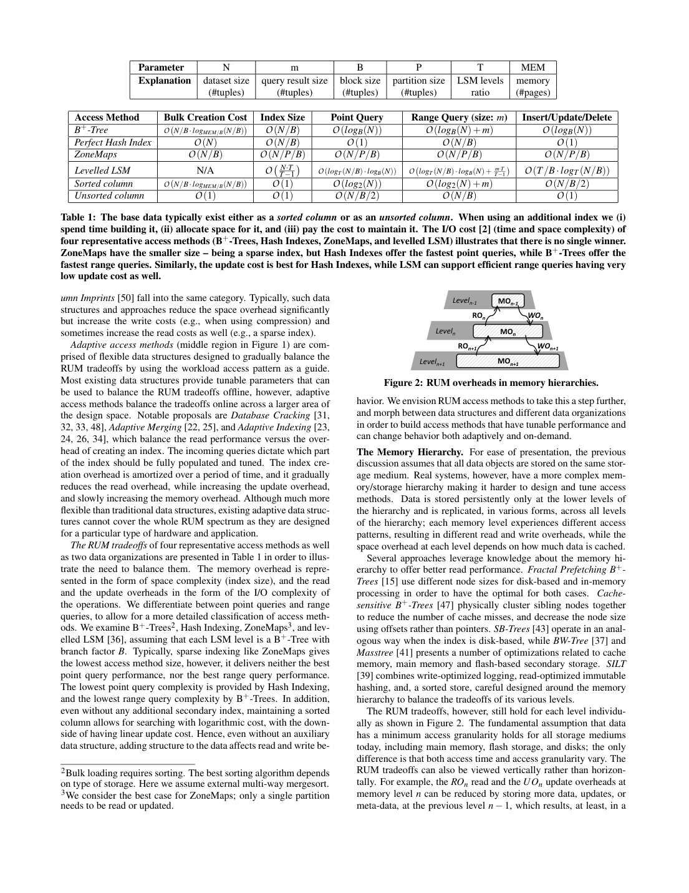
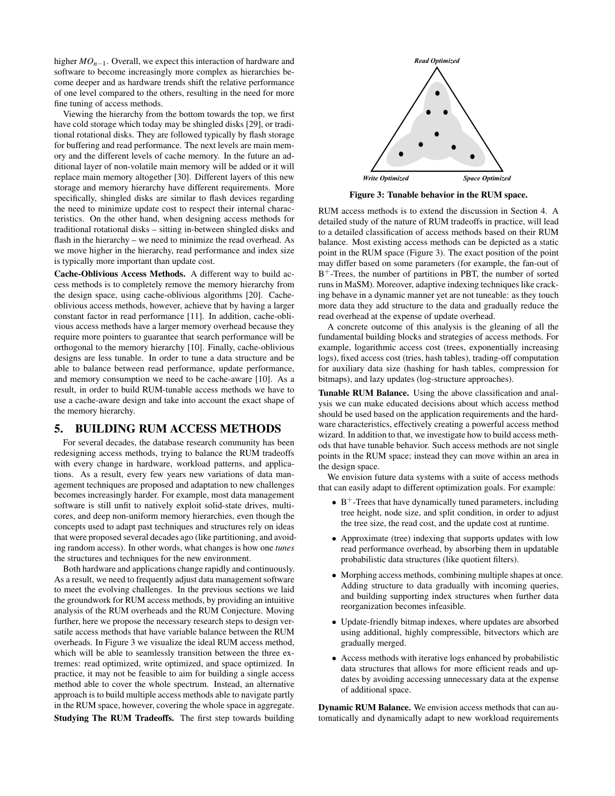

> 本组第 58 篇 · 存储结构与索引 · [全部论文]() · [上一篇]() · [下一篇]()

RUM把访问方法的代价分为读、更新与内存/存储放大，提出“约束两项会限制第三项”的猜想并给研究路线。它不是已经证明的定量不可能定理，也不是恰好只能改善两项：作者明确承认利用数据结构先验、压缩及工程可在一定范围同时改善三项。三组数组/日志示例解释不同代价，不能脱离实现当全称定理。表1是带简化条件的复杂度分类而非性能benchmark；多层存储中的成本还会跨层转移。值得借鉴的是统一计量、识别Pareto交换及面向负载/硬件调参，而不是用三角图替代实测与证明。

本文保留论文陈述、读者推断与待验证方案的区别；实验数字只适用于原文条件。原文和翻译来自已有 AI 辅助精读报告，已做来源匹配与编辑复核，不等于人工逐项核验或独立实验复现。所有页码均为 PDF 物理页。

## 论文与阅读范围

Manos Athanassoulis, Michael S. Kester, Lukas M. Maas, Radu Stoica, Stratos Idreos, Anastasia Ailamaki, Mark Callaghan. Designing Access Methods: The RUM Conjecture. EDBT 2016, March 15–18, Bordeaux, France; local 6-page paper. Conjecture/model/roadmap, not an implemented universal index benchmark.

[论文集中的原始 PDF](https://github.com/lonng/db-papers/blob/4ff1331069c7cf52ac97dd769e5f484c1c35c200/papers/storage-structure/designing-access-methods%3A-the-rum-conjecture.pdf) · 本地来源：`storage-structure/designing-access-methods_-the-rum-conjecture.pdf`，共 6 页。

本篇保留 25 组原文精读和 26 条证据。截图为原始 PDF 的局部页选，不是重新生成的图表；未将整份 PDF 复制到博客。

## 研究问题与适用边界

硬件、应用和工作负载变化使索引不断重设计：读低延迟、更新少写与辅助信息少占空间常互相拉扯。论文试图给出共同语言，避免孤立追求某项而忽略其他代价。

基数据是业务要存的记录，辅助数据可为索引、元数据及待合并更新。读写空间开销都相对基数据定义，M可指DRAM或存储，并非仅“内存条大小”。目标不是一个新可执行通用索引，而是模型、猜想、分类与可调访问方法的路线。

不能把conjecture当已证定理，或由“不存在万能最优”推断停止优化；作者明确鼓励RUM-aware/adaptive设计，也承认一个被支配基线可三项一起改进。

依据：论文陈述；PDF 物理页 2, 3。证据：[RUMREV01](#evidence-rumrev01), [RUMREV02](#evidence-rumrev02), [RUMREV03](#evidence-rumrev03), [RUMREV04](#evidence-rumrev04), [RUMREV08](#evidence-rumrev08), [RUMREV09](#evidence-rumrev09)。

## 系统架构与设计空间模型

**三个指标的精确定义**
RO=总读取数据量（基数据+辅助）/需要取回的基数据量；UO=一次逻辑更新产生的物理更新数据量/逻辑更新量；MO=(基数据+辅助空间)/基数据空间。分子含基数据，理论理想比率为1，不是0。额外空间25%对应MO1.25，不是MO0.25。

这些比率不是墙钟延迟。块大小、缓存、压缩、CPU、定位目标的读取、日志、复制与设备层WA是否计入必须明确边界。后面表1用I/O复杂度和索引绝对规模，不应直接拿它们当2节的比率值。

图1三角是定性投影：点/树索引偏读，差分结构偏写，近似/稀疏结构偏空间，adaptive位于中间区域。它不是带坐标实测图、数值Pareto边界或三项和固定的单纯形。

依据：论文陈述；PDF 物理页 2, 3, 4。证据：[RUMREV01](#evidence-rumrev01), [RUMREV02](#evidence-rumrev02), [RUMREV03](#evidence-rumrev03), [RUMREV08](#evidence-rumrev08), [RUMREV10](#evidence-rumrev10), [RUMREV12](#evidence-rumrev12)。

*原论文 PDF 物理页 4，版权归原作者或出版方。点击图片可查看原尺寸。页面文本中定位到：Table 1: The base data typically exist either as a sorted column or as an unsorted column. When using an additional index we (i)；Figure 2: RUM overheads in memory hierarchies.。这是页面定位信息，不表示本次已复核图内所有数据。*

## 核心算法、理论构造与复杂度分析

**三组说明性设计**
直接地址数组令blkID=value，{1,17}用17块。已知值可直接定位，RO最小；最大值无界使MO可无界，改值需清旧槽写新槽，最坏两次物理更新。这是给定整数值、操作与布局下的例子，不是任何RO=1都普遍蕴含UO=2。

追加日志每更新只写一次，但不回收、不重组时历史副本持续增长，查询需回看，RO/MO增加；压缩合并又增加写量。Prop2说的是该日志设计，不能理解成UO=1对所有结构都强制空间无界，因为下一例已给UO=MO=1。

无辅助密集数组MO1，查询最坏扫描N，已定位槽的原位更新UO1。定位读成本并未消失；三个例子合起来说明模型选择，不构成对所有数据结构的形式下界证明。

实际读者脚本qa/rum-reader-tests.py核验120/100=1.2读比、300/100=3写比、1250/1000=1.25空间比，及17槽/2值=8.5、100基记录加900日志空间10倍。它没有实现新索引、测硬件或证明RUM。

依据：论文陈述；PDF 物理页 3。证据：[RUMREV05](#evidence-rumrev05), [RUMREV06](#evidence-rumrev06), [RUMREV07](#evidence-rumrev07)。

## 正确性论证与理论边界

**不要扩大论证强度**
3节措辞为conjecture：为两项设置上界，也设置第三项下界。未给通用f(R,U,M)不等式、计算模型完备定义、所有操作分布及完整证明；2页把“proving the RUM Conjecture”列进一步研究。应归为设计猜想及说明性分析，不能称CAP式已证不可能定理。

“不能三项同时全局最优”不等于“任何两项不能同时最优”，Prop3自己的MO=UO=1就是后者反例；也不等于每次局部改进都必须恶化一项。结构先验、压缩与CPU计算可使被支配基线三项都改善，作者承认这一点。CPU在简化三轴之外，不能凭字节量推断延迟。

表1限定LSM各层为分支B的B+树，ZoneMaps取只读/更新一个分区的最佳情况。表中m为结果元组数、MEM标页数，范围和建索引公式有简化单位语境；本报告不静默改写为一般教材公式或由它推所有现代实现的精确界。Perfect Hash、缓存与输出规模条件同样不能省略。

图3morph区域是未来愿景；迁移期间新旧副本、重建、并发可见性、恢复和CPU都要计成本。不存在已由本篇证明的零代价任意切换。

依据：读者推断；PDF 物理页 2, 3, 4, 5。证据：[RUMREV04](#evidence-rumrev04), [RUMREV05](#evidence-rumrev05), [RUMREV06](#evidence-rumrev06), [RUMREV07](#evidence-rumrev07), [RUMREV08](#evidence-rumrev08), [RUMREV09](#evidence-rumrev09), [RUMREV10](#evidence-rumrev10), [RUMREV11](#evidence-rumrev11), [RUMREV13](#evidence-rumrev13)。

## 实验评估与工作负载分析

**本篇没有独立性能评测**
六页内容主要给模型、三组例子、图表分类、层级讨论和未来研究，不提供新系统实现、数据集、机器配置、吞吐曲线或受控实验。报告中的数组和日志数字是读者或原文模型算例，不能填成benchmark结果。

表1展示代表结构的I/O复杂度与索引规模。Hash点查快、B+树范围好、稀疏索引小、LSM更新低等是条件化分类，不是同预算实际排序；ZoneMap最佳情况、LSM层结构假设、输出量及均摊边界均影响结论。

4节引用多种历史方法说明设计轴，未在本报告中独立核验全部引用源码或实验。5节对cache-oblivious常数、空间和可调性的评价是作者当时引用语境，不是本篇证明所有缓存无关算法永远较差。

依据：论文陈述；PDF 物理页 2, 3, 4, 5。证据：[RUMREV05](#evidence-rumrev05), [RUMREV06](#evidence-rumrev06), [RUMREV07](#evidence-rumrev07), [RUMREV09](#evidence-rumrev09), [RUMREV10](#evidence-rumrev10), [RUMREV11](#evidence-rumrev11), [RUMREV14](#evidence-rumrev14)。

*原论文 PDF 物理页 5，版权归原作者或出版方。点击图片可查看原尺寸。页面文本中定位到：Figure 3: Tunable behavior in the RUM space.。这是页面定位信息，不表示本次已复核图内所有数据。*

## 工程权衡与设计取舍

层级成本可以转移：更高层缓存更多数据/元数据，减少低层读或合并，但提高高层M。磁盘块、SSD页、DRAM访问和cache line粒度不同，必须按层记录，不可把设备IO减少视作总成本消失。

压缩以CPU换数据量，结构先验以计算换元数据；可能同时降低字节指标却引入CPU瓶颈。late decompression不等于所有算子从不解压。动态切换/重建还引入短期资源峰值，静态稳态RUM不足以描述服务尾延迟和可靠性。

目标应为适合负载与硬件的Pareto设计，而不是某项单点指标最低。

依据：读者推断；PDF 物理页 2, 4, 5, 6。证据：[RUMREV01](#evidence-rumrev01), [RUMREV02](#evidence-rumrev02), [RUMREV03](#evidence-rumrev03), [RUMREV04](#evidence-rumrev04), [RUMREV12](#evidence-rumrev12), [RUMREV13](#evidence-rumrev13), [RUMREV15](#evidence-rumrev15)。

## 相关工作与同类技术对比

B+树、hash等偏读；LSM、PBT、MaSM等差分方法合并更新以降低随机写，但读需合并、空间需容纳待处理状态；近似/稀疏索引减少空间却可能多读或需验证。这样的分类只是讨论起点，具体实现可跨多个区域。

adaptive indexing以查询逐步增加结构，摊销建索引代价；作者仍认为它不覆盖全部空间。RUM-aware调参愿景希望参数和结构能随负载移动，甚至由多个方法共同覆盖范围，不承诺单个方法万能。

本篇RO按字节比，Fractal Trees白皮书R按I/O数；若跨文对照必须统一单位及缓存条件，不能因都叫read amplification便直接比较数字。

依据：读者推断；PDF 物理页 2, 4, 5。证据：[RUMREV01](#evidence-rumrev01), [RUMREV10](#evidence-rumrev10), [RUMREV11](#evidence-rumrev11), [RUMREV12](#evidence-rumrev12), [RUMREV13](#evidence-rumrev13)。

## 复现指南与验证路径

**建议的研究路线**
先定义基数据、操作集合、逻辑/物理单位、缓存和持久化边界；分别测每次操作读取字节、写入字节、辅助/总空间、CPU和延迟，区分冷/热、点/范围、均摊/最坏、构建/稳态/迁移阶段。

选可穷举数组、直接地址和日志实现核对不变量及读写计量，再在目标硬件跑相同负载；对LSM层比、节点大小、压缩、过滤器、缓存预算做独立消融。可画实测Pareto前沿，不把有限样本前沿称理论下界。

实际仅运行qa/rum-reader-tests.py的比例和说明性算术；没有原系统benchmark、通用下界证明或已完成的动态morph实现。

依据：待验证的工程设想；PDF 物理页 2, 3, 4, 5。证据：[RUMREV01](#evidence-rumrev01), [RUMREV02](#evidence-rumrev02), [RUMREV03](#evidence-rumrev03), [RUMREV05](#evidence-rumrev05), [RUMREV06](#evidence-rumrev06), [RUMREV07](#evidence-rumrev07), [RUMREV10](#evidence-rumrev10), [RUMREV11](#evidence-rumrev11), [RUMREV12](#evidence-rumrev12), [RUMREV13](#evidence-rumrev13)。

## 结论与内核工程启示

RUM的实用价值是统一成本账本并引导问“优化换来了什么、代价移到哪一层”，不是提供不经测量就能选数据结构的答案。作者给的是猜想、实例与路线，不是已证万能负面结论。

严谨使用须同时保留计量边界、CPU/层级/迁移代价与语义约束，在同一负载下比较。能改进现有基线不违背设计交换，宣传“二选三”也不能替代证明或实际Pareto分析。

依据：读者推断；PDF 物理页 2, 3, 4, 5, 6。证据：[RUMREV04](#evidence-rumrev04), [RUMREV08](#evidence-rumrev08), [RUMREV09](#evidence-rumrev09), [RUMREV12](#evidence-rumrev12), [RUMREV13](#evidence-rumrev13), [RUMREV15](#evidence-rumrev15)。

## 原文精读：从句子回到机制

以下保留原文、忠实翻译、含义与边界；假设示例不作为论文实验结果。

### P001 · PDF 物理页 2

**原文**

<blockquote class="paper-source-quote"><pre><code>Read Overhead (RO). The RO of an access method is given by the&#10;data accesses to auxiliary data when retrieving the necessary base&#10;data. We refer to RO as the read amplification: the ratio between the&#10;total amount of data read including auxiliary and base data, divided&#10;by the amount of retrieved data. For example, when traversing a&#10;B+-Tree to access a tuple, the RO is given by the ratio between the&#10;total data accessed (including the data read to traverse the tree and&#10;the base data) and the base data intended to be read.</code></pre></blockquote>

**忠实翻译**

> 读开销（Read Overhead, RO）。一种访问方法的 RO 由在检索所需基础数据时对辅助数据的访问给出。我们将 RO 称为读放大：即读取的总数据量（包括辅助数据和基础数据）与检索到的数据量之间的比率。例如，当遍历一棵 B+-Tree 以访问一个元组时，RO 由访问的总数据量（包括为遍历树而读取的数据和基础数据）与打算读取的基础数据之间的比率给出。

**技术含义与边界**

> RO按读取字节总量与目标基数据量的比值定义，不是I/O次数或延迟。基数据本身也在分子内，理想比率1而非0；缓存边界、页内无关记录与压缩单位会影响如何记账。物理页2还定义UO与MO，后面的复杂度表另用I/O数，不能混为同一指标。

**常见误读**

> 容易将 RO 误解为仅指磁盘 I/O 次数或延迟。原文明确将 RO 定义为数据量的比率，而非时间或操作次数。此外，不应将 B+-Tree 的示例泛化为所有结构的 RO 计算方式相同；不同访问方法的辅助数据形态不同，RO 的计算细节也不同。

**读者构造的假设示例**

> 读者构造的假设示例：为取得100字节记录，额外读取3个各4096字节的辅助页，并另读100字节目标数据，RO=(12288+100)/100=123.88。这里3页明确都是辅助页，若其中一页已包含目标记录，就不能再次把同一物理读取重复计入。

### P002 · PDF 物理页 6

**原文**

<blockquote class="paper-source-quote"><pre><code>Narayan, S. Seshadri, S. Sudarshan, and R. Kanneganti.&#10;Incremental Organization for Data Recording and Warehousing. In VLDB,&#10;1997.&#10;[36] B. C. Kuszmaul. A Comparison of Fractal Trees to Log-Structured Merge&#10;(LSM) Trees. Tokutek White Paper, 2014.&#10;[37] J. J. Levandoski, D. B. Lomet, and S. Sengupta. The Bw-Tree: A B-tree for&#10;new hardware platforms. In ICDE, 2013.</code></pre></blockquote>

**忠实翻译**

> ……Narayan、S. Seshadri、S. Sudarshan、R. Kanneganti：《数据记录与仓库的增量组织》，VLDB，1997。[36] B. C. Kuszmaul：《分形树与日志结构合并树的比较》，Tokutek白皮书，2014。[37] J. J. Levandoski、D. B. Lomet、S. Sengupta：《Bw-Tree：面向新硬件平台的B树》，ICDE，2013。

**技术含义与边界**

> 参考文献片段提供历史技术背景，不等于本文独立复现了这些工作的定理或实验。本次另实际阅读了[36]的本地15页白皮书，发现其主要是模型与假想配置比较；两文都称read amplification，但RUM按字节比、[36]按I/O次数，需要统一口径。其余被引全文未在本篇复核中独立阅读。

**常见误读**

> 不能把参考文献名称当作已核验实现或证明。段首是上一条目的续行，不能据此虚构完整作者列表，也不把白皮书的产品主张升级为RUM的形式证明。

**读者构造的假设示例**

> 读者构造的假设示例：白皮书说某短范围查询3次I/O，而RUM例子说RO=12，二者分母不同；若每页和输出字节数未知，不能说12比3差4倍。

### P003 · PDF 物理页 4

**原文**

<blockquote class="paper-source-quote"><pre><code>We differentiate between point queries and range&#10;queries, to allow for a more detailed classification of access meth-&#10;ods. We examine B+-Trees2, Hash Indexing, ZoneMaps3, and lev-&#10;elled LSM [36], assuming that each LSM level is a B+-Tree with&#10;branch factor B. Typically, sparse indexing like ZoneMaps gives&#10;the lowest access method size, however, it delivers neither the best&#10;point query performance, nor the best range query performance.</code></pre></blockquote>

**忠实翻译**

> 我们区分点查询和范围查询，以对访问方法进行更详细的分类。我们考察 B+-Trees、Hash Indexing、ZoneMaps 以及分层 LSM [36]，假设每个 LSM 层是一棵分支因子为 B 的 B+-Tree。通常，像 ZoneMaps 这样的稀疏索引给出最小的访问方法大小，然而，它既不提供最佳的点查询性能，也不提供最佳的范围查询性能。

**技术含义与边界**

> 作者对表1限定LSM每层为分支因子B的B+树，ZoneMaps脚注还取只读/更新一个分区的最佳情况。表比较点/范围查询、构建、索引规模与维护，不能据单项复杂度决定真实延迟。表中Hash范围查询为O(N/B)，不是O(N/P/B)。

**常见误读**

> 这些是特定理论模型的分类，不是所有现代LSM或所有数据分布的精确界。原文完整表格确实给出Hash点查、B+树范围查询的比较，不应因短引未包含全部信息便宣称全文没有说明。

**读者构造的假设示例**

> 读者构造的假设示例：假设有一个包含 100 万条记录的表，使用 ZoneMaps 可能只需存储少量区间元数据（空间小），但要查找某个特定键（点查询）可能需要扫描多个区间，而 Hash Index 可直接定位，B+-Tree 可高效支持范围扫描。

### P004 · PDF 物理页 3

**原文**

<blockquote class="paper-source-quote"><pre><code>When we change a value we need to update two&#10;blocks: empty the old block and insert the new value in its new&#10;block, effectively, increasing the worst case UO to two physical&#10;updates for one logical update.&#10;Prop. 1 min(RO) = 1.0 ⇒UO = 2.0 and MO →∞&#10;Minimizing Only UO. In order to minimize UO, we append every&#10;update, effectively forming an ever increasing log.</code></pre></blockquote>

**忠实翻译**

> 当我们更改一个值时，我们需要更新两个块：清空旧块并将新值插入其新块，实际上，将最坏情况下的 UO 增加到一次逻辑更新的两次物理更新。
> 命题 1 min(RO) = 1.0 ⇒ UO = 2.0 且 MO → ∞
> 仅最小化 UO。为了最小化 UO，我们追加每一次更新，实际上形成一个不断增长日志。

**技术含义与边界**

> 上下文是直接地址整数数组blkID=value，而非任意页内空间不足的引擎。修改值时旧下标清空、新下标写值，所以这一构造最坏两次物理更新；最大可插入值无界使空间可能无界。随后追加日志是另一个具体构造，不是证明所有UO=1的结构都空间无界。

**常见误读**

> Prop1/2不可脱离各自布局读成任意结构的全称定理。RO=1不普遍意味着UO恰好2；Prop3的密集数组还给出UO=MO=1，足以阻止把Prop2直接当成普遍蕴含。

**读者构造的假设示例**

> 读者构造的假设示例：数组存整数1和17，使用下标1至17共17槽；把17改18需要清空17槽、写18槽。RO按值寻址为1，空间比17/2=8.5（修改前），若最大值不断增大空间比可很大。

### P005 · PDF 物理页 5

**原文**

<blockquote class="paper-source-quote"><pre><code>A&#10;detailed study of the nature of RUM tradeoffs in practice, will lead&#10;to a detailed classification of access methods based on their RUM&#10;balance. Most existing access methods can be depicted as a static&#10;point in the RUM space (Figure 3). The exact position of the point&#10;may differ based on some parameters (for example, the fan-out of&#10;B+-Trees, the number of partitions in PBT, the number of sorted&#10;runs in MaSM).</code></pre></blockquote>

**忠实翻译**

> 对实践中 RUM 权衡性质的详细研究，将导致基于 RUM 平衡对访问方法进行详细分类。大多数现有访问方法可以描绘为 RUM 空间中的一个静态点（图 3）。该点的确切位置可能因某些参数而有所不同（例如，B+-Trees 的扇出、PBT 中的分区数、MaSM 中的有序运行段数）。

**技术含义与边界**

> 作者以静态点表示给定结构和参数下的权衡，参数变动可形成区域。已目视物理页5图3，它是定性空间示意，并非实测坐标或已证Pareto前沿。本文没有定义三项和恒定或任何通用代数关系。

**常见误读**

> 不能把static理解为参数绝不可调，也不能由三角图推得任何局部改进都必然恶化另一项。作者在物理页2明确承认计算、数据先验与工程可在一定范围同时改进三项。

**读者构造的假设示例**

> 读者构造的假设示例：设计A的(R,U,M)=(3,5,2)，经消除重复元数据与冗余写得到B=(2,4,1.5)，三项同时改善只是说明A被支配，并不建立所有设计都可同时达到(1,1,1)。

### P006 · PDF 物理页 4

**原文**

<blockquote class="paper-source-quote"><pre><code>The I/O cost [2] (time and space complexity) of&#10;four representative access methods (B+-Trees, Hash Indexes, ZoneMaps, and levelled LSM) illustrates that there is no single winner.&#10;ZoneMaps have the smaller size – being a sparse index, but Hash Indexes offer the fastest point queries, while B+-Trees offer the&#10;fastest range queries.</code></pre></blockquote>

**忠实翻译**

> 四种代表性访问方法（B+-Trees、Hash Indexes、ZoneMaps 和分层 LSM）的 I/O 成本 [2]（时间和空间复杂度）表明没有单一的优胜者。ZoneMaps 具有更小的大小——作为一种稀疏索引，但 Hash Indexes 提供最快的点查询，而 B+-Trees 提供最快的范围查询。

**技术含义与边界**

> 表1用渐近I/O复杂度与索引规模说明不同目标下没有单一胜者，并非实际吞吐评测。表注随后也明确说LSM可低更新成本支持有效范围查询，不能只因这段短引未包含后句便否认该上下文。Hash范围查询为O(N/B)，B+树范围列含m输出项；m在参数栏标为结果元组数，单位简化必须保留说明。

**常见误读**

> fastest是本文比较模型中的评价，不是任何硬件下的响应时间保证。表中的绝对索引规模不是MO比率，复杂度也不直接等于2节RO/UO的字节比；不要把表格当独立测量。

**读者构造的假设示例**

> 读者构造的假设示例：Hash的等值探测可用常数次访问，但查询一半键空间仍可能扫全部桶；有序结构可定位起点再输出，结果量大时仍必须付出输出成本。该例不宣称特定实现的真实毫秒数。

### P007 · PDF 物理页 3

**原文**

<blockquote class="paper-source-quote"><pre><code>The UO cost of&#10;in-place updates is also optimal because only the base data intended&#10;to be updated is ever updated.&#10;Prop. 3 min(MO) = 1.0 ⇒RO = N and UO = 1.0&#10;3.&#10;THE RUM CONJECTURE&#10;Achieving the optimal value for one overhead is not always as&#10;important as finding a good balance across all RUM overheads.</code></pre></blockquote>

**忠实翻译**

> 就地更新的 UO 成本也是最优的，因为只有打算被更新的基础数据才会被更新。
> 命题 3 min(MO) = 1.0 ⇒ RO = N 且 UO = 1.0
> 3.
> RUM 猜想
> 为一种开销实现最优值并不总是像在全部 RUM 开销之间找到良好平衡那样重要。

**技术含义与边界**

> 物理页3开头已定义N为固定大小元素数。密集数组不存辅助索引时MO=1；查询最坏扫描N个元素，而已知目标槽后的原位更新只改基数据，UO=1。定位读开销没有消失。这是特定数组构造，后续RUM为猜想而非完整证明。

**常见误读**

> 不能说N在全文未定义，也不能推得任何MO=1都必然线性查询。此例同时达到两项理想值，恰好说明‘恰好只能优化两项’式口号需要限定，不能当全部操作上的精确不可能定理。

**读者构造的假设示例**

> 读者构造的假设示例：假设一个数组存储结构，就地更新只需改写对应下标的元素（UO=1.0），但若该数组无序且无索引，查找该元素需扫描全部 N 个元素（RO=N），且不使用额外索引空间（MO=1.0）。

### P008 · PDF 物理页 5

**原文**

<blockquote class="paper-source-quote"><pre><code>For example:&#10;• B+-Trees that have dynamically tuned parameters, including&#10;tree height, node size, and split condition, in order to adjust&#10;the tree size, the read cost, and the update cost at runtime.&#10;• Approximate (tree) indexing that supports updates with low&#10;read performance overhead, by absorbing them in updatable&#10;probabilistic data structures (like quotient filters).&#10;• Morphing access methods, combining multiple shapes at once.</code></pre></blockquote>

**忠实翻译**

> 例如：
> • 具有动态调优参数的 B+-Trees，包括树高、节点大小和分裂条件，以便在运行时调整树大小、读成本和更新成本。
> • 近似（树）索引，通过在可更新的概率数据结构（如商过滤器 quotient filters）中吸收更新来支持低读性能开销的更新。
> • 变形访问方法，一次组合多种形状。

**技术含义与边界**

> 这些是作者提出的可调RUM研究方向：运行时调树参数、用可更新概率结构吸收更新、组合多种结构形态。文章没有交付一个能无成本覆盖完整RUM空间的实现；甚至明确提出可能需要多个方法合起来覆盖。

**常见误读**

> 节点更大并不单调降低UO：虽可能减少分裂，也可能增加整页改写字节。调参需要测工作负载、缓存、记录长度、CPU和迁移成本；不能用一个方向性示例替代保证。

**读者构造的假设示例**

> 读者构造的假设示例：运行时把节点8KiB改16KiB可能降低树高，却使每次单条随机更新的整页写入增大。若需重新布局，迁移期间新旧副本与并发可见性也要记账，不是改一个参数立即免费获得收益。

### P009 · PDF 物理页 6

**原文**

<blockquote class="paper-source-quote"><pre><code>or hardware changes, like a sudden increase or decrease of avail-&#10;ability of storage or memory. For example, in the case of access&#10;methods based on iterative merges, by changing the number of&#10;merge trees dynamically, the depth of the merge hierarchy and the&#10;frequency of merging, we can build access methods that dynami-&#10;cally adapt to workload and hardware changes.&#10;Compression and Computation.</code></pre></blockquote>

**忠实翻译**

> 或硬件变化，如存储或内存可用性的突然增加或减少。例如，在基于迭代合并的访问方法的情况下，通过动态改变合并树的数量、合并层级的深度以及合并的频率，我们可以构建能够动态适应工作负载和硬件变化的访问方法。
> 压缩与计算。

**技术含义与边界**

> 作者设想通过合并树数量、深度和频率适应内存/存储变化，属于未来设计路线；没有给出自动控制器、迁移算法或稳定性实验。原文随后Compression and Computation段在同一物理页6完整存在，讨论压缩用计算换数据移动和尽量晚解压，不能以当前短引截止为由说全文未知。

**常见误读**

> 资源变化并不直接指定唯一正确参数方向；更多run可能减少立即合并写量却提高读取合并和空间。压缩在简化三轴之外消耗CPU，late decompression也不等于所有算子从不解压。

**读者构造的假设示例**

> 读者构造的假设示例：内存缩减时系统或需限制缓冲并提前合并，短期写入与尾延迟反而上升；应同时记录过渡峰值和稳态成本，不能只说动态调参后必然更快。

### P010 · PDF 物理页 4

**原文**

<blockquote class="paper-source-quote"><pre><code>When using an additional index we (i)&#10;spend time building it, (ii) allocate space for it, and (iii) pay the cost to maintain it. The I/O cost [2] (time and space complexity) of&#10;four representative access methods (B+-Trees, Hash Indexes, ZoneMaps, and levelled LSM) illustrates that there is no single winner.</code></pre></blockquote>

**忠实翻译**

> 当使用一个额外的索引时，我们 (i) 花费时间构建它，(ii) 为其分配空间，以及 (iii) 付出维护它的成本。四种代表性访问方法（B+-Trees、Hash Indexes、ZoneMaps 和分层 LSM）的 I/O 成本 [2]（时间和空间复杂度）表明没有单一的优胜者。

**技术含义与边界**

> 新增索引要计构建、空间和每次更新维护三类成本，不能只看读加速。表1展示的是带假设的代表方法，不构成所有结构的形式下界或独立性能测量。稳态比较还需加上创建/迁移阶段的暂态成本。

**常见误读**

> 不应将三项代价误解为仅在'额外'索引上发生；主索引同样有构建、空间和维护成本，原文强调的是'additional index'带来的叠加负担。'没有单一优胜者'的结论限定在所考察的四种方法和 I/O 成本维度内，不应泛化为所有可能的访问方法或在所有评价指标下均无优劣之分。

**读者构造的假设示例**

> 读者构造的假设示例：已有B+树的数据另建Hash辅助索引，需要扫描构建并分配桶，后续插入同时维护树与Hash表；这不是同时维护两棵树，且是否节省总体成本取决于点查收益、更新率和内存预算。

### RUMP001 · PDF 物理页 2

**原文**

<blockquote class="paper-source-quote"><pre><code>Read Overhead (RO). The RO of an access method is given by the&#10;data accesses to auxiliary data when retrieving the necessary base&#10;data. We refer to RO as the read amplification: the ratio between the&#10;total amount of data read including auxiliary and base data, divided&#10;by the amount of retrieved data. For example, when traversing a&#10;B+-Tree to access a tuple, the RO is given by the ratio between the&#10;total data accessed (including the data read to traverse the tree and&#10;the base data) and the base data intended to be read.&#10;Update Overhead (UO).</code></pre></blockquote>

**忠实翻译**

> 读开销是取出所需基数据时的辅助访问，读放大定义为总读取量（辅助与基数据）除以实际取回的基数据量。

**技术含义与边界**

> RO是数据量比，不只是延迟，也不是恰好等于I/O次数；块大小与缓存粒度会影响量比与耗时。

**常见误读**

> 不把RO1.2直接称为慢20%，或与别文以I/O数定义的read amplification无单位比较。

**读者构造的假设示例**

> 读者构造的假设示例：实际算术：读100字节结果加20字节辅助信息，RO=1.2；若延迟被一次随机seek主导，时间不必同为1.2倍。

### RUMP002 · PDF 物理页 2

**原文**

<blockquote class="paper-source-quote"><pre><code>Update Overhead (UO). The UO is given by the amount of up-&#10;dates applied to the auxiliary data in addition to the updates to the&#10;main data. We refer to UO as the write amplification: the ratio&#10;between the size of the physical updates performed for one logical&#10;update, divided by the size of the logical update. In the previous&#10;example, the UO is calculated by dividing the updated data size&#10;(both base and auxiliary data) by the size of the updated base data.&#10;Memory Overhead (MO).</code></pre></blockquote>

**忠实翻译**

> 更新开销按一次逻辑更新引起的物理更新数据量除以逻辑更新量定义，包含基数据及辅助数据更新。

**技术含义与边界**

> 这是write amplification口径，定位更新对象的读取成本并不自动计作写入；CPU、日志、设备内部写是否纳入需明确边界。

**常见误读**

> 不把append一条逻辑记录就认定整个系统写放大1，忽略日志、复制、compaction或设备层。

**读者构造的假设示例**

> 读者构造的假设示例：实际算术：逻辑100字节、实际总写300字节，UO=3。

### RUMP003 · PDF 物理页 2

**原文**

<blockquote class="paper-source-quote"><pre><code>Memory Overhead (MO). The MO is the space overhead induced&#10;by storing auxiliary data. We refer to MO as the space amplifica-&#10;tion, defined as the ratio between the space utilized for auxiliary&#10;and base data, divided by the space utilized for base data. Follow-&#10;ing the preceding example, the MO is computed by dividing the&#10;overall size of the B+-Tree by the base data size.&#10;Minimizing RUM overheads.</code></pre></blockquote>

**忠实翻译**

> MO按辅助数据和基数据占用空间总和除以基数据空间定义，文中也称space amplification。

**技术含义与边界**

> 分子包含基数据，因此理论最小1而不是0；M可指内存或存储，不仅限DRAM。额外开销为25%时总比率1.25。

**常见误读**

> 不把M叫作主存容量绝对数，也不把索引大小/基数据的0.25与总space amplification1.25混用。

**读者构造的假设示例**

> 读者构造的假设示例：实际算术基数据1000、辅助250，MO=1.25。

### RUMP004 · PDF 物理页 2

**原文**

<blockquote class="paper-source-quote"><pre><code>In modern&#10;implementations of data systems, however, one can optimize up to&#10;some point for all three. Such optimizations are possible by relying&#10;on using inherently defined structure instead of storing detailed in-&#10;formation. A prime example is the block-based clustered indexing,&#10;which reduces both read and memory overhead by storing only a&#10;few pointers to pages (only when an indexed tuple is stored to a&#10;different page than the previous one), hence building a very short&#10;tree. The reason why such an approach would give us good read&#10;performance is the fact that data is clustered on the index attribute.&#10;Even in this ideal case, however, we have to perform additional&#10;computation in order to calculate the exact location of the tuple&#10;we are searching for. In essence, we use computation and knowl-&#10;edge about the data in order to reduce the RUM overheads.</code></pre></blockquote>

**忠实翻译**

> 现代实现可以在一定程度同时改善三项，借助数据内在结构而非详细元数据；如聚簇索引用少量页指针减少读与空间，但需额外计算定位。

**技术含义与边界**

> RUM不是禁止对被支配基线三项同时改进；压缩、结构先验与工程可移动设计点，CPU也是被简化指标之外的代价。

**常见误读**

> 不将任何“三赢优化”直接称为推翻RUM，也不由猜想断言所有工程优化必须让一项立刻变差。

**读者构造的假设示例**

> 读者构造的假设示例：实际读者举R/U/M从(3,5,2)到(2,4,1.5)是改进基线，不证明达到全局三维最优。

### RUMP005 · PDF 物理页 3

**原文**

<blockquote class="paper-source-quote"><pre><code>Minimizing Only RO. In order to minimize RO we organize data&#10;in an array and we store each value in the block with blkID = value.&#10;For example, the relation {1,17} is stored in an array with 17&#10;blocks. The first block holds value 1, the last block holds value&#10;17, and every block in-between holds a null value. RO is now min-&#10;imal because we always know where to find a specific value (if it&#10;exists), and we only read useful data. On the other hand, the ar-&#10;ray is sparsely populated, with unbounded MO since, in the general&#10;case, we cannot anticipate what would be the maximum value ever&#10;inserted. When we insert or delete a value we only update the cor-&#10;responding block. When we change a value we need to update two&#10;blocks: empty the old block and insert the new value in its new&#10;block, effectively, increasing the worst case UO to two physical&#10;updates for one logical update.&#10;Prop. 1 min(RO) = 1.0 ⇒UO = 2.0 and MO →∞&#10;Minimizing Only UO.</code></pre></blockquote>

**忠实翻译**

> 为最小RO，示例令数组块ID等于值：{1,17}分配17块，中间空值，直接读所需块；MO随最大值可无界，值更新需清旧块并写新块，最坏两次物理更新。

**技术含义与边界**

> 这是特定direct-address示例与操作定义的推演，不是所有RO=1结构都被普遍证明具有UO=2和无界MO。

**常见误读**

> 不把Prop1箭头脱离示例当通用定理；有界稠密域或不同操作模型需重算。

**读者构造的假设示例**

> 读者构造的假设示例：实际读者算术17槽存2值，空间比8.5；将1改20需清旧槽与置新槽两步。

### RUMP006 · PDF 物理页 3

**原文**

<blockquote class="paper-source-quote"><pre><code>Minimizing Only UO. In order to minimize UO, we append every&#10;update, effectively forming an ever increasing log. That way we&#10;achieve the minimum UO, which is equal to 1.0, at the cost of con-&#10;tinuously increasing RO and MO. Notice that any reorganization of&#10;the data to reduce RO would result in an increase of UO. Hence,&#10;for minimum UO, both RO and MO perpetually increase as updates&#10;are appended.&#10;Prop. 2 min(UO) = 1.0 ⇒RO →∞and MO →∞&#10;Minimizing Only MO.</code></pre></blockquote>

**忠实翻译**

> 为最小UO，示例把所有更新追加成不断增长的日志，单次写比1；不重组时RO与MO随追加持续增加，重组又会增加UO。

**技术含义与边界**

> Prop2描述这个append-only设计，不是普遍证明UO=1必导致无限空间；下一个dense array示例本身就给UO=MO=1但高RO。

**常见误读**

> 不能把三段示例箭头当作可以任意合并的全称逻辑蕴含，否则会与Prop3混淆。

**读者构造的假设示例**

> 读者构造的假设示例：100个基记录再保留900个等长更新，不GC时空间10倍，单条append仍可只写一次。

### RUMP007 · PDF 物理页 3

**原文**

<blockquote class="paper-source-quote"><pre><code>Minimizing Only MO. When minimizing MO, no auxiliary data&#10;is stored and the base data is stored as a dense array. During a se-&#10;lection, we need to scan all data to find the values we are interested&#10;in, while updates are performed in place. The minimum MO=1.0 is&#10;achieved. The RO, however, is now dictated by the size of the rela-&#10;tion since a full scan is needed in the worst case. The UO cost of&#10;in-place updates is also optimal because only the base data intended&#10;to be updated is ever updated.&#10;Prop. 3 min(MO) = 1.0 ⇒RO = N and UO = 1.0&#10;3.&#10;THE RUM CONJECTURE</code></pre></blockquote>

**忠实翻译**

> 无辅助数据、基数据密集数组时MO=1；查找最坏扫描N个，已定位的原位更新只写目标基数据，UO=1。

**技术含义与边界**

> 两个维度可同时达到此示例最小，代价是另一个高；假说说不能同时最优三项，不是任何两项绝不能同时优。

**常见误读**

> 不把UO1解释为查找更新对象也O1；搜索读取在RO及操作整体时延中仍可能高。

**读者构造的假设示例**

> 读者构造的假设示例：实际读者100元素数组，为找到一个未知位置值最坏扫100，确定槽后改写一次。

### RUMP008 · PDF 物理页 3

**原文**

<blockquote class="paper-source-quote"><pre><code>The RUM Conjecture. An access method that can set an upper&#10;bound for two out of the read, update, and memory overheads, also&#10;sets a lower bound for the third overhead.</code></pre></blockquote>

**忠实翻译**

> RUM猜想：一个访问方法若为读、更新、空间三项中的两项设置上界，也会给第三项设置下界。

**技术含义与边界**

> 论文提出定性设计约束，未给适用于任意模型的定量f(R,U,M)不等式与完整证明；2页明确将proving列未来研究。

**常见误读**

> 不称为已经证明的CAP式定理，也不从三角图读出数值最优点或强制恰好二选三。

**读者构造的假设示例**

> 读者构造的假设示例：读者可将预算化R、U两项后测M的Pareto前沿，但不把一次观察当理论下界。

### RUMP009 · PDF 物理页 2

**原文**

<blockquote class="paper-source-quote"><pre><code>Similarly, proving the RUM Conjecture will expand on this line of&#10;research.</code></pre></blockquote>

**忠实翻译**

> 类似地，证明RUM猜想会扩展这条理论研究路线。

**技术含义与边界**

> 作者自己的贡献清单把证明留作进一步研究；这限定了全文lower bound和infeasible的证据强度。

**常见误读**

> 不把conjecture译成定理，或捏造已完成形式证明、实验验证或通用复杂度常数。

**读者构造的假设示例**

> 读者构造的假设示例：报告应将“作者猜想”“示例推演”“读者建议”分别标注。

### RUMP010 · PDF 物理页 4

**原文**

<blockquote class="paper-source-quote"><pre><code>We examine B+-Trees2, Hash Indexing, ZoneMaps3, and lev-&#10;elled LSM [36], assuming that each LSM level is a B+-Tree with&#10;branch factor B.</code></pre></blockquote>

**忠实翻译**

> 表1比较B+树、Hash Index、ZoneMaps与leveled LSM，其中假设每个LSM层是分支因子B的B+树。

**技术含义与边界**

> 表中读写用I/O复杂度、空间用索引规模，与2节总量放大比例不是同一数值单位；不能把此LSM实现假设推广所有SST索引。

**常见误读**

> 不直接把表的O(N/B)索引量当MO比率，也不从简化表推导当代RocksDB固定性能。

**读者构造的假设示例**

> 读者构造的假设示例：若按页计索引大小需再除基数据页数才能比较空间比；缓存与过滤器也会改变I/O。

### RUMP011 · PDF 物理页 4

**原文**

<blockquote class="paper-source-quote"><pre><code>We consider the best case for ZoneMaps; only a single partition&#10;needs to be read or updated.</code></pre></blockquote>

**忠实翻译**

> ZoneMaps项取最佳情况：只需读或更新一个分区。

**技术含义与边界**

> 表格不是最坏情况下任意数据顺序的统一保证；ZoneMap剪枝取决于数据聚集、分区范围与查询。

**常见误读**

> 不把此行复杂度作为所有低选择率查询都只读一分区的证明，也不把表中m和MEM的单位未核即换写标准公式。

**读者构造的假设示例**

> 读者构造的假设示例：全域乱序值让每分区min/max都覆盖查询值时，可能全部无法剪枝；这是读者语义例，不是论文实验。

### RUMP012 · PDF 物理页 4

**原文**

<blockquote class="paper-source-quote"><pre><code>The RUM tradeoffs, however, still hold for each level individu-&#10;ally as shown in Figure 2. The fundamental assumption that data&#10;has a minimum access granularity holds for all storage mediums&#10;today, including main memory, flash storage, and disks; the only&#10;difference is that both access time and access granularity vary.</code></pre></blockquote>

**忠实翻译**

> 作者称RUM交换在每个层级仍成立；所有存储介质都有最小访问粒度，只是访问时间与粒度不同。

**技术含义与边界**

> 跨层缓存以更高层空间换低层读取或更新开销，必须按层记账；把数据放DRAM并非消灭成本。

**常见误读**

> 不把磁盘块、缓存行和逻辑记录大小等同，也不把低层IO减少当总内存占用不变。

**读者构造的假设示例**

> 读者构造的假设示例：用100MB DRAM存索引可减SSD访问，同时提高高层M；两项应列在同一成本表。

### RUMP013 · PDF 物理页 5

**原文**

<blockquote class="paper-source-quote"><pre><code>In&#10;practice, it may not be feasible to aim for building a single access&#10;method able to cover the whole spectrum. Instead, an alternative&#10;approach is to build multiple access methods able to navigate partly&#10;in the RUM space, however, covering the whole space in aggregate.</code></pre></blockquote>

**忠实翻译**

> 实践中单一访问方法覆盖全部RUM空间可能不可行，可构建多个各自覆盖部分空间的方法，合起来覆盖设计范围。

**技术含义与边界**

> 这是研究路线，不是已经实现可零成本在任意结构间瞬时morph的系统。迁移、共存、并发语义与恢复需另测。

**常见误读**

> 不把Figure3灰色区域当测出的可达Pareto前沿，或说用户一调参数便覆盖全三角。

**读者构造的假设示例**

> 读者构造的假设示例：读者可在B+树与写优化结构之间试验迁移，但转换期间额外副本和写入也要计入RUM。

### RUMP014 · PDF 物理页 5

**原文**

<blockquote class="paper-source-quote"><pre><code>Cache-Oblivious Access Methods. A different way to build ac-&#10;cess methods is to completely remove the memory hierarchy from&#10;the design space, using cache-oblivious algorithms [20]. Cache-&#10;oblivious access methods, however, achieve that by having a larger&#10;constant factor in read performance [11]. In addition, cache-obli-&#10;vious access methods have a larger memory overhead because they&#10;require more pointers to guarantee that search performance will be&#10;orthogonal to the memory hierarchy [10]. Finally, cache-oblivious&#10;designs are less tunable. In order to tune a data structure and be&#10;able to balance between read performance, update performance,&#10;and memory consumption we need to be cache-aware [10]. As a&#10;result, in order to build RUM-tunable access methods we have to&#10;use a cache-aware design and take into account the exact shape of&#10;the memory hierarchy.</code></pre></blockquote>

**忠实翻译**

> 作者讨论cache-oblivious设计及其常数、空间和调参限制，并主张为RUM可调设计应采用cache-aware、考虑层级形状。

**技术含义与边界**

> 这是基于所引文献与当时设计语境的论证，不是文中证明任何cache-oblivious算法都不可能可调的普遍定理。

**常见误读**

> 不将所有缓存无关结构永久判为劣势，或把引用结果当本文新实测；本次未读全部所引原文。

**读者构造的假设示例**

> 读者构造的假设示例：对具体结构仍需在目标层级、块粒度和工作负载上测，而不是单凭cache-aware标签决定胜负。

### RUMP015 · PDF 物理页 6

**原文**

<blockquote class="paper-source-quote"><pre><code>Compression and Computation. Orthogonally to the tension be-&#10;tween the three overheads, when accessing data today compression&#10;is often used to reduce the amount of data to be moved. This trade-&#10;off between computation (compressing/decompressing) and data&#10;size does not affect the fundamental nature of the RUM Conjecture.&#10;Compression is seldom used only for transferring data through the&#10;memory hierarchy. Rather, modern data systems operate mostly on&#10;compressed data and decompress as late as possible, usually when&#10;presenting the final answer of a query to the user.</code></pre></blockquote>

**忠实翻译**

> 压缩以计算换减少数据移动，作者称不改变RUM竞争本质；现代系统常在压缩数据上操作，并尽可能延后解压到呈现查询结果。

**技术含义与边界**

> CPU、压缩比与访问代价是额外设计轴，不能仅看三项字节比就推性能；late decompression也不意味着全部操作永不解压。

**常见误读**

> 不把压缩三项改善当猜想反例，也不把这段概括当所有引擎源码事实。

**读者构造的假设示例**

> 读者构造的假设示例：选择性执行可先筛压缩块再解码少量值，但若每次点更新都需重压整块，CPU与U会变化。

## 尚未解决的问题

1. 形式计算模型、定量下界函数和完整证明本篇未提供。
2. 表1各项单位、结果输出量及具体实现假设需针对复现统一。
3. cache-oblivious相关引用的详细定理未独立阅读。
4. 动态结构迁移成本、并发恢复与当前硬件实测均未完成。

## 证据索引

证据编号沿用原报告，便于将上文判断追溯到原句。引文匹配只验证位置，不证明解读正确。

**C001N03 · PDF 物理页 2**

2节定义RO为读取总数据量/目标基数据量，UO为物理更新量/逻辑更新量，MO为基数据及辅助总空间/基数据空间；在本文无压缩等简化记账模型中理想比率为1而非0。表1另用I/O复杂度与索引规模，不能把它的数值直接当这些字节比或延迟。

<blockquote class="paper-source-quote"><pre><code>We refer to RO as the read amplification: the ratio between the total amount of data read including auxiliary and base data, divided by the amount of retrieved data.</code></pre></blockquote>

**C001N05 · PDF 物理页 3**

Prop1描述直接地址整数数组blkID=value：点查直接定位，变更值清旧槽写新槽，最坏两次更新；无界值域令稀疏空间比可无界。这是特定布局的说明性例子，不是所有RO=1结构都必须UO=2的普适定理，也与查询剪枝机制不同。

<blockquote class="paper-source-quote"><pre><code>Prop. 1 min(RO) = 1.0 ⇒UO = 2.0 and MO →∞</code></pre></blockquote>

**C001N07 · PDF 物理页 3**

Prop3的密集无索引数组MO=1，已定位槽的原位更新UO=1，查找最坏扫N个固定大小元素；N在3页开头已定义。不能把该构造升格成任何零辅助空间结构的通用读下界，也不能忽略更新定位的读代价。

<blockquote class="paper-source-quote"><pre><code>Prop. 3 min(MO) = 1.0 ⇒RO = N and UO = 1.0</code></pre></blockquote>

**C002N01 · PDF 物理页 4**

表1是条件化复杂度分类而非测量：Perfect Hash点查O(1)、范围O(N/B)，不是O(N/P/B)；后者是ZoneMaps一行。B+树范围项按原表写O(log_B(N)+m)，m标结果元组数，不能静默改成别的单位。各列I/O复杂度、索引绝对规模与2节放大比不是同一指标。

<blockquote class="paper-source-quote"><pre><code>The I/O cost [2] (time and space complexity) of four representative access methods</code></pre></blockquote>

**C002N02 · PDF 物理页 4**

文中对 Table 1 的 LSM 分析假设每一层 LSM level 是一棵分支因子为 B 的 B+-Tree。对 ZoneMaps 的分析假设为最佳情况：仅需读取或更新单个 partition。Bulk loading 假设使用 external multi-way mergesort。这些前提直接影响复杂度公式的成立边界，若 LSM 层内结构非 B+-Tree 或 ZoneMap 需扫描多分区，则表中公式不适用。

<blockquote class="paper-source-quote"><pre><code>assuming that each LSM level is a B+-Tree with branch factor B.</code></pre></blockquote>

**C002N03 · PDF 物理页 4**

Adaptive access methods（如 Database Cracking、Adaptive Merging、Adaptive Indexing）利用工作负载访问模式在线平衡 RUM 权衡。其核心机制是：由到来的查询决定索引的哪些部分应被完全填充和调优；索引创建开销随时间摊还，逐步降低读开销，同时增加更新开销并缓慢增加内存开销。与传统结构的离线调参不同，adaptive 方法在设计空间的更大范围内在线调整。但其局限在于无法覆盖整个 RUM 谱系，因为它们针对特定硬件和应用类型设计。

<blockquote class="paper-source-quote"><pre><code>The incoming queries dictate which part of the index should be fully populated and tuned.</code></pre></blockquote>

**C002N07 · PDF 物理页 5**

多数结构可按给定参数表示为定性RUM空间中的点，改变参数会移动位置；本文认为现有adaptive indexing还不具备覆盖全部空间的可调能力，这是作者研究动机，不是证明cracking任何参数都不可人工调整。图不是实测坐标或通用Pareto下界。

<blockquote class="paper-source-quote"><pre><code>Most existing access methods can be depicted as a static point in the RUM space</code></pre></blockquote>

**C002N08 · PDF 物理页 5**

论文列举了五类可调优 RUM 平衡的具体技术设想（属于愿景而非已实现系统）：(1) 动态调参的 B+-Tree（树高、节点大小、分裂条件运行时调整）；(2) 近似树索引，用可更新的概率数据结构（如 quotient filters）吸收更新以降低读性能开销；(3) Morphing access methods，结合多种形态，随查询逐步添加数据结构，当重组不可行时构建辅助索引；(4) Update-friendly bitmap indexes，用额外高可压缩 bitvector 吸收更新并逐步合并；(5) 迭代 log 加概率数据结构，以额外空间换取避免访问不必要数据。

<blockquote class="paper-source-quote"><pre><code>Approximate (tree) indexing that supports updates with low read performance overhead</code></pre></blockquote>

**C002N09 · PDF 物理页 6**

Dynamic RUM Balance 设想访问方法能自动动态适应工作负载变化或硬件变化（如存储/内存可用性突变）。具体例子：基于 iterative merges 的访问方法可通过动态改变 merge tree 数量、merge 层级深度和合并频率来适应变化。这属于方向性提议，文中未给出算法细节或实验验证。

<blockquote class="paper-source-quote"><pre><code>by changing the number of merge trees dynamically, the depth of the merge hierarchy</code></pre></blockquote>

**C002N11 · PDF 物理页 4**

本地6页没有独立系统性能评测；表1为带假设的复杂度分类，三个数组/日志例子为说明性分析。RUM本身仍是猜想，作者明确把证明列为未来研究，不能将全文所有权衡宣称都写成已经完成的渐近下界推导。

<blockquote class="paper-source-quote"><pre><code>illustrates that there is no single winner.</code></pre></blockquote>

**C002N12 · PDF 物理页 6**

参考文献列出了I/O模型、Fractal/LSM比较、PBT、自适应索引、Cracking与缓存无关结构等历史来源；列出引用不等于本次独立核验每篇证明、源码或实验。本文对这些方法的分类和评价仍应按原始假设阅读。

<blockquote class="paper-source-quote"><pre><code>A Comparison of Fractal Trees to Log-Structured Merge (LSM) Trees</code></pre></blockquote>

**RUMREV01 · PDF 物理页 2**

RO是数据量比，不只是延迟，也不是恰好等于I/O次数；块大小与缓存粒度会影响量比与耗时。

<blockquote class="paper-source-quote"><pre><code>Read Overhead (RO). The RO of an access method is given by the&#10;data accesses to auxiliary data when retrieving the necessary base&#10;data. We refer to RO as the read amplification: the ratio between the&#10;total amount of data read including auxiliary and base data, divided&#10;by the amount of retrieved data. For example, when traversing a&#10;B+-Tree to access a tuple, the RO is given by the ratio between the&#10;total data accessed (including the data read to traverse the tree and&#10;the base data) and the base data intended to be read.&#10;Update Overhead (UO).</code></pre></blockquote>

**RUMREV02 · PDF 物理页 2**

这是write amplification口径，定位更新对象的读取成本并不自动计作写入；CPU、日志、设备内部写是否纳入需明确边界。

<blockquote class="paper-source-quote"><pre><code>Update Overhead (UO). The UO is given by the amount of up-&#10;dates applied to the auxiliary data in addition to the updates to the&#10;main data. We refer to UO as the write amplification: the ratio&#10;between the size of the physical updates performed for one logical&#10;update, divided by the size of the logical update. In the previous&#10;example, the UO is calculated by dividing the updated data size&#10;(both base and auxiliary data) by the size of the updated base data.&#10;Memory Overhead (MO).</code></pre></blockquote>

**RUMREV03 · PDF 物理页 2**

分子包含基数据，因此理论最小1而不是0；M可指内存或存储，不仅限DRAM。额外开销为25%时总比率1.25。

<blockquote class="paper-source-quote"><pre><code>Memory Overhead (MO). The MO is the space overhead induced&#10;by storing auxiliary data. We refer to MO as the space amplifica-&#10;tion, defined as the ratio between the space utilized for auxiliary&#10;and base data, divided by the space utilized for base data. Follow-&#10;ing the preceding example, the MO is computed by dividing the&#10;overall size of the B+-Tree by the base data size.&#10;Minimizing RUM overheads.</code></pre></blockquote>

**RUMREV04 · PDF 物理页 2**

RUM不是禁止对被支配基线三项同时改进；压缩、结构先验与工程可移动设计点，CPU也是被简化指标之外的代价。

<blockquote class="paper-source-quote"><pre><code>In modern&#10;implementations of data systems, however, one can optimize up to&#10;some point for all three. Such optimizations are possible by relying&#10;on using inherently defined structure instead of storing detailed in-&#10;formation. A prime example is the block-based clustered indexing,&#10;which reduces both read and memory overhead by storing only a&#10;few pointers to pages (only when an indexed tuple is stored to a&#10;different page than the previous one), hence building a very short&#10;tree. The reason why such an approach would give us good read&#10;performance is the fact that data is clustered on the index attribute.&#10;Even in this ideal case, however, we have to perform additional&#10;computation in order to calculate the exact location of the tuple&#10;we are searching for. In essence, we use computation and knowl-&#10;edge about the data in order to reduce the RUM overheads.</code></pre></blockquote>

**RUMREV05 · PDF 物理页 3**

这是特定direct-address示例与操作定义的推演，不是所有RO=1结构都被普遍证明具有UO=2和无界MO。

<blockquote class="paper-source-quote"><pre><code>Minimizing Only RO. In order to minimize RO we organize data&#10;in an array and we store each value in the block with blkID = value.&#10;For example, the relation {1,17} is stored in an array with 17&#10;blocks. The first block holds value 1, the last block holds value&#10;17, and every block in-between holds a null value. RO is now min-&#10;imal because we always know where to find a specific value (if it&#10;exists), and we only read useful data. On the other hand, the ar-&#10;ray is sparsely populated, with unbounded MO since, in the general&#10;case, we cannot anticipate what would be the maximum value ever&#10;inserted. When we insert or delete a value we only update the cor-&#10;responding block. When we change a value we need to update two&#10;blocks: empty the old block and insert the new value in its new&#10;block, effectively, increasing the worst case UO to two physical&#10;updates for one logical update.&#10;Prop. 1 min(RO) = 1.0 ⇒UO = 2.0 and MO →∞&#10;Minimizing Only UO.</code></pre></blockquote>

**RUMREV06 · PDF 物理页 3**

Prop2描述这个append-only设计，不是普遍证明UO=1必导致无限空间；下一个dense array示例本身就给UO=MO=1但高RO。

<blockquote class="paper-source-quote"><pre><code>Minimizing Only UO. In order to minimize UO, we append every&#10;update, effectively forming an ever increasing log. That way we&#10;achieve the minimum UO, which is equal to 1.0, at the cost of con-&#10;tinuously increasing RO and MO. Notice that any reorganization of&#10;the data to reduce RO would result in an increase of UO. Hence,&#10;for minimum UO, both RO and MO perpetually increase as updates&#10;are appended.&#10;Prop. 2 min(UO) = 1.0 ⇒RO →∞and MO →∞&#10;Minimizing Only MO.</code></pre></blockquote>

**RUMREV07 · PDF 物理页 3**

两个维度可同时达到此示例最小，代价是另一个高；假说说不能同时最优三项，不是任何两项绝不能同时优。

<blockquote class="paper-source-quote"><pre><code>Minimizing Only MO. When minimizing MO, no auxiliary data&#10;is stored and the base data is stored as a dense array. During a se-&#10;lection, we need to scan all data to find the values we are interested&#10;in, while updates are performed in place. The minimum MO=1.0 is&#10;achieved. The RO, however, is now dictated by the size of the rela-&#10;tion since a full scan is needed in the worst case. The UO cost of&#10;in-place updates is also optimal because only the base data intended&#10;to be updated is ever updated.&#10;Prop. 3 min(MO) = 1.0 ⇒RO = N and UO = 1.0&#10;3.&#10;THE RUM CONJECTURE</code></pre></blockquote>

**RUMREV08 · PDF 物理页 3**

论文提出定性设计约束，未给适用于任意模型的定量f(R,U,M)不等式与完整证明；2页明确将proving列未来研究。

<blockquote class="paper-source-quote"><pre><code>The RUM Conjecture. An access method that can set an upper&#10;bound for two out of the read, update, and memory overheads, also&#10;sets a lower bound for the third overhead.</code></pre></blockquote>

**RUMREV09 · PDF 物理页 2**

作者自己的贡献清单把证明留作进一步研究；这限定了全文lower bound和infeasible的证据强度。

<blockquote class="paper-source-quote"><pre><code>Similarly, proving the RUM Conjecture will expand on this line of&#10;research.</code></pre></blockquote>

**RUMREV10 · PDF 物理页 4**

表中读写用I/O复杂度、空间用索引规模，与2节总量放大比例不是同一数值单位；不能把此LSM实现假设推广所有SST索引。

<blockquote class="paper-source-quote"><pre><code>We examine B+-Trees2, Hash Indexing, ZoneMaps3, and lev-&#10;elled LSM [36], assuming that each LSM level is a B+-Tree with&#10;branch factor B.</code></pre></blockquote>

**RUMREV11 · PDF 物理页 4**

表格不是最坏情况下任意数据顺序的统一保证；ZoneMap剪枝取决于数据聚集、分区范围与查询。

<blockquote class="paper-source-quote"><pre><code>We consider the best case for ZoneMaps; only a single partition&#10;needs to be read or updated.</code></pre></blockquote>

**RUMREV12 · PDF 物理页 4**

跨层缓存以更高层空间换低层读取或更新开销，必须按层记账；把数据放DRAM并非消灭成本。

<blockquote class="paper-source-quote"><pre><code>The RUM tradeoffs, however, still hold for each level individu-&#10;ally as shown in Figure 2. The fundamental assumption that data&#10;has a minimum access granularity holds for all storage mediums&#10;today, including main memory, flash storage, and disks; the only&#10;difference is that both access time and access granularity vary.</code></pre></blockquote>

**RUMREV13 · PDF 物理页 5**

这是研究路线，不是已经实现可零成本在任意结构间瞬时morph的系统。迁移、共存、并发语义与恢复需另测。

<blockquote class="paper-source-quote"><pre><code>In&#10;practice, it may not be feasible to aim for building a single access&#10;method able to cover the whole spectrum. Instead, an alternative&#10;approach is to build multiple access methods able to navigate partly&#10;in the RUM space, however, covering the whole space in aggregate.</code></pre></blockquote>

**RUMREV14 · PDF 物理页 5**

这是基于所引文献与当时设计语境的论证，不是文中证明任何cache-oblivious算法都不可能可调的普遍定理。

<blockquote class="paper-source-quote"><pre><code>Cache-Oblivious Access Methods. A different way to build ac-&#10;cess methods is to completely remove the memory hierarchy from&#10;the design space, using cache-oblivious algorithms [20]. Cache-&#10;oblivious access methods, however, achieve that by having a larger&#10;constant factor in read performance [11]. In addition, cache-obli-&#10;vious access methods have a larger memory overhead because they&#10;require more pointers to guarantee that search performance will be&#10;orthogonal to the memory hierarchy [10]. Finally, cache-oblivious&#10;designs are less tunable. In order to tune a data structure and be&#10;able to balance between read performance, update performance,&#10;and memory consumption we need to be cache-aware [10]. As a&#10;result, in order to build RUM-tunable access methods we have to&#10;use a cache-aware design and take into account the exact shape of&#10;the memory hierarchy.</code></pre></blockquote>

**RUMREV15 · PDF 物理页 6**

CPU、压缩比与访问代价是额外设计轴，不能仅看三项字节比就推性能；late decompression也不意味着全部操作永不解压。

<blockquote class="paper-source-quote"><pre><code>Compression and Computation. Orthogonally to the tension be-&#10;tween the three overheads, when accessing data today compression&#10;is often used to reduce the amount of data to be moved. This trade-&#10;off between computation (compressing/decompressing) and data&#10;size does not affect the fundamental nature of the RUM Conjecture.&#10;Compression is seldom used only for transferring data through the&#10;memory hierarchy. Rather, modern data systems operate mostly on&#10;compressed data and decompress as late as possible, usually when&#10;presenting the final answer of a query to the user.</code></pre></blockquote>

## 版本与使用边界

- 原 PDF SHA256：`29315acebbcbb511f2f094e97752ef0426c39be6abcbe5688748b29bcbc95e13`。
- 报告来源：`qwen3.8-max`；此处按已完成报告整理，没有重新请求模型。
- OCR 记录页：[]；低文本页：[]。
- 本次新增页面截图，未据此自动重写原报告的数值、公式或实验结论；原有“未进行图像识别”限制仍适用于分析生成过程。
- 截图与短引仅服务于论文评论，版权归原作者或出版方；正式发布前复查转载范围和授权。
- 本文保留未核实的书目信息及研究问题，不用现代产品行为替代历史论文的证据。

前序报告保留的书目与阅读过程记录

Manos Athanassoulis, Michael S. Kester, Lukas M. Maas, Radu Stoica, Stratos Idreos, Anastasia Ailamaki, Mark Callaghan. Designing Access Methods: The RUM Conjecture. EDBT 2016, March 15–18, Bordeaux, France; local 6-page paper. Conjecture/model/roadmap, not an implemented universal index benchmark.

Codex实际逐页阅读全部6页提取文本，另目视核对PDF物理页[2, 3, 4, 5]。未逐项核对所有图表细节，未运行原系统、原始数据性能复现、硬件测量或当前软件兼容测试；读者小算例与作者实验明确区分。

