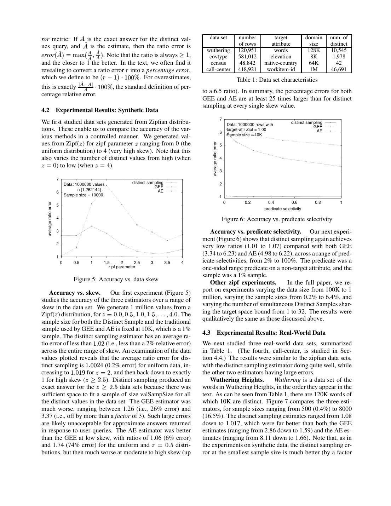
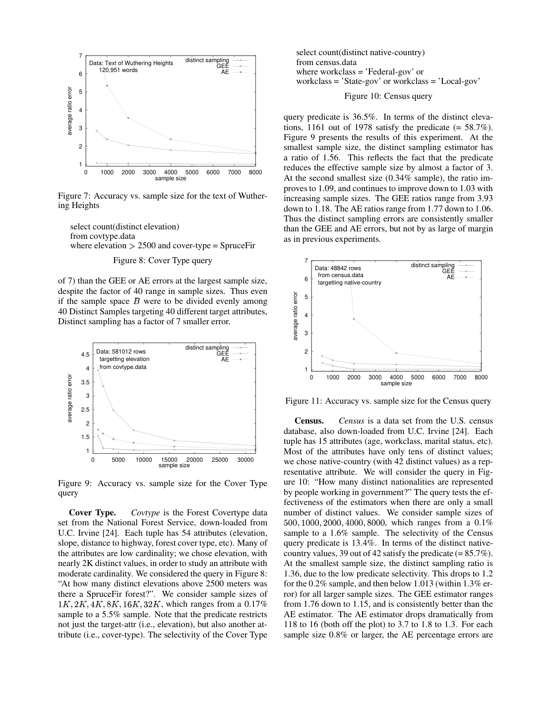

> 本组第 49 篇 · 概率计数与抽样 · [全部论文]() · [上一篇]() · [下一篇]()

Distinct Sampling先完整扫描数据，再按目标属性值的一致随机die-level选键，为已选键保留全部行或最多t条均匀reservoir及精确频数。查询在摘要上执行谓词和COUNT DISTINCT，再按2^ell放大。它对键而非频次均匀，并保留非目标列信息；代价是事先确定目标键、一次全扫、每键行预算和维护。误差保证依赖目标选择率、值内选择率及完全独立哈希，不是“1%样本固定10%误差”。实验有明确例外：Covtype最小预算ratio1.56、1%事件样本Avg SA误差32.8%。本地版本百分比算术冲突均保留标注，未擅改数据或声称作者确认勘误。

本文保留论文陈述、读者推断与待验证方案的区别；实验数字只适用于原文条件。原文和翻译来自已有 AI 辅助精读报告，已做来源匹配与编辑复核，不等于人工逐项核验或独立实验复现。所有页码均为 PDF 物理页。

## 论文与阅读范围

Phillip B. Gibbons. Distinct Sampling for Highly-Accurate Answers to Distinct Values Queries and Event Reports. Proceedings of the 27th VLDB Conference, Roma, Italy, 2001. Local conference paper 10 physical pages; full June 2001 Bell Labs technical report cited as [13] is not included/read.

[论文集中的原始 PDF](https://github.com/lonng/db-papers/blob/4ff1331069c7cf52ac97dd769e5f484c1c35c200/papers/probabilistic-counting/distinct-sampling-for-highly-accurate-answers-to-distinct-values-queries-and-event-reports.pdf) · 本地来源：`probabilistic-counting/distinct-sampling-for-highly-accurate-answers-to-distinct-values-queries-and-event-reports.pdf`，共 10 页。

本篇保留 24 组原文精读和 24 条证据。截图为原始 PDF 的局部页选，不是重新生成的图表；未将整份 PDF 复制到博客。

## 研究问题与适用范围

**不只是整列NDV**
查询模板为SELECT COUNT(DISTINCT target) FROM rel WHERE P，P可以抽样后才给出并涉及其他属性。普通行样本偏向高频键、易漏低频键；仅存目标键的经典bit/hash摘要又没有非目标列信息来检查P。

该方法没有突破只读少量输入的NDV估计负面下界，而是允许构建时完整扫描，查询时读小摘要。摘要小、构建少读、查询快是三件事。target必须预知，事后任意谓词不等于事后任意更换目标属性；复合目标也需对应样本。

事件报告还需同会话事件一起保留，才能算会话级派生指标；普通行样本可能有start无end。保留完整会话要求t不小于会话事件数，不是任何t都天然满足。

依据：论文陈述；PDF 物理页 2, 4, 5, 6, 9。证据：[DISTINCT-SAMPLINGREV01](#evidence-distinct-samplingrev01), [DISTINCT-SAMPLINGREV02](#evidence-distinct-samplingrev02), [DISTINCT-SAMPLINGREV06](#evidence-distinct-samplingrev06), [DISTINCT-SAMPLINGREV12](#evidence-distinct-samplingrev12), [DISTINCT-SAMPLINGREV17](#evidence-distinct-samplingrev17), [DISTINCT-SAMPLINGREV21](#evidence-distinct-samplingrev21), [DISTINCT-SAMPLINGREV24](#evidence-distinct-samplingrev24)。

## 双层抽样架构

**两层抽样和维护状态**
全局保留level ell、固定die-hash、总样本行槽预算B、每键行预算t。对合格键存至多t条真实行，达到阈值后加dummy行保存精确出现次数。查询必须忽略dummy，它是维护元数据而不是一条真实事件。

同一键始终映射同一随机级别；保留已扫描且die-level>=ell的键，空间满时整级淘汰并提升ell。资格概率为2^(−ell)，因而是键均匀，不是行均匀；已选键有些保留全部行，有些只有reservoir。

按die-level链表组织，作者提出lazy deletion平滑回收成本，但未证明并发锁自由或实时硬时延。B按行槽而不是实际字节描述，dummy、键、索引与元数据都会占内存；部署比较不可只对行数。

依据：论文陈述；PDF 物理页 4, 5。证据：[DISTINCT-SAMPLINGREV02](#evidence-distinct-samplingrev02), [DISTINCT-SAMPLINGREV03](#evidence-distinct-samplingrev03), [DISTINCT-SAMPLINGREV04](#evidence-distinct-samplingrev04), [DISTINCT-SAMPLINGREV07](#evidence-distinct-samplingrev07), [DISTINCT-SAMPLINGREV22](#evidence-distinct-samplingrev22)。

*原论文 PDF 物理页 7，版权归原作者或出版方。点击图片可查看原尺寸。页面文本中定位到：Figure 5: Accuracy vs. data skew；Table 1: Data set characteristics；Figure 6: Accuracy vs. predicate selectivity。这是页面定位信息，不表示本次已复核图内所有数据。*

## 构建与查询算法

**逐行处理**
先取目标键v，用固定hash检查资格；重复行不得重新独立投币。未满t条则追加，累计频数c_v继续增长；之后以t/c_v概率接纳新行并随机替换旧reservoir行，维持组内均匀。空间阈值触发整级淘汰并提高ell，不能逐行随机丢弃破坏键级一致性。示意伪代码的极端容量、无可淘汰级别、全零hash与dummy槽位需要复现时显式测试，不声称已检查原实现。

**查询和参数**
对真实样本行执行P，数合格不同键，乘2^ell；值内reservoir若漏掉罕见满足行，精确总频数不能补成该P的精确命中数。只筛目标键时t=1可让预算尽量用于键覆盖；非目标谓词需保留更多组内行。

式1经验建议t=min(2/q,B/50)，预期约两次命中不是必然两次。定理2另给t=Theta(log(1/delta)/q_val*)，B=Theta(t log(1/delta)/(q_tar*epsilon^2))，还需完全独立哈希与完整证明。q_tar是合格不同键比例，q_val(v)是合格键内部行命中比例，文中总体q_val取中位数，不等于全表行选择率。

实际读者有限总体算术：一个100行组只有1行命中，均匀不放回抽5行，漏检概率95%。它解释稀有组内条件风险，不是整算法实现或误差界证明。

依据：论文陈述；PDF 物理页 4, 5, 6。证据：[DISTINCT-SAMPLINGREV03](#evidence-distinct-samplingrev03), [DISTINCT-SAMPLINGREV04](#evidence-distinct-samplingrev04), [DISTINCT-SAMPLINGREV05](#evidence-distinct-samplingrev05), [DISTINCT-SAMPLINGREV06](#evidence-distinct-samplingrev06), [DISTINCT-SAMPLINGREV07](#evidence-distinct-samplingrev07), [DISTINCT-SAMPLINGREV08](#evidence-distinct-samplingrev08), [DISTINCT-SAMPLINGREV09](#evidence-distinct-samplingrev09), [DISTINCT-SAMPLINGREV21](#evidence-distinct-samplingrev21), [DISTINCT-SAMPLINGREV22](#evidence-distinct-samplingrev22)。

## 正确性与误差前提

**不变量与条件**
固定hash和单调ell保持键资格一致，reservoir保持值内行均匀。逐行Bernoulli不能替代前者，仅存最近t条不能替代后者。保持两个局部性质也不等于所有事后谓词最终精确。

定理2保证按原文陈述为满足两个选择率条件的任一查询提供epsilon/delta界；证明在未读的完整技术报告[13]且假设fully independent random hash functions。5页具体die-hash只声称pairwise independence，不能自动等同证明前提；本报告不宣称对无限自适应全部查询同时成立，也不补造隐含常数。中位q_val定义与完整证明的联系仍需核验。

**删除不保证永久一次扫描**
reservoir删除需[15]维护技术，不能只删数组元素便认定仍均匀。改目标键的更新为delete+insert；大量删除后已淘汰键不能由小样本恢复，论文明确可能重扫以保持保证。“may read only once”不是无条件绝不重扫。

ratio=max(Ahat/A,A/Ahat)，论文percentage=(ratio−1)*100%，仅在高估时等于通常相对误差。实际100、估计50，通常相对误差50%，论文派生percentage100%；空真值还需规定实现规则，不能除零。

依据：读者推断；PDF 物理页 4, 5, 6, 7。证据：[DISTINCT-SAMPLINGREV03](#evidence-distinct-samplingrev03), [DISTINCT-SAMPLINGREV04](#evidence-distinct-samplingrev04), [DISTINCT-SAMPLINGREV08](#evidence-distinct-samplingrev08), [DISTINCT-SAMPLINGREV09](#evidence-distinct-samplingrev09), [DISTINCT-SAMPLINGREV10](#evidence-distinct-samplingrev10), [DISTINCT-SAMPLINGREV13](#evidence-distinct-samplingrev13), [DISTINCT-SAMPLINGREV21](#evidence-distinct-samplingrev21)。

## 实验与原文数值复核

**协议与反例**
一般实验733MHz Pentium、256MB、Linux，每绘图点7次独立试验平均；合成Zipf100万行、1万样本，跨偏斜和2%至100%非目标谓词选择率，比较GEE、AE。这不是每查询最大误差或置信区间。Covtype最小样本ratio1.56、下一档1.09，直接限制“任何预算10%内”的解释。

Call-center是获准私有数据，商业alpha系统10小时模拟测试活动，不是生产全量日志；约418921行、46691会话。报表实验改用Windows NT4.0、SQL Server7.0、Crystal Reports。t=25大于最大会话事件数，所以入样会话才完整。

表2每档一次试验：精确216秒，1%样本2秒约108倍，但Avg SA误差32.8%，不是全部字段0–10%。第二报表5小时26分到5%样本10秒约1956倍、平均误差7%，精确路径有严重内存thrashing；不能外推本机或现代平台同倍数。

**原版算术冲突保留**
目视确认Wuthering的8000/120951被写16.5%，实算6.61%；Census500至8000/48842被写0.1%至1.6%，实算约1.02%至16.38%；39/42被写85.7%，实算92.86%。“40倍样本跨度”也不能由已列500到8000直接得到（16倍）。不擅改行数、样本量或合格键数，不声称作者勘误，也不据此否定算法。

依据：论文陈述；PDF 物理页 6, 7, 8, 9, 10。证据：[DISTINCT-SAMPLINGREV14](#evidence-distinct-samplingrev14), [DISTINCT-SAMPLINGREV15](#evidence-distinct-samplingrev15), [DISTINCT-SAMPLINGREV16](#evidence-distinct-samplingrev16), [DISTINCT-SAMPLINGREV17](#evidence-distinct-samplingrev17), [DISTINCT-SAMPLINGREV18](#evidence-distinct-samplingrev18), [DISTINCT-SAMPLINGREV19](#evidence-distinct-samplingrev19), [DISTINCT-SAMPLINGREV20](#evidence-distinct-samplingrev20), [DISTINCT-SAMPLINGREV24](#evidence-distinct-samplingrev24)。

*原论文 PDF 物理页 8，版权归原作者或出版方。点击图片可查看原尺寸。页面文本中定位到：Figure 7: Accuracy vs. sample size for the text of Wuther-；Figure 8: Cover Type query；Figure 9: Accuracy vs. sample size for the Cover Type；Figure 10: Census query；Figure 9 presents the results of this experiment. At the。这是页面定位信息，不表示本次已复核图内所有数据。*

## 资源与维护权衡

每键更多行降低非目标谓词漏检，却挤占不同键覆盖。低q_tar需更多键，低q_val需更大reservoir，一份固定小摘要无法对任意稀有过滤器保持固定相对误差。多目标样本增加存储维护，单次只扫相应样本不等于所有样本免费。

一次全扫换重复快查询适合重要目标相对稳定的仓库与事件流；未知目标组合很多时可混合传统样本回退。大量删除、长尾会话与稀有关键指标需要监控、补样和精确回退。t不足不再是完整会话，不能继续照完整事件算业务指标。

依据：读者推断；PDF 物理页 5, 6, 9。证据：[DISTINCT-SAMPLINGREV06](#evidence-distinct-samplingrev06), [DISTINCT-SAMPLINGREV08](#evidence-distinct-samplingrev08), [DISTINCT-SAMPLINGREV10](#evidence-distinct-samplingrev10), [DISTINCT-SAMPLINGREV12](#evidence-distinct-samplingrev12), [DISTINCT-SAMPLINGREV17](#evidence-distinct-samplingrev17), [DISTINCT-SAMPLINGREV23](#evidence-distinct-samplingrev23)。

## 与其他方法比较

普通行样本可不全扫抽取，且能复用任意目标列，但不同键估计常差；本方案先完整看数据再按键一致采样，不是同观察预算下突破不可能下界。

经典FM等紧凑摘要擅长整列NDV，却不保留任意非目标列P所需行信息。此比较限于本文讨论的经典形式，不否定所有后来条件sketch，也未检查当前HLL产品。

本文承认join sampling困难，建议借外键join synopsis，或在事实表为瓶颈且适当前提下用事实表摘要、其他表保持完整。不能扩写成任意多对多、任意目标列联接都享有同一保证。

依据：读者推断；PDF 物理页 2, 6。证据：[DISTINCT-SAMPLINGREV01](#evidence-distinct-samplingrev01), [DISTINCT-SAMPLINGREV11](#evidence-distinct-samplingrev11), [DISTINCT-SAMPLINGREV12](#evidence-distinct-samplingrev12), [DISTINCT-SAMPLINGREV23](#evidence-distinct-samplingrev23)。

## 复现建议与实际检查

**建议路线，不冒充实现**
先对可穷举小表验证资格键、精确频数、reservoir、dummy和2^ell放大。测试重复键不重投币、输入重排、整级淘汰、容量极端、插入删除及目标更新。固定hash检查不变量，再多seed评估误差，不能用一次精确结果代替概率证明。

独立变化q_tar与q_val，加入高偏斜、稀有组内条件、长会话和大规模删除；记录真值、估计、ratio、普通相对误差、空集规则与失败率。空间比较包含真实字节、元数据与索引。

实际入口qa/naru-reader-tests.py输出本篇qa/distinct-sampling-reader-tests.json，只检验95%漏检、指标口径、表中文字除法及会话不完整反例；没有实现整算法、reservoir删除、原数据实验或SQL Server性能复现。定理常数与具体哈希落地需另读[13]/[15]。

依据：待验证的工程设想；PDF 物理页 4, 5, 6, 7, 8, 9。证据：[DISTINCT-SAMPLINGREV03](#evidence-distinct-samplingrev03), [DISTINCT-SAMPLINGREV04](#evidence-distinct-samplingrev04), [DISTINCT-SAMPLINGREV06](#evidence-distinct-samplingrev06), [DISTINCT-SAMPLINGREV08](#evidence-distinct-samplingrev08), [DISTINCT-SAMPLINGREV09](#evidence-distinct-samplingrev09), [DISTINCT-SAMPLINGREV10](#evidence-distinct-samplingrev10), [DISTINCT-SAMPLINGREV13](#evidence-distinct-samplingrev13), [DISTINCT-SAMPLINGREV16](#evidence-distinct-samplingrev16), [DISTINCT-SAMPLINGREV17](#evidence-distinct-samplingrev17), [DISTINCT-SAMPLINGREV21](#evidence-distinct-samplingrev21), [DISTINCT-SAMPLINGREV22](#evidence-distinct-samplingrev22), [DISTINCT-SAMPLINGREV23](#evidence-distinct-samplingrev23)。

## 结论与工程启发

核心启发是按业务实体一致抽样，为事后谓词保留受控组内信息，而不只是末尾乘放大倍数。全扫构建、键级选择和值内抽样共同提供能力，也共同决定目标列、空间及稀有谓词限制。

实际使用应区分理论前提、经验参数与有限实验，关键指标保留精确回退；本地原文算术冲突保留疑点，不让宣传百分比替代可核验边界。

依据：读者推断；PDF 物理页 2, 4, 5, 6, 8, 9。证据：[DISTINCT-SAMPLINGREV01](#evidence-distinct-samplingrev01), [DISTINCT-SAMPLINGREV02](#evidence-distinct-samplingrev02), [DISTINCT-SAMPLINGREV08](#evidence-distinct-samplingrev08), [DISTINCT-SAMPLINGREV09](#evidence-distinct-samplingrev09), [DISTINCT-SAMPLINGREV15](#evidence-distinct-samplingrev15), [DISTINCT-SAMPLINGREV18](#evidence-distinct-samplingrev18), [DISTINCT-SAMPLINGREV21](#evidence-distinct-samplingrev21), [DISTINCT-SAMPLINGREV24](#evidence-distinct-samplingrev24)。

## 原文精读：从句子回到机制

以下保留原文、忠实翻译、含义与边界；假设示例不作为论文实验结果。

原文中形如 `[U+0000]` 的标记表示 PDF 提取文本中的不可见控制字符，不是论文中的变量，也不是补写的公式；原始报告不变，字形需对照原 PDF。

### P001 · PDF 物理页 2

**原文**

<blockquote class="paper-source-quote"><pre><code>called distinct sampling, that reads all the data in&#10;a single scan, and collects a specially tailored sample over&#10;the distinct values. In contrast to the above negative result,&#10;our small Distinct Samples can be stored in a database and&#10;used at query time to estimate the number of distinct values&#10;(and answer other common distinct values queries), with&#10;high accuracy (within 10%) and error guarantees. After the&#10;initial scan to construct it, a Distinct Sample can be incre-&#10;mentally maintained up-to-date as new data is inserted or&#10;deleted, with minimal time and memory overheads. Thus&#10;although we necessarily read all the data, we may do so&#10;only once.</code></pre></blockquote>

**忠实翻译**

> distinct sampling以一次完整扫描读取全部数据，在不同值上收集专门设计的样本；小样本可存于数据库并在查询时估计不同值，初始化后能随插入删除增量维护，所以完整扫描可能只需一次。

**技术含义与边界**

> 它没有绕过只看少量输入的负面下界，而是改变了构建阶段可读的数据量。小摘要不等于少读取原始数据。

**常见误读**

> 不把“may only once”改为绝不重扫；大量删除时6页明确可能为了保持保证而重扫。

**读者构造的假设示例**

> 读者构造的假设示例：构建时扫过一亿行仅保留1%摘要，查询时很快；不能称为只检查1%输入也具有同样保证。

### P002 · PDF 物理页 4

**原文**

<blockquote class="paper-source-quote"><pre><code>Each distinct target-attr value in the table rel is&#10;equally likely to be in the sample.&#10;[U+0000]For each distinct value&#10;[U+0001] in the sample, we have:&#10;– a count of the number of times&#10;[U+0001] appears in the&#10;entire table scanned thus far, and&#10;– either&#10;all&#10;the&#10;rows&#10;in&#10;the&#10;table&#10;with&#10;target-attr&#10;[U+0019]&#10;[U+0001] , or, if there are more&#10;than&#10;[U+0002] such rows, a uniform sample of&#10;[U+0002] of these&#10;rows (&#10;[U+0002] is a parameter).</code></pre></blockquote>

**忠实翻译**

> 表中每个不同target-attr值入样的机会相等；每个已入样值附带扫描至今的总出现次数，以及其全部行，或当行数超过t时保留这些行的一个均匀样本。

**技术含义与边界**

> 这是“值层选择+值内行reservoir”的双层结构。只存一个键能估总NDV，却不足以处理其他列上的事后谓词。

**常见误读**

> 不能把distinct sample当简单SELECT DISTINCT后均匀抽几个键；也不能说任何已入样值都保存了其所有行。

**读者构造的假设示例**

> 读者构造的假设示例：客户A被选中但有一万条订单时，只保留t条订单和精确总数；事后“是否有海外订单”可能因reservoir漏掉而低估。

### P003 · PDF 物理页 4

**原文**

<blockquote class="paper-source-quote"><pre><code>The invariant we maintain throughout is that&#10;[U+0000]contains&#10;all the distinct values appearing in the scanned portion of&#10;the table whose die-level is at least&#10;[U+0004] , and no other distinct&#10;values. Because levels for distinct values are chosen at ran-&#10;dom,&#10;[U+0000]contains a uniform sample of the distinct values in&#10;the scanned portion. (Of course, it may have many rows&#10;duplicating the same values.)</code></pre></blockquote>

**忠实翻译**

> 保持的不变量是：样本包含已扫描部分中die-level至少为当前层级的所有不同值，且没有其他值；由于各值的层级随机，它形成不同值的均匀样本，尽管行可重复同一值。

**技术含义与边界**

> 相同键必须用相同哈希层级，后续重复出现不能独立重新掷硬币；提升层级后按键整组淘汰。

**常见误读**

> 不把均匀NDV样本误写为均匀元组样本，或用每行独立Bernoulli采样替代键一致性。

**读者构造的假设示例**

> 读者构造的假设示例：A出现100次、B出现1次，若各键先决定是否合格，则两者键入样机会相同；逐行投币则A更易出现。

### P004 · PDF 物理页 5

**原文**

<blockquote class="paper-source-quote"><pre><code>For values that reach that limit, we use reservoir&#10;sampling [35] to maintain a uniform sample of the&#10;[U+0002] rows&#10;with that value (Steps 10-13). Reservoir sampling requires&#10;knowing the number of rows with the same value thus far&#10;(whether currently in the Distinct Sample or not); thus we&#10;also store a dummy row in the Distinct Sample that con-&#10;tains the exact number of occurrences of this value thus far&#10;(Step 9).</code></pre></blockquote>

**忠实翻译**

> 达到t上限的值用reservoir sampling保持t条均匀样本；该过程需要已见该值的总行数，因此还存一个dummy行记录精确出现次数。

**技术含义与边界**

> 插入第c_v条时按t/c_v概率接纳并替换一条旧样本。dummy计数参与维护，不是查询真实行；存储预算还要考虑元数据开销。

**常见误读**

> 不能把dummy行当额外一次出现计入COUNT，或把reservoir简单替换成最后t条，后者有时间偏置。

**读者构造的假设示例**

> 读者构造的假设示例：t=3、当前累计100次时新行以3/101概率进入；查询COUNT DISTINCT要忽略dummy行。

### P005 · PDF 物理页 5

**原文**

<blockquote class="paper-source-quote"><pre><code>For queries without predi-&#10;cates, or queries with predicates only on the target attribute,&#10;the valSampSize&#10;[U+0002] could be set to 1, resulting in the best&#10;performance for distinct sampling on such queries, because&#10;the available storage would be devoted entirely to distinct&#10;values (and not to multiple rows with the same value).</code></pre></blockquote>

**忠实翻译**

> 无谓词或谓词只作用于目标属性时，可将valSampSize设为1，以把空间尽量用于不同值，而非同一值的多行。

**技术含义与边界**

> 目标键上的谓词对同一键全部行真假一致，一条代表行即足够；非目标列谓词则取决于值内行多样性。

**常见误读**

> 不要把t=1普遍设为最优，忽略业务是否会按其他属性筛选；也不必对无谓词NDV盲目保留数百条同键行。

**读者构造的假设示例**

> 读者构造的假设示例：COUNT DISTINCT customer WHERE customer在某范围内可用t=1；WHERE order_status=failed则可能需要每客户更多行。

### P006 · PDF 物理页 5

**原文**

<blockquote class="paper-source-quote"><pre><code>A good rule of thumb is to set&#10;[U+0002]&#10;to be the minimum of (i) twice the inverse of the minimum&#10;predicate selectivity,&#10;1 , for queries of interest (e.g.,&#10;0[U+0013]232 for&#10;predicates down to 2%) and (ii) 2% of the sample size</code></pre></blockquote>

**忠实翻译**

> 作者建议t取两者较小者：关注的最小谓词选择率倒数的两倍，以及总样本空间B的2%。

**技术含义与边界**

> 式1可见为t=min(2/q,B/50)。这是经验设参建议，不是定理2的完整样本复杂度，也未给普遍10%误差常数。

**常见误读**

> 不能只用全表行选择率替代每个合格值内的q_val，更不能将期望两次命中解释成必然至少两次。

**读者构造的假设示例**

> 读者构造的假设示例：t=100、值内选择率2%时预期命中2条；概率仍可能为零，尤其不同键之间选择率差异很大。

### P007 · PDF 物理页 5

**原文**

<blockquote class="paper-source-quote"><pre><code>Producing an estimate.&#10;Given a stored Distinct Sam-&#10;ple&#10;[U+0000]and its current level&#10;[U+0004] , we execute the distinct values&#10;query on&#10;[U+0000] , remembering to ignore the dummy rows, and&#10;multiply the result by the scale factor</code></pre></blockquote>

**忠实翻译**

> 给定存储的样本及其当前层级，在样本上执行不同值查询，忽略dummy行，再乘相应层级的放大因子。

**技术含义与边界**

> 图文给出放大2^ell，对应资格概率2^(−ell)。倍数用于distinct键命中计数，不是对每个值内reservoir缺失再直接乘总频率。

**常见误读**

> 不要将2^ell写成ell或1/ell，也不能认为放大可以修补值内谓词罕见命中的漏检。

**读者构造的假设示例**

> 读者构造的假设示例：ell=3、20个样本不同值满足谓词，估计为160；若本应合格的键在值内行样本中无命中，它仍不会被这一步恢复。

### P008 · PDF 物理页 5

**原文**

<blockquote class="paper-source-quote"><pre><code>We de-&#10;fine the target selectivity,&#10;1 tar&#10;S&#10;0 , to be&#10;[U+0013]&#10;L&#10;N&#10;[U+0013]&#10;[U+0011]&#10;[U+0013]&#10;L&#10;[U+0013] , i.e., the&#10;number of distinct values satisfying&#10;M&#10;divided by the total&#10;number of distinct values in the relation.</code></pre></blockquote>

**忠实翻译**

> 目标选择率是满足谓词的不同值数量除以关系中的全部不同值数量。

**技术含义与边界**

> q_tar按键数计，不是全表行选择率；值选择率q_val(v)则是该合格键组内命中行的比例，文中聚合取中位数。两轴分别影响需多少键与每键多少行。

**常见误读**

> 不能用一个“谓词选择率”笼统替代全部前提，也不把q_val中位数误写为最小值。

**读者构造的假设示例**

> 读者构造的假设示例：100个键中50个有命中，q_tar=0.5；每个合格组内只有1%行命中时，q_val=0.01，两个数量相差很大。

### P009 · PDF 物理页 6

**原文**

<blockquote class="paper-source-quote"><pre><code>The proof appears in the full technical report [13], and as-&#10;sumes fully independent random hash functions.</code></pre></blockquote>

**忠实翻译**

> 证明在完整技术报告[13]，并假设完全独立的随机哈希函数。

**技术含义与边界**

> 本地定理2给t=Theta(log(1/delta)/q_val*)，B=Theta(t log(1/delta)/(q_tar* epsilon^2))。5页具体die-hash声称pairwise independence，不能直接代替这里fully independent的证明前提；本次未读完整证明或核验具体哈希族。

**常见误读**

> 不声称pairwise哈希已证明享有同一高概率保证，也不把“任一查询”的保证提升为无限自适应全部查询同时成功。

**读者构造的假设示例**

> 读者构造的假设示例：若要同时保证一万个预先固定查询，可考虑分配失败概率并做union bound；是否可行及常数需额外证明与预算。

### P010 · PDF 物理页 6

**原文**

<blockquote class="paper-source-quote"><pre><code>if a substan-&#10;tial fraction of the relation is deleted, it may be necessary to&#10;rescan the relation in order to preserve the accuracy guar-&#10;antees [13].</code></pre></blockquote>

**忠实翻译**

> 如果关系中相当大的一部分被删除，为保持准确性保证，可能需要重新扫描关系。

**技术含义与边界**

> 层级可单调上升收缩，却不能凭已有小样本恢复以前淘汰的键。保留值内部的删除还需reservoir删除维护，不是任意删除仅扣计数就足够。

**常见误读**

> 不要说支持删除就意味着永久一次扫描或任意删除下精度不变；更新目标键也需删除旧键、插入新键。

**读者构造的假设示例**

> 读者构造的假设示例：NDV从百万降到一千而ell仍高时，幸存摘要可能几乎空，需要补样或重建；只调放大系数不会创造丢失数据。

### P011 · PDF 物理页 6

**原文**

<blockquote class="paper-source-quote"><pre><code>Distinct sampling over joins suf-&#10;fers from the same difficulties as uniform sampling over&#10;joins [3], and the same join synopsis approach can be used&#10;to handle the common case of multiway foreign key joins.</code></pre></blockquote>

**忠实翻译**

> 对联接做distinct sampling面临与联接上的均匀采样相同的困难，常见多路外键联接可用同样的join synopsis思路处理。

**技术含义与边界**

> 后文建议以大事实表的摘要替换事实表、其他表保持完整，在相应场景可保留精度；这不是任意多对多、任意目标属性下自动正确的结论。

**常见误读**

> 不把支持谓词扩展成已解决所有联接分布与扇出问题；联接乘数、谓词落在哪张表都需界定。

**读者构造的假设示例**

> 读者构造的假设示例：目标键来自事实表且维表外键匹配良好时可考虑替换；两边都有重复键的多对多联接需另作分析。

### P012 · PDF 物理页 6

**原文**

<blockquote class="paper-source-quote"><pre><code>a single sample can be used for distinct-&#10;values estimation for any target attribute (although the ac-&#10;curacy is often poor), whereas distinct sampling requires&#10;a separate Distinct Sample for each target attribute (and a&#10;priori knowledge of the target attributes).</code></pre></blockquote>

**忠实翻译**

> 传统样本虽常不精确，却能用于任意目标属性的NDV；distinct sampling需为每个目标属性单独建样，并预先知道这些目标。

**技术含义与边界**

> 查询谓词未知但target-attr要已知，复合目标键也算单独目标。多个样本可在一次扫描中构建，空间和维护开销仍随目标数量增加。

**常见误读**

> 不把任意事后谓词说成任意事后目标组合均不用额外摘要；单查询只扫描对应样本不等于所有样本存储免费。

**读者构造的假设示例**

> 读者构造的假设示例：按客户、商品、(客户,商品)统计三种NDV，可需要三份不同键分组摘要，而不是随意换SELECT DISTINCT列即可。

### P013 · PDF 物理页 7

**原文**

<blockquote class="paper-source-quote"><pre><code>In the text, we often find it&#10;revealing to convert a ratio error&#10;[U+0002] into a percentage error,&#10;which we define to be&#10;[U+000B]&#10;[U+0002]&#10;[U+0008]&#10;0&#10;[U+000C]/.&#10;0[U+0013]232[U+0004][U+0003] . For overestimates,&#10;this is exactly&#10;[U+0005]&#10;"&#10;[U+0001]&#10;[U+0007]&#10;[U+0001]&#10;[U+0005]&#10;[U+0001]&#10;.&#10;0[U+0013]232[U+0004][U+0003] , the standard definition of per-&#10;centage relative error.</code></pre></blockquote>

**忠实翻译**

> 文中常把ratio error r换成(r−1)乘100%的percentage error；对于高估，这恰好等于通常定义的百分比相对误差。

**技术含义与边界**

> 低估时两者不同，因此摘要中的百分比要按论文定义解释；ratio error始终至少1，但普通相对误差非对称。

**常见误读**

> 不能把r=2说成任何方向都是通常相对误差100%；实际100、估计50时普通相对误差50%，而ratio派生百分比100%。

**读者构造的假设示例**

> 读者构造的假设示例：实际读者算术测试列出100对50的两个口径，帮助比较其他AQP论文时统一指标。

### P014 · PDF 物理页 6

**原文**

<blockquote class="paper-source-quote"><pre><code>The experiments were run on a 733 MHz Pentium PC&#10;with 256MB RAM running Linux. Each data point plotted&#10;is the average of 7 independent trials.</code></pre></blockquote>

**忠实翻译**

> 实验在733MHz Pentium、256MB内存、Linux的机器上运行；每个绘图数据点是7次独立试验平均值。

**技术含义与边界**

> 这不是尾部高置信限或最大误差。事件报表另换Windows NT4.0、SQL Server7.0和Crystal Reports，表2为单次试验。

**常见误读**

> 不把7次平均的好结果当作每次、每个查询、每个平台都在10%内；也不能把旧硬件速度套到当前电脑。

**读者构造的假设示例**

> 读者构造的假设示例：平均ratio1.05仍可能有个别试验偏差较大，应另外报告分位数与置信度。

### P015 · PDF 物理页 8

**原文**

<blockquote class="paper-source-quote"><pre><code>At the&#10;smallest sample size, the distinct sampling estimator has&#10;a ratio of 1.56.&#10;This reflects the fact that the predicate&#10;reduces the effective sample size by almost a factor of 3.&#10;At the second smallest size (0.34% sample), the ratio im-&#10;proves to 1.09, and continues to improve down to 1.03 with&#10;increasing sample sizes.</code></pre></blockquote>

**忠实翻译**

> 在最小样本量时，distinct sampling的ratio为1.56；谓词令有效样本量减少约三倍。次小样本量时ratio改善到1.09，继续增加样本后降至1.03。

**技术含义与边界**

> Covtype实验已提供摘要“通常0–10%”之外的反例：最小预算误差56%（ratio派生口径）。需把预算和选择率共同报告。

**常见误读**

> 不抹掉1.56尾例，只留下总体宣传；实验并不支持任意小样本固定10%误差。

**读者构造的假设示例**

> 读者构造的假设示例：预算不足导致合格键很少时，扩大B可改善；t过大也可能挤占不同键覆盖，需要平衡。

### P016 · PDF 物理页 8

**原文**

<blockquote class="paper-source-quote"><pre><code>In terms of the distinct native-&#10;country values, 39 out of 42 satisfy the predicate (= 85.7%).</code></pre></blockquote>

**忠实翻译**

> 原文称不同native-country值中，42个有39个满足谓词，并在括号中写为85.7%。

**技术含义与边界**

> 原图确认这两处数字并存，但39/42实际约92.86%。7页Wuthering的8000/120951约6.61%而文中16.5%；8页Census 500至8000/48842约1.02%至16.38%，文字却说0.1%至1.6%。保留为本地版本算术/排版疑点，不能自行决定哪个数据值才正确。

**常见误读**

> 不把不一致数据拼成精确可复现实验，也不据此否定算法理论；未获得原始数据或作者勘误。

**读者构造的假设示例**

> 读者构造的假设示例：实际读者算术脚本只核验已印数字的除法，没有复跑数据集，不能断言应把39改成36。

### P017 · PDF 物理页 9

**原文**

<blockquote class="paper-source-quote"><pre><code>Accordingly, for our Distinct Samples, we set&#10;the valSampSize to be larger than the maximum number of&#10;events for a call</code></pre></blockquote>

**忠实翻译**

> 因此，对这些distinct samples，作者把valSampSize设得比每通电话的最大事件数更大。

**技术含义与边界**

> 本实验t=25，因所有已选会话事件都保留，才能计算会话时长等派生统计；一般t上限小于会话长度时不再保证完整会话。

**常见误读**

> 不把“抽中一个事件即保留全部会话”当成任何参数下的不变量；这是事件实验特意满足的条件。

**读者构造的假设示例**

> 读者构造的假设示例：t=25、最长会话20条事件可整组保留；一个50事件会话会进入reservoir，不能再直接当完整会话算起止时间。

### P018 · PDF 物理页 9

**原文**

<blockquote class="paper-source-quote"><pre><code>Table 2 depicts the query times and relative errors in&#10;the answers for each field in the Call Center Performance&#10;Report (one of the reports studied), for Aqua reports using a&#10;range of Distinct Sample sizes (a single trial each).</code></pre></blockquote>

**忠实翻译**

> 表2给出Call Center Performance Report各字段在一系列distinct样本量下的查询时间和相对误差，每个设置只做一次试验。

**技术含义与边界**

> 物理10页表2精确报表216秒、1%样本2秒，但Avg SA字段误差32.8%，并非全部字段0–10%；第二报表5小时26分到10秒约1956倍，受原精确报表内存thrashing影响。

**常见误读**

> 不将单次表2的108倍写成所有场景万倍，也不隐藏1%样本32.8%的字段；“2–4数量级”必须带场景和慢基线背景。

**读者构造的假设示例**

> 读者构造的假设示例：若服务水平指标Avg SA很关键，即使其他字段误差很小，也可能需更大样本或精确查询，不能只看平均宣传。

### P019 · PDF 物理页 10

**原文**

<blockquote class="paper-source-quote"><pre><code>Report&#10;Query time&#10;WO&#10;WH&#10;ABD&#10;ABD Rate&#10;Avg PPT&#10;Avg SA&#10;Avg HT&#10;Exact&#10;216 secs&#10;184,753&#10;184,753&#10;0&#10;0.00%&#10;00:34&#10;03:03&#10;00:32&#10;Aqua 25%&#10;51 secs&#10;0.2%&#10;0.2%&#10;0.0%&#10;0.0%&#10;0.0%&#10;0.0%&#10;0.0%&#10;Aqua 20%&#10;43 secs&#10;0.5%&#10;0.5%&#10;0.0%&#10;0.0%&#10;0.0%&#10;5.5%&#10;0.0%&#10;Aqua 10%&#10;21 secs&#10;0.4%&#10;0.4%&#10;0.0%&#10;0.0%&#10;0.0%&#10;4.4%&#10;0.0%&#10;Aqua 5%&#10;10 secs&#10;0.004%&#10;0.004%&#10;0.0%&#10;0.0%&#10;0.0%&#10;3.3%&#10;0.0%&#10;Aqua 1%&#10;2 secs&#10;2.6%&#10;2.6%&#10;0.0%&#10;0.0%&#10;0.0%&#10;32.8%&#10;0.0%&#10;Table 2: Query times and answer accuracy vs. Distinct Sample sizes.</code></pre></blockquote>

**忠实翻译**

> 表2精确报表216秒；Aqua25%、20%、10%、5%、1%分别51、43、21、10、2秒。1%行WO与WH误差各2.6%，ABD、ABD Rate、Avg PPT、Avg HT为0%，Avg SA为32.8%；20%、10%、5%的Avg SA分别5.5%、4.4%、3.3%。

**技术含义与边界**

> 原页图已核对；参数为每档单次试验，不能用“通常0–10%”替代个别关键字段。表2为第一报表，5小时26分属于另一个报表。

**常见误读**

> 不把所有字段写成<=10%，也不把第二报表的秒数与本表拼成同一加速比。

**读者构造的假设示例**

> 读者构造的假设示例：实际算术216/2=108倍，只对应本表1%设置；业务若依赖Avg SA，应单独审核32.8%能否接受。

### P020 · PDF 物理页 7

**原文**

<blockquote class="paper-source-quote"><pre><code>data set&#10;number&#10;target&#10;domain&#10;num. of&#10;of rows&#10;attribute&#10;size&#10;distinct&#10;wuthering&#10;120,951&#10;words&#10;128K&#10;10,545&#10;covtype&#10;581,012&#10;elevation&#10;8K&#10;1,978&#10;census&#10;48,842&#10;native-country&#10;64K&#10;42&#10;call-center&#10;418,921&#10;workitem-id&#10;1M&#10;46,691&#10;Table 1: Data set characteristics</code></pre></blockquote>

**忠实翻译**

> 表1：wuthering120951行、10545个不同词；covtype581012行、1978个不同海拔；census48842行、42个不同native-country；call-center418921行、46691个不同workitem-id。

**技术含义与边界**

> 该表给逐数据集基数，后续样本比例须以对应行数为分母。原版若百分比不一致，保留实际表值而不猜哪个数是作者本意。

**常见误读**

> 不混用NDV作为样本行比例分母，也不把“128K domain”误当实际10545的NDV。

**读者构造的假设示例**

> 读者构造的假设示例：8000条文本样本占120951行约6.61%，不是8000除以10545个不同词。

### P021 · PDF 物理页 4

**原文**

<blockquote class="paper-source-quote"><pre><code>Adding the value to the sample with some&#10;probability would not produce a uniform sample of the dis-&#10;tinct values, and in fact would be quite biased towards fre-&#10;quently occurring values [14]. On the other hand, ignoring&#10;the value is no good either, because this would completely&#10;bias the sample towards values occurring early in the table.</code></pre></blockquote>

**忠实翻译**

> 对当前不在样本的值，再以某概率加入会偏向频繁出现的值；始终忽略也不行，会偏向早出现的值。

**技术含义与边界**

> 相同键的资格必须由固定hash一致决定，才能不追踪全部已见键又避免重复投币偏差。

**常见误读**

> 不要用逐行随机接纳替代键级选择，或把忽略未见键当无偏修复。

**读者构造的假设示例**

> 读者构造的假设示例：A重复100次而B出现一次，逐行投币给A更多入样机会；固定键哈希让二者资格概率相同。

### P022 · PDF 物理页 5

**原文**

<blockquote class="paper-source-quote"><pre><code>Storing by die-level.&#10;We can store the Distinct Sam-&#10;ple using an array&#10;K&#10;of size&#10;[U+0014]&#10;;6&lt;&#10;[U+0001]&#10;, such that&#10;K&#10;/&#10;&amp;&#10;3 is the head&#10;of a linked list of all the rows in the Distinct Sample with&#10;die-level&#10;&amp; . This makes finding the rows to evict during a&#10;level change trivial. In fact, we can use lazy deletion, re-&#10;claiming the sample slots associated with the most recently&#10;evicted level one-at-a-time, as new slots are needed. This&#10;has the advantage that the processing time for each row is&#10;more consistent: there are no longer slow steps due to level&#10;changes.</code></pre></blockquote>

**忠实翻译**

> 可用按die-level索引的链表存样本，升层时容易找到应淘汰行；lazy deletion逐个回收最近淘汰层槽位，使每行处理时间更均匀，避免升层时的慢步骤。

**技术含义与边界**

> 逻辑淘汰与物理槽位回收可分开；这只是维护布局优化，不改变查询须排除已淘汰行的语义。

**常见误读**

> 不把更一致处理时间当严格实时上界、并发安全或零拷贝保证；本文未给这些协议。

**读者构造的假设示例**

> 读者构造的假设示例：一组100槽逻辑失效后逐个复用，查询仍必须忽略失效层，不能因尚未物理清空而计入结果。

### P023 · PDF 物理页 6

**原文**

<blockquote class="paper-source-quote"><pre><code>All such Distinct&#10;Samples can be collected in one scan of the data, but the up-&#10;date costs increase with the number of target attributes.</code></pre></blockquote>

**忠实翻译**

> 多个目标的Distinct Samples可以一次扫描同时收集，但更新成本随目标属性数量增加。

**技术含义与边界**

> 共享输入扫描不等于共享全部状态；不同单列或复合目标的哈希、组计数及reservoir仍可能分别维护。

**常见误读**

> 不把支持多个目标误解为免费任意列组合；也不把一次查询只读一份样本等同总体存储与更新成本不增加。

**读者构造的假设示例**

> 读者构造的假设示例：维护客户、商品、客户商品组合三份样本时，一条新订单可能触发三套维护，即使只读取一次输入。

### P024 · PDF 物理页 9

**原文**

<blockquote class="paper-source-quote"><pre><code>This data&#10;set is 10 hours of simulated call activity used in an actual&#10;test run of an alpha-version of a commercial call center pro-&#10;cessing system.</code></pre></blockquote>

**忠实翻译**

> 该数据集是商业呼叫中心处理系统alpha版本一次实际测试中使用的10小时模拟呼叫活动。

**技术含义与边界**

> 数据来自真实商业系统测试场景，但活动是模拟；“real-world”与生产全量线上行为不能混为一谈。

**常见误读**

> 不把测试活动直接称生产呼叫实录，也不把该有限会话长度分布推广所有呼叫中心。

**读者构造的假设示例**

> 读者构造的假设示例：若生产中存在比测试更长的会话，t=25可能不足，必须重新核对完整会话假设。

## 尚未解决的问题

1. 完整技术报告如何连接中位q_val与定理2、常数和失败事件，未核验。
2. fully independent证明与具体pairwise die-hash如何落实保证，未核验。
3. reservoir删除与大量删除后重建尚未实现测试。
4. 原始样本比例及Census合格键比例冲突未获原数据或作者勘误确认。

## 证据索引

证据编号沿用原报告，便于将上文判断追溯到原句。引文匹配只验证位置，不证明解读正确。

**DISTINCT-SAMPLINGREV01 · PDF 物理页 2**

它没有绕过只看少量输入的负面下界，而是改变了构建阶段可读的数据量。小摘要不等于少读取原始数据。

<blockquote class="paper-source-quote"><pre><code>called distinct sampling, that reads all the data in&#10;a single scan, and collects a specially tailored sample over&#10;the distinct values. In contrast to the above negative result,&#10;our small Distinct Samples can be stored in a database and&#10;used at query time to estimate the number of distinct values&#10;(and answer other common distinct values queries), with&#10;high accuracy (within 10%) and error guarantees. After the&#10;initial scan to construct it, a Distinct Sample can be incre-&#10;mentally maintained up-to-date as new data is inserted or&#10;deleted, with minimal time and memory overheads. Thus&#10;although we necessarily read all the data, we may do so&#10;only once.</code></pre></blockquote>

**DISTINCT-SAMPLINGREV02 · PDF 物理页 4**

这是“值层选择+值内行reservoir”的双层结构。只存一个键能估总NDV，却不足以处理其他列上的事后谓词。

<blockquote class="paper-source-quote"><pre><code>Each distinct target-attr value in the table rel is&#10;equally likely to be in the sample.&#10;[U+0000]For each distinct value&#10;[U+0001] in the sample, we have:&#10;– a count of the number of times&#10;[U+0001] appears in the&#10;entire table scanned thus far, and&#10;– either&#10;all&#10;the&#10;rows&#10;in&#10;the&#10;table&#10;with&#10;target-attr&#10;[U+0019]&#10;[U+0001] , or, if there are more&#10;than&#10;[U+0002] such rows, a uniform sample of&#10;[U+0002] of these&#10;rows (&#10;[U+0002] is a parameter).</code></pre></blockquote>

**DISTINCT-SAMPLINGREV03 · PDF 物理页 4**

相同键必须用相同哈希层级，后续重复出现不能独立重新掷硬币；提升层级后按键整组淘汰。

<blockquote class="paper-source-quote"><pre><code>The invariant we maintain throughout is that&#10;[U+0000]contains&#10;all the distinct values appearing in the scanned portion of&#10;the table whose die-level is at least&#10;[U+0004] , and no other distinct&#10;values. Because levels for distinct values are chosen at ran-&#10;dom,&#10;[U+0000]contains a uniform sample of the distinct values in&#10;the scanned portion. (Of course, it may have many rows&#10;duplicating the same values.)</code></pre></blockquote>

**DISTINCT-SAMPLINGREV04 · PDF 物理页 5**

插入第c_v条时按t/c_v概率接纳并替换一条旧样本。dummy计数参与维护，不是查询真实行；存储预算还要考虑元数据开销。

<blockquote class="paper-source-quote"><pre><code>For values that reach that limit, we use reservoir&#10;sampling [35] to maintain a uniform sample of the&#10;[U+0002] rows&#10;with that value (Steps 10-13). Reservoir sampling requires&#10;knowing the number of rows with the same value thus far&#10;(whether currently in the Distinct Sample or not); thus we&#10;also store a dummy row in the Distinct Sample that con-&#10;tains the exact number of occurrences of this value thus far&#10;(Step 9).</code></pre></blockquote>

**DISTINCT-SAMPLINGREV05 · PDF 物理页 5**

目标键上的谓词对同一键全部行真假一致，一条代表行即足够；非目标列谓词则取决于值内行多样性。

<blockquote class="paper-source-quote"><pre><code>For queries without predi-&#10;cates, or queries with predicates only on the target attribute,&#10;the valSampSize&#10;[U+0002] could be set to 1, resulting in the best&#10;performance for distinct sampling on such queries, because&#10;the available storage would be devoted entirely to distinct&#10;values (and not to multiple rows with the same value).</code></pre></blockquote>

**DISTINCT-SAMPLINGREV06 · PDF 物理页 5**

式1可见为t=min(2/q,B/50)。这是经验设参建议，不是定理2的完整样本复杂度，也未给普遍10%误差常数。

<blockquote class="paper-source-quote"><pre><code>A good rule of thumb is to set&#10;[U+0002]&#10;to be the minimum of (i) twice the inverse of the minimum&#10;predicate selectivity,&#10;1 , for queries of interest (e.g.,&#10;0[U+0013]232 for&#10;predicates down to 2%) and (ii) 2% of the sample size</code></pre></blockquote>

**DISTINCT-SAMPLINGREV07 · PDF 物理页 5**

图文给出放大2^ell，对应资格概率2^(−ell)。倍数用于distinct键命中计数，不是对每个值内reservoir缺失再直接乘总频率。

<blockquote class="paper-source-quote"><pre><code>Producing an estimate.&#10;Given a stored Distinct Sam-&#10;ple&#10;[U+0000]and its current level&#10;[U+0004] , we execute the distinct values&#10;query on&#10;[U+0000] , remembering to ignore the dummy rows, and&#10;multiply the result by the scale factor</code></pre></blockquote>

**DISTINCT-SAMPLINGREV08 · PDF 物理页 5**

q_tar按键数计，不是全表行选择率；值选择率q_val(v)则是该合格键组内命中行的比例，文中聚合取中位数。两轴分别影响需多少键与每键多少行。

<blockquote class="paper-source-quote"><pre><code>We de-&#10;fine the target selectivity,&#10;1 tar&#10;S&#10;0 , to be&#10;[U+0013]&#10;L&#10;N&#10;[U+0013]&#10;[U+0011]&#10;[U+0013]&#10;L&#10;[U+0013] , i.e., the&#10;number of distinct values satisfying&#10;M&#10;divided by the total&#10;number of distinct values in the relation.</code></pre></blockquote>

**DISTINCT-SAMPLINGREV09 · PDF 物理页 6**

本地定理2给t=Theta(log(1/delta)/q_val*)，B=Theta(t log(1/delta)/(q_tar* epsilon^2))。5页具体die-hash声称pairwise independence，不能直接代替这里fully independent的证明前提；本次未读完整证明或核验具体哈希族。

<blockquote class="paper-source-quote"><pre><code>The proof appears in the full technical report [13], and as-&#10;sumes fully independent random hash functions.</code></pre></blockquote>

**DISTINCT-SAMPLINGREV10 · PDF 物理页 6**

层级可单调上升收缩，却不能凭已有小样本恢复以前淘汰的键。保留值内部的删除还需reservoir删除维护，不是任意删除仅扣计数就足够。

<blockquote class="paper-source-quote"><pre><code>if a substan-&#10;tial fraction of the relation is deleted, it may be necessary to&#10;rescan the relation in order to preserve the accuracy guar-&#10;antees [13].</code></pre></blockquote>

**DISTINCT-SAMPLINGREV11 · PDF 物理页 6**

后文建议以大事实表的摘要替换事实表、其他表保持完整，在相应场景可保留精度；这不是任意多对多、任意目标属性下自动正确的结论。

<blockquote class="paper-source-quote"><pre><code>Distinct sampling over joins suf-&#10;fers from the same difficulties as uniform sampling over&#10;joins [3], and the same join synopsis approach can be used&#10;to handle the common case of multiway foreign key joins.</code></pre></blockquote>

**DISTINCT-SAMPLINGREV12 · PDF 物理页 6**

查询谓词未知但target-attr要已知，复合目标键也算单独目标。多个样本可在一次扫描中构建，空间和维护开销仍随目标数量增加。

<blockquote class="paper-source-quote"><pre><code>a single sample can be used for distinct-&#10;values estimation for any target attribute (although the ac-&#10;curacy is often poor), whereas distinct sampling requires&#10;a separate Distinct Sample for each target attribute (and a&#10;priori knowledge of the target attributes).</code></pre></blockquote>

**DISTINCT-SAMPLINGREV13 · PDF 物理页 7**

低估时两者不同，因此摘要中的百分比要按论文定义解释；ratio error始终至少1，但普通相对误差非对称。

<blockquote class="paper-source-quote"><pre><code>In the text, we often find it&#10;revealing to convert a ratio error&#10;[U+0002] into a percentage error,&#10;which we define to be&#10;[U+000B]&#10;[U+0002]&#10;[U+0008]&#10;0&#10;[U+000C]/.&#10;0[U+0013]232[U+0004][U+0003] . For overestimates,&#10;this is exactly&#10;[U+0005]&#10;"&#10;[U+0001]&#10;[U+0007]&#10;[U+0001]&#10;[U+0005]&#10;[U+0001]&#10;.&#10;0[U+0013]232[U+0004][U+0003] , the standard definition of per-&#10;centage relative error.</code></pre></blockquote>

**DISTINCT-SAMPLINGREV14 · PDF 物理页 6**

这不是尾部高置信限或最大误差。事件报表另换Windows NT4.0、SQL Server7.0和Crystal Reports，表2为单次试验。

<blockquote class="paper-source-quote"><pre><code>The experiments were run on a 733 MHz Pentium PC&#10;with 256MB RAM running Linux. Each data point plotted&#10;is the average of 7 independent trials.</code></pre></blockquote>

**DISTINCT-SAMPLINGREV15 · PDF 物理页 8**

Covtype实验已提供摘要“通常0–10%”之外的反例：最小预算误差56%（ratio派生口径）。需把预算和选择率共同报告。

<blockquote class="paper-source-quote"><pre><code>At the&#10;smallest sample size, the distinct sampling estimator has&#10;a ratio of 1.56.&#10;This reflects the fact that the predicate&#10;reduces the effective sample size by almost a factor of 3.&#10;At the second smallest size (0.34% sample), the ratio im-&#10;proves to 1.09, and continues to improve down to 1.03 with&#10;increasing sample sizes.</code></pre></blockquote>

**DISTINCT-SAMPLINGREV16 · PDF 物理页 8**

原图确认这两处数字并存，但39/42实际约92.86%。7页Wuthering的8000/120951约6.61%而文中16.5%；8页Census 500至8000/48842约1.02%至16.38%，文字却说0.1%至1.6%。保留为本地版本算术/排版疑点，不能自行决定哪个数据值才正确。

<blockquote class="paper-source-quote"><pre><code>In terms of the distinct native-&#10;country values, 39 out of 42 satisfy the predicate (= 85.7%).</code></pre></blockquote>

**DISTINCT-SAMPLINGREV17 · PDF 物理页 9**

本实验t=25，因所有已选会话事件都保留，才能计算会话时长等派生统计；一般t上限小于会话长度时不再保证完整会话。

<blockquote class="paper-source-quote"><pre><code>Accordingly, for our Distinct Samples, we set&#10;the valSampSize to be larger than the maximum number of&#10;events for a call</code></pre></blockquote>

**DISTINCT-SAMPLINGREV18 · PDF 物理页 9**

物理10页表2精确报表216秒、1%样本2秒，但Avg SA字段误差32.8%，并非全部字段0–10%；第二报表5小时26分到10秒约1956倍，受原精确报表内存thrashing影响。

<blockquote class="paper-source-quote"><pre><code>Table 2 depicts the query times and relative errors in&#10;the answers for each field in the Call Center Performance&#10;Report (one of the reports studied), for Aqua reports using a&#10;range of Distinct Sample sizes (a single trial each).</code></pre></blockquote>

**DISTINCT-SAMPLINGREV19 · PDF 物理页 10**

原页图已核对；参数为每档单次试验，不能用“通常0–10%”替代个别关键字段。表2为第一报表，5小时26分属于另一个报表。

<blockquote class="paper-source-quote"><pre><code>Report&#10;Query time&#10;WO&#10;WH&#10;ABD&#10;ABD Rate&#10;Avg PPT&#10;Avg SA&#10;Avg HT&#10;Exact&#10;216 secs&#10;184,753&#10;184,753&#10;0&#10;0.00%&#10;00:34&#10;03:03&#10;00:32&#10;Aqua 25%&#10;51 secs&#10;0.2%&#10;0.2%&#10;0.0%&#10;0.0%&#10;0.0%&#10;0.0%&#10;0.0%&#10;Aqua 20%&#10;43 secs&#10;0.5%&#10;0.5%&#10;0.0%&#10;0.0%&#10;0.0%&#10;5.5%&#10;0.0%&#10;Aqua 10%&#10;21 secs&#10;0.4%&#10;0.4%&#10;0.0%&#10;0.0%&#10;0.0%&#10;4.4%&#10;0.0%&#10;Aqua 5%&#10;10 secs&#10;0.004%&#10;0.004%&#10;0.0%&#10;0.0%&#10;0.0%&#10;3.3%&#10;0.0%&#10;Aqua 1%&#10;2 secs&#10;2.6%&#10;2.6%&#10;0.0%&#10;0.0%&#10;0.0%&#10;32.8%&#10;0.0%&#10;Table 2: Query times and answer accuracy vs. Distinct Sample sizes.</code></pre></blockquote>

**DISTINCT-SAMPLINGREV20 · PDF 物理页 7**

该表给逐数据集基数，后续样本比例须以对应行数为分母。原版若百分比不一致，保留实际表值而不猜哪个数是作者本意。

<blockquote class="paper-source-quote"><pre><code>data set&#10;number&#10;target&#10;domain&#10;num. of&#10;of rows&#10;attribute&#10;size&#10;distinct&#10;wuthering&#10;120,951&#10;words&#10;128K&#10;10,545&#10;covtype&#10;581,012&#10;elevation&#10;8K&#10;1,978&#10;census&#10;48,842&#10;native-country&#10;64K&#10;42&#10;call-center&#10;418,921&#10;workitem-id&#10;1M&#10;46,691&#10;Table 1: Data set characteristics</code></pre></blockquote>

**DISTINCT-SAMPLINGREV21 · PDF 物理页 4**

相同键的资格必须由固定hash一致决定，才能不追踪全部已见键又避免重复投币偏差。

<blockquote class="paper-source-quote"><pre><code>Adding the value to the sample with some&#10;probability would not produce a uniform sample of the dis-&#10;tinct values, and in fact would be quite biased towards fre-&#10;quently occurring values [14]. On the other hand, ignoring&#10;the value is no good either, because this would completely&#10;bias the sample towards values occurring early in the table.</code></pre></blockquote>

**DISTINCT-SAMPLINGREV22 · PDF 物理页 5**

逻辑淘汰与物理槽位回收可分开；这只是维护布局优化，不改变查询须排除已淘汰行的语义。

<blockquote class="paper-source-quote"><pre><code>Storing by die-level.&#10;We can store the Distinct Sam-&#10;ple using an array&#10;K&#10;of size&#10;[U+0014]&#10;;6&lt;&#10;[U+0001]&#10;, such that&#10;K&#10;/&#10;&amp;&#10;3 is the head&#10;of a linked list of all the rows in the Distinct Sample with&#10;die-level&#10;&amp; . This makes finding the rows to evict during a&#10;level change trivial. In fact, we can use lazy deletion, re-&#10;claiming the sample slots associated with the most recently&#10;evicted level one-at-a-time, as new slots are needed. This&#10;has the advantage that the processing time for each row is&#10;more consistent: there are no longer slow steps due to level&#10;changes.</code></pre></blockquote>

**DISTINCT-SAMPLINGREV23 · PDF 物理页 6**

共享输入扫描不等于共享全部状态；不同单列或复合目标的哈希、组计数及reservoir仍可能分别维护。

<blockquote class="paper-source-quote"><pre><code>All such Distinct&#10;Samples can be collected in one scan of the data, but the up-&#10;date costs increase with the number of target attributes.</code></pre></blockquote>

**DISTINCT-SAMPLINGREV24 · PDF 物理页 9**

数据来自真实商业系统测试场景，但活动是模拟；“real-world”与生产全量线上行为不能混为一谈。

<blockquote class="paper-source-quote"><pre><code>This data&#10;set is 10 hours of simulated call activity used in an actual&#10;test run of an alpha-version of a commercial call center pro-&#10;cessing system.</code></pre></blockquote>

## 版本与使用边界

- 原 PDF SHA256：`cdc50c91ce80651d8e673571bf749012e5db6cd7af0b9142cc55f0ba3812d5e9`。
- 报告来源：`codex-current-session`；此处按已完成报告整理，没有重新请求模型。
- OCR 记录页：[]；低文本页：[]。
- 本次新增页面截图，未据此自动重写原报告的数值、公式或实验结论；原有“未进行图像识别”限制仍适用于分析生成过程。
- 截图与短引仅服务于论文评论，版权归原作者或出版方；正式发布前复查转载范围和授权。
- 本文保留未核实的书目信息及研究问题，不用现代产品行为替代历史论文的证据。

前序报告保留的书目与阅读过程记录

Phillip B. Gibbons. Distinct Sampling for Highly-Accurate Answers to Distinct Values Queries and Event Reports. Proceedings of the 27th VLDB Conference, Roma, Italy, 2001. Local conference paper 10 physical pages; full June 2001 Bell Labs technical report cited as [13] is not included/read.

本篇由当前Codex会话在API draft校验失败后直接撰写，不重试API、不修补未知原始响应格式。实际阅读10/10页提取文本，目视物理页3、4、5、6、7、8、9、10；24处原始引句精确匹配对应提取页。部分数学字体文本层损坏，原引句保持原字符，关键公式与表数字按所列图像核对。未读完整技术报告[13]或删除维护论文[15]，未运行原系统或原实验。实际小型算术与假设反例见qa/distinct-sampling-reader-tests.json。Current-session engine=codex-current-session，usage=None，不虚构token用量。源PDF、API原始调用、笔记和主流程manifest/sqlite/index保持不变；本次只做detached import，待主流程注册。

