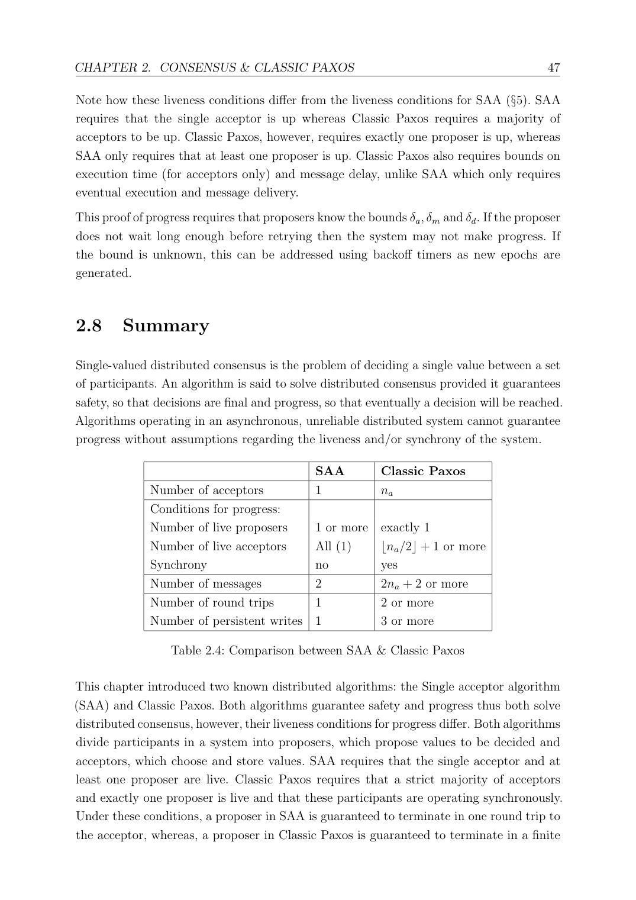
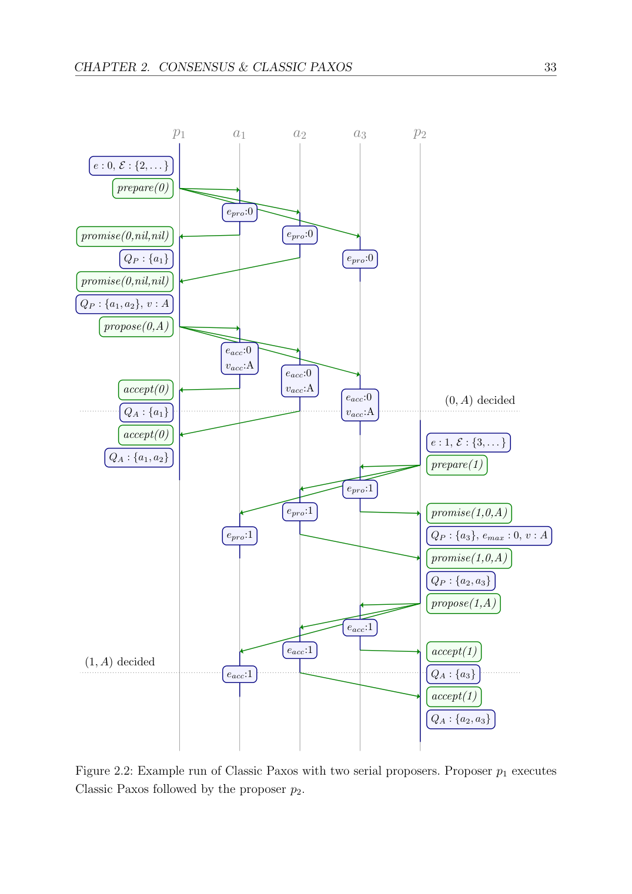

> 本组第 32 篇 · 共识协议 · [全部论文]() · [上一篇]() · [下一篇]()

本文通过追踪 Paxos 证明实际使用的条件，构造按阶段、epoch 和已知历史配置的共识算法族：Flexible Paxos/Revision A 弱化同阶段相交，B 只保护旧 epoch，C 复用 promise 中历史 proposal 的约束，quorum-based value selection 排除不可能的旧决定，共享 epoch 则增加同 epoch 接受限制和更强恢复相交。收益是可选择稳态与恢复、quorum 大小与碰撞等待的取舍，不是安全性、可用性、性能的无条件同时改善。研究假定固定成员、非 Byzantine、稳定存储与顺序原子伪代码；进展保证按 timeout、NACK、稳定 proposer、同值或 allocator 路径分别限定。本轮基于已实际完成的 151/151 页文本阅读与 22 页原图核对修正成稿，区分作者轨迹、读者推断和验证建议。特别标明 QP 交集打印与 Algorithm 32 候选门槛的局部疑点；没有把局部算例说成双决定反例或正式勘误。

本文保留论文陈述、读者推断与待验证方案的区别；实验数字只适用于原文条件。原文和翻译来自已有 AI 辅助精读报告，已做来源匹配与编辑复核，不等于人工逐项核验或独立实验复现。所有页码均为 PDF 物理页。

## 论文与阅读范围

Heidi Howard. Distributed consensus revised. University of Cambridge, Computer Laboratory / Pembroke College, PhD dissertation, September 2018. 来源为本地 151 页 PDF，SHA256 保持不变。

[论文集中的原始 PDF](https://github.com/lonng/db-papers/blob/4ff1331069c7cf52ac97dd769e5f484c1c35c200/papers/consensus/distributed-consensus-revised.pdf) · 本地来源：`consensus/distributed-consensus-revised.pdf`，共 151 页。

本篇保留 34 组原文精读和 182 条证据。截图为原始 PDF 的局部页选，不是重新生成的图表；未将整份 PDF 复制到博客。

## 研究问题与适用边界

1. 研究问题不是“如何证明多数派是唯一答案”，而是 Paxos 的哪些约束真正被证明使用了。作者在第 17-18、143 页提出：性能、扩展性和可用性的某些局限是否源自 Classic/Multi-Paxos 的具体选择，而不是共识问题本身？其假设是“方法特有”，不是原稿误写的“前者/问题固有”。第 3、13、16 页对 Paxos 的批评是研究动机与作者评价；不能把它读成所有生产实现必然缓慢、不可靠的实测结论。[C001N01][C001N09][C012N02][SRC01]

2. 单值共识在有限参与者之间决定一个候选值，分为三项安全要求与两项进展要求。Non-triviality 要求决定值曾被提出；Safety 禁止异值决定；Safe learning 禁止返回并未决定的值。Progress 和 Eventual learning 均在明确的活性条件下要求最终发生。多数派不是问题定义的一部分，而是实现方式。决定点是 acceptor 达到相应决定条件的事件，学习点在其后。[C002N11][C002N12][SRC06][SRC07][SRC45]

3. 适用模型：非 Byzantine，算法按规定执行、消息与状态不任意损坏；成员固定且已知，每个参与者有唯一标识。允许停止与重启，但持久状态跨重启保持，易失状态重新初始化。伪代码单线程顺序执行、每行原子，写入包括稳定存储必须完成后才能前进，读取应为最新状态。这里没有证明动态扩缩容、恶意节点、磁盘静默损坏或过期读/master lease 的安全性。epoch-dependent quorum 是固定成员上的 quorum 配置变化，不等于成员重配置。[C002N08][C002N09][SRC02][SRC03][SRC04]

4. FLP 在本文中限制的是一般异步故障模型下的确定性无条件终止，不能被简化成“所有算法在所有状态都必须有界时延”。作者用偏同步、稳定单 proposer 等充分条件证明 timeout 基线进展，也给出最终送达、NACK 与同值提议等特殊条件下的不同保证。安全性与进展须分别证明，特殊保证没有推翻一般不可能性。[C001N04][C002N01][C004N07][SRC48]

5. 方法边界与本报告范围：API 读取 12 个块并生成 120 条有效证据；当前 Codex 会话另外在前两轮分批实际读完全部 151 物理页（96+55），核对 22 页原图。本轮重新对照了基础证明、正式进展前提和关键算法页。全文阅读不等于每页视觉核查、机械证明或外部参考文献的独立核验。补充解释、算例及现代工程验证计划分别标明读者推断或建议；下文均使用 PDF 物理页码。

依据：论文陈述；PDF 物理页 3, 13, 14, 15, 17, 19, 20, 21, 22, 23, 45, 51, 143。证据：[C001N01](#evidence-c001n01), [C001N09](#evidence-c001n09), [C012N02](#evidence-c012n02), [SRC01](#evidence-src01), [C002N11](#evidence-c002n11), [C002N12](#evidence-c002n12), [SRC06](#evidence-src06), [SRC07](#evidence-src07), [SRC45](#evidence-src45), [C002N08](#evidence-c002n08), [C002N09](#evidence-c002n09), [SRC02](#evidence-src02), [SRC03](#evidence-src03), [SRC04](#evidence-src04), [C001N04](#evidence-c001n04), [C002N01](#evidence-c002n01), [C004N07](#evidence-c004n07), [SRC48](#evidence-src48)。

## 架构设计与执行模型

1. 基础角色与状态。Proposer 有候选值 γ，选择 epoch、收集 QP（已承诺者）和 QA（已接受者）、选择提议值并学习决定。Acceptor 维护持久的 epro、eacc、vacc，即最后承诺 epoch 和最后接受的 (epoch,value)。QP/QA 是去重集合，不能按重复消息累计票数；旧 epoch 的回复不匹配当前尝试，不应计入。Learner 是了解决定的角色，不自动拥有提议候选值。SAA 用一个持久 acceptor 选择首个到达值，保证安全但承担活性单点；多个独立首写寄存器不能直接替代共识。[C002N13][C003N01][C003N03][C003N05][SRC09]

2. 必须区分 Classic Paxos 的单值两阶段、distinguished proposer 与 Multi-Paxos 的 leader。Classic phase one 为当前 epoch 收集 promise 和旧接受记录；它本身不是对一个独立 leader 对象再执行一次共识。Distinguished proposer 只是减少并发冲突的串行化选择，多个或零个此角色仍可安全。Multi-Paxos 则由完成共享 phase one 的 proposer 负责后续日志实例的 phase two；新 leader 仍须接管并保留过去决定。原稿把引言 Multi-Paxos 概述无差别套到每个单值流程，现按第 59-61 页分开。[C001N05][C005N11][SRC51][SRC52]

3. Classic 消息流。prepare(e) 到 acceptor 后，只有 epro 为空或 e>=epro 才推进 epro 并回复 promise(e,eacc,vacc)。Proposer 收到所需多数承诺后，若全部没有先前接受记录，则提候选 γ；否则继承其中最高 accepted epoch 的值。接着发送 propose(e,v)；acceptor 检查 promise 上界，更新稳定接受记录后回 accept(e)。达到第二阶段 quorum 是 decided，收到足够证据后 proposer 才能返回。这里 highest-epoch 是保守安全规则，不是“排序启发式”。[C003N04][C003N05][C003N11]

4. Multi-Paxos 共享承诺上界，但并不删除所有逐 slot 接受历史。稳定 leader 在一轮 phase two 达成一个实例的决定；客户端转发、重定向以及返回学习结果可能另增通信。Leader 负载集中包括接收请求、分配 slot、提议、收集接受、通知学习；这是本文讨论非对称 quorum 与多路径的动机。若只看 acceptor RTT 而忽略客户端路径，便不能与端到端请求延迟直接比较。[SRC52][C002N05][SRC19]

5. 执行与持久化接口。epro>=eacc 和 epro 非递减依赖更新顺序。持久编号可用版本号、序列号或预留上界减少每次刷盘；第 62 页“到 phase two 前才完成”讨论 proposer 的编号唯一性，不授权 acceptor 先发 promise/accept 再落盘。重启后的编号不得重复，去重与恢复状态必须与具体实现的一致性域匹配。本文没有提供可直接复用的 WAL/并发存储实现。[SRC04][SRC10][SRC53][C006N01][C006N02][C006N03]

6. 可选 phase three 传播 decided(v)，使已知终态的 acceptor 能向以后 proposer 直接报告决定；这优化的是学习已存在决定，不能解释为一个普通接受回复就能创建决定。第 57 页允许丢弃其他状态，但若实现真的回收持久 promise/accepted 信息，需先持久保存终态知识或有等价恢复办法。Algorithm 9 未将 vdec 标为 persistent，因此这里只列工程义务，不冒充作者已验证了任意垃圾回收方案。[SRC45][SRC46][SRC50]

依据：论文陈述；PDF 物理页 14, 17, 20, 23, 26, 27, 28, 30, 31, 32, 38, 40, 57, 59, 60, 62, 89。证据：[C002N13](#evidence-c002n13), [C003N01](#evidence-c003n01), [C003N03](#evidence-c003n03), [C003N05](#evidence-c003n05), [SRC09](#evidence-src09), [C001N05](#evidence-c001n05), [C005N11](#evidence-c005n11), [SRC51](#evidence-src51), [SRC52](#evidence-src52), [C003N04](#evidence-c003n04), [C003N11](#evidence-c003n11), [C002N05](#evidence-c002n05), [SRC19](#evidence-src19), [SRC04](#evidence-src04), [SRC10](#evidence-src10), [SRC53](#evidence-src53), [C006N01](#evidence-c006n01), [C006N02](#evidence-c006n02), [C006N03](#evidence-c006n03), [SRC45](#evidence-src45), [SRC46](#evidence-src46), [SRC50](#evidence-src50)。

*原论文 PDF 物理页 47，版权归原作者或出版方。点击图片可查看原尺寸。页面文本中定位到：Table 2.4: Comparison between SAA & Classic Paxos。这是页面定位信息，不表示本次已复核图内所有数据。*

## 核心算法与泛化机制

一、已知修订怎样改变通信，而不改变决定值。
NACK 让低 epoch 请求得到显式拒绝，可能附带更高 epro 和旧接受记录。Algorithm 5 可在一份匹配尝试的 NACK 后放弃，跳到 >f 的 epoch；不需要先等多数 NACK 才准重试。多数拒绝能证明当前尝试不能完成，但一次拒绝只说明那个 acceptor 不会配合。是否抢先重试和是否跳号是两个选择。[C004N11][C005N01][SRC48]
Phase-two bypass 的充分证据是一个决定 quorum 曾接受同一 proposal (epoch,value)。Algorithm 7 的 QV 遇到更高 epoch 时重置，只累计同 (emax,v)；达到多数后可返回。不同 epoch 的相同 value 不等于这个证据。可等更多 promise、复用历史接受证据或并行推进，但不能为了等旁路无限阻塞。[C005N06][C005N07][SRC49][VIS05]
Proposal copying 复制已合法提出的完整 (e,v)，可跳过该 proposal 已执行过的 phase one；不允许换成自己的值。Algorithm 11 的 f=g 是避免复制过期 proposal 的成功机会限制，不是说复制异值也合法。它不同于第 7 章共享 epoch 的异值竞争。[C006N06][C006N07][SRC54]

二、Revision A：按阶段区分 quorum。
Q1、Q2 是 quorum 的家族，不是两个计数值。式 4.4：对任意 Q1∈family1、Q2∈family2，Q1∩Q2 非空；同阶段任意两集合可不相交。第二阶段达到一个允许 Q2 即决定；第一阶段要获得能够命中每个允许 Q2 的承诺集合。固定大小 counting quorum 的大小式 q1+q2>n 是读者从集合最坏相交推出的特例，不替代一般家族定义。基础 epoch 值唯一与 acceptor 规则仍保留。[C007N01][C007N02][SRC14][SRC15]
Algorithm 12 与这个重述不要混淆：它原本等到“存在 Q∈Qfamily 被 QP 完整包含”才结束；不是覆盖所有 Q。其原始家族两两相交。一般 family 中，任意命中所有 Q 的集合也不自动就是原 Algorithm 12 配置的合法 Q；报告不再把两种谓词无条件当作完全等价。[C006N09]

三、Revision B：相交按 epoch 有方向。
对每个当前 e，仅要求 Q1(e) 与所有 f<e 的 Q2(f) 相交；同 e 的 Q1/Q2 以及 Q1(e) 与未来 Q2 都无此义务（式 4.6）。未来第一阶段负责继承旧决定并拦住旧第二阶段。最小 epoch 没有旧历史，可跳过 phase one；在唯一 owner 分配下仅那一 proposer 享有此入口。低 epoch 即使没看见较高 epoch 的决定而提出异值，其 phase two 仍会被较高 promise 阻止，不构成双重决定。[SRC16][SRC17][C007N08]

四、Revision C：从 promise 的内容复用历史约束。
promise(e,f,v) 的历史 proposal 表示 <=f 的决定若存在则只能为 v，不表示 f 已经决定。原 proposer 的 phase one 已建立这段历史的值选择约束，因此新 proposer 只需直接覆盖 f<g<e 的 Q2(g)；emax 是排他下界。若 f 为 e 的直接前驱，区间为空，剩余等待可结束；若 f 远小于 e，就不能凭一条回复忽略中间历史。此复用依赖同 epoch 值唯一性；固定 quorum 的共享 epoch 恢复版本只覆盖严格 <f。[SRC21][SRC22][SRC36][C008N07][C008N08]

五、Quorum-based value selection：排除旧决定的可行性。
R[a]=no 表示尚未回复；R[a]=nil 表示回复了且从未接受；R[a]=(f,w) 是最后接受。二者绝不可混用。Algorithm 18 为每个 Q 计算 D[Q]：Q 中 nil 排除其旧决定；Q 内较低 (f,w) 与任意位置更高 epoch 的异值记录 (g,x) 结合，也能排除含低记录 acceptor 的 Q。第二个记录不必来自同一个 Q。剩余可能值汇总为 Vdec：空则可选合法候选，单值则继承。它不是简单“每个 Q 取最大”或按票数选最频繁值。[SRC23][SRC24][C008N11][C008N12]
Algorithm 19/20 将状态区分到每个旧 epoch 和 quorum，unknown 时返回整个值域作为未排除状态，收到新 promise 就重算。实现不能把该抽象写成枚举无限值域；宜用 unknown 标志表达。等 |Vdec|<=1 才前进，并须证明满足相交前提后该条件能到达。[C009N08][C009N09][C009N11]

六、Epochs revised 与 hybrid。
Allocator 将唯一编号责任移给专门服务，增加申请阶段与活性单点。Value mapping 把值绑定到 epoch，不再通过 proposer 唯一性保证值唯一，但仍保护旧决定；正文是已知有限域，脚注支持满足可划分条件的已知无限域。Hybrid 让常见值/最小 epoch 用快路径，其余回到预分配编号。[SRC28][SRC29][SRC30][C010N05][C010N06][SRC39]
Recovery 允许同 epoch 初始提不同值，必须同时满足：同 epoch Q2 两两相交；acceptor 不接受同 epoch 异值覆写；恢复 phase one 收到足够证据令 Vdec 至多一值。式 7.2 的最坏充分条件是 Q1(e)∩Q2a(f)∩Q2b(f) 非空（f<e），不是两个独立二重交集。它保证碰撞歧义可消除，实际收到有用历史时可更早完成。[SRC31][SRC32][SRC33][SRC34][C010N11]
Counting quorum 中 2k>n；普通相交至少 q=n-k+1，但遇到碰撞可能需到 2n-2k+1。候选值 v 的已见最高 epoch 计数须至少 k+q-n，才可能由所有 n-q 个未知节点补成 k。Algorithm 31/32 将最小共享 epoch 的快 quorum 设为 ceil(3n/4)，其余 classic epoch 走多数。打印 Algorithm 32 的 ceil(n/4) 候选门槛存在下节专门列出的局部疑点，不能把该伪代码当成已运行验证的实现。[SRC37][C011N04][C011N06][SRC41][VIS04][VIS03]

依据：论文陈述；PDF 物理页 49, 50, 51, 53, 54, 55, 65, 66, 67, 68, 69, 71, 76, 78, 81, 82, 83, 84, 92, 93, 94, 97, 98, 99, 100, 106, 107, 110, 114, 115, 118, 119, 122, 123, 127, 128, 135, 137, 138。证据：[C004N11](#evidence-c004n11), [C005N01](#evidence-c005n01), [SRC48](#evidence-src48), [C005N06](#evidence-c005n06), [C005N07](#evidence-c005n07), [SRC49](#evidence-src49), [VIS05](#evidence-vis05), [C006N06](#evidence-c006n06), [C006N07](#evidence-c006n07), [SRC54](#evidence-src54), [C007N01](#evidence-c007n01), [C007N02](#evidence-c007n02), [SRC14](#evidence-src14), [SRC15](#evidence-src15), [C006N09](#evidence-c006n09), [SRC16](#evidence-src16), [SRC17](#evidence-src17), [C007N08](#evidence-c007n08), [SRC21](#evidence-src21), [SRC22](#evidence-src22), [SRC36](#evidence-src36), [C008N07](#evidence-c008n07), [C008N08](#evidence-c008n08), [SRC23](#evidence-src23), [SRC24](#evidence-src24), [C008N11](#evidence-c008n11), [C008N12](#evidence-c008n12), [C009N08](#evidence-c009n08), [C009N09](#evidence-c009n09), [C009N11](#evidence-c009n11), [SRC28](#evidence-src28), [SRC29](#evidence-src29), [SRC30](#evidence-src30), [C010N05](#evidence-c010n05), [C010N06](#evidence-c010n06), [SRC39](#evidence-src39), [SRC31](#evidence-src31), [SRC32](#evidence-src32), [SRC33](#evidence-src33), [SRC34](#evidence-src34), [C010N11](#evidence-c010n11), [SRC37](#evidence-src37), [C011N04](#evidence-c011n04), [C011N06](#evidence-c011n06), [SRC41](#evidence-src41), [VIS04](#evidence-vis04), [VIS03](#evidence-vis03)。

## 正确性证明与不变量

一、证明依赖链，而不是只核对最终公式。
非平凡性先证明 proposed value∈Γ，再因 decided 必先 proposed 得到 decided value∈Γ。第一 proposer 的 phase one 仍收到所需 promise；只是其中没有先前 accepted proposal，故可以选自己的候选值。原稿的“未收到任何 promise”把回应与历史记录混淆了。之后若继承某值，该值早先已被提出，归纳保持候选来源合法。[C004N01]
Acceptor 侧 epro 非递减、epro>=eacc，加上稳定存储与消息处理顺序，约束能发送的 promise/accept 历史。Lemma 8 的一般格式为 e>=f；基础唯一 epoch 算法实际用来完成未结束 phase one 的非空记录满足 e>f。共享 epoch recovery 放宽了可见历史情形，不能将所有旧引理逐字搬过去。第 40 页证明末句 strictly increasing 比算法实际允许的非递减更强，本报告按允许同 epoch 重传的精确性质解释。[SRC10][C004N02][C004N03][C004N04][SRC11]

二、弱化 quorum 后如何保住安全。
基础证明中 Lemma 11 是 quorum 相交使用处：更高 epoch 的 phase one 必与可能已决定的低 epoch phase two 有共同 acceptor。结合该 acceptor 已发出更低 accept、较高 promise 的顺序，后续值选择继承受约束的历史。Revision A/B 只替换这部分所需相交，其余属性并未消失。Revision C 则用 Lemma 18 的直接相交或更高历史记录两种路径，重建未来提议值的约束。[SRC15][C007N04][C008N08]
Quorum-based 值选择要证明真正决定的 Q 不会被错误置 no：其 acceptor 不会返回 nil，且决定后的允许历史不能提供相反值的更高证据。基础唯一 epoch 排除同 epoch 异值，再按 successor 归纳得到跨 epoch 不变。Lemma 22/23 保证 only 的内部与外部输入单值；Lemma 24/25 保证达到 revision C 相交条件后 unknown 消失、Vdec<=1。这些是各自前提下的安全与阶段进展义务，不是任意时序下无条件终止。[SRC24][SRC25][C009N01][C009N02][C009N06][C009N11]
共享 epoch 后 value uniqueness 不再能直接使用。Property 17 保证单 acceptor 同 epoch 不接受异值，结合同 epoch Q2 相交得到该 epoch 至多一个决定；Property 18/19 与恢复候选集合处理跨 epoch。三重相交的充分条件用于保证若两个候选 Q 都仍可能决定，就在已回复的公共 acceptor 上产生矛盾，因此候选可缩到至多一个。仅本地拒绝覆写，没有 quorum 约束，还不能推出全局安全。[C010N11][SRC32][SRC35]

三、正式活性条件。
Timeout Classic Paxos 的第 45-47 页证明选取 GST 后足够长的期间：多数 acceptor 及时处理、有一个固定 proposer、已知消息/执行/相对时钟界；超时给 δa+2δm+δd 留足时间。某些静默条件是作者为简化证明选择的充分条件，不是最弱必要集合。只要求最终送达而不需这些时间界的是 SAA，以及在保留其他条件时使用 NACK 的变种。NACK 不自动解决多 proposer 的无限抢占。[SRC12][SRC13][C004N07][C004N08][SRC48][C003N10]
第 136、139 页同值多 proposer 的无同步保证有 NACK 脚注；allocator 两轮保证还需对应 quorum 活跃，且其脚注要求从启动以来同步。有限 RTT 是协议轮数声明，不自动等于异步环境下有限的 wall-clock 时延。[SRC40][SRC42][C011N11][C012N08]

四、原图确认的局部伪代码疑点（读者推断，非作者正式勘误）。
Algorithm 13 第 9 行及 Algorithm 15 第 9 行打印 QP←QP∩{a}。QP 初始为空，逐字执行会永远为空，无法按通常情况累计承诺。结合 Algorithm 3 的 union 和图中的累计 QP，候选勘误应是 union；本报告保留原字，不改造引文来假装源码无疑点。第 82、128 页也有相似文本，但未额外声称那些页已视觉确认。[VIS01][VIS02][C003N05]
Algorithm 32 第 17 行打印阈值 ceil(n/4)，随后 only(Vdec)。读者构造 n=4、fast k=3、slow phase-one q=3，回复 A,A,B：打印阈值 1 得到 {A,B}，only 无定义；按可补成 fast quorum 的计数 k+q-n=2，只 A 仍可能决定。这是局部阶段进展/伪代码一致性问题，不是两个值已决定的反例；没有运行完整状态机或机械证明显式修复。通用 Algorithm 29 的可能性计数可作交叉检查。[VIS03][VIS04]
另一个表示前提是 min/succ/前驱存在及编号试探可前进。定义 2 虽写无限全序，实际算法不能不加说明地实现于任意稠密或无最小元素的全序。复现宜选自然数或明确定义的编号元组，证明需用的离散与分配性质。[SRC08][SRC53]

依据：论文陈述；PDF 物理页 27, 28, 30, 31, 39, 40, 41, 45, 46, 47, 51, 62, 77, 78, 92, 93, 100, 102, 104, 110, 119, 122, 123, 125, 127, 136, 138, 139, 145。证据：[C004N01](#evidence-c004n01), [SRC10](#evidence-src10), [C004N02](#evidence-c004n02), [C004N03](#evidence-c004n03), [C004N04](#evidence-c004n04), [SRC11](#evidence-src11), [SRC15](#evidence-src15), [C007N04](#evidence-c007n04), [C008N08](#evidence-c008n08), [SRC24](#evidence-src24), [SRC25](#evidence-src25), [C009N01](#evidence-c009n01), [C009N02](#evidence-c009n02), [C009N06](#evidence-c009n06), [C009N11](#evidence-c009n11), [C010N11](#evidence-c010n11), [SRC32](#evidence-src32), [SRC35](#evidence-src35), [SRC12](#evidence-src12), [SRC13](#evidence-src13), [C004N07](#evidence-c004n07), [C004N08](#evidence-c004n08), [SRC48](#evidence-src48), [C003N10](#evidence-c003n10), [SRC40](#evidence-src40), [SRC42](#evidence-src42), [C011N11](#evidence-c011n11), [C012N08](#evidence-c012n08), [VIS01](#evidence-vis01), [VIS02](#evidence-vis02), [C003N05](#evidence-c003n05), [VIS03](#evidence-vis03), [VIS04](#evidence-vis04), [SRC08](#evidence-src08), [SRC53](#evidence-src53)。

## 实验评估与示例推演

1. 证据类型与缺口。
全文是理论算法与证明论文，包含消息序列图、手工执行、quorum 数量表和理论通信/持久写代价；没有发现论文自身的硬件、运行系统、负载生成器、吞吐曲线、P99 延迟或故障注入性能实验。第 20 页直接声明高层算法而非具体协议实现。因此本节保留标准评估入口，但不能把说明性轨迹叫成“实验验证了所有执行正确”。参考文献中有工程工作不意味着本文复现了它们。[SRC05][SRC44]

2. 基线表的数字与计量口径。
Table 2.4（第 47 页）列 SAA：一个 acceptor、至少一个 proposer、两消息、一 RTT、一次持久写、无需有界时延；Classic Paxos：n 个 acceptor，活跃多数及单 proposer，2n+2 或更多消息、两 RTT 或更多、三次或更多持久写、所选证明需要同步。原表消息数按其最少参与与发送口径读取；若向全部 acceptor 广播并都回应，每阶段是 2n。不能一边引用表中最少消息一边假定全员广播响应，再混成同一次执行。[C004N09][C006N11]
三次持久写应按编号预留/持久化、phase-one promise、phase-two accepted 的关键依赖理解，不是凭空增加一项“决定后确认落盘”。具体是否批处理、合并或使用版本编号，是后续实现优化与模型选择；报告没有替某种磁盘布局计数。[SRC53][C006N01][C006N03]

3. 作者执行示例的实际含义。
图 2.4/2.5 在三个 acceptor、两个 proposer、majority=2 下，旧 proposer 停在未到 commit point 的第二阶段。若后继只见 nil，可提 B；若看到部分接受的 A，经典规则保守继承 A。这演示继承不等于旧 A 一定已决定。图 2.6 则显示 prepare 互相提高 epro 导致 phase two 反复失败，同值或先前已决定也可能无法让当前 proposer 学习并返回。[C003N07][C003N08][C003N09][SRC47]
图 3.6 使用 Q={{a1,a2},{a1,a3},{a1,a4},{a2,a3,a4}}，在相交 family 中两节点 Q 也能完成，说明非多数形状可用；不能从一个特定二元 quorum 推出任意二元组都合法。图 4.2 使用 Q1={{a1,a2},{a3,a4}}、Q2={{a1,a3},{a2,a4}}，同阶段可分离，a3 的较高 promise 阻止旧 phase two。该轨迹是作者例子，不应冒充本报告自创或实测。[C006N10][C007N05]
第 105 页的五 acceptor 例子：e=5，a1 返回 (3,A)、a2 返回 nil、a4 返回 (2,B)，Q2 只有 {a1,a2,a3} 与 {a4,a5} 两种。第一种由 nil 排除，第二种由更高异值历史排除，Vdec 为空；经典规则仍取 A。另一个无 nil 例子用 (3,A)、(1,A)、(2,B) 交叉排除，说明收益来自更多历史知识，而非仅 nil 快捷分支。[SRC26][C009N07]
图 7.4 的 n=3,k=2：a2 返回 (0,A)、a3 返回 (0,B) 后 Vdec={A,B}，普通两回复不足；第三个 a1 返回 A 才得到 {A}。Table 7.1 的 q 区间是计数推导：n=3,k=2 为 2-3，n=5,k=3 为 3-5；不是延迟样本区间或失败概率。[SRC38][C011N06][C011N07][C011N08]

4. 读者完成的检查仅为局部代数 sanity check。
QA 中记录了 Algorithm 32 的 n=4、A,A,B 算例，并枚举一个未知 acceptor 的 A/B 补全：只有 A 能补成三个接受，B 最多两个。该检查实际运行过，但不是完整网络模拟或作者实验；不能把它提升为形式验证、修正版正确性证明或双重决定反例。[VIS03][VIS04]

5. 不能得到的性能结论。
单个 quorum 目标发送减少消息但可能失去最快回应者；chain/ring 减少消息会增加串行 hop。第 89 页从更低决定时延推导吞吐收益还假设有界并发决定并忽略 batching。读者推断：排队、序列化、磁盘同步、重传与请求转发也会改变端到端表现，但这里没有这些实测数据。不能宣称任何 Revision 在实际数据库中普遍优于现有 Raft/Multi-Paxos。[SRC19][SRC55][C008N02][C008N03]

依据：论文陈述；PDF 物理页 20, 32, 33, 35, 36, 47, 62, 69, 70, 72, 78, 79, 80, 89, 105, 127, 128, 130, 132, 138, 145。证据：[SRC05](#evidence-src05), [SRC44](#evidence-src44), [C004N09](#evidence-c004n09), [C006N11](#evidence-c006n11), [SRC53](#evidence-src53), [C006N01](#evidence-c006n01), [C006N03](#evidence-c006n03), [C003N07](#evidence-c003n07), [C003N08](#evidence-c003n08), [C003N09](#evidence-c003n09), [SRC47](#evidence-src47), [C006N10](#evidence-c006n10), [C007N05](#evidence-c007n05), [SRC26](#evidence-src26), [C009N07](#evidence-c009n07), [SRC38](#evidence-src38), [C011N06](#evidence-c011n06), [C011N07](#evidence-c011n07), [C011N08](#evidence-c011n08), [VIS03](#evidence-vis03), [VIS04](#evidence-vis04), [SRC19](#evidence-src19), [SRC55](#evidence-src55), [C008N02](#evidence-c008n02), [C008N03](#evidence-c008n03)。

*原论文 PDF 物理页 33，版权归原作者或出版方。点击图片可查看原尺寸。页面文本中定位到：Figure 2.2: Example run of Classic Paxos with two serial proposers. Proposer p1 executes。这是页面定位信息，不表示本次已复核图内所有数据。*

## 权衡分析与工程约束

本节把论文中的选择空间与读者工程推断分开；没有基准数据支持普遍最优配置。

1. 稳态 versus 接管。Revision A 可以让较小 Q2 换较大 Q1。读者构造 n=5、任意四节点 Q1、任意二节点 Q2，4+2>5：现任 leader 可能只需两个可达 acceptor 就写入，但失去 leader 后若只剩三个节点可用，新 phase one 无法收齐四份。当前状态可写不等于从任意状态可恢复。第 89 页偶数节点特例可在保持原 Q1 时缩小 Q2，但不能据此取消一般取舍。[SRC14][SRC19][C008N01][C012N06]

2. 一 RTT 与故障路径。All aboard 共置 proposer/acceptor，phase one 本地、phase two 全员；要求所有 acceptor 响应是成本。Revision B 允许早期 epoch 用全员 Q2、较后 epoch 用多数 Q2，快路径不成可进入慢路径；已被更高 epoch 抢占后，早期快入口也不能无条件成功。Singleton 配置相反：全员 phase one、单节点 phase two。两者都不能按最快 Q2 数量独立宣称整体容错。[SRC18][C007N09][C007N10]

3. 完整知识 versus 状态开销。经典最大 epoch 规则只需追踪一个最大项，保守但简单；quorum-based 规则保存各 acceptor 回复并推导多个 Q/epoch 的可能性。更多回复可能解除必须继承旧值的限制，却可能增加等待、状态与计算。显式枚举所有 quorum 可达组合数量级；读者推断实现需利用 counting、固定 quorum 或拓扑结构，并以通用语义为 oracle。第 127 页作者只提示 Vdec 可增量更新，没有给出高频数据库 workload 上的 CPU 收益。[SRC23][SRC27][C011N05]

4. 唯一编号 versus 共享冲突。静态分配、投票、allocator、value mapping 保证每 epoch 值唯一的方式不同；共享 recovery 不再依靠该保证，需接受更强恢复相交与 collision 等待。固定 Q 的特化只要命中该 Q 一次，phase two 却需全 Q；跨 epoch 的 fixed Qf 还要覆盖尚未被历史信息排除的各旧 f。第 127 页 effectively free 针对这一特化的额外 promise，不能用作整个共享算法的零成本承诺。[SRC28][SRC30][SRC31][SRC32][SRC36][C011N01][C011N02][C011N03]

5. Allocator 与不同终止保证。纯 allocator 有额外 RTT 和单点依赖；hybrid 用预分配慢 epoch 让 allocator 不可用时仍有路径，但不保留快路径的所有时延。仅最小 epoch 申请到一次与 allocator 保存并复用 epoch-value 映射的方案也不能混同；第 136 页多 proposer 两轮保证依赖后者的串行化知识及活跃 quorum、从启动同步等条件。值映射也不是完整事务提交协议：binary commit/abort 共识只决定二值，不自动提供事务原子性与参与者准备状态。[SRC29][SRC39][C011N11][SRC40][SRC42][C010N06]

6. 持久性与垃圾回收。版本编号或 epoch 上界预留降低刷盘频率，不允许把已对外承诺的 epoch 在崩溃后忘掉。以 decided 终态替换旧状态时也要保留决定知识；仅在易失内存设 vdec 后丢掉持久历史不是这里已证明安全的优化。读者推断：真实 WAL 合并、断电原子性、校验和和恢复流程需另建精确实现模型，本文高层伪代码不能自动覆盖这些契约。[SRC04][SRC10][SRC50][SRC53][C006N02][C006N03]

依据：读者推断；PDF 物理页 20, 40, 57, 62, 76, 86, 87, 89, 99, 111, 114, 115, 118, 119, 127, 135, 136, 139, 144。证据：[SRC14](#evidence-src14), [SRC19](#evidence-src19), [C008N01](#evidence-c008n01), [C012N06](#evidence-c012n06), [SRC18](#evidence-src18), [C007N09](#evidence-c007n09), [C007N10](#evidence-c007n10), [SRC23](#evidence-src23), [SRC27](#evidence-src27), [C011N05](#evidence-c011n05), [SRC28](#evidence-src28), [SRC30](#evidence-src30), [SRC31](#evidence-src31), [SRC32](#evidence-src32), [SRC36](#evidence-src36), [C011N01](#evidence-c011n01), [C011N02](#evidence-c011n02), [C011N03](#evidence-c011n03), [SRC29](#evidence-src29), [SRC39](#evidence-src39), [C011N11](#evidence-c011n11), [SRC40](#evidence-src40), [SRC42](#evidence-src42), [C010N06](#evidence-c010n06), [SRC04](#evidence-src04), [SRC10](#evidence-src10), [SRC50](#evidence-src50), [SRC53](#evidence-src53), [C006N02](#evidence-c006n02), [C006N03](#evidence-c006n03)。

## 与现有技术的比较

对照范围只使用本文已经读过的讨论；未读取现代产品源码、未联网核验其他论文。原 API 稿关于 Calcite 代价模型、DuckDB 零拷贝/WAL、StarRocks FE 实现以及“比 Raft term 对齐更快”的断言没有相应来源，现删除。以下是机制层面的比较和待验证问题，不是这些系统的实现事实。

1. 对 Classic Paxos：不是把安全性换成可用性，而是在保持目标安全属性下削弱足够条件。经典任意 quorum 相交、唯一 epoch 值和最大 accepted epoch 选择，是算法族的保守点；Revision A/B/C 分别利用阶段、时间方向和已知历史减少直接覆盖。不能把不相交理解为所有阶段、所有 epoch 的集合都可任意分离。[SRC14][SRC15][SRC16][SRC21][SRC27]

2. 对 Multi-Paxos：共享 phase one 本身就是偏向稳定 leader 的优化。Flexible quorum 可进一步移动稳态和接管成本，论文没有证明“去中心化一定更快”；allocator、全员 Q2、同值 shared epoch 等达到一轮的路径各有不同条件。待验证的是，在相同网络、持久化与客户端路径下，稳态收益是否被恢复代价抵消，而不是单比一句“一 RTT”。[SRC19][SRC52][SRC43]

3. 对 Fast Paxos：第 73 页给两个 fast 与一个 classic 的三重相交及 counting 约束 n<2kc、2n<2kf+kc。第 119、137 页将恢复条件结合 promise 内容，能够在某些历史下早于最坏 quorum 上界完成 phase one。此处是本文对 Fast Paxos 的概述与泛化说明；其 2005 技术报告仅核了本地 bibliography 条目，未独立复核全文，也没有在这里比较两个实际实现。[SRC56][SRC57][SRC32][SRC33][SRC41]

4. 对 Raft/VRR 等文献中的术语与机制：本文将 epoch 对齐 term/view 等称谓，讨论了 voting、distinguished proposer、termination/commit-index 通知与 Multi-Paxos 家族化描述。名称相似不等于可以把共享 epoch 或新 quorum 大小直接替换到另一个协议。待验证的研究计划应先列出对方 leader election、日志匹配、提交和恢复所需的具体不变量，再证明变更后的全链条，而非从 epoch=term 推出性能优劣。[C003N12][C006N04][SRC51][SRC52]

5. 对数据库组件（读者建议）：元数据日志、副本组或事务协调器若拟采用本算法族，应先明确它调用的是单值决定、全序日志还是业务原子提交；分别定义 client-visible 完成、状态机应用和持久决定。可以测稳定 leader 与恢复两个状态下的消息、持久写、吞吐与尾延迟；不能把二元值映射示例当成已完成的分布式事务实现。动态成员变更与 Byzantine 故障应作为独立扩展证明，而不是在原模型中悄悄启用。[SRC03][SRC05][SRC45][SRC30]

依据：待验证的工程设想；PDF 物理页 20, 23, 27, 28, 29, 59, 60, 63, 73, 76, 78, 81, 89, 92, 111, 115, 119, 137, 143, 149。证据：[SRC14](#evidence-src14), [SRC15](#evidence-src15), [SRC16](#evidence-src16), [SRC21](#evidence-src21), [SRC27](#evidence-src27), [SRC19](#evidence-src19), [SRC52](#evidence-src52), [SRC43](#evidence-src43), [SRC56](#evidence-src56), [SRC57](#evidence-src57), [SRC32](#evidence-src32), [SRC33](#evidence-src33), [SRC41](#evidence-src41), [C003N12](#evidence-c003n12), [C006N04](#evidence-c006n04), [SRC51](#evidence-src51), [SRC03](#evidence-src03), [SRC05](#evidence-src05), [SRC45](#evidence-src45), [SRC30](#evidence-src30)。

## 复现指南与验证建议

以下均为可执行的后续验证设计，不是已经完成的模拟器、证明或 benchmark。当前会话实际完成的是全文阅读、22 页视觉核对、逐条来源校验和 QA 中的局部代数检查。

1. 建立最小语义模型。选 n=3/4/5、两 proposer、候选 A/B/C，epoch 先限自然数有限前缀；区分已提议、已接受、曾经 decided、已 learned，不能仅用最后 accepted 快照判断决定。持久状态与易失状态分离；消息可以延迟、乱序、重复；崩溃后只恢复持久状态。先复现 SAA 与 Algorithm 3/4，再分别开启 A/B/C，避免同时改多个前提后无法定位错误。[SRC04][SRC45][SRC46][C003N05]

2. 枚举 quorum 并检验适用条件。A 检查所有跨 phase 对相交（4.4）；B 检查每个新 e 的 Q1 与所有 f<e 的 Q2（4.6）；C 按已见 emax 将直接覆盖区间缩到 emax<g<e（5.1）。同 epoch 投票编号需要额外 Q1 内相交（4.7）。Shared recovery 再检查同 epoch Q2 相交与恢复三重相交（7.1/7.2）。每项开启前保存失败的 quorum 组合。反例测试可故意违反条件，但必须标成模型外对照，不能混算为模型内安全性失败。[SRC14][SRC16][SRC20][SRC21][SRC31][SRC32]

3. 检查值选择与未定状态。用通用 quorum 枚举实现 possibleValues 作为 oracle，再与 counting/fixed-quorum 优化对比；明确 no=未回复、nil=无接受历史、unknown=尚未排除任意值。强制 only 的输入恰好单值，否则输出最小轨迹而不是任意挑值。复现作者第 105 页两个无决定例子和图 7.4 的 collision，并故意改变送达顺序；观察空集/单集/多集的分界是否正确。[SRC23][SRC24][SRC25][SRC26][SRC34][SRC38]

4. 把源伪代码疑点作为首批回归。分别保存打印版本与候选修正版本：QP 的 intersect 与 union；Algorithm 32 的 ceil(n/4) 与依据 k+q-n 的一般可能性计数。先在 n=4、回复 A,A,B 下断言 only 不能吃多集，再覆盖其他 n、回复数和未回复补全。即使候选修复通过有限状态测试，也不能称已证明任意 n 或无限执行正确，需另做 TLA+/证明助理等独立验证。[VIS01][VIS02][VIS03][VIS04]

5. 故障与活性分开测。对 epro 更新、accepted 更新、回复发送前后注入崩溃；顺序错误版本应尝试暴露 epro<eacc，不能一出现不变量破坏就宣称已构造双决定。GC 测试先持久化终态再回收，断电恢复后仍知已决定值。模拟并发 duelling 与 GST 后稳定 proposer；分别比较 timeout/NACK。NACK 本身不保证打破任意并发活锁。测试同值特殊进展时保留原脚注的响应机制和可用性条件。[SRC10][SRC13][SRC47][SRC48][SRC50][SRC40][SRC42]

6. 工程评测分阶段。安全模型核验后才加入稳定存储、负载与网络；记录硬件、fsync 策略、batching、并发窗口、候选值大小、client 转发路径。比较相同 n 和故障模型下 q1/q2 不同配置，分别报告稳定 leader、切主、少数慢节点和分区恢复的可用请求比例、P50/P99、磁盘写与消息数。对 Vdec 全量/增量实现验证集合相等，再测 CPU 和空间；不能只根据减少消息推断净收益。[SRC19][SRC55][C008N03][C011N05]

7. 验收标准。安全指标为所有可达模型内执行中异值决定为零、非法候选决定为零、未决定学习为零；活性只在声明的调度公平/时序和可用条件内检查。有限模型探索、代数检查与真实压测各自记录范围，不相互冒充。对外部产品或动态 membership 的适配是下一项研究，尚未在本报告完成。[SRC06][SRC07][SRC03][SRC05]

依据：待验证的工程设想；PDF 物理页 20, 21, 22, 23, 30, 31, 32, 36, 40, 47, 51, 57, 72, 76, 77, 81, 89, 90, 92, 93, 99, 100, 104, 105, 119, 122, 127, 132, 136, 138, 139。证据：[SRC04](#evidence-src04), [SRC45](#evidence-src45), [SRC46](#evidence-src46), [C003N05](#evidence-c003n05), [SRC14](#evidence-src14), [SRC16](#evidence-src16), [SRC20](#evidence-src20), [SRC21](#evidence-src21), [SRC31](#evidence-src31), [SRC32](#evidence-src32), [SRC23](#evidence-src23), [SRC24](#evidence-src24), [SRC25](#evidence-src25), [SRC26](#evidence-src26), [SRC34](#evidence-src34), [SRC38](#evidence-src38), [VIS01](#evidence-vis01), [VIS02](#evidence-vis02), [VIS03](#evidence-vis03), [VIS04](#evidence-vis04), [SRC10](#evidence-src10), [SRC13](#evidence-src13), [SRC47](#evidence-src47), [SRC48](#evidence-src48), [SRC50](#evidence-src50), [SRC40](#evidence-src40), [SRC42](#evidence-src42), [SRC19](#evidence-src19), [SRC55](#evidence-src55), [C008N03](#evidence-c008n03), [C011N05](#evidence-c011n05), [SRC06](#evidence-src06), [SRC07](#evidence-src07), [SRC03](#evidence-src03), [SRC05](#evidence-src05)。

## 结论与工程启示

论文最重要的结果是把“Paxos 必须如此”的若干实现习惯还原成证明依赖，展示更广的算法族，而不是给出一个无条件更快、更高可用的统一替代品。Revision A 只保留跨阶段相交；B 将相交定向到旧 epoch；C 利用 promise 所携历史复用约束；quorum-based 值选择排除不可能已决定的历史；共享 epoch 则以额外接受规则和恢复相交换取更多快路径。[SRC14][SRC16][SRC21][SRC23][SRC31][SRC32][SRC43]

必须保留的四组区别是：accepted 与 decided/learned，可能已决定与已经证明决定，当前稳态可写与从任意状态可恢复，以及安全性与有条件进展。它们决定何时可以继承值、何时可以旁路、何时必须继续收集 promise，也决定“一个 RTT”究竟从哪里计起。在共享 epoch 下直接照搬唯一 epoch 的 value uniqueness、<=f 历史复用或 majority 即结束，会丢失论文明确补上的条件。[SRC45][SRC46][SRC49][SRC36][SRC38]

本轮已实际修订 API 成稿，而非仅附建议：纠正最高 epoch 规则的启发式误称、SAA/Classic 活性混淆、Algorithm 12 量词错误、Lemma 20 证据来源范围、非平凡性中 promise 与 accepted 的混淆；补齐 allocator、NACK、值域、持久化与同值进展脚注条件；删除缺少来源的现代产品架构与性能断言。所有原始 API 引文、原始十段 passage、模型、用量和 critique 都保留，原稿还在专属 QA 留档；较旧 all-notes 为原流水线材料，不代表其中解读已被逐条修正。[C003N04][C003N10][C006N09][C008N12][C004N01]

两处重点伪代码疑点已明确列为读者推断：QP 的打印交集无法累计，以及 Algorithm 32 阈值可能导致 only 多集输入。引文和 PDF 均未改写，局部算例不被包装成正式勘误或已完成的形式证明。实施前应首先让抽象语义、打印伪代码、计数特化与恢复存储契约一致。[VIS01][VIS02][VIS03][VIS04]

真实方法范围：API 12 块全文分析；Codex 前两轮按整页有界批次读完 151/151 物理页、实际查看 22 页原图，本轮又针对上述问题重读关键页。报告中的中译解释并不因此成为独立人工审查；外部引用未单独全文验证，未运行完整共识模拟/模型检查，也没有生产性能数据。对数据库工程师的直接价值是一个更精确的设计和验证清单，而不是可以跳过本地证明、恢复测试和真实负载评估的许可证。[SRC05][SRC43][SRC44]

依据：读者推断；PDF 物理页 20, 23, 27, 28, 32, 39, 53, 68, 69, 71, 76, 77, 81, 92, 93, 99, 100, 119, 127, 132, 138, 143, 145。证据：[SRC14](#evidence-src14), [SRC16](#evidence-src16), [SRC21](#evidence-src21), [SRC23](#evidence-src23), [SRC31](#evidence-src31), [SRC32](#evidence-src32), [SRC43](#evidence-src43), [SRC45](#evidence-src45), [SRC46](#evidence-src46), [SRC49](#evidence-src49), [SRC36](#evidence-src36), [SRC38](#evidence-src38), [C003N04](#evidence-c003n04), [C003N10](#evidence-c003n10), [C006N09](#evidence-c006n09), [C008N12](#evidence-c008n12), [C004N01](#evidence-c004n01), [VIS01](#evidence-vis01), [VIS02](#evidence-vis02), [VIS03](#evidence-vis03), [VIS04](#evidence-vis04), [SRC05](#evidence-src05), [SRC44](#evidence-src44)。

## 原文精读：从句子回到机制

以下保留原文、忠实翻译、含义与边界；假设示例不作为论文实验结果。

### P001 · PDF 物理页 2

**原文**

<blockquote class="paper-source-quote"><pre><code>I further state that no substantial part of my dissertation has already been&#10;submitted, or, is being concurrently submitted for any such degree, diploma or other&#10;qualification at the University of Cambridge or any other University or similar institution&#10;except as declared in the Preface and specified in the text&#10;This dissertation does not exceed the regulation length of 60 000 words, including tables&#10;and footnotes.</code></pre></blockquote>

**忠实翻译**

> 我进一步声明，除前言中已声明及正文中已指明的情况外，本学位论文的任何实质性部分均未曾在剑桥大学或任何其他大学或类似机构提交过，也未正在同时提交以申请任何此类学位、文凭或其他资格。本论文未超过规定的 60 000 词长度限制，该字数包含表格和脚注。

**技术含义与边界**

> 这是博士论文的行政性原创/字数声明，不包含任何共识机制、实验规模或正确性证据。它不表示禁止把部分研究发表为会议论文；本文第 19 页另列已发表的 Flexible Paxos 工作。

**常见误读**

> 不能从 60,000 词上限推出技术深度，也不能把学位重复提交声明扩成会议论文重复发表判定。

**读者构造的假设示例**

> 读者构造的假设示例：博士生在学位提交时核对篇幅和既往学位提交情况；这一步不验证一个 quorum 配置是否安全。

### P002 · PDF 物理页 145

**原文**

<blockquote class="paper-source-quote"><pre><code>CONCLUSION&#10;145&#10;In section 7.4, we proposed a hybrid algorithm consisting of using an allocator for the&#10;minimum epoch and pre-allocation for all other epochs. Provided the allocator is live and&#10;synchronous, then any number of proposers will terminate in two rounds trips (one to the&#10;allocator, one to the acceptors).&#10;8.3.3&#10;Improved performance&#10;Our generalisations provide the opportunity to improve the best case performance and/or&#10;to increase the likelihood of the best case occurring in practice.</code></pre></blockquote>

**忠实翻译**

> 结论
> 145
> 在第 7.4 节中，我们提出了一种混合算法，即对最小 epoch 使用分配器（allocator），对所有其他 epoch 使用预分配（pre-allocation）。只要分配器是活跃且同步的，那么任意数量的提议者（proposers）都将在两次往返（round trips）内终止（一次到分配器，一次到接受者（acceptors））。
> 8.3.3 性能改进
> 我们的泛化（generalisations）提供了改进最佳情况性能和/或提高最佳情况在实践中发生概率的机会。

**技术含义与边界**

> 这是第 145 页的结论摘要。完整两轮保证还需对照第 136 页：allocator 保存相应值映射形成串行化点、对应 acceptor quorum 活跃，且系统从启动以来满足脚注所述同步条件。单纯“首次把唯一 emin 给一个 proposer”的 allocator 并不能让所有并发 proposer 都走相同快路径。

**常见误读**

> 不得只保留 allocator 在线而删去 quorum、同步历史与映射重用条件；两 RTT 是协议轮数，不是异步下 wall-clock 上界。

**读者构造的假设示例**

> 读者构造的假设示例：allocator 持久保存最小 epoch 的既定值 A，后来的 proposer 取得同一映射后复制给活跃 quorum；这与 100 个 proposer 被分到各自不同值而仍全部两轮决定不同值完全不同。

### P003 · PDF 物理页 75

**原文**

<blockquote class="paper-source-quote"><pre><code>Each stage generalises over the previous revision by further weakening&#10;the quorum intersection requirements.&#10;4.1&#10;Quorum intersection across phases&#10;We begin by differentiating between the quorums used by phase one of Classic Paxos,&#10;which we will refer to as Q1 and the quorums for phase two, referred to as Q2. We could&#10;use different quorum sets of each of the two phases of Classic Paxos.&#10;As before, we begin by revising our definition of decided:&#10;Definition 9.</code></pre></blockquote>

**忠实翻译**

> 每个阶段都通过进一步弱化法定人数交集（quorum intersection）要求来对前一修订版进行泛化。
> 4.1 跨阶段的法定人数交集
> 我们首先区分 Classic Paxos 第一阶段使用的法定人数（我们将其称为 Q1）与第二阶段使用的法定人数（称为 Q2）。我们可以对 Classic Paxos 的两个阶段分别使用不同的法定人数集合。
> 如前所述，我们首先修改“已决定（decided）”的定义：
> 定义 9。

**技术含义与边界**

> 片段止于 Definition 9 标题，但原论文同页随即给出 phase-two quorum 接受即 decided，下一页式 4.4 要求所有跨阶段 quorum 对相交。Q1/Q2 是 quorum 家族，不必是多数，也不应把两个阶段等同于业务读写操作。

**常见误读**

> 片段截断不等于原文没有定义；允许不同 family 不等于允许任意跨阶段不相交。

**读者构造的假设示例**

> 读者构造的假设示例：n=5，所有四节点 Q1 与所有二节点 Q2 相交，因 4+2>5；phase-two 家族内部可有不相交二元组，仍保留每 epoch 值唯一性前提。

### P004 · PDF 物理页 40

**原文**

<blockquote class="paper-source-quote"><pre><code>The proof of lemma 7 highlights the importance of ensuring the steps in the Classic Paxos&#10;algorithm are executed in-order. If the last accepted proposal was written prior to writing&#10;the last promised epoch then an acceptor failure between these two writes could violate&#10;lemma 7.&#10;Lemma 8 (General promise format). For all promises sent by acceptors of the form&#10;promise(e,f,v), where f̸ = nil then it is the case that e ≥f.</code></pre></blockquote>

**忠实翻译**

> 引理 7 的证明凸显了确保 Classic Paxos 算法中各步骤按顺序执行的重要性。如果最后被接受的提案（last accepted proposal）是在写入最后承诺的 epoch（last promised epoch）之前写入的，那么在这两次写入之间发生的接受者故障可能会违反引理 7。
> 引理 8（通用承诺格式）。对于接受者发送的所有形式为 promise(e,f,v) 的承诺，其中 f ≠ nil，则有 e ≥ f。

**技术含义与边界**

> acceptor 应先完成 promise 上界，再记录相应接受历史；epro>=eacc 是这里直接讨论的局部不变量。一般 promise(e,f,v) 可有 e=f；基础算法实际用于尚未完成 phase one 的旧记录另满足 e>f。不能把破坏一个局部不变量直接包装成已构造全局双决定。

**常见误读**

> 不应将“按顺序执行”误解为仅指内存中的指令顺序。结合“written prior to writing”和“persistent storage”的语境，这里特指持久化存储（如 WAL）的落盘顺序。此外，引理 8 的条件限定为“f ≠ nil”，当 f = nil 时，e ≥ f 的约束不适用或未在此处声明，不能无前提地泛化。

**读者构造的假设示例**

> 读者构造的假设示例：旧 epro=3，收到 propose(5,A) 却先持久化 eacc=5/vacc=A，尚未写 epro=5 就崩溃；重启可出现 epro=3<eacc=5。这是写入顺序错误暴露的不变量破坏，不是本例已经证明两个值都被决定。

### P005 · PDF 物理页 105

**原文**

<blockquote class="paper-source-quote"><pre><code>Therefore, we require&#10;that the epochs of these proposals are the same, however, this cannot occur due to value&#10;uniqueness (Corollary 9.1).&#10;6.1.3&#10;Examples&#10;Consider the following example where A = {a1, a2, a3, a4, a5} and Q2 = {{a1, a2, a3}, {a4, a5}}.&#10;A proposer is in epoch 5 and receives the following promises (in order):&#10;• promise(5,3,A) from a1, followed by&#10;• promise(5,nil,nil) from a2, followed by&#10;• promise(5,2,B) from a4&#10;In Classic Paxos, the proposer must propose the value associated with the highest epoch,&#10;in this case A.</code></pre></blockquote>

**忠实翻译**

> 因此，我们要求这些提案的 epoch 相同，然而，由于值的唯一性（推论 9.1），这不可能发生。
> 6.1.3 示例
> 考虑以下示例，其中 A = {a1, a2, a3, a4, a5} 且 Q2 = {{a1, a2, a3}, {a4, a5}}。
> 一个提议者处于 epoch 5，并（按顺序）收到以下承诺：
> • 来自 a1 的 promise(5,3,A)，随后是
> • 来自 a2 的 promise(5,nil,nil)，随后是
> • 来自 a4 的 promise(5,2,B)
> 在 Classic Paxos 中，提议者必须提议与最高 epoch 关联的值，在本例中为 A。

**技术含义与边界**

> 前段反证的是同 epoch 不同值，不是说同 epoch 本身不能出现。示例 Q2 在此模型中正是指定的两个合法 quorum；a1:(3,A)、a2:nil 排除第一 Q 的旧决定，a4:(2,B) 结合更高异值 A 排除第二 Q，所以第 105 页后文允许新的合法候选。经典规则保守继承 A，但这不说明此执行中 A 已决定。

**常见误读**

> 不能把 Q2 说成尚未列完的随意子集；合法 quorum 是配置给定。也不能在这个已有 nil/异值排除证据的场景声称 A 仍可能由上述 Q2 决定。

**读者构造的假设示例**

> 读者构造的假设示例：沿用指定回复，新的候选 C 可以由 quorum-based 规则提出；直接按最后到达的 B 选择并不是经典规则。是否允许 C 来自证明所有旧决定已排除，而非随意用接收顺序挑值。

### P006 · PDF 物理页 14

**原文**

<blockquote class="paper-source-quote"><pre><code>Therefore, algorithms which solve consensus aim to guarantee progress&#10;under the weakest liveness assumptions possible.&#10;The Paxos algorithm, originally proposed by Leslie Lamport in 1998 [Lam98] and later&#10;refined [Lam01a], is at the heart of how we achieve distributed consensus today1. Broadly&#10;speaking, its approach operates in two stages, each requiring agreement by the majority&#10;of participants.</code></pre></blockquote>

**忠实翻译**

> 因此，解决共识问题的算法旨在尽可能在最弱的活跃性（liveness）假设下保证进展（progress）。
> Paxos 算法最初由 Leslie Lamport 于 1998 年提出 [Lam98] 并在后来得到完善 [Lam01a]，它是当今我们实现分布式共识的核心。广义上讲，它的方法分两个阶段运行，每个阶段都需要多数参与者的同意。

**技术含义与边界**

> 第 14 页以常见 Multi-Paxos 用法概述 Paxos，并引用 1998/2001 文献；第 15 页补充 1990 提交等历史。本报告只核对本论文叙述，不独立考证那些外部文献。真正参数化 quorum 与单值算法见后续章节。

**常见误读**

> majority 不是全员；引言的 leader 化概述也不能替代各变种正式算法。安全与进展条件需后文区分。

**读者构造的假设示例**

> 读者构造的假设示例：n=5 的 timeout 基线在稳定单 proposer、足够时间界和至少三 acceptor 响应下可以推进；仅“三节点正常”还不足以排除无限 duelling。

### P007 · PDF 物理页 123

**原文**

<blockquote class="paper-source-quote"><pre><code>If one or more previously accepted proposals were returned then the value associated&#10;with the highest epoch is chosen.&#10;However, we will add the following three additional properties for future use:&#10;Property 17. For each propose message received by an acceptor where the epoch received&#10;is the same as the last accepted epoch, the message is processed by the acceptor only if the&#10;proposed value is the same as the last accepted value.&#10;Property 18. Proposers only propose a value after receiving promises from sufficient&#10;acceptors such that at most one value may have been decided.</code></pre></blockquote>

**忠实翻译**

> 如果返回了一个或多个先前被接受的提案，则选择与最高 epoch 关联的值。
> 然而，我们将添加以下三个额外属性以供将来使用：
> 属性 17。对于接受者收到的每条 propose 消息，如果收到的 epoch 与最后被接受的 epoch 相同，则仅当提议的值与最后被接受的值相同时，接受者才处理该消息。
> 属性 18。提议者仅在从足够多的接受者处收到承诺后才提议一个值，使得最多只有一个值可能已被决定。

**技术含义与边界**

> 开头是被替换的旧 Property 4，不应误写成共享 epoch 仍要求原样最高 epoch 规则。Property 17 限制同 epoch 异值覆写；Property 18 要求 Vdec<=1；Property 19 则按候选集合选值。局部拒绝规则还要结合同 epoch Q2 相交等条件，才有全局单决定。

**常见误读**

> 更高 epoch 请求也仍须满足 promise 上界等规则；只检查 value 相同不足以接受任意旧消息。单个 acceptor 拒绝异值不等于无需 quorum 交集。

**读者构造的假设示例**

> 读者构造的假设示例：a1 已接受 (4,X)，不再接受 (4,Y)；若另外两个互不相交 quorum 各自接受不同值，本地规则本身并不会连通它们，因此还需要文中的相交条件。

### P008 · PDF 物理页 55

**原文**

<blockquote class="paper-source-quote"><pre><code>CHAPTER 3. KNOWN REVISIONS&#10;55&#10;We can increase the likelihood of phase two bypass using the following techniques:&#10;• If a proposer has received many of the same proposals in phase one but not quite&#10;reached the ⌊na/2⌋+ 1 copies needed to bypass phase two then it may opt to wait&#10;for further promises before proceeding.</code></pre></blockquote>

**忠实翻译**

> 第 3 章。已知修订版
> 55
> 我们可以使用以下技术来提高第二阶段旁路（phase two bypass）的可能性：
> • 如果一个提议者在第一阶段收到了许多相同的提案，但尚未达到旁路第二阶段所需的 ⌊na/2⌋+ 1 个副本，那么它可以选择在继续之前等待更多的承诺。

**技术含义与边界**

> 额外等待是可选调度策略；决定证据仍是足够 acceptor 接受同一个 proposal，而非任意相同 value。片段后的同页正文要求 timeout 限制等待以保持进展；还可先启动 phase two，同时继续搜集历史证据。

**常见误读**

> 不能将“等待更多的承诺”理解为无限期阻塞。原文使用的是“may opt to wait”（可以选择等待），这是一种可选的启发式行为，并非强制协议规则。此外，阈值 ⌊na/2⌋+ 1 明确指向 majority，未达到该阈值前强行 bypass 会破坏安全性。

**读者构造的假设示例**

> 读者构造的假设示例：已收齐三份 phase-one 回复，只有其中两份返回同 (7,A)，第三份没有该 proposal。可以有限等待另一 acceptor 也返回 (7,A)，或按既定规则进入 phase two；不是在未收齐普通 phase-one 条件时随意前进。

### P009 · PDF 物理页 90

**原文**

<blockquote class="paper-source-quote"><pre><code>This requires us to add the following quorum intersection&#10;requirement:&#10;∀Q, Q′ ∈Qe&#10;1 : Q ∩Q′̸ = ∅&#10;(4.7)&#10;This mechanism allows any proposer to try to use any epoch, including emin. However,&#10;this quorum intersection restriction means that we are no longer able to skip phase one&#10;for emin.&#10;4.4&#10;Summary&#10;Classic Paxos (§3.11) requires proposers to wait to complete phase one until they have&#10;received a promise from every quorum, regardless of the phase or epoch.</code></pre></blockquote>

**忠实翻译**

> 这要求我们添加以下法定人数交集要求：
> ∀Q, Q′ ∈Qe1 : Q ∩Q′≠ ∅
> (4.7)
> 此机制允许任何提议者尝试使用任何 epoch，包括 emin。然而，这一法定人数交集限制意味着我们不再能够为 emin 跳过第一阶段。
> 4.4 总结
> Classic Paxos（§3.11）要求提议者等待完成第一阶段，直到他们收到了来自每个法定人数的承诺，无论阶段或 epoch 如何。

**技术含义与边界**

> 本段的额外同 epoch Q1 相交用于通过投票保证至多一个 proposer 获得 epoch 使用权。最小 epoch 虽没有旧历史，也不能绕过取得唯一使用权的投票。Table 4.2 的 hit-all 重述不等于 Algorithm 12 在任意非封闭 family 上的 configured-quorum 包含谓词，两者须按所用变种区分。

**常见误读**

> 不能假设例中两个 Q1 不相交；它们明明共享 a3。问题是跳过投票后多个 proposer 可能使用同 epoch，值唯一性未建立。

**读者构造的假设示例**

> 读者构造的假设示例：两个 proposer 都尝试 e=0，Q1 分别为 {a1,a2,a3}、{a3,a4,a5}；a3 的同 epoch 一次投票规则阻止双方同时取得排他使用权。双方若跳过 phase one，就没有这份排他保证。

### P010 · PDF 物理页 27

**原文**

<blockquote class="paper-source-quote"><pre><code>In the best case, the unoptimised algorithm is able to reach agreement in two round trips&#10;to the majority of acceptors and three synchronous writes to persistent storage, though&#10;in some cases more time will be needed. The liveness conditions is that ⌊na/2⌋+ 1 of&#10;na acceptors and one proposer must be up and communicating synchronously. These&#10;conditions are both necessary and sufficient for progress.&#10;The approach taken by Classic Paxos to deciding a value has two phases.</code></pre></blockquote>

**忠实翻译**

> 在最佳情况下，未优化的算法能够在两次到多数接受者的往返以及三次到持久化存储的同步写入内达成一致，尽管在某些情况下需要更多时间。活跃性条件是 na 个接受者中的 ⌊na/2⌋+ 1 个和一个提议者必须处于启动状态并进行同步通信。这些条件对于进展既是必要的也是充分的。
> Classic Paxos 决定一个值的方法包含两个阶段。

**技术含义与边界**

> 本段量化未优化 Classic Paxos 的最佳路径：两 RTT、三次同步写，并概述其进展条件。第 45-47 页正式证明给出单固定 proposer、多数及时 acceptor 及时间界等充分条件。第 27 页必要且充分的概括不能被推广为任意状态、任意变种的最弱条件。

**常见误读**

> 不要把三次同步写解释成决定后凭空增加一次确认写；epoch 预留/持久化也在成本内。SAA 才有最终送达而无需这些时间界的简单证明。

**读者构造的假设示例**

> 读者构造的假设示例：proposer 先确保编号不重复，acceptor 在 phase one 持久化 epro 后回复，再于 phase two 持久化接受记录后回复。两 RTT 不含额外 client 转发；版本号预留或 batching 会改变具体刷盘布局。

### P011 · PDF 物理页 20

**原文**

<blockquote class="paper-source-quote"><pre><code>The pseudocode provided in&#10;this thesis is assumed to be executed in order by a single thread and each line is&#10;executed atomically. Writes to state must be completed before proceeding, including&#10;writes to persistent storage.</code></pre></blockquote>

**忠实翻译**

> 本论文的伪代码假定由单线程按顺序执行，每一行原子执行。进入后续步骤之前必须完成状态写入，也包括持久存储的写入。

**技术含义与边界**

> 这是证明模型与真实存储系统之间最重要的接口之一。promise 或 accept 不能在相关持久状态可靠落盘之前返回；否则崩溃重启会抹掉已对外承诺的历史。第 40 页还要求 epro >= eacc，并指出写入顺序不能倒置。这里没有替某种具体 fsync、日志批处理或磁盘故障语义背书。

**常见误读**

> 把行级原子性直接理解为任意语言的一次赋值都已崩溃原子、持久原子，或者把先发 ack 后异步刷盘当作本文已证明的优化。

**读者构造的假设示例**

> 读者构造的假设示例：a1 先回复 promise(8,nil,nil)，却没有持久化 epro=8；重启后又接受 epoch=7。这个执行已超出论文假设，不能用正文安全性证明为它辩护。

### P012 · PDF 物理页 22

**原文**

<blockquote class="paper-source-quote"><pre><code>It is important to note that the safety requirements do not rely on any liveness conditions.</code></pre></blockquote>

**忠实翻译**

> 需要特别注意：安全性要求不依赖任何活性条件。

**技术含义与边界**

> 作者将 safety 与 progress 分离：延迟、消息乱序或参与者停顿不能造成两个不同决定，但可能使系统长期没有决定。第 45 页选择 GST 后单 proposer、有界通信和执行的充分活性条件来完成另外一部分证明。

**常见误读**

> 将“网络分区中仍然安全”写成“网络分区中总能完成”，或者把恢复时阻塞说成 safety violation。

**读者构造的假设示例**

> 读者构造的假设示例：三个 acceptor 中只有一个能通信，普通 majority Paxos 可以一直没有返回值；只要未返回相互矛盾的决定，这属于无进展，而不是安全性破坏。

### P013 · PDF 物理页 76

**原文**

<blockquote class="paper-source-quote"><pre><code>There is no need to require that phase one quorums intersect&#10;with each other nor that phase two quorums intersect with each other. Since no intersection&#10;is required within phases, quorums within each phase of Classic Paxos can be disjoint.</code></pre></blockquote>

**忠实翻译**

> 不需要第一阶段的 quorum 彼此相交，也不需要第二阶段的 quorum 彼此相交。因为阶段内部不再要求相交，所以同一阶段的 quorum 可以互不相交。

**技术含义与边界**

> 必须连同第 76 页式 4.4 阅读：每个允许的 Q1 都要与每个允许的 Q2 相交。基础 epoch 值唯一性仍在。对任意大小为 q1、q2 的 counting quorum，q1+q2>n 是读者可推出的充分必要大小条件；它不是任意拓扑 quorum 家族唯一的描述。

**常见误读**

> 写成“所有 quorum 都能互不相交”或“quorum 只看数量即可”；图 4.2 仍靠跨阶段相交阻止旧 proposer 完成。

**读者构造的假设示例**

> 读者构造的假设示例：n=5，允许所有四节点 Q1 与所有二节点 Q2，则 4+2>5；二节点 Q2 可以互不相交，仍不会凭空允许同一 epoch 提两个不同值。

### P014 · PDF 物理页 81

**原文**

<blockquote class="paper-source-quote"><pre><code>We require only that a phase one quorum of the epoch e (Qe&#10;1) intersects with the phase two&#10;quorums (Qf&#10;2) for all smaller epochs, {f ∈E|f &lt; e}</code></pre></blockquote>

**忠实翻译**

> 只要求 epoch e 的第一阶段 quorum 与所有更小 epoch 的第二阶段 quorum 相交。

**技术含义与边界**

> 式 4.6 有严格时间方向：为了保护旧决定，较新 proposer 必须接触能承载旧决定的历史 quorum。它无须与未来第二阶段相交；反过来，未来第一阶段会保护自己的旧历史。成员集合仍固定。

**常见误读**

> 将“跨 epoch quorum 可变化”当成成员自动增删的完整重配置方案；或者说 e 的 Q1 与 e 的 Q2 也一律必须相交。

**读者构造的假设示例**

> 读者构造的假设示例：若 epoch 0 的 Q2 唯一为 {a1,a2}，epoch 1 的 Q1={a1} 可以覆盖这个旧 quorum；若把 Q1 换成 {a3}，即使它与 epoch 1 的 Q2 相交，也不满足历史保护条件。

### P015 · PDF 物理页 89

**原文**

<blockquote class="paper-source-quote"><pre><code>This modification optimises for the steady-state performance, whilst increasing the cost of&#10;recovering from failure.</code></pre></blockquote>

**忠实翻译**

> 这一修改优化稳定状态性能，同时增加从故障中恢复的成本。

**技术含义与边界**

> Multi-Paxos 复用第一阶段而反复运行第二阶段，所以降低 Q2 可改善常见路径，却会增大或约束 Q1。需要分别度量现任 leader 的可用写入路径和换 leader 的恢复路径。第 89 页的偶数节点特例允许某些大小调整不增加原 Q1，但这不消除普遍取舍。

**常见误读**

> 只报告 q2 对应的可容忍故障数，并将其当成系统从任意状态的整体容错保证。

**读者构造的假设示例**

> 读者构造的假设示例：n=5、q1=4、q2=2 时，已有 leader 有二个可用 acceptor 仍可能写入；失去 leader 后只有三个可用 acceptor，则无法收齐新 phase one 的四份承诺。

### P016 · PDF 物理页 92

**原文**

<blockquote class="paper-source-quote"><pre><code>If a proposer in e receives promise(e,f,v) then it learns that all&#10;epochs ≤f are limited to value v. This is because the proposer of f must have received&#10;promises from a quorum of acceptors in its phase one.</code></pre></blockquote>

**忠实翻译**

> 若 epoch e 的 proposer 收到 promise(e,f,v)，它知道所有不大于 f 的 epoch 都被限制为值 v。这是因为 f 的 proposer 在它的第一阶段必然已经收到 quorum 的承诺。

**技术含义与边界**

> limited to v 是若这些 epoch 达成决定，则只能决定 v，并不表示它们都已经决定。revision C 将需直接碰到的历史区间收缩为 f<g<e；若 f 是 e 的直接前驱，剩余区间为空。依赖基础每 epoch 值唯一和相应选择规则。

**常见误读**

> 把一个 acceptor 见到 (f,v) 说成已经证明 v 被 quorum 决定，或在共享 epoch 恢复算法中直接沿用 <=f 的边界。

**读者构造的假设示例**

> 读者构造的假设示例：e=8 收到 promise(8,7,A) 可不再等待普通 phase-one quorum 就进入第二阶段；但若只收到 promise(8,4,A)，仍需覆盖 5、6、7 的尚未排除历史。

### P017 · PDF 物理页 99

**原文**

<blockquote class="paper-source-quote"><pre><code>This algorithm for calculating quorum decision (lines 2-9, Algorithm 18) is not simply&#10;calculating the highest proposal in each quorum.</code></pre></blockquote>

**忠实翻译**

> 这个计算 quorum 决定的算法，并不是简单地计算每个 quorum 中最大的 proposal。

**技术含义与边界**

> Algorithm 18 先构造 D[Q]：有 nil 回复可排除包含该 acceptor 的旧决定；较高 epoch 的异值 proposal 能排除含较低 proposal acceptor 的 quorum。否则留下可能决定的值。其本质是排除不可能历史，不是以频率投票。

**常见误读**

> 认为只要收到更多 A 票就可以忽略 B；这里用于排除的是 epoch 顺序、promise 与接受历史之间的证明关系。

**读者构造的假设示例**

> 读者构造的假设示例：Q={a1,a2,a3} 中 a2 回复 nil，可排除 Q 在当前 epoch 之前已决定；另一个 quorum 的 a4 回复 (2,B)，而外部 a1 回复 (3,A)，则能进一步排除前者的 B 历史。

### P018 · PDF 物理页 105

**原文**

<blockquote class="paper-source-quote"><pre><code>However, utilising quorum-based value selection a proposer can learn that&#10;no decision has been reached in the epochs 0 −4 and thus the proposer is free to choose&#10;any value for phase two.</code></pre></blockquote>

**忠实翻译**

> 然而，利用基于 quorum 的值选择，proposer 可以得知 epoch 0 到 4 中尚未达成决定，因此第二阶段可以自由选择值。

**技术含义与边界**

> 第 105 页明确给出 Q2={{a1,a2,a3},{a4,a5}}，e=5 的回复依次为 a1:(3,A)、a2:nil、a4:(2,B)。nil 排除第一个 quorum；更高异值 proposal 配合 Lemma 20 排除第二个。这使经典规则必须继承的 A 不再被强制继承。

**常见误读**

> 将作者的执行示例变成吞吐评测，或认为即使 A 已经决定也可以换值。这里正是先证明未决定。

**读者构造的假设示例**

> 读者构造的假设示例：照此符号例子将应用候选值设为 C；在该完整历史判定成立时可以提出 C，但 C 仍必须是合法候选，不能由算法凭空生成违反 non-triviality 的业务值。

### P019 · PDF 物理页 104

**原文**

<blockquote class="paper-source-quote"><pre><code>If this is not the case, the proposer algorithm&#10;will halt, reaching deadlock and violating our progress guarantees.</code></pre></blockquote>

**忠实翻译**

> 如果不是这种情况，proposer 算法就会停止、陷入死锁，并违反我们的进展保证。

**技术含义与边界**

> 前句 this case 指 only 的输入必须为 singleton。空集与多元素集都不是 only 的合法输入。Lemma 22、23 在基础值唯一性和足够 promise 下分别证明内部 D 与总体 Vdec 的单值性；第 7 章放宽值唯一后必须添加新的 collision 恢复逻辑。

**常见误读**

> 将 only 理解成 choose-any，从而掩盖伪代码可能的多候选异常；或者把无法调用 only 一概误标为已出现两个决定。

**读者构造的假设示例**

> 读者构造的假设示例：若实现得到 Vdec={A,B}，应继续收集能排除候选的证据或进入合适恢复流程，不能使用集合的第一个元素来“修好”返回值。

### P020 · PDF 物理页 115

**原文**

<blockquote class="paper-source-quote"><pre><code>This does, however, require an extra phase to request and receive&#10;an epoch. Furthermore, the liveness of the system now also depends on the availability&#10;of the allocator, introducing a single point of failure, meaning the algorithms are of little&#10;practical use.</code></pre></blockquote>

**忠实翻译**

> 不过，这需要额外一个请求并接收 epoch 的阶段。系统活性也会依赖 allocator 的可用性，引入单点故障，所以这些算法几乎没有实用性。

**技术含义与边界**

> 单独 allocator 方案只把唯一编号的责任移到专门服务；第 114 页使用持久 vid 与易失 sid 保证重启不重复。第 135 页的混合方案才通过 allocator 只服务最小 epoch、其余预分配 epoch 提供回退路径。

**常见误读**

> 忽略编号申请 RTT，或声称混合慢路径保留了 allocator 快路径的所有时延保证。

**读者构造的假设示例**

> 读者构造的假设示例：allocator 宕机后，hybrid proposer 可以放弃请求最小 epoch，改用自己的 epoch 10 执行正常 prepare/propose；不意味着宕机的 allocator 还能在一轮内答复。

### P021 · PDF 物理页 115

**原文**

<blockquote class="paper-source-quote"><pre><code>This approach does not satisfy the problem of distributed&#10;consensus as it can only be applied to systems where the values which may be decided are&#10;to be within a finite known set</code></pre></blockquote>

**忠实翻译**

> 这种方法不能满足本文的一般分布式共识问题，因为它只能应用于可能决定的值属于有限且已知集合的系统。

**技术含义与边界**

> 需同时保留脚注 4 的限定：若 epoch 集可划分为无限多个无限子集，也支持已知无限值域。第 136 页的 hybrid 将常见已知值映射到早期 epoch，其他值回退预分配 epoch。这里的二元 commit/abort 示例也不是一个完整分布式事务协议。

**常见误读**

> 把有限值域说成本文任何版本的绝对限制，或把二元共识直接等同于完整 ACID 提交协议。

**读者构造的假设示例**

> 读者构造的假设示例：将 abort 映射至偶数 epoch、commit 映射至奇数 epoch，可表达二元共识；若应用提出未在映射中的新操作，则应采用文中 hybrid 慢路径，而非随意复用某个旧 epoch。

### P022 · PDF 物理页 119

**原文**

<blockquote class="paper-source-quote"><pre><code>Now, we require that a phase one quorum intersects with the intersection of any phase two&#10;quorums for a previous epoch.</code></pre></blockquote>

**忠实翻译**

> 现在要求第一阶段 quorum 与某个旧 epoch 的任意两个第二阶段 quorum 的交集相交。

**技术含义与边界**

> 式 7.2 是 Q1∩Q2a∩Q2b 非空，而不仅是 Q1∩Q2a、Q1∩Q2b 各自非空。同 epoch 的 Q2 还须两两相交，acceptor 不能在同 epoch 覆写异值；联合这些条件才能在恢复中消除不同候选的歧义。

**常见误读**

> 把它当成无需附加条件的一般 Flexible Paxos；也不能将最坏充分上界误称每次实际恢复都不可少的最小数量。

**读者构造的假设示例**

> 读者构造的假设示例：n=3，Q2a={a1,a2}、Q2b={a2,a3}。Q1={a1,a3} 分别碰到两个 Q2，却没有碰到二者交集 {a2}；若收到同 epoch 的 A、B，就无法靠这两个回复排除歧义。

### P023 · PDF 物理页 122

**原文**

<blockquote class="paper-source-quote"><pre><code>if there are multiple&#10;possibly decided values then the proposer must wait for additional promises to rule out&#10;values until only one or zero values remain.</code></pre></blockquote>

**忠实翻译**

> 若有多个可能已决定的值，proposer 必须等待额外 promise 以排除值，直到只剩一个或零个值。

**技术含义与边界**

> 图 7.4 在 n=3、k=2 时，a2:A、a3:B 的两个回复满足普通相交，但 Vdec={A,B}。收到 a1:A 后，A 可能有两份而 B 最多一份，才缩为 {A}。这是 Algorithm 25 比经典路径多出的条件。

**常见误读**

> 将 phase one 达到 majority 就当作立即有唯一可提值；共享 epoch 取消了这一经典证明捷径。

**读者构造的假设示例**

> 读者构造的假设示例：构造 a1=A、a2=A、a3=B，先交付 a2 与 a3 的 promise；第三份 a1 的回复前不能选 A 或 B，第三份到达后才可安全提 A。

### P024 · PDF 物理页 127

**原文**

<blockquote class="paper-source-quote"><pre><code>receiving&#10;a proposal (f, v) is only sufficient to satisfy the quorum intersection requirement for epochs&#10;strictly less than f, unlike Paxos revision C where this was sufficient for epoch less than&#10;or equivalent to f.</code></pre></blockquote>

**忠实翻译**

> 收到 proposal(f,v) 只足以满足严格小于 f 的 epoch 的相交要求；不像 revision C，在那里它足以覆盖小于等于 f 的 epoch。

**技术含义与边界**

> 第 127 页讨论 fixed quorum、epochs by recovery 的变体。共享 f 的 proposer 仍可能在 f 内发生异值碰撞，不能只借一个见到 f 的 promise 就将 f 本身排除。strict < 和 <= 的差别会直接改变 phase-one 完成谓词。

**常见误读**

> 为了代码共用而把 Algorithm 15 的 emax<z 条件原封不动迁移到共享 epoch；本页明确说明需要包含 f 的额外检查。

**读者构造的假设示例**

> 读者构造的假设示例：当前 e=3，收到 accepted (2,A) 后，共享 epoch 2 仍须依据其固定 quorum 覆盖证据；在唯一 epoch 的 revision C 中，直接前驱信息则可结束第一阶段。

### P025 · PDF 物理页 136

**原文**

<blockquote class="paper-source-quote"><pre><code>This statement assumes that NACKs are used instead of timeouts</code></pre></blockquote>

**忠实翻译**

> 这个陈述假定使用 NACK，而非超时。

**技术含义与边界**

> 脚注 20 修饰第 136 页 value-based hybrid 在所有 proposer 同值时、即便异步仍有终止保证的声明；第 139 页脚注 21 对 recovery 的类似声明也作此限定。它们是特定状态、候选值和响应机制下的进展保证，不构成 FLP 的反例。

**常见误读**

> 把同值、可通信或 NACK 条件删掉后宣称任意异步运行都能有界终止；也不能把无同步下的一次最终回复说成有界 wall-clock 延迟。

**读者构造的假设示例**

> 读者构造的假设示例：所有 proposer 都提 A，但网络任意延迟；NACK 能使过期尝试主动转向可用路径。若实现只依赖固定短超时反复抢占，就不能直接引用这里的终止声明。

### P026 · PDF 物理页 143

**原文**

<blockquote class="paper-source-quote"><pre><code>The algorithm we have proposed is no ‘silver bullet’ solution. Instead, it is a flexible family&#10;of approaches for constructing a broad spectrum of consensus algorithms</code></pre></blockquote>

**忠实翻译**

> 我们提出的算法不是银弹，而是一个灵活的方法族，用于构造广泛的共识算法。

**技术含义与边界**

> 贡献是按 phase、epoch 和已知历史调整足够条件，从而暴露多个性能/可用性取舍。并未给出单一部署方案或以实测证明各方面普遍更优。第 20 页已明确只有高层表示，第 145 页也保留故障路径变慢的代价。

**常见误读**

> 用“全面替代 Paxos”或“在任何故障下都更快”作为结论；现代系统对照也必须标成待查证问题，不能冒充本文已做实现比较。

**读者构造的假设示例**

> 读者构造的假设示例：低故障频率、稳定 leader 的业务可以偏向小 Q2；频繁切主的业务可能选择更对称的 quorum。二者都属于论文算法族可表达的选择，而非一方被理论判成普遍最优。

### P027 · PDF 物理页 23

**原文**

<blockquote class="paper-source-quote"><pre><code>The proposers learn which value has been&#10;decided, this must always take place after the commit point has been reached.</code></pre></blockquote>

**忠实翻译**

> proposer 学习哪个值已经决定，必须始终发生在达到 commit point 之后。

**技术含义与边界**

> 第 23 页定义 commit point 为 acceptor 已经承诺选定某值的时刻；第 32 页在 Classic Paxos 中将其具体化为一个 proposal 已被多数 acceptor 接受。proposer 后来收到足够 ack 才能知道这个事实，所以提交点与返回点不是同一个事件。

**常见误读**

> 把 leader 收到最后一个 ack 的时间当成唯一可能的决定时间，或把 proposer 崩溃当成已经发生的决定自动撤销。

**读者构造的假设示例**

> 读者构造的假设示例：a1、a2 已接受 (0,A)，回复消息都延迟；此时 A 可以已经决定，但 proposer 尚不知道。若 proposer 崩溃，后继仍必须保留这个历史决定。

### P028 · PDF 物理页 32

**原文**

<blockquote class="paper-source-quote"><pre><code>Note that this definition does not require that the proposal is still the last accepted&#10;proposal on a majority of acceptors.</code></pre></blockquote>

**忠实翻译**

> 这个定义并不要求该 proposal 现在仍是多数 acceptor 上最后接受的 proposal。

**技术含义与边界**

> 决定是曾经完成 quorum 接受的不可撤销事件，不是对当前快照进行相同 tuple 计票。后续 epoch 的同值 proposal 可以逐步覆盖旧 tuple，而不影响旧决定的效力。该区别也是第 55 页重用旧 promise 与第 67 页利用 NACK 接受证据的基础。

**常见误读**

> 从当前没有多数完全相同的最后 proposal 就推断历史从未决定；或者把同值但不同 epoch 的零散记录当成已满足普通 bypass。

**读者构造的假设示例**

> 读者构造的假设示例：三节点先由 a1、a2 接受 (0,A) 而决定 A，随后 a2、a3 接受 (1,A)。之后即使没有两节点仍把 (0,A) 保留为最后 proposal，A 的决定也不失效。

### P029 · PDF 物理页 51

**原文**

<blockquote class="paper-source-quote"><pre><code>NACK’s have replaced timeouts as we assume that messages are eventually delivered. We&#10;can therefore remove the synchrony assumptions from our progress proof. However, we&#10;still require there to be exactly one proposer for guaranteed progress</code></pre></blockquote>

**忠实翻译**

> 我们假设消息最终会被送达，因此以 NACK 取代了超时，可以从这份进展证明中移除同步假设。不过，为保证进展，仍然要求恰好一个 proposer。

**技术含义与边界**

> NACK 将“编号太旧”显式反馈，并能带回更高 epro，使单个活跃 proposer 跳过失败 epoch。它不是让异步网络有了时延上界；失去稳定单 proposer 时仍可能互相抢占。第 59 页若靠失败检测实现稳定 proposer，又会引入其自身时序条件。

**常见误读**

> 只引用去掉同步这一半句，遗漏最终送达、足够可用 acceptor 和单 proposer；这不会推翻 FLP。

**读者构造的假设示例**

> 读者构造的假设示例：旧编号 0 被告知 epro=5，proposer 可直接试 6，无须等 0、2、4 的定时器；如果另一 proposer 不断提高编号，两者仍可能持续竞争。

### P030 · PDF 物理页 53

**原文**

<blockquote class="paper-source-quote"><pre><code>This is achieved by maintaining a set of acceptors,&#10;QV , who have promised and returned the proposal (emax, v) with their promise</code></pre></blockquote>

**忠实翻译**

> 算法维护集合 QV，记录那些已经发出 promise、且 promise 中返回 proposal (emax,v) 的 acceptor。

**技术含义与边界**

> Algorithm 7 在遇到更高 epoch 时重置 QV，只有同一最高 epoch 的接受证据才累积；|QV| 达到多数后才知道这个 proposal 已决定。第 53 页的“all promises agreed on a value”要按这段算法的更精确条件解释。

**常见误读**

> 把不同 epoch 的相同 value 合并成一次多数接受；这混淆了可能决定值与某个 proposal 确实被决定。

**读者构造的假设示例**

> 读者构造的假设示例：a1 返回 (0,A)、a2 返回 (1,A)，虽值都为 A，QV 只留下最高 epoch 的 a2。不能仅凭这两份不同 proposal 就声称 Algorithm 7 已允许 bypass。

### P031 · PDF 物理页 57

**原文**

<blockquote class="paper-source-quote"><pre><code>All other state on the&#10;acceptor can now be safely discarded.</code></pre></blockquote>

**忠实翻译**

> acceptor 上所有其他状态现在都可以安全丢弃。

**技术含义与边界**

> 上下文是已收到合法 decided(v)，之后回复决定值而不再参与新选择。工程上若丢掉 epro/eacc/vacc 的持久记录，决定知识必须持久保留或通过等价的安全恢复重新获得。Algorithm 9 仅写 vdec，未在状态声明中标为 persistent，不能把抽象“已学到”直接当成崩溃后也还知道。

**常见误读**

> 在易失内存记下 vdec 就清空全部稳定状态，然后重启为空节点；本段没有证明这样的 garbage collection 安全。这里是实现义务，不是已发布的作者勘误。

**读者构造的假设示例**

> 读者构造的假设示例：a1 学到 A 后先持久化终态记录再回收旧 epoch 日志；若只把 A 放 RAM 就删除日志，断电后可能忘记 A，已超出保留决定知识的语义。

### P032 · PDF 物理页 59

**原文**

<blockquote class="paper-source-quote"><pre><code>It is always safe for&#10;there be to no distinguished proposer, multiple distinguished proposers or inconsistent&#10;knowledge of the distinguished proposer</code></pre></blockquote>

**忠实翻译**

> 没有 distinguished proposer、有多个 distinguished proposer，或各方对其身份了解不一致，始终都可以是安全的。

**技术含义与边界**

> 基础 proposer/acceptor 协议仍负责 safety；distinguished proposer 只是通过转发请求减少 duelling。作者在本页脚注明确其选择本身不要求共识。若要保证进展，则要让一个 proposer 最终稳定工作；这与 Multi-Paxos 中完成 phase one 后的 leader 语义不应混为一谈。

**常见误读**

> 以为各节点暂时认为两个不同 leader 必然已破坏安全，或把“无须共识选择 distinguished”说成无需执行 Paxos 的 phase one。

**读者构造的假设示例**

> 读者构造的假设示例：网络抖动后 p1、p2 都自认 distinguished；只要 acceptor 仍遵循 promise 与值选择规则，可能多轮重试而不出现异值决定。

### P033 · PDF 物理页 65

**原文**

<blockquote class="paper-source-quote"><pre><code>It is important for safety (Lemma 9) to&#10;ensure that at most one value is used with each epoch. However, there is no requirement&#10;that only one proposer uses each epoch.</code></pre></blockquote>

**忠实翻译**

> 为了安全性，每个 epoch 最多只能使用一个值；但不要求每个 epoch 只能由一个 proposer 使用。

**技术含义与边界**

> 第 65-67 页的 copying 复制的是已被合法 propose 的完整映射 (e,v)。看到接受记录即知道其原先 phase one 选定了这个值，因此可重发同一 phase two，并用历史接受证据累计完成。第 7 章 recovery 则允许同一 epoch 初始出现不同值，需要额外 quorum 和冲突恢复。

**常见误读**

> 只看到 e 就发自己的候选值，或把 copying 误当成任何 proposer 能不经验证重用 epoch。

**读者构造的假设示例**

> 读者构造的假设示例：NACK 告知最后 accepted=(5,B)，后继可尝试重发 propose(5,B)；不能把它改成 propose(5,C)。若 last promised>5，copy 也可能被拒绝而无进展。

### P034 · PDF 物理页 73

**原文**

<blockquote class="paper-source-quote"><pre><code>Fast Paxos requires that any two fast and a classic quorum must intersect.</code></pre></blockquote>

**忠实翻译**

> Fast Paxos 要求任意两个 fast quorum 和一个 classic quorum 的交集非空。

**技术含义与边界**

> 本页给 counting quorum 约束 n<2kc、2n<2kf+kc，与第 119 页一般化的恢复三重相交条件相呼应。普通两两相交不能排除恢复歧义；这些是理论计数条件，而非 RTT 或吞吐实测。这里只核对本论文如何描述 Fast Paxos，未另读 Lamport 原技术报告。

**常见误读**

> 将 fast/classic 门槛都设为普通多数，或者把式子理解为任意两个 quorum 各自碰到 classic 就行。

**读者构造的假设示例**

> 读者构造的假设示例：n=5、kc=3、kf=4 时 5<6 且 10<11；若 kf=3，则 10<9 不成立，不能按这组条件保证冲突恢复。

## 尚未解决的问题

1. 打印 Algorithm 13/15 的 QP 交集及 Algorithm 32 阈值能否获得作者勘误或独立形式模型的确认？目前仅有原图与局部算例。
2. 以一般 possibleValues 为 oracle，counting/fixed-quorum 增量实现能否在所有已探索历史中保持等价？如何限制状态/计算增长？
3. 在相同硬件、client 路径与稳定存储策略下，非对称 q1/q2 配置的稳定 leader 收益能否抵消故障恢复时的可用性和尾延迟代价？
4. 已学决定后的终态持久化、日志回收和恢复如何兑现，才能安全删除旧 promise/accepted 信息？
5. 共享 epoch 的同值特殊进展与有竞争的恢复路径应如何分别测试，避免把 NACK 或一 RTT 扩成无条件时延保证？
6. 若扩展到动态成员或其他协议，哪些相交、日志、学习和恢复不变量需要重新证明？本文没有给出该扩展。

## 证据索引

证据编号沿用原报告，便于将上文判断追溯到原句。引文匹配只验证位置，不证明解读正确。

**C001N01 · PDF 物理页 3**

论文提出Paxos虽在生产系统广泛部署，但在实践中被证明是heavyweight、unscalable和unreliable的。作者的核心假设是这些局限并非共识问题的固有属性，而是Paxos特定方法的产物。这一假设为后续对Paxos进行泛化和弱化前提提供了动机。适用边界：针对的是Paxos类两阶段多数派共识算法的工程与理论局限，而非所有共识协议。

<blockquote class="paper-source-quote"><pre><code>Paxos is widely deployed in production systems, yet it is poorly understood and it proves to be heavyweight, unscalable and unreliable in practice.</code></pre></blockquote>

**C001N02 · PDF 物理页 3**

作者声称通过分析得出了对Paxos要求的substantial weakening，并在此基础上证明了extensive generalisation。这使得构建一个diverse family of consensus algorithms成为可能，涵盖经典算法以及此前被认为不可能的新型共识算法。注意：此处为摘要级声明，具体的数据结构、不变量和算法步骤在后续章节（如第4-7章）展开，本块未提供技术细节。

<blockquote class="paper-source-quote"><pre><code>The surprising result of our analysis is a substantial weakening to the requirements of this widely studied algorithm. Building on this insight, we are able to prove an extensive generalisation over the Paxos algorithm.</code></pre></blockquote>

**C001N04 · PDF 物理页 14**

引言明确指出，根据FLP85的不可能定理，在不做出关于同步性或可靠性的假设的情况下，保证共识的progress是不可能的。因此，解决共识的算法旨在尽可能弱的前提下保证活性。这构成了本文所有优化和新算法的理论边界：任何声称解决共识的算法都不能违反FLP定理，必须在某些同步或故障假设下才能提供活性。

<blockquote class="paper-source-quote"><pre><code>It is known to be impossible to guarantee progress without making assumptions regarding synchrony or reliability [FLP85]. Therefore, algorithms which solve consensus aim to guarantee progress under the weakest liveness assumptions possible.</code></pre></blockquote>

**C001N05 · PDF 物理页 14**

引言概述了Paxos的两阶段工作机制：第一阶段通过多数派同意建立leader，阻止过去的leader继续做决策；第二阶段由leader获取多数派支持来做决策。Leader负责确保在第一阶段学到的过去决策被保留，仅在安全时提议新值。该机制的活性前提是至少多数派节点在线且同步通信。这是对基线算法的定性描述，非形式化定义。

<blockquote class="paper-source-quote"><pre><code>Broadly speaking, its approach operates in two stages, each requiring agreement by the majority of participants. The first stage establishes one of the participants as the leader, preventing past leaders from making any further decisions.</code></pre></blockquote>

**C001N06 · PDF 物理页 14**

文中引用的Paxos文献包括Lamport 1998年的原始提案[Lam98]以及2001年的改进版[Lam01a]。同时指出，当前语境下的Paxos通常指代Multi-degree Paxos或Multi-Paxos，而非Lamport最初描述的版本。FLP不可能定理引用自Fischer, Lynch and Paterson 1985年的工作[FLP85]。这些构成了本文的理论基线。

<blockquote class="paper-source-quote"><pre><code>The Paxos algorithm, originally proposed by Leslie Lamport in 1998 [Lam98] and later refined [Lam01a], is at the heart of how we achieve distributed consensus today</code></pre></blockquote>

**C001N08 · PDF 物理页 11**

算法列表揭示了本文提出的多种变体机制，例如：Algorithm 5/6引入NACKs，Algorithm 7引入phase two bypass，Algorithm 8/9引入termination，Algorithm 12引入generalised quorums，Algorithm 13-15对应Paxos revision A/B/C，以及Algorithm 24-29对应epochs by recovery。这些命名暗示了对经典Paxos消息流和quorum结构的系统性解耦与重组，但具体算法逻辑和不变量在当前文本块中缺失。

<blockquote class="paper-source-quote"><pre><code>5 Proposer algorithm for Classic Paxos with NACKs . . . . . . . . . . . . . . 50&#10;6 Acceptor algorithm for Classic Paxos with NACKs . . . . . . . . . . . . . . 51</code></pre></blockquote>

**C001N09 · PDF 物理页 13**

作者在引言中批评Paxos的方法inflexible，导致其在面对异步和故障时可能变得unavailable。这与摘要中提到的unreliable相呼应。论文的动机正是为了打破这种僵化的两阶段多数派范式，探索新的tradeoffs。适用边界：针对的是传统Paxos在极端网络条件下的可用性缺陷。

<blockquote class="paper-source-quote"><pre><code>Despite its popularity, Paxos performs poorly in practice, its inflexible approach is heavyweight, unscalable and can be unavailable in the face of asynchrony and failures.</code></pre></blockquote>

**C001N10 · PDF 物理页 2**

本页仅声明博士论文不超过 60,000 词（包括表格、脚注）；这是行政性长度约束，不能据此证明技术深度或算法正确性。

<blockquote class="paper-source-quote"><pre><code>This dissertation does not exceed the regulation length of 60 000 words, including tables and footnotes.</code></pre></blockquote>

**C002N01 · PDF 物理页 15**

第 15 页介绍 FLP 的确定性异步共识终止不可能性，指出可靠消息、至多一个崩溃和二值问题也受其限制；不能由此推出每一种协议、每一种状态都必须假设有界时延才能进展。本文的 NACK/单 proposer 及同值特例须另按各自条件讨论。

<blockquote class="paper-source-quote"><pre><code>it holds; namely reliable exactly-once out-of-order message delivery, a bound of at most one participant failing and agreement over a single binary value. This is known as the FLP result.</code></pre></blockquote>

**C002N02 · PDF 物理页 15**

原子广播保证系统中所有参与者最终收到相同的消息序列。文献指出原子广播与分布式共识是等价的（CT96）。这是一个关键的理论归约：解决其中一个问题即解决另一个。

<blockquote class="paper-source-quote"><pre><code>An atomic broadcast is a broadcast which guarantees that all participants in a system eventually receive the same sequence of messages. It is also a powerful primitive in distributed systems and was shown to be equivalent to distributed consensus</code></pre></blockquote>

**C002N03 · PDF 物理页 16**

作者在第 16 页批评多数参与带来的通信与 leader 负载，并以三/五节点部署作动机。这是论文对所讨论基线的评价，不是所有 Paxos 实现扩展性或实际性能的普遍下界。

<blockquote class="paper-source-quote"><pre><code>the reliance on majority agreement means that the Paxos algorithm is slow to reach decisions, as each requires a round trip to/from many participants. By involving most participants in each decision, a high load is placed upon the network</code></pre></blockquote>

**C002N04 · PDF 物理页 16**

Paxos 无法达成一致的原因不仅是主机不可用，还包括网络分区、慢节点、网络拥塞、持久化存储资源争用、时钟偏移、丢包等。这些问题在生产系统中常见且相互关联。部署 Paxos 并不能保证可用性，因为其进度依赖于当前系统无法保证的同步性和活性条件。

<blockquote class="paper-source-quote"><pre><code>failure to reach agreement can result not only from unavailable hosts but also network partitions, slow hosts, network congestion, contention for resources such as persistent storage, clock skew, packet loss and countless other scenarios.</code></pre></blockquote>

**C002N05 · PDF 物理页 17**

Paxos 的 Leader 机制提供了一个串行化点以简化设计，但也将算法性能瓶颈限制在单个高度拥塞的参与者上。所有决策请求必须转发给 Leader 处理，增加了决策延迟。Leader 引入了单点故障，虽然 Paxos 能在给定条件下从 Leader 故障中恢复，但恢复过程可能缓慢且通常导致一段不可用期。

<blockquote class="paper-source-quote"><pre><code>This centralised approach provides simplicity as a single point of serialisation yet it also bottlenecks the algorithm’s performance to that of a single highly congested participant.</code></pre></blockquote>

**C002N06 · PDF 物理页 17**

作者提出一种用于证明共识算法正确性的框架，并将其应用于 Paxos。该框架的目的是显式说明算法属性如何在正确性证明中被使用，从而允许修改算法并在不重新证明整个算法的情况下验证正确性。应用该框架的两个意外发现是：正确性证明并未使用所提供属性的全部强度；存在许多满足相同属性的方法。这构成了对 Paxos 进行渐进泛化的基础。

<blockquote class="paper-source-quote"><pre><code>We begin by developing a framework for proving the correctness of a consensus algorithm and apply it to the Paxos algorithm. The purpose of the framework is to be explicit about how the properties of the algorithm are used within the proof of correctness.</code></pre></blockquote>

**C002N07 · PDF 物理页 18**

第 18 页概述四项修订：区分阶段及 epoch 后削弱 quorum 相交；复用历史 promise 约束；按 quorum 判断可能决定值；调整 epoch 分配。跨阶段不相交只有在后文规定的 epoch 方向和额外条件下才允许，不能理解为任意 quorum 全部可互不相交。

<blockquote class="paper-source-quote"><pre><code>We generalise the Paxos algorithm by weakening the quorum intersection requirements to permit non-intersecting quorums within each of the algorithm’s two phases.</code></pre></blockquote>

**C002N08 · PDF 物理页 19**

此引文直接支持非 Byzantine 假设。固定且已知成员、重启持久性、无状态/消息损坏和排除依赖时钟的弱语义操作等另见物理第 20 页及补充证据 SRC03、SRC04、SRC05，不应只用第 19 页这一个短引证明全部边界。

<blockquote class="paper-source-quote"><pre><code>Byzantine fault tolerance – We assume that algorithms are implemented and executed correctly. Participants and the network between them cannot act arbitrarily or maliciously.</code></pre></blockquote>

**C002N09 · PDF 物理页 20**

在执行模型方面，假设伪代码由单线程按顺序执行，每行原子执行。状态写入（包括持久化存储）必须在继续之前完成（可通过 WAL 实现）。状态读取必须始终返回最新值。参与者可以停止并重启，重启后持久化状态不变，非持久化状态重新初始化，算法从头开始执行。

<blockquote class="paper-source-quote"><pre><code>The pseudocode provided in this thesis is assumed to be executed in order by a single thread and each line is executed atomically. Writes to state must be completed before proceeding, including writes to persistent storage.</code></pre></blockquote>

**C002N11 · PDF 物理页 21**

单值分布式共识问题被形式化为：在有限参与者集合 U={u1,...,un} 之间决定单一值 v∈V。算法必须满足三个安全性要求：Non-triviality（决定的值必须由参与者提议）、Safety（若已决定某值，则不会决定其他值）、Safe learning（若参与者学习到某值，必须是已决定的值）。安全性不依赖任何活性条件，即故障或异步不能导致安全性违规。

<blockquote class="paper-source-quote"><pre><code>Definition 1. An algorithm is said to solve distributed consensus only if it satisfies the following three safety requirements: Non-triviality The decided value must have been proposed by a participant.</code></pre></blockquote>

**C002N12 · PDF 物理页 22**

除了安全性，共识还需要两个进度要求：Progress（在指定的活性条件下，若有值被提议，则最终会决定一个值）和 Eventual learning（在指定活性条件下，若值已决定，则最终会被学习）。注意这里的 Progress 定义比文献中常见的特定于多数派的定义更通用，目的是将多数派概念从问题定义中解耦。没有任何要求限制决定哪个提议值，算法可自由选择。

<blockquote class="paper-source-quote"><pre><code>Note, that this definition of progress is more general than the one commonly found in the literature which is specific to majorities. This generalisation aims to decouple majorities (a common aspect of consensus algorithms) from the problem definition.</code></pre></blockquote>

**C002N13 · PDF 物理页 23**

Single Acceptor Algorithm (SAA) 是一个用于解释共识问题的稻草人算法。它要求恰好一个参与者担任 Acceptor 角色。活性条件是 Acceptor 和至少一个 Proposer 正常运行并能可靠交换消息。SAA 选择 Proposer 提出的第一个值：Proposer 发送 propose(γ)，若为首次收到提议，Acceptor 将 γ 写入持久化存储（accepting）并通过 accept(γ) 通知 Proposer；否则回复已决定的值 γ′。

<blockquote class="paper-source-quote"><pre><code>The single acceptor algorithm chooses the first value proposed by the proposers. A proposer who has a candidate value γ will propose the value to the acceptor using the message propose(γ).</code></pre></blockquote>

**C003N01 · PDF 物理页 27**

SAA 依赖单一 acceptor 作为所有提案的交汇点，从而实现全序并保证一致性，但该 acceptor 是单点故障源：一旦宕机系统无法推进直到恢复。引入多 acceptor 后无法再保证全序，因此 SAA 不再适用，需要 Classic Paxos。适用边界明确：除非网络提供原子广播，否则多 acceptor 不能用 SAA。

<blockquote class="paper-source-quote"><pre><code>This algorithm works as all value proposals intersect at a single point, the acceptor. The result is that proposals are totally ordered so choosing a proposal is trivial.</code></pre></blockquote>

**C003N03 · PDF 物理页 26**

SAA 的安全性证明（Theorem 2）依赖以下前提：消息不可被篡改（messages cannot be corrupted）、vacc 是持久化的（persistent）、以及单个 acceptor 上的事件不可能并发发生（cannot have occurred concurrently）。这些假设构成不变量推理的基础：若 γ≠γ′ 则 vacc 必须在两次发送之间改变，但持久化且非 nil 的条件阻止了这种改变。

<blockquote class="paper-source-quote"><pre><code>Since the events of sending accept(γ) and sending accept(γ′) occur on one participant, the single acceptor, the two events cannot have occurred concurrently.</code></pre></blockquote>

**C003N04 · PDF 物理页 28**

Classic Paxos 的值选择是安全性规则：收齐所需 promise 后，无先前 accepted proposal 才能选候选值；否则继承最高 accepted epoch 对应的值。它不是用于查询搜索的排序启发式，也不是可随意放宽的性能建议。

<blockquote class="paper-source-quote"><pre><code>If more than one proposal was returned then the proposer must choose the value associated with the greatest epoch.</code></pre></blockquote>

**C003N05 · PDF 物理页 31**

Algorithm 3 收集 QP 和 QA：在基数小于 floor(n/2)+1 时继续等待，达到多数才结束相应阶段；记录最高已接受 epoch 及其值，超时用更大 epoch 重试。只有匹配当前 switch 分支的消息才被使用，旧 epoch 消息等可忽略。

<blockquote class="paper-source-quote"><pre><code>Note that all other messages which are received by the proposer but do not match a switch statement (such as messages from previous epochs or promises during phase two) can be safely ignored.</code></pre></blockquote>

**C003N07 · PDF 物理页 32**

文中通过消息序列图（MSD）给出 Classic Paxos 的执行示例，环境为 3 个 acceptor {a1,a2,a3} 和 2 个 proposer {p1,p2}，quorum 大小为 2。Epoch 使用自然数 N0 并以 round-robin 方式分配给 proposer（p1: {0,2,4,...}, p2: {1,3,5,...}）。Figure 2.2 展示串行最佳情况：p1 决定 (0,A) 后 p2 在 phase 1 观察到 A 并在 phase 2 决定 (1,A)，两个 proposer 均在两阶段内完成。

<blockquote class="paper-source-quote"><pre><code>Each example system is comprised of three acceptors A = {a1, a2, a3} and two proposers P = {p1, p2}, thus ⌊na/2⌋+ 1 = 2.</code></pre></blockquote>

**C003N08 · PDF 物理页 35**

图 2.4/2.5 为说明性执行，不是正确性穷尽验证或性能测试：旧 proposer 在 commit point 前停止时，后继是否观察到部分接受记录，会影响经典规则选 B 还是 A。

<blockquote class="paper-source-quote"><pre><code>In Figure 2.4, proposer p2 does not observe the proposal (0, A) during its phase one thus the proposal (1, B) is subsequently decided.</code></pre></blockquote>

**C003N09 · PDF 物理页 36**

Figure 2.6 展示了 Classic Paxos 的最坏情况：两个并发 proposer 互相 dueling，各自在 phase 1 提高 epoch 导致对方 phase 2 超时失败。文中明确指出这种情况可以无限持续（could continue indefinitely），且即使在两个 proposer 提议相同值或已经做出决定之后仍可能发生。这是活锁问题，说明算法仅有条件活性保证。

<blockquote class="paper-source-quote"><pre><code>Though unlikely, this situation could continue indefinitely. Note that this situation can still occur when both proposers are proposing the same value or after a decision has been reached.</code></pre></blockquote>

**C003N10 · PDF 物理页 27**

第 27 页对未优化 Classic Paxos 概述多数 acceptor、一个 proposer 与同步通信的进展条件；正式证明见第 45-47 页的 GST 后充分条件和已知时间界。仅需最终送达、无需时间界的说明属于 SAA 或特定 NACK 变种，不能套到这份 timeout 基线证明。

<blockquote class="paper-source-quote"><pre><code>The liveness conditions is that ⌊na/2⌋+ 1 of na acceptors and one proposer must be up and communicating synchronously. These conditions are both necessary and sufficient for progress.</code></pre></blockquote>

**C003N11 · PDF 物理页 32**

Definition 4 将 decided 定义为提案 (e,v) 被多数 acceptor 接受。关键细节是该定义不要求该提案仍然是多数 acceptor 上最后被接受的提案（does not require that the proposal is still the last accepted proposal on a majority of acceptors）。commit point 被定义为提案首次被决定的时刻。这区分了逻辑上的决定与物理状态的后续变化。

<blockquote class="paper-source-quote"><pre><code>Note that this definition does not require that the proposal is still the last accepted proposal on a majority of acceptors.</code></pre></blockquote>

**C003N12 · PDF 物理页 28**

文中对术语进行了跨文献对齐：epoch 在其他文献中被称为 terms (OO14)、view numbers (LC12)、round numbers (MPSP10)、instance values/epoch (HKJR10) 或 ballot numbers；proposal 也被称为 ballots；Classic Paxos 也被称为 Synod 或 Single-degree Paxos (Lam98)。脚注指出 VRR (LC12) 中将 propose 消息混淆地称为 prepare。

<blockquote class="paper-source-quote"><pre><code>Epochs are also referred to as terms [OO14, §5.1], view numbers [LC12, §3], round numbers [MPSP10, §3]</code></pre></blockquote>

**C004N01 · PDF 物理页 39**

非平凡性先把决定值归约到提议值，再对提议历史归纳。首个 proposer 仍收到所需 promise，只是其中没有先前 accepted proposal，并非没有收到任何 promise；因此选自己的合法候选值。之后继承值来自先前提议，保持 V 为候选集合 Γ 的子集。

<blockquote class="paper-source-quote"><pre><code>If the value v is decided then v ∈Γ.</code></pre></blockquote>

**C004N02 · PDF 物理页 40**

Lemma 6 的精确实现性质是 last promised epoch 非递减；允许相同 epoch 的重传，不保证每次严格增加。Lemma 7 为 epro>=eacc；更新 eacc 前先完成 epro 更新。原文证明末句 strictly increasing 不宜逐字扩成实现的严格比较条件。

<blockquote class="paper-source-quote"><pre><code>The last promised epoch stored by each acceptor is monotonically increasing.</code></pre></blockquote>

**C004N03 · PDF 物理页 40**

Lemma 7 的证明揭示了持久化写入顺序的关键约束：必须先写 last promised epoch 再写 last accepted proposal。如果顺序颠倒，acceptor 在两次写入之间发生故障将违反 Lemma 7。这属于实现层面的正确性前提，而非纯算法逻辑。

<blockquote class="paper-source-quote"><pre><code>If the last accepted proposal was written prior to writing the last promised epoch then an acceptor failure between these two writes could violate lemma 7.</code></pre></blockquote>

**C004N04 · PDF 物理页 40**

Lemma 8 证明 acceptor 发出的 promise(e,f,v)（f≠nil）满足 e≥f。推论 8.1 指出 proposer 实际用于完成 phase one 的 promise 只有两种格式：promise(e,nil,nil) 或 promise(e,f,v) 且 e>f。即使因乱序投递出现 promise(e,e,v)，也不会被 proposer 用于完成 phase one，因为该 proposer 已经完成过 phase one。推论 8.2 表明若 e=succ(f)，proposer 必然选择 v。

<blockquote class="paper-source-quote"><pre><code>All promises that are used by proposers towards a decision are either of the forms promise(e,nil,nil)</code></pre></blockquote>

**C004N05 · PDF 物理页 41**

Lemma 9 证明同一 epoch 内至多一个值被提出（value uniqueness），因为每个 epoch 至多被一个 proposer 使用（Property 1），且 proposer 不会重复使用同一 epoch。推论 9.1 保证 proposer 在 phase one 不会收到同 epoch 不同值的多个 proposal。Lemma 10 证明单个 acceptor 发出的消息序列中，epoch 构成发送顺序的偏序关系，无论消息类型。

<blockquote class="paper-source-quote"><pre><code>If the value v is proposed in epoch e then no other value can also be proposed in e.</code></pre></blockquote>

**C004N07 · PDF 物理页 45**

第 45 页为该 timeout 基线证明选择 GST 后足够长时间的充分条件：多数 acceptor 在 δa 内处理、一个固定 proposer、消息在 δm 内送达和相对时钟偏移界 δd。脚注说明不投递其他 proposer 消息等是证明简化，不是所有变种必要或最弱条件。

<blockquote class="paper-source-quote"><pre><code>This model of initial asynchrony, eventually followed by synchrony is sometimes known as partial synchrony</code></pre></blockquote>

**C004N08 · PDF 物理页 46**

Theorem 16 的 progress 证明中，proposer 的超时阈值设为 δa + 2δm + δd。若在此时间内未收到多数派 promise，则放弃当前 epoch 并以更大 epoch 重试。由于 GST 后无其他 proposer 活动，acceptor 的 last promised epoch 只会被当前 proposer 提升，因此最终 proposer 能生成足够大的 epoch 获得多数派承诺。phase two 同理。

<blockquote class="paper-source-quote"><pre><code>If the proposer does not receive promises from a majority of acceptors after δa + 2δm + δd, the proposer will abandon epoch e</code></pre></blockquote>

**C004N09 · PDF 物理页 47**

Table 2.4 对比 SAA 与 Classic Paxos 的代价指标：SAA 需 1 个 acceptor、1 个或多个 proposer、2 条消息、1 次 round trip、1 次持久化写入、无需同步假设；Classic Paxos 需 na 个 acceptor、严格多数派存活、恰好 1 个 proposer、至少 2na+2 条消息、至少 2 次 round trips、至少 3 次持久化写入、需要同步假设。这些数据来源于文中分析而非实验测量。

<blockquote class="paper-source-quote"><pre><code>Number of messages 2 2na + 2 or more</code></pre></blockquote>

**C004N10 · PDF 物理页 47**

Progress 证明要求 proposer 知道 δa、δm、δd 的具体上界。若等待时间不足则系统可能无法取得进展。文中提到若上界未知可使用 backoff timers，但未给出具体策略或收敛性证明。此外，假设无其他 proposer 消息投递是为了简化证明，并非 progress 的必要条件。

<blockquote class="paper-source-quote"><pre><code>This proof of progress requires that proposers know the bounds δa, δm and δd.</code></pre></blockquote>

**C004N11 · PDF 物理页 49**

第 3.1 节引入 NACK 优化：Classic Paxos 中 acceptor 对低 epoch 请求保持沉默，导致 proposer 只能等待超时。NACK 机制让 acceptor 在收到 e < epro 的 prepare/propose 时返回 no-promise(e) 或 no-accept(e)，可附带 last promised epoch f 甚至 last accepted proposal (g,v)。proposer 收到多数派 NACK 后可立即重启，无需等待超时。文中声明在任何阶段放弃或重启提案都是安全的，等价于 proposer 故障重启。

<blockquote class="paper-source-quote"><pre><code>These negative responses would be sent by acceptors to proposers upon receipt of prepare or propose messages where e &lt; epro.</code></pre></blockquote>

**C005N01 · PDF 物理页 50**

Algorithm 5 可在收到一份匹配当前尝试的 NACK 后重启，并过滤掉 <=f 的候选 epoch；这利用显式拒绝信息减少无谓重试。它不提供不受条件约束的进展保证，重启与跳号是可分开的优化。

<blockquote class="paper-source-quote"><pre><code>If the proposer receives either no-promise(e,f) or no-accept(e,f) then it restarts the algorithm and skips over all epochs ≤f</code></pre></blockquote>

**C005N02 · PDF 物理页 51**

引入 NACK 后，progress 证明不再依赖同步性假设（synchrony assumptions），前提是消息最终会被送达（messages are eventually delivered）。但为保证 progress，仍然要求恰好有一个 proposer 在运行；而实现「恰好一个 proposer」这一条件本身又需要依赖同步性假设（如心跳和超时）。这揭示了 NACK 优化在活性保证上的前提边界。

<blockquote class="paper-source-quote"><pre><code>NACK’s have replaced timeouts as we assume that messages are eventually delivered. We can therefore remove the synchrony assumptions from our progress proof.</code></pre></blockquote>

**C005N04 · PDF 物理页 51**

Figure 3.1 展示了 NACK 优化的执行轨迹：proposal (5,B) 已被决定，p1 发送 prepare(0) 后被 a1 以 no-promise(0,5) 拒绝，p1 随即将 E 过滤为 {6,8,...}，选择 e=6 重新发起 prepare(6)。相比 Classic Paxos 需要等待超时并依次尝试 2,4,6（至少 4 个 RTT），NACK 允许在 2 个 RTT 内完成 Phase 1。这是文中的示例推演，非系统基准测试。

<blockquote class="paper-source-quote"><pre><code>allowing phase one to be completed in 2 round trips.</code></pre></blockquote>

**C005N06 · PDF 物理页 53**

Phase-two bypass 需有足够 acceptor 返回同一个 (emax,v) proposal 的历史接受证据。第 53 页的概括应按 QV 及第 54 页 Algorithm 7 理解；仅 value 相同或只知某值可能已决定，都不能直接 bypass。

<blockquote class="paper-source-quote"><pre><code>There are therefore three possible outcomes of the proposer’s phase one: Decision not reached - No proposals were received with promises during phase one</code></pre></blockquote>

**C005N07 · PDF 物理页 55**

文中列举了提高 Phase Two Bypass 成功率的多种启发式技术：proposer 差一点达到多数派时可额外等待（需 timeout 限制以保证 progress）；并发启动 Phase 2 同时继续收集 promise；追踪所有返回的提案而非仅最大提案；复用历史 epoch 的 promise；将 NACK 中的提案纳入统计；acceptor 存储所有已接受提案而非仅最后一个并在 promise 中返回。这些均为建议，未提供实验数据验证其效果。

<blockquote class="paper-source-quote"><pre><code>We can increase the likelihood of phase two bypass using the following techniques:</code></pre></blockquote>

**C005N11 · PDF 物理页 59**

distinguished proposer 减少竞争；零个、多个或身份认知不一致不影响协议安全。该进展论证依赖一个稳定 proposer；用心跳和超时实现故障检测需其时序假设，并不要求任何时刻都已经完美一致。

<blockquote class="paper-source-quote"><pre><code>It is always safe for there be to no distinguished proposer, multiple distinguished proposers or inconsistent knowledge of the distinguished proposer</code></pre></blockquote>

**C006N01 · PDF 物理页 62**

第 62 页用 volatile sid、固定 pid 与持久 vid 组织唯一 epoch；重启递增 vid，避免每次同步记录 sid。优化须仍保证编号不重复、恢复分配正确及相应进展条件，不是牺牲正确性换写次数。

<blockquote class="paper-source-quote"><pre><code>Proposers must increment vid each time they restart to ensure uniqueness of epochs, without writing sid updates to persistent storage.</code></pre></blockquote>

**C006N02 · PDF 物理页 62**

另一种减少同步写的方法是向持久化存储写入 epoch 的上界而非当前值，仅在需要时更新该上界。文中指出这等价于批量预执行持久化写入。此方法同样可应用于 acceptor 端记录 last promised epoch，从而消除 acceptor 每次 promise 时的同步持久化写。

<blockquote class="paper-source-quote"><pre><code>This approach of writing an upper bound on a epoch to persistent storage can also be applied to the last promised epoch on acceptors.</code></pre></blockquote>

**C006N03 · PDF 物理页 62**

这里延后到 phase two 前完成的是 proposer 的编号唯一性持久化；不能把它推广成 acceptor 可先回复 promise/accept 再异步持久化。后一行为仍受第 20、40 页顺序与稳定存储条件约束。

<blockquote class="paper-source-quote"><pre><code>In practice, the write to persistent storage does not need to be completed until the start of phase two to maintain proposal uniqueness.</code></pre></blockquote>

**C006N04 · PDF 物理页 63**

Algorithm 10 展示了通过投票实现 epoch 排他性的 acceptor 算法。prepare(e) 的处理条件为 epro=nil 或 e>epro 或 (e=epro 且 p=plst)。这意味着若 epoch 相同，只有之前 promise 过的同一个 proposer 才能再次获得 promise。由此 proposer 不再需要被分配不相交的 epoch 子集，可以使用任意 epoch。

<blockquote class="paper-source-quote"><pre><code>if (epro = nil) ∨(e &gt; epro) ∨(e = epro ∧p = plst) then</code></pre></blockquote>

**C006N05 · PDF 物理页 65**

Lemma 17 证明每个 acceptor 对每个 epoch e 最多 promise 一个 proposer。证明依赖 last promised epoch 单调不减（Lemma 6）。若 acceptor 已 promise epoch e，则其 last promised epoch ≥ e；后续收到另一 proposer 的 prepare(e) 时，因 e 不大于 last promised epoch，无法再次 promise。这是 Algorithm 10 安全性的核心不变量。

<blockquote class="paper-source-quote"><pre><code>Since the last promised epoch is monotonically increasing (lemma 6), then the acceptor’s last promised epoch will henceforth be ≥e.</code></pre></blockquote>

**C006N06 · PDF 物理页 66**

Proposal copying 允许 proposer 在收到 no-promise(e,f,g,w) 或 no-accept(e,f,g,w) 时，若 g≠nil 且 f=g，直接复制已有 proposal (g,w) 并跳转到 phase two，跳过 phase one。Algorithm 11 第 14-16 行和第 28-30 行实现了此逻辑。此外，从 NACK 中得知某 acceptor 已接受 (e,v) 后，该 acceptor 可直接计入 phase two quorum（第 24 行）。

<blockquote class="paper-source-quote"><pre><code>if (g, w)̸ = nil ∧f = g then&#10;/* copy proposal (g, w) and skip rest of phase one */</code></pre></blockquote>

**C006N07 · PDF 物理页 67**

Algorithm 11 的 proposal copying 要求 f=g（即 NACK 中报告的 last promised epoch 等于已接受的 epoch），否则 proposal copying 不太可能成功。这是一个实践中的启发式约束，限制了 copying 的适用场景。

<blockquote class="paper-source-quote"><pre><code>Algorithm 11 also includes the requirement that f = g otherwise proposal copying is unlikely to be successful.</code></pre></blockquote>

**C006N08 · PDF 物理页 67**

在 co-located 系统中（proposer 和 acceptor 在同一节点），若节点已接受 proposal (e,v) 但超时未确认 decision，可启动 recovery proposer 利用 proposal copying 直接发送 propose(e,v)，仅需 phase two 即可完成决策，且不会与原 proposer 冲突。

<blockquote class="paper-source-quote"><pre><code>Using proposal copying, the participant can skip phase one and proceed to phase two where it sends propose(e,v) to all other participants.</code></pre></blockquote>

**C006N09 · PDF 物理页 69**

Section 3.11 的 quorum 家族全部两两相交。Algorithm 12 的等待谓词是对所有 Q，QP 不包含 Q（QA 类似）；退出条件是存在某个 Q 被 QP 完整包含，而不是 QP 包含所有 Q。Definition 8 以一个 quorum 已接受定义 decided。

<blockquote class="paper-source-quote"><pre><code>∀Q, Q′ ∈Q : Q ∩Q′̸ = ∅&#10;(3.1)</code></pre></blockquote>

**C006N10 · PDF 物理页 69**

文中给出了非多数 quorum 的具体示例：4 个 acceptor，quorum set Q={{a1,a2},{a1,a3},{a1,a4},{a2,a3,a4}}。相比 strict majority 需要 3 个 acceptor，proposer p1 仅用 {a1,a2} 两个 acceptor 就完成了两个 phase。不同 phase 可使用不同 quorum。但这不是性能实验，仅为说明性 trace。

<blockquote class="paper-source-quote"><pre><code>the quorum system is Q = {{a1, a2}, {a1, a3}, {a1, a4}, {a2, a3, a4}}.</code></pre></blockquote>

**C006N11 · PDF 物理页 72**

消息复杂度分析：向所有 na 个 acceptor 发送产生每 phase 2na 条消息；仅向 majority 发送在最佳情况下产生 2(⌊na/2⌋+1) 条消息；ring/chain 转发在最佳情况下将消息数降至 ⌊na/2⌋+2，但延迟从 2 hops 增至 ⌊na/2⌋+2 hops。这些是理论代价分析，无实验数据支撑。

<blockquote class="paper-source-quote"><pre><code>In the best case, this approach reduces messages to ⌊na/2⌋+2, however latency increases from 2 hops to ⌊na/2⌋+ 2 hops.</code></pre></blockquote>

**C006N12 · PDF 物理页 73**

Fast Paxos 对 quorum 大小有额外约束以保证安全性：na < 2kc 且 2na < 2kf + kc，其中 kf 为 fast epoch 的 quorum 大小，kc 为 classic epoch 的 quorum 大小。除了所有 quorum 需两两相交外，还要求任意两个 fast quorum 与一个 classic quorum 三者必须相交。

<blockquote class="paper-source-quote"><pre><code>na &lt; 2kc&#10;2na &lt; 2kf + kc</code></pre></blockquote>

**C006N13 · PDF 物理页 75**

Chapter 4 提出 Classic Paxos 的 quorum 交集要求过于保守。将 quorum 区分为 phase one 使用的 Q1 和 phase two 使用的 Q2 后，原本要求所有 quorum 两两相交的条件被拆分为三个独立条件（公式 4.1-4.3），为后续进一步弱化交集要求奠定基础。

<blockquote class="paper-source-quote"><pre><code>We begin by differentiating between the quorums used by phase one of Classic Paxos, which we will refer to as Q1 and the quorums for phase two, referred to as Q2.</code></pre></blockquote>

**C007N01 · PDF 物理页 76**

Revision A 即 Flexible Paxos：所有 phase-one quorum 必须与所有 phase-two quorum 相交，阶段内部无相交义务。它是对基础 Paxos、epoch 值唯一与既定 acceptor 规则的泛化，不能泛称对任意两阶段事务提交协议均成立。

<blockquote class="paper-source-quote"><pre><code>it is only necessary for phase one quorums (Q1) and phase two quorums (Q2) to intersect. There is no need to require that phase one quorums intersect with each other</code></pre></blockquote>

**C007N02 · PDF 物理页 76**

式 4.4 要求每对跨阶段 quorum 相交。Algorithm 13 以 QP 命中每个 Q2 为 phase-one 条件；proposer 仍须遵守编号与值唯一性等其余属性，不能说只需持久化 Q2。该算法第 9 行 QP 的交集更新另有原图确认的伪代码一致性疑点。

<blockquote class="paper-source-quote"><pre><code>∀Q1 ∈Q1, ∀Q2 ∈Q2 : Q1 ∩Q2̸ = ∅</code></pre></blockquote>

**C007N03 · PDF 物理页 76**

Algorithm 13 中 Proposer 替换 Property 2 和 3 为 Property 11 和 12：Proposer 仅在收到 phase one quorum 的 promises 后才 propose 值；仅在收到 phase two quorum 的 accepts 后才 return 值。其余属性不变。这构成了 Revision A 正确性的前提模型。

<blockquote class="paper-source-quote"><pre><code>Property 11. Proposers only propose a value after receiving promises from a phase one quorum of acceptors, Q ∈Q1.</code></pre></blockquote>

**C007N04 · PDF 物理页 78**

安全性证明的核心观察是：Classic Paxos 的 Lemma 11（若值 v 在 epoch e 被决定，则至少一个接受了 (e,v) 的 acceptor 必须在未来 >e 的 proposal 中做出 promise）的证明并未用到同阶段内 quorum 相交的假设。因此只需将原证明中的强交集假设替换为公式 4.4 的弱交集假设即可完成 Revision A 的安全性证明。非平凡性证明不涉及 quorum 交集，故直接适用。

<blockquote class="paper-source-quote"><pre><code>The proof of lemma 11 was the only occasion that quorum intersection was utilised in the proof of Classic Paxos.</code></pre></blockquote>

**C007N05 · PDF 物理页 78**

文中给出了 4 个 acceptor (a1-a4) 和 2 个 proposer (p1,p2) 的 Revision A 示例。Quorum 系统配置为 Q1={{a1,a2},{a3,a4}}，Q2={{a1,a3},{a2,a4}}，这是满足修订交集要求的最小交集配置。图 4.1 展示串行执行，图 4.2 展示并发执行。并发时 p1 和 p2 的 phase one quorum 不相交，两者都能完成 phase one；但只有 p2 能完成 phase two，因为 p1 的 phase two quorum 与 p2 的 phase one quorum 在 a3 处相交。无外部性能实验数据。

<blockquote class="paper-source-quote"><pre><code>Q1 = {{a1, a2}, {a3, a4}} and Q2 = {{a1, a3}, {a2, a4}}. This quorum system has been chosen as it has the minimum intersection</code></pre></blockquote>

**C007N08 · PDF 物理页 83**

Revision B 允许最小 epoch 的 proposer 跳过 phase one 直接在 phase two propose 自己的值，从而实现单 RTT 决定。但这带来一个反直觉的情况：commit point 可能已经达到，而低 epoch 的 proposer 在跳过的 phase one 中看不到已选择的值，进而在 phase two 提出不同的值。这不违反安全性，因为该 proposer 的 phase two 会失败（其 phase two quorum 会与高 epoch 的 phase one quorum 相交）。局限性在于这种失败会导致额外的重试延迟。

<blockquote class="paper-source-quote"><pre><code>Counterintuitively, it is now possible that the commit point may have already been reached and that a proposer (with a lower epoch such as emin) does not see the chosen value</code></pre></blockquote>

**C007N09 · PDF 物理页 86**

All aboard Paxos 结合了 proposer/acceptor 共置与 Revision A/B。在 Revision A 下，若要求所有 acceptor 参与 phase two（Q2 仅含全集），则 phase one quorum 可以是任意单个 acceptor（Q1={{a1},{a2},{a3}}）。共置后 phase one 可本地完成，实现 1-RTT 共识。局限：需要所有参与者存活才能保证 progress。利用 Revision B，可以在 epoch 0 到 k 要求全量 accept，k+1 起退化为 majority accept，从而在全节点存活时 1-RTT，仅 majority 存活时 2-RTT 回退到 Classic Paxos 行为。

<blockquote class="paper-source-quote"><pre><code>if we are willing to require all participants be up for guaranteed progress (and co-locate proposers and acceptors) then we can reach consensus in only one round trip.</code></pre></blockquote>

**C007N10 · PDF 物理页 87**

Singleton Paxos 是另一种极端配置：要求所有 acceptor 在 phase one 做出 promise（Q1 仅含全集），从而允许任何单个 acceptor 在 phase two accept 值（Q2 为单元素集合）。这与 All aboard Paxos 形成对偶关系。同样可以结合 phase three 来存储决定的值。

<blockquote class="paper-source-quote"><pre><code>require that all acceptors promise in phase one thus allowing any acceptor to accept a value in phase two.</code></pre></blockquote>

**C007N11 · PDF 物理页 88**

在 5 节点共置的 Classic Paxos 轮询 epoch 分配中，应用 Revision B 的洞察：phase one quorum 只需与之前 epoch 的 phase two quorum 相交。因此 Q0_1 可以是空集，Q1_1 可以包含单元素 {u1} 或不含 u1 的三元组，Q2_1 可以包含二元组。一般化结论是：与之前 epoch 关联的所有参与者的集合构成当前 epoch 的有效 phase one quorum。但该优化仅在最初几个 epoch 有效，当 epoch > 3 时，任何 3 个以上参与者的集合已经是有效 quorum，优化不再有帮助。

<blockquote class="paper-source-quote"><pre><code>the set of all participants associated with previous epochs &lt; e is a valid phase one quorum for epoch e.</code></pre></blockquote>

**C007N12 · PDF 物理页 88**

Multi-Paxos 的稳态假设是故障罕见，因此 phase one 极少执行，主要执行 phase two。基于 Revision A 的结论（交集仅需跨阶段），可以在 phase one 和 phase two 的 quorum 大小之间进行权衡（tradeoff）。例如缩小高频执行的 phase two quorum，代价是增大低频执行的 phase one quorum。此推论的前提是接受故障率低且 leader 稳定的工作负载特征。

<blockquote class="paper-source-quote"><pre><code>If we assume that failures occur rarely, then phase one of Classic Paxos would be seldom executed compared to phase two.</code></pre></blockquote>

**C008N01 · PDF 物理页 89**

Multi-Paxos使用majority quorums时，性能、系统规模与容错能力紧密耦合。Paxos revision A允许在phase one quorum增大的代价下缩小phase two quorum，从而为特定场景提供权衡空间。该修改优化了稳态性能，但增加了故障恢复的代价。当acceptor数量na为偶数时，revision A可将phase two quorum从na/2+1降至na/2，且无其他惩罚。

<blockquote class="paper-source-quote"><pre><code>This modification optimises for the steady-state performance, whilst increasing the cost of recovering from failure.</code></pre></blockquote>

**C008N02 · PDF 物理页 89**

若proposer仅向一个phase two quorum发送propose消息（失败时可重试另一个quorum），稳态下Classic Paxos每个decision的消息数几乎减半，同时降低leader和网络负载及存储需求。但相比向所有acceptor发送，无论是否发生故障，decision延迟都会增加。减小phase two quorum可进一步减少消息数和accepted value的副本数。

<blockquote class="paper-source-quote"><pre><code>This approach (almost) halves the number of messages sent per decision during the steady state of Classic Paxos</code></pre></blockquote>

**C008N03 · PDF 物理页 89**

关于减小phase two quorum能提升吞吐量的论述依赖两个前提假设：算法对并发decision数量有上界约束，且忽略了decision batching的影响。这属于适用边界条件，若不满足则吞吐量推断可能不成立。

<blockquote class="paper-source-quote"><pre><code>assuming the algorithm has some bound on the number of concurrent decisions and ignores the effects of batching decisions.</code></pre></blockquote>

**C008N04 · PDF 物理页 90**

Table 4.2总结了三种变体的phase one完成条件（while condition）。Classic Paxos要求phase one quorum QP与任意Q∈Q相交；Revision A放宽为QP需与所有phase two quorum Q∈Q2相交；Revision B进一步放宽为仅需与epoch小于当前e的所有phase two quorum Q∈Qf_2相交。这些是正确性保证的核心不变量。

<blockquote class="paper-source-quote"><pre><code>Table 4.2 summaries how the three stages of generalisation have weakened the quorum intersection requirements.</code></pre></blockquote>

**C008N05 · PDF 物理页 90**

若引入epoch voting机制以保证epoch唯一性，要求同一epoch的phase one quorum必须两两相交（公式4.7）。此限制导致即使对于最小epoch emin也无法跳过phase one，削弱了Revision A/B对emin的优化效果。

<blockquote class="paper-source-quote"><pre><code>this quorum intersection restriction means that we are no longer able to skip phase one for emin.</code></pre></blockquote>

**C008N06 · PDF 物理页 91**

Revision C的核心洞察：若proposer在epoch e收到promise(e,f,v)，则它知道若epoch f达成了decision，其值必为v。因此无需再等待f的所有phase two quorum的promise（因为不会返回同epoch不同value的promise），也无需与epoch < f的phase two quorum相交。公式5.1将交集要求缩减至f < g < e的范围。

<blockquote class="paper-source-quote"><pre><code>the proposer does not need to intersect with phase two quorums associated with previous epochs &lt; f.</code></pre></blockquote>

**C008N07 · PDF 物理页 93**

Algorithm 15实现了Revision C。关键数据结构包括emax（收到的最大epoch，初始nil）、QP和QA集合。Phase one的while循环条件（line 6）使用emax作为排他性下界：仅当z > emax（或emax为nil）且z < e时，才需要检查QP是否与Q^z_2相交。这意味着一旦收到高epoch的promise，低epoch的quorum交集检查即可跳过。

<blockquote class="paper-source-quote"><pre><code>while ∃z ∈E, ∃Q ∈Qz 2 : (emax = nil ∨emax &lt; z) ∧z &lt; e ∧(QP ∩Q = ∅) do</code></pre></blockquote>

**C008N08 · PDF 物理页 92**

Property 15定义了Revision C的安全性不变量：proposer在epoch e提议值之前，对于每个前序epoch f < e，必须满足以下二者之一：(1) 收到f的每个phase two quorum中至少一个acceptor的promise；或 (2) 收到任意acceptor包含epoch >= f的proposal的promise。Lemma 11在此不再成立，需用Lemma 18替代。

<blockquote class="paper-source-quote"><pre><code>promises from at least one acceptor in each phase two quorum for f, Qf 2 or a promise from any acceptor including a proposal from epoch f or a subsequent epoch</code></pre></blockquote>

**C008N09 · PDF 物理页 94**

Table 5.1 在 epoch-agnostic Q2 下给 revision C 的等待条件增加 e!=emin 和 e!=succ(emax)。emax 是 promise 携带的最后已接受 proposal 的 epoch，不是当前 promise 的目标 epoch；知道直接前驱时可结束剩余 phase one。

<blockquote class="paper-source-quote"><pre><code>Table 5.1: Simplified while conditions for line 6, Algorithm 15.</code></pre></blockquote>

**C008N10 · PDF 物理页 95**

文中给出了5个节点的colocated proposers/acceptors示例，说明Revision C如何减少所需promise数量。例如participant u4在epoch 3执行phase one时，若收到任意参与者的promise(3,2,_)仅需1个promise即可进入phase two；若收到u3的promise(3,1,_)也仅需1个。这是理论推演而非实际系统实验。

<blockquote class="paper-source-quote"><pre><code>u4 can proceed to phase two with less than three promises in the following five scenarios:</code></pre></blockquote>

**C008N11 · PDF 物理页 98**

Algorithm 16引入了状态映射R，记录每个acceptor返回的promise内容（no或(f,w)）。Phase one完成条件是R中每个phase two quorum至少有一个acceptor不为no。完成后调用possibleValues(R)计算可能被决定的值集合Vdec。若Vdec为空则提议候选值γ，否则提议Vdec中的唯一值。

<blockquote class="paper-source-quote"><pre><code>while ∃Q ∈Q2, ∀a ∈Q : R[a] = no do</code></pre></blockquote>

**C008N12 · PDF 物理页 100**

Algorithm 18 以 D[Q] 表示旧决定的可行性：Q 内 nil 回复排除该 Q 的旧决定；Q 内较低 epoch、值 w 的记录，结合任意位置更高 epoch、异值 x 的回复，排除含低记录 acceptor 的 Q。第二个 acceptor 不要求也在 Q 内。

<blockquote class="paper-source-quote"><pre><code>if two acceptors return proposals with different values then no decision for quorums containing the acceptor with the lower proposal</code></pre></blockquote>

**C008N13 · PDF 物理页 101**

Quorum-based value selection与classic value selection的差异在于：当收到较多promise时，classic实现可能返回一个值（强制proposer提议该值），而quorum-based实现可能返回空集（允许proposer自由提议候选值）。换言之，classic方法可能提议一个quorum-based方法已知未被决定的值。但反之不成立（quorum-based不会漏掉已决定的值）。

<blockquote class="paper-source-quote"><pre><code>the classic approach may propose a value that the quorum-based approach knows to be undecided</code></pre></blockquote>

**C009N01 · PDF 物理页 102**

在 epoch agnostic 算法中，D[Q] 被设为 no 有两条路径：一是 quorum Q 中任一 acceptor 返回 nil proposal；二是返回了更大 epoch 且不同值的 proposal。安全性证明通过排除这两条路径来论证 D[Q] != no，从而保证 proposer 不会错误地认为可以自由选择值。这依赖于 Lemma 10（消息顺序）、Lemma 6&7（accepted epochs 单调性）和 Lemma 8.1（最大返回 epoch）。

<blockquote class="paper-source-quote"><pre><code>There are two routes for setting D[Q] = no, firstly if any acceptor in Q returns a nil</code></pre></blockquote>

**C009N02 · PDF 物理页 102**

Corollary 12.2 的归纳情况证明指出，若值 v 在 epoch e 被决定，且从 e（不含）到 f（含）的所有 proposal 均限于值 v，则在 g=succ(f) 提出的值 w 必等于 v。证明分两路：Vdec 为空要求 D[Q]=no（已被排除），Vdec={w} 要求 D[Q]=w，结合 value uniqueness (Lemma 9) 和 accepted epochs 单调性推导出 v=w。

<blockquote class="paper-source-quote"><pre><code>If the value v is decided in epoch e and the proposals from e (exclusive) to f (inclusive)</code></pre></blockquote>

**C009N03 · PDF 物理页 108**

算法依赖 Property 16 替代 Classic Paxos 的 Property 4。Property 16 规定：若 Vdec 为空集，proposer 可选择任意值；若 Vdec 为单元素集，则必须选择其中唯一的值。这是 quorum-based value selection 的核心前提，将值选择的依据从“最高 epoch 对应的值”泛化为“所有可能已决定的值的集合”。

<blockquote class="paper-source-quote"><pre><code>If Vdec is an empty set then any value can be chosen. Otherwise if Vdec is a singleton</code></pre></blockquote>

**C009N04 · PDF 物理页 103**

Lemma 19 证明了若 acceptor a 发送 promise(f,e,w) 且 (e,w)=nil，则包含 a 的任何 quorum 在直到 f（不含）的 epoch 中均未达成决定。证明分为发送前（a 未接受任何 proposal）和发送后（a 承诺的 epoch >= f，不会再接受 <f 的 proposal）两个阶段。这是推断某 epoch 范围内无决定的关键依据。

<blockquote class="paper-source-quote"><pre><code>If an acceptor a sends promise(f,e,w) where (e, w) = nil then no decision is reached</code></pre></blockquote>

**C009N06 · PDF 物理页 104**

Lemma 22/23 证明 only 调用的输入单值性。对每个 Q，调用前至少有一个 Q 内 acceptor 已回复；若 nil 或较高异值记录可排除该 Q，走 no 分支；否则得到唯一值。不能只要求全系统有某一个非空回复。

<blockquote class="paper-source-quote"><pre><code>Our epoch agnostic, quorum-based value selection algorithm relies on the fact that a set is a singleton</code></pre></blockquote>

**C009N07 · PDF 物理页 105**

第 105 页为作者的理论执行示例：a1:(3,A)、a2:nil、a4:(2,B) 分别排除两个合法 Q2 的旧决定，使 Vdec 为空。新规则可选合法候选值，经典最高 epoch 规则会继承 A。这是有证明支撑的排除推理，不是启发式剪枝或真实系统测试。

<blockquote class="paper-source-quote"><pre><code>Consider the following example where A = {a1, a2, a3, a4, a5} and Q2 = {{a1, a2, a3}, {a4, a5}}.</code></pre></blockquote>

**C009N08 · PDF 物理页 106**

Epoch dependent algorithm (Algorithm 19 & 20) 允许 quorum 随 epoch 变化（Q^f_2）。Proposer 每收到一个 promise 就重新计算 Vdec，当 |Vdec|<=1 时结束 phase one。Algorithm 20 中的状态 D 针对每个 epoch 的每个 quorum 记录结果（no/v/nil）。这种设计使得 revision B/C 能够被充分利用，而 epoch agnostic 算法因使用固定 quorum 只能有限利用。

<blockquote class="paper-source-quote"><pre><code>In this section, we see how proposers can track promises not only by quorum but also by epochs.</code></pre></blockquote>

**C009N09 · PDF 物理页 107**

Algorithm 20 对待考察旧 epoch f，若两个已回复 proposal 的 epoch 均>=f 且值不同，便可将该 epoch 的 D[f,Q] 设为 no。这是唯一 epoch 值假设下排除旧决定的逻辑分支，不是无前提搜索剪枝。

<blockquote class="paper-source-quote"><pre><code>else if ∃g, h ∈E, ∃w, x ∈V : R[ ] = (g, w) ∧R[ ] = (h, x) ∧f ≤ g ∧f ≤h ∧w̸ = x then</code></pre></blockquote>

**C009N10 · PDF 物理页 109**

在 6.2.2 Progress 节中，作者明确指出与之前的算法不同，对于 epoch dependent algorithm（Algorithm 19），在预期的 liveness 条件下算法是否总能取得进展并不直观明确（it is not clear that the algorithm will always make progress）。因此需要额外的 Lemma 24 和 25 来严格证明一旦满足 revision C 的 quorum intersection 要求，phase one 就会终止。

<blockquote class="paper-source-quote"><pre><code>In contrast to the algorithms thus far, it is not clear that the algorithm will always make progress</code></pre></blockquote>

**C009N11 · PDF 物理页 110**

Lemma 24/25 证明达到 revision C 相交条件后，旧 quorum 的状态不再 unknown，Vdec 为空或单值，所以该 phase-one 完成谓词不会额外死锁。它不是无需原有活性条件的普遍完备性或终止证明。

<blockquote class="paper-source-quote"><pre><code>Assume that there exist two quorums, from epochs f and g where D[Q] has values, w and x such that w̸ = x.</code></pre></blockquote>

**C010N01 · PDF 物理页 114**

Allocator 使用有序元组 (vid, sid) 作为 epoch，其中 vid 为持久化存储的服务版本号，每次重启递增；sid 为易失性存储的序列号，每次分配递增。该设计避免了每次提案都进行同步持久化写入，同时保证 epoch 唯一性。Allocator 保证每个 epoch 至多分配一次且按递增顺序分配，因此原有安全性证明无需修改即可成立。

<blockquote class="paper-source-quote"><pre><code>The service version number, vid, is stored in persistent storage and incremented on each restart. The sequence number, sid, is stored in volatile storage</code></pre></blockquote>

**C010N02 · PDF 物理页 115**

单节点 Allocator 引入额外阶段（请求和接收 epoch），且系统活性依赖于 Allocator 可用性，构成单点故障。作者明确指出这使得该朴素算法在实际中几乎没有实用价值，后续在 §7.4 解决此限制。此外，epoch 分配不必按序也不必分配所有 epoch 即可保证安全，但按序分配可简化活性证明。

<blockquote class="paper-source-quote"><pre><code>the liveness of the system now also depends on the availability of the allocator, introducing a single point of failure, meaning the algorithms are of little practical use.</code></pre></blockquote>

**C010N04 · PDF 物理页 115**

按值分配 epoch 不再需要通过 phase-one 投票保证 epoch 的值唯一；但仍须保护旧 epoch 决定，不能说所有 phase-one 相交条件都消失。正文先讨论已知有限值域，脚注 4 还准许满足可划分条件的已知无限值域；未知候选可在 hybrid 中回退。

<blockquote class="paper-source-quote"><pre><code>This approach does not satisfy the problem of distributed consensus as it can only be applied to systems where the values which may be decided are to be within a finite known set</code></pre></blockquote>

**C010N05 · PDF 物理页 115**

对于无限值集，只要 epoch 集合能被划分为无限个无限子集，epochs by value mapping 方法也可支持。这是原文脚注中给出的理论前提假设。

<blockquote class="paper-source-quote"><pre><code>Known infinite value sets can also be supported provided the epoch set is divisible into an infinite number of infinite subsets.</code></pre></blockquote>

**C010N06 · PDF 物理页 118**

Binary consensus 示例中，奇数 epoch 对应 v=1（commit），偶数 epoch 对应 v=0（abort）。由于 emin=0，提议 abort 的 proposer 可直接跳过 phase one（Algorithm 22 lines 4-5）。若 promise 中返回的前驱 epoch 提案存在，也可跳过 phase one 剩余部分（line 13）。因为 epoch 直接对应值（v = e mod 2），propose/accept 消息中可省略具体的值字段。

<blockquote class="paper-source-quote"><pre><code>As the epochs directly correspond to values, v = e mod 2, the proposed/accepted value can also be omitted.</code></pre></blockquote>

**C010N07 · PDF 物理页 119**

Epochs by recovery 允许共享 epoch，通过增加恢复机制处理同一 epoch 提议多个值的情况。Solution 1 要求同一 epoch 的 phase two quorums 必须相交（公式 7.1）。Solution 2 要求 acceptor 不能覆盖同 epoch 不同值的已接受提案（Algorithm 24 line 8 增加条件 e != eacc || v == vacc）。

<blockquote class="paper-source-quote"><pre><code>an acceptor cannot overwrite an accepted value with the same epoch.</code></pre></blockquote>

**C010N08 · PDF 物理页 119**

共享 epoch 会导致 value collision 问题：proposer 在 phase one 收到同 epoch 但不同值的两个 promise 时，无法确定哪个值已被决定，也无法知道 prepare 消息被其他 acceptor 接收的顺序，从而无法安全地选择值继续推进，导致活性丧失。

<blockquote class="paper-source-quote"><pre><code>Therefore, since the proposer cannot safely proceed through the algorithm, it cannot make progress.</code></pre></blockquote>

**C010N09 · PDF 物理页 119**

为解决 value collision，公式 7.2 提出更强的 quorum 交集要求：epoch e 的 phase one quorum 必须与之前任意 epoch f 的两个 phase two quorums 的交集相交。这是一个最坏情况下的上界要求。对于最小 epoch emin，不存在 phase one quorum 交集要求，任何 proposer 均可跳过 phase one。

<blockquote class="paper-source-quote"><pre><code>we require that a phase one quorum intersects with the intersection of any phase two quorums for a previous epoch.</code></pre></blockquote>

**C010N11 · PDF 物理页 123**

安全性证明放弃了 Property 1（proposers use unique epochs）和 Property 4（基于最高 epoch 选值），新增 Property 17（同 epoch 仅接受同值）、Property 18（收到足够 promise 确保至多一个值可能被决定后才提议）和 Property 19（Vdec 为空则任选，为单例则选其唯一值）。Lemma 26 证明单个 acceptor 不会在同 epoch 接受不同值；Lemma 27 结合同 epoch phase two quorum 必相交的性质，证明同 epoch 至多决定一个值。

<blockquote class="paper-source-quote"><pre><code>Property 17. For each propose message received by an acceptor where the epoch received is the same as the last accepted epoch, the message is processed by the acceptor only if the proposed value is the same as the last accepted value.</code></pre></blockquote>

**C011N01 · PDF 物理页 127**

固定 Q2={Q} 的 recovery 变种，Q 内一个 promise 可满足该阶段的相交条件；第二阶段仍要求 Q 的所有 acceptor 接受，活性并非任意一个节点在线即可。使用 epoch 的是 proposer，而非单独 acceptor。

<blockquote class="paper-source-quote"><pre><code>If we let Q2 = {Q} then one promise from an acceptor in Q will always be sufficient to complete phase one</code></pre></blockquote>

**C011N02 · PDF 物理页 127**

Algorithm 28 为每个历史 epoch f 固定 Qf；它在该 epoch 内的双 Q2 交集就是 Qf，命中 Qf 的一个 promise 可满足针对该旧 epoch 的三重相交。当前 proposer 仍须覆盖所有尚未被复用信息排除的历史 epoch，不是只命中当前 Qe 即自动完成。

<blockquote class="paper-source-quote"><pre><code>All phase two quorums in epoch e are guaranteed to intersect at all acceptors in Qe</code></pre></blockquote>

**C011N03 · PDF 物理页 127**

第 127 页固定 quorum、shared-epoch 变种收到 (f,v) 只复用严格 <f 的历史，而唯一 epoch 的 revision C 可覆盖 <=f。作者所说 shared epochs effectively free 只针对该特化的额外 promise，不是所有共享 epoch 的总成本为零。

<blockquote class="paper-source-quote"><pre><code>receiving a proposal (f, v) is only sufficient to satisfy the quorum intersection requirement for epochs strictly less than f</code></pre></blockquote>

**C011N04 · PDF 物理页 127**

Algorithm 29 针对 counting quorum 特化：任何大小 ≥k 的 acceptor 集合都是 phase two quorum。为保证 phase two quorum intersection，必须满足 2k > na。phase one 完成需两个条件：(1) 至少收到 na−k+1 个 promise；(2) Vdec 中至多包含一个值。Vdec 表示在 emax 中可能已被 decided 的值集合。

<blockquote class="paper-source-quote"><pre><code>we require that 2k &gt; na where na is the number of acceptors and k is the quorum size</code></pre></blockquote>

**C011N05 · PDF 物理页 127**

Algorithm 29 的伪代码在每次收到消息后重新计算 Vdec，作者指出这可以通过增量更新 Vdec 来更高效地完成。这是一个实现层面的性能局限，文中未给出增量更新的具体算法或实验对比。

<blockquote class="paper-source-quote"><pre><code>This pseduocode is re-calculating Vdec after receiving each message, this could be done more effectively by updating Vdec incrementally.</code></pre></blockquote>

**C011N06 · PDF 物理页 128**

在 worst case 下，收到的 proposals 在最高 epoch 关联的两个值之间均匀分布。由此可推导 QP 基数的上下界：na−k+1 ≤ |QP| ≤ 2na−2k+1。Table 7.1 列举了不同 na 和 k 组合下的 |QP| 范围，例如 na=5,k=3 时 |QP| 为 3-5。

<blockquote class="paper-source-quote"><pre><code>In the worst case, the proposals received are equally split between two values associated with the highest epochs.</code></pre></blockquote>

**C011N07 · PDF 物理页 130**

第 130-134 页给 n=3、p=2、k=2 的手工执行轨迹，展示 a3 的不同历史与 collision 恢复。示例解释机制，不能代替完整正确性证明或实测评估。

<blockquote class="paper-source-quote"><pre><code>the system is comprised of 3 acceptors (na = 3), 2 proposers (np = 2) and strict majority quorums are used (k = 2)</code></pre></blockquote>

**C011N08 · PDF 物理页 132**

图7.4展示了 value collision 场景：a2返回(0,A)、a3返回(0,B)，此时|QP|=2且Vdec={A,B}，proposer p2必须等待更多promise。当收到a1的promise(0,A)后，|QP|=3且Vdec={A}，collision解除，p2进入phase two propose (1,A)。这说明算法通过收集足够promise来解决冲突，属于正确性机制而非启发式排序。

<blockquote class="paper-source-quote"><pre><code>At this point, |QP| = 2 and Vdec = {A, B}. This is a value collision thus the proposer p2 must wait for further promises.</code></pre></blockquote>

**C011N09 · PDF 物理页 134**

Hybrid epoch allocation 的核心思想是将 emin（fast path）与其他 epoch（slow path）采用不同的分配策略。Table 7.2 对比了五种 epoch 分配方法在「epoch是否唯一绑定value」「是否唯一绑定proposer」「是否需要assignment」三个维度的差异。Recovery-based 方法三项均为 N。

<blockquote class="paper-source-quote"><pre><code>algorithms for distributed consensus need not utilise only one of these mechanisms but may use them in combination</code></pre></blockquote>

**C011N10 · PDF 物理页 135**

Multi-path Paxos using allocator（Algorithm 30）：phase zero 向 allocator 请求 emin，成功则跳过 phase one 直接进入 phase two（fast path）；若 allocator 不可用或 emin 已被分配，则回退到 pre-allocation 的 epoch 执行经典两阶段（slow path）。allocator 可用简单布尔标志实现。这解决了单 allocator 影响 liveness 的问题。

<blockquote class="paper-source-quote"><pre><code>If the fast path is unsuccessful, either because the allocator is unavailable or another proposer has already been allocated emin</code></pre></blockquote>

**C011N11 · PDF 物理页 136**

使用 allocator 的 Multi-path Paxos 提供了新的 progress guarantee：若系统同步且 allocator 与一个 acceptor quorum Q∈Qemin2 均存活，proposer 保证在两次 round trip 内终止。但该保证要求系统自启动以来一直同步，且依赖 allocator 作为 serialization point 防止 dueling。

<blockquote class="paper-source-quote"><pre><code>If the system is synchronous and both the allocator and an acceptor quorum Q ∈Qemin 2 are live, then proposers are guaranteed to terminate in two round trips</code></pre></blockquote>

**C011N13 · PDF 物理页 142**

论文总结了对 Paxos 的理论放宽：(1) quorum intersection 从任意两个 quorum 必须相交，弱化为 epoch e 的 phase one quorum 仅需与所有 f<e 的 phase two quorum 相交；(2) 收到 proposal (e,v) 的 promise 足以满足直到 e（含）的 quorum intersection 要求；(3) value selection 中选择最大 epoch 对应值是保守近似，若收到超额 promise 可通过 tracking quorums 提出自己的候选值。

<blockquote class="paper-source-quote"><pre><code>we have shown that it is not necessary to require that phase one quorums intersect, nor that phase two quorums intersect</code></pre></blockquote>

**C012N01 · PDF 物理页 143**

epochs by recovery 技术将 Fast Paxos 算法泛化，其核心手段是弱化 quorum intersection 要求，并将基于 quorum 的值选择方法应用于允许 proposer 以更少的 promise 完成 phase one，从而在提议值上提供更大灵活性。该技术取消了 epoch 必须唯一对应 proposal 的限制。

<blockquote class="paper-source-quote"><pre><code>The technique, referred to as epochs by recovery, generalises over the Fast Paxos algorithm by weakening its quorum intersection requirements.</code></pre></blockquote>

**C012N02 · PDF 物理页 143**

论文提出两个研究问题：Paxos 的局限性是共识问题的固有属性还是 Paxos 方法特有的？Paxos 是否是分布式共识的最优解？作者认为已改进了 Paxos 并证明其部分局限性是方法特有的。这界定了本文的适用边界是针对 Paxos 族算法的结构弱点进行泛化，而非解决所有共识问题。

<blockquote class="paper-source-quote"><pre><code>Are the limitations of Paxos inherent to the problem of consensus or specific to the approach taken by the Paxos algorithm?</code></pre></blockquote>

**C012N03 · PDF 物理页 143**

作者强调算法族并非银弹，允许按环境选择性能/可用性取舍。安全性必须由选定变种的数学条件保证，不能以“适合某部署”替代 quorum、值选择和持久性证明。

<blockquote class="paper-source-quote"><pre><code>The algorithm we have proposed is no ‘silver bullet’ solution. Instead, it is a flexible family of approaches for constructing a broad spectrum of consensus algorithms</code></pre></blockquote>

**C012N06 · PDF 物理页 144**

在进展保证方面，如果 phase one 已完成且 quorum 中的 acceptor 自 phase one 以来未 promise 或 accept，proposer 可以在一次往返内到达 phase two quorum 并终止。极端情况下（§4.3.2），该 quorum 可能仅包含一个 acceptor。这种优化的代价是 phase one quorum 的性能和可用性下降。结合 Multi-Paxos 时此权衡是值得的，因为 phase one 极少执行。

<blockquote class="paper-source-quote"><pre><code>A proposer can terminate in one round trip to a phase two quorum of acceptors if phase one has been completed and no acceptors in the quorum promise or accept since phase one</code></pre></blockquote>

**C012N07 · PDF 物理页 144**

Classic Paxos 这份进展证明依赖稳定单 proposer；文中同值多 proposer 的特殊进展保证另见第 136、139 页，并有 NACK 代替 timeout 等条件。不能概括成任意异步同值运行均有有界终止。

<blockquote class="paper-source-quote"><pre><code>Our progress guarantee for Classic Paxos relies on a single proposer executing the proposer algorithm. In practice, this is often achieved by designating one proposer as distinguished</code></pre></blockquote>

**C012N08 · PDF 物理页 145**

第 145 页是 allocator hybrid 的结论摘要，完整保证须连同第 136 页阅读：allocator 与对应 acceptor quorum 均存活，且系统从启动起满足所需同步条件。不能只保留 allocator 在线一个条件。

<blockquote class="paper-source-quote"><pre><code>Provided the allocator is live and synchronous, then any number of proposers will terminate in two rounds trips (one to the allocator, one to the acceptors).</code></pre></blockquote>

**C012N10 · PDF 物理页 145**

为了在不中心化的情况下实现单往返协议，当 proposer 和 acceptor 共置时，参与者可以本地执行 phase one（前提是使用所有参与者进行 phase two），或者如果参与者接受了前驱 epoch 的 proposal，则可以本地完成 phase one。否则，被分配最小 epoch 的 proposer 可以跳过 phase one，或在序列协议中轮换 proposer 以避免中心化。

<blockquote class="paper-source-quote"><pre><code>A participant can execute phase one locally, provided it uses all participants for phase two (§4.1).</code></pre></blockquote>

**SRC01 · PDF 物理页 17**

研究的主要对象是单值共识；不是一个已实现并测量的分布式数据库。

<blockquote class="paper-source-quote"><pre><code>In contrast to previous work, we undertake an extensive examination&#10;of how to achieve consensus over a single value.</code></pre></blockquote>

**SRC02 · PDF 物理页 19**

故障模型排除 Byzantine 行为；不能将任意节点作恶的容错能力赋予本论文。

<blockquote class="paper-source-quote"><pre><code>We assume that algorithms are implemented and executed&#10;correctly. Participants and the network between them cannot act arbitrarily or&#10;maliciously.</code></pre></blockquote>

**SRC03 · PDF 物理页 20**

成员集合固定且已知；跨 epoch 改 quorum 不等于已经解决成员重配置。

<blockquote class="paper-source-quote"><pre><code>We assume a fixed and known set of participants each with a unique&#10;identifier.</code></pre></blockquote>

**SRC04 · PDF 物理页 20**

单线程、行级原子性以及持久化先完成后继续，是实现需要兑现的前提。

<blockquote class="paper-source-quote"><pre><code>The pseudocode provided in&#10;this thesis is assumed to be executed in order by a single thread and each line is&#10;executed atomically. Writes to state must be completed before proceeding, including&#10;writes to persistent storage.</code></pre></blockquote>

**SRC05 · PDF 物理页 20**

作者明确不提供具体协议实现；不得编造吞吐、尾延迟或故障实验。

<blockquote class="paper-source-quote"><pre><code>All algorithms are provided as high-level representations, not concrete&#10;protocols or implementations.</code></pre></blockquote>

**SRC06 · PDF 物理页 21**

decided 和 learned 是不同事件，安全学习要求返回值已被决定。

<blockquote class="paper-source-quote"><pre><code>Safe learning If a participant learns a value, it must learn the decided value.</code></pre></blockquote>

**SRC07 · PDF 物理页 22**

安全性不依赖时序活性条件；活性定理的同步假设不能反向成为安全性前提。

<blockquote class="paper-source-quote"><pre><code>It is important to note that the safety requirements do not rely on any liveness conditions.</code></pre></blockquote>

**SRC08 · PDF 物理页 28**

定义 2 给出全序 epoch；具体算法仍使用 min 和 successor，复现时需明确离散可枚举表示。

<blockquote class="paper-source-quote"><pre><code>An epoch e is any member of the set of epochs E. E is any infinite totally&#10;ordered set such that the operators &lt;, &gt; and = are always defined</code></pre></blockquote>

**SRC09 · PDF 物理页 38**

持久状态至少包含 promise 上界与最后接受的 proposal（包括值），不应遗漏 vacc。

<blockquote class="paper-source-quote"><pre><code>Last promised epoch and last accepted proposal are persistent and only&#10;updated by Properties 7 &amp; 9</code></pre></blockquote>

**SRC10 · PDF 物理页 40**

关键本地不变量 epro >= eacc；结合非递减 epro 排除旧 epoch 覆写。

<blockquote class="paper-source-quote"><pre><code>The last promised epoch is always greater&#10;than (or equivalent to) the last accepted epoch on each acceptor.</code></pre></blockquote>

**SRC11 · PDF 物理页 41**

基础证明依赖每个 epoch 的值唯一性；第 7 章共享 epoch 后必须重建相关证明。

<blockquote class="paper-source-quote"><pre><code>If the value v is proposed in epoch e then no other value&#10;can also be proposed in e.</code></pre></blockquote>

**SRC12 · PDF 物理页 45**

这是作者选取的充分进展条件，而非一切 Paxos 变种的必要最小条件。

<blockquote class="paper-source-quote"><pre><code>Exactly one (fixed) proposer is live and its relative clock is no faster than δd ahead&#10;of global time. We assume that no messages from other proposers are delivered</code></pre></blockquote>

**SRC13 · PDF 物理页 47**

超时必须给消息与执行留足时间；异步下重试本身不能保证终止。

<blockquote class="paper-source-quote"><pre><code>If the proposer&#10;does not wait long enough before retrying then the system may not make progress. If&#10;the bound is unknown, this can be addressed using backofftimers as new epochs are&#10;generated.</code></pre></blockquote>

**SRC14 · PDF 物理页 76**

revision A 删除同 phase 相交要求；跨 phase 相交仍需对每一对候选 quorum 成立。

<blockquote class="paper-source-quote"><pre><code>There is no need to require that phase one quorums intersect&#10;with each other nor that phase two quorums intersect with each other. Since no intersection&#10;is required within phases, quorums within each phase of Classic Paxos can be disjoint.</code></pre></blockquote>

**SRC15 · PDF 物理页 78**

证明重用的关键是定位 quorum intersection 唯一使用处，而非删掉所有证明前提。

<blockquote class="paper-source-quote"><pre><code>The proof of lemma 11 was the only occasion that quorum intersection was utilised in the&#10;proof of Classic Paxos.</code></pre></blockquote>

**SRC16 · PDF 物理页 81**

revision B 的相交有方向：较新 phase one 与较旧 phase two；不是任意两轮均可完全不相交。

<blockquote class="paper-source-quote"><pre><code>We require only that a phase one quorum of the epoch e (Qe&#10;1) intersects with the phase two&#10;quorums (Qf&#10;2) for all smaller epochs, {f ∈E|f &lt; e}</code></pre></blockquote>

**SRC17 · PDF 物理页 83**

revision B 中跳过最小 epoch phase one 的权利只属于该 epoch 的唯一 owner。

<blockquote class="paper-source-quote"><pre><code>As epochs are unique to proposers,&#10;only one proposer will be able to take advantage of this.</code></pre></blockquote>

**SRC18 · PDF 物理页 86**

All aboard 的单次 RTT 收益以所有 acceptor 可用为代价，不能说容错免费。

<blockquote class="paper-source-quote"><pre><code>The primary limitation of All aboard Paxos compared&#10;to Classic Paxos is that all participants must be live to guarantee progress instead of just&#10;a majority.</code></pre></blockquote>

**SRC19 · PDF 物理页 89**

降低 phase two quorum 主要优化稳定状态，可能扩大 phase one 与恢复代价。

<blockquote class="paper-source-quote"><pre><code>This modification optimises for the steady-state performance, whilst increasing the cost of&#10;recovering from failure.</code></pre></blockquote>

**SRC20 · PDF 物理页 90**

若通过 phase one 投票获得 epoch 唯一性，必须额外恢复同 epoch 的 phase one 相交要求。

<blockquote class="paper-source-quote"><pre><code>This observation can also apply to our revisions, provided phase one quorums&#10;for a given epoch intersect.</code></pre></blockquote>

**SRC21 · PDF 物理页 92**

revision C 复用历史 phase one 的约束效果，不是将一个 accepted 误当作已决定。

<blockquote class="paper-source-quote"><pre><code>If a proposer in e receives promise(e,f,v) then it learns that all&#10;epochs ≤f are limited to value v. This is because the proposer of f must have received&#10;promises from a quorum of acceptors in its phase one.</code></pre></blockquote>

**SRC22 · PDF 物理页 94**

这里 this case 指已收到当前 epoch 直接前驱的 proposal；离开上下文会误读成任意回复。

<blockquote class="paper-source-quote"><pre><code>If this is the case, the proposer can proceed directly to phase two without waiting for a&#10;phase one quorum.</code></pre></blockquote>

**SRC23 · PDF 物理页 99**

quorum-based value selection 利用排除决定可能性的证据，不是对每个 quorum 再取最大 epoch。

<blockquote class="paper-source-quote"><pre><code>This algorithm for calculating quorum decision (lines 2-9, Algorithm 18) is not simply&#10;calculating the highest proposal in each quorum.</code></pre></blockquote>

**SRC24 · PDF 物理页 100**

新规则不能任意覆盖已决定值；自由来自证明未决定，而非放弃安全性。

<blockquote class="paper-source-quote"><pre><code>If a value has been decided, then both implementations of possibleValues will return the&#10;decided value.</code></pre></blockquote>

**SRC25 · PDF 物理页 104**

only 函数必须接收 singleton，相关不变量是进展义务，不可假定存在任意 tie breaker。

<blockquote class="paper-source-quote"><pre><code>If this is not the case, the proposer algorithm&#10;will halt, reaching deadlock and violating our progress guarantees.</code></pre></blockquote>

**SRC26 · PDF 物理页 105**

作者五 acceptor 示例说明更完整证据可排除所有旧决定；示例不是基准测试。

<blockquote class="paper-source-quote"><pre><code>However, utilising quorum-based value selection a proposer can learn that&#10;no decision has been reached in the epochs 0 −4 and thus the proposer is free to choose&#10;any value for phase two.</code></pre></blockquote>

**SRC27 · PDF 物理页 111**

经典最大 epoch 规则是保守近似；较完整规则伴随状态追踪与计算成本。

<blockquote class="paper-source-quote"><pre><code>The&#10;original rules are a quick and safe approximation of the more complete quorum-based rules.</code></pre></blockquote>

**SRC28 · PDF 物理页 114**

动态分配器没有消除唯一性义务，只是把它移动到 allocator。

<blockquote class="paper-source-quote"><pre><code>The allocator must guarantee that each epoch is allocated at&#10;most once</code></pre></blockquote>

**SRC29 · PDF 物理页 115**

单独 allocator 版本增加一轮并引入活性单点；不能不加条件宣称一轮最优。

<blockquote class="paper-source-quote"><pre><code>This does, however, require an extra phase to request and receive&#10;an epoch. Furthermore, the liveness of the system now also depends on the availability&#10;of the allocator, introducing a single point of failure, meaning the algorithms are of little&#10;practical use.</code></pre></blockquote>

**SRC30 · PDF 物理页 115**

value mapping 的正文限定已知值域，脚注另准许特定可划分的已知无限值域；混合路径才放宽未知值域。

<blockquote class="paper-source-quote"><pre><code>This approach does not satisfy the problem of distributed&#10;consensus as it can only be applied to systems where the values which may be decided are&#10;to be within a finite known set</code></pre></blockquote>

**SRC31 · PDF 物理页 119**

共享 epoch 时 acceptor 必须拒绝同 epoch 异值覆写。

<blockquote class="paper-source-quote"><pre><code>In other&#10;words, an acceptor cannot overwrite an accepted value with the same epoch.</code></pre></blockquote>

**SRC32 · PDF 物理页 119**

共享 epoch 的充分恢复条件为三重相交，不是仅 phase one 分别碰到两个 phase two quorum。

<blockquote class="paper-source-quote"><pre><code>Now, we require that a phase one quorum intersects with the intersection of any phase two&#10;quorums for a previous epoch.</code></pre></blockquote>

**SRC33 · PDF 物理页 119**

三重相交为最坏情况充分上界；实际可凭回复内容更早结束，不能混淆必要性。

<blockquote class="paper-source-quote"><pre><code>The usual weaker requirement 4.6 may be&#10;sufficient, depending upon the promises received.</code></pre></blockquote>

**SRC34 · PDF 物理页 122**

共享 epoch 出现 value collision 后必须等待排除候选，禁止任意挑一个值。

<blockquote class="paper-source-quote"><pre><code>if there are multiple&#10;possibly decided values then the proposer must wait for additional promises to rule out&#10;values until only one or zero values remain.</code></pre></blockquote>

**SRC35 · PDF 物理页 125**

Lemma 28 把充分三重相交与 possibleValues 单值性连接起来，是共享 epoch 活性的关键。

<blockquote class="paper-source-quote"><pre><code>After a proposer in epoch e has received sufficient promises to satisfy Equa-&#10;tion 7.2, possibleValues always returns an empty or singleton set.</code></pre></blockquote>

**SRC36 · PDF 物理页 127**

固定 quorum 的共享 epoch 变种只复用严格更旧的 epoch；不能照搬 revision C 的 <= 边界。

<blockquote class="paper-source-quote"><pre><code>receiving&#10;a proposal (f, v) is only sufficient to satisfy the quorum intersection requirement for epochs&#10;strictly less than f, unlike Paxos revision C where this was sufficient for epoch less than&#10;or equivalent to f.</code></pre></blockquote>

**SRC37 · PDF 物理页 127**

counting quorum 的共享 epoch 要求 2k > n；普通 Flexible Paxos 的 q1+q2>n 不足以替代。

<blockquote class="paper-source-quote"><pre><code>Since we require phase two quorum intersection&#10;(Equation 7.1) then we require that 2k &gt; na where na is the number of acceptors and k is&#10;the quorum size.</code></pre></blockquote>

**SRC38 · PDF 物理页 132**

图 7.4 的二回复 collision 需要第三个回复解除；majority phase one 并非始终够。

<blockquote class="paper-source-quote"><pre><code>At this point,&#10;|QP| = 2 and Vdec = {A, B}. This is a value collision thus the proposer p2 must wait for&#10;further promises.</code></pre></blockquote>

**SRC39 · PDF 物理页 135**

混合算法用慢路径恢复 allocator 单点失效下的进展，并非消除快路径的依赖。

<blockquote class="paper-source-quote"><pre><code>If the fast path is unsuccessful, either because the allocator is unavailable or another&#10;proposer has already been allocated emin, then the proposer executes Paxos as usual</code></pre></blockquote>

**SRC40 · PDF 物理页 136**

无同步下同值终止声明附有 NACK 条件；不得漏掉脚注。

<blockquote class="paper-source-quote"><pre><code>This statement assumes that NACKs are used instead of timeouts</code></pre></blockquote>

**SRC41 · PDF 物理页 137**

此处 3/4 是快路径 acceptor 门槛，不是以普通 majority 立即完成的通用算法。

<blockquote class="paper-source-quote"><pre><code>a decision in one round trip to 3&#10;4 of&#10;acceptors.</code></pre></blockquote>

**SRC42 · PDF 物理页 139**

epochs by recovery 的无同步同值进展结论也有 NACK 脚注限制。

<blockquote class="paper-source-quote"><pre><code>This statement assumes we are using NACKs instead of timeouts.</code></pre></blockquote>

**SRC43 · PDF 物理页 143**

论文交付的是可选择 trade-off 的算法族，不是一个全面优于所有 Paxos 实现的系统。

<blockquote class="paper-source-quote"><pre><code>The algorithm we have proposed is no ‘silver bullet’ solution. Instead, it is a flexible family&#10;of approaches for constructing a broad spectrum of consensus algorithms</code></pre></blockquote>

**SRC44 · PDF 物理页 145**

性能段落表达机会与代价，不等同于真实 workload 上测得的加速。

<blockquote class="paper-source-quote"><pre><code>The tradeofffor this gain can be&#10;decreased performance during the rarer failure case behaviour.</code></pre></blockquote>

**SRC45 · PDF 物理页 23**

学习决定只能在 commit point 之后；单个 acceptor 的接受不等于任意 quorum 已决定。

<blockquote class="paper-source-quote"><pre><code>The proposers learn which value has been&#10;decided, this must always take place after the commit point has been reached.</code></pre></blockquote>

**SRC46 · PDF 物理页 32**

decided 是历史性事实，不要求查询时多数节点的最后状态仍为同一个 proposal。

<blockquote class="paper-source-quote"><pre><code>Note that this definition does not require that the proposal is still the last accepted&#10;proposal on a majority of acceptors.</code></pre></blockquote>

**SRC47 · PDF 物理页 36**

基础 Classic Paxos 的 duelling 即使同值或已决定仍可能持续；决定、安全学习、每个 proposer 终止不同。

<blockquote class="paper-source-quote"><pre><code>Note that this situation can still occur when both proposers are&#10;proposing the same value or after a decision has been reached.</code></pre></blockquote>

**SRC48 · PDF 物理页 51**

NACK 移除这里的 timeout 同步条件，但仍保留 eventual delivery 和单 proposer 活性条件。

<blockquote class="paper-source-quote"><pre><code>NACK’s have replaced timeouts as we assume that messages are eventually delivered. We&#10;can therefore remove the synchrony assumptions from our progress proof. However, we&#10;still require there to be exactly one proposer for guaranteed progress</code></pre></blockquote>

**SRC49 · PDF 物理页 53**

phase-two bypass 计数的是同一个 (emax,v) proposal 的接受证据，不是任意 epoch 的相同 value。

<blockquote class="paper-source-quote"><pre><code>This is achieved by maintaining a set of acceptors,&#10;QV , who have promised and returned the proposal (emax, v) with their promise</code></pre></blockquote>

**SRC50 · PDF 物理页 57**

这里以 acceptor 已获知 decided(v) 为上下文；实现时若丢弃旧持久状态，必须让决定知识跨崩溃保留或有等价恢复协议。

<blockquote class="paper-source-quote"><pre><code>All other state on the&#10;acceptor can now be safely discarded.</code></pre></blockquote>

**SRC51 · PDF 物理页 59**

distinguished proposer 是减少竞争的优化，安全不依赖其唯一；保证进展才需要最终稳定的单 proposer。

<blockquote class="paper-source-quote"><pre><code>It is always safe for&#10;there be to no distinguished proposer, multiple distinguished proposers or inconsistent&#10;knowledge of the distinguished proposer</code></pre></blockquote>

**SRC52 · PDF 物理页 60**

Multi-Paxos 共享 phase one 和 promise 上界；不是没有 phase one，也不是省略所有 per-slot 接受记录。

<blockquote class="paper-source-quote"><pre><code>The phase one of Classic&#10;Paxos is shared by all instances. Each acceptor needs only to store the last promised epoch&#10;once.</code></pre></blockquote>

**SRC53 · PDF 物理页 62**

proposal 编号分配也涉及持久性；版本号或批量预留方案改变刷盘时机，不消除唯一性责任。

<blockquote class="paper-source-quote"><pre><code>The current sid must be written to persistent storage before use by the proposer&#10;to ensure proposal uniqueness.</code></pre></blockquote>

**SRC54 · PDF 物理页 65**

proposal copying 允许多个 proposer 重发同一个 (e,v)，和第 7 章允许同 epoch 初始竞争异值不同。

<blockquote class="paper-source-quote"><pre><code>It is important for safety (Lemma 9) to&#10;ensure that at most one value is used with each epoch. However, there is no requirement&#10;that only one proposer uses each epoch.</code></pre></blockquote>

**SRC55 · PDF 物理页 72**

更少消息数可增加串行 hop；不能把少消息自动等同于低延迟。

<blockquote class="paper-source-quote"><pre><code>If we wish to minimise the number of messages further, we can have acceptors forward&#10;messages in a chain or ring.</code></pre></blockquote>

**SRC56 · PDF 物理页 73**

Fast Paxos 的三 quorum 交集约束比普通两两相交强，随后列出 n<2kc 与 2n<2kf+kc。

<blockquote class="paper-source-quote"><pre><code>Fast Paxos requires that any two fast and a classic quorum must intersect.</code></pre></blockquote>

**SRC57 · PDF 物理页 149**

本地论文将 Fast Paxos 引为 2005 技术报告；这只是核对本论文 bibliography，不代表阅读了该外部报告。

<blockquote class="paper-source-quote"><pre><code>Leslie Lamport. Fast Paxos. Technical Report MSR-TR-2005-112, Microsoft&#10;Research, 2005.</code></pre></blockquote>

**VIS01 · PDF 物理页 77**

Algorithm 13 第 9 行打印为交集；从空 QP 出发无法累计 promise。union 是读者据上下文提出的局部候选勘误，不是作者正式勘误。

<blockquote class="paper-source-quote"><pre><code>case promise( e,f,w) received from acceptor a&#10;9&#10;QP ←QP ∩{a}</code></pre></blockquote>

**VIS02 · PDF 物理页 93**

Algorithm 15 第 9 行也打印交集；原文保持原样，不能直接照抄为可运行累计集合。

<blockquote class="paper-source-quote"><pre><code>case promise( e,f,w) received from acceptor a&#10;9&#10;QP ←QP ∩{a}</code></pre></blockquote>

**VIS03 · PDF 物理页 138**

Algorithm 32 的打印阈值 ceil(n/4) 可在 n=4 的读者算例留下多个候选，导致 only 无定义；未证明存在双决定。

<blockquote class="paper-source-quote"><pre><code>if emax = emin then</code></pre></blockquote>

**VIS04 · PDF 物理页 127**

Algorithm 29 用 k+|QP|-n 作为可行值计数门槛，对应未回复节点全支持该值的上界推导。

<blockquote class="paper-source-quote"><pre><code>A value v is only included in Vdec&#10;if the proposal (emax, v) has been returned by sufficient acceptors that (emax, v) would be&#10;decided if all remaining acceptors (na −|QP|) also return the proposal (emax, v).</code></pre></blockquote>

**VIS05 · PDF 物理页 54**

Algorithm 7 只有同一 (emax,v) 的 QV 达多数才 bypass，非仅 value 相同。

<blockquote class="paper-source-quote"><pre><code>if |QV | ≥⌊na/2⌋+ 1 then&#10;/* proposer has learned that (emax, v) is decided */&#10;20&#10;return v</code></pre></blockquote>

## 版本与使用边界

- 原 PDF SHA256：`151696064201aabd120f72e9805c4e553846fc8f6963a6fd2486b3d004c88471`。
- 报告来源：`qwen3.8-max`；此处按已完成报告整理，没有重新请求模型。
- OCR 记录页：[74, 112, 140]；低文本页：[10]。
- 本次新增页面截图，未据此自动重写原报告的数值、公式或实验结论；原有“未进行图像识别”限制仍适用于分析生成过程。
- 截图与短引仅服务于论文评论，版权归原作者或出版方；正式发布前复查转载范围和授权。
- 本文保留未核实的书目信息及研究问题，不用现代产品行为替代历史论文的证据。

前序报告保留的书目与阅读过程记录

Heidi Howard. Distributed consensus revised. University of Cambridge, Computer Laboratory / Pembroke College, PhD dissertation, September 2018. 来源为本地 151 页 PDF，SHA256 保持不变。方法：API 12 个全文块、120 条原始有效笔记及原始 critique；当前 Codex 会话另在两轮有界整页阅读中实际读完 151/151 页（96+55），视觉核对 22 页。本轮完成成稿的语义纠正和重新导出。原始 API 引文/模型/用量及原始十段 passage 保留；增补来源证据与原文精读另标。未独立核查外部参考论文，未完成机械证明、全状态模拟或生产性能评估。

