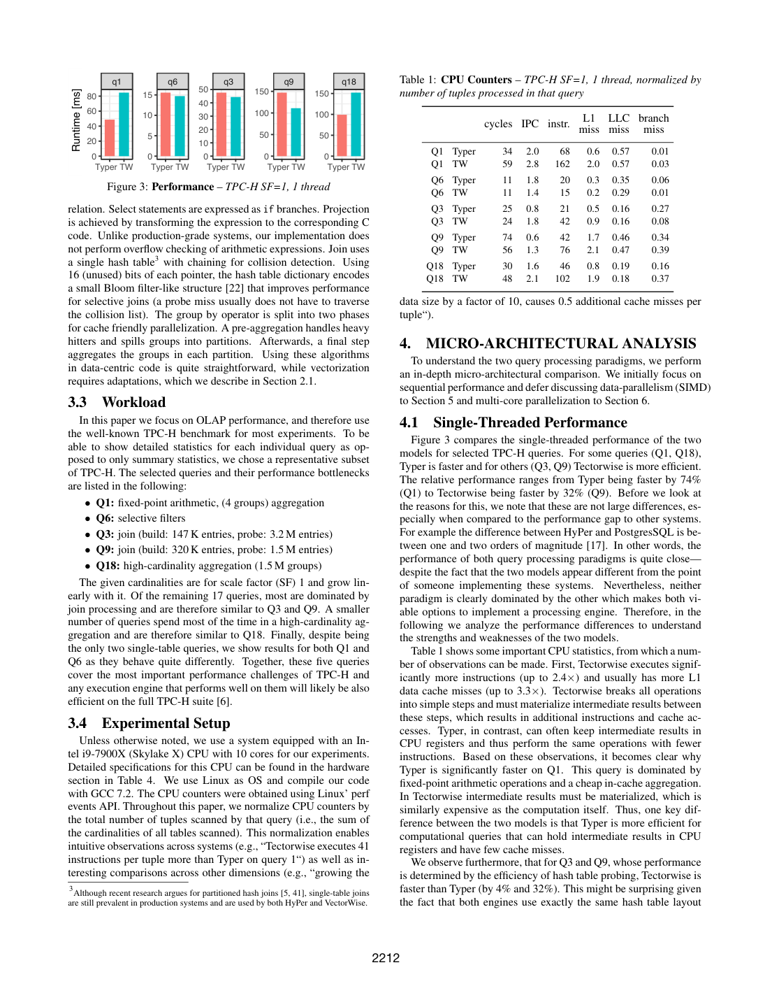
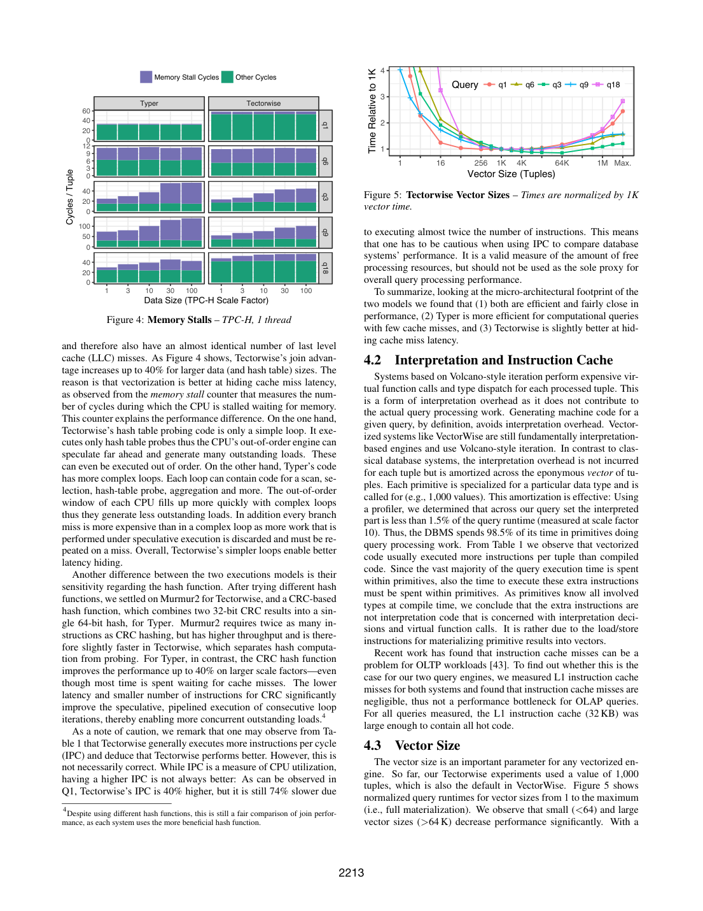

> 本组第 21 篇 · 查询执行引擎 · [全部论文]() · [上一篇]() · [下一篇]()

论文在同一测试系统中比较生成C++的Typer与批量类型特化primitive构成的Tectorwise，控制物理计划、核心算法、数据结构和morsel-driven并行框架，但两者循环/访问结构不同，且分别使用更有利的CRC与Murmur2哈希函数。实测不存在全面胜出的范式：Typer通常减少中间向量物化和指令数，利于计算密集、少cache miss的查询；Tectorwise简单循环能让更多独立load并行在途，在大哈希表probe中更好隐藏延迟。向量化不等于SIMD，也不等于全列物化；编译融合只限非阻塞pipeline。8.4倍是理想选择微基准的SIMD对标量加速，Q6仅1.4倍，Q3/Q9约1.1倍，不能据此判定范式胜负。结论限定于所测TPC-H子集、SSB与硬件，排除解析/优化/代码生成/编译时间；KNL的Q6结果尤其受重复执行和16GB缓存影响。

本文保留论文陈述、读者推断与待验证方案的区别；实验数字只适用于原文条件。原文和翻译来自已有 AI 辅助精读报告，已做来源匹配与编辑复核，不等于人工逐项核验或独立实验复现。所有页码均为 PDF 物理页。

## 论文与阅读范围

Timo Kersten, Viktor Leis, Alfons Kemper, Thomas Neumann, Andrew Pavlo, Peter Boncz. Everything You Always Wanted to Know About Compiled and Vectorized Queries But Were Afraid to Ask. PVLDB, 11(13): 2209-2222, 2018. DOI: https://doi.org/10.14778/3275366.3275370. 以下是单篇来源的AI精读与语义修订，非独立人工核查或性能复现。

[论文集中的原始 PDF](https://github.com/lonng/db-papers/blob/4ff1331069c7cf52ac97dd769e5f484c1c35c200/papers/execution-engine/everything-you-always-wanted-to-know-about-compiled-and-cectorized-queries-but-were-afraid-to-ask.pdf) · 本地来源：`execution-engine/everything-you-always-wanted-to-know-about-compiled-and-cectorized-queries-but-were-afraid-to-ask.pdf`，共 14 页。

本篇保留 10 组原文精读和 43 条证据。截图为原始 PDF 的局部页选，不是重新生成的图表；未将整份 PDF 复制到博客。

## 研究问题与适用边界

研究问题是隔离执行模型本身对内存OLAP执行效率的影响，而非评选一个永远更快的完整DBMS。HyPer与VectorWise还在压缩、扫描谓词、并行调度、数据类型、优化器与算法上不同，直接比较其耗时不能归因于编译/向量化。作者因此实现Typer与Tectorwise，并固定物理计划、核心算法、数据结构及并行策略。

这里的data-centric宜理解为“以数据流为中心”，不是数据中心硬件。Typer生成C++查询代码；HyPer使用LLVM IR，二者不能混为同一实现。Tectorwise的next每次返回一批元组，用预先编译、按类型特化的primitive摊销解释分派。Typer的produce/consume是在代码生成期间组织非阻塞pipeline，不是运行时每个元组调用一整串虚函数；生成的循环内部仍可逐元组处理。

这是对两种特定经典设计的比较，不是把pull与向量化、push与编译定义成不可分割的关系。论文第9.2节还列出push-vectorized与pull-compiled等组合。

实验只计执行，不计解析、优化、代码生成和编译；这是一种隔离变量的测量范围，不是证明编译开销可以忽略，也不假设执行时间足以代表所有系统优劣。原型省略算术溢出检查，生产语义和端到端延迟仍需另测。主要TPC-H负载只有Q1/Q6/Q3/Q9/Q18，不是22条完整TPC-H合规成绩。

依据：论文陈述；PDF 物理页 1, 2, 3, 4, 12。证据：[C001N04](#evidence-c001n04), [C001N11](#evidence-c001n11), [C002N03](#evidence-c002n03), [C002N04](#evidence-c002n04), [exactsource-cv-models](#evidence-exactsource-cv-models), [exactsource-cv-controlled](#evidence-exactsource-cv-controlled), [exactsource-cv-designspace](#evidence-exactsource-cv-designspace), [exactsource-cv-primitives](#evidence-exactsource-cv-primitives)。

## 系统架构与控制流设计

统一框架共享的是核心算法、数据结构、物理计划和morsel-driven并行方式，不是每条指令或访问顺序都相同。Tectorwise为了在单类型primitive中处理一批元组，必须重排表达式、复合键检查和聚合步骤；Typer将相邻非阻塞算子生成到同一紧密循环。作者还为两者分别选更有利的哈希函数：TW用Murmur2，Typer用两个32位CRC合成64位hash，不能称全部实现细节严格一致。

TW在primitive之间写出批内中间向量、选择位置或候选指针；这不是每个关系算子都完全物化整张结果表。Typer尽量让当前元组的中间值留在寄存器，避免相应load/store，但hash join的build以及聚合等阻塞边界不会因代码生成消失。控制流接口、物化粒度与是否生成代码应分别分析。

并行方面，TW为每个worker创建operator tree和独占资源，各算子另有一个共享状态实例，用来共享hash table和分配任务。hash join先并行完成build，barrier之后再probe。两种引擎都采用morsel-driven，不能把历史HyPer与VectorWise的11.7倍/7.2倍扩展差距归为编译与向量化的固有差距。

论文表6将流水线方式分为pull、push、无流水线，将执行方式分为解释、向量化、编译，构成9种组合，列出8种先驱系统。MonetDB的全物化是其中一条独立设计路线。push利于多消费者DAG和分布式Exchange，但控制流也有代价；论文以merge-sort需物化一侧输入为例，而非声称所有push算子都阻塞。

依据：论文陈述；PDF 物理页 3, 5, 8, 12。证据：[C001N10](#evidence-c001n10), [C003N06](#evidence-c003n06), [C004N08](#evidence-c004n08), [C004N12](#evidence-c004n12), [exactsource-cv-microarch](#evidence-exactsource-cv-microarch), [exactsource-cv-designspace](#evidence-exactsource-cv-designspace)。

*原论文 PDF 物理页 4，版权归原作者或出版方。点击图片可查看原尺寸。页面文本中定位到：Figure 3: Performance – TPC-H SF=1, 1 thread；Table 1: CPU Counters – TPC-H SF=1, 1 thread, normalized by；Figure 3 compares the single-threaded performance of the two；Table 1 shows some important CPU statistics, from which a num-。这是页面定位信息，不表示本次已复核图内所有数据。*

## 核心算法与原语实现差异

原文机制：Typer可在同一循环、同一if内检查不同类型谓词，并融合后续表达式。TW将表达式按算术操作拆为类型特化primitive；多类型primitive并非理论上不可能，而是类型组合会导致代码数量膨胀。批内primitive之间传递选择位置和中间结果，带来额外物化，但也形成更简单的循环。

读者示例，非论文源码：对color='green'且tires=4，先逐项比较color，把满足条件的原始行号存入sel1；再只访问tires[sel1[j]]，把同时满足tires=4的原始行号放入sel2。第二步不要求先把整行或所有列gather成一个vector_mid。选择向量本身就是需要写出的中间状态；算术表达式还可能产生值向量。这解释了额外load/store，但不能把每个选择都描述为强制复制完整元组。批量向量是内存数组，也不等同于一个硬件SIMD寄存器。

原文hash join：两者先消费build侧，将键和值以行格式存入链式哈希表，再probe。TW先分列算hash、定位候选，逐键列调用比较primitive；保存命中，将冲突链下一节点变成下一轮候选，直到候选向量为空，最后buildGather把所需build侧值送到下游缓冲区。哈希目录利用指针中16个未用位保存Bloom-like摘要，选择性join的未命中通常可直接排除。它是加速过滤，不替代最终键相等检查。

原文group by：对一批尚未找到已有分组的元组，先按完整相等键划分，再为每个键类创建一组，避免同批重复建组，然后运行聚合primitive。这与整体两阶段聚合是不同层次：后者先处理heavy hitters并把组分入分区，再聚合各分区；这里的spill不能直接理解为磁盘落盘。

微架构推断由原文计数器支持：Typer更少的中间物化可节省指令；TW的简单probe循环使乱序窗口容纳更多不同元组的独立load。复杂融合循环更快占满窗口，且分支预测失败可能丢弃更多已推测工作。重点是指令级并行与内存级并行的平衡，不是“指令越少必然越快”或“更高IPC必然更快”。

依据：读者推断；PDF 物理页 2, 3, 4, 5。证据：[C001N06](#evidence-c001n06), [C001N08](#evidence-c001n08), [C001N09](#evidence-c001n09), [C002N01](#evidence-c002n01), [C002N02](#evidence-c002n02), [exactsource-cv-primitives](#evidence-exactsource-cv-primitives), [exactsource-cv-microarch](#evidence-exactsource-cv-microarch)。

## 正确性保证与工程妥协

本节区分原文事实、正确性要求与未验证问题。论文是性能实验，不提供完整SQL语义、正确性或复杂度的形式化证明。

溢出检查：原文说“our implementation”不做算术表达式溢出检查，不能擅自限定为只有Typer缺少检查，更不能据此认定Typer获得了相对TW的不公平优势。补入检查会改变何种指令、分支和性能，需要两边在同一数值语义下重测。无溢出的测试域不等于存在查询结果错误，也不等于生产语义已经通过验证。

Bloom-like摘要：旧报告的“不能保证不漏报（false positives）”把漏报和误报混淆了，应删除。正确性要求是过滤器不能把真实匹配提前排除，即不能有false negative；false positive只是多做一次链遍历和完整键比较，不会凭空输出错误结果。论文描述了加速用途，未给出该摘要的形式证明；实现仍应以无摘要基线、碰撞和重复键测试检验。不能借“最终比较”弥补已经被错误过滤掉的真匹配。

批处理聚合：一个batch内相同新键只能建立一个逻辑分组，复合键需按全部组件判等；否则可能把同一组拆成多个不相干状态。并行build/probe屏障则维持hash table构建完成后才能探测的阶段顺序。它们是机制所需不变量，不是本文已穷尽所有并发竞态或隔离级别的证明。

编译时间从性能计时中排除，只限定计量范围，不说明编译是否正确。代码生成器bug、事务隔离、NULL/字符串排序规则及溢出边界均需独立测试，本文没有提供这些完整验证，不能以缺少计时反推存在错误。HyPer的LLVM优化/解释回退属于工程缓解措施，不是Typer实测后端或正确性结论。

依据：读者推断；PDF 物理页 3, 4, 8, 10。证据：[C001N04](#evidence-c001n04), [C001N09](#evidence-c001n09), [C002N01](#evidence-c002n01), [C002N03](#evidence-c002n03), [C003N06](#evidence-c003n06), [C003N13](#evidence-c003n13)。

## 实验设计、工作负载与核心数据

条件与口径：主机Intel i9-7900X（Skylake X），10物理核、2-way SMT共20硬件线程，Linux、GCC 7.2；perf events计数器按查询所扫描所有表的基数之和归一化，不按输出行数。排除解析、优化、代码生成、编译。论文未列完整编译命令与优化flags，不能补造-O3或-march=native，也未给出重复次数、误差条或置信区间。自动向量化实验另测GCC 7.2、Clang 5.0、ICC 18。

负载不是只有SF1。主TPC-H选Q1、Q6、Q3、Q9、Q18，SF1时分别涉及4组聚合、选择过滤、147K build/3.2M probe、320K build/1.5M probe、1.5M组聚合。图4把SF从1扩到100；解释开销在SF10测量；并行与外存测SF100。第4.4节还测SSB四模板，SF30、单线程。作者认为五条TPC-H覆盖主要瓶颈，这是作者的代表性主张，不是22条全测。

表1：SF1、单线程，以下均为Typer/TW。Q1 cycles/tuple=34/59、IPC=2.0/2.8、instructions/tuple=68/162；TW虽然IPC更高，耗时却更长。Q9 cycles=74/56、instructions=42/76、LLC misses=0.46/0.47；相近miss数配合更少stall解释了TW的优势，而非缓存miss被消除了。Q6 instructions=20/15，是“Typer总是指令更少”的反例。第3.4节举例说Q1多41条指令，与表1的162-68=94不一致；这里明确引用表1，不把示例当另一测量结果。正文74%/32%的“更快”措辞不能直接改写成同百分比的延迟下降。

解释、I-cache和批大小：SF10解释部分低于1.5%，约98.5%时间在primitive内，额外指令主要是物化load/store；所测OLAP热代码可驻32KB L1指令cache，不代表OLTP也如此。TW默认1000元组；小于64或大于64K会明显变慢，Q3用64K却比默认快15%，所以1000不是无条件最优。

SIMD与scalar的比较主要在TW内部进行，不是Typer对TW。图6用8192个L1驻留连续32位整数、40%选择率，对照无分支scalar：dense selection为8.4倍，带40%输入选择向量的二级selection为2.7倍，SF1完整Q6为1.4倍。图7的4GB稀疏访问在输入选择率低于50%时两者接近；Q6首级保留43%，后续gather受内存访问制约。图8中hashing为2.3倍、gather约1.1倍、probe primitive最佳1.4倍，而完整Q3/Q9约1.1倍。图9工作集增大后收益收敛，是这组lookup的观察，不是SIMD必须让全库驻cache的普遍定理。ICC18在AVX-512上自动向量化了hashing/selection/projection而非probe/aggregation，指令减少20%-60%，却未稳定降低整查询时间，甚至变慢；仅指当时测试版本。

表3：TPC-H SF100，Ratio=Typer ms/TW ms。20线程时Q1=466/708ms，Q6=236/196ms，Q3=842/743ms，Q9=2525/2083ms，Q18=1955/2026ms。10物理核时Q1/Q3/Q9的加速约8.4-9.2倍（各自对单线程基线）；使用20硬件线程后除Q6外差距缩小。Q6是带宽受限的例外，Typer的无分支selection消耗更多带宽，不能把隐藏延迟的结论写成所有内存瓶颈均有同样收益。

硬件不是仅有定性声明。表4给出i9-7900X 10核×2、Threadripper1950X 16核×2、Phi7210 64核×4；SIMD吞吐宽度分别2×512、2×128、2×512bit，表列内存带宽58/56/68GB/s。图11/12与第7节有跨平台曲线和相对数字。KNL的16GB高带宽内存约300GB/s，设作硬件L3 cache，Quadrant模式暴露一个NUMA节点。重复Q6可使整个工作集驻留其中，标量相对Skylake最高2倍，关闭L3时仅高10%；手写SIMD近3倍亦有同样缓存警告。它不是普遍的硬件或范式优越性证据。

表5外存读表：3块SATA SSD RAID5，1.4GB/s，对照该节内存55GB/s，SF100/20线程。Typer/TW毫秒依次为Q1 923/1184、Q6 808/773、Q3 1405/1313、Q9 3268/2827、Q18 2747/2795，差距趋近1但未消失。这说明所测二级存储读表条件下相对趋势仍在，不证明外部hash join或聚合的磁盘spill算法已被完整验证。

依据：论文陈述；PDF 物理页 3, 4, 5, 6, 7, 8, 9, 10。证据：[C001N04](#evidence-c001n04), [C002N03](#evidence-c002n03), [C002N04](#evidence-c002n04), [C002N05](#evidence-c002n05), [C002N10](#evidence-c002n10), [C002N11](#evidence-c002n11), [C002N14](#evidence-c002n14), [C003N01](#evidence-c003n01), [C003N02](#evidence-c003n02), [C003N03](#evidence-c003n03), [C003N07](#evidence-c003n07), [C003N09](#evidence-c003n09), [exactsource-cv-table1](#evidence-exactsource-cv-table1), [exactsource-cv-microarch](#evidence-exactsource-cv-microarch), [exactsource-cv-vector-size](#evidence-exactsource-cv-vector-size), [exactsource-cv-ssb-production](#evidence-exactsource-cv-ssb-production), [exactsource-cv-simd-auto](#evidence-exactsource-cv-simd-auto), [exactsource-cv-table3](#evidence-exactsource-cv-table3), [exactsource-cv-table4](#evidence-exactsource-cv-table4), [exactsource-cv-ssd-knl](#evidence-exactsource-cv-ssd-knl), [exactsource-cv-knl-qualitative](#evidence-exactsource-cv-knl-qualitative)。

*原论文 PDF 物理页 5，版权归原作者或出版方。点击图片可查看原尺寸。页面文本中定位到：Figure 4: Memory Stalls – TPC-H, 1 thread；Figure 5: Tectorwise Vector Sizes – Times are normalized by 1K。这是页面定位信息，不表示本次已复核图内所有数据。*

## 架构权衡与设计空间

指令节省与延迟隐藏：Typer避免部分primitive边界物化，计算密集、cache miss少的Q1受益；TW简单循环在hash probe中产生更多并行内存请求，即使多执行指令也可更快。工作集大不是充分条件：带宽、访问模式、分支和独立load数量都会影响瓶颈，不能由“内存受限”直接选定执行范式。

SIMD是另一维度。TW的紧密primitive更容易使用SIMD，但selection vector会令后续访问稀疏，hash lookup还受延迟和load吞吐制约。论文也明确提到压缩数据和Xeon Phi可能有更大SIMD收益。因此不能把局部图9结果变成“SIMD仅对全缓存驻留数据有效”的普遍定律。

编译延迟与可观测性：第8节定性讨论LLVM优化编译时间经常随代码量超线性增长，宽表的简单SQL同样可能生成大量代码；不是所有编译器的固定复杂度定理。HyPer用替代优化和先解释morsel等方式缓解，Spark的8KB字节码回退是论文当时叙述，未在此验证当前版本。预编译primitive降低查询编译负担，但不保证整个查询启动延迟极低或确定。向量化可以低开销按primitive计时、替换执行逻辑以适应数据；编译pipeline要还原每个算子的成本较难。

两者均有实现成本：向量化需把控制逻辑与类型primitive分离，复合键比较可能产生额外boolean向量；编译有代码生成代码的间接性、调试和后端抽象问题。不能声称每个TW算子都需要shuffle或多次gather/scatter。MonetDB全物化会增加主存带宽，论文没有给出“成倍增加”的统一倍数。

混合设计是开放空间。HyPer的压缩Data Block扫描预编译且向量化，其他算子数据流中心编译；Peloton relaxed fusion选择性增加物化边界以支持批处理、预取和SIMD，需正确判断在哪里切分。反向将primitive融合也可减少物化。论文讨论这些机制，并未在统一框架证明任意混合都优于Typer和TW。OLTP存储过程/多语言融合偏向编译，低编译延迟/profile/适应性偏向向量化，均是工程定性取舍，不是本实验测得的事务吞吐量排名。

依据：论文陈述；PDF 物理页 5, 7, 10, 11, 12。证据：[C002N10](#evidence-c002n10), [C003N03](#evidence-c003n03), [C003N13](#evidence-c003n13), [C004N05](#evidence-c004n05), [C004N07](#evidence-c004n07), [C004N12](#evidence-c004n12), [exactsource-cv-microarch](#evidence-exactsource-cv-microarch), [exactsource-cv-adaptive](#evidence-exactsource-cv-adaptive), [exactsource-cv-knl-qualitative](#evidence-exactsource-cv-knl-qualitative)。

## 与现有系统及开源生态的联系

本节只提出待验证的现代系统对照，不把外部记忆写成本文证据。论文2018年描述的HyPer、VectorWise、Peloton、Impala和Spark不自动等于这些系统的当前实现；本文未研究StarRocks、Calcite或DuckDB源码。

对StarRocks、DuckDB等目标引擎，首先固定具体版本和物理计划，再核查batch表示、selection vector、表达式融合、复合键join与group by的实际路径；随后测寄存器压力、中间写流量、独立在途load与stall，不能从“向量化”标签推断天然优于某编译引擎。对Calcite相关集成，应先区分优化器与真正负责执行的下游组件，再确认调度与控制流。

论文自身的对照并未缺失：表2给出Actian Vector 5.0及TUM研究版HyPer与TW/Typer的SF1单线程耗时。它用于说明原型与代表系统性能量级接近，不把压缩或完整语义等差异重新归因为范式。HyPer Q6可直接在压缩列上SIMD过滤，也解释了为何不能让Typer代表HyPer所有行为。

可进一步检验在相同基础执行器中引入选择性融合/解融合、预取和代码缓存的增益，并把编译延迟纳入端到端指标。这属于新的实验设计；不能把Peloton当成本文已实现且已胜出的第三个基线，也不能将论文的Spark字节码阈值当作现代版本不变规则。

依据：待验证的工程设想；PDF 物理页 6, 10, 11, 12。证据：[C004N05](#evidence-c004n05), [C004N07](#evidence-c004n07), [exactsource-cv-ssb-production](#evidence-exactsource-cv-ssb-production), [exactsource-cv-adaptive](#evidence-exactsource-cv-adaptive), [exactsource-cv-knl-qualitative](#evidence-exactsource-cv-knl-qualitative)。

## 复现指南与缺失信息

以下为复现方案，不是本文已经执行的额外实验。

1. 先取论文参考文献[16]给出的实现仓库https://github.com/TimoKersten/db-engine-paradigms，记录实际可获取的commit与构建条件；本文已给出源码链接，图1/2还有选择与hash join伪代码，不能称没有源码或伪代码。本轮未联网核验仓库现状。Typer生成C++，因此复现主实验不要求实现LLVM JIT；LLVM IR是HyPer等系统的讨论范围。
2. 固定物理计划、扫描布局、数据类型、链式hash table、两阶段聚合及morsel-driven调度。保留TW单类型批量primitive与Typer非阻塞pipeline融合的真实差异。以原文Murmur2/CRC分别优化的设置为主，再添加相同hash函数的敏感性对照，不能把后二者混称论文原始基线。
3. 用Q1/Q6/Q3/Q9/Q18复现SF1计数器、SF1到100的stall趋势、SF10解释占比、SF100的1/10/20线程结果；另测SF30单线程SSB。TW默认batch1000，并重测1到全物化及Q3的64K例外。按所有扫描表总元组数归一化，分别报告cycles、instructions、IPC、L1/LLC miss、branch miss和memory stalls，不能只看IPC。
4. 在TW内分别比较无分支scalar、手写AVX-512和自动向量化；保留dense/sparse、8192元素L1工作集与4GB工作集、输入/输出选择率、hash/probe微基准及整查询的层级，不能将8.4倍登记成编译对向量化的比值。
5. 跨平台记录Skylake、Threadripper、KNL的物理核/SMT、频率、NUMA和缓存配置。KNL复现必须同时报告16GB HBM作cache与关闭该cache的Q6、冷/热和混合负载。SSD实验复现SF100/20线程、3 SATA RAID5读表，但另行定义超内存hash/aggregation spill实验，不能默认原文已测。
6. 先验证结果一致性：与参考执行器比较聚合值、重复键、冲突链与选择位置，确保Bloom-like摘要不丢真匹配；要保留原型无溢出检查的比较时，应限定安全输入域，同时另测两边统一加入检查的生产语义版本。

已披露信息有CPU、OS、编译器版本、图表数字、主算法与源码链接。真正需补齐的是源码可获取版本、完整compiler flags、RAM配置、线程亲和/频率管理、数据生成与预热细节、重复次数和统计误差，以及bitmap位映射和morsel配置等实现细节是否可从代码恢复。新实验应把执行时间与编译/端到端时间分列，报告分布和置信区间。以上参数不能伪称原文已完整提供，也不能反过来说论文没有跨平台性能数字。

依据：待验证的工程设想；PDF 物理页 2, 3, 4, 5, 6, 7, 8, 9, 10, 13。证据：[C001N11](#evidence-c001n11), [C002N01](#evidence-c002n01), [C002N05](#evidence-c002n05), [C003N06](#evidence-c003n06), [exactsource-cv-primitives](#evidence-exactsource-cv-primitives), [exactsource-cv-microarch](#evidence-exactsource-cv-microarch), [exactsource-cv-ssb-production](#evidence-exactsource-cv-ssb-production), [exactsource-cv-simd-auto](#evidence-exactsource-cv-simd-auto), [exactsource-cv-table3](#evidence-exactsource-cv-table3), [exactsource-cv-table4](#evidence-exactsource-cv-table4), [exactsource-cv-ssd-knl](#evidence-exactsource-cv-ssd-knl), [exactsource-cv-knl-qualitative](#evidence-exactsource-cv-knl-qualitative), [exactsource-cv-code-reference](#evidence-exactsource-cv-code-reference)。

## 总结与内核工程师启示

在本文共享核心算法、数据结构、物理计划和morsel-driven框架的原型中，两种执行设计都高效，OLAP性能总体接近，没有某个所测硬件平台上的全面支配者。Typer常以减少中间物化和指令数取胜于计算密集、少cache miss场景；TW常以更简单循环、更高内存级并行隐藏大hash table的probe延迟。这里不能将“常”改成所有查询都成立：Q6指令数已是反例，带宽瓶颈也不同于延迟瓶颈。

AVX-512的微基准大收益没有同幅度传递到完整查询。TW上的SIMD/scalar结果、Typer/TW比较和历史生产系统对照是三类不同实验。并行方式与执行模型正交，双方使用morsel-driven后都可较好扩展；Skylake的SMT通常缩小差距，Q6例外，Threadripper的SMT也未呈同样收益。

工程选择还取决于编译延迟、OLTP与语言融合、profile、适应性和实现成本。论文讨论混合模型，但不提供一个普适最优的融合/物化边界。最可靠的启示是同时观察指令工作量、分支/乱序窗口、在途load、缓存层次与带宽，并在目标负载下测量；不是从单一IPC、8.4倍微基准或KNL热缓存曲线选定一贯胜出的范式。以上是单篇来源的AI语义审核结果，不是新性能证明。

依据：论文陈述；PDF 物理页 4, 5, 8, 9, 10, 12。证据：[C002N10](#evidence-c002n10), [C003N07](#evidence-c003n07), [exactsource-cv-table1](#evidence-exactsource-cv-table1), [exactsource-cv-microarch](#evidence-exactsource-cv-microarch), [exactsource-cv-knl-qualitative](#evidence-exactsource-cv-knl-qualitative), [exactsource-cv-ssd-knl](#evidence-exactsource-cv-ssd-knl), [exactsource-cv-summary](#evidence-exactsource-cv-summary)。

## 原文精读：从句子回到机制

以下保留原文、忠实翻译、含义与边界；假设示例不作为论文实验结果。

### P001 · PDF 物理页 2

**原文**

<blockquote class="paper-source-quote"><pre><code>Note that for these simple operators&#10;the Tectorwise implementation must already change the structure&#10;of the algorithms and deviate from the Typer data access patterns.&#10;The resulting materialization of intermediates makes fast caches&#10;very important for vectorized engines.&#10;2.2&#10;Vectorized Hash Join and Group By&#10;Pseudo code for parts of our hash join implementations are shown&#10;in Figure 2.</code></pre></blockquote>

**忠实翻译**

> 注意，对于这些简单算子，Tectorwise 实现必须已经改变算法的结构，并偏离 Typer 的数据访问模式。由此产生的中间结果物化使得快速缓存对向量化引擎非常重要。2.2 向量化 Hash Join 与 Group By 图 2 展示了我们 hash join 实现的部分伪代码。

**技术含义与边界**

> 原文陈述：即使是简单算子，向量化实现（Tectorwise）也需要在算法结构上做出调整，无法完全沿用数据中心编译执行（Typer）的访问模式；这种调整导致中间结果被物化，因此高速缓存成为向量化引擎的关键。作者随后引出 hash join 和 group by 的向量化实现伪代码。适用边界：该结论针对文中对比的 Tectorwise 与 Typer 两种特定实现方式。

**常见误读**

> 容易误认为所有向量化引擎都必须改变所有算子的算法结构，或误认为中间结果物化是向量化的固有缺陷。原文仅指出在 Tectorwise 与 Typer 的对比语境下，简单算子的向量化实现需要改变结构并导致中间物化，不能泛化为全局保证。

**读者构造的假设示例**

> 读者构造示例，非论文代码：先检查一批color值，输出满足color='green'的原始行号sel1；第二个primitive按这些行号检查tires，输出sel2。批向量和selection vector通常在内存中，并不是必须先把整批装进一个SIMD寄存器，也不要求复制整行。批内中间位置/值向量的load/store对缓存敏感。

### P002 · PDF 物理页 12

**原文**

<blockquote class="paper-source-quote"><pre><code>Nevertheless, there are also&#10;other (more or less common) models. Before discussing the strengths&#10;and weaknesses of these alternative approaches, we taxonomize&#10;them in Table 6. We classify query processing paradigms regarding&#10;(1) how/whether pipelining is implemented, and (2) how execution&#10;is performed. Pipelining can be implemented either using the pull&#10;(next) interface, the push (produce/consume) interface, or not at all&#10;(i.e., full materialization after each operator).</code></pre></blockquote>

**忠实翻译**

> 尽管如此，也存在其他（或多或少常见的）模型。在讨论这些替代方法的优缺点之前，我们在表 6 中对它们进行了分类。我们根据 (1) 流水线如何实现/是否实现，以及 (2) 执行如何进行，来对查询处理范式进行分类。流水线可以使用 pull（next）接口、push（produce/consume）接口来实现，或者根本不实现（即每个算子之后完全物化）。

**技术含义与边界**

> 原文陈述：作者提出了一种二维分类法来划分查询处理范式：第一维是流水线的实现方式（pull、push 或不实现流水线即全物化），第二维是执行方式。适用边界：这是作者提出的分类框架，用于后续讨论不同模型的优缺点。

**常见误读**

> 不要把批内中间物化等同于每个算子之后全结果物化，也不要把push/pull分别与编译/向量化绑定。该文的分类框架将流水线与执行方法视为正交维度；next和produce/consume的具体使用还要区分运行时解释与代码生成期。

**读者构造的假设示例**

> 读者构造示例：解释式pull算子在运行时通过next拉取数据；数据流中心编译则可在代码生成阶段通过produce/consume组织融合循环，运行时不必每行再做这些接口调用。全物化路线会先完成整个算子结果，再由后继读取；它不同于TW仅在批内primitive间保存向量。

### P003 · PDF 物理页 7

**原文**

<blockquote class="paper-source-quote"><pre><code>We also show an estimate of how many cycles on average&#10;are spent resolving cache misses. We observe that most of the time&#10;is spent waiting for data. Thus the memory subsystem becomes&#10;the bottleneck of the selection operation and the positive effect of&#10;utilizing SIMD instructions disappears. In the selection cascade of&#10;Q6, only the first selection primitive benefits from SIMD and se-&#10;lects 43% of the tuples.</code></pre></blockquote>

**忠实翻译**

> 我们还展示了一个估计值，说明平均花费多少周期来解决缓存未命中。我们观察到大部分时间都花在等待数据上。因此，内存子系统成为 selection 操作的瓶颈，利用 SIMD 指令的正向效果消失了。在 Q6 的 selection 级联中，只有第一个 selection 原语受益于 SIMD，并选择了 43% 的元组。

**技术含义与边界**

> 原文在4GB稀疏selection实验中估算cache miss的平均周期，发现等待数据占主导；Q6首级选择保留43%元组，后续primitive沿selection vector进行非连续访问，落入SIMD与scalar接近的区间。这不是说筛选后更小的逻辑输入必然驻留cache。

**常见误读**

> 容易错误推断 SIMD 在所有数据库操作中都没有正向效果。原文明确限定条件为“selection 操作”且瓶颈在于“内存子系统”，并且指出在 Q6 级联中第一个 selection 确实受益于 SIMD。不能将此局部结果泛化为 SIMD 整体无效。

**读者构造的假设示例**

> 读者构造示例：若selection vector保存[0,7,31,80]，下一个谓词读取下一列的这些分散位置，可能为少量有效值加载多条cache line。即使比较指令更快，gather和数据等待仍可主导。逻辑剩余元组变少不自动等于内存访问连续或工作集驻留L1。

### P004 · PDF 物理页 4

**原文**

<blockquote class="paper-source-quote"><pre><code>Select statements are expressed as if branches. Projection&#10;is achieved by transforming the expression to the corresponding C&#10;code. Unlike production-grade systems, our implementation does&#10;not perform overflow checking of arithmetic expressions. Join uses&#10;a single hash table3 with chaining for collision detection.</code></pre></blockquote>

**忠实翻译**

> Select 语句被表达为 if 分支。Projection 通过将表达式转换为相应的 C 代码来实现。与生产级系统不同，我们的实现不对算术表达式执行溢出检查。Join 使用单个哈希表3，并通过链地址法进行冲突检测。

**技术含义与边界**

> 原文介绍原型中selection、projection、链式hash join及省略溢出检查。our implementation指原型实现，不是明确说只有Typer缺少检查；不能从这段判定两者相对不公平或推断具体性能收益。

**常见误读**

> 容易忽略“与生产级系统不同”这一前提，误认为生成的代码包含完整的安全检查。原文明确指出缺乏溢出检查，这意味着该实现的性能数据可能高于具备完整安全检查的生产系统，不能直接等同。

**读者构造的假设示例**

> 读者构造的假设示例：对于 SQL 语句 SELECT a + b FROM T WHERE c > 10，原型系统可能生成类似 if (c > 10) { result = a + b; } 的 C 代码，其中 a + b 不会检查整数溢出。而生产系统可能会插入额外的 if 语句或使用带溢出检测的内置函数来处理 a + b。

### P005 · PDF 物理页 10

**原文**

<blockquote class="paper-source-quote"><pre><code>However, compilation time can also become&#10;large if the generated code is large because (optimizing) LLVM&#10;compile time is often super-linear to code size. OLAP queries that&#10;consist of many operators will generate large amounts of code, but&#10;also a small SQL query such as SELECT * FROM T can produce a&#10;lot of code if table T has thousands of columns, as each column&#10;leads to some code generation.</code></pre></blockquote>

**忠实翻译**

> 然而，如果生成的代码很大，编译时间也可能变得很长，因为（优化型）LLVM 编译时间通常与代码大小呈超线性关系。由许多算子组成的 OLAP 查询会生成大量代码，但即使是像 SELECT * FROM T 这样的小型 SQL 查询，如果表 T 有数千列，也会产生大量代码，因为每一列都会导致一些代码生成。

**技术含义与边界**

> 论文定性指出优化型LLVM的编译时间经常随代码量超线性增长；复杂算子组合和数千列的简单SELECT均可能生成大量代码。这不是所有编译器的严格复杂度定理，也不是Typer实测编译时间；Typer在本文生成C++，计时不包括编译。

**常见误读**

> 容易误认为只有复杂的 OLAP 查询才会面临编译时间过长的问题。原文明确给出了反例：SELECT * FROM T 这种极简查询在宽表条件下同样会产生大量代码。不能将“查询逻辑简单”等同于“生成代码量小”。

**读者构造的假设示例**

> 读者构造示例：表有2000列时，即使SQL只有SELECT *，逐列特化的访问与结果输出也可能生成较大代码。需要记录实际代码量和编译延迟，不能仅凭列数给出秒数或把该估计当成论文测量。

### P006 · PDF 物理页 3

**原文**

<blockquote class="paper-source-quote"><pre><code>This test-&#10;ing methodology allows an apples-to-apples comparison of both&#10;approaches because the only difference between Tectorwise and&#10;Typer is the query execution method: vectorized versus data-centric&#10;compiled execution.&#10;3.1&#10;Related Work&#10;Vectorization was proposed by Boncz et al. [7] in 2005. It was&#10;first used in MonetDB/X100, which evolved into the commercial&#10;OLAP system VectorWise, and later adopted by systems like DB2&#10;BLU [40], columnar SQL Server [21], and Quickstep [33].</code></pre></blockquote>

**忠实翻译**

> 这种测试方法允许对两种方法进行苹果对苹果的比较，因为 Tectorwise 和 Typer 之间唯一的区别是查询执行方法：向量化与数据中心编译执行。3.1 相关工作 向量化由 Boncz 等人 [7] 于 2005 年提出。它首次用于 MonetDB/X100，该系统演变为商业 OLAP 系统 VectorWise，后来被 DB2 BLU [40]、列式 SQL Server [21] 和 Quickstep [33] 等系统采用。

**技术含义与边界**

> 作者通过共享物理计划、核心算法、数据结构和并行策略隔离执行模型，而非保证访问顺序和每个实现细节相同。第2节明确说明primitive拆分改变结构，第4.1节分别选Murmur2与CRC以利各自引擎。后半段是论文给出的历史沿革，不表示本轮已读那些参考文献正文。

**常见误读**

> 不能把apples-to-apples读成逐条实现完全相同，也不能推导所有向量化/编译比较天然公平。原文引文编号是学术来源指向，不是操作指令；本轮未外查其正文，所以不补写那些系统的当前具体实现。

**读者构造的假设示例**

> 读者构造示例：先固定同一物理计划和链式hash table，再分别执行批量primitive和生成循环；仍需记录两种hash函数及访问模式差异。解析和优化被排除计时，不需要臆造原型共享了哪一种完整解析器或优化器。

### P007 · PDF 物理页 5

**原文**

<blockquote class="paper-source-quote"><pre><code>Each primitive is specialized for a particular data type and is&#10;called for (e.g., 1,000 values). This amortization is effective: Using&#10;a profiler, we determined that across our query set the interpreted&#10;part is less than 1.5% of the query runtime (measured at scale factor&#10;10). Thus, the DBMS spends 98.5% of its time in primitives doing&#10;query processing work. From Table 1 we observe that vectorized&#10;code usually executed more instructions per tuple than compiled&#10;code.</code></pre></blockquote>

**忠实翻译**

> 每个原语都针对特定数据类型进行了特化，并被调用处理（例如 1,000 个值）。这种摊销是有效的：使用性能分析器，我们确定在我们的查询集中，解释执行部分占查询运行时间的比例不到 1.5%（在 scale factor 10 下测量）。因此，DBMS 将 98.5% 的时间花在执行查询处理工作的原语上。从表 1 我们观察到，向量化代码通常比编译代码在每个元组上执行更多的指令。

**技术含义与边界**

> 原文陈述：向量化引擎通过批量处理（如每次 1000 个值）和类型特化原语来摊销解释调用的开销。实验表明解释开销低于 1.5%，绝大部分时间在执行底层原语。同时指出一个现象：向量化代码处理每个元组时执行的指令数通常多于编译代码。适用边界：解释开销的比例基于特定查询集和 scale factor 10 的测量结果。

**常见误读**

> 更多instructions/tuple不等于更慢，更高IPC也不等于更快。这里原始Typer/TW差异主要由中间物化与乱序/内存级并行解释，不能拿后文SIMD作为未经证明的原因。SF10解释开销比例也不能推广为任意查询的固定常数。

**读者构造的假设示例**

> 原文表1对照而非新测量：SF1单线程Q1中Typer/TW分别68/162 instructions和34/59 cycles每扫描元组，TW的2.8 IPC高于Typer的2.0但周期仍更多；Q9中TW的独立probe可更好隐藏内存等待。因此需同时检查指令工作量与stall，不能只读IPC。

### P008 · PDF 物理页 8

**原文**

<blockquote class="paper-source-quote"><pre><code>In general, the&#10;shared state of each operator is used to share results and coordinate&#10;work distribution. Additionally, pipeline breaking operators use a&#10;barrier to enforce a global order of sub-tasks. The hash join oper-&#10;ator uses this barrier to enforce that first all workers consume the&#10;build side and insert results into a shared hash table.</code></pre></blockquote>

**忠实翻译**

> 通常，每个算子的共享状态用于共享结果和协调工作分配。此外，流水线阻断算子使用屏障来强制执行子任务的全局顺序。hash join 算子使用此屏障来确保所有 worker 首先消费 build side 并将结果插入共享哈希表中。

**技术含义与边界**

> 第6.1节描述本文TW的共享状态和同步：每worker有独立operator tree及资源，各算子另有共享state，hash join在全部build完成后才probe。这里的barrier用于该具体阶段边界，不是声称所有并行算法都要相同全局同步。

**常见误读**

> 容易误认为所有算子都需要屏障。原文明确限定“流水线阻断算子”（pipeline breaking operators）才使用屏障来强制全局顺序。非阻断算子可以通过共享状态持续流水线处理，无需全局同步。

**读者构造的假设示例**

> 读者构造的假设示例：假设有 4 个 worker 线程执行 Hash Join。它们各自读取 build side 的一部分数据并插入同一个共享哈希表。屏障的作用是：如果 worker 1 提前完成了自己的部分，它不能立即开始 probe 阶段，必须等待 worker 2、3、4 也完成各自的 build 插入，确保哈希表完整后才能统一进入 probe 阶段。

### P009 · PDF 物理页 6

**原文**

<blockquote class="paper-source-quote"><pre><code>Results for a best-case sce-&#10;nario, in which all consumed data are 32-bit integers, are present in&#10;the L1 cache, and the input is a contiguous vector, are shown in Fig-&#10;ure 6a. The observed performance gain for this micro-benchmark&#10;is 8.4×. However, as Figure 6c shows, in a realistic query with&#10;multiple expensive selections like Q6, we only observe a speedup&#10;of 1.4×—even though almost 90% of the processing time is spent&#10;in SIMD primitives.</code></pre></blockquote>

**忠实翻译**

> 最佳场景的结果显示在图 6a 中，在该场景中所有消费的数据都是 32 位整数，存在于 L1 缓存中，且输入是连续的向量。在这个微基准测试中观察到的性能提升是 8.4 倍。然而，如图 6c 所示，在具有多个昂贵 selection 的真实查询（如 Q6）中，我们仅观察到 1.4 倍的加速——尽管几乎 90% 的处理时间都花在 SIMD 原语上。

**技术含义与边界**

> 原文陈述：对比了 SIMD 在理想微基准测试和真实查询中的表现差异。理想条件下（L1 缓存命中、连续内存、单一数据类型）可获得 8.4 倍加速；但在真实查询 Q6 中，即使 90% 时间在运行 SIMD 原语，实际加速仅为 1.4 倍。适用边界：明确区分了微基准测试的最佳情况与真实查询的实际情况。

**常见误读**

> 极易将微基准测试的 8.4 倍加速误认为是 SIMD 在实际数据库系统中的普遍收益。原文通过“However”强烈转折，指出真实查询中受限于多种因素（结合 P003 可知是内存瓶颈），加速比骤降至 1.4 倍。不能把局部最优结果泛化为全局保证。

**读者构造的假设示例**

> 读者构造示例，非论文实测毫秒：某查询scalar耗时14单位、SIMD耗时10单位，加速比为1.4。即使一个L1连续数组primitive单独能快8.4倍，整查询还包含稀疏gather、cache miss及其他步骤，不能把局部8.4倍直接乘到全查询，也不能把它当成TW相对Typer的比值。

### P010 · PDF 物理页 11

**原文**

<blockquote class="paper-source-quote"><pre><code>This is the&#10;key insight behind Peloton’s relaxed operator fusion [26] model,&#10;which selectively introduces explicit materialization boundaries in&#10;the generated code. By batching multiple tuples, Peloton can easily&#10;introduce SIMD and software prefetching instructions [26]. Con-&#10;sequently, Peloton’s pipelines are shorter and their structure resem-&#10;bles vectorized code (see Figure 13).</code></pre></blockquote>

**忠实翻译**

> 这是 Peloton 的宽松算子融合（relaxed operator fusion）[26] 模型背后的关键洞察，该模型在生成的代码中选择性地引入显式的物化边界。通过对多个元组进行批处理，Peloton 可以轻松引入 SIMD 和软件预取指令 [26]。因此，Peloton 的流水线更短，其结构类似于向量化代码（见图 13）。

**技术含义与边界**

> 原文讨论在编译生成的非阻塞pipeline内选择性增加物化边界，以形成批处理并方便加入SIMD/预取。即便没有relaxed fusion，原有阻塞算子仍有物化边界；不能称编译模型会完全消除所有物化，也不能说这是编译利用SIMD的唯一途径。

**常见误读**

> 这是混合设计，不等于转为纯向量解释。是否切分、在哪里切分需要非平凡决策；本文未在其统一原型中证明Peloton总是更快。参考文献[26]是学术来源，本轮未读其全文，因此不补造其优化器或源码细节。

**读者构造的假设示例**

> 读者构造的概念示例：在一个融合的scan/filter/hash-probe片段中，将若干probe地址暂存为batch，再执行预取或SIMD处理，是一种可能的解融合方向。这里只说明边界如何改变数据流，不声称Peloton按1000元组或某固定算子序列执行，也不声称加入物化必然更快。

## 尚未解决的问题

1. 在固定源码版本、compiler flags及结果语义后，编译时间、执行时间和端到端延迟各自如何随查询复杂度与数据规模变化？
2. 相同hash函数与各自最优hash函数两种设置下，寄存器压力、在途load及branch miss对结果各有多少贡献？
3. 什么可测代价能指导pipeline的局部融合/解融合，并抵消新增中间物化、预取和编译成本？
4. 在新硬件或ARM平台上，原文的指令数/延迟隐藏权衡是否仍成立？本轮未检索或验证当前平台。
5. 两种实现统一加入溢出与NULL等完整语义后，结果正确性及绝对/相对性能如何变化？
6. KNL的Q6热缓存优势在混合查询、冷启动或HBM关闭时能保留多少？原文未证明可泛化到生产混合负载。
7. 向量大小、morsel大小和线程数的联合选择能否在不破坏可比性的条件下自适应？

## 证据索引

证据编号沿用原报告，便于将上文判断追溯到原句。引文匹配只验证位置，不证明解读正确。

**C001N04 · PDF 物理页 3**

实验排除解析、优化、代码生成和编译，仅测执行；两者控制物理计划、核心算法、数据结构与并行框架。这不意味着编译开销被证明可忽略，不能据此推导端到端优劣。

<blockquote class="paper-source-quote"><pre><code>We do not include query parsing, optimization, code generation, and compilation time in our measurements.</code></pre></blockquote>

**C001N06 · PDF 物理页 2**

在多谓词选择场景下，编译模型（Typer）可在单次循环迭代中同时评估所有谓词（Integrated）。而向量化模型（Tectorwise）受限于单类型约束，必须将评估拆分为每个谓词一个原语。解释逻辑先运行第一个函数按颜色选择元素，再运行第二个函数按轮胎数选择。这种拆分导致中间结果物化，使得快速缓存对向量化引擎极为重要。

<blockquote class="paper-source-quote"><pre><code>The resulting materialization of intermediates makes fast caches very important for vectorized engines.</code></pre></blockquote>

**C001N08 · PDF 物理页 3**

Tectorwise的哈希连接探测复合键时，因不能违反单类型约束，必须分步执行：首先通过probeHash表达式为每个键列调用一个原语计算哈希并写入输出向量；然后用该哈希向量在哈希表中生成候选匹配位置；接着通过cmpKey表达式为每个键列调用独立原语检查等值；若候选有溢出链，则将溢出条目作为新候选进入下一次迭代，直到候选向量为空。最后用buildGather将数据移入下一算子的缓冲区。

<blockquote class="paper-source-quote"><pre><code>For composite join-keys, this invokes multiple primitives: one for every key column, to avoid violating (i) and (ii).</code></pre></blockquote>

**C001N09 · PDF 物理页 3**

Tectorwise的Group By算子同样使用包含分组键和聚合值的哈希表。对于未在哈希表中找到分组的元组，不能简单地每个元组添加一个分组，因为这会导致同一分组被重复添加。因此，算法将所有无分组的元组按相等键洗牌（shuffle）成分区（复合键逐组件处理），然后为每个分区向哈希表添加一个分组。一旦所有传入元组的分组已知，再运行聚合原语。

<blockquote class="paper-source-quote"><pre><code>Unfortunately, it is not sufficient to just add one group per group-less tuple as this could lead to groups added multiple times.</code></pre></blockquote>

**C001N10 · PDF 物理页 3**

为了在Tectorwise中实现算子，必须偏离Typer的实现方式。这种偏离并非出于设计选择，而是向量化施加的约束(i)和(ii)所迫。这导致每个算子有两种不同的实现，尽管核心算法和并行策略相同。向量化转换使Group By产生了比Join更大的数据访问模式偏差，并引入了额外工作（如洗牌分区）。

<blockquote class="paper-source-quote"><pre><code>Note that in order to implement Tectorwise operators we need to deviate from the Typer implementations. This deviation is not by choice</code></pre></blockquote>

**C001N11 · PDF 物理页 3**

同一测试系统实现scan、select、project/map、join和group by。核心算法和数据结构保持可比，但向量化造成循环及数据访问结构的必要调整，哈希函数还分别选各自更有利实现。

<blockquote class="paper-source-quote"><pre><code>We implemented five relational operators both in Tectorwise and Typer: scan, select, project (map), join, and group by.</code></pre></blockquote>

**C001N12 · PDF 物理页 3**

论文梳理了两种范式的起源与应用：向量化由Boncz等人于2005年提出，首用于MonetDB/X100，后演变为VectorWise，并被DB2 BLU、SQL Server列存版和Quickstep采用。数据中心代码生成由Neumann于2011年提出，使用LLVM作为HyPer的处理模型，后被Peloton和Spark采用。

<blockquote class="paper-source-quote"><pre><code>Vectorization was proposed by Boncz et al. [7] in 2005. It was first used in MonetDB/X100, which evolved into the commercial OLAP system VectorWise</code></pre></blockquote>

**C002N01 · PDF 物理页 4**

两者使用单个链式hash table，目录利用指针的16个未用位作Bloom-like摘要以快速排除probe miss；命中仍需完整键比较。这里不把false positive误写成漏报，也不声称过滤器允许false negative。

<blockquote class="paper-source-quote"><pre><code>Using 16 (unused) bits of each pointer, the hash table dictionary encodes a small Bloom filter-like structure [22] that improves performance for selective joins</code></pre></blockquote>

**C002N02 · PDF 物理页 4**

Group by 算子被拆分为两阶段以实现缓存友好的并行化：预聚合阶段处理 heavy hitters 并将分组溢出到分区；最终阶段对每个分区内的分组进行聚合。这是算法步骤层面的设计，不涉及剪枝或排序启发式。

<blockquote class="paper-source-quote"><pre><code>The group by operator is split into two phases for cache friendly parallelization. A pre-aggregation handles heavy hitters and spills groups into partitions.</code></pre></blockquote>

**C002N03 · PDF 物理页 4**

原文说整个原型实现不做算术表达式溢出检查，并未限定只有Typer省略检查；不能据此断言Typer相对TW获得不公平优势。生产完整数值语义与附加开销需另验。

<blockquote class="paper-source-quote"><pre><code>Unlike production-grade systems, our implementation does not perform overflow checking of arithmetic expressions.</code></pre></blockquote>

**C002N04 · PDF 物理页 4**

作者选取TPC-H五条查询覆盖主要瓶颈，这是作者的代表性主张，不是报告作者独创的推断，也不是完整22条TPC-H验证。SF1基数作为说明，其他实验还使用更大SF。

<blockquote class="paper-source-quote"><pre><code>Together, these five queries cover the most important performance challenges of TPC-H and any execution engine that performs well on them will likely be also efficient</code></pre></blockquote>

**C002N05 · PDF 物理页 4**

硬件环境为 Intel i9-7900X (Skylake X) 10核 CPU，操作系统 Linux，编译器 GCC 7.2。CPU 计数器通过 Linux perf events API 获取，并按该查询扫描的总元组数（所有被扫描表基数之和）进行归一化，以便跨系统和跨数据规模比较。

<blockquote class="paper-source-quote"><pre><code>we normalize CPU counters by the total number of tuples scanned by that query (i.e., the sum of the cardinalities of all tables scanned).</code></pre></blockquote>

**C002N10 · PDF 物理页 5**

通过 profiler 测量发现，在 scale factor 10 下，Tectorwise 的解释开销（Volcano 风格迭代中的虚函数调用和类型分发被分摊到向量上）占查询运行时间不到1.5%，98.5%的时间花在执行实际查询处理的 primitive 中。额外指令主要源于将 primitive 结果物化到向量的 load/store 指令，而非解释逻辑。

<blockquote class="paper-source-quote"><pre><code>the interpreted part is less than 1.5% of the query runtime (measured at scale factor 10). Thus, the DBMS spends 98.5% of its time in primitives doing query processing work.</code></pre></blockquote>

**C002N11 · PDF 物理页 5**

L1 指令缓存缺失对这两个 OLAP 查询引擎而言可以忽略不计，不是性能瓶颈。在所有测量的查询中，32 KB 的 L1 指令缓存足以容纳所有热点代码。这与近期关于 OLTP 负载中发现指令缓存问题的研究形成对比。

<blockquote class="paper-source-quote"><pre><code>we measured L1 instruction cache misses for both systems and found that instruction cache misses are negligible, thus not a performance bottleneck for OLAP queries.</code></pre></blockquote>

**C002N14 · PDF 物理页 6**

使用 AVX-512 实现的 SIMD 选择算子在理想微基准测试（密集输入、L1缓存命中、连续向量）下达到8.4倍加速，但在包含多个昂贵选择的真实查询 TPC-H Q6 中仅获得1.4倍加速。性能差距归因于选择向量导致的稀疏数据加载（非连续内存 gather）以及变步长引起的缓存缺失。

<blockquote class="paper-source-quote"><pre><code>The observed performance gain for this micro-benchmark is 8.4×. However, as Figure 6c shows, in a realistic query with multiple expensive selections like Q6, we only observe a speedup of 1.4×</code></pre></blockquote>

**C003N01 · PDF 物理页 7**

在4GB数据集上测试带selection vector的稀疏选择操作（输出选择率40%）。当输入选择率低于50%时，标量与SIMD变体性能几乎相同；大部分周期消耗在L1缓存未命中上，内存子系统成为瓶颈，SIMD优势消失。Q6的选择级联中仅第一个选择原语受益于SIMD（选出43%元组），后续选择均处于标量同样快的选择率区间。

<blockquote class="paper-source-quote"><pre><code>the memory subsystem becomes the bottleneck of the selection operation and the positive effect of utilizing SIMD instructions disappears</code></pre></blockquote>

**C003N02 · PDF 物理页 7**

TW的SIMD/scalar对照中hashing2.3倍、gather最佳约1.1倍、probe primitive最佳1.4倍；完整Q3/Q9约1.1倍，即约10%收益，而非字面完全无增益。瓶颈受测试机load吞吐、工作集和内存延迟制约，不是编译与向量化的加速比。

<blockquote class="paper-source-quote"><pre><code>the memory system of the test machine can perform at most two load operations per cycle—regardless of whether SIMD gather or scalar loads are used</code></pre></blockquote>

**C003N03 · PDF 物理页 7**

图9显示该hash lookup的SIMD收益随工作集增长而缩小，访问内存的延迟逐渐主导。这是性能观察，不是正确性定理，也不是SIMD在所有工作负载都要求全数据驻cache。

<blockquote class="paper-source-quote"><pre><code>With a growing working set, gains from SIMD diminish and the execution costs are dominated by memory latency</code></pre></blockquote>

**C003N06 · PDF 物理页 8**

并行化框架方面，VectorWise使用exchange operators，算子本身不感知并行；HyPer使用morsel-driven parallelism，join和aggregation使用共享哈希表并显式感知并行，获得更好的局部性和负载均衡。作者在Tectorwise和Typer中都实现了morsel-driven并行化。Tectorwise的实现方式为：每个算子创建单一共享状态实例，所有worker可访问；pipeline breaking算子使用barrier强制全局子任务顺序，例如hash join先用barrier确保所有worker完成build side插入共享哈希表后才开始probe阶段。

<blockquote class="paper-source-quote"><pre><code>pipeline breaking operators use a barrier to enforce a global order of sub-tasks</code></pre></blockquote>

**C003N07 · PDF 物理页 8**

SF100、Skylake10物理核/20硬件线程，双方用morsel-driven。10核Q1/Q3/Q9约8.4-9.2倍各自单线程加速；20线程除Q6外差距缩小。Ratio为Typer/TW耗时，Q6带宽限制是例外，不能泛化为所有SMT平台。

<blockquote class="paper-source-quote"><pre><code>hyper-threading is effective at hiding some of the downsides of microarchitecturally sub-optimal code</code></pre></blockquote>

**C003N09 · PDF 物理页 9**

表5在SF100/20线程从3 SATA SSD的RAID5读取表，读带宽1.4GB/s，对照该节主存55GB/s；性能差距趋近1但仍在。它不等于验证了hash join/aggregation工作集超内存时的全部外部spill算法。

<blockquote class="paper-source-quote"><pre><code>stored the table data in a RAID 5 array of 3 SATA SSDs providing 1.4 GB/s read bandwidth instead of main memory</code></pre></blockquote>

**C003N13 · PDF 物理页 10**

第8.2节定性讨论LLVM优化编译时间往往随代码量超线性增长，以及HyPer和Spark当时的缓解方式；不是Typer的编译后端或本实验测得的编译延迟。Typer实际生成C++。

<blockquote class="paper-source-quote"><pre><code>(optimizing) LLVM compile time is often super-linear to code size</code></pre></blockquote>

**C004N05 · PDF 物理页 11**

Peloton 的 relaxed operator fusion 模型选择性地在生成代码中引入显式物化边界，将单条 pipeline 拆分为多个片段。动机是默认的全融合虽能避免中间结果写缓存，但在某些场景（如 hash join）中打断 pipeline 可更好利用乱序执行和预取。通过批量处理多个元组，Peloton 可以方便地插入 SIMD 和软件预取指令，使其 pipeline 更短、结构更像向量化代码。但该优化依赖优化器正确决策是否打断 pipeline，这本身是非平凡的。

<blockquote class="paper-source-quote"><pre><code>selectively introduces explicit materialization boundaries in the generated code. By batching multiple tuples, Peloton can easily introduce SIMD and software prefetching instructions</code></pre></blockquote>

**C004N07 · PDF 物理页 12**

Apache Impala 采用一种不同于算子融合的混合编译方式：关系算子保持分离，通过表示元组批次的向量互相接口。算子为 C++ 模板，由元组特定函数参数化。默认使用较慢的 ADT 实现，编译时用生成的 LLVM IR 替换泛型调用。优点是便于测试、调试和 profiling；缺点是缺乏算子融合使代码效率较低。

<blockquote class="paper-source-quote"><pre><code>Rather than fusing relational operators together, they are kept apart, and interface with each other using vectors representing batches of tuples</code></pre></blockquote>

**C004N08 · PDF 物理页 12**

论文提出一个二维分类法：(1) 流水线实现方式（pull/next、push/produce-consume、或完全不流水即全物化）；(2) 执行方式（解释、向量化、编译）。共 9 种配置，表 6 显示已有 8 种被实际使用或提出。Push 模型支持 DAG 结构查询计划（一个算子可推给多个消费者），也利于分布式 Exchange 算子；但控制流灵活性略差，例如归并排序必须完全物化一个输入关系。

<blockquote class="paper-source-quote"><pre><code>we classify query processing paradigms regarding (1) how/whether pipelining is implemented, and (2) how execution is performed</code></pre></blockquote>

**C004N11 · PDF 物理页 12**

第10节总结三平台均未出现某范式全面占优。具体型号、硬件规格和跨平台曲线/相对数字已在表4、图11/12及第7节提供，不能从本块的总结没有数字推断全文缺失数字。

<blockquote class="paper-source-quote"><pre><code>We performed all experiments on Intel Skylake, Intel Knights Landing, and AMD Ryzen. The effects listed above occur on all of the machines</code></pre></blockquote>

**C004N12 · PDF 物理页 12**

论文承认 MonetDB 等系统完全不实现流水线，而是在每个算子后完全物化中间结果。这简化了实现，但代价是增加主存带宽消耗。这是对全物化模型局限性的直接陈述。

<blockquote class="paper-source-quote"><pre><code>Some systems, mostly notably MonetDB [10], do not implement pipelining at all—and fully materialize intermediate results</code></pre></blockquote>

**exactsource-cv-models · PDF 物理页 1**

论文对比的具体模型：批量pull与预编译类型primitive，及生成代码的push式非阻塞pipeline融合；不是所有向量化或编译系统的唯一组织方式。

<blockquote class="paper-source-quote"><pre><code>Like the Volcano-style iteration model, vectorization uses pull-&#10;based iteration where each operator has a next method that produces&#10;result tuples. However, each next call fetches a block of tuples&#10;instead of just one tuple, which amortizes the iterator call over-&#10;head. The actual query processing work is performed by primitives&#10;that execute a simple operation on one or more type-specialized&#10;columns (e.g., compute hashes for a vector of integers). Together,&#10;amortization and type specialization eliminate most of the overhead&#10;of traditional engines.&#10;In data-centric code generation, each relational operator imple-&#10;ments a push-based interface (produce and consume). However, in-&#10;stead of directly processing tuples, the produce/consume calls gen-&#10;erate code for a given query. They can also be seen as operator&#10;methods that get called during a depth-first traversal of the query&#10;plan tree, where produce is called on first visit, and consume on&#10;last visit, after all children have been processed. The resulting code&#10;is specialized for the data types of the query and fuses all operators&#10;in a pipeline of non-blocking relational operators into a single (po-&#10;tentially nested) loop. This generated code can then be compiled to&#10;efficient machine code (e.g., using the LLVM).&#10;Although both models eliminate the overhead of traditional en-&#10;gines and are highly efficient, they are conceptually different from&#10;each other: Vectorization is based on the pull model (root-to-leaf&#10;traversal), vector-at-a-time processing, and interpretation. Data-&#10;centric code generation uses the push model (leaf-to-root traver-&#10;sal), tuple-at-a-time processing, and up-front compilation. As we&#10;discuss in Section 9, other designs that mix or combine ideas from&#10;data-centric compilation and vectorization have been proposed. In&#10;this paper, we focus on these two specific designs, as they have been&#10;highly influential and are in use in multiple widespread systems.</code></pre></blockquote>

**exactsource-cv-primitives · PDF 物理页 2**

单类型、批量primitive的工程约束及复合谓词/表达式拆分；多类型primitive理论可行但类型组合使代码规模膨胀。

<blockquote class="paper-source-quote"><pre><code>pression in its columnar storage [19], whereas VectorWise uses&#10;more compact compression methods [53]. Related to this choice,&#10;HyPer features predicate-pushdown in scans but VectorWise does&#10;not. Another important dimension in which both systems differ&#10;is parallelism.&#10;VectorWise queries spawn threads scheduled by&#10;the OS, and controls parallelism using explicit exchange opera-&#10;tors where the parallelism degree is fixed at query optimization&#10;time [3]. HyPer, on the other hand, runs one thread on each core&#10;and explicitly schedules query tasks on it on a morsel-driven basis&#10;using a NUMA-aware, lock-free queue to distribute work. HyPer&#10;and VectorWise also use different query processing algorithms and&#10;structures, data type representations, and query optimizers. Such&#10;different design choices affect performance and scalability, but are&#10;independent of the query execution model.&#10;To isolate the fundamental properties of the execution model&#10;from incidental differences, we implemented a compilation-based&#10;relational engine and a vectorization-based engine in a single test&#10;system (available at [16]). The experiments where we employed&#10;data-centric code-generation into C++1 we call “Typer” and the&#10;vectorized engine we call ”Tectorwise” (TW). Both implementa-&#10;tions use the same algorithms and data structures. This allows an&#10;apples-to-apples comparison of both approaches because the only&#10;difference between Tectorwise and Typer is the query execution&#10;method: vectorized versus data-centric compiled execution.&#10;Our experimental results show that both approaches lead to very&#10;efficient execution engines, and the performance differences are&#10;generally not very large. Compilation-based engines have an ad-&#10;vantage in calculation-heavy queries, whereas vectorized engines&#10;are better at hiding cache miss latency, e.g., during hash joins.&#10;After introducing the two models in more detail in Section 2&#10;and describing our methodology in Section 3, we perform a micro-&#10;architectural analysis of in-memory OLAP workloads in Section 4.&#10;We then examine in Section 5 the benefit of data-parallel opera-&#10;tions (SIMD), and Section 6 discusses intra-query parallelization&#10;on multi-core CPUs. In Section 7, we investigate different hard-&#10;ware platforms (Intel, AMD, Xeon Phi) to find out which model&#10;works better on which hardware. After these quantitative OLAP&#10;performance comparisons, we discuss other factors in Section 8,&#10;including OLTP workloads and compile time. A discussion of hy-&#10;brid processing models follows in Section 9. We conclude by sum-&#10;marizing our results as a guide for system designers in Section 10.&#10;2.&#10;VECTORIZEDVS.COMPILEDQUERIES&#10;The main principle of vectorized execution is batched execu-&#10;tion [30] on a columnar data representation: every “work” prim-&#10;itive function that manipulates data does not work on a single data&#10;item, but on a vector (an array) of such data items that represents&#10;multiple tuples. The idea behind vectorized execution is to amor-&#10;tize the DBMS’s interpretation decisions by performing as much&#10;as possible inside the data manipulation methods. For example,&#10;this work can be to hash 1000s of values, compare 1000s of string&#10;pairs, update a 1000 aggregates, or fetch a 1000 values from 1000s&#10;of addresses.&#10;Data-centric compilation generates low-level code for a SQL&#10;query that fuses all adjacent non-blocking operators of a query&#10;pipeline into a single, tight loop. In order to understand the proper-&#10;ties of vectorized and compiled code, it is important to understand&#10;the structure of each variant’s code. Therefore, in this section we&#10;present example operator implementations, motivate why they are&#10;implemented in this fashion, and discuss some of their properties.&#10;1HyPer compiles to LLVM IR rather than C++, but this choice only affects compila-&#10;tion time (which we ignore in this paper anyway), not execution time.&#10;vec&lt;int&gt; sel_eq_row(vec&lt;string&gt; col, vec&lt;int&gt; tir)&#10;vec&lt;int&gt; res;&#10;for(int i=0; i&lt;col.size(); i++) // for colors and tires&#10;if(col[i] == "green" &amp;&amp; tir[i] == 4) // compare both&#10;res.append(i) // add to final result&#10;return res&#10;(a) Integrated: Both predicates checked at once&#10;vec&lt;int&gt; sel_eq_string(vec&lt;string&gt; col, string o)&#10;vec&lt;int&gt; res;&#10;for(int i=0; i&lt;col.size(); i++) // for colors&#10;if(col[i] == o) // compare color&#10;res.append(i) // remember position&#10;return res&#10;vec&lt;int&gt; sel_eq_int(vec&lt;int&gt; tir, int o, vec&lt;int&gt; s)&#10;vec&lt;int&gt; res;&#10;for(i : s) // for remembered position&#10;if(tir[i] == o) // compare tires&#10;res.append(i) // add to final result&#10;return res&#10;(b) Vectorized: Each predicate checked in one primitive&#10;Figure 1: Multi-Predicate Example – The straightforward way&#10;to evaluate multiple predicates on one data item is to check all at&#10;once (1a). Vectorized code must split the evaluation into one part&#10;for each predicate (1b).&#10;2.1&#10;Vectorizing Algorithms&#10;Typer executes queries by running generated code. This means&#10;that a developer can create operator implementations in any way&#10;they see fit. Consider the example in Figure 1a: a function that&#10;selects every row whose color is green and has four tires. There is a&#10;loop over all rows and in each iteration, all predicates are evaluated.&#10;Tectorwise implements the same algorithms as Typer, staying as&#10;close to it as possible and reasonable (for performance). This is,&#10;however, only possible to a certain degree, as every function imple-&#10;mented in vectorized style has two constraints: It can (i) only work&#10;on one data type2 and it (ii) must process multiple tuples. In gener-&#10;ated code these decisions can both be put into the expression of one&#10;if statement. This, however, violates (i) which forces Tectorwise&#10;to use two functions as shown in Figure 1b. A (not depicted) in-&#10;terpretation logic would start by running the first function to se-&#10;lect all elements by color, then the second function to select by&#10;number of tires. By processing multiple elements at a time, these&#10;functions also satisfy (ii). The dilemma is faced by all operators&#10;in Tectorwise and all functions are broken down into primitives&#10;that satisfy (i) and (ii). This example uses a column-wise storage&#10;format, but row-wise formats are feasible as well. To maximize&#10;throughput, database developers tend to highly optimize such func-&#10;tions. For example, with the help of predicated evaluation (*res=i;&#10;res+=cond) or SIMD vectorized instruction logic (see Section 5.1).&#10;With these constraints in mind, let us examine the details of op-&#10;erator implementations of Tectorwise. We implemented selections&#10;as shown above. Expressions are split by arithmetic operators into&#10;primitives in a similar fashion. Note that for these simple operators&#10;the Tectorwise implementation must already change the structure&#10;of the algorithms and deviate from the Typer data access patterns.&#10;The resulting materialization of intermediates makes fast caches&#10;very important for vectorized engines.</code></pre></blockquote>

**exactsource-cv-controlled · PDF 物理页 3**

同系统同核心算法、数据结构和物理计划；仅计执行，排除解析、优化、代码生成、编译。

<blockquote class="paper-source-quote"><pre><code>3.&#10;METHODOLOGY&#10;To isolate the fundamental properties of the execution model&#10;from incidental differences found in real-world systems, we im-&#10;plemented a compilation-based engine (Typer) and a vectorization-&#10;based engine (Tectorwise) in a single test system (available at [16]).&#10;To make experiments directly comparable, both implementations&#10;use the same algorithms and data structures. When testing queries,&#10;we use the same physical query plans for vectorized and compiled&#10;execution. We do not include query parsing, optimization, code&#10;generation, and compilation time in our measurements. This test-&#10;ing methodology allows an apples-to-apples comparison of both&#10;approaches because the only difference between Tectorwise and&#10;Typer is the query execution method: vectorized versus data-centric&#10;compiled execution.</code></pre></blockquote>

**exactsource-cv-table1 · PDF 物理页 4**

表1为SF1单线程、按所有扫描表总元组数归一化的CPU计数器，包含Q1 68/162条指令、34/59周期及Q6指令数20/15这一例外。

<blockquote class="paper-source-quote"><pre><code>Table 1: CPU Counters – TPC-H SF=1, 1 thread, normalized by&#10;number of tuples processed in that query&#10;cycles IPC instr.&#10;L1&#10;miss&#10;LLC&#10;miss&#10;branch&#10;miss&#10;Q1&#10;Typer&#10;34&#10;2.0&#10;68&#10;0.6&#10;0.57&#10;0.01&#10;Q1&#10;TW&#10;59&#10;2.8&#10;162&#10;2.0&#10;0.57&#10;0.03&#10;Q6&#10;Typer&#10;11&#10;1.8&#10;20&#10;0.3&#10;0.35&#10;0.06&#10;Q6&#10;TW&#10;11&#10;1.4&#10;15&#10;0.2&#10;0.29&#10;0.01&#10;Q3&#10;Typer&#10;25&#10;0.8&#10;21&#10;0.5&#10;0.16&#10;0.27&#10;Q3&#10;TW&#10;24&#10;1.8&#10;42&#10;0.9&#10;0.16&#10;0.08&#10;Q9&#10;Typer&#10;74&#10;0.6&#10;42&#10;1.7&#10;0.46&#10;0.34&#10;Q9&#10;TW&#10;56&#10;1.3&#10;76&#10;2.1&#10;0.47&#10;0.39&#10;Q18&#10;Typer&#10;30&#10;1.6&#10;46&#10;0.8&#10;0.19&#10;0.16&#10;Q18&#10;TW&#10;48&#10;2.1&#10;102&#10;1.9&#10;0.18&#10;0.37</code></pre></blockquote>

**exactsource-cv-microarch · PDF 物理页 5**

大hash table的延迟隐藏、乱序窗口与在途load，Murmur2/CRC分别选择，IPC不可替代运行时间指标；Q1表1与正文例子需分开引用。

<blockquote class="paper-source-quote"><pre><code>and therefore also have an almost identical number of last level&#10;cache (LLC) misses. As Figure 4 shows, Tectorwise’s join advan-&#10;tage increases up to 40% for larger data (and hash table) sizes. The&#10;reason is that vectorization is better at hiding cache miss latency,&#10;as observed from the memory stall counter that measures the num-&#10;ber of cycles during which the CPU is stalled waiting for memory.&#10;This counter explains the performance difference. On the one hand,&#10;Tectorwise’s hash table probing code is only a simple loop. It exe-&#10;cutes only hash table probes thus the CPU’s out-of-order engine can&#10;speculate far ahead and generate many outstanding loads. These&#10;can even be executed out of order. On the other hand, Typer’s code&#10;has more complex loops. Each loop can contain code for a scan, se-&#10;lection, hash-table probe, aggregation and more. The out-of-order&#10;window of each CPU fills up more quickly with complex loops&#10;thus they generate less outstanding loads. In addition every branch&#10;miss is more expensive than in a complex loop as more work that is&#10;performed under speculative execution is discarded and must be re-&#10;peated on a miss. Overall, Tectorwise’s simpler loops enable better&#10;latency hiding.&#10;Another difference between the two executions models is their&#10;sensitivity regarding the hash function. After trying different hash&#10;functions, we settled on Murmur2 for Tectorwise, and a CRC-based&#10;hash function, which combines two 32-bit CRC results into a sin-&#10;gle 64-bit hash, for Typer. Murmur2 requires twice as many in-&#10;structions as CRC hashing, but has higher throughput and is there-&#10;fore slightly faster in Tectorwise, which separates hash computa-&#10;tion from probing. For Typer, in contrast, the CRC hash function&#10;improves the performance up to 40% on larger scale factors—even&#10;though most time is spent waiting for cache misses. The lower&#10;latency and smaller number of instructions for CRC significantly&#10;improve the speculative, pipelined execution of consecutive loop&#10;iterations, thereby enabling more concurrent outstanding loads.4&#10;As a note of caution, we remark that one may observe from Ta-&#10;ble 1 that Tectorwise generally executes more instructions per cycle&#10;(IPC) and deduce that Tectorwise performs better. However, this is&#10;not necessarily correct. While IPC is a measure of CPU utilization,&#10;having a higher IPC is not always better: As can be observed in&#10;Q1, Tectorwise’s IPC is 40% higher, but it is still 74% slower due&#10;4Despite using different hash functions, this is still a fair comparison of join perfor-&#10;mance, as each system uses the more beneficial hash function.&#10;1&#10;2&#10;3&#10;4&#10;1&#10;16&#10;256&#10;1K&#10;4K&#10;64K&#10;1M Max.&#10;Vector Size (Tuples)&#10;Time Relative to 1K&#10;Query&#10;q1&#10;q6&#10;q3&#10;q9&#10;q18&#10;Figure 5: Tectorwise Vector Sizes – Times are normalized by 1K&#10;vector time.&#10;to executing almost twice the number of instructions. This means&#10;that one has to be cautious when using IPC to compare database&#10;systems’ performance. It is a valid measure of the amount of free&#10;processing resources, but should not be used as the sole proxy for&#10;overall query processing performance.</code></pre></blockquote>

**exactsource-cv-vector-size · PDF 物理页 5**

默认1000元组向量及从1到全物化的向量大小实验。

<blockquote class="paper-source-quote"><pre><code>4.3&#10;Vector Size&#10;The vector size is an important parameter for any vectorized en-&#10;gine. So far, our Tectorwise experiments used a value of 1,000&#10;tuples, which is also the default in VectorWise. Figure 5 shows&#10;normalized query runtimes for vector sizes from 1 to the maximum&#10;(i.e., full materialization). We observe that small (&lt;64) and large&#10;vector sizes (&gt;64 K) decrease performance significantly. With a&#10;2213</code></pre></blockquote>

**exactsource-cv-ssb-production · PDF 物理页 6**

vector size对Q3的例外、SF30单线程SSB四模板与表2生产系统对照；不能声称论文只含微基准或没有成品系统数字。

<blockquote class="paper-source-quote"><pre><code>vector size of 1, Tectorwise is a Volcano-style interpreter with its&#10;large CPU overhead. Large vectors do not fit into the CPU caches&#10;and therefore cause cache misses. The other end of the spectrum is&#10;to process the query one column at a time; this approach is used in&#10;MonetDB [9]. Generally, a vector size of 1,000 seems to be a good&#10;setting for all queries. The only exception is Q3, which executes&#10;15% faster using a vector size of 64K.&#10;4.4&#10;Star Schema Benchmark&#10;So far, we investigated a carefully selected subset of TPC-H. To&#10;show that our findings are more generally applicable, we also im-&#10;plemented the Star Schema Benchmark (SSB), which consists of 4&#10;query templates (with different selections) and which is dominated&#10;by hash table probes. We use one thread and scale factor 30:&#10;cycles IPC instr.&#10;L1&#10;miss&#10;LLC&#10;miss&#10;branch&#10;miss&#10;mem&#10;stall&#10;Q1.1&#10;Typer&#10;28&#10;0.7&#10;21&#10;0.3&#10;0.31&#10;0.69&#10;6.33&#10;Q1.1&#10;TW&#10;12&#10;2.0&#10;23&#10;0.4&#10;0.29&#10;0.05&#10;2.77&#10;Q2.1&#10;Typer&#10;39&#10;0.8&#10;30&#10;1.3&#10;0.12&#10;0.17&#10;18.35&#10;Q2.1&#10;TW&#10;30&#10;1.5&#10;44&#10;1.6&#10;0.13&#10;0.23&#10;7.63&#10;Q3.1&#10;Typer&#10;55&#10;0.7&#10;40&#10;1.1&#10;0.20&#10;0.24&#10;27.95&#10;Q3.1&#10;TW&#10;53&#10;1.3&#10;71&#10;1.7&#10;0.23&#10;0.41&#10;15.68&#10;Q4.1&#10;Typer&#10;78&#10;0.5&#10;39&#10;1.8&#10;0.31&#10;0.38&#10;45.91&#10;Q4.1&#10;TW&#10;59&#10;1.0&#10;61&#10;2.5&#10;0.32&#10;0.63&#10;19.48&#10;These results are quite similar to TPC-H Q3 and Q9 and show&#10;once more that Tectorwise requires more instructions but has an ad-&#10;vantage for join heavy queries due to better hidden memory stalls.&#10;In general, we find that TPC-H subsumes SSB for our purposes and&#10;in the name of conciseness, we present our findings using TPC-H&#10;in the rest of this paper.&#10;4.5&#10;Tectorwise/Typer vs. VectorWise/HyPer&#10;Table 2: Production Systems&#10;HyPer&#10;VW&#10;Typer&#10;TW&#10;Q1&#10;53&#10;71&#10;44&#10;85&#10;Q6&#10;10&#10;21&#10;15&#10;15&#10;Q3&#10;48&#10;50&#10;47&#10;44&#10;Q9&#10;124&#10;154&#10;126&#10;111&#10;Q18&#10;224&#10;159&#10;90&#10;154&#10;Let us close this section&#10;by comparing Actian Vec-&#10;tor 5.0 (the current market-&#10;ing name for VectorWise) and&#10;the research (TUM) version&#10;of HyPer (a related system is&#10;now with Tableau).&#10;The re-&#10;sults are shown in Table 2 use&#10;one thread and TPC-H scale&#10;factor 1. The first observation&#10;is that HyPer performs simi-&#10;larly to Typer, and Tectorwise’s performance is similar to Vector-&#10;Wise.&#10;Second, except for Q65, either Typer or Tectorwise are&#10;slightly faster than both production-grade systems.&#10;It is unsur-&#10;prising given that these must handle complex issues like overflow&#10;checking (that our prototype ignores).</code></pre></blockquote>

**exactsource-cv-simd-auto · PDF 物理页 7**

当时GCC7.2、Clang5.0、ICC18的自动向量化比较：ICC18减少20%-60%指令却未稳定改善整查询耗时。

<blockquote class="paper-source-quote"><pre><code>5.3&#10;Compiler Auto-Vectorization&#10;We manually rewrote Tectorwise primitives using SIMD intrin-&#10;sics. Given that the code of most primitives is quite simple, one&#10;may reasonably ask whether compilers can do this job automati-&#10;cally. We tested the GCC 7.2, Clang 5.0, and ICC 18 compilers. Of&#10;these, only ICC was able to auto-vectorize a fair amount of prim-&#10;itives (and only with AVX-512). Figure 10 shows how successful&#10;ICC was in relevant paths for query processing. Its vectorized vari-&#10;ant reduces the observed number of instructions executed per tuple&#10;by between 20% to 60%. By inspecting traces of the executed code,&#10;we confirmed that automatic vectorization was applied to hashing,&#10;selection, and projection primitives. Hash table probing and ag-&#10;gregation, however, were not transformed. We also show a variant&#10;with automatic and manual SIMD application combined, which has&#10;a benefit for Q3 and Q9.&#10;Unfortunately, these automatic SIMD optimizations do not yield&#10;any significant improvements in query runtime. Automatic vec-&#10;torization alone hardly creates any gains but even introduces cases&#10;where the optimized code becomes slower. This means that even&#10;though primitives can be auto-vectorized, this is not yet a fire-and-&#10;forget solution.</code></pre></blockquote>

**exactsource-cv-table3 · PDF 物理页 8**

表3的SF100线程数、毫秒、各自speedup与Typer/TW运行时间比；20线程不是20物理核。

<blockquote class="paper-source-quote"><pre><code>Table 3: Multi-Threaded Execution – TPC-H SF=100 on Skylake&#10;(10 cores, 20 hyper-threads)&#10;Thr.&#10;Typer&#10;ms&#10;Typer&#10;speedup&#10;TW&#10;ms&#10;TW&#10;speedup&#10;Ratio&#10;Q1&#10;1&#10;4426&#10;1.0&#10;7871&#10;1.0&#10;0.56&#10;Q1&#10;10&#10;496&#10;8.9&#10;867&#10;9.1&#10;0.57&#10;Q1&#10;20&#10;466&#10;9.5&#10;708&#10;11.1&#10;0.66&#10;Q6&#10;1&#10;1511&#10;1.0&#10;1443&#10;1.0&#10;1.05&#10;Q6&#10;10&#10;243&#10;6.2&#10;213&#10;6.8&#10;1.14&#10;Q6&#10;20&#10;236&#10;6.4&#10;196&#10;7.4&#10;1.20&#10;Q3&#10;1&#10;9754&#10;1.0&#10;7627&#10;1.0&#10;1.28&#10;Q3&#10;10&#10;1119&#10;8.7&#10;913&#10;8.4&#10;1.23&#10;Q3&#10;20&#10;842&#10;11.6&#10;743&#10;10.3&#10;1.13&#10;Q9&#10;1&#10;28086&#10;1.0&#10;20371&#10;1.0&#10;1.38&#10;Q9&#10;10&#10;3047&#10;9.2&#10;2394&#10;8.5&#10;1.27&#10;Q9&#10;20&#10;2525&#10;11.1&#10;2083&#10;9.8&#10;1.21&#10;Q18&#10;1&#10;13620&#10;1.0&#10;18072&#10;1.0&#10;0.75&#10;Q18&#10;10&#10;2099&#10;6.5&#10;2432&#10;7.4&#10;0.86&#10;Q18&#10;20&#10;1955&#10;7.0&#10;2026&#10;8.9&#10;0.97</code></pre></blockquote>

**exactsource-cv-table4 · PDF 物理页 8**

表4三台硬件的型号、物理核数、SMT、SIMD宽度、频率、缓存和内存带宽，均为论文实验平台。

<blockquote class="paper-source-quote"><pre><code>Table 4: Hardware Platforms – used in experiments.&#10;Intel&#10;AMD&#10;Intel&#10;Skylake&#10;T.ripper&#10;KNL&#10;model&#10;i9-7900X&#10;1950X&#10;Phi 7210&#10;cores (SMT)&#10;10 (x2)&#10;16 (x2)&#10;64 (x4)&#10;issue width&#10;4&#10;4&#10;2&#10;SIMD [bit]&#10;2×512&#10;2×128&#10;2×512&#10;clock rate [GHz]&#10;3.4-4.5&#10;3.4-4.0&#10;1.2-1.5&#10;L1 cache&#10;32 KB&#10;32 KB&#10;64 KB&#10;L2 cache&#10;1 MB&#10;1 MB&#10;1 MB&#10;LLC&#10;14 MB&#10;32 MB&#10;(16 GB)&#10;list price [$]&#10;989&#10;1000&#10;1881&#10;launch&#10;Q2’17&#10;Q3’17&#10;Q4’16&#10;mem BW [GB/s]&#10;58&#10;56&#10;68</code></pre></blockquote>

**exactsource-cv-ssd-knl · PDF 物理页 9**

表5外存读表实验、图11跨平台数据及KNL HBM作cache、Quadrant模式配置；不是完整外部算法spill验证。

<blockquote class="paper-source-quote"><pre><code>6.3&#10;Out-Of-Memory Experiments&#10;Table 5: SSD Results&#10;Typer&#10;ms&#10;TW&#10;ms&#10;Ratio&#10;Q1&#10;923&#10;1184&#10;0.78&#10;Q6&#10;808&#10;773&#10;1.05&#10;Q3&#10;1405&#10;1313&#10;1.07&#10;Q9&#10;3268&#10;2827&#10;1.16&#10;Q18&#10;2747&#10;2795&#10;0.98&#10;To compare Tectorwise and Typer&#10;at maximum speed, all measure-&#10;ments so far were in-memory (i.e.,&#10;all table data was present in main&#10;memory).&#10;Large OLAP databases&#10;often exceed main memory capac-&#10;ity, which is why we also measured&#10;the impact of fetching the data from&#10;secondary storage. To do this, we&#10;stored the table data in a RAID 5&#10;array of 3 SATA SSDs providing&#10;1.4 GB/s read bandwidth instead of&#10;main memory, which has a bandwidth of 55 GB/s. Table 5 shows&#10;the runtimes with 20 threads on scale factor 100 when data is read&#10;from secondary storage. Comparing these with the in-memory re-&#10;sults (c.f. Table 3), we can observe that the performance differences&#10;between the two query engines are slightly smaller but still notice-&#10;able (“Ratio” moves closer to one). Furthermore, as expected, the&#10;performance of the scan-dominated Q1 and Q6 are more affected&#10;by the slower bandwidth than the performance of the join and ag-&#10;gregation queries. Overall, we find that our in-memory analysis&#10;applies to out-of-memory settings with modern I/O devices.&#10;7.&#10;HARDWARE&#10;In previous experiments, we solely measured on Intel’s latest mi-&#10;croarchitecture Skylake. To find out whether our results also hold&#10;for other hardware platforms, we now also look at AMD with its&#10;recent Zen microarchitecture and Intel’s Phi product line.&#10;7.1&#10;Intel Skylake X vs. AMD Threadripper&#10;Table 4 shows the technical specifications for our Intel and AMD&#10;CPUs. Intel Skylake and AMD Threadripper cost almost the same,&#10;which directly allows comparing performance per dollar. Both sys-&#10;tems also posses an almost equal memory bandwidth. However,&#10;the AMD Threadripper features 16 compute cores, clocked at max-&#10;imally 4.0 GHz, while the Intel Skylake clocks at a higher rate&#10;of 4.5 GHz but contains only 10 cores. The differences between&#10;these processors is not coincidental but rather represents the de-&#10;sign choices of the overall CPU product palettes of AMD and Intel.&#10;AMD offers more cores per dollar, but has only a quarter of com-&#10;putational SIMD throughput.&#10;In terms of query processing performance our experiments show&#10;that both CPU models are roughly on par in absolute performance.&#10;Figure 11 shows the performance (in queries / second) for our ex-&#10;perimental queries and systems both on Skylake and on Threadrip-&#10;per. As both processors have a different core counts the graphs are&#10;normalized on the x-axis to show which percentage of the avail-&#10;able cores was used to achieve the runtime. Notably, the perfor-&#10;mance of both CPUs is very similar for Q6 and Q18 and the re-&#10;maining queries are still quite similar (Q1 &lt; 20%, Q3 &lt; 25%, Q9&#10;&lt; 40%). Also the relative performance of Typer and Tectorwise&#10;are quite similar. The join queries Q3 and Q9 and the selective&#10;scan in Q6 are processed faster by Tectorwise. Typer has an ad-&#10;vantage on the computational query Q1. Overall, the performance&#10;characteristics two platforms are quite similar and the relative per-&#10;formance between the two hardware platforms is almost the same&#10;on both CPUs.&#10;The only significant difference between the two platforms is that,&#10;although both platforms offer 2-way Simultaneous Multi-Threading&#10;(SMT), Intel’s hyper-threading implementation seems to be much&#10;better. On the Skylake, we see a performance boost from hyper-&#10;threading for all queries. On the AMD system, the benefit of SMT&#10;is either very small, and for some queries the use of hyper-threads&#10;results in a performance degradation.&#10;7.2&#10;Knights Landing (Xeon Phi)&#10;Despite being from two different hardware manufacturers, Sky-&#10;lake and Threadripper are quite similar. This cannot be said of&#10;the second generation of Intel’s Xeon Phi product line. This mi-&#10;croarchitecture is also called Knights Landing and is designed as&#10;a processor for high-performance computing (HPC). It is an inte-&#10;grated many-core architecture: There are 64 to 72 cores on each&#10;chip, but every core is relatively slow compared to Xeon cores. On&#10;the plus side, each core is equipped with two 512-bit vector pro-&#10;cessing units with an aggregate capacity of multiple TFLOPs. That&#10;makes it attractive for HPC applications.&#10;From a database systems perspective, Knights Landing seems&#10;promising. Main memory can directly be accessed using six DDR4&#10;memory channels (in contrast to GPUs data does not have to copied&#10;through PCIe). Each core features a 64 KB L1 cache and a 1 MB&#10;L2 cache that is shared with one neighboring core. Additionally,&#10;16 GB of high-bandwidth memory, with a bandwidth of around&#10;300 GB per second, is available. The available memory, number of&#10;cores, and the fact that many SIMD resources are available make&#10;the Knights Landing processor seem like a perfect OLAP machine.&#10;Naturally, we want to explore this machine’s qualities and see&#10;how Tectorwise and Typer perform in this scenario.&#10;For our experiments on Knights Landing we configured the high-&#10;bandwidth memory as a hardware-managed L3 cache and expose&#10;all CPUs as one NUMA node (Quadrant Mode). A comparison of&#10;query processing performance of Knights Landing against Skylake&#10;is shown in Figure 12. Without any changes to the code we observe&#10;about the join queries Q3 and Q9 that Knights Landing’s execution&#10;performance is from 0 to 25% higher than Skylake’s. The relative&#10;performance of Tectorwise and Typer is similar on both CPUs.&#10;2217</code></pre></blockquote>

**exactsource-cv-knl-qualitative · PDF 物理页 10**

KNL的Q6重复执行可驻16GB缓存，关闭缓存优势降至10%；SIMD近3倍也有缓存警告。第8节讨论OLTP与编译时间，不是实测事务性能。

<blockquote class="paper-source-quote"><pre><code>For query Q18 Knights Landing’s performance is about 20%&#10;lower. On query Q1 it is about 30% lower. Finally, on Q6 Knights&#10;Landing is up to 2× faster. Recall that on Skylake query Q6 is&#10;bandwidth bound. Thus the extra 2 DDR4 channels of Knights&#10;Landing combined with the high-bandwidth memory as cache pro-&#10;vide the required resources to get ahead of the Skylake processor.&#10;This measurement, however, must be seen in perspective: Each&#10;of our measurements is executed repeatedly. The cache of 16 GB,&#10;which can hold the entire working set of query Q6, boosts the per-&#10;formance unrealistically. In a real workload the cache would be&#10;shared with other queries which would likely evict much of query&#10;Q6’s data. As a frame of reference one may use our measurement of&#10;query Q6 with the hardware configured not to have an L3 cache. In&#10;that case Knights Landing’s Q6 performance is only 10% higher&#10;than the respective performance on Skylake. In a mixed work-&#10;load one can expect the difference to be between these two. As&#10;a summary up to this point, with some queries being slightly faster&#10;and others slightly slower than Skylake, Knights Landings’s per-&#10;formance seems not that great.&#10;To be fair, this platform is designed for heavy use of SIMD in-&#10;structions. Therefore, we need to take the measurements with man-&#10;ual SIMD optimizations into account. We observe that Knights&#10;Landing is able to execute a join query up to 50% faster than Sky-&#10;lake. On the selection query Q6 even a factor of almost 3× is&#10;achieved (although the same remark as for the scalar variant of Q6&#10;applies). However, when taking a step back and looking at the&#10;whole performance picture, we also need to take the cost of each&#10;processor into account. Unfortunately, Knights Landing comes at&#10;almost twice the price of our Intel and AMD processors. Thus when&#10;the performance is broken down to execution speed per dollar, the&#10;commodity CPUs come out on top.&#10;8.&#10;OTHER FACTORS&#10;So far, we have focused on OLAP workloads and found only&#10;moderate performance differences between the two model—in par-&#10;ticular, when properly parallelized. The performance differences&#10;are not large enough to make a general recommendation whether&#10;to use vectorization or compilation. Therefore, as a practical mat-&#10;ter, other factors like OLTP performance or implementation effort,&#10;which we discuss in this section, may be of greater importance.&#10;8.1&#10;OLTP and Multi-Language Support&#10;The vectorized execution model achieves efficiency when many&#10;vectors of values are processed, which is almost always the case in&#10;OLAP, but not in OLTP, where a query might only touch a single&#10;tuple. For OLTP workloads, vectorization has little benefit over tra-&#10;ditional Volcano-style iteration. With compilation, in contrast, it is&#10;possible to compile all queries of a stored procedure into a single,&#10;efficient machine code fragment. This is a major benefit of compi-&#10;lation for OLTP and HTAP systems. Despite already having a mod-&#10;ern vectorized engine (Apollo [21, 20]), the Microsoft SQL Server&#10;team felt compelled to additionally integrate the compilation-based&#10;engine Hekaton [12].&#10;Compilation can also be highly beneficial for integrating user-&#10;defined functions and multiple languages into the same execution&#10;environment [11, 32, 31, 42].&#10;8.2&#10;Compilation Time&#10;A disadvantage of code generation is the risk of compilation time&#10;dominating execution time [48]. This can be an issue in OLTP&#10;queries, though in transactional workloads it can be countered by&#10;relying on stored procedures, in which case code-generation can be&#10;done ahead of time. However, compilation time can also become&#10;large if the generated code is large because (optimizing) LLVM&#10;compile time is often super-linear to code size. OLAP queries that&#10;consist of many operators will generate large amounts of code, but&#10;also a small SQL query such as SELECT * FROM T can produce a&#10;lot of code if table T has thousands of columns, as each column&#10;leads to some code generation. Real-world data-centric compila-&#10;tion systems take mitigating measures against this. HyPer switches&#10;off certain LLVM optimization passes such as register allocation&#10;and replaces them by its own more scalable register allocation al-&#10;gorithm, and even contains a LLVM IR interpreter that is used to&#10;execute the first morsels of data; if that is enough to answer the&#10;query, full LLVM compilation is omitted [17]. This largely obvi-&#10;ates this downside of compilation—but comes at the cost of addi-&#10;tional system complexity. Spark falls back to interpreted tuple-at-&#10;a-time execution if a pipeline generates more than 8 KB Java byte&#10;code.&#10;8.3&#10;Profiling and Debuggability&#10;A practical advantage of vectorized execution is that detailed&#10;profiling is possible without slowing down queries, since getting&#10;clock cycle counts for each primitive adds only marginal overhead,&#10;as each call to the function works on a thousand values. For data-&#10;centric compilation, it is hard to separate the contribution of the in-&#10;dividual relational operators to the final execution time of a pipeline,&#10;though it could be done using sample-based code profiling, if the&#10;system can map back generated code lines to the relational operator&#10;in the query plan responsible for it. For this reason it is currently&#10;not possible in Spark SQL to know the individual contributions to&#10;execution time of relational operators, since the system can only&#10;measure performance on a per-pipeline basis.&#10;8.4&#10;Adaptivity&#10;Adaptive query execution, for instance to re-order the evaluation&#10;order of conjunctive filter predicates or even joins is a technique&#10;2218</code></pre></blockquote>

**exactsource-cv-adaptive · PDF 物理页 11**

向量化的profile/适应性与实现约束，编译的间接生成代码复杂度；HyPer压缩scan与Peloton relaxed fusion属于混合设计讨论。

<blockquote class="paper-source-quote"><pre><code>for improving robustness that can compensate for (inevitable) esti-&#10;mation errors in query optimization. Integrating adaptivity in com-&#10;piled execution is very hard; the idea of adaptive execution works&#10;best in systems that interpret a query—in adaptive systems they can&#10;change the way they interpret it during runtime. Vectorized execu-&#10;tion is interpreted, and thus amenable for adaptivity. The combina-&#10;tion of fine-grained profiling and adaptivity allows VectorWise to&#10;make various micro-adaptive decisions [39].&#10;We saw that VectorWise was faster than Tectorwise on TPC-H&#10;Q1 (see Table 1); this is due to an adaptive optimization in the for-&#10;mer, similar to [15], that it not present in the latter. During aggre-&#10;gation, the system partitions the input tuples in multiple selection&#10;vectors; one for each group-by key. This task only succeeds if there&#10;are few groups in the current vector; if it fails the system exponen-&#10;tially backs off from trying this optimization in further vectors. If it&#10;succeeds, by iterating over all elements in a selection vector, i.e. all&#10;tuples of one group in the vector, hash-based aggregation is turned&#10;into ordered aggregation. Ordered aggregation then performs par-&#10;tial aggregate calculation, keeping e.g. the sum in a register which&#10;strongly reduces memory traffic, since updating aggregate values&#10;in a hash table for each tuple is no longer required. Rather, the&#10;aggregates are just updated once per vector.&#10;8.5&#10;Implementation Issues&#10;Both models are non-trivial to implement. In vectorized exe-&#10;cution the challenge is to separate the functionality of relational&#10;operators in control logic and primitives such that the primitives&#10;are responsible for the great majority of computation time (see&#10;Section 2.1). In compiled query execution, the database system&#10;is a compiler and consists of code that generates code, thus it is&#10;harder to comprehend and debug; especially if the generated code&#10;is quite low-level, such as LLVM IR. To make code generation&#10;maintainable and extensible, modern compilation systems intro-&#10;duce abstraction layers that simplify code generation [42] and make&#10;it portable to multiple backends [32, 31]. For HyPer, some of these&#10;abstractions have been discussed in the literature [29], while others&#10;have yet to be published.&#10;It is worth mentioning that vectorized execution is at some disad-&#10;vantage when sort-keys in order by or window functions are com-&#10;posite (consist of multiple columns). Such order-aware operations&#10;depend on comparison primitives, but primitives can only be spe-&#10;cialized for a single type (in order to avoid code explosion). There-&#10;fore, such comparisons must be decomposed in multiple primitives,&#10;which requires a (boolean) vector as interface to these multiple&#10;primitives. This extra materialization costs performance. Com-&#10;piled query execution can generate a full sort algorithm specifically&#10;specialized to the record format and sort keys at hand.&#10;8.6&#10;Summary&#10;As a consequence of their architecture and code structure compi-&#10;lation and vectorization have distinct qualities that are not directly&#10;related to OLAP performance:&#10;OLTP&#10;Lang.&#10;Support&#10;Comp.&#10;Time&#10;Pro-&#10;filing&#10;Adapt-&#10;ivity&#10;Imple-&#10;mentation&#10;Comp. ✓&#10;✓&#10;(✓)&#10;Indirection&#10;Vect.&#10;✓&#10;✓&#10;✓&#10;Constraints&#10;On the one hand, compiled queries allow for fast OLTP stored&#10;procedures and seamlessly integrating different programming lan-&#10;guages. Vectorization, on the other hand, offers very low query&#10;compile times, as primitives are precompiled: As a result of this&#10;structure, parts of a vectorized query can be swapped adaptively&#10;System R [25]&#10;VectorWise [7]&#10;HyPer [28]&#10;Peloton [26]&#10;Sompolski [45]&#10;Tuple-at-a-time&#10;Vectorization&#10;Compilation&#10;Interpretation&#10;HyPer + Data Blocks [19]&#10;Figure 13: Design space between vectorization and compilation&#10;– hybrid models integrate the advantages of the other approach.&#10;during runtime and profiling is easier. Finally, both systems have&#10;their own implementation challenges: Implementing operators with&#10;code generation introduces an additional indirection, whereas vec-&#10;torization comes with a set of constraints on the code, which can&#10;be complicated to handle.</code></pre></blockquote>

**exactsource-cv-designspace · PDF 物理页 12**

流水线pull/push/无流水与解释/向量化/编译是正交分类；MonetDB全物化不是Tectorwise的执行方式。

<blockquote class="paper-source-quote"><pre><code>9.2&#10;Other Query Processing Models&#10;Vectorization and data-centric compilation are the two state-of-&#10;the-art query processing paradigms used by most modern systems,&#10;and have largely superseded the traditional pull-based iterator model,&#10;which effectively is an interpreter.&#10;Nevertheless, there are also&#10;other (more or less common) models. Before discussing the strengths&#10;and weaknesses of these alternative approaches, we taxonomize&#10;them in Table 6. We classify query processing paradigms regarding&#10;(1) how/whether pipelining is implemented, and (2) how execution&#10;is performed. Pipelining can be implemented either using the pull&#10;(next) interface, the push (produce/consume) interface, or not at all&#10;(i.e., full materialization after each operator). Orthogonally to the&#10;pipelining dimension, we use the execution method (interpreted,&#10;vectorized, or compilation-based) as the second classification cri-&#10;terion. Thus, in total there are 9 configurations, and, as Table 6&#10;shows, 8 of these have actually been used/proposed.&#10;Since System R, most database systems avoided materializing&#10;intermediate results using pull-based iteration. The push model be-&#10;came prominent as a model for compilation, but has also been used&#10;in vectorized and interpreted engines. One advantage of the push&#10;model is that it enables DAG-structured query plans (as opposed&#10;to trees), i.e., an operator may push its output to more than one&#10;consumer [27]. Push-based execution also has advantages in dis-&#10;tributed query processing with Exchange operators, which is one&#10;of the reasons it has been adopted by Virtuoso [8]. One downside&#10;of the push model is that it is slightly less flexible in terms of con-&#10;trol flow: A merge-sort, for example, has to fully materialize one&#10;input relation. Some systems, mostly notably MonetDB [10], do&#10;not implement pipelining at all—and fully materialize intermediate&#10;results. This simplifies the implementation, but comes at the price&#10;of increased main memory bandwidth consumption.&#10;In the last decade, compilation emerged as a viable alternative&#10;to interpretation and vectorization. As Table 6 shows, although&#10;compilation can be combined with all 3 pipelining approaches, the&#10;push model is most widespread as it tends to result in more efficient&#10;code [47]. One exception is Hekaton [12], which uses pull-based&#10;compilation. An advantage of pull-based compilation is that it au-&#10;tomatically avoids exponential code size growth for operators that&#10;call consume more than once. With push-based compilation, an op-&#10;erator like full outer join that produces result tuples from two dif-&#10;ferent places in the source code, must avoid inlining the consumer&#10;code twice by moving it into a separate function that is called twice.</code></pre></blockquote>

**exactsource-cv-summary · PDF 物理页 12**

作者总结两者均有效，无所测硬件平台上的全面支配；计算、内存访问、SIMD与工程需求须分别讨论。

<blockquote class="paper-source-quote"><pre><code>10.&#10;SUMMARY&#10;To our surprise, the performance of vectorized and data-centric&#10;compiled query execution is quite similar in OLAP workloads. In&#10;the following, we summarize some of our main findings:&#10;&lt; Computation: Data-centric compiled code is better at compu-&#10;tationally-intensive queries, as it is able to keep data in registers&#10;and thus needs to execute fewer instructions.&#10;&gt; Parallel data access: Vectorized execution is slightly better in&#10;generating parallel cache misses, and thus has some advantage&#10;in memory-bound queries that access large hash-tables for ag-&#10;gregation or join.&#10;= SIMD has lately been one of the prime mechanisms employed&#10;by hardware architects to increase CPU performance. In theory,&#10;vectorized query execution is in a better position to profit from&#10;that trend. In practice, we find that the benefits are small as most&#10;operations are dominated by memory access cost.&#10;= Parallelization: With find that with morsel-driven parallelism&#10;both vectorized and compilation based-engines can scale very&#10;well on multi-core CPUs.&#10;= Hardware platforms: We performed all experiments on Intel&#10;Skylake, Intel Knights Landing, and AMD Ryzen. The effects&#10;listed above occur on all of the machines and neither vector-&#10;ization nor data-centric compilation dominates on any hardware&#10;platform.&#10;Besides OLAP performance, other factors also play an important&#10;role. Compilation-based engines have advantages in&#10;&lt; OLTP as they can create fast stored procedures and&#10;&lt; language support as they can seamlessly integrate code written&#10;in different languages.&#10;Vectorized engines have advantages in terms of&#10;&gt; compile time as primitives are pre-compiled,&#10;&gt; profiling as runtime can be attributed to primitives, and&#10;&gt; adaptivity as execution primitives can be swapped mid-flight.</code></pre></blockquote>

**exactsource-cv-code-reference · PDF 物理页 13**

参考文献[16]给出实现仓库链接；本轮未联网验证仓库当前可用性或commit。

<blockquote class="paper-source-quote"><pre><code>[16] T. Kersten. https://github.com/TimoKersten/db-&#10;engine-paradigms, 2018.</code></pre></blockquote>

## 版本与使用边界

- 原 PDF SHA256：`8653fde533a0120eb564a467879ed69a60e9d87a71173f79fa8d10568c310101`。
- 报告来源：`qwen3.8-max`；此处按已完成报告整理，没有重新请求模型。
- OCR 记录页：[]；低文本页：[]。
- 本次新增页面截图，未据此自动重写原报告的数值、公式或实验结论；原有“未进行图像识别”限制仍适用于分析生成过程。
- 截图与短引仅服务于论文评论，版权归原作者或出版方；正式发布前复查转载范围和授权。
- 本文保留未核实的书目信息及研究问题，不用现代产品行为替代历史论文的证据。
