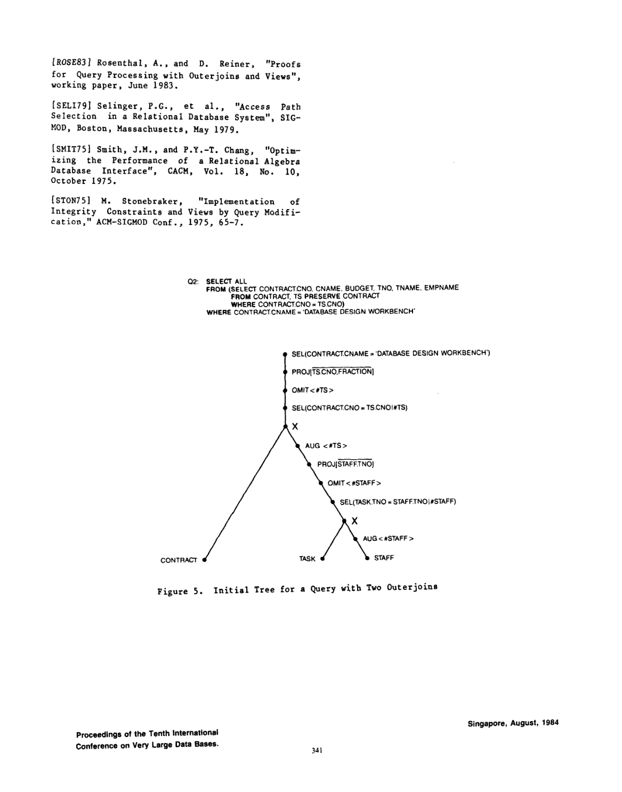
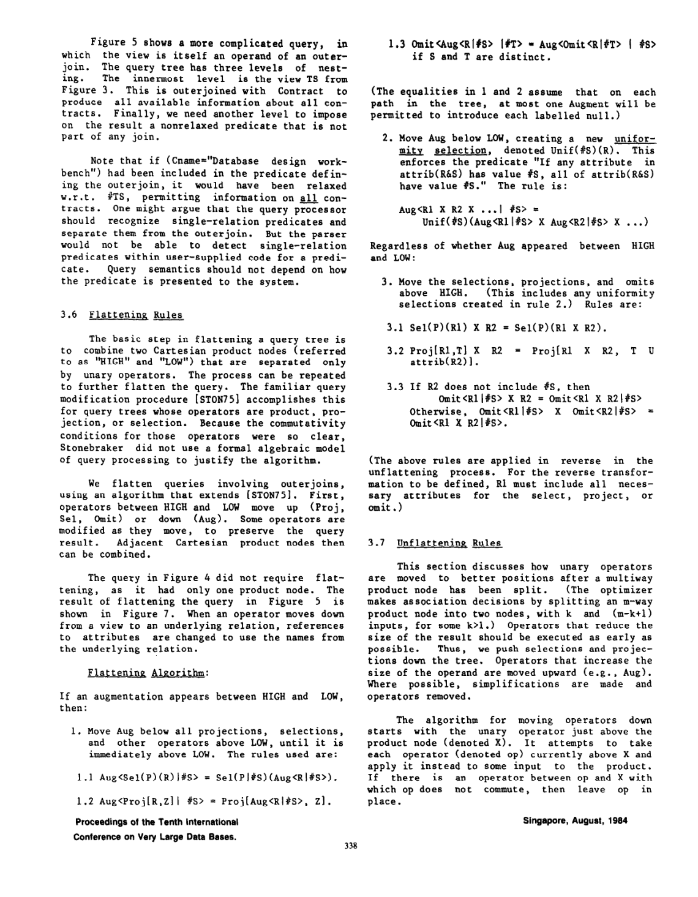

> 本组第 4 篇 · 连接重排 · [全部论文]() · [上一篇]() · [下一篇]()

本文提出将外连接、视图和部分嵌套子查询纳入既有关系代数优化框架的操纵规则：用带标签空值 #R、Augment、relaxed selection 和 Omit 表达外连接，通过 Flattening/Unflattening 移动算子，复用已有的连接次序选择机制。正文不提供 union 移动规则，讨论的嵌套子查询不引用外层查询；第 4 节还简要讨论聚合和全称量词，并非只讨论 SPJ。关系和算子以集合式定义，作者明确警告某条连接消除规则可能改变重复元组数；这不能被扩张为整套规则已获 SQL bag/NULL 语义认证。Rule 4 的单调性和 Rule 5 的两个充分条件限定规则可调用的范围，不构成任意外连接重排的完备性证明。图 5-8 是代数重写示例，没有基准测试、运行时间或量化收益；第 3.2 节有嵌套循环与归并实现的简短讨论。第 4 页双侧外连接印刷公式疑似缺少对 R1 的 Augment，报告保留这一原文疑点，不代作者补式或宣称已证明。现代 SQL 与执行引擎中的适用性仍需另行验证。

本文保留论文陈述、读者推断与待验证方案的区别；实验数字只适用于原文条件。原文和翻译来自已有 AI 辅助精读报告，已做来源匹配与编辑复核，不等于人工逐项核验或独立实验复现。所有页码均为 PDF 物理页。

## 论文与阅读范围

作者: Arnon Rosenthal, David Reiner; 机构: Computer Corporation of America; 出处: Proceedings of the Tenth International Conference on Very Large Data Bases (VLDB 1984), Singapore, August 1984, pp. 334-343。页码范围依据 PDF 首页与末页实际印刷页码核对，不是用物理页数推算。PDF 共 10 个物理页。[ROSE83] 在第 8 页参考文献中列为 Rosenthal 与 Reiner 的工作论文“Proofs for Query Processing with Outerjoins and Views”, June 1983；本次未读取该工作论文，不能声称已独立复核其中证明。其余原文参考文献保留为论文内部引用，未做外部书目核实。

[论文集中的原始 PDF](https://github.com/lonng/db-papers/blob/4ff1331069c7cf52ac97dd769e5f484c1c35c200/papers/join-order/extending-the-algebraic-framework-of-query-processing-to-handle-outerjoins.pdf) · 本地来源：`join-order/extending-the-algebraic-framework-of-query-processing-to-handle-outerjoins.pdf`，共 10 页。

本篇保留 10 组原文精读和 31 条证据。截图为原始 PDF 的局部页选，不是重新生成的图表；未将整份 PDF 复制到博客。

## 研究问题与适用边界

关系查询优化可通过重排查询树寻找较优执行次序。本文研究的是如何为包含外连接、视图或嵌套子查询的查询建立代数操纵规则，以最小改动复用既有查询优化和视图替换机制（C001N01）。这不等于允许直接把普通内连接的所有交换、结合规则套在外连接节点上。

原文边界：第 1 页说明为简单起见不呈现 union 算子的移动规则，因此关注 conjunctive queries（SRC001）。第 2 页仅考虑不引用外层查询的嵌套子查询，并假设视图 V 中的关系不再出现在外层查询 Q 中（C001N02、P004）；第 7 页把相关子查询的树模型扩展列为后续研究（SRC009）。第 3 页还采用关系别名区分重复引用，要求各树节点有不同名字。

不可扩大限制：原文没有因出现 CASE WHEN 就排除查询；可用哪些谓词取决于具体移动规则的前提，例如 #S-monotonicity，不能只按 SQL 关键字判定。第 4 节简要讨论聚合与全称量词，因此“本文只解决纯 SPJ”也过窄。读者推论：现代 SQL 的 bag 计数、已有 NULL 和三值逻辑、相关性及有序结果都需单独验证，未被本文的代数示例整体覆盖。

连接次序搜索不是本文新算法：作者明确不提议修改优化器产生和测试 association 的方法，规则可配合启发式、逐树枚举或动态规划（SRC002）。贡献是扩展表达和变换规则，而非提供新的全局最优计划保证。

依据：论文陈述；PDF 物理页 1, 2, 3, 6, 7。证据：[C001N01](#evidence-c001n01), [C001N02](#evidence-c001n02), [SRC001](#evidence-src001), [SRC002](#evidence-src002), [SRC003](#evidence-src003), [C002N09](#evidence-c002n09), [C002N10](#evidence-c002n10), [SRC009](#evidence-src009)。

## 系统架构与算子模型

论文以简单、单一任务的代数算子表达复杂构造，以 product 而不是 join 作为组合关系的基本操作。外连接用普通乘积与新增一元机制组合，现有优化器仍负责选择 association。

1. Labelled nulls 与 Augment：每个可能使用空元组的关系有不同标签 #R；标签在查询处理完成后无需保留，而不是“仅在优化阶段存在”的元数据。Aug<R|#S> = R ∪ {全为 #S 的元组}，要求 attrib(S) 包含 attrib(R)，原始树只含 Aug<R|#R>；经变换后，来自视图的标签可作用于其底层关系（C001N06、SRC004）。这里的 R 也可以是视图，不仅是基表。

2. Relaxed selection 与 Omit：(P/#S) 是 P OR（S 中出现在 P 内的所有属性值均为 #S）。标量 x #S-dominates y 当 x=y，或 x 非空且 y=#S；不同元组逐属性满足该关系才构成元组支配。Omit 删除存在不同支配者的元组，不是普通按值去重（C001N07、P008）。

第 4 页的单侧表达为 Proj[Omit<Sel(P/#R2)(R1 × Aug<R2|#R2>)|#R2>, output-list]：保留 R1，增广的是另一侧 R2。完整链条是 Augment 输入 -> product -> relaxed selection -> Omit -> projection，不能漏掉 Augment。读者构造的假设示例：R1={1,2}，R2={1}，P 为值相等。增广并放宽后得到 (1,1)、(1,#R2)、(2,#R2)；Omit 删除被 (1,1) 支配的 (1,#R2)，保留 (2,#R2)。该小例使用无既存 NULL 的集合输入，不代表 SQL 全域证明。

3. Unif 与规则条件：当 Aug 穿过 product 分发到多个输入时，Unif(#S) 要求 attrib(R&S) 中若任一属性为 #S，其余也必须为 #S，排除部分补空的混合组合（SRC006）。#S-monotonic 则是第 3.7 节关于子集算子与 Omit 交换的前提，不是所有代数算子的统一类型要求；projection 有独立的 Rule 5 条件。

依据：论文陈述；PDF 物理页 4, 5, 6。证据：[C001N06](#evidence-c001n06), [C001N07](#evidence-c001n07), [C002N02](#evidence-c002n02), [SRC004](#evidence-src004), [SRC006](#evidence-src006), [SRC013](#evidence-src013)。

*原论文 PDF 物理页 8，版权归原作者或出版方。点击图片可查看原尺寸。这是页面定位信息，不表示本次已复核图内所有数据。*

## Flattening 与 Unflattening 算法

本节区分作者规则与读者构造的示例；示例不冒充作者图中的查询或实验。

一、Flattening（第 3.6 节）
目标是将只被一元算子隔开的 HIGH 与 LOW 两个 product 节点合并。若两者之间有 Aug，先按规则 1.1-1.3 将它移到紧邻 LOW 的上方。移动会改变算子：例如 Aug<Sel(P)(R)|#S> = Sel(P/#S)(Aug<R|#S>)，谓词必须放宽；不能只改树上位置。规则 1.3 在 S≠T 时交换 Aug(#S) 与 Omit(#T)。规则 1、2 的等式假设每条树路径至多有一个 Augment 引入给定标签（C001N10、SRC006）。

再按规则 2 将 Aug 分发到 LOW 的各输入，并加入 Unif(#S)：Aug<R1×R2|#S> = Unif(#S)(Aug<R1|#S>×Aug<R2|#S>)。随后把 Sel/Proj/Omit（包括新建 Unif）移到 HIGH 之上，合并相邻 product。规则 3.3 不能无条件使用：若 R2 不含 #S，可将 Omit<R1|#S>×R2 写成 Omit<R1×R2|#S>；否则原文给的是两侧都先 Omit 的对应等式（SRC006）。

修正后的读者构造示例：令 V=R LEFT JOIN S ON R.b=S.b，外层查询为 T LEFT JOIN V ON T.c=V.c。V 的内部增广是 Aug<S|#S>，外层增广是 Aug<V|#V>；保留侧 R、T 不因被保留而增广。取 V 内部 product 为 LOW，外层 product 为 HIGH。位于两者之间的 Aug<V|#V> 才是向下移动的对象：穿过 V 内的 selection 时引入 /#V，穿过 Omit(#S) 时使用不同标签的规则，然后分发成 Aug<R|#V> 和作用于 S 分支的 Aug(...|#V)，并保留 Unif(#V)。这解释了跨关系标签为何来自变换；并非把外层另一个独立分支的 Aug 强行推入 LOW。此处只是移动结构示意，不声称略去其他算子后的树已经等价。

二、Unflattening（第 3.7 节）
优化器选取 association、拆分 multiway product 后，下推缩小中间结果的 selection/projection，上移增大输入的 Aug；次序选择与算子移动可以交替，不是先已证明找到最佳次序再处理。算法从紧邻 product X 的一元算子开始，尝试作用于某个输入；若路径中有不可交换算子则留在原位（C001N11）。反向使用规则 3 时，目标输入还必须包含 select/project/omit 所需全部属性。某些无法整体移动的算子可拆分，例如只提前删除 inessential 属性（C002N01）。

三、Omit 的交换边界
Rule 4：若子集算子 op 是 #S-monotonic，则 Omit<op(R)|#S> = op(Omit<R|#S>)。Rule 5 给出 projection 与 Omit 交换的两个可选充分条件：(a) 被删除属性依赖于保留集合 T 中且不在 S 内的属性；或 (b) R 是对 R1×R2 施加 projection 与 #S-monotonic 算子的组合，投影保留 R1 的全部属性，且 attrib(R&S)⊆attrib(R1)。满足其一可调用该规则，不满足不等于已证明绝无等价变换（C002N04、C002N05、SRC007）。

四、局部简化（第 3.8 节）
上层 Sel(P) 排除 R 各属性都为 #S 的补空元组时，可删除 Aug<R|#S> 和对应 Omit；原文例为 TS 上的 FRACTION=0.5，使 STAFF 补空行无法保留（SRC008）。无输出属性且仅参与与 Preserved 关系的外连接的 R 可删除，但作者警告重复次数可能变化（C002N08、P005）。Unif(#S)(Aug<R|#S>) 中的 Unif 可省略；不能把这条规则扩大为任意位置的 Unif 都冗余。

依据：读者推断；PDF 物理页 4, 5, 6。证据：[C001N06](#evidence-c001n06), [C001N10](#evidence-c001n10), [C001N11](#evidence-c001n11), [C002N01](#evidence-c002n01), [C002N04](#evidence-c002n04), [C002N05](#evidence-c002n05), [C002N07](#evidence-c002n07), [C002N08](#evidence-c002n08), [SRC004](#evidence-src004), [SRC006](#evidence-src006), [SRC007](#evidence-src007), [SRC008](#evidence-src008), [SRC015](#evidence-src015)。

## 正确性保证与语义边界

作者给出带条件的等式，而不是任意外连接重排的完整正确性或完备性定理。

#S-monotonicity 与 null rejection 必须区分。前者描述：若 op 已保留 t，而 t' #S-dominates t，则把输入中的 t 替换为 t' 后应保留 t'；对 selection 即 t 满足谓词时，其支配者也应满足。第 6 页将 Unique、Omit 列为此类算子，并说明普通不提及 #S 的谓词及某些 is not null 谓词的情况（P007）。Rule 4 以该性质为充分前提；前提不满足时不能援引该规则，但不能因此断言等式对每个输入必然不成立。Rule 5 是两个可选充分条件，不是必要且充分的完整边界。Rules 4-6 的证明被指向 [ROSE83]；本文未展开，本次也未读取该工作论文（SRC007、SRC012）。

null rejection 对应第 3.8 节另一个简化条件：位于 Aug 上方的 Sel(P) 对该 Aug 生成的全 #S 属性组合为假，从而补空元组不会输出，可移除 Aug 与对应 Omit。原文例是 FRACTION=0.5，而不是任意不提及 NULL 的谓词都可触发这一简化（SRC008）。读者构造的 SQL 类比：SELECT A.id FROM A LEFT JOIN B ON A.id=B.id WHERE B.x=5 在排除 B 补空行时可考虑转内连接；若把 B.x=5 放入 ON，则不匹配的 A 行仍须保留，不能照搬此消除。这个 SQL 类比及 FALSE/UNKNOWN 均不通过 WHERE 的三值逻辑解释是读者延伸，不是原文已完成的 SQL 语义证明。第 5 页 Q2 另用非 relaxed 上层谓词过滤合同名，强调把它并入外连接谓词会改变保留行为（SRC005）。

投影移动还须保留后续谓词和支配判断所需属性。Rule 6.3 明确要求 projection 不丢掉 selection 所需属性。第 4 节称 Unique 可与 Omit、selection、Augment 交换，保留 key 时与 projection 交换，但不能上移穿过 product；不能把这个例子推广为所有 Max/Sum/Median 都可同样移动（C002N06、C002N09）。

重复语义：作者仅对删除不必要关系明确警告 duplicate 数量可能变化。读者的现代 SQL 延伸是：若未证明匹配至多一行，删除非保留侧可能改变 bag 计数；被保留侧自身有主键并不够。末端 DISTINCT 也不是万能补救，若中途已有依赖计数的聚合等操作，最终去重不能恢复它们的值。不能通过随意插入去重来“修复”原本的 bag 查询。

原文疑点与未覆盖项：第 3.2 节将双侧外连接定义为匹配行及双方未匹配补空行的并集；但第 4 页印刷的双侧代数式在 product 输入处只显示 R1 × Aug<R2|#R2>，未见 Aug<R1|#R1>（SRC004，已对照原 PDF）。这是原文公式与其定义之间的疑似缺项；不能默默补式后称为作者已证明的结果。类似地，原文没有在本文完成现代 SQL 已存 NULL、三值逻辑及 bag 计数的联合证明。本报告不替作者补足这些限制。

依据：论文陈述；PDF 物理页 4, 5, 6, 8。证据：[C002N02](#evidence-c002n02), [C002N04](#evidence-c002n04), [C002N05](#evidence-c002n05), [C002N06](#evidence-c002n06), [C002N08](#evidence-c002n08), [C002N09](#evidence-c002n09), [SRC004](#evidence-src004), [SRC005](#evidence-src005), [SRC007](#evidence-src007), [SRC008](#evidence-src008), [SRC012](#evidence-src012), [SRC013](#evidence-src013), [SRC015](#evidence-src015)。

## 实验评估与证据缺失

核对全部 10 页后，本文没有性能评估实验，没有硬件/软件配置、数据量、分布、对照基线、运行时间、内存或优化时间数字。它给的是代数规则与查询树示例，不能将图示视为量化实验，也不能声称已证明枚举完备或获得全局最优计划。

图示对应关系：Figure 5（PDF 第 8 页）是 Q2 的双层外连接初始树；Figure 6（第 9 页）是 Q2 在 flattening 中、product 节点合并之前的状态；Figure 7（第 9 页）是 Q1 unflattening 后的结果；Figure 8（第 10 页）是 Q2 unflattening 后的结果（C002N12）。这些图不全属于 Q2。第 9 页 Figure 7 图注明确写着投影向下移动时 TS.CNO 改名为 TASK.CNO；这不是无证据推断（SRC010，已对照原 PDF）。正文第 5 页对图号的个别指向有歧义，报告以各图图注和图内内容说明，不据此制造另一组实验。

Q1、Q2 的模式与用途不是完全未知：第 3.5 节明确说示例使用 CONTRACT、TASK、STAFF，合同由任务构成、任务由员工承担；Q1 过滤 REPORT WRITER 任务，Q2 查询 DATABASE DESIGN WORKBENCH 合同。它们是作者构造的语义与重写示例，不是已运行的 benchmark 工作负载；文中没有给出实例数据规模、基数或倾斜。

物理实现信息并非完全缺失。第 3.2 节讨论单侧外连接可用修改的 nested loops：若某保留侧元组没有成功匹配，就输出其补空行，无需独立 set union，且只需显式物化 Preserved relation；双侧外连接需要单独实现，有时可用 merging 高效计算（SRC003）。这是定性实现说明，不是实现完成或性能提升的实测证据。

因此可以说论文提供代数扩展方法和应用示例，但不能从本文断言执行加速幅度、优化开销可接受性、生产并发能力或变换系统完备性。后续工程采纳需要另建基准。

依据：论文陈述；PDF 物理页 3, 4, 5, 8, 9, 10。证据：[C002N12](#evidence-c002n12), [SRC003](#evidence-src003), [SRC004](#evidence-src004), [SRC005](#evidence-src005), [SRC010](#evidence-src010), [SRC011](#evidence-src011), [SRC014](#evidence-src014)。

*原论文 PDF 物理页 5，版权归原作者或出版方。点击图片可查看原尺寸。这是页面定位信息，不表示本次已复核图内所有数据。*

## 设计权衡与工程挑战

以下是读者基于原文机制提出的工程推论，不是作者的实验或已验证结论。

1. 规则条件与维护成本：同一代数树可复用现有 association 搜索，但 Aug/Omit/Unif 及 Rule 5 的前提需要实现和测试。不能把“无需改换概念框架”理解为实现复杂度为零。第 7 页作者明确指出条件还可放宽或简化，新数据类型谓词的单调性需告知处理器（SRC009）。

2. 重复次数与 SQL 迁移：删除冗余关系可能改变 duplicate 数量，这是作者的局部警告，不是其他规则均已获 bag 认证或全部失效的结论。工程上应逐规则证明计数保持性；额外插入 DISTINCT 会改变原始 bag 查询，不能当作通用补救。

3. 算子拆分的物理收益需测量：部分 projection 提前执行可能减少列宽；是否产生额外计算、物化或影响流水线由实现决定，不能仅凭代数拆分断言一定增加开销。本文没有相应性能数据。

4. 标签的逻辑语义与物理表示：标签在查询处理完成后才无需保留；若按该代数直接执行，中间态须维护必要来源信息。但物理计划可以把代数组合识别为原生外连接，未必逐一物化 Aug/Omit/标签列。第 3.2 节本就指出无需按定义分多次查询再做 union（SRC003）。因此“必须用额外位图/内存”或“标签纯属优化阶段”都不是作者结论。

5. 有序与相关语义：第 7 页把物理算子、排序分组的有用代数模型及相关子查询列为进一步研究，且指出考虑排序或分组时 product 的操作数次序影响结果（SRC009）。这限制了直接迁移，而不是给出已完成的向量化或分布式实现。

依据：读者推断；PDF 物理页 3, 4, 5, 6, 7。证据：[C001N06](#evidence-c001n06), [C001N10](#evidence-c001n10), [C002N01](#evidence-c002n01), [C002N08](#evidence-c002n08), [SRC003](#evidence-src003), [SRC009](#evidence-src009), [SRC014](#evidence-src014)。

## 与现代系统及文献的比较

原文比较与读者待验证问题分开处理。

1. 作者在第 4 节说明可通过外连接处理全称量词：先让 R1 与违反 P 的 R2 行按 not P 外连接并保留 R1，再以 Has_null(#R2) 选择未找到反例的 R1 行（C002N10）。Has_null 不是普通按任一列 IS NULL 的随意替代，而是要求 S 的所有属性为对应标签。作者说 [DAYA83a] 对量化查询能产生更好的策略，但使用较多专用机制；没有给出本文与 Dayal 的运行时间对比。此为作者对被引工作的陈述，本次未独立核实那些论文。

2. [ROSE83] 在原文参考文献中是 June 1983 的工作论文，正文把 Rules 4-6 的证明指向它（SRC007、SRC012）。这与本文已逐条展示证明不同，也不能据此宣称本次已复核完整证明。

3. 读者待验证问题：现代 Calcite、DuckDB、StarRocks 等系统怎样处理外连接重排，是否采用类似 Aug/Omit 的内部表达，均未由本文提供答案。本报告不对它们的实现作事实比较，不联网补充来源。这些现代系统名称仅用于提出后续源码核查问题。

依据：读者推断；PDF 物理页 1, 6, 8。证据：[C001N01](#evidence-c001n01), [C002N10](#evidence-c002n10), [SRC007](#evidence-src007), [SRC012](#evidence-src012)。

## 复现指南与验证建议

以下是读者提出的验证方案，不是原文给出的实现或已经执行的复现；本次仅审核报告，未运行查询引擎实验。

1. 先实现无既存 NULL 的小型集合语义参考解释器：为可能被补空的关系/视图（即外连接的非保留侧，而非保留侧）分配标签；实现 Augment、relaxed selection、Omit 和 Unif。以第 3.2 节的单侧外连接定义作直接 oracle，枚举小关系、空输入、无匹配和多匹配情况。双侧公式先记录第 4 页疑似缺项，任何读者修正版本须单独命名，不能伪装成原式复现。

2. 按规则逐项编码前提：每路径同标签的 Aug 唯一性；规则 3.3 的另一输入是否含 #S；Rule 4 的 #S-monotonicity；Rule 5 的函数依赖或结构条件；projection 所需属性。构造违反前提的用例，并检查优化器是否拒用，而不是把拒用误当成原查询非法。

3. SQL bag/NULL 验证作为独立扩展：随机生成外连接、ON/WHERE 谓词及 projection，与本地可用且确认支持相应语法的数据库比较，逐值和逐重复次数核验。重点覆盖一个保留行匹配多个非保留行、已有 NULL、B.x=5 与 B.x IS NULL、谓词从 ON 移至 WHERE、聚合先于最终 DISTINCT。不能把集合 oracle 的通过当作 SQL bag 等价性结论。

4. 性能实验另行设计：在正确性验证后对照开启/关闭规则集，测量优化时间、候选计划数、执行时间、峰值内存。可自建包含外连接的工作负载；若改写标准 benchmark，明确标为改写变体，不把任意查询号称作原生外连接案例。是否放入 Cascades 等框架是实现选择，不是作者要求。

5. 范围测试：相关子查询和 union 的移动未在本文给出完整规则，应由实现明确拒用未支持的变换或走其他已验证路径，不要求系统崩溃或拒绝整个合法查询。新增数据类型谓词还需声明或验证其单调性质。

依据：待验证的工程设想；PDF 物理页 1, 2, 4, 5, 6, 7。证据：[C001N01](#evidence-c001n01), [C001N02](#evidence-c001n02), [C001N06](#evidence-c001n06), [C001N10](#evidence-c001n10), [C002N05](#evidence-c002n05), [C002N08](#evidence-c002n08), [SRC004](#evidence-src004), [SRC006](#evidence-src006), [SRC008](#evidence-src008), [SRC009](#evidence-src009)。

## 总结与工程启示

Rosenthal 与 Reiner 的贡献是展示如何用显式的扩展关系代数表达外连接，并将算子的代数性质与既有查询树 flattening/unflattening 框架分离。它支持在不更换整个优化范式的情况下加入新构造；不是任意外连接排列可直接等价、搜索完备或性能已验证的承诺。

读者工程启示：先准确表达语义，再编码每条规则的充分前提。Aug 必须放在需要补空的一侧，分发至 product 输入时要维护 Unif；null rejection 的消除与 #S-monotonic 的 Omit 交换是不同条件。投影不能提前丢失后续谓词或支配判断依赖的属性，重复计数不能靠无条件去重补救。

理论与实现仍有距离，但不能说论文完全未涉及物理执行：第 3.2 节已讨论修改的 nested loops 和某些 merging 方案。欠缺的是量化性能评估、现代执行属性与完整 SQL bag/NULL 语义验证。双侧代数式的疑似原文缺项与外部工作论文中的证明均保留为未解决的来源边界，不以读者推导填补作者结论。

依据：读者推断；PDF 物理页 1, 3, 4, 5, 6。证据：[C001N01](#evidence-c001n01), [C001N06](#evidence-c001n06), [C001N10](#evidence-c001n10), [C002N05](#evidence-c002n05), [C002N08](#evidence-c002n08), [SRC003](#evidence-src003), [SRC004](#evidence-src004), [SRC006](#evidence-src006), [SRC008](#evidence-src008), [SRC013](#evidence-src013), [SRC014](#evidence-src014)。

## 原文精读：从句子回到机制

以下保留原文、忠实翻译、含义与边界；假设示例不作为论文实验结果。

### P001 · PDF 物理页 1

**原文**

<blockquote class="paper-source-quote"><pre><code>The &#10;reordering &#10;may &#10;be &#10;explicit &#10;or implicit. &#10;Our major &#10;goal &#10;in &#10;this &#10;paper is to describe &#10;manipulation &#10;rules &#10;for &#10;queries &#10;that &#10;include &#10;outerjoins, &#10;and views &#10;or &#10;nested &#10;subqueries. &#10;By &#10;expressing &#10;queries &#10;and &#10;processing &#10;Strategies &#10;in &#10;terms &#10;of &#10;relational &#10;algebra, &#10;one can use the ordinary &#10;mechanisms &#10;of &#10;query &#10;optimization &#10;and view &#10;substitution &#10;with &#10;a &#10;minimum of disrupt &#10;ion.</code></pre></blockquote>

**忠实翻译**

> 重排序可以是显式的或隐式的。本文的主要目标是描述针对包含外连接（outerjoins）以及视图或嵌套子查询的查询的操作规则。通过用关系代数来表达查询和处理策略，人们可以使用普通的查询优化和视图替换机制，并将干扰降到最低。

**技术含义与边界**

> 作者陈述了论文的核心贡献：为含有外连接、视图或嵌套子查询的查询建立基于关系代数的操作（manipulation）规则。其动机是使这些复杂查询能够复用现有的普通查询优化与视图替换机制，从而减少对现有系统的侵入性。读者推断：这里的“重排序”指的是算子在查询计划树中的位置调整，是实现优化的基础手段。

**常见误读**

> 容易误认为该框架能无代价地处理所有类型的查询。原文明确限定了目标范围是“包含外连接以及视图或嵌套子查询”的查询，且强调是“将干扰降到最低”而非完全没有干扰。不能将此局部结论泛化为对所有SQL特性的全局保证。

**读者构造的假设示例**

> 读者构造的假设示例：一个已有内连接优化器要加入左外连接，可增加 Augment、relaxed selection、Omit 的代数表达和各自带条件的移动规则，再复用原有 association 搜索框架。这不是不作扩展就直接套用全部原有下推规则。

### P002 · PDF 物理页 9

**原文**

<blockquote class="paper-source-quote"><pre><code>Q2 During &#10;Flattening; &#10;Just &#10;Btfort &#10;Product &#10;Node8 art &#10;Combined &#10;I &#10;PROJ[STAFF.TNO] &#10;OMlTc#STAFF&gt; &#10;SEL(TASK.TNO = STAFF.TNOI#STAFF) &#10;X A &#10;PROJ[TASK.CNOJ &#10;AUG c #STAFF &gt; &#10;SEL(TNAME - ‘REPORT I;)/ &#10;yOJ;M &#10;Figure &#10;7. &#10;Query Ql, After &#10;Unflattening &#10;(Large &#10;nodes indicate &#10;operators &#10;which &#10;have moved since &#10;the previous &#10;figure) &#10;(“TS.CNO” &#10;is renamed “TASK.CNO” when the projection &#10;is moved down) &#10;Procoadlngm &#10;ol ths Tenth lnttmttbntl &#10;Conftrtm &#10;on Very Ltrgt &#10;Dttt Btttt.</code></pre></blockquote>

**忠实翻译**

> 片段开头是 Figure 6 的 Q2 图注尾部：Q2 在展平期间、乘积节点合并之前。随后是 Figure 7 的 Q1 反展平树及图注：大节点表示自前一图以来移动的算子；投影向下移动时，“TS.CNO”改名为“TASK.CNO”。树中算子文本有提取乱码，不能据此逐字符恢复完整表达式。

**技术含义与边界**

> 该原始片段跨越 Figure 6 图注尾部和 Figure 7，不能把两者都当成 Q1 或 Q2。第 9 页原 PDF 确认 Figure 7 是 Q1 的结果：TASK 分支下推了 TNAME='REPORT WRITER' 的选择及删除 TASK.CNO 的投影，STAFF 分支有删除 FRACTION 的投影和 Aug(#STAFF)。图中 projection 属性列表上有横线；按第 4 页记号说明，横线表示删去列，不是保留列。改名对应视图列到基表列的引用转换。

**常见误读**

> 这是 PDF 直接文本提取的乱码，不是 OCR：coverage.ocr_pages=[]。不能从不完整的线性文本推断树边或忽略 projection 横线。图注明确包含 TS.CNO 的重命名，不能再说没有确切文字证据；也不能把这种引用改名解释为避免名称冲突的已证实动机。

**读者构造的假设示例**

> 读者构造的假设示例：视图 V 的 V.c 来源于基表 R.c。若删除 V.c 的投影下移到 R 分支，所删除列的引用应改成 R.c；这是视图展开后的属性对应，不是把删除投影误写成保留 R.c。原文 Figure 7 的 TS.CNO/TASK.CNO 正说明这种对应。

### P003 · PDF 物理页 5

**原文**

<blockquote class="paper-source-quote"><pre><code>Proceedings &#10;of the Tenth &#10;International &#10;Conference &#10;on Very Large Data Bases. &#10;1.3 Omittiug&lt;RItS&gt; &#10;I#T&gt; - Aug&lt;Omit&lt;Rt#T&gt; &#10;t #S&gt; &#10;if &#10;S and T are distinct. &#10;(The equalities &#10;in 1 and 2 assume &#10;that &#10;on &#10;each &#10;path &#10;in &#10;the &#10;tree, &#10;at most one Augment will &#10;be &#10;permitted &#10;to introduce &#10;each labelled &#10;null.) &#10;2. Move Aug below LOW, creating &#10;a &#10;new &#10;unifor- &#10;&amp;y &#10;selection, &#10;denoted &#10;Unif(#S) &#10;(RI.</code></pre></blockquote>

**忠实翻译**

> 规则 1.3：当 S 与 T 不同，Omit<Aug<R|#S>|#T> = Aug<Omit<R|#T>|#S>。（规则 1、2 的等式假设：树的每条路径至多有一个 Augment 引入每个带标签空值。）步骤 2：将 Aug 移到 LOW 下方，建立新的 uniformity selection，记为 Unif(#S)(R)。这里公式按已核对的第 5 页原 PDF 释读，原始引文中的乱码保持不动。

**技术含义与边界**

> 第 3.6 节已经把 HIGH、LOW 定义为仅被一元算子隔开的上、下两个 Cartesian product 节点，因此 LOW 不是未定义术语。规则 1.3 只在不同标签时交换 Aug 和 Omit；步骤 2 是跨越 LOW 的乘积，把 augmentation 分发到各输入，并用 Unif 限制同一来源的属性必须一同补空，不能只机械交换节点。

**常见误读**

> 每路径同标签 Aug 的唯一性限定适用于规则 1 和 2 的等式；S≠T 则是规则 1.3 的独立条件。不能把不同标签交换推广到相同标签，也不能遗漏跨 product 时的新 Unif。原文公式本身可从 PDF 读出，不应把提取乱码重新发明成一个名为 Omitting 的算子。

**读者构造的假设示例**

> 读者构造的假设示例：Aug<R1×R2|#S> 分发后，Aug<R1|#S>×Aug<R2|#S> 会额外生成一边真实、一边 #S 的混合行；Unif(#S) 排除这些混合行，只允许对应属性均补空或均不为该标签。它不是可无条件删除的装饰节点。

### P004 · PDF 物理页 2

**原文**

<blockquote class="paper-source-quote"><pre><code>(For &#10;simplicity, &#10;we assume &#10;rela- &#10;tions &#10;in &#10;V do not &#10;appear &#10;in &#10;Q.) &#10;- The query &#10;includes &#10;a &#10;nested &#10;subquery. &#10;(We &#10;consider &#10;only &#10;subqueries &#10;that &#10;do not &#10;reference &#10;the &#10;enclosing &#10;query. &#10;See &#10;[KIM821 &#10;and &#10;[LOHM84] &#10;for &#10;more &#10;general &#10;treatments.) &#10;- A parenthesization &#10;mechanism &#10;produces &#10;nested &#10;subquer &#10;ies &#10;that &#10;can &#10;be &#10;referenced &#10;from &#10;the &#10;enclosing &#10;query &#10;IDATE831.</code></pre></blockquote>

**忠实翻译**

> （为简单起见，我们假设 V 中的关系不出现在 Q 中。）
> - 查询包含一个嵌套子查询。（我们仅考虑不引用外层查询的子查询。更一般的处理请参见 [KIM821 和 [LOHM84]。）
> - 一种括号化（parenthesization）机制产生可以从外层查询引用的嵌套子查询 IDATE831。

**技术含义与边界**

> 作者明确了本文讨论范围的几个限定条件：1. 视图定义V中的关系不与查询Q中的关系重叠；2. 仅处理非相关子查询（即子查询不引用外层查询的属性），排除了更复杂的解嵌套场景；3. 提到了通过括号化机制将子查询作为可引用实体的方法。

**常见误读**

> 容易将“我们仅考虑不引用外层查询的子查询”误解为本文的方法无法处理任何子查询。实际上，这只是作者在设定本文的适用边界，并明确指出对于相关子查询（引用外层查询）需要参考其他文献（如Kim 1982, Lohm 1984）。不能将本文的局部结论泛化到相关子查询的优化上。

**读者构造的假设示例**

> 读者构造的假设示例：假设查询Q是“SELECT * FROM Emp WHERE DeptNo IN (SELECT DeptNo FROM Dept)”，这里的子查询没有引用Emp表的列，属于本文考虑的“不引用外层查询的子查询”。如果是“WHERE DeptNo IN (SELECT DeptNo FROM Dept WHERE Dept.EmpId = Emp.Id)”，则超出了本文范围。

### P005 · PDF 物理页 6

**原文**

<blockquote class="paper-source-quote"><pre><code>ioins: &#10;Remove &#10;unnecessary &#10;Suppose &#10;some &#10;relation &#10;R &#10;has no attributes &#10;in &#10;the &#10;output &#10;list, &#10;and none &#10;in &#10;any &#10;predicate &#10;except &#10;an &#10;outerjoin &#10;with &#10;a &#10;Preserved &#10;relation. &#10;Then &#10;R may be removed &#10;from &#10;the &#10;query. &#10;(However, &#10;the &#10;removal &#10;may change &#10;the &#10;number &#10;of &#10;duplicate &#10;tuples &#10;returned.) &#10;Remove unnecessary &#10;uniformity &#10;predicates: &#10;If &#10;the &#10;tree &#10;includes &#10;Unif(#S) &#10;(Aug&lt;RI#S&gt;), &#10;the &#10;unifor- &#10;mity &#10;predicate &#10;can be omitted. &#10;4.</code></pre></blockquote>

**忠实翻译**

> 连接：移除不必要的
> 假设某个关系 R 在输出列表中没有属性，并且在除与被保留（Preserved）关系的外连接之外的任何谓词中也没有属性。那么 R 可以从查询中移除。（然而，这种移除可能会改变返回的重复元组的数量。）
> 移除不必要的均匀性谓词：如果树包含 Unif(#S) (Aug<RI#S>)，则可以省略该均匀性谓词。
> 4.

**技术含义与边界**

> 作者陈述了两条查询简化规则。第一条是消除冗余连接：如果一个表既不贡献输出列，也不参与除保护性外连接外的过滤条件，就可以被移除，但作者特别警告这会改变结果的基数（重复元组数）。第二条是消除冗余的均匀性谓词Unif，当它与特定的Aug结构共存时可以安全省略。

**常见误读**

> 极易忽略括号中的警告：“这种移除可能会改变返回的重复元组的数量”。这意味着该规则不是在所有语义下都保持严格等价（例如在包语义/多重集语义下不等价），仅在集合语义或不关心重复数量的场景下才安全。不能将其视为无条件安全的优化规则。

**读者构造的假设示例**

> 读者构造的假设示例：A 只有一行 (id=1,x='a')，B 有两行都满足 B.id=1。SELECT A.x FROM A LEFT JOIN B ON A.id=B.id 在 bag 语义下返回两行 'a'；删除 B 后只返回一行。若反过来是 A 两行都只匹配同一个 B 行，删除 B 不会因此减少 A 的两行，原报告的反例把匹配方向写反了。

### P006 · PDF 物理页 4

**原文**

<blockquote class="paper-source-quote"><pre><code>Each &#10;relation &#10;for &#10;which &#10;a null &#10;tuple &#10;may &#10;be &#10;used &#10;is &#10;given &#10;a distinct &#10;labelled &#10;null. &#10;The null &#10;value &#10;assigned &#10;to &#10;attributes &#10;of &#10;R &#10;is &#10;denoted &#10;#R. &#10;The &#10;system &#10;is &#10;not &#10;required &#10;to &#10;retain &#10;the &#10;labels &#10;after &#10;query &#10;processing &#10;is &#10;completed. &#10;Aug&lt;RI#S&gt;: &#10;R U {the &#10;tuple &#10;(#S,...,#S)).</code></pre></blockquote>

**忠实翻译**

> 每一个可能使用空元组的关系都被赋予一个不同的带标签空值（labelled null）。分配给 R 的属性的空值记为 #R。系统不需要在查询处理完成后保留这些标签。
> Aug<RI#S>: R U {元组 (#S,...,#S)}。

**技术含义与边界**

> 作者为可能被补空的关系/视图分配来源标签，Aug 将一个全为指定标签的元组并入其输入。第 4 页后文补充 attrib(S) 必须包含 attrib(R)，原始树只出现 Aug<R|#R>。变换把视图的 Aug 分发到底层关系后才可能出现 R 与 S 不同的写法。标签在查询处理完成后无需保留；不能据此说它只在优化阶段有意义。

**常见误读**

> 不能因记号中允许 #S 就认为原始树可以任意混用标签，也不能在保留侧随意放 Aug。标签标记的是需要补空的关系来源；在真实执行中可保留相应语义或融合为原生外连接，不要求把每个逻辑算子独立物化。

**读者构造的假设示例**

> 读者构造的假设示例：假设这是变换后的输入，且 attrib(R)⊆attrib(S)。R={(1,'a'),(2,'b')} 经 Aug<R|#S> 后增加 (#S,#S) 这一行。若是在原始树中直接给 R 增广，则按作者约定使用 #R；标签随视图展开而跨关系传播要另由变换规则说明。

### P007 · PDF 物理页 6

**原文**

<blockquote class="paper-source-quote"><pre><code>Their &#10;results &#10;are &#10;illustrated &#10;in &#10;Figure &#10;7, &#10;which &#10;shows &#10;the &#10;result &#10;of &#10;unflattening &#10;the &#10;query &#10;of &#10;Figure &#10;4, &#10;and &#10;in Figure &#10;8, &#10;which &#10;shows &#10;the &#10;result &#10;of &#10;unflattening &#10;the &#10;query &#10;of Figure &#10;6. &#10;Before &#10;the &#10;rules &#10;can be given, &#10;we &#10;need &#10;to &#10;restrict &#10;ourselves &#10;to &#10;well-behaved &#10;operators, &#10;namely &#10;subsetting &#10;operators &#10;which &#10;prefer &#10;non-null &#10;values &#10;to &#10;null &#10;values. &#10;A subsetting &#10;operator &#10;op(R) &#10;is &#10;#/S-monotonic &#10;if &#10;[(t &#10;is &#10;in &#10;op(R) &#10;and &#10;(t’ &#10;#S-dominates &#10;t)l &#10;implies &#10;that &#10;t* &#10;is &#10;op(R- &#10;{tl &#10;u {t’)).</code></pre></blockquote>

**忠实翻译**

> Figure 7 是 Figure 4 查询的反展平结果，Figure 8 是 Figure 6 查询的反展平结果。给出规则前，作者将所用子集算子限制为偏好非空值的 well-behaved 算子。op(R) 是 #S-monotonic，若 t∈op(R) 且 t' #S-dominates t，则 t'∈op((R−{t})∪{t'})。公式按第 6 页原 PDF 核对释读；缓存中的 t*、{tl 等提取错误不改写到原始引文内。

**技术含义与边界**

> 这里的关键是保留性：已经被 op 接受的 t 被更具体的支配者 t' 替换后，t' 也应被接受。不是只要观察到由丢弃全空行变为可能保留非空行，就已经检验了定义。该性质是 Rule 4 对子集算子的前提；projection 另有 Rule 5。作者将 Rules 4-6 的证明指向 [ROSE83]，本次未复核那份工作论文。

**常见误读**

> 原报告示例从 op 丢弃 t 开始，定义的 t∈op(R) 前件未成立，不能据此说明单调性。#S-monotonic 也不等于普通集合包含单调性或 null rejection；是否接受 NULL 与支配替换的保留性是不同问题。

**读者构造的假设示例**

> 读者构造的假设示例：op 为选择第一列>0。R 含 t=(1,#S)，op 保留 t；t'=(1,7) #S-dominates t，替换后 op 仍保留 t'，满足该次检查。对照谓词“第二列是 #S”：它保留 t，却拒绝支配者 t'，因此该替换给出不满足 #S-monotonic 的反例。单个正例不能代替对所有合法输入的证明。

### P008 · PDF 物理页 4

**原文**

<blockquote class="paper-source-quote"><pre><code>For &#10;distinct &#10;tuples &#10;t’ &#10;and &#10;t, &#10;t’ &#10;#S- &#10;dominates &#10;t &#10;if &#10;for &#10;every &#10;attribute &#10;A, &#10;t’ .A #S-dominates &#10;t .A. &#10;A join &#10;that &#10;uses &#10;a &#10;relaxed &#10;predicate &#10;yields &#10;tuples &#10;not &#10;present &#10;in &#10;the &#10;outerjoin. &#10;The Omit &#10;operator &#10;below &#10;throws &#10;away &#10;dominated &#10;tuples. &#10;Omit&lt;RI#S&gt;: &#10;= (t &#10;in &#10;R I &#10;there &#10;is &#10;no &#10;t’ &#10;in &#10;R &#10;which &#10;#S-dominates &#10;t). &#10;We are &#10;now able &#10;to &#10;express &#10;an outerjoin &#10;algebrai- &#10;cally.</code></pre></blockquote>

**忠实翻译**

> 对于不同的元组 t’ 和 t，如果对每个属性 A，t’.A #S-支配 t.A，则 t’ #S-支配 t。
> 使用宽松谓词（relaxed predicate）的连接会产生外连接中不存在的元组。下面的 Omit 算子会丢弃被支配的元组。
> Omit<RI#S>: = {t 属于 R | R 中不存在 #S-支配 t 的 t’}。
> 我们现在能够用代数方式表达外连接了。

**技术含义与边界**

> 作者陈述了“#S-支配”的逐属性定义，并解释了为什么需要Omit算子：因为在用普通连接加上宽松谓词来模拟外连接时，会产生多余的元组（即那些本应被真实值覆盖的空值填充元组）。Omit算子的作用就是扫描关系R，剔除那些被其他元组在#S意义上支配的元组，从而实现外连接的精确代数语义。

**常见误读**

> 容易将“#S-支配”误解为简单的NULL替换。实际上它是一种偏序关系，用于比较包含特定标签空值的元组。另外，不能认为Omit算子是物理执行引擎中必须实现的独立算子，它更多是代数推导和逻辑优化阶段的表达工具。

**读者构造的假设示例**

> 读者构造的假设示例：假设关系R中有两行：t1=(1, #S) 和 t2=(1, 2)。对于属性A1，两者都是1；对于属性A2，2是非空值，#S是空值，因此t2.A2 #S-支配 t1.A2。综合来看，t2 #S-支配 t1。执行Omit<R|#S>后，t1会被丢弃，只保留t2。这正是外连接中“有匹配时取真实值，无匹配时取空值”的代数体现。

### P009 · PDF 物理页 5

**原文**

<blockquote class="paper-source-quote"><pre><code>It &#10;attempts &#10;to &#10;take &#10;each &#10;operator &#10;(denoted &#10;op&gt; currently &#10;above X and &#10;apply &#10;it &#10;instead &#10;to some input &#10;to &#10;the &#10;product. &#10;If &#10;there &#10;is &#10;an &#10;operator &#10;between &#10;op and X with &#10;which &#10;op does &#10;not &#10;commute , &#10;then &#10;leave &#10;op &#10;in &#10;place.</code></pre></blockquote>

**忠实翻译**

> 它试图获取当前位于 X 上方的每个算子（记为 op>），并将其改为应用到乘积的某个输入上。如果在 op 和 X 之间存在一个 op 与之不可交换的算子，则将 op 留在原位。

**技术含义与边界**

> 作者陈述了一种算子下推（pushdown）的启发式规则。该规则尝试将位于某个节点X（通常是乘积/连接节点）上方的算子op下推到X的输入分支中。但设定了严格的安全边界：如果在op和目标位置之间存在任何与op不满足交换律的算子，则放弃下推，保持op在原位。

**常见误读**

> 容易误认为只要op和X的输入兼容就可以无限下推。原文明确指出“如果在op和X之间存在一个op与之不可交换的算子，则将op留在原位”，这意味着下推过程是受路径上所有中间算子交换性约束的，不能跳过不可交换的算子强行下推。

**读者构造的假设示例**

> 读者构造的假设示例：假设查询树从上到下依次是：投影(Proj) -> 聚合(Agg) -> 笛卡尔积(X)。现在试图将Proj下推到X的输入端。由于Proj和Agg通常不可交换（先投影可能导致聚合计算错误），因此根据此规则，Proj必须留在Agg上方，不能下推穿过Agg到达X的输入。

### P010 · PDF 物理页 6

**原文**

<blockquote class="paper-source-quote"><pre><code>Sometimes &#10;an operator &#10;that &#10;cannot &#10;move &#10;can &#10;be &#10;split &#10;into &#10;two &#10;operators, &#10;one of which &#10;can &#10;move down. &#10;For &#10;example, &#10;one may be able &#10;to &#10;move &#10;part &#10;of &#10;a projection &#10;below &#10;a join &#10;predicate &#10;or &#10;a &#10;Unique &#10;or &#10;Omit, &#10;if &#10;the &#10;attributes &#10;projected &#10;away &#10;are &#10;inessential.</code></pre></blockquote>

**忠实翻译**

> 有时，一个无法移动的算子可以被拆分为两个算子，其中一个可以向下移动。例如，如果投影掉的属性是不必要的（inessential），人们可能能够将投影的一部分移到连接谓词、Unique 或 Omit 的下方。

**技术含义与边界**

> 作者陈述了一种高级优化技巧：算子拆分（operator splitting）。当整个算子因为语义依赖无法整体下推时，可以将其分解为两部分，将不影响上层语义的部分提前下推。具体以投影（Projection）为例，如果某些被丢弃的列在下层算子（如Join、Unique、Omit）中不被需要，那么这部分投影操作就可以安全地下推。

**常见误读**

> 容易将“投影的一部分可以下推”泛化为“任何算子都可以随意拆分”。原文使用了“有时（Sometimes）”和“例如（For example）”进行限定，并且强调了前提条件：“如果投影掉的属性是不必要的”。如果下层算子（如Unique）依赖于被投影掉的属性来去重，则拆分和下推是不合法的。

**读者构造的假设示例**

> 读者构造的假设示例：输入 R 有 A、B、C、D 列，目标表达式是保留 A、B 的投影 π\[A,B\](Sel(C>0)(R))。可以写为 π\[A,B\](Sel(C>0)(π\[A,B,C\](R)))，下层投影提前删掉无关 D，保留选择所需 C，上层仍删 C。不能把原本输出 A、B、C 的查询改成仅输出 A、B；原报告的后半例正犯了这一错误。

## 尚未解决的问题

1. 在现代多重集语义（Bag Semantics）SQL 引擎中，如何修改本文的 Omit 和 Augment 机制以安全地支持外连接重排而不改变重复元组数量？
2. 本文的 Flattening/Unflattening 算法在 Cascades 优化框架中应被建模为 Exploration Rules 还是 Implementation Rules？其搜索空间膨胀率如何？
3. 带标签空值（Labelled Nulls）在向量化执行引擎中如何高效物理表示？是否需要额外的位图向量来追踪标签？
4. 对于包含相关子查询（Correlated Subqueries）的场景，是否存在一种代数扩展能够将本文的规则推广适用，而无需退化为逐行求值（Nested Loop）？
5. 算子拆分启发式（如将 Projection 拆分以部分下推）在现代基于 Pipeline 的执行引擎中，是否会导致额外的物化开销从而抵消下推带来的收益？
6. 本文引用的 [ROSE83] 中关于 #S-monotonic 的完整证明细节是什么？在现代优化器中如何自动化验证一个 UDF 是否满足该单调性？
7. 现代数据库系统（如 Calcite、DuckDB、StarRocks 等）在逻辑优化阶段具体如何处理外连接重排？是否采用了与本文同构的代数机制？（未知，需源码阅读验证）

## 证据索引

证据编号沿用原报告，便于将上文判断追溯到原句。引文匹配只验证位置，不证明解读正确。

**C001N01 · PDF 物理页 1**

论文目标是描述包含 outerjoin、视图或嵌套子查询的查询操纵规则，使查询和处理策略可用关系代数表达，从而最小化对现有查询优化和视图替换机制的改动。问题边界限定于 conjunctive queries，且暂不处理 union 算子的简化规则。

<blockquote class="paper-source-quote"><pre><code>Our major goal in this paper is to describe manipulation rules for queries that include outerjoins, and views or nested subqueries.</code></pre></blockquote>

**C001N02 · PDF 物理页 2**

在讨论多层查询树（multilevel queries）时，作者假设嵌套子查询不引用外层查询（non-correlated），更一般的 correlated 情况被排除在外，仅引用 Kim82 和 Lohm84 作为扩展阅读。这一前提直接影响后续 flattening 规则的适用范围。

<blockquote class="paper-source-quote"><pre><code>We consider only subqueries that do not reference the enclosing query.</code></pre></blockquote>

**C001N06 · PDF 物理页 4**

为追踪优化过程中 null 的来源，每个可能产生 null tuple 的关系被赋予唯一的 labelled null #R。系统不需要在查询处理完成后保留这些标签。Aug<R|#S> 定义为 R 并上一个全为 #S 的元组，要求 attrib(S) 包含 attrib(R)。原始查询树中只出现 Aug<R|#R> 形式。

<blockquote class="paper-source-quote"><pre><code>Each relation for which a null tuple may be used is given a distinct labelled null. The null value assigned to attributes of R is denoted #R.</code></pre></blockquote>

**C001N07 · PDF 物理页 4**

relaxed predicate (P/#S) 定义为 P OR (S 中出现在 P 里的所有属性值均为 #S)。使用 relaxed predicate 的 join 会产生 outerjoin 中不存在的元组，因此需要 Omit 算子丢弃被 #S-dominates 的元组。dominates 的定义是逐属性比较：x #S-dominates y 当 x=y 或 x 非空且 y=#S。

<blockquote class="paper-source-quote"><pre><code>A join that uses a relaxed predicate yields tuples not present in the outerjoin. The Omit operator below throws away dominated tuples.</code></pre></blockquote>

**C001N10 · PDF 物理页 5**

Flattening 算法的核心是将 HIGH 和 LOW 两个 Cartesian product 节点之间的一元算子移走：Aug 向下移（规则1.1-1.3），Sel/Proj/Omit 向上移（规则3.1-3.3）。当 Aug 移到 LOW 下方时需创建 Unif(#S) 选择以保证一致性。等式成立的前提是树上每条路径最多允许一个 Augment 引入同一个 labelled null。

<blockquote class="paper-source-quote"><pre><code>The equalities in 1 and 2 assume that on each path in the tree, at most one Augment will be permitted to introduce each labelled null.</code></pre></blockquote>

**C001N11 · PDF 物理页 5**

Unflattening 过程在 multiway product 被拆分为 two-way products 后进行，目的是将缩小结果的算子（selection, projection）尽早下推，将增大结果的算子（Aug）上移。算法从 product 节点上方的一元算子开始，尝试将其应用到某个输入上；若中间存在不可交换的算子则停止移动。上述 flattening 规则可逆应用，但要求 R1 包含必要属性。

<blockquote class="paper-source-quote"><pre><code>If there is an operator between op and X with which op does not commute , then leave op in place.</code></pre></blockquote>

**C002N01 · PDF 物理页 6**

当某个算子无法整体下移时，可将其拆分为两个算子，使其中一部分能够下移。例如，若被投影掉的属性无关紧要，可将部分 projection 下推到 join predicate、Unique 或 Omit 之下。这是一种启发式拆分策略，用于扩大算子移动空间。

<blockquote class="paper-source-quote"><pre><code>Sometimes an operator that cannot move can be split into two operators, one of which can move down.</code></pre></blockquote>

**C002N02 · PDF 物理页 6**

第 3.7 节为 Omit 交换规则定义 well-behaved、#S-monotonic 子集算子；这不意味着所有代数算子或 Rules 4-6 一概只有同一个前提。Projection 另受 Rule 5 条件限制。

<blockquote class="paper-source-quote"><pre><code>we need to restrict ourselves to well-behaved operators, namely subsetting operators which prefer non-null values to null values.</code></pre></blockquote>

**C002N04 · PDF 物理页 6**

Rule 4 规定若 op 是 #S-monotonic，则 Omit<op(R)|#S> = op(Omit<R|#S>)。这是一个正确性等价变换规则，允许将 #S-monotonic 算子穿过 Omit 下推。其证明引用自 [ROSE83]。

<blockquote class="paper-source-quote"><pre><code>4. If op is #S-monotonic, then: Omit &lt;op(R) 1 #S&gt; = op(Omit&lt;RI#S&gt;).</code></pre></blockquote>

**C002N05 · PDF 物理页 6**

Rule 5 给出 Proj[Omit<R|#S>,T] = Omit<Proj[R,T]|#S> 的两个可选充分条件：删除属性依赖于 T 中不在 S 的属性；或 R 是对 R1×R2 施加 projections 和 #S-monotonic 算子的组合，projection 保留 R1 全部属性且 attrib(R&S)⊆attrib(R1)。不是必要条件、互斥条件或重排完备边界。

<blockquote class="paper-source-quote"><pre><code>5. Proj[Omit&lt;RI#S&gt;, Tl = Omit&lt;Proj[R,Tl I #s&gt; if either:</code></pre></blockquote>

**C002N06 · PDF 物理页 6**

Rule 6 引用普通关系代数规则用于 unflattening：6.1 Selections 可交换；6.2 Projections 可交换；6.3 Project 与 selection 可交换，前提是 project 不丢弃 select 所需的属性。这些是标准等价变换，作为外连接优化的补充。

<blockquote class="paper-source-quote"><pre><code>6.1 Selections commute. 6.2 Projections commute. 6.3 Project commutes with selection, if the project does not discard an attribute needed by select.</code></pre></blockquote>

**C002N07 · PDF 物理页 6**

第 3.8 节列出三条局部简化：上层 Sel 排除 R 属性全为 #S 的补空元组时可移除 Aug 与相应 Omit；关系无输出属性且仅参与与 Preserved 关系的外连接时可删除，但重复次数可能变化；Unif(#S)(Aug<R|#S>) 中 Unif 可省略。不能删除这些限定。

<blockquote class="paper-source-quote"><pre><code>Remove unnecessary augmentations: If Sel(P) appears above Aug&lt;RI#S&gt; and P is false for all tuples that contain #S</code></pre></blockquote>

**C002N08 · PDF 物理页 6**

作者警告删除不必要的关系可能改变返回的重复元组数；因此不能无条件用于要求 bag 计数保持的查询，并非声称每个输入上的删除都一定错误。

<blockquote class="paper-source-quote"><pre><code>(However, the removal may change the number of duplicate tuples returned.)</code></pre></blockquote>

**C002N09 · PDF 物理页 6**

第 4 节简述 Max、Sum、Median 等聚合的变换或不可移动性；具体举例是 Unique 与 Omit、selections、Augment 交换，保留 key 时与 projection 交换，且不能上移穿过 product。不能把 Unique 的规则泛化为所有聚合。

<blockquote class="paper-source-quote"><pre><code>For example, Unique commutes with Omit, with selections, and with Augment; it commutes with projection as long as a key survives the projection;</code></pre></blockquote>

**C002N10 · PDF 物理页 6**

全称量词可通过外连接处理：定义 Hasnull 谓词仅接受 S 的所有属性值为 #S 的 R 元组。"{x in R1 | for all y in R2, P(x,y)}" 等价于先构造 View V = Select * From R1, R2 Preserve R1 Where not P(R1,R2)，再 Select R1.* From V Where Hasnull(#R2)(V)。引用 [KIM82] 和 [DAYA83a,b] 指出 Dayal 的方法可为量化查询产生更好策略，但引入了大量专用机制。

<blockquote class="paper-source-quote"><pre><code>Define a simple selection predicate Haspull to accept only tuples of R where all attributes of S have the value IS,</code></pre></blockquote>

**C002N12 · PDF 物理页 9**

Figures 5、6、8 分别为 Q2 初始树、合并 product 前的 flattening 状态和 unflattening 结果；Figure 7 则为 Q1 的 unflattening。图 7 明写 TS.CNO 下移投影时改名 TASK.CNO。这些是示例而非性能实验；无量化指标。

<blockquote class="paper-source-quote"><pre><code>Figure 7. Query Ql, After Unflattening (Large nodes indicate operators which have moved since the previous figure)</code></pre></blockquote>

**SRC001 · PDF 物理页 1**

第 1 页不呈现 union 移动规则，并将注意力限制于合取查询；这不是对任意复杂 SQL 谓词的逐关键字排除。

<blockquote class="paper-source-quote"><pre><code>For &#10;simplicity, &#10;we &#10;do not present &#10;simplification &#10;rules &#10;for &#10;moving &#10;union &#10;operators. &#10;Thus, &#10;our attention &#10;is restricted &#10;to conjunctive &#10;queries &#10;[DAYA83b 1.</code></pre></blockquote>

**SRC002 · PDF 物理页 2**

作者不提议改变优化器产生和测试 association 的方法，后续原文列举启发式、逐树枚举和动态规划。

<blockquote class="paper-source-quote"><pre><code>We have &#10;no changes &#10;to &#10;propose &#10;in &#10;the &#10;way an optimizer &#10;generates &#10;and &#10;tests &#10;alternative &#10;associations.</code></pre></blockquote>

**SRC003 · PDF 物理页 3**

第 3.2 节有单侧外连接的修改 nested loops 实现说明，不需单独 set union，且只需显式物化 Preserved relation；双侧外连接需单独实现，有时可用 merging。这是定性说明而非性能实验。

<blockquote class="paper-source-quote"><pre><code>Instead, &#10;one-s ided &#10;outerjoins &#10;are implemented &#10;by nested &#10;Ioops &#10;much &#10;like &#10;an ordinary &#10;join &#10;lDAYA83al. &#10;The join &#10;logic &#10;is modified &#10;so that &#10;if &#10;tl &#10;has &#10;not &#10;succe8sfully &#10;been joined, &#10;(tl ,null) &#10;is &#10;included &#10;in the result. &#10;There is no need to perform &#10;a separate &#10;8et union,</code></pre></blockquote>

**SRC004 · PDF 物理页 4**

第 4 页要求 Aug<R|#S> 的标签所属属性包含 R 的属性，原始树只用 Aug<R|#R>。该页外连接代数式已另对照 PDF：单侧增广 R2；双侧印刷式的乘积输入未见对 R1 的 Augment，与双侧定义有疑似缺项，不能代作者补正。

<blockquote class="paper-source-quote"><pre><code>Attrib(S) &#10;must &#10;contain &#10;attrib(R). &#10;The origi- &#10;nal &#10;tree &#10;for &#10;a query &#10;contains &#10;only &#10;augment a- &#10;tions &#10;of &#10;the &#10;form &#10;Aug&lt;RI#R&gt;.</code></pre></blockquote>

**SRC005 · PDF 物理页 5**

Q2 的合同名单关系过滤若并入外连接谓词会被相对 #TS 放宽，允许所有合同的信息；原文因此另用非 relaxed 上层谓词。

<blockquote class="paper-source-quote"><pre><code>Note that &#10;if &#10;(Cname=“Database &#10;design &#10;work- &#10;bench”) &#10;had been included &#10;in the predicate &#10;defin- &#10;ing the outerjoin, &#10;it &#10;would &#10;have &#10;been &#10;relaxed &#10;w.r.t. &#10;#TS,</code></pre></blockquote>

**SRC006 · PDF 物理页 5**

规则 2 将 Aug 分发过 LOW 的 product 并创建 Unif，避免部分属性补空；规则 1.1 还需放宽 selection，规则 3.3 对另一输入是否含 #S 分情况处理。已核对第 5 页原 PDF 的规则 1.1-3.3，不能把移动理解为不修改算子地换位置。

<blockquote class="paper-source-quote"><pre><code>This &#10;enforces &#10;the predicate &#10;“If &#10;any attribute &#10;in &#10;attrib(R&amp;S) &#10;has value &#10;CS, all &#10;of attrib(R&amp;S) &#10;have value &#10;8s.”</code></pre></blockquote>

**SRC007 · PDF 物理页 6**

正文将 Rules 4-6 的证明指向 [ROSE83]；Rule 5 的条件是可调用等式的两个充分条件，不是必要性或重排完备性的证明。

<blockquote class="paper-source-quote"><pre><code>Rules &#10;4-6 &#10;below &#10;guide &#10;the &#10;operator &#10;movement. &#10;They &#10;are &#10;proved &#10;in &#10;[ROSE831.</code></pre></blockquote>

**SRC008 · PDF 物理页 6**

null rejection 式简化要求上层 Sel 对 R 属性全为该标签的补空元组为假，才能消除 Aug 和相应 Omit；原文例是 FRACTION=0.5。与 #S-monotonic 的 Omit 交换不是同一条件。

<blockquote class="paper-source-quote"><pre><code>If &#10;Sel(P) &#10;appears &#10;above &#10;Aug&lt;RI#S&gt; &#10;and P is &#10;false &#10;for &#10;all &#10;tuples &#10;that &#10;contain &#10;#S for &#10;the &#10;attributes &#10;of &#10;R, &#10;then &#10;the &#10;null &#10;tuple &#10;cannot &#10;appear &#10;in &#10;the &#10;query &#10;output. &#10;The augmentation &#10;(and &#10;the &#10;corresponding &#10;Omit) &#10;can be removed.</code></pre></blockquote>

**SRC009 · PDF 物理页 7**

第 7 页把相关子查询的树模型扩展列为进一步研究；该页还说移动条件可放宽，新数据类型谓词需提供单调性信息，排序与分组的物理代数仍是研究方向。

<blockquote class="paper-source-quote"><pre><code>The &#10;operator &#10;tree &#10;model &#10;of &#10;queries &#10;would &#10;need considerabie &#10;exten- &#10;sion &#10;to handle &#10;nested &#10;queries &#10;which &#10;reference &#10;relations &#10;in the outer &#10;query.</code></pre></blockquote>

**SRC010 · PDF 物理页 9**

第 9 页 Figure 7 图注明确说明下移 projection 时 TS.CNO 改名为 TASK.CNO，已核对 PDF。提取缓存虽有乱码，但此图注不是缺失证据。

<blockquote class="paper-source-quote"><pre><code>(“TS.CNO” &#10;is renamed “TASK.CNO” when the projection &#10;is moved down)</code></pre></blockquote>

**SRC011 · PDF 物理页 10**

第 10 页 Figure 8 为 Q2 unflattening 结果，末页印刷页码 343；结合首页印刷页码 334 可确认 pp. 334-343，而不是通过页数推算。缓存将 Q2 误提取为 42，已按 PDF 图注核对。

<blockquote class="paper-source-quote"><pre><code>Figure &#10;8. &#10;Query 42, After &#10;Unflattening &#10;Singapore, August, 1994 &#10;343</code></pre></blockquote>

**SRC012 · PDF 物理页 8**

原文参考文献列出 [ROSE83] 为 June 1983 的工作论文；本次未获取或复核其全文。

<blockquote class="paper-source-quote"><pre><code>[ROSE831 Rosenthal, &#10;A., &#10;and &#10;D. &#10;Reiner, &#10;“Proofs &#10;for &#10;Query Processing &#10;with &#10;Outerjoins &#10;and Views”, &#10;working &#10;paper, &#10;June 1983.</code></pre></blockquote>

**SRC013 · PDF 物理页 4**

第 4 页双侧外连接式的缓存与 PDF 印刷均在乘积输入处只见 R1 × Aug<R2|#R2>；相较双方补空的语义定义，这疑似缺少对 R1 的 augmentation。此为来源内部疑点的审核记录，不是擅自修补后的作者定理。

<blockquote class="paper-source-quote"><pre><code>For &#10;a two-sided &#10;outerjoins &#10;of &#10;Rl and R2 with &#10;join &#10;predicate &#10;P, the &#10;algebraic &#10;expression &#10;is: &#10;Proj[OmitGmit&lt;Sel((P~#Rl)~#R2)&gt; &#10;(Rl &#10;X Aug&lt;R2l#R2&gt; &#10;1 #Rl&gt; &#10;I #R2&gt;, &#10;output-list]</code></pre></blockquote>

**SRC014 · PDF 物理页 3**

第 3 页另一栏明确说仅需显式物化 Preserved relation；双侧外连接需单独实现，有时可归并计算。该说明不是实验结果，也不是完全未触及物理实现。

<blockquote class="paper-source-quote"><pre><code>and &#10;only &#10;the &#10;Preserved &#10;relation &#10;need8 &#10;to be &#10;explicitly &#10;materialized. &#10;Two &#10;sided &#10;outerjoins &#10;require &#10;a &#10;separate &#10;implementation. &#10;They &#10;sometime8 &#10;can be computed &#10;efficiently &#10;by merging &#10;the &#10;two &#10;relations &#10;being &#10;outerjoined.</code></pre></blockquote>

**SRC015 · PDF 物理页 6**

Rule 5 原文列出 projection 与 Omit 交换的两种可选充分条件。关系结构条件包括对 R1×R2 施加 projection/单调子集算子、保留 R1 全属性及 attrib(R&S) 包含于 attrib(R1)。不应称必要条件或完备边界。

<blockquote class="paper-source-quote"><pre><code>All &#10;deleted &#10;attributes &#10;are &#10;functionally &#10;dependent &#10;on &#10;attributes &#10;that &#10;are &#10;in &#10;T but &#10;not &#10;in &#10;S; OR &#10;(R represents &#10;a composition &#10;of &#10;projections &#10;and &#10;#S-monotonic &#10;operators &#10;applied &#10;to &#10;(Rl &#10;X R2), &#10;the &#10;projection &#10;preserves &#10;all &#10;attributes &#10;of &#10;Rl , &#10;and &#10;attrib(R&amp;S) &#10;C attrib(R1) &#10;&gt; .</code></pre></blockquote>

## 版本与使用边界

- 原 PDF SHA256：`a6642ffbff284d3cfc343c234f464a3607ac2409f432d1d0d66665fb11832b20`。
- 报告来源：`qwen3.8-max`；此处按已完成报告整理，没有重新请求模型。
- OCR 记录页：[]；低文本页：[]。
- 本次新增页面截图，未据此自动重写原报告的数值、公式或实验结论；原有“未进行图像识别”限制仍适用于分析生成过程。
- 截图与短引仅服务于论文评论，版权归原作者或出版方；正式发布前复查转载范围和授权。
- 本文保留未核实的书目信息及研究问题，不用现代产品行为替代历史论文的证据。
