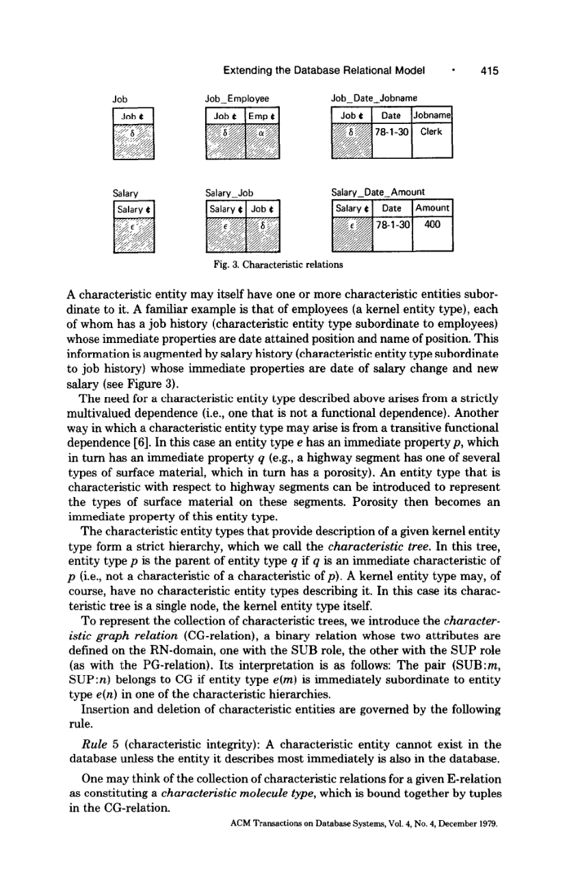
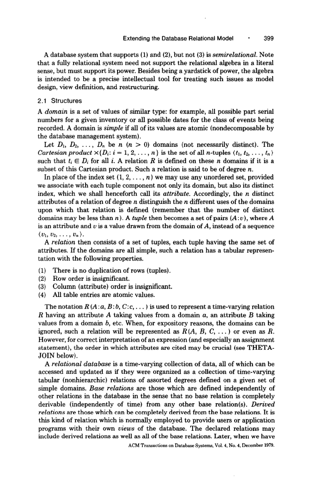

> 本组第 42 篇 · 关系模型与查询语言 · [全部论文]() · [上一篇]() · [下一篇]()

RM/T不是把关系模型替换成无约束图数据库，而是在关系结构上增加实体身份、类型、属性/特征/关联的IUD规则、模式目录与操作集合，使较大的有意义信息单位也能被表达和转换。作者强调结构、操纵规则与代数能力都属于模型，同时承认捕获意义是无止境的，扩展主要服务设计者和熟练用户。

三个常见误读须避免：system surrogate不是用户可见UUID或物理指针；OUTER UNION是补列后并行，不是FULL OUTER JOIN；UGI/AGI、cover与事件先后有不同语义，不能统一当IS-A或通用happens-before。报告还按原页核对OPEN的字面定义疑问，标记为有限读者例而非已确认勘误，并保留COMPRESS的结合交换前提与闭包恢复的属性限制。

本文保留论文陈述、读者推断与待验证方案的区别；实验数字只适用于原文条件。原文和翻译来自已有 AI 辅助精读报告，已做来源匹配与编辑复核，不等于人工逐项核验或独立实验复现。所有页码均为 PDF 物理页。

## 论文与阅读范围

E. F. Codd. Extending the Database Relational Model to Capture More Meaning. ACM Transactions on Database Systems 4(4), December 1979, pp.397-434. 本地38个PDF物理页；印刷页=物理页+396。Tasmania等先前展示不是这份期刊副本的出版日期。

[论文集中的原始 PDF](https://github.com/lonng/db-papers/blob/4ff1331069c7cf52ac97dd769e5f484c1c35c200/papers/essentials/extending-the-database-relational-model-to-capture-more-meaning.pdf) · 本地来源：`essentials/extending-the-database-relational-model-to-capture-more-meaning.pdf`，共 38 页。

本篇保留 35 组原文精读和 70 条证据。截图为原始 PDF 的局部页选，不是重新生成的图表；未将整份 PDF 复制到博客。

## 研究问题与适用边界

**不只画结构，还要定义允许的操作**
作者批评只强调结构而忽视操纵，提出atomic semantics与molecular semantics两条互补路线：什么是原子事实，什么信息簇是有意义单位。RM/T汇集既有思想并补充分类、规则与算子，不宣称旧关系模型完全没有语义；域、键和依赖本来就包含语义。

fully relational的判断不只看表结构，还看插入更新删除规则，以及删去循环递归设施后，子语言是否仍至少具有关系代数的能力。这不是禁止循环递归，而是不允许靠逐行程序补偿基础数据语言能力的缺失。

目标是数据库设计、视图中介与重构表达，不是完成一个通用AI本体理解系统。第36页再次说语义扩展永无终点，且主要面向少数设计者与熟练用户，不能把模型提案称为部署验证过的完整DBMS。

依据：论文陈述；PDF 物理页 2, 36。证据：[RMT01](#evidence-rmt01), [RMT02](#evidence-rmt02), [RMT25](#evidence-rmt25)。

## 系统架构与对象模型

**实例身份、类型存在与属性事实分开**
E-domain存system-controlled surrogate，E-attribute是其上的属性；每个实体类型有一元E-relation列出该类型实体身份。P-relations记录单值即时属性，并以K-role的E属性为主键，要求对应实体在E关系中存在。属性放一个多元P关系还是多个二元P关系，作者留给设计者，不宣称EAV普遍优于n元表示。

surrogate值不显示也不由用户控制，但列标题可见，用户可用身份连接；这不是用户UUID、自增键或内存指针。用户业务键仍有用。系统允许用户断言两对象实际相同后coalesce，不能当成自动实体解析算法。实体动态失去某类型，也不同于从数据库彻底移除其身份。

模式层另有RN-domain存关系名字。PG、CG、AG、UGI、AGI、KG及事件图关系把属性归属、特征依赖、关联参与、泛化与成员类型等结构也存成关系。RN域里的类型名与E域里的实体实例身份不能混用；目录可操作性不等于直接解引用指针。

依据：论文陈述；PDF 物理页 14, 15, 17, 19, 24, 29。证据：[RMT10](#evidence-rmt10), [RMT11](#evidence-rmt11), [RMT12](#evidence-rmt12), [RMT13](#evidence-rmt13), [RMT14](#evidence-rmt14), [RMT16](#evidence-rmt16), [RMT20](#evidence-rmt20)。

*原论文 PDF 物理页 19，版权归原作者或出版方。点击图片可查看原尺寸。页面文本中定位到：Fig. 3. Characteristic relations。这是页面定位信息，不表示本次已复核图内所有数据。*

## 核心算法与算子机制

**从目录定位一组关系，再按代数组合**
NOTE取得关系名字、TAG附名字列、DENOTE由名字取得关系或一组关系。APPLY对关系集合逐个映射；COMPRESS以某个结合且交换、在相应对象上可用的二元运算折叠；PATT按属性值分组为关系集合，PTUPLE把每元组提升为单元组关系，PREL把整个关系包成集合唯一成员。它们的输入输出类型不同，不能全叫“遍历表”。

PROPERTY示例先从PG找某类型的P关系名，经DENOTE取关系集合，再在共享的非空K身份上做outer natural join。它合并已有P事实，不自动保证某E关系里完全无任何P行的实体也出现在结果中。不能省略数据前提后说“完整所有实体快照”。

图算子则另有作用：OPEN意在去掉非直接从属，CLOSE取传递闭包，STEP为输入图元组加最少边数。若要返回所有可达对，不能只给STEP传直接边就声称已生成闭包。labeled操作按PER类别处理，额外属性的保留/丢失又要单独看。

依据：读者推断；PDF 物理页 29, 30, 31。证据：[RMT20](#evidence-rmt20), [RMT21](#evidence-rmt21), [RMT22](#evidence-rmt22), [RMT23](#evidence-rmt23), [RMT24](#evidence-rmt24)。

## 正确性论证与不变量

**不同语义轴有不同不变量**
E关系不接受NULL和更新；P事实要求相应实体存在；特征实体要求其直接描述的父实体存在。关联实体有自己的身份，除非有相反显式约束，即使某参与者未知也可保留并用E-null标记。不能把特征依赖的删除规则无差别搬到所有关联或类型成员上。

UGI存无条件类型包含，AGI表示替代/条件包含，必须看实例信息选择分支。新客户可推出legal unit，但不能因此同时插入company、partnership与individual。泛化可多继承，闭包为偏序而不必森林；这与CG特征树不同。cover成员可重叠，船属于船队也不是船IS-A船队。

**OPEN字面条件的局部疑问**
第31页将无标签OPEN写成满足“没有非端点两跳中介”的极大子集。对R={a→b,b→c,a→c}，{a→b,b→c}和{a→b,a→c}都符合该字面极大无三角条件，但后者丢了b→c的可达性，与保可达传递约简意图不同。有限集合测试只提示需要额外解释或约束；未确认外部勘误，未检查任何原实现，不据此否定全部模型。

COMPRESS的结合交换前提不能忽略，也不能推广任意outer theta join都满足。原文还明确OPEN可能丢失SUB/SUP/PER之外事实，CLOSE不能重建；有关恒等式的度数限制不是装饰性脚注。

依据：读者推断；PDF 物理页 15, 19, 20, 24, 26, 30, 31。证据：[RMT12](#evidence-rmt12), [RMT14](#evidence-rmt14), [RMT15](#evidence-rmt15), [RMT16](#evidence-rmt16), [RMT17](#evidence-rmt17), [RMT18](#evidence-rmt18), [RMT21](#evidence-rmt21), [RMT22](#evidence-rmt22), [RMT23](#evidence-rmt23)。

## 实验评估与工作负载

**本文没有原型性能基准**
作者给模型定义、示意、关系样例与操作表达，不给DBMS硬件/负载/基线/吞吐或置信区间。不能把更丰富语义解释为已测得更快推理、更少存储或更优视图集成，也不凭n元与二元取舍自行填倍数。

本报告实际执行Python有限集合例子，记录于qa/rmt-reader-tests.json。OUTER UNION例R={(a,1)}、S={(1,c)}按各自模式补NULL后有两行，而等值outer join为一行(a,1,c)。另一个三节点DAG枚举了上节OPEN字面条件的两个候选，展示可达性差异。这不是原RM/T系统运行，也不是外部勘误认证。

视觉核对12页，包括NULL表、实体分类、PG示意、泛化与cover、图算子及汇总。其余文本已读，但不能声称所有被引证明和全部图像都已独立验证。当前报告保持AI待复核等级。

依据：读者推断；PDF 物理页 10, 11, 31, 36。证据：[RMT08](#evidence-rmt08), [RMT22](#evidence-rmt22), [RMT25](#evidence-rmt25)。

*原论文 PDF 物理页 3，版权归原作者或出版方。点击图片可查看原尺寸。这是页面定位信息，不表示本次已复核图内所有数据。*

## 权衡取舍与设计局限

**更有意义的对象也增加规则与代数复杂度**
关系列本身无序，但表达式引用属性的次序可能决定赋值映射。domain也不只是物理数据类型：相同表示的编号可有不同业务域和引用语义。原文referential Rule2还有复合主键成员、primary domain等历史条件，不能不加说明就替换为今日所有可空外键的完整定义。

NULL处理只覆盖“目前未知”，不是完整unknown/inapplicable双体系，作者称初步且待研究。TRUE与MAYBE运算按谓词结果TRUE或UNKNOWN选择，不是概率值；用于去重的元组识别又可把相应NULL视为同一个，与谓词NULL=NULL得到UNKNOWN分属层次。

OUTER UNION补缺列后并行，而outer join按条件匹配并补未匹配行，不能混淆。开放世界把缺失元组视为未知、封闭世界视为假，可按关系选取，但不等于任意不受约束推理都可计算。丰富模式换来可表达性，也带来理解、实现与验证负担；本文没有量化成本模型。

依据：论文陈述；PDF 物理页 3, 4, 7, 9, 10, 11, 13。证据：[RMT03](#evidence-rmt03), [RMT04](#evidence-rmt04), [RMT05](#evidence-rmt05), [RMT06](#evidence-rmt06), [RMT07](#evidence-rmt07), [RMT08](#evidence-rmt08), [RMT09](#evidence-rmt09)。

## 与现代系统的比较分析

**四种分子结构不是一种图边**
Cartesian aggregation将若干参与成分看作更大关联单位，不是SQL SUM/GROUP BY，也不要求执行物化笛卡尔积。generalization区分实例归属与类型包含；cover是集合成员结构，能重叠；event precedence记录类型层的无条件或替代前后要求。US/AS与UP/AP不能简单互为单一逆边，因为一事件可有多个前驱。

原文借订单—收货说明约束：收货需有相应未完成订单，而下单也可能有不同后继。它不是Lamport时钟协议，不是已经实现的CEP或完整时态数据库。时间维度与nonforgetting仍在未来扩展中。

与现代知识图、类型系统、ORM、schema migration的相似只能作为对照问题：是否区分类型名/实例ID，是否定义插入删除规则，关系集合算子是否有清楚类型及代数前提。本次没有核查这些现代实现，不能因表面相似便断言直接继承或完备替代。

依据：读者推断；PDF 物理页 19, 24, 26, 27, 29, 36。证据：[RMT14](#evidence-rmt14), [RMT16](#evidence-rmt16), [RMT17](#evidence-rmt17), [RMT18](#evidence-rmt18), [RMT19](#evidence-rmt19), [RMT20](#evidence-rmt20), [RMT25](#evidence-rmt25)。

## 复现路径与验证建议

**先复现规则与小代数，再谈引擎**
最小模型可先有E关系、P关系、PG和CG，分别测试身份存在、属性引用与特征父依赖；再加入关联实体的未知参与者，验证它与特征实体的不同。coalesce必须显式输入身份断言，并检查冲突，不假装自动识别现实同一性。

第二层构造UGI/AGI小图，检查多继承、替代分支及失去类型时的存活；用重叠俱乐部例区分cover与IS-A。第三层定义NOTE/DENOTE的对象映射、APPLY/COMPRESS类型与适用条件，再用具有非NULL共享K的P关系验证PROPERTY，并测试无P行实体的缺失边界。

图算子须先明确是否要求DAG、是否保可达性及额外属性如何传播，再检验OPEN/CLOSE的恒等式。已运行的只有两个有限集合例子；没有完成此模型解释器、原始软件或数据库性能试验。不要为了复现方便悄悄修正文字公式，再称实现与字面原文完全一致。

依据：待验证的工程设想；PDF 物理页 14, 15, 19, 20, 24, 26, 29, 30, 31。证据：[RMT10](#evidence-rmt10), [RMT11](#evidence-rmt11), [RMT12](#evidence-rmt12), [RMT14](#evidence-rmt14), [RMT15](#evidence-rmt15), [RMT16](#evidence-rmt16), [RMT17](#evidence-rmt17), [RMT18](#evidence-rmt18), [RMT20](#evidence-rmt20), [RMT21](#evidence-rmt21), [RMT22](#evidence-rmt22), [RMT23](#evidence-rmt23)。

## 结论与工程启示

RM/T的价值在于让意义不仅出现在模式图和说明文字里，还进入身份、类型、操纵规则、目录与可组合操作。正确阅读它，需要持续区分实体与类型、关系名与实例值、存在依赖与关联参与、集合并与连接、字面定义与实现意图。

报告增加25段原文精读与两个有限读者例；对OPEN的局部张力保留前提和未确认状态，不以夸张勘误结论替代解释。四personality愿景中，原文只呈现表格与集合论方面，时间/nonforgetting也未完成；这些缺口与无性能基准都在本稿显式保留。

依据：读者推断；PDF 物理页 2, 10, 11, 31, 36。证据：[RMT01](#evidence-rmt01), [RMT08](#evidence-rmt08), [RMT22](#evidence-rmt22), [RMT23](#evidence-rmt23), [RMT25](#evidence-rmt25)。

## 原文精读：从句子回到机制

以下保留原文、忠实翻译、含义与边界；假设示例不作为论文实验结果。

### P001 · PDF 物理页 2

**原文**

<blockquote class="paper-source-quote"><pre><code>In recent papers on semantic data modeling there is a strong emphasis on &#10;structural aspects, sometimes to the detriment of manipulative aspects. Structure &#10;without corresponding operators or inferencing techniques is rather like anatomy &#10;without physiology. Some investigations have retained clear links with the &#10;relational model and have therefore benefited from inheriting the operators of &#10;this model-just as the relational model retained clear links with predicate logic &#10;and can therefore inherit its inferencing techniques.</code></pre></blockquote>

**忠实翻译**

> 在近期关于语义数据建模的论文中，存在对结构方面的强烈强调，有时以牺牲操作方面为代价。没有相应运算符或推理技术的结构，相当像没有生理学的解剖学。一些研究保留了与关系模型的清晰联系，因此受益于继承该模型的运算符——正如关系模型保留了与谓词逻辑的清晰联系，因而能够继承其推理技术。

**技术含义与边界**

> 原文陈述：作者指出语义数据建模领域过度关注数据结构而忽视操作（manipulative aspects），并认为结构与操作应当配套。作者通过类比（解剖学与生理学）说明仅有结构缺乏意义。作者进一步陈述，部分研究因保持与关系模型的联系而继承了关系运算符，正如关系模型因保持与谓词逻辑的联系而继承了推理技术。读者推断：这暗示一个完善的数据模型不仅需要表达能力强的结构定义，还需要完备的操作代数或推理机制作为支撑。适用边界：这是对当时研究趋势的批评性观察，并非对所有语义数据模型的绝对否定。

**常见误读**

> 容易发生的错误解读是认为作者完全否定了语义数据建模的价值。原文不支持这种解读，作者批评的是‘有时以牺牲操作方面为代价’的过度强调结构，而非语义建模本身。另一个陷阱是将‘继承关系运算符’泛化为所有语义模型都必须基于关系模型，原文仅指‘一些研究（Some investigations）’保留了这种联系。

**读者构造的假设示例**

> 读者例：组织图需配套查询、插入、删除和约束规则。映射成表后可以使用关系运算，但这一步不自动证明全部语义规则完备或实现正确。

### P002 · PDF 物理页 36

**原文**

<blockquote class="paper-source-quote"><pre><code>A data model that is to act as &#10;(1) &#10;a conceptual framework for defining a wide class of formatted databases and &#10;(2) &#10;a mediator between stored representations &#10;and user views &#10;should probably have at least four personalities; &#10;a tabular personality &#10;(e.g., the &#10;extensions of relations in the relational &#10;model), a set-theoretic &#10;personality &#10;(e.g., &#10;the relational &#10;algebra), an inferential &#10;string-formula &#10;personality &#10;(e.g., predicate &#10;logic in modern notation), and a graph-theoretic &#10;personality &#10;(e.g., labeled, directed &#10;hypergraphs &#10;for relations).</code></pre></blockquote>

**忠实翻译**

> 一个要充当 (1) 定义广泛类别的格式化数据库的概念框架，以及 (2) 存储表示与用户视图之间的中介的数据模型，可能应该至少具有四种特性（personalities）：表格特性（例如，关系模型中关系的扩展）、集合论特性（例如，关系代数）、推理性字符串公式特性（例如，现代符号表示的谓词逻辑），以及图论特性（例如，用于关系的带标签有向超图）。

**技术含义与边界**

> 原文陈述：作者提出一个理想的数据模型应同时具备四种视角的特性：表格（对应实例/扩展）、集合论（对应代数操作）、推理公式（对应逻辑推导）和图论（对应结构可视化或遍历）。前提是该模型需要同时满足‘定义广泛类别的格式化数据库的概念框架’和‘存储表示与用户视图之间的中介’这两个角色。读者推断：这反映了作者认为单一数学基础不足以全面描述和操作复杂数据，需要多维度的理论支撑。适用边界：作者使用了‘可能应该（should probably）’，表明这是一种建议性观点，而非已被证明的定理。

**常见误读**

> 四personality是同一模型的多种视角，不是四个物理模块。原文随后明确这里只呈现表格与集合论两方面；不能说全部推理和图形能力已经完成。

**读者构造的假设示例**

> 读者构造的假设示例：考虑一个关系模型。它的‘表格特性’体现为数据库中实际存储的员工表数据行；‘集合论特性’体现为对该表执行并集、差集等关系代数运算；‘推理性字符串公式特性’体现为用一阶谓词逻辑表达‘所有工资大于5000的员工’这样的查询条件；‘图论特性’体现为将表及其外键依赖画成节点和带方向的边构成的图。

### P003 · PDF 物理页 19

**原文**

<blockquote class="paper-source-quote"><pre><code>This &#10;information &#10;is augmented by salary history (characteristic &#10;entity type subordinate &#10;to job history) &#10;whose immediate properties are date of salary change and new &#10;salary (see Figure 3). &#10;The need for a characteristic &#10;entity type described above arises from a strictly &#10;multivalued &#10;dependence (i.e., one that is not a functional &#10;dependence). Another &#10;way in which a characteristic &#10;entity type may arise is from a transitive &#10;functional &#10;dependence [6].</code></pre></blockquote>

**忠实翻译**

> 此信息通过薪水历史（从属于工作历史的特征实体类型）得到增强，其直接属性是薪水变更日期和新薪水（见图3）。上述对特征实体类型的需求源于严格的多值依赖（即不是函数依赖的一种依赖）。特征实体类型可能出现的另一种方式是源于传递函数依赖 [6]。

**技术含义与边界**

> 原文陈述：作者解释了‘特征实体类型（characteristic entity type）’的概念及其产生原因。具体而言，当存在严格的多值依赖（非函数依赖）时，需要引入特征实体类型（如薪水历史从属于工作历史）。此外，传递函数依赖也是引入特征实体类型的另一种途径。原文引用了图表（Figure 3）和文献[6]作为辅助说明。读者推断：特征实体类型是一种用于处理复杂依赖关系（多值或传递）的建模机制，通过将多值或传递属性独立为子实体来规范化数据结构。适用边界：原文仅列举了两种产生特征实体类型的情况，未声明这是全部情况。

**常见误读**

> 容易发生的错误解读是认为任何带有时间属性的历史记录都是特征实体类型。原文不支持这种泛化，明确指出其需求源于‘严格的多值依赖’或‘传递函数依赖’。另一个陷阱是混淆‘特征实体类型’与普通关联实体，原文强调它是‘从属于（subordinate to）’另一实体的。

**读者构造的假设示例**

> 读者建模例：把每次任职下的薪酬历史作为依赖该任职的特征实体，可独立记录变动日期和金额。单凭“一人多技能”不能直接证明满足形式化多值依赖，还需说明关系模式与独立性条件；引入特征实体也不等于所有此类数据只有这一种规范化设计。

### P004 · PDF 物理页 27

**原文**

<blockquote class="paper-source-quote"><pre><code>EVENTPRECEDENCE &#10;Entities of event type are those which have as part of their description &#10;a time of &#10;occurrence or a start time and/or a stop time. Note that not all entities with time &#10;attributes &#10;are events. For example, an associative entity &#10;which indicates that &#10;supplier x can supply item y with a delivery time of three months is not itself an &#10;event. &#10;Ordering of events in time plays a major role in certain databases.</code></pre></blockquote>

**忠实翻译**

> EVENTPRECEDENCE（事件优先序）。事件类型的实体是指那些在其描述中包含发生时间，或开始时间和/或结束时间的实体。请注意，并非所有具有时间属性的实体都是事件。例如，一个指示供应商 x 可以供应物品 y 且交货时间为三个月的关联实体，其本身并不是一个事件。事件在时间上的排序在某些数据库中起着重要作用。

**技术含义与边界**

> 作者以发生/开始/结束时间定义事件，并区分描述持续时长的普通关联。后续US/AS/UP/AP是类型层先后要求，不是Lamport因果时钟，也未构成完整时态或CEP引擎。

**常见误读**

> 容易发生的错误解读是将任何包含时间戳或时间间隔的记录都视为事件。原文明确反驳了这一点（‘not all entities with time attributes are events’），并用交货时间（delivery time of three months）作为反例。交货时间是一个持续量度，而不是一个在特定时刻发生的事件。不能将‘事件排序重要’泛化为全局保证，原文限定了是‘在某些数据库中’。

**读者构造的假设示例**

> 读者构造的假设示例：在一个医疗数据库中，‘患者入院记录’包含入院时间，它是一个事件类型的实体；‘患者出院记录’包含出院时间，也是一个事件。这两者之间存在 EVENTPRECEDENCE（入院先于出院）。相反，‘患者的预计康复周期为30天’虽然包含时间属性（30天），但它描述的是一种状态或预期时长，根据原文定义，它本身不是一个事件。

### P005 · PDF 物理页 33

**原文**

<blockquote class="paper-source-quote"><pre><code>Each relation in the set Rd is joined by entity employee to relation Rs. The &#10;result is compressed by repeated union to yield Rg, the required output. &#10;The final expression is an example of a join by entity, in contrast to a join by &#10;property. &#10;Example C. A database contains information &#10;about employees. The properties &#10;and characteristics &#10;pertinent to all employees are linked per PG and CG with the &#10;entity type employee.</code></pre></blockquote>

**忠实翻译**

> 集合中的各关系通过employee实体与所示属性关系连接，再以重复UNION合成所需输出；这是按实体连接而非按普通属性连接。随后示例C转向PG、CG关联的员工属性与特征。（原文变量下标的文本层有损，未据乱码改造代数式。）

**技术含义与边界**

> 结合前页示例B：按jobtype取得P关系、筛选excellent并投影员工身份，再与包含身份、姓名、jobtype的综合员工P关系相连后并集。PG是属性归属图，CG是特征从属图，均使用关系名域；不是上下文未知。

**常见误读**

> 容易发生的错误解读是认为‘按实体连接’和‘按属性连接’在底层物理实现上完全不同。原文仅在概念表达式层面进行了对比（‘in contrast to’），未涉及执行引擎的物理差异。另一个陷阱是试图从本段推断出 Rg 的具体业务含义，原文仅说它是‘所需的输出（the required output）’，缺乏具体上下文。

**读者构造的假设示例**

> 读者例：两位同名员工用不同surrogate区分，按身份连接可避免姓名误配。把各jobtype筛选结果UNION是集合合并，不是自动按员工数值汇总，也不凭此保证所有P缺失情况都补齐。

### P006 · PDF 物理页 10

**原文**

<blockquote class="paper-source-quote"><pre><code>DIVISION &#10;is treated in a similar manner. The original operator based upon &#10;true inclusion &#10;(inclusion &#10;testing that yields T) is retained &#10;and called TRUE &#10;DIVISION. &#10;A new division operator +w is introduced &#10;which entails only maybe &#10;inclusion &#10;(inclusion testing that yields w), and this is called MAYBE &#10;DIVISION. &#10;The following &#10;examples illustrate &#10;the two kinds of division.</code></pre></blockquote>

**忠实翻译**

> DIVISION类似扩展：保留包含测试求值为TRUE的原运算，称TRUE DIVISION；另引入仅对包含测试求值为UNKNOWN的MAYBE DIVISION。这里true inclusion是“包含测试为真”，不是集合严格包含。

**技术含义与边界**

> 第7-9页已给出T、F、UNKNOWN三值及NULL替代原则，不是只能猜测符号含义。TRUE和MAYBE是并存的不同真值筛选，不是概率阈值。

**常见误读**

> 不能把MAYBE解释为包含所有可能满足的情况，更不能把TRUE误译成严格子集关系。FALSE输入不会因为不确定功能存在就自动纳入MAYBE。

**读者构造的假设示例**

> 读者构造的假设示例：假设我们要找出选修了所有必修课的学生。如果使用 TRUE DIVISION，只有当学生确定（True）选修了每一门必修课时才会被返回。如果某学生的选课记录中存在缺失值（导致包含测试结果为 maybe/w），那么使用 MAYBE DIVISION (+w) 可能会将该学生包含在结果集中，表示他‘可能’选修了所有必修课。

### P007 · PDF 物理页 13

**原文**

<blockquote class="paper-source-quote"><pre><code>One may choose to interpret &#10;the absence of an admissible tuple from a base &#10;relation as a statement that the truth value of the corresponding &#10;atomic formula &#10;is (1) unknown; (2) false. If (1) is adopted, we have the open worM interpretation. &#10;If (2) is adopted, we have the closed world interpretation &#10;(see [28]).</code></pre></blockquote>

**忠实翻译**

> 人们可以选择将基关系中可容许元组（admissible tuple）的缺失解释为如下声明：相应原子公式的真值是 (1) 未知；(2) 假。如果采用 (1)，我们就有了开放世界解释（open world interpretation）。如果采用 (2)，我们就有了封闭世界解释（closed world interpretation）（见 [28]）。

**技术含义与边界**

> 原文陈述：作者阐述了数据库中处理‘缺失元组’的两种基本语义解释。如果基关系中缺少某个合法元组，可以解释为该元组对应的命题真值为‘未知’（开放世界假设），或者解释为‘假’（封闭世界假设）。原文引用了文献[28]。读者推断：这直接关系到查询求值时的逻辑基础。在封闭世界解释下，不在表中的数据即为假；在开放世界解释下，不在表中的数据仅代表当前不知道其真假。适用边界：原文使用了‘人们可以选择（One may choose to interpret）’，表明这是两种可选的理论立场，而非规定某一数据库必须采用哪一种。

**常见误读**

> 原文允许不同关系采用不同开放/封闭解释，需明确每个关系的约定。缺元组的解释不同于已存在元组的字段NULL；不把二者混成无条件可互换的语义。

**读者构造的假设示例**

> 读者构造的假设示例：在一个‘员工’基关系中，没有名为‘张三’的元组。如果采用封闭世界解释（closed world interpretation），查询‘张三是员工吗？’将返回‘假（False）’。如果采用开放世界解释（open world interpretation），同样的查询将返回‘未知（Unknown）’，因为张三可能在现实中是员工，只是尚未录入数据库。

### P008 · PDF 物理页 21

**原文**

<blockquote class="paper-source-quote"><pre><code>Suppose &#10;one were to establish an RM/T &#10;relation TO@?: e, Pe: e, Je: e), where the attribute &#10;Je is defined on project surrogates. It is not clear from this declaration &#10;whether &#10;the pairs (s, p) in TO are pairs from IS or pairs from CAN or just any arbitrary &#10;pairs of supplier and part surrogates. A separate integrity &#10;constraint &#10;of the form &#10;TO[Se, Pel ii IS[Se, Pel &#10;helps to resolve this ambiguity &#10;at the type level, but not at the instance level.</code></pre></blockquote>

**忠实翻译**

> 假设有人要建立一个 RM/T 关系 TO(Se: e, Pe: e, Je: e)，其中属性 Je 定义在项目代理（project surrogates）上。从这个声明中不清楚 TO 中的对 (s, p) 是来自 IS 的对，还是来自 CAN 的对，或者仅仅是供应商和零件代理的任意对。形式为 TO[Se, Pe] ⊆ IS[Se, Pe] 的单独完整性约束有助于在类型级别解决这种歧义，但在实例级别无法解决。

**技术含义与边界**

> 完整上下文：IS(s,p,c)记录实际从城市c供货，CAN记录可供货。即便约束TO的(s,p)来自IS，IS仍可能有(s,p,c1)与(s,p,c2)两条不同关联实例，TO只保留(s,p)无法指明引用哪一条。作者用关联实体自己的ISe surrogate解决实例身份歧义；这不是并发更新或暂时约束失效问题。

**常见误读**

> 容易发生的错误解读是认为添加了完整性约束 TO[Se, Pe] ⊆ IS[Se, Pe] 就能彻底解决所有歧义。原文明确否定了这一点，强调它‘在实例级别无法解决（but not at the instance level）’。不应将类型级别的保证泛化为全局保证。另一个陷阱是忽略前提条件，即属性 Je 是定义在项目代理上的，这与 (s, p) 对的歧义是并列陈述的背景信息。

**读者构造的假设示例**

> 读者例：同供应商同零件分别从北京和上海供货，TO(s,p,j)未带城市也未引用ISe，无法判断项目j指向哪次/哪条供货关联。加入指向特定IS实体的ISe后才能唯一引用；静态包含约束本身并不缺少动态执行能力，而是少了身份信息。

### P009 · PDF 物理页 34

**原文**

<blockquote class="paper-source-quote"><pre><code>Table I lists the objects, while Table II lists the &#10;algebraic operators. We use “att” and “rel” as abbreviations &#10;for “attribute” &#10;and &#10;“relation,” &#10;respectively. &#10;Sets of n-ary relations have been introduced as an additional &#10;type of object for &#10;algebraic manipulation. &#10;The conventional &#10;set operators applicable to these higher &#10;Cartesian &#10;Aggregation &#10;Event &#10;Precedence &#10;Aggregation &#10;Fig. 10.</code></pre></blockquote>

**忠实翻译**

> 表 I 列出了对象，而表 II 列出了代数运算符。我们分别使用 ‘att’ 和 ‘rel’ 作为 ‘attribute’（属性）和 ‘relation’（关系）的缩写。n 元关系的集合已被引入作为一种用于代数操作的附加对象类型。适用于这些更高阶...的传统集合运算符...笛卡尔聚合...事件优先序聚合...图 10。

**技术含义与边界**

> 结合物理34-36页全文及已核对表I/II：新增对象是关系的集合，APPLY逐成员映射，COMPRESS按满足前提的运算折叠，PATT等产生集合。所谓高阶对象不等于任意高阶逻辑或无限制递归推理。原摘录混入图10标签，完整定义需沿前后页读。

**常见误读**

> 关系集合与单个关系不同，UNION要求相容模式；若混合模式，原示例D明确用OUTER UNION。不要因集合一词就不检查元素类型和运算适用域。

**读者构造的假设示例**

> 读者例：同模式的北京/上海员工关系组成集合，可用UNION折叠。若两边列不同，应先明确如何补列或选择其他合适操作，不能直接假定普通UNION总合法。

### P010 · PDF 物理页 6

**原文**

<blockquote class="paper-source-quote"><pre><code>It is the concatenation &#10;of rows of R with rows of S whenever the &#10;Bl-component &#10;of the R-row bears relation 8 to the Bz-component &#10;of the S-row. &#10;When B is equality, the operator is called EQUI-JOIN. &#10;Of all the THETA-JOINS, &#10;only EQUI-JOIN &#10;yields a result that necessarily contains two identical columns &#10;(one derived from B1, the other from Bz). More generally, 8 may be permitted to &#10;be any binary relation that is applicable to the domain of B1 and Bz.</code></pre></blockquote>

**忠实翻译**

> 每当 R 行的 B1 分量与 S 行的 B2 分量之间存在关系 θ 时，它就是 R 的行与 S 的行的拼接（concatenation）。当 θ 为相等时，该运算符称为等值连接（EQUI-JOIN）。在所有 θ 连接（THETA-JOINS）中，只有等值连接必然产生包含两个相同列的结果（一列派生自 B1，另一列派生自 B2）。更一般地，θ 可以被允许是适用于 B1 和 B2 域的任意二元关系。

**技术含义与边界**

> 原文陈述：作者定义了 θ 连接的机制：基于 R 的属性 B1 和 S 的属性 B2 之间满足二元关系 θ 来拼接行。作者明确指出，当 θ 是相等关系时，特称为 EQUI-JOIN。作者提出了一个排他性事实：在所有 θ 连接中，‘只有（only）’等值连接的结果‘必然（necessarily）’包含两个相同的列。最后补充，θ 可以是适用于两属性域的任意二元关系。读者推断：这是因为只有相等关系能保证 B1 和 B2 的值完全一致，从而使结果中的两列冗余且相同；其他关系（如大于、小于）产生的两列值通常不同。适用边界：前提是 B1 和 B2 参与比较，且 θ 适用于它们的域。

**常见误读**

> 基础theta-join保留两个参与比较的列；自然连接另涉及共享列处理，不要自动混为一谈。这里基本代数章节尚排除NULL，不能用全NULL数据作它的直接例子。其他比较在特殊数据上偶然同列，与等值条件保证逐行相等不同。

**读者构造的假设示例**

> 读者构造的假设示例：假设有关系 R(A, B1) 和 S(B2, C)。如果执行 θ 连接，条件为 B1 > B2（大于连接），结果中将包含 B1 和 B2 两列，且 B1 的值必然大于 B2 的值，两列不相同。如果执行 EQUI-JOIN，条件为 B1 = B2，结果中 B1 列和 B2 列的每一行值都相等，因此‘必然包含两个相同列’。

### RMT-REVIEW-01 · PDF 物理页 2

**原文**

<blockquote class="paper-source-quote"><pre><code>the task of capturing the meaning of data is a never-ending &#10;one. So the label “semantic” must not be interpreted in any absolute sense.</code></pre></blockquote>

**忠实翻译**

> 捕获数据含义是没有终点的任务，所以semantic这个标签不能按绝对意义理解。

**技术含义与边界**

> 作者承认旧模型已有域、键和依赖等语义，RM/T只是增加结构化意义。

**常见误读**

> 不能说1979前关系模型完全无语义，也不是通用AI知识理解系统。

**读者构造的假设示例**

> 读者例：记录实体类型可约束部分输入，但仍需应用解释业务含义。

### RMT-REVIEW-02 · PDF 物理页 2

**原文**

<blockquote class="paper-source-quote"><pre><code>the structural aspects of the relational model; &#10;(2) &#10;the insert-update-delete rules; &#10;(3) a data sublanguage at least as powerful as the relational algebra, even if all &#10;facilities the language may have for iterative loops and recursion were &#10;deleted from that language.</code></pre></blockquote>

**忠实翻译**

> 完全关系系统须支持关系结构、插入更新删除规则，以及至少具有关系代数能力的子语言，即使删去其循环和递归设施后也如此。

**技术含义与边界**

> 模型同时有结构、操纵规则与操作能力，不只是一张ER图。

**常见误读**

> 不是禁止系统提供循环递归，而是不能靠它们补偿基础代数能力缺失。

**读者构造的假设示例**

> 读者例：可用循环逐行模拟某操作，不独自证明接口具备声明式代数能力。

### RMT-REVIEW-03 · PDF 物理页 3

**原文**

<blockquote class="paper-source-quote"><pre><code>for correct interpretation &#10;of an expression (and especially an assignment &#10;statement), the order in which attributes &#10;are cited may be crucial (see THETA- &#10;JOIN below).</code></pre></blockquote>

**忠实翻译**

> 为正确解释表达式、尤其赋值语句，属性被引用的次序可能十分关键。

**技术含义与边界**

> 关系列序无意义与某个表达式映射属性的引用次序有意义，属于不同层。

**常见误读**

> 不能据无序关系模型允许任意调换赋值左右对应列。

**读者构造的假设示例**

> 读者例：A、B都为整数，投影写(B,A)后赋值到(X,Y)必须说明对应。

### RMT-REVIEW-04 · PDF 物理页 4

**原文**

<blockquote class="paper-source-quote"><pre><code>Rule 2 (referential &#10;integrity): &#10;Suppose an attribute &#10;A of a compound &#10;(i.e., &#10;multiattribute) &#10;primary &#10;key of a relation R is defined on a primary &#10;domain D. &#10;Then, at alI times, for each value v of A in R there must exist a base relation (say &#10;S) with a simple primary key (say B ) such that v occurs as a value of B in S.</code></pre></blockquote>

**忠实翻译**

> 规则2：若复合主键的属性A定义在primary domain D上，则A的每个值必须出现在某个具有简单主键B的基关系里。

**技术含义与边界**

> 原规则带复合主键成员与primary domain前提。

**常见误读**

> 不要无修改地改写为现代任意可空外键的完整规范。

**读者构造的假设示例**

> 读者例：属性参与何种键、基于哪个域，是应用该历史规则前要检查的条件。

### RMT-REVIEW-05 · PDF 物理页 7

**原文**

<blockquote class="paper-source-quote"><pre><code>Here, we shall concern ourselves with &#10;only the “value at present unknown” &#10;type of null and denote it by w (see [5] for &#10;more details). The following treatm,ent should be regarded as preliminary &#10;and in &#10;need of further research.</code></pre></blockquote>

**忠实翻译**

> 这里只处理“目前值未知”这一类NULL，以符号表示；以下处理是初步的，仍需进一步研究。

**技术含义与边界**

> 不适用NULL虽被提及，却未在这里完成双NULL系统。

**常见误读**

> 不能说本文完整实现了unknown/inapplicable两套逻辑。

**读者构造的假设示例**

> 读者例：尚不知道出生日期与对非自然人不适用出生日期，概念上不同。

### RMT-REVIEW-06 · PDF 物理页 9

**原文**

<blockquote class="paper-source-quote"><pre><code>tuple identification &#10;for duplicate removal is an operation &#10;at a lower &#10;level of detail than equality &#10;testing in the evaluation &#10;of retrieval &#10;conditions. &#10;Hence, it is possible to adopt a different &#10;rule.</code></pre></blockquote>

**忠实翻译**

> 用于去重的元组识别比检索条件的相等测试处在更低细节层，所以可以采用不同规则。

**技术含义与边界**

> 谓词NULL=NULL为UNKNOWN，不妨碍集合去重把两个相应NULL元组识别为重复。

**常见误读**

> 不要把两种等同性概念误认成作者忘了三值逻辑。

**读者构造的假设示例**

> 读者例：DISTINCT仅留一个全NULL元组，但WHERE a=b未必保留任一NULL比较。

### RMT-REVIEW-07 · PDF 物理页 9

**原文**

<blockquote class="paper-source-quote"><pre><code>we introduce &#10;a MAYBE &#10;THETA &#10;JOIN that concatenates &#10;only those pairs of tuples for which the specified condition evaluates to w.</code></pre></blockquote>

**忠实翻译**

> 引入MAYBE THETA JOIN，只连接那些指定条件求值为UNKNOWN的元组对。

**技术含义与边界**

> MAYBE选择真值类别，不是给匹配赋概率。

**常见误读**

> 不能说它返回所有不确定世界的概率加权答案。

**读者构造的假设示例**

> 读者例：明确FALSE的配对不因叫MAYBE就被包括。

### RMT-REVIEW-08 · PDF 物理页 10

**原文**

<blockquote class="paper-source-quote"><pre><code>Let R, S be relations which have attribute(s) B in common and no others. Let the &#10;remaining attribute(s) &#10;of R be A, and those of S be C. Let &#10;Rl(A,B,C) = R x (C:w) &#10;&amp;(A,B,C) = (A:w) x S</code></pre></blockquote>

**忠实翻译**

> R、S仅共享B属性，其余分别为A、C；给R补C的未知值列，给S补A的未知值列。（引文含两条填充式，文本层符号有损，已核对第11页示例。）

**技术含义与边界**

> 后页把两侧填充结果作UNION，而不是按B相等把两行拼接。

**常见误读**

> OUTER UNION不等于FULL OUTER JOIN。

**读者构造的假设示例**

> 已运行读者例：R={(a,1)},S={(1,c)}，outer union有两条补NULL行，outer join是一条(a,1,c)。

### RMT-REVIEW-09 · PDF 物理页 13

**原文**

<blockquote class="paper-source-quote"><pre><code>If (1) is adopted, we have the open worM interpretation. &#10;If (2) is adopted, we have the closed world interpretation</code></pre></blockquote>

**忠实翻译**

> 若采用第一种即缺失表示未知，是开放世界解释；采用第二种即缺失表示假，是封闭世界解释。

**技术含义与边界**

> 缺元组如何解释属于关系的语义选择，可与字段NULL的具体表示分开。

**常见误读**

> 开放世界不等于无约束，也不自动实现任意逻辑推理。

**读者构造的假设示例**

> 读者例：未记录某人电话，可能未知；未列在某实体类型的封闭枚举中则可表示不存在该类型成员。

### RMT-REVIEW-10 · PDF 物理页 14

**原文**

<blockquote class="paper-source-quote"><pre><code>they have no control over its &#10;value, nor is its value ever displayed to them.</code></pre></blockquote>

**忠实翻译**

> 用户不能控制surrogate的值，也不会看到具体值。

**技术含义与边界**

> 这是系统控制的身份抽象；后文说列标题仍可见，并可据身份连接。

**常见误读**

> 不等于用户可见的UUID、自增号或内存地址。

**读者构造的假设示例**

> 读者例：用户编号改变，不必改变“同一个实体”的系统身份。

### RMT-REVIEW-11 · PDF 物理页 14

**原文**

<blockquote class="paper-source-quote"><pre><code>A special coalescing command enables &#10;a user to tell the system that two objects that were previously &#10;asserted to be &#10;distinct, are, in fact, one and the same.</code></pre></blockquote>

**忠实翻译**

> 特殊coalescing命令让用户告诉系统：此前断言不同的两个对象，实际是同一个。

**技术含义与边界**

> 身份合并依赖输入断言与系统规则，不是自动事实发现。

**常见误读**

> 不能当成已实现无误差实体消歧AI。

**读者构造的假设示例**

> 读者例：两个来源确认是同一供应商后发出合并断言，尚需处理约束冲突。

### RMT-REVIEW-12 · PDF 物理页 15

**原文**

<blockquote class="paper-source-quote"><pre><code>E-relations &#10;accept insertions and deletions, but not updates. In con- &#10;formity with Rule 1 for the basic relational &#10;model, E-relations &#10;do not accept null &#10;values.</code></pre></blockquote>

**忠实翻译**

> E关系接受插入和删除、不接受更新，也不接受NULL值。

**技术含义与边界**

> 一元E关系列出某类型实体的身份，属性事实放P关系；失去某类型与完整删除实体不同。

**常见误读**

> 不能把E关系不更新理解为整个数据库不可修改属性。

**读者构造的假设示例**

> 读者例：修改员工地址影响P事实，不是改写员工surrogate。

### RMT-REVIEW-13 · PDF 物理页 17

**原文**

<blockquote class="paper-source-quote"><pre><code>Both the original relational &#10;model and RM/T &#10;leave this &#10;decision to the model user.</code></pre></blockquote>

**忠实翻译**

> 原关系模型和RM/T都把这一决策留给模型使用者。

**技术含义与边界**

> 上下文是属性放一个多元P关系，还是拆为多个二元关系；高于1NF的范式是指南，不是模型强制命令。

**常见误读**

> 不能宣称RM/T证明二元EAV永远更优。

**读者构造的假设示例**

> 读者例：地址的街道、城市、邮编是否分开，要看有意义单位及使用需要。

### RMT-REVIEW-14 · PDF 物理页 19

**原文**

<blockquote class="paper-source-quote"><pre><code>A characteristic &#10;entity &#10;cannot exist in the &#10;database unless the entity it describes most immediately &#10;is also in the database.</code></pre></blockquote>

**忠实翻译**

> 特征实体只有在它直接描述的实体仍在数据库时才能存在。

**技术含义与边界**

> 特征依赖与CG树表达明确的直接父身份。

**常见误读**

> 不能把它无差别推广给关联实体和所有类型关系。

**读者构造的假设示例**

> 读者例：某次任职的薪酬记录依赖那次任职，而不只是随意一个员工类型名。

### RMT-REVIEW-15 · PDF 物理页 20

**原文**

<blockquote class="paper-source-quote"><pre><code>Unless there is an explicit integrity &#10;constraint &#10;to &#10;the contrary, &#10;an associative entity &#10;can exist in the database (i.e., there is a &#10;corresponding surrogate in the appropriate &#10;E-relation), &#10;even though one or more &#10;entities participating &#10;in that association are unknown. In such a case the surrogate &#10;E-null is used to indicate that a participating &#10;entity is unknown.</code></pre></blockquote>

**忠实翻译**

> 除非有相反显式约束，关联实体可在一个或多个参与实体未知时存在，并用E-null表示未知参与者。

**技术含义与边界**

> 关联实体有自己的surrogate，所以参与者未知不必丢掉关联自身身份。

**常见误读**

> 不要把删除任一参与者都必自动级联删除关联当成模型默认。

**读者构造的假设示例**

> 读者例：分配记录可保留已知项目、未知员工，若业务设非NULL约束则另当别论。

### RMT-REVIEW-16 · PDF 物理页 24

**原文**

<blockquote class="paper-source-quote"><pre><code>The transitive &#10;closure of the UGI-relation &#10;represents a partial &#10;order of the &#10;entity types, but not necessarily a collection of trees, since an entity type may be &#10;generalized &#10;by inclusion &#10;into two or more entity &#10;types.</code></pre></blockquote>

**忠实翻译**

> UGI的传递闭包是类型偏序，但不必是树或森林，因为一个类型可按包含推广到多个类型。

**技术含义与边界**

> 多重泛化与实例归属不是同一个概念；目录边用RN域的类型名。

**常见误读**

> 不能把CG特征树的限制搬给所有泛化图。

**读者构造的假设示例**

> 读者例：女性工程师可同时属于工程师与女性员工。

### RMT-REVIEW-17 · PDF 物理页 26

**原文**

<blockquote class="paper-source-quote"><pre><code>By &#10;consulting &#10;AGI it ascertains that more extensional &#10;information &#10;is needed to &#10;determine &#10;whether &#10;to enter the surrogate into the E-relation &#10;for companies, &#10;partnerships, &#10;or individuals.</code></pre></blockquote>

**忠实翻译**

> 查询AGI后发现还需更多实例信息，才能确定应把该客户surrogate放进公司、合伙还是个人的E关系。

**技术含义与边界**

> 替代泛化需要选择哪一分支的事实；不是所有上位候选都无条件成立。

**常见误读**

> 不能把新客户同时插入公司、合伙、个人来“满足继承”。

**读者构造的假设示例**

> 读者例：customer可推出legal unit，具体法律形态则需进一步输入。

### RMT-REVIEW-18 · PDF 物理页 26

**原文**

<blockquote class="paper-source-quote"><pre><code>So, in general, this type of aggregation constitutes a cover rather &#10;than a partition-hence &#10;its name.</code></pre></blockquote>

**忠实翻译**

> 一般而言这种聚合构成覆盖，而非划分，因此得名。

**技术含义与边界**

> 船队示例的互斥不是所有cover aggregation的要求，俱乐部成员可重叠。

**常见误读**

> 成员属于集合不是IS-A：船不是一种船队。

**读者构造的假设示例**

> 读者例：同一人可同时加入两个俱乐部，不意味着类型继承冲突。

### RMT-REVIEW-19 · PDF 物理页 27

**原文**

<blockquote class="paper-source-quote"><pre><code>Provision &#10;for recording this ordering at the type level represents a step toward supporting &#10;scripts (see [17]).</code></pre></blockquote>

**忠实翻译**

> 在类型层记录事件时间顺序，是朝支持scripts迈出的一步。

**技术含义与边界**

> US/AS/UP/AP记录类型层的前后置要求，本文没有给出完整时间数据库引擎。

**常见误读**

> 不是Lamport happens-before协议，也不是已实现CEP系统。

**读者构造的假设示例**

> 读者例：接受一批货前必须有相应订单，是约束；还需匹配具体实例。

### RMT-REVIEW-20 · PDF 物理页 29

**原文**

<blockquote class="paper-source-quote"><pre><code>NOTE(R) &#10;is the relname of R (i.e., the character string &#10;representation &#10;of the name of R) provided R has been assigned such a name by &#10;a user; else NOTE(R) &#10;is null.</code></pre></blockquote>

**忠实翻译**

> 如果R已获用户赋名，NOTE(R)返回该名字的字符串；否则为NULL。

**技术含义与边界**

> NOTE/TAG/DENOTE把关系名和关系对象联系起来，使目录与数据可统一操作。

**常见误读**

> 不是直接解引用内存指针，也不是必须执行不安全字符串SQL。

**读者构造的假设示例**

> 读者例：临时未赋名关系可以没有relname；这不表示它没有元组。

### RMT-REVIEW-21 · PDF 物理页 30

**原文**

<blockquote class="paper-source-quote"><pre><code>Let f be an associative and commutative &#10;operator that maps a pair of relations &#10;into a relation (for example, a join</code></pre></blockquote>

**忠实翻译**

> 设f是把两个关系映射成一个关系的结合且交换运算，例如某种join。（引文是句子前段。）

**技术含义与边界**

> COMPRESS折叠集合需满足给定代数前提和适用域；APPLY则逐成员映射，二者类型不同。

**常见误读**

> 不能因文中PROPERTY用了outer natural join，就推广任意outer theta join都结合交换。

**读者构造的假设示例**

> 读者例：更换分组或折叠顺序前，先证明该特定模式上的运算性质。

### RMT-REVIEW-22 · PDF 物理页 31

**原文**

<blockquote class="paper-source-quote"><pre><code>it is the maximal &#10;subset RI of R having the property &#10;that if &#10;(SUB:m, SUP:n) belongs to RI, then either there does not exist any k for which &#10;both (SUB:m, SUP:k) and (SUB:k, SUP:n) belong to RI, or else the existence &#10;of such a k implies that k = m or k = n.</code></pre></blockquote>

**忠实翻译**

> OPEN字面定义取R的一个极大子集，其中边m→n不能同时有非端点k使m→k、k→n也在子集中。

**技术含义与边界**

> 原文意图是去掉非直接从属；但仅按这条极大无三角描述，可有不保可达性的候选。

**常见误读**

> 这是字面定义的有限集合疑问，不是外部已确认勘误或任何实现都会选错。

**读者构造的假设示例**

> 已运行例：R={a→b,b→c,a→c}，{a→b,a→c}也极大无三角，却丢失b到c可达性。

### RMT-REVIEW-23 · PDF 物理页 31

**原文**

<blockquote class="paper-source-quote"><pre><code>With higher degree digraph relations, OPEN may lose information &#10;(contained in &#10;attributes &#10;other than SUB, SUP, and PER) which CLOSE cannot regenerate.</code></pre></blockquote>

**忠实翻译**

> 更高度图关系中，OPEN可能丢失SUB、SUP、PER以外属性的信息，而CLOSE不能重建。

**技术含义与边界**

> CLOSE(OPEN(R))等式的适用度数与属性条件不可省略。

**常见误读**

> 不能把去掉边的附加事实当成可由传递闭包无损恢复。

**读者构造的假设示例**

> 读者例：直接边上的审批备注不由可达关系自动算出。

### RMT-REVIEW-24 · PDF 物理页 31

**原文**

<blockquote class="paper-source-quote"><pre><code>where (SUB:x, &#10;SUP:y, 2:~) belongs to R and n is the least number of edges of &#10;the graph which separate node x from node y.</code></pre></blockquote>

**忠实翻译**

> 对属于输入R的(x,y,z)，加入SEP:n，其中n为图中分隔x与y的最少边数。

**技术含义与边界**

> STEP给输入元组附距离，不无条件生成所有可达节点对；必要时须先做闭包。

**常见误读**

> 不要把STEP单独称为完整全点对最短路径结果生成器。

**读者构造的假设示例**

> 读者例：输入只含a→b、b→c，不能仅凭输出距离列就说一定有a→c行。

### RMT-REVIEW-25 · PDF 物理页 36

**原文**

<blockquote class="paper-source-quote"><pre><code>only the tabular and set-theoretic &#10;aspects of RM/T &#10;are presented &#10;here.</code></pre></blockquote>

**忠实翻译**

> 这里只呈现RM/T的表格和集合论两方面。

**技术含义与边界**

> 四种personality是更完整愿景；本文未完成全部推理和图形体系。

**常见误读**

> 时间维度与nonforgetting也在后文列作考虑中的扩展，不是已完成时光回溯存储。

**读者构造的假设示例**

> 读者例：目录能表示图边，不证明已提供完整可视化编辑器或通用推理服务。

## 尚未解决的问题

1. OPEN的极大子集字面条件与保可达意图是否还需未写出的前提？需外部版本/勘误核查。
2. PROPERTY合并已有P关系时，如何处理完全无P事实的E实体？
3. COMPRESS对每类outer join的适用模式与结合交换前提应怎样明确验证？
4. 完整的时间、nonforgetting、推理与图形方面均未在本文完成，后续实现需另研究。

## 证据索引

证据编号沿用原报告，便于将上文判断追溯到原句。引文匹配只验证位置，不证明解读正确。

**C001N01 · PDF 物理页 2**

论文指出语义数据建模存在两个互补方向：寻找尽可能小的有意义单元（原子语义）和寻找比通常 n 元关系更大的信息簇（分子语义）。作者认为近期语义建模工作过度强调结构方面，有时损害了操作方面，提出'没有对应算子或推理技术的结构就像没有生理学的解剖学'。适用边界：本文扩展主要面向数据库设计者和高级用户，而非普通终端用户。

<blockquote class="paper-source-quote"><pre><code>Structure without corresponding operators or inferencing techniques is rather like anatomy without physiology.</code></pre></blockquote>

**C001N02 · PDF 物理页 2**

Codd 给出了区分关系系统与非关系系统的严格定义：完全关系系统（fully relational）必须同时支持三项能力——(1) 关系模型的结构方面；(2) 插入-更新-删除规则；(3) 至少与关系代数同等强大的数据子语言，即使删除该语言中所有迭代循环和递归设施。仅支持 (1) 和 (2) 而不支持 (3) 的系统称为半关系系统（semirelational）。这是一个正确性判定标准，而非启发式排序。

<blockquote class="paper-source-quote"><pre><code>A database system is fully relational if it supports: (1) the structural aspects of the relational model; (2) the insert-update-delete rules;</code></pre></blockquote>

**C001N03 · PDF 物理页 3**

关系代数不仅是衡量表达能力的标尺，还被定位为处理模型设计、视图定义和重构等问题的精确智力工具。文中明确指出将关系模型与一阶谓词逻辑等同是不正确的（引用 [43] 作为反例），但两者存在密切关联。前提假设是：代数的表达能力足以覆盖实际查询需求，且无需依赖迭代或递归即可达到该能力下界。

<blockquote class="paper-source-quote"><pre><code>Besides being a yardstick of power, the algebra is intended to be a precise intellectual tool for treating such issues as model design, view definition, and restructuring.</code></pre></blockquote>

**C001N05 · PDF 物理页 5**

关系分类引入了三种类型：基关系（base relations）独立于其他关系定义，不能由其他基关系完全导出；派生关系（derived relations）可由基关系完全导出，通常用于提供视图；半派生关系（semiderived relations）在第5页定义，指其某个投影（至少含一个属性）是派生关系的类。半派生关系包含派生关系作为子类。声明的关系可包括这三类。

<blockquote class="paper-source-quote"><pre><code>Semiderived relations are those which have a projection (with at least one attribute) that is a derived relation</code></pre></blockquote>

**C001N07 · PDF 物理页 4**

两条核心完整性规则：Rule 1（实体完整性）规定基关系的主键值不允许为 null 或包含 null 分量。Rule 2（参照完整性）规定：若复合主键的属性 A 定义在主域 D 上，则对于 R 中 A 的每个值 v，必须存在一个具有简单主键 B 的基关系 S，使得 v 作为 B 的值出现在 S 中。这两条规则约束所有对基关系的插入、更新和删除操作。

<blockquote class="paper-source-quote"><pre><code>Rule 1 (entity integrity): No primary key value of a base relation is allowed to be null or to have a null component.</code></pre></blockquote>

**C001N08 · PDF 物理页 6**

THETA-SELECT 算子定义为 R[A θ c] 或 R[A θ B]，其中 θ 属于 {<, ≤, =, ≥, >, ≠}。PROJECTION 算子 R[A1,...,Ak] 通过丢弃未指定列并去除冗余重复行实现。THETA-JOIN 要求 B1 和 B2 定义在公共域上。EQUI-JOIN 是唯一必然产生两个相同列的 theta-join。NATURAL JOIN 等同于 EQUI-JOIN 但移除冗余列。DIVIDE 是全称量词的代数对应物。

<blockquote class="paper-source-quote"><pre><code>Of all the THETA-JOINS, only EQUI-JOIN yields a result that necessarily contains two identical columns</code></pre></blockquote>

**C002N01 · PDF 物理页 9**

在不等式测试中应用null替换原则：当x或y为null时，表达式 x θ y（θ为<, ≤, ≥, >）的真值被赋为w（unknown）。这避免了将null强行嵌入数值或字典序的任意步骤。这是一种正确性定义而非启发式排序。

<blockquote class="paper-source-quote"><pre><code>we assign the truth value w to the expressions x 19 y, where 8 is any one of &lt;, I, 2, &gt; whenever x or y is null.</code></pre></blockquote>

**C002N02 · PDF 物理页 9**

关于去重的不变量：由n个null组成的n元组是合法元组，但非基n元关系最多包含一个这样的元组，基关系则完全不能包含。去重时将不同元组中的null视为相同，这与等值测试中 w=w 结果为 w 的规则处于不同抽象层级，因此不矛盾。

<blockquote class="paper-source-quote"><pre><code>tuple identification for duplicate removal is an operation at a lower level of detail than equality testing in the evaluation of retrieval conditions.</code></pre></blockquote>

**C002N03 · PDF 物理页 9**

引入MAYBE THETA-JOIN算子：保留仅连接条件求值为T的TRUE THETA-JOIN，新增仅连接条件求值为w的MAYBE版本。记号是在theta符号后加w（如=w）。文中还展示了利用MAYBE EQUI-JOIN与单元素关系T进行PROJECTION来筛选特定属性为w的行。

<blockquote class="paper-source-quote"><pre><code>we introduce a MAYBE THETA JOIN that concatenates only those pairs of tuples for which the specified condition evaluates to w.</code></pre></blockquote>

**C002N04 · PDF 物理页 10**

DIVISION算子同样分为TRUE DIVISION（基于真包含，测试结果为T）和MAYBE DIVISION（记为÷w，基于maybe包含，测试结果为w）。这是对标准关系除法的直接三值逻辑扩展。

<blockquote class="paper-source-quote"><pre><code>A new division operator +w is introduced which entails only maybe inclusion (inclusion testing that yields w), and this is called MAYBE DIVISION.</code></pre></blockquote>

**C002N06 · PDF 物理页 11**

OUTER THETA-JOIN用于在两关系的join属性投影不相等时保留信息。算法步骤：先计算常规theta-join T，再分别计算未匹配的R1=R-T[A,B1]和S1=S-T[B2,C]，最后将R1与全null元组做笛卡尔积、全null元组与S1做笛卡尔积，三者取并集。生成的null类型为“value at present unknown”。

<blockquote class="paper-source-quote"><pre><code>RIBI @ B2]S = T U (RI x (Bs:w, C:w)) U ((A:w, B1:w) x &amp;)</code></pre></blockquote>

**C002N07 · PDF 物理页 13**

关于open world与closed world interpretation的前提假设：若采用open world解释，缺失元组意味着对应原子公式的真值未知，此时生成的null属于“value at present unknown”；若采用closed world解释，缺失即假，更适合使用“property inapplicable”类型的null。作者主张商业数据库通常用closed world，但某些关系可混用。

<blockquote class="paper-source-quote"><pre><code>If (1) is adopted, we have the open worM interpretation. If (2) is adopted, we have the closed world interpretation</code></pre></blockquote>

**C002N08 · PDF 物理页 13**

用户控制的主键作为实体永久标识符存在三个问题：1）键值由用户决定因此可能被修改（如公司合并导致编号改变）；2）不同关系可能在不同域上定义键但指向同一实体；3）实体在被分配键之前或失去键之后仍需记录信息。这导致基于键值的equi-join可能不等于基于实体的join。

<blockquote class="paper-source-quote"><pre><code>There are three difficulites in employing user-controlled keys as permanent surrogates for entities.</code></pre></blockquote>

**C002N09 · PDF 物理页 14**

为解决实体标识问题，RM/T引入E-domain和surrogate。Surrogate由系统分配，全局唯一且对用户不可见其具体值。核心不变量：两个surrogate在关系模型中等价当且仅当它们在感知世界中代表同一实体。提供coalescing命令让用户声明原本被认为不同的两个对象实际上是同一个。

<blockquote class="paper-source-quote"><pre><code>Two surrogates are equal in the relational model if and only if they denote the same entity in the perceived world of entities.</code></pre></blockquote>

**C002N10 · PDF 物理页 15**

Rule 3（RM/T中的实体完整性）：每个实体类型对应一个一元E-relation，列出该类型所有实体的surrogate。E-relation接受插入和删除，但不接受更新（update），且不接受null值。这是为了支持实体类型的动态变化（如从supplier兼customer变为仅supplier）。

<blockquote class="paper-source-quote"><pre><code>Rule 3 (entity integrity in RM/T): In conformity with the ground rules for surrogates, E-relations accept insertions and deletions, but not updates.</code></pre></blockquote>

**C002N12 · PDF 物理页 17**

Rule 4（属性完整性）：P-relation表示实体的即时单值属性，其主键为起K-role的E-attribute。规则要求P-relation中的元组t对应的surrogate必须存在于相应的E-relation中。对于P-relation应设计为二元还是n元，RM/T不作强制要求，留给用户决定，并提供算子在两者间转换。

<blockquote class="paper-source-quote"><pre><code>Rule 4 (property integrity): A tuple t may not appear in a P-relation unless the corresponding E-relation asserts the existence of the entity which t describes.</code></pre></blockquote>

**C003N01 · PDF 物理页 18**

RM/T 引入 property graph relation（PG-relation）来记录哪些 P-relation 属于哪个 E-relation。PG 的两个属性均定义在 RN-domain 上，分别标记为 SUB（从属）和 SUP（上级）。元组 (SUB:m, SUP:n) 属于 PG 当且仅当 P-relation m 所表示的属性类型是 E-relation n 所表示实体类型的属性。该机制将某个 E-relation 对应的所有 P-relations 绑定为一个 property molecule type，无论属性分解粒度粗细，均可通过 OUTER NATURAL JOIN 在 K-role 的 E-attributes 上重建视图。

<blockquote class="paper-source-quote"><pre><code>The pair (SUB:m, SUP:n) belongs to PG iff p(m) is a property type for entity type e(n).</code></pre></blockquote>

**C003N02 · PDF 物理页 18**

RM/T 认为“最小有意义单元”因人而异，因此即使主模式完全基于二元关系，仍然需要 n-ary join 来获得更高阶关系以定义视图、研究视图集成并表示广泛查询。封装某实体类型全部或部分直接属性的视图，其适当连接方式是对该类型所有 P-relations 在具有 K-role 的 E-attributes 上做 OUTER NATURAL JOIN。这是一种设计哲学前提而非算法约束。

<blockquote class="paper-source-quote"><pre><code>With RM/T we take the position that one man’s minimal meaningful unit is not necessarily another’s.</code></pre></blockquote>

**C003N03 · PDF 物理页 19**

多值属性被建模为 characteristic entity，其本身可拥有下级 characteristic entity，形成严格层次结构 characteristic tree。若实体类型 p 是 q 的直接 characteristic（即非 characteristic 的 characteristic），则 p 是树中 q 的父节点。kernel entity 若无 characteristic entity，其特征树退化为单节点。characteristic entity 的来源包括严格多值依赖（非函数依赖）以及传递函数依赖。

<blockquote class="paper-source-quote"><pre><code>The need for a characteristic entity type described above arises from a strictly multivalued dependence</code></pre></blockquote>

**C003N04 · PDF 物理页 19**

characteristic graph relation（CG-relation）是一个二元关系，两个属性均在 RN-domain 上，分别标记 SUB 和 SUP。元组 (SUB:m, SUP:n) 属于 CG 当且仅当实体类型 e(m) 在某个 characteristic hierarchy 中直接隶属于 e(n)。Rule 5（characteristic integrity）规定：characteristic entity 不能存在于数据库中，除非它所最直接描述的实体也存在于数据库中。这构成一种存在性依赖不变量。

<blockquote class="paper-source-quote"><pre><code>Rule 5 (characteristic integrity): A characteristic entity cannot exist in the database unless the entity it describes most immediately is also in the database.</code></pre></blockquote>

**C003N05 · PDF 物理页 20**

associative entity 在 RM/T 中的表示与 kernel entity 相同：每个 associative entity type 有一个 E-relation 和零或多个 P-relations。association graph relation（AG-relation）是二元关系，(SUB:m, SUP:n) 属于 AG 当且仅当 e(m) 直接参与 associative entity type e(n) 的定义。AG 的传递闭包是偏序，但不一定是树或树的集合。Rule 6（association integrity）规定：除非有显式完整性约束相反要求，associative entity 可以在参与实体未知时存在，此时用 surrogate E-null 表示未知参与者。

<blockquote class="paper-source-quote"><pre><code>Rule 6 (association integrity): Unless there is an explicit integrity constraint to the contrary, an associative entity can exist in the database</code></pre></blockquote>

**C003N06 · PDF 物理页 21**

当 association type 以另一个 association type 作为参与者时，若不使用 surrogate 引用具体元组，会产生实例级歧义。文中以 IS 和 CAN 两个关系为例，两者均有 Se、Pe、Ce 属性。若 TO 关系引用 (s,p) 对，无法区分该对来自 IS 还是 CAN；即使添加子集约束 TO[Se,Pe] ⊆ IS[Se,Pe]，若 IS 中存在 (s,p,c1) 和 (s,p,c2) 两条元组，TO 中的 (s,p) 仍无法确定指向哪一条。RM/T 通过在 TO 中使用 ISe 属性直接引用 IS 的 surrogate 来解决类型级和实例级歧义。

<blockquote class="paper-source-quote"><pre><code>It is not clear from this declaration whether the pairs (s, p) in TO are pairs from IS or pairs from CAN</code></pre></blockquote>

**C003N07 · PDF 物理页 21**

nonentity association type 没有 E-relation，也没有 surrogate，因此无法在 PG-relation 或 AG-relation 中被系统控制地引用，也不能作为组件参与其他 association。它由单个 n-ary 关系表示，包含参与实体的 E-attributes 及其直接属性。其插入、更新、删除受基本关系模型 Rule 2 约束：关联实体不存在则 nonentity association 不得存在。此外，nonentity association 一般不能无损拆分为 anchored binary projections，因为没有 entity domain 用于重新连接投影。

<blockquote class="paper-source-quote"><pre><code>A nonentity association type has no E-relation. There is no surrogate associated with an association of this type.</code></pre></blockquote>

**C003N09 · PDF 物理页 22**

Cartesian aggregation 在 RM/T 中分为三类：(1) 简单属性的聚合产生 entity type（characteristic、kernel 或 associative）；(2) characteristic entities 的聚合产生 entity type；(3) kernel 与 associative entity types 任意组合的聚合产生 associative entity type 或 nonentity association type。第一类由 P-relations 加 PG-relation 支持，第二类由 characteristic relations 加 CG-relation 支持，第三类由 kernel/associative relations 加 AG-relation 支持。RM/T 不强制 Smith and Smith 提出的“必须可用简单英语名词命名”的约束，认为该约束过于模糊。

<blockquote class="paper-source-quote"><pre><code>Cartesian aggregation in RM/T is broken down into three types:</code></pre></blockquote>

**C003N10 · PDF 物理页 24**

unconditional generalization 处理 subtype 关系。E-relations 处理 membership 层面的泛化；对于 inclusion 层面的泛化，RM/T 引入 unconditional gen inclusion relation（UGI-relation），这是一个三元关系，两个属性在 RN-domain 上（SUB 和 SUP），第三个属性在 category label domain PER 上。(SUB:m, SUP:n, PER:p) 属于 UGI 当且仅当 e(m) 是按类别 p 泛化的 e(n) 的直接子类型。UGI 仅存储 immediate 约束，不包含传递闭包。UGI 的传递闭包构成偏序但不一定是树的集合，因为一个 entity type 可被泛化到多个父类型。

<blockquote class="paper-source-quote"><pre><code>The triple (SUB:m, SUP:n, PER:p) belongs to UGI if entity type e(m) is an immediate subtype of entity type e(n) per category p.</code></pre></blockquote>

**C003N11 · PDF 物理页 25**

Rule 7（subtype integrity）规定：当 surrogate s 属于类型为 e 的实体的 E-relation 时，s 也必须属于 e 的每个超类型的 E-relation。property inheritance rule 指出：给定任何子类型 e，其父类型的所有属性都适用于 e。但 RM/T 本身并不强制要求将公共属性尽量放在泛化层次的高处，这被视为用户可选择的设计纪律。

<blockquote class="paper-source-quote"><pre><code>Rule 7 (subtype integrity): Whenever a surrogate (say s) belongs to the E-relation for an entity of type e, s must also belong to the E-relation for each entity type of which e is a subtype.</code></pre></blockquote>

**C003N12 · PDF 物理页 25**

alternative generalization 通过 alternative gen inclusion relation（AGI-relation）支持，AGI 是与 UGI 结构相同的三元关系，但语义不同：(SUB:m, SUP:n, PER:p) 属于 AGI 表示名为 m 的 E-relation 按类别 p 有条件地被包含在名为 n 的 E-relation 中。插入新实体时，系统根据 Rule 7 必须自动将生成的 surrogate 插入到直接声明类型的 E-relation 以及 UGI 和 AGI 中所有上级实体类型的 E-relation。必须同时查询两个图关系，因为 A 可能替代性地隶属于 B 和 C，而 B 和 C 又无条件隶属于 D，故 A 非直接但无条件地隶属于 D。

<blockquote class="paper-source-quote"><pre><code>(SUB:m, SUP:n, PER:p) belongs to AGI if the E-relation with name m is constrained to be conditionally included in E-relation n</code></pre></blockquote>

**C004N03 · PDF 物理页 27**

Cover member 内部的实体类型不必是同质的。例如 task force 可同时包含 ships、planes、tanks 和 personnel。这与要求同质的 partition 不同，是 cover aggregation 的一般性前提。

<blockquote class="paper-source-quote"><pre><code>A typical cover member may or may not be homogeneous in type. For example, a task force may consist of ships, planes, tanks, and personnel.</code></pre></blockquote>

**C004N04 · PDF 物理页 27**

Event precedence 用四个 graph relation 在 RN-domain 上表示事件类型间的偏序：US（unconditional successor）、AS（alternative successor）、UP（unconditional predecessor）、AP（alternative predecessor）。后继定义为 e1 的发生/开始时间严格晚于 e2 的发生/完成时间。这些关系仅记录直接相邻的事件类型对，不含中间类型。它们可用于约束事件关系的插入和更新操作。

<blockquote class="paper-source-quote"><pre><code>Event el succeeds event e2 if the time of occurrence/start of el is strictly later than the time of occurrence/completion of e2</code></pre></blockquote>

**C004N05 · PDF 物理页 27**

并非所有带时间属性的实体都是事件。文中明确指出，表示供应商 x 可在三个月内供应物品 y 的 associative entity 本身不是事件，因为它描述的是能力而非发生。这划定了 event type 的适用边界。

<blockquote class="paper-source-quote"><pre><code>Note that not all entities with time attributes are events. For example, an associative entity which indicates that supplier x can supply item y</code></pre></blockquote>

**C004N06 · PDF 物理页 28**

RM/T catalog 由七个关系组成：CATR（关系）、CATA（属性）、CATD（域）、CATRA（关系-属性关联）、CATAD（属性-域关联）、CATC（类别标签）、CATRC（关系-类别关联）。Re、Ae、De、Ce 定义在 E-domain 上作为代理键；RAe、ADe、RCe 也在 E-domain 上作为关联实体的代理。RELTYPE 通过字母拼接标识关系类型（如 TK 表示 kernel event entity type relation，LG 表示 edge-labeled digraph）。

<blockquote class="paper-source-quote"><pre><code>CATR ( Re RELNAME RELTYPE ) CATRA ( RAe Re Ae ) CATA ( Ae ATTNAME USERKEY )</code></pre></blockquote>

**C004N07 · PDF 物理页 29**

名称算子 NOTE(R) 返回关系 R 的 relname（若用户未命名则为 null）。TAG(R) = R × {NOTE(R)}，即在关系中追加一列 relname。DENOTE(r) 是由 relname r 所指代的关系；DENOTE 也可作用于 relname 集合，返回对应关系的集合。NOTE 与 DENOTE 在有 relname 时互为逆运算。

<blockquote class="paper-source-quote"><pre><code>TAG(R) = R x {NOTE(R)} where x denotes Cartesian product.</code></pre></blockquote>

**C004N08 · PDF 物理页 30**

集合算子 COMPRESS(f, Z) 对关系集合 Z 反复两两应用结合且交换的二元算子 f 得到单一关系，记作 f/Z。APPLY(f, Z) 对集合 Z 中每个关系应用一元算子 f。PATT(R,A) 按属性 A 的值划分关系 R，满足 R = UNION/PATT(R,A)。PTUPLE(R) 将每个元组提升为单元组关系。PREL(R) 生成仅含 R 自身的单元素集合。SETREL 将显式命名的关系组合为集合。

<blockquote class="paper-source-quote"><pre><code>COMPRESS( f, 2) is the relation obtained by repeated pairwise application of f to the relations in 2.</code></pre></blockquote>

**C004N09 · PDF 物理页 31**

图算子 OPEN 移除有向图中的非直接边（传递冗余边），保留极大子集使得不存在中间节点 k 使 (SUB:m,SUP:k) 和 (SUB:k,SUP:n) 同时存在（除非 k=m 或 k=n）。CLOSE 计算传递闭包，新增元组的非 SUB/SUP/PER 属性填 null。恒等式包括 OPEN(OPEN(R))=OPEN(R)、OPEN(CLOSE(R))=OPEN(R)、CLOSE(CLOSE(R))=CLOSE(R)。对于 degree 2 无标签图或 degree 3 边标签图，CLOSE(OPEN(R))=CLOSE(R)；但更高度的图在 OPEN 时会丢失其他属性信息，CLOSE 无法恢复。

<blockquote class="paper-source-quote"><pre><code>With higher degree digraph relations, OPEN may lose information (contained in attributes other than SUB, SUP, and PER) which CLOSE cannot regenerate.</code></pre></blockquote>

**C004N10 · PDF 物理页 31**

STEP 算子为有向图中每对 (SUB,SUP) 添加 SEP 属性，值为两节点间最少边数。对于边标签图，SEP 计算的是具有相同 PER 标签 p 的最短路径长度。该算子要求输入关系不含 SEP 属性。这是图距离计算的声明式封装。

<blockquote class="paper-source-quote"><pre><code>n is the least number of edges of the graph which separate node x from node y.</code></pre></blockquote>

**C004N11 · PDF 物理页 33**

Example B 展示了跨 jobtype 泛化层次查询 rating=excellent 员工的 name 和 jobtype 的完整代数流程：先用 UGI 获取 employee 的直接子类型名集合 R1，用 APPLY(PROPERTY,R1) 获取各子类型的综合 P-relation 集合 R2，再限制、投影、最后通过 join by entity（基于 EMPe 代理键）合并结果。该示例假设 jobtype category 对 employees 做 partition，且 rating 在各子类型 P-relation 中分别存储。文中未给出性能数据或实验评估。

<blockquote class="paper-source-quote"><pre><code>The final expression is an example of a join by entity, in contrast to a join by property.</code></pre></blockquote>

**C004N12 · PDF 物理页 34**

RM/T 引入了 sets of n-ary relations 作为新的代数操作对象类型，配合 APPLY、COMPRESS、UNION/ 等算子实现元编程式的 schema 无关查询。然而文中未讨论这些高阶操作的执行代价、优化策略或终止性保证（如 COMPRESS 依赖 f 的结合性和交换性，但未说明如何验证）。

<blockquote class="paper-source-quote"><pre><code>Sets of n-ary relations have been introduced as an additional type of object for algebraic manipulation.</code></pre></blockquote>

**C005N01 · PDF 物理页 35**

Table I 列出了 RM/T 中所有系统级对象及其用途。其中带星号(*)的对象在每个 RM/T 数据库中仅存在一个实例，包括 surrogate（系统控制的实体代表）、E-null（表示'实体未知'的 surrogate）、E-domain（活跃 surrogate 的域）、PER-domain（类别标签域）、RN-domain（关系名域），以及多个图关系（如 P-rel 属性图、CG-rel 特征图、AG-rel 关联图等）。这构成了一种内建的、基于关系的元数据目录结构，而非依赖外部系统表。

<blockquote class="paper-source-quote"><pre><code>In any RM/T database there is only one object of each type marked with an asterisk.</code></pre></blockquote>

**C005N02 · PDF 物理页 35**

Table I 中的图关系（graph relations）用于表达实体类型之间的语义联系：P-rel 存储实体类型的直接属性，PG-rel 为属性图，CG-rel 为特征图，AG-rel 为关联图，UGI-rel 和 AGI-rel 分别为无条件和可选的泛化包含图（generalization inclusion graph），US-rel 和 AS-rel 为无条件和可选的后继图，UP-rel 和 AP-rel 为前驱图。这些图关系将语义网络概念编码为标准关系，使 RM/T 能在关系框架内表达继承、聚合等高级语义。

<blockquote class="paper-source-quote"><pre><code>property graph * characteristic graph * association graph * unconditional gen inclusion graph</code></pre></blockquote>

**C005N03 · PDF 物理页 35**

Table I 中以百分号(%)标记的关系（CATR-rel、CATRA-rel、CATA-rel、CATAD-rel、CATD-rel、CATC-rel、CATRC-rel）具有对应的 E-relation 版本但未在表中显式列出。这些关系分别维护关系名与类型列表、关系与属性的映射、属性列表、属性与域的映射、域列表、类别列表及类别与顶层实体类型的映射。这表明 RM/T 的目录系统本身也遵循关系模型，且每个目录关系可能同时存在元数据版本和实体版本。

<blockquote class="paper-source-quote"><pre><code>The relations marked % have E-relation counterparts not listed explicitly here.</code></pre></blockquote>

**C005N05 · PDF 物理页 36**

作者在结论中提出，一个既作为定义格式化数据库的概念框架、又作为存储表示与用户视图之间中介的数据模型，应当至少具备四种'人格'（personalities）：表格型（tabular，用于展示和修改外延数据）、集合论型（set-theoretic，支持无需导航的搜索）、推理字符串公式型（inferential string-formula，如谓词逻辑，用于内涵知识的字符串表达和通用推理）、图论型（graph-theoretic，如有向超图，用于数据库设计和维护者绘制直观图形）。这是对数据模型设计空间的理论假设，非实验验证结论。

<blockquote class="paper-source-quote"><pre><code>should probably have at least four personalities; a tabular personality</code></pre></blockquote>

**C005N06 · PDF 物理页 36**

作者明确指出本文仅呈现了 RM/T 的表格型和集合论型方面，图论方面（如用超图表示 n 元关系、图关系的有向图表示）未在此展开。此外，时间维度支持和'非遗忘'（nonforgetting）操作模式等其他扩展仍在考虑中。这意味着本文给出的 RM/T 定义是不完整的，读者不应将文中描述等同于 RM/T 的全部设计。

<blockquote class="paper-source-quote"><pre><code>Note that only the tabular and set-theoretic aspects of RM/T are presented here.</code></pre></blockquote>

**C005N07 · PDF 物理页 36**

作者声明 RM/T 的扩展主要面向少数群体——数据库设计者和高级用户，而大多数用户可能更偏好基本关系模型的简洁性。这是一个关于目标用户分层的设计前提假设，暗示 RM/T 的复杂性代价对于普通查询场景可能过高，其适用边界在于需要丰富语义建模的专业场景。

<blockquote class="paper-source-quote"><pre><code>the extensions in RM/T are primarily intended for the minority consisting of database designers and sophisticated users</code></pre></blockquote>

**C005N08 · PDF 物理页 36**

作者承认将更大的有意义信息单元纳入模型是一个'永无止境的任务'（never-ending task），因此 RM/T 仅比之前的模型'稍微更具语义性'。这揭示了语义数据模型的根本问题：任何固定的模型扩展都无法穷尽现实世界的语义需求，RM/T 的定位是在关系模型基础上做有限增量改进，而非终极解决方案。

<blockquote class="paper-source-quote"><pre><code>incorporation of larger meaningful units is a never-ending task, and therefore this model is only slightly more semantic</code></pre></blockquote>

**C005N09 · PDF 物理页 36**

为了创建和操作关系集合以及图关系，RM/T 引入了 UNION、INTERSECTION 和 SET DIFFERENCE 等高阶集合操作符，并提及 OUTER UNION 等其他操作符也可应用。relname set 被定义为一种一元关系（即 relnames 的集合）。这使得 RM/T 的代数不仅能操作单个关系内的元组，还能操作关系本身的集合，提升了代数的表达能力。

<blockquote class="paper-source-quote"><pre><code>order sets are UNION, INTERSECTION, and SET DIFFERENCE. Various other operators (e.g., OUTER UNION) may be applied to them.</code></pre></blockquote>

**RMT01 · PDF 物理页 2**

作者承认旧模型已有域、键和依赖等语义，RM/T只是增加结构化意义。 不能说1979前关系模型完全无语义，也不是通用AI知识理解系统。

<blockquote class="paper-source-quote"><pre><code>the task of capturing the meaning of data is a never-ending &#10;one. So the label “semantic” must not be interpreted in any absolute sense.</code></pre></blockquote>

**RMT02 · PDF 物理页 2**

模型同时有结构、操纵规则与操作能力，不只是一张ER图。 不是禁止系统提供循环递归，而是不能靠它们补偿基础代数能力缺失。

<blockquote class="paper-source-quote"><pre><code>the structural aspects of the relational model; &#10;(2) &#10;the insert-update-delete rules; &#10;(3) a data sublanguage at least as powerful as the relational algebra, even if all &#10;facilities the language may have for iterative loops and recursion were &#10;deleted from that language.</code></pre></blockquote>

**RMT03 · PDF 物理页 3**

关系列序无意义与某个表达式映射属性的引用次序有意义，属于不同层。 不能据无序关系模型允许任意调换赋值左右对应列。

<blockquote class="paper-source-quote"><pre><code>for correct interpretation &#10;of an expression (and especially an assignment &#10;statement), the order in which attributes &#10;are cited may be crucial (see THETA- &#10;JOIN below).</code></pre></blockquote>

**RMT04 · PDF 物理页 4**

原规则带复合主键成员与primary domain前提。 不要无修改地改写为现代任意可空外键的完整规范。

<blockquote class="paper-source-quote"><pre><code>Rule 2 (referential &#10;integrity): &#10;Suppose an attribute &#10;A of a compound &#10;(i.e., &#10;multiattribute) &#10;primary &#10;key of a relation R is defined on a primary &#10;domain D. &#10;Then, at alI times, for each value v of A in R there must exist a base relation (say &#10;S) with a simple primary key (say B ) such that v occurs as a value of B in S.</code></pre></blockquote>

**RMT05 · PDF 物理页 7**

不适用NULL虽被提及，却未在这里完成双NULL系统。 不能说本文完整实现了unknown/inapplicable两套逻辑。

<blockquote class="paper-source-quote"><pre><code>Here, we shall concern ourselves with &#10;only the “value at present unknown” &#10;type of null and denote it by w (see [5] for &#10;more details). The following treatm,ent should be regarded as preliminary &#10;and in &#10;need of further research.</code></pre></blockquote>

**RMT06 · PDF 物理页 9**

谓词NULL=NULL为UNKNOWN，不妨碍集合去重把两个相应NULL元组识别为重复。 不要把两种等同性概念误认成作者忘了三值逻辑。

<blockquote class="paper-source-quote"><pre><code>tuple identification &#10;for duplicate removal is an operation &#10;at a lower &#10;level of detail than equality &#10;testing in the evaluation &#10;of retrieval &#10;conditions. &#10;Hence, it is possible to adopt a different &#10;rule.</code></pre></blockquote>

**RMT07 · PDF 物理页 9**

MAYBE选择真值类别，不是给匹配赋概率。 不能说它返回所有不确定世界的概率加权答案。

<blockquote class="paper-source-quote"><pre><code>we introduce &#10;a MAYBE &#10;THETA &#10;JOIN that concatenates &#10;only those pairs of tuples for which the specified condition evaluates to w.</code></pre></blockquote>

**RMT08 · PDF 物理页 10**

后页把两侧填充结果作UNION，而不是按B相等把两行拼接。 OUTER UNION不等于FULL OUTER JOIN。

<blockquote class="paper-source-quote"><pre><code>Let R, S be relations which have attribute(s) B in common and no others. Let the &#10;remaining attribute(s) &#10;of R be A, and those of S be C. Let &#10;Rl(A,B,C) = R x (C:w) &#10;&amp;(A,B,C) = (A:w) x S</code></pre></blockquote>

**RMT09 · PDF 物理页 13**

缺元组如何解释属于关系的语义选择，可与字段NULL的具体表示分开。 开放世界不等于无约束，也不自动实现任意逻辑推理。

<blockquote class="paper-source-quote"><pre><code>If (1) is adopted, we have the open worM interpretation. &#10;If (2) is adopted, we have the closed world interpretation</code></pre></blockquote>

**RMT10 · PDF 物理页 14**

这是系统控制的身份抽象；后文说列标题仍可见，并可据身份连接。 不等于用户可见的UUID、自增号或内存地址。

<blockquote class="paper-source-quote"><pre><code>they have no control over its &#10;value, nor is its value ever displayed to them.</code></pre></blockquote>

**RMT11 · PDF 物理页 14**

身份合并依赖输入断言与系统规则，不是自动事实发现。 不能当成已实现无误差实体消歧AI。

<blockquote class="paper-source-quote"><pre><code>A special coalescing command enables &#10;a user to tell the system that two objects that were previously &#10;asserted to be &#10;distinct, are, in fact, one and the same.</code></pre></blockquote>

**RMT12 · PDF 物理页 15**

一元E关系列出某类型实体的身份，属性事实放P关系；失去某类型与完整删除实体不同。 不能把E关系不更新理解为整个数据库不可修改属性。

<blockquote class="paper-source-quote"><pre><code>E-relations &#10;accept insertions and deletions, but not updates. In con- &#10;formity with Rule 1 for the basic relational &#10;model, E-relations &#10;do not accept null &#10;values.</code></pre></blockquote>

**RMT13 · PDF 物理页 17**

上下文是属性放一个多元P关系，还是拆为多个二元关系；高于1NF的范式是指南，不是模型强制命令。 不能宣称RM/T证明二元EAV永远更优。

<blockquote class="paper-source-quote"><pre><code>Both the original relational &#10;model and RM/T &#10;leave this &#10;decision to the model user.</code></pre></blockquote>

**RMT14 · PDF 物理页 19**

特征依赖与CG树表达明确的直接父身份。 不能把它无差别推广给关联实体和所有类型关系。

<blockquote class="paper-source-quote"><pre><code>A characteristic &#10;entity &#10;cannot exist in the &#10;database unless the entity it describes most immediately &#10;is also in the database.</code></pre></blockquote>

**RMT15 · PDF 物理页 20**

关联实体有自己的surrogate，所以参与者未知不必丢掉关联自身身份。 不要把删除任一参与者都必自动级联删除关联当成模型默认。

<blockquote class="paper-source-quote"><pre><code>Unless there is an explicit integrity &#10;constraint &#10;to &#10;the contrary, &#10;an associative entity &#10;can exist in the database (i.e., there is a &#10;corresponding surrogate in the appropriate &#10;E-relation), &#10;even though one or more &#10;entities participating &#10;in that association are unknown. In such a case the surrogate &#10;E-null is used to indicate that a participating &#10;entity is unknown.</code></pre></blockquote>

**RMT16 · PDF 物理页 24**

多重泛化与实例归属不是同一个概念；目录边用RN域的类型名。 不能把CG特征树的限制搬给所有泛化图。

<blockquote class="paper-source-quote"><pre><code>The transitive &#10;closure of the UGI-relation &#10;represents a partial &#10;order of the &#10;entity types, but not necessarily a collection of trees, since an entity type may be &#10;generalized &#10;by inclusion &#10;into two or more entity &#10;types.</code></pre></blockquote>

**RMT17 · PDF 物理页 26**

替代泛化需要选择哪一分支的事实；不是所有上位候选都无条件成立。 不能把新客户同时插入公司、合伙、个人来“满足继承”。

<blockquote class="paper-source-quote"><pre><code>By &#10;consulting &#10;AGI it ascertains that more extensional &#10;information &#10;is needed to &#10;determine &#10;whether &#10;to enter the surrogate into the E-relation &#10;for companies, &#10;partnerships, &#10;or individuals.</code></pre></blockquote>

**RMT18 · PDF 物理页 26**

船队示例的互斥不是所有cover aggregation的要求，俱乐部成员可重叠。 成员属于集合不是IS-A：船不是一种船队。

<blockquote class="paper-source-quote"><pre><code>So, in general, this type of aggregation constitutes a cover rather &#10;than a partition-hence &#10;its name.</code></pre></blockquote>

**RMT19 · PDF 物理页 27**

US/AS/UP/AP记录类型层的前后置要求，本文没有给出完整时间数据库引擎。 不是Lamport happens-before协议，也不是已实现CEP系统。

<blockquote class="paper-source-quote"><pre><code>Provision &#10;for recording this ordering at the type level represents a step toward supporting &#10;scripts (see [17]).</code></pre></blockquote>

**RMT20 · PDF 物理页 29**

NOTE/TAG/DENOTE把关系名和关系对象联系起来，使目录与数据可统一操作。 不是直接解引用内存指针，也不是必须执行不安全字符串SQL。

<blockquote class="paper-source-quote"><pre><code>NOTE(R) &#10;is the relname of R (i.e., the character string &#10;representation &#10;of the name of R) provided R has been assigned such a name by &#10;a user; else NOTE(R) &#10;is null.</code></pre></blockquote>

**RMT21 · PDF 物理页 30**

COMPRESS折叠集合需满足给定代数前提和适用域；APPLY则逐成员映射，二者类型不同。 不能因文中PROPERTY用了outer natural join，就推广任意outer theta join都结合交换。

<blockquote class="paper-source-quote"><pre><code>Let f be an associative and commutative &#10;operator that maps a pair of relations &#10;into a relation (for example, a join</code></pre></blockquote>

**RMT22 · PDF 物理页 31**

原文意图是去掉非直接从属；但仅按这条极大无三角描述，可有不保可达性的候选。 这是字面定义的有限集合疑问，不是外部已确认勘误或任何实现都会选错。

<blockquote class="paper-source-quote"><pre><code>it is the maximal &#10;subset RI of R having the property &#10;that if &#10;(SUB:m, SUP:n) belongs to RI, then either there does not exist any k for which &#10;both (SUB:m, SUP:k) and (SUB:k, SUP:n) belong to RI, or else the existence &#10;of such a k implies that k = m or k = n.</code></pre></blockquote>

**RMT23 · PDF 物理页 31**

CLOSE(OPEN(R))等式的适用度数与属性条件不可省略。 不能把去掉边的附加事实当成可由传递闭包无损恢复。

<blockquote class="paper-source-quote"><pre><code>With higher degree digraph relations, OPEN may lose information &#10;(contained in &#10;attributes &#10;other than SUB, SUP, and PER) which CLOSE cannot regenerate.</code></pre></blockquote>

**RMT24 · PDF 物理页 31**

STEP给输入元组附距离，不无条件生成所有可达节点对；必要时须先做闭包。 不要把STEP单独称为完整全点对最短路径结果生成器。

<blockquote class="paper-source-quote"><pre><code>where (SUB:x, &#10;SUP:y, 2:~) belongs to R and n is the least number of edges of &#10;the graph which separate node x from node y.</code></pre></blockquote>

**RMT25 · PDF 物理页 36**

四种personality是更完整愿景；本文未完成全部推理和图形体系。 时间维度与nonforgetting也在后文列作考虑中的扩展，不是已完成时光回溯存储。

<blockquote class="paper-source-quote"><pre><code>only the tabular and set-theoretic &#10;aspects of RM/T &#10;are presented &#10;here.</code></pre></blockquote>

## 版本与使用边界

- 原 PDF SHA256：`a430773909f5162e575e92a486b1cb8eab23f807c9d6ae5f7cf41c4f382f7579`。
- 报告来源：`qwen3.8-max`；此处按已完成报告整理，没有重新请求模型。
- OCR 记录页：[]；低文本页：[]。
- 本次新增页面截图，未据此自动重写原报告的数值、公式或实验结论；原有“未进行图像识别”限制仍适用于分析生成过程。
- 截图与短引仅服务于论文评论，版权归原作者或出版方；正式发布前复查转载范围和授权。
- 本文保留未核实的书目信息及研究问题，不用现代产品行为替代历史论文的证据。

前序报告保留的书目与阅读过程记录

E. F. Codd. Extending the Database Relational Model to Capture More Meaning. ACM Transactions on Database Systems 4(4), December 1979, pp.397-434. 本地38个PDF物理页；印刷页=物理页+396。Tasmania等先前展示不是这份期刊副本的出版日期。

API读取38页全文的5个块；Codex实读物理1-38页，视觉核对7、8、11、16、18、24、25、26、31、32、35、36页。只运行Python有限集合读者例，没有原RM/T实现、性能基准或外部勘误确认。被引证明、当前产品未独立核查。保留原API来源、模型、用量、证据与审查结果，Codex编辑用量未测量，仍为AI待复核稿。

