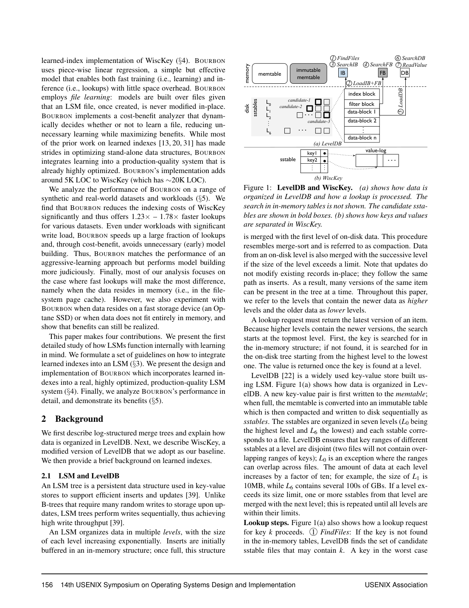
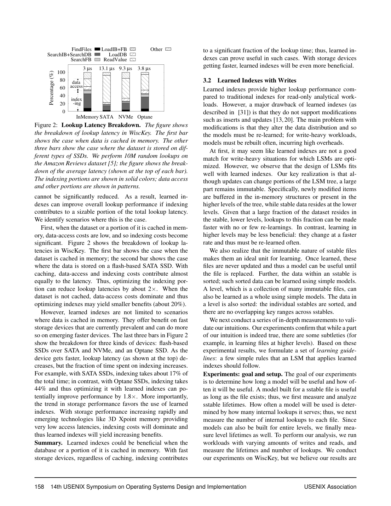

> 本组第 59 篇 · 存储结构与索引 · [全部论文]() · [上一篇]() · [下一篇]()

Bourbon在WiscKey的key/value分离LSM上建立辅助Greedy-PLR模型，以不可变SST为默认学习单元，按延迟建模与同层历史成本收益决定是否训练。它仍保留候选文件、Bloom/index辅助、误差范围内核验与value-log读取，不是完整查询O(1)或任意变长key支持。层级学习可选但配置静态；two-competitive是等待/寿命选择的作者主张，不是整套CBA端到端保证。1.23-1.78x来自模型已建、无写的点查；50%写的10x是学习时间减少。L4单文件60分钟与整层25秒并不矛盾，Seg10%的2.05%来自原图并使正文0%-2%应读作约数。原始API来源、模型、用量、critique、引文和段落保留，九章及精读由本次全文复核校正。

本文保留论文陈述、读者推断与待验证方案的区别；实验数字只适用于原文条件。原文和翻译来自已有 AI 辅助精读报告，已做来源匹配与编辑复核，不等于人工逐项核验或独立实验复现。所有页码均为 PDF 物理页。

## 论文与阅读范围

Yifan Dai, Yien Xu, Aishwarya Ganesan, Ramnatthan Alagappan, Brian Kroth, Andrea C. Arpaci-Dusseau, Remzi H. Arpaci-Dusseau，From WiscKey to Bourbon: A Learned Index for Log-Structured Merge Trees，14th USENIX OSDI，November4-6,2020，印刷155-171。所供PDF18物理页含1页封面；p2-18对应印刷页=物理页+153，本文证据定位均用物理页。已完整阅读封面、正文、脚注、公式和全部参考文献，查看13页覆盖图1-17、表1-3及其他图内表；未联网引用后续实现、未审计代码或运行数据库。

[论文集中的原始 PDF](https://github.com/lonng/db-papers/blob/4ff1331069c7cf52ac97dd769e5f484c1c35c200/papers/storage-structure/from-wisckey-to-bourbon%3A-a-learned-index-for-log-structured-merge-trees.pdf) · 本地来源：`storage-structure/from-wisckey-to-bourbon_-a-learned-index-for-log-structured-merge-trees.pdf`，共 18 页。

本篇保留 10 组原文精读和 51 条证据。截图为原始 PDF 的局部页选，不是重新生成的图表；未将整份 PDF 复制到博客。

## 目标与学习单元

作者要把学习索引用于支持写入的LSM，而不是用全量重训维护一个不断原地变化的数组。LSM文件一经写成不可变，模型可服务到该文件被替换；新写入形成新的数据/文件，compaction改变文件集合。因此不是只有最底层不可变，也不是任何写入都使所有既有文件模型失效。

WiscKey将value放log、SST存固定key与pointer，减小压实搬运。正文p4明确讨论较小的LSM树可缓存，但不保证所有规模常驻内存；查找仍可能跨多个文件、层及最终value-log。Bourbon目标是降低索引搜索成本，设备/缓存越让数据访问主导，整体收益越受限。早先瓶颈论述不能覆盖后文LoadChunk使数据加载范围缩小的实测。

五条经验guidelines分别强调低层长寿、等待短命文件消失、不忽略高层、工作负载/装载顺序感知、写密集不宜整层模型。高层负内部查找与热点positive也可有价值，不是只学底层。本文是2020 WiscKey集成原型；对当时学习索引的观察不应外推所有现代结构均不支持更新。

依据：论文陈述；PDF 物理页 2, 3, 4, 5, 6, 7, 8。证据：[C001N01](#evidence-c001n01), [C001N06](#evidence-c001n06), [C001N07](#evidence-c001n07), [C001N10](#evidence-c001n10), [C001N11](#evidence-c001n11), [BOURBON-SRC02](#evidence-bourbon-src02), [BOURBON-SRC03](#evidence-bourbon-src03), [BOURBON-SRC04](#evidence-bourbon-src04), [BOURBON-SRC05](#evidence-bourbon-src05), [BOURBON-SRC06](#evidence-bourbon-src06), [BOURBON-SRC07](#evidence-bourbon-src07), [BOURBON-SRC08](#evidence-bourbon-src08)。

## 模型与基线路径并存

Bourbon在约20KLOC的WiscKey上新增约5KLOC，使用Greedy-PLR、成本收益分析器和辅助模型查找路径。默认按文件学习；整层模型可以直接给候选文件/偏移，少一个FindFiles步骤，却会随任一文件增删失效。level learning不能直接用于L0整体，因为SST之间范围可重叠；各个SST内部仍有序，不能说L0每个文件无序。

p10图6及正文明确七步：FindFiles、LoadIB+FB、ModelLookup、SearchFB、LoadChunk、LocateKey、ReadValue。模型先输出pos与误差界，仍需block filter判断、范围内核验，最后从value log读值；若模型尚未建立就走baseline，而不是拒绝请求。误差范围跨块时会参考index block，不是彻底删除IB/Bloom或用模型取代membership判断。原API critique因短引文没列七步而判其无来源，完整源文已排除此疑点。

偏移依赖固定key与固定pointer：predicted_position*(keysize+pointersize)，value长度可以变化。当前实现不支持string key或key compression，支持value compression；字符串转大整数是未来方向，不是已实现的任意key。level/file粒度是静态配置，不会因CBA自行切换。

一次lookup可有多个候选文件的negative internal lookups，再在某文件positive；内部negative不等于整条请求查无此key。新版本搜索顺序仍属于LSM基线语义，辅助模型不是重写版本判定的独立引擎。

依据：论文陈述；PDF 物理页 3, 4, 5, 7, 8, 9, 10, 11。证据：[C001N06](#evidence-c001n06), [C002N06](#evidence-c002n06), [C002N10](#evidence-c002n10), [C003N04](#evidence-c003n04), [BOURBON-SRC02](#evidence-bourbon-src02), [BOURBON-SRC03](#evidence-bourbon-src03), [BOURBON-SRC08](#evidence-bourbon-src08), [BOURBON-SRC11](#evidence-bourbon-src11), [BOURBON-SRC12](#evidence-bourbon-src12), [BOURBON-SRC16](#evidence-bourbon-src16), [BOURBON-SRC17](#evidence-bourbon-src17), [BOURBON-SRC18](#evidence-bourbon-src18)。

*原论文 PDF 物理页 3，版权归原作者或出版方。点击图片可查看原尺寸。页面文本中定位到：Figure 1: LevelDB and WiscKey.。这是页面定位信息，不表示本次已复核图内所有数据。*

## PLR、等待与成本收益

Greedy-PLR按有序点流生成线段，若新点不能在误差界内加入当前段则开新段；作者给构建O(n)。推理先二分定位段（O(log s)），再slope*key+intercept得到预测位置，若不在预测点则在有界范围局部搜索。固定误差范围时作者把局部成本视常量；这不是完整多层LSM请求O(1)，也没有给贪心段数全局最小证明。

先等待Twait避免立刻训练短命文件。作者按学习时长设置等待，实验约4MB文件max约40ms，保守实现50ms。two-competitive的表述针对知晓寿命、立即或从不学习的比较；本文未展开完整证明，不能扩成CBA在任意未来负载下总时间至多最优2倍，也不把50ms当所有文件/硬件最优。

Cmodel=Tbuild，保守假定后台训练会干扰其他工作；Tbuild由离线单点训练均时乘点数。Bmodel=(Tn.b-Tn.m)*Nn+(Tp.b-Tp.m)*Np，按negative/positive内部lookup分开，因为多数negative止于filter。等待期baseline计时、同层已有模型均时、同层已完成寿命文件平均lookup数，再按文件大小/同层均值缩放，估计净收益；过滤短命文件。它不是未来查找次数oracle，也不是强化学习策略。

启动统计不足先always-learn但仍有Twait；随后Cmodel<Bmodel才学，多个文件按B-C最大队列优先。成本估计保守并不构成任意负载无退化保证。

读者构造的假设示例：设训练成本40ms，预计模型每次省1us、未来100000次相关lookup，收益100ms大于40ms；若仅1000次则预计1ms不足。此例只说明同单位比较，不伪造Greedy-PLR拟合或作者实验，未来数估错也会使决定失准。

依据：论文陈述；PDF 物理页 7, 8, 9, 10, 14。证据：[C002N08](#evidence-c002n08), [C002N12](#evidence-c002n12), [C003N02](#evidence-c003n02), [C004N06](#evidence-c004n06), [BOURBON-SRC08](#evidence-bourbon-src08), [BOURBON-SRC09](#evidence-bourbon-src09), [BOURBON-SRC10](#evidence-bourbon-src10), [BOURBON-SRC13](#evidence-bourbon-src13), [BOURBON-SRC14](#evidence-bourbon-src14), [BOURBON-SRC15](#evidence-bourbon-src15), [BOURBON-SRC16](#evidence-bourbon-src16)。

## 位置误差与工程前提

PLR为训练数据点给定位置误差界，查找仍要检验实际key并局部搜索；这是模型路径机制，不是统计置信度，也不证明缺失key存在。不可变SST使模型不因原地写入而漂移，但模型与正确文件版本、key编码、误差范围/跨块处理仍需对应。

本文没有完整提供并发模型发布/回收、崩溃恢复、数值边界或所有请求无假阴性的形式证明。不能从worker训练完成、SST不可变或“范围内搜索”单独补出全系统安全性；也不能声称CBA取Tbuild便保证最坏吞吐不崩溃。成本/收益正确估计和资源干扰是独立问题。

应区分文件寿命与整层静态期：p6的50%写L4约60分钟是单文件，p7约25秒是L4整体变化间隔。某些文件持续存在不妨碍层内其他文件变动；源文不矛盾。图3寿命研究还有删失估计：载入已有文件按workload持续时间，未删新文件按至少w-c及其他文件分布推估，不全是完整生灭记录。

p15图17(b)明确Seg10%153.6MB/2.05%，正文0%-2%为约略概括，不是严格<=2%上界。Linear0.0%为显示舍入而非绝对无模型；空间比例分母是total dataset，不是节约多少传统索引空间。delta8仅在测试数据/机器中较好，不是普遍最优定理。

依据：论文陈述；PDF 物理页 6, 7, 8, 9, 10, 14, 15。证据：[C002N02](#evidence-c002n02), [C002N03](#evidence-c002n03), [C002N07](#evidence-c002n07), [C002N08](#evidence-c002n08), [C002N12](#evidence-c002n12), [C004N06](#evidence-c004n06), [C004N07](#evidence-c004n07), [BOURBON-SRC05](#evidence-bourbon-src05), [BOURBON-SRC08](#evidence-bourbon-src08), [BOURBON-SRC09](#evidence-bourbon-src09), [BOURBON-SRC10](#evidence-bourbon-src10), [BOURBON-SRC13](#evidence-bourbon-src13), [BOURBON-SRC14](#evidence-bourbon-src14), [BOURBON-SRC17](#evidence-bourbon-src17), [BOURBON-SRC25](#evidence-bourbon-src25)。

## 将预建、混合与存储测试分开

通用设置p11明确20core Xeon E5-2660、160GB内存、480GB SATA SSD，16B integer key、64B value、delta8，未说明处10M operations。Synthetic四类各64M，AR是Amazon Reviews而非“自动记录”，33.5M；NY OpenStreetMaps21.9M。主要结果page cache驻留；真实key分布并不等于原始业务完整value/生产trace，硬件有说明，不能说CPU和内存总量缺失。

行为研究先载256M、单rate-limited client执行200M；5%写L0文件约2分钟、L4文件150分钟；50%写L4文件约60分钟、L0约10秒，少数L4文件也<1秒。另测整层变化，50%写L4整体约25秒；两个对象不可混同。部分文件寿命经估算，不全是精确观测。

表1用10M operations比较：50%写baseline82.6s、file71.5s（1.16x，74.2%模型路径）、level95.1s（0.87x，1.5%路径）；66次level重学均因层先变化失败。只读48.4/27.2/25.2s，file1.78x、level1.92x。它支持默认file和只读可选level，不证明所有写比例/实现整层都失败。

无写、模型先建的六数据集点查1.23-1.78x相对WiscKey，不是低写混合保证或与最新RocksDB/B-tree的全功能比较。装载顺序、请求分布另有1.47-1.61x与1.54-1.76x条件内结果。图8测到Search以及LoadData减少：chunk比整block小；这纠正了“绝不降低dataaccess”的绝对说法，但不保证所有设备I/O次数都减少。图2确有SATA/NVMe/Optane分解，是源文内容而非外部推测；其中潜在1.8x不是Bourbon实际Optane收益。

范围查询AR/OSM各类长度共1M次：AR长度1为1.90x、100为1.15x、500为1.10x，OSM500约1.04x，主要加快首key定位，后续scan近基线。混合AR50M中，50%写always学习134s、CBA13.9s；约10x是学习时间减少。total work由foreground+learning+compaction时间相加，不等于并行wallclock；CBA前台近always且少学习，不能推所有负载不退化。

YCSB A/F写密集1.06-1.18x、B/D读密集1.24-1.44x、C约1.6x、E1.16-1.19x；SOSD六数据集1.48-1.74x，均相对WiscKey。Optane顺序载入只读AR3.53→2.75us（1.28x）、OSM3.14→2.51us（1.25x）；Optane混合读密集1.16-1.19x、写密集1.05/1.06x。SATA内存容25%数据库时，uniform98.6→94.4us（1.04x）、80%请求访问25%热点的Zipf18.8→15.1us（1.25x），不是全局最大收益条件。

图17权衡delta与段数/局部搜索，AR delta8较好；模型空间对total dataset约0%-2.05%，Seg10%153.6MB/2.05%、AR3.09MB/.08%、OSM7.08MB/.26%。这些是论文实测，本次未复现，不补精确置信区间、p99或多核吞吐结论。

依据：论文陈述；PDF 物理页 5, 6, 7, 8, 9, 10, 11, 12, 13, 14, 15。证据：[C002N02](#evidence-c002n02), [C002N03](#evidence-c002n03), [C002N04](#evidence-c002n04), [C002N05](#evidence-c002n05), [C002N07](#evidence-c002n07), [C002N10](#evidence-c002n10), [C003N08](#evidence-c003n08), [C003N11](#evidence-c003n11), [C003N12](#evidence-c003n12), [C003N13](#evidence-c003n13), [C004N02](#evidence-c004n02), [C004N03](#evidence-c004n03), [C004N05](#evidence-c004n05), [C004N06](#evidence-c004n06), [C004N07](#evidence-c004n07), [BOURBON-SRC04](#evidence-bourbon-src04), [BOURBON-SRC05](#evidence-bourbon-src05), [BOURBON-SRC12](#evidence-bourbon-src12), [BOURBON-SRC18](#evidence-bourbon-src18), [BOURBON-SRC19](#evidence-bourbon-src19), [BOURBON-SRC20](#evidence-bourbon-src20), [BOURBON-SRC21](#evidence-bourbon-src21), [BOURBON-SRC22](#evidence-bourbon-src22), [BOURBON-SRC23](#evidence-bourbon-src23), [BOURBON-SRC24](#evidence-bourbon-src24), [BOURBON-SRC25](#evidence-bourbon-src25)。

*原论文 PDF 物理页 5，版权归原作者或出版方。点击图片可查看原尺寸。页面文本中定位到：Figure 2: Lookup Latency Breakdown. The figure shows；Figure 2 shows the breakdown of lookup la-。这是页面定位信息，不表示本次已复核图内所有数据。*

## 收益摊销与资源取舍

以下为读者工程推断，不是新增实测或作者定理。

寿命长只意味着可能有摊销时间，不代表访问多；高层虽寿命短也可承担大量negative或热点positive。需要把存续、访问次数及baseline/model差值一起看，而非按层号一次性决定全学/不学。

等待短命文件减少浪费，也损失早期查找收益；Twait、成本模型和统计分布各有假设。同层均值可忽略个别热点/分布突变，保守估Cmodel不能保证未来Bmodel或前台干扰；always训练更多也不等于理论最优。

模型扩大误差界可减段数/空间，却扩大局部搜索范围；只要仍验证数据，主要权衡是搜索工作与内存，不应把delta大直接说成返回错误数据。key/value布局、integer编码及key compression限制也会影响可用性。

整层可以省FindFiles，但文件一变就失效；文件粒度更稳定却保留候选文件开销。这是静态配置与CBA是否建模两个不同决策，没有自动切换实现。

受限内存uniform较小收益、热点较大收益符合缓存条件；不能以此忽略完整内存/只读时更大增益。长scan后续遍历主导，点查上限也不代表范围/写负载收益。

依据：读者推断；PDF 物理页 4, 5, 6, 7, 8, 9, 10, 11, 12, 13, 14, 15。证据：[C001N06](#evidence-c001n06), [C002N05](#evidence-c002n05), [C002N06](#evidence-c002n06), [C002N08](#evidence-c002n08), [C002N12](#evidence-c002n12), [C003N11](#evidence-c003n11), [BOURBON-SRC05](#evidence-bourbon-src05), [BOURBON-SRC06](#evidence-bourbon-src06), [BOURBON-SRC07](#evidence-bourbon-src07), [BOURBON-SRC11](#evidence-bourbon-src11), [BOURBON-SRC13](#evidence-bourbon-src13), [BOURBON-SRC14](#evidence-bourbon-src14), [BOURBON-SRC15](#evidence-bourbon-src15), [BOURBON-SRC16](#evidence-bourbon-src16), [BOURBON-SRC20](#evidence-bourbon-src20), [BOURBON-SRC21](#evidence-bourbon-src21), [BOURBON-SRC22](#evidence-bourbon-src22), [BOURBON-SRC24](#evidence-bourbon-src24), [BOURBON-SRC25](#evidence-bourbon-src25)。

## 相关工作与未来实现边界

本文以WiscKey为主要基线，把模型作为已优化LSM的辅助索引，而不是重新搭一个全数据库。作者用XIndex、FITing-Tree、AIDEL的额外更新结构和ALEX的gapped array作当时背景比较；本次不追访其原文或最新版本，不能据此断言所有learned index无法写入或某路线普遍更好。

Monkey的过滤器分配、Dostoevsky/HyperLevelDB/bLSM的压实策略及cLSM/RocksDB并发优化被视为正交方向。兼容是设计定位，不是本文已将各项全部组合并测出叠加收益。对B-tree的背景引用也不是本文直接全引擎对照。

RMI、PGM-index、splines等模型替代在p8/p15列为未来探索，string支持、key compression、动态file/level切换、更复杂CBA与其他写优化结构推广也未完成。不能把未来工作写成生产特性或现代模型泛化实验。

本报告不引入未在源文支持的外部OLAP/优化器系统关系来背书。是否能跨引擎、跨硬件迁移，需另有实现和测量。

依据：论文陈述；PDF 物理页 2, 3, 4, 8, 10, 15, 16, 17, 18。证据：[BOURBON-SRC01](#evidence-bourbon-src01), [BOURBON-SRC02](#evidence-bourbon-src02), [BOURBON-SRC11](#evidence-bourbon-src11), [BOURBON-SRC16](#evidence-bourbon-src16), [BOURBON-SRC26](#evidence-bourbon-src26), [C001N06](#evidence-c001n06)。

## 未执行的验证方案

以下为读者方案，不是已完成复现，不包含真实DB/SQL动作。

1. 固定WiscKey/Bourbon代码版本、编译/OS/文件系统、缓存与设备条件，区分160GB pagecache主结果、Optane和SATA限内存。保留16B integer key、64B value、delta8、各实验操作数，不能因分块笔记缺失就写全文无参数；此18页版无额外附录供本次虚构引用。

2. 用不可变有序文件做离线PLR与位置范围核验，分开存在/缺失key、跨block、模型未就绪fallback及版本替换；记录段数/内存/局部搜索成本，不把O(log s)当整个LSM请求复杂度。并发发布/回收与崩溃处理需要另行定义和验证，不先指定某种无锁实现。

3. 离线重放文件创建/删除与lookup时间线，分别记录真实终止寿命、右删失下界和估算值，区分单文件与整层变化。测同层均值在热点及分布切换时的预测误差，检查CBA误学/漏学和等待损失，不预设两倍端到端保证。

4. 在另行授权隔离系统才比较预建只读、offline、always、CBA；报告训练、前台、compaction工作量和墙钟，避免把134/13.9的学习时间比当query speedup。不同大小dataset的段数/模型内存需按分母明确。

5. 扫描delta与Twait，既报告内存也报告响应，不预设8/50ms全局最优。完整构建/发布协议、运行参数和重复次数仍需额外材料；本次未取外部artifact或运行存储系统。

依据：待验证的工程设想；PDF 物理页 4, 5, 6, 7, 8, 9, 10, 11, 12, 13, 14, 15。证据：[C002N02](#evidence-c002n02), [C002N08](#evidence-c002n08), [C002N12](#evidence-c002n12), [C003N02](#evidence-c003n02), [BOURBON-SRC05](#evidence-bourbon-src05), [BOURBON-SRC08](#evidence-bourbon-src08), [BOURBON-SRC09](#evidence-bourbon-src09), [BOURBON-SRC10](#evidence-bourbon-src10), [BOURBON-SRC11](#evidence-bourbon-src11), [BOURBON-SRC13](#evidence-bourbon-src13), [BOURBON-SRC14](#evidence-bourbon-src14), [BOURBON-SRC15](#evidence-bourbon-src15), [BOURBON-SRC17](#evidence-bourbon-src17), [BOURBON-SRC18](#evidence-bourbon-src18), [BOURBON-SRC19](#evidence-bourbon-src19), [BOURBON-SRC22](#evidence-bourbon-src22), [BOURBON-SRC24](#evidence-bourbon-src24), [BOURBON-SRC25](#evidence-bourbon-src25)。

## 结论与可信度分层

读者综合：Bourbon的贡献是利用不可变SST与WiscKey布局把低成本PLR和训练摊销连接起来。它不局限底层，也不删除所有传统索引；实际key核验、filter和baseline路径仍重要。固定key/变长value与未完成string支持必须同时说明。

位置误差机制、寿命观察、等待与CBA是不同证据层次：two-competitive只属于作者的等待选择主张，不给整个系统最优或不退化保证。CBA动态决定是否学习不等于动态切换file/level，更不是激进全学的“理论最优”。

预建无写的1.23-1.78x、混合训练时间约10x减少、Optane1.25-1.28x、限内存uniform1.04x、短range收益等各有条件，不可互相代换。L4文件/层寿命和约2%的空间范围需按正确对象理解；原图2.05%不应因短引文遗漏而被当成未知数字。

本次完整阅读18物理页（含封面/全参考文献），查看13页覆盖全部图表与关键公式，实际修订九章及10组精读，保留API来源/模型/用量/critique/英文引文。它是单源AI复核，不是独立人审、源码审计或基准复现。

依据：读者推断；PDF 物理页 1, 2, 3, 4, 5, 6, 7, 8, 9, 10, 11, 12, 13, 14, 15, 16, 17, 18。证据：[BOURBON-SRC01](#evidence-bourbon-src01), [BOURBON-SRC02](#evidence-bourbon-src02), [BOURBON-SRC03](#evidence-bourbon-src03), [BOURBON-SRC04](#evidence-bourbon-src04), [BOURBON-SRC05](#evidence-bourbon-src05), [BOURBON-SRC06](#evidence-bourbon-src06), [BOURBON-SRC07](#evidence-bourbon-src07), [BOURBON-SRC08](#evidence-bourbon-src08), [BOURBON-SRC09](#evidence-bourbon-src09), [BOURBON-SRC10](#evidence-bourbon-src10), [BOURBON-SRC11](#evidence-bourbon-src11), [BOURBON-SRC12](#evidence-bourbon-src12), [BOURBON-SRC13](#evidence-bourbon-src13), [BOURBON-SRC14](#evidence-bourbon-src14), [BOURBON-SRC15](#evidence-bourbon-src15), [BOURBON-SRC16](#evidence-bourbon-src16), [BOURBON-SRC17](#evidence-bourbon-src17), [BOURBON-SRC18](#evidence-bourbon-src18), [BOURBON-SRC19](#evidence-bourbon-src19), [BOURBON-SRC20](#evidence-bourbon-src20), [BOURBON-SRC21](#evidence-bourbon-src21), [BOURBON-SRC22](#evidence-bourbon-src22), [BOURBON-SRC23](#evidence-bourbon-src23), [BOURBON-SRC24](#evidence-bourbon-src24), [BOURBON-SRC25](#evidence-bourbon-src25), [BOURBON-SRC26](#evidence-bourbon-src26)。

## 原文精读：从句子回到机制

以下保留原文、忠实翻译、含义与边界；假设示例不作为论文实验结果。

### P001 · PDF 物理页 2

**原文**

<blockquote class="paper-source-quote"><pre><code>LSMs have&#10;many positive properties as compared to B-trees and their&#10;cousins, including high insert performance [11,37,40].&#10;In this paper, we apply the idea of the learned index to&#10;LSMs. A major challenge is that while learned indexes are&#10;primarily tailored for read-only settings, LSMs are optimized&#10;for writes. Writes cause disruption to learned indexes be-&#10;cause models learned over existing data must now be updated&#10;to accommodate the changes; the system thus must re-learn&#10;the data repeatedly.</code></pre></blockquote>

**忠实翻译**

> 与 B-tree 及其同类结构相比，LSM 具有许多积极特性，包括高插入性能 [11,37,40]。在本文中，我们将 learned index（学习型索引）的思想应用于 LSM。一个主要挑战是，learned index 主要针对只读场景定制，而 LSM 针对写入进行了优化。写入会对 learned index 造成干扰，因为在已有数据上学习得到的模型现在必须被更新以适应变化；因此系统必须反复重新学习数据。

**技术含义与边界**

> 作者用只读学习索引与写优化LSM的张力引出重学成本。全文随后指出SST一旦创建不可变，可到文件替换前复用模型；并非每次写都原地修改所有模型。这里的primarily也不是所有现代学习索引不支持更新的分类定理。

**常见误读**

> 不能将写入干扰泛化为任何LSM写入都必须全量重训、永远无收益或只能学习底层；文件模型与整层模型的失效对象不同。

**读者构造的假设示例**

> 读者构造的假设示例：新写形成文件B，而旧文件A仍不可变，A的模型可继续服务；如果稍后compaction以C替换A/B，需为新对象决定是否学习。此例说明维护单元，不伪造训练调度或收益数字。

### P002 · PDF 物理页 15

**原文**

<blockquote class="paper-source-quote"><pre><code>As δ increases, fewer line segments are created,&#10;leading to low space overheads. Table 17(b) shows the space&#10;overheads for different datasets. As shown, for a variety of&#10;datasets, the overhead compared to the total dataset size is&#10;little (0% – 2%).&#10;6&#10;Related Work&#10;Learned indexes. The core idea of our work, replacing in-&#10;dexing structures with ML models, is inspired from the pi-&#10;oneering work on learned indexes [31].</code></pre></blockquote>

**忠实翻译**

> 随着 δ 增大，创建的线段数量减少，从而带来较低的空间开销。表 17(b) 展示了不同数据集的空间开销。如图所示，对于多种数据集，与总数据集大小相比，该开销很小（0% – 2%）。6 相关工作 Learned indexes。我们工作的核心思想，即用 ML 模型替换索引结构，受到 learned indexes 开创性工作 [31] 的启发。

**技术含义与边界**

> delta增大通常容许更少线段，降低模型空间。原文0%-2%是针对测试dataset的近似概括，图17(b)确写Seg10%2.05%；比例分母是total dataset，不能当严格上界或传统index节约比例。delta还影响局部搜索工作，不是越大越好。

**常见误读**

> 不能把显示0.0%当模型绝对零字节，或将更大delta直接等同结果不准确：模型只预测，实际key仍核验；主要额外代价是更大搜索范围。没有证据保证所有分布空间都<=2%。

**读者构造的假设示例**

> 读者构造的假设示例：同一份有序数据用更松误差界后，从1000段降为500段；若每段存储不变，模型内存可减，但每次可能需核验更大的位置范围。是假设取舍，不是作者报告的段数。

### P003 · PDF 物理页 8

**原文**

<blockquote class="paper-source-quote"><pre><code>At the&#10;end, Greedy-PLR produces a set of line segments that repre-&#10;sents the data. Greedy-PLR runs in linear time with respect&#10;to the number of data points.&#10;Once the model is learned, inference is quick: first, the&#10;correct line segment that contains the key is found (using&#10;binary search); within that line segment, the position of the&#10;target key is obtained by multiplying the key with the line’s&#10;slope and adding the intercept.</code></pre></blockquote>

**忠实翻译**

> 最后，Greedy-PLR 生成一组表示数据的线段。Greedy-PLR 的运行时间相对于数据点数量呈线性。一旦模型学习完成，推理很快：首先，找到包含该 key 的正确线段（使用二分查找）；在该线段内，通过将 key 乘以直线的斜率并加上截距来获得目标 key 的位置。

**技术含义与边界**

> 训练线性于数据点数，推理先按段二分再计算位置，二者不能混同。计算得到是位置预测，后续还需误差范围搜索及固定record大小的偏移转换、filter和valuelog等步骤；完整LSM请求不因此成为O(1)。

**常见误读**

> 线性时间限定训练，O(log s)限定段定位。不能把slope*key+intercept的预测当已经确定的物理地址，也不能忽略预测后的实值核验。

**读者构造的假设示例**

> 读者构造的假设示例：假设某文件有1000段，需要先二分选择适用段，再算出记录位置预测；如果key不在预测点，仍在规定范围核验。只有固定record布局且知道recordsize后才换成字节偏移，不虚构具体段号或拟合系数。

### P004 · PDF 物理页 5

**原文**

<blockquote class="paper-source-quote"><pre><code>Given that a large fraction of the dataset resides in&#10;the stable, lower levels, lookups to this fraction can be made&#10;faster with no or few re-learnings. In contrast, learning in&#10;higher levels may be less beneficial: they change at a faster&#10;rate and thus must be re-learned often.&#10;We also realize that the immutable nature of sstable files&#10;makes them an ideal unit for learning. Once learned, these&#10;files are never updated and thus a model can be useful until&#10;the file is replaced.</code></pre></blockquote>

**忠实翻译**

> 鉴于大部分数据集驻留在稳定的较低层，对这部分的查找可以在没有或极少重新学习的情况下变得更快。相比之下，在较高层进行学习可能收益较小：它们以更快的速率变化，因此必须经常重新学习。我们还意识到 sstable 文件的不可变特性使其成为理想的学习单元。一旦学习完成，这些文件永远不会被更新，因此模型可以一直有用直到文件被替换。

**技术含义与边界**

> 低层平均更稳定是本文测量前的直觉/策略依据，文件不可变才是模型到替换前可复用的关键。后文guideline3明确不要忽略高层，因为它们可能服务大量negative或热点positive；不能将这段等同只学低层的最终设计。

**常见误读**

> higher/lower是L0附近/更底层，不是文件是否可变的二分。高层SST本身仍不原地更新，也会被替换；所有层只要文件存在，文件模型都可能有效。

**读者构造的假设示例**

> 读者构造的假设示例：文件A保持60秒、B只保持2秒，但B可能收到很多查找；不能仅看寿命判B完全不值学。仍需比较训练成本、实际可服务查找和模型节省。数字不是本文实验。

### P005 · PDF 物理页 7

**原文**

<blockquote class="paper-source-quote"><pre><code>Note that&#10;#changes/#files is higher than 1 in L1 as there are more cre-&#10;ations and deletions than the number of files. (b) shows the&#10;time between bursts for L4 for different write percentages.&#10;Level learning cannot be applied at L0 because it is unsorted:&#10;files in L0 can have overlapping key ranges. Once a level&#10;is learned, any change to the level causes a re-learning. A&#10;level changes when new sstables are created at that level, or&#10;existing ones are deleted.</code></pre></blockquote>

**忠实翻译**

> 注意，L1的#changes/#files大于1，因为创建与删除的次数多于文件数量。(b)显示不同写比例下L4两次突发变化之间的时间。整层学习不能用于L0，因为L0整体不具备非重叠有序范围：L0各文件key范围可重叠。层一旦被学习，任何层变化都会引起重新学习；当该层新增SST或已有SST删除时，层就发生变化。

**技术含义与边界**

> 图的变化数/文件数可以超过1，这是事件计数与存量分母的比值；不单凭>1推得某个固定事件频率。L0整体重叠不同于各SST内部是否有序。整层模型依赖文件集合，任一增删使原模型不能按原分布直接复用；这是本文方案，不代表任何未来算法都不能增量维护。

**常见误读**

> 不能把25秒整层静态期当单文件寿命，也不能说L0的每个SST未排序。层学习不适用L0不妨碍对L0中的不可变文件学习。

**读者构造的假设示例**

> 读者构造的假设示例：L2有10个文件，其中1个被替换，另9个仍在；整层集合已变化，旧层模型需重建，但那9个未变文件的文件模型仍可用。它解释为何整层静态期短于部分文件寿命。

### P006 · PDF 物理页 11

**原文**

<blockquote class="paper-source-quote"><pre><code>As shown in 9(a), BOURBON is faster than&#10;WiscKey for all datasets; depending upon the dataset, the im-&#10;provements vary (1.23× to 1.78×). BOURBON provides the&#10;most benefit for the linear dataset because it has the smallest&#10;number of segments (one per model); with fewer segments,&#10;fewer searches are needed to find the target line segment.&#10;From 9(b), we observe that latencies increase with the num-&#10;ber of segments (e.g., latency of seg-1% is greater than that&#10;of linear).</code></pre></blockquote>

**忠实翻译**

> 如图 9(a) 所示，BOURBON 在所有数据集上都比 WiscKey 快；根据数据集的不同，提升幅度各异（1.23× 至 1.78×）。BOURBON 对 linear 数据集提供的收益最大，因为它具有最少的线段数量（每个模型一个）；线段越少，找到目标线段所需的搜索就越少。从图 9(b) 中我们观察到，延迟随线段数量增加而增加（例如，seg-1% 的延迟大于 linear 的延迟）。

**技术含义与边界**

> 这里是六数据集、模型先建且无写的点查，基线WiscKey；数字是lookup加速而非构建成本一并计入的系统收益。linear每文件模型一段降低段选择成本；跨不同总数据量的AR/OSM不能只按总段数直接比。

**常见误读**

> 不能将all datasets写成所有可能数据、所有操作或所有设备；也不能把六数据集各自训练模型看作单一模型对未见数据统计泛化。段数与延迟的观察不替代其他瓶颈分析。

**读者构造的假设示例**

> 读者构造的假设示例：两个同规模文件分别只需1段和1000段，后者选择段的搜索工作可能更多；但完整lookup仍有找文件、filter和value读取，不能从单段就推整条查询O(1)或固定倍数收益。

### P007 · PDF 物理页 4

**原文**

<blockquote class="paper-source-quote"><pre><code>2.2&#10;WiscKey&#10;In LevelDB, compaction results in large write amplification&#10;because both keys and values are sorted and rewritten. Thus,&#10;LevelDB suffers from high compaction overheads, affecting&#10;foreground workloads.&#10;WiscKey [37] (and Badger [1]) reduces this overhead by&#10;storing the values separately; the sstables contain only keys&#10;and pointers to the values as shown in Figure 1(b). With this&#10;design, compaction sorts and writes only the keys, leaving&#10;the values undisturbed, thus reducing I/O amplification and&#10;overheads.</code></pre></blockquote>

**忠实翻译**

> 2.2 WiscKey。在 LevelDB 中，compaction 会导致大量写放大，因为键和值都被排序并重写。因此，LevelDB 遭受高 compaction 开销的影响，影响前台工作负载。WiscKey [37]（以及 Badger [1]）通过单独存储值来减少这种开销；sstable 仅包含键和指向值的指针，如图 1(b) 所示。通过这种设计，compaction 仅排序和写入键，保持值不受干扰，从而减少 I/O 放大和开销。

**技术含义与边界**

> 该段说明key/value separation减少compaction内搬运value；不是所有I/O或空间管理开销消失。全文p8利用固定key+pointer支持变长value，不能将这种支持扩成任意变长key；valuelog读取也仍在。

**常见误读**

> 不要把“保持value不动”扩大成系统永不移动/管理value，或认为没有任何压实成本。这里只陈述压实中的价值搬运差异，不给所有工作负载无条件收益。

**读者构造的假设示例**

> 读者构造的假设示例：某记录key16B、value4KB；如果一次合并只需写key和pointer，所搬字节可远少于连同value重写。仍要计pointer和其他结构成本，也不能用这个单记录示例算系统实际写放大。

### P008 · PDF 物理页 13

**原文**

<blockquote class="paper-source-quote"><pre><code>With a high percentage of writes, BOURBON-cba chooses not&#10;to learn many files, reducing learning time; for example,&#10;with 50% writes, BOURBON-cba spends only 13.9 seconds in&#10;learning (10× lower than BOURBON-always). Consequently,&#10;many lookups take the baseline path. BOURBON-cba takes&#10;this action because there is less benefit to learning as the data&#10;is changing rapidly and there are fewer lookups.</code></pre></blockquote>

**忠实翻译**

> 在高写入比例下，BOURBON-cba 选择不学习许多文件，从而减少学习时间；例如，在 50% 写入时，BOURBON-cba 仅花费 13.9 秒用于学习（比 BOURBON-always 低 10×）。因此，许多查找走基线路径。BOURBON-cba 采取此行动是因为随着数据快速变化且查找较少，学习的收益较小。

**技术含义与边界**

> AR50M混合实验中50%写，CBA减少学习文件，13.9秒对always约134秒是学习时间下降约一个数量级。更多lookup走baseline是主动取舍；不是查询10倍快、整系统资源10倍少或所有未来负载都不退化。

**常见误读**

> 不能把baseline路径比例等同查询失败或错误率；模型未建仍走原逻辑。原文total work相加也不同于可能并行的wallclock，需分开报前台、学习和compaction。

**读者构造的假设示例**

> 读者构造的假设示例：预计某文件可省1ms查询时间却需40ms训练时，CBA可选择不学、由baseline处理。此例不规定高写比例必选几个文件，也不保证同层估计准确。

### P009 · PDF 物理页 6

**原文**

<blockquote class="paper-source-quote"><pre><code>Files at lower levels live much longer; files&#10;at L4 live about 150 minutes. Third, although the average&#10;lifetime of files reduces with more writes, even with a high&#10;†If the files are created during load, we assign the workload duration as&#10;their lifetimes. If not, we estimate the lifetime of a file based on its creation&#10;time (c) and the total workload time (w); the lifetime of the file is at least&#10;w −c. We thus consider the lifetime distribution of other files that have a&#10;lifetime of at least w−c.</code></pre></blockquote>

**忠实翻译**

> 较低层的文件活得长得多；L4文件约存活150分钟。第三，尽管文件平均寿命随写入增多而减少，但即使在高……（所选正文句在此被脚注打断）。
> 脚注：如果文件在load期间创建，就把workload持续时间赋为其寿命；否则根据创建时间c和总workload时间w估算，文件寿命至少是w-c。因此考虑其他寿命至少为w-c的文件的寿命分布。

**技术含义与边界**

> 完整上下文的150分钟是5%写条件下单个L4文件平均寿命；它不等于层级静态期。观测结束尚存文件存在右删失，w-c是下界；全文脚注随后说从满足下界的其他文件分布随机选寿命赋值，这是估算而非完整生灭事实。该补充来自本次全文，不冒充截取短段已完整包含后句。

**常见误读**

> 不能把至少w-c直接等同实际寿命，或把load已有文件的真实创建时间当已知。文件60分钟与层25秒不是源文矛盾，更不能用L4约150分钟当固定常数。

**读者构造的假设示例**

> 读者构造的假设示例：观测长200分钟，文件在第50分钟创建且结束仍在，只知寿命至少150分钟；真实寿命可能更长。若按本文估算还会参考满足下界的其他文件分布，不能说已精确量得150分钟。

### P010 · PDF 物理页 9

**原文**

<blockquote class="paper-source-quote"><pre><code>Only&#10;a mere 1.5% of internal lookups take the model path; these&#10;lookups are the ones performed just after loading the data&#10;and when the initial level models are available. We observe&#10;that all the 66 attempted level learnings failed because the&#10;level changed before the learning completed. Because of the&#10;additional cost of re-learnings, level learning performs even&#10;worse than the baseline with 50% writes.</code></pre></blockquote>

**忠实翻译**

> 仅有区区 1.5% 的内部查找走了模型路径；这些查找是在加载数据后立即执行且初始 level 模型可用时执行的。我们观察到所有 66 次尝试的 level 学习都失败了，因为 level 在学习完成之前就发生了变化。由于额外的重新学习成本，在 50% 写入时，level learning 的表现甚至比基线更差。

**技术含义与边界**

> 50%写的表1/相应测试里，level重学完成前集合已变，66次未成功；初始模型还让1.5%内部lookup走模型。是该策略与负载下的观察，不是任意整层算法必败、file模型必败或整体Bourbon不可用于写。

**常见误读**

> 不能把内部lookup模型路径比例当全局命中率、请求成功率或最终所有部署固定值；也不能把测试66次失败模拟成对所有未来算法的数学证明。

**读者构造的假设示例**

> 读者构造的假设示例：一次层模型训练预计10秒，而3秒后有文件新增，原训练对象已变，模型不能按原集合发布。该故事解释失效原因，但不伪称重现66次或测得相同1.5%。

## 尚未解决的问题

1. 模型发布、文件版本绑定、回收、崩溃后恢复和跨block边界的完整协议是什么？
2. 同层平均统计在热点/分布突变下误差多少，CBA误学/漏学和饥饿如何量化？
3. Twait的two-competitive主张所用精确成本与比较对象是什么，不能据此替代端到端验证。
4. 未实现string/key compression与其他模型会怎样改变训练、位置映射及搜索代价？
5. delta/Twait在不同设备、缓存/数据集及负载下最优点如何变化？
6. 完整构建、实验参数、重复次数与资源分摊未在本文全部提供，怎样复核端到端成本？

## 证据索引

证据编号沿用原报告，便于将上文判断追溯到原句。引文匹配只验证位置，不证明解读正确。

**C001N01 · PDF 物理页 2**

本文把写优化LSM与学习索引结合，依靠不可变SST作为学习单元；所有层文件一旦创建都不原地更新，不是只有底层不可变。写/compaction更换文件或改变层集合，引起新学习需求；频繁变化可能减少可摊销收益。

<blockquote class="paper-source-quote"><pre><code>A major challenge is that while learned indexes are primarily tailored for read-only settings, LSMs are optimized for writes.</code></pre></blockquote>

**C001N06 · PDF 物理页 4**

WiscKey的SST存key+valuepointer，value在log，减少压实value重写。正文p4确有更小树可能整体缓存的描述，但这是条件性能力，不是任意数据库必驻内存；Bourbon固定key支持变长value，不是任意变长记录。

<blockquote class="paper-source-quote"><pre><code>WiscKey [37] (and Badger [1]) reduces this overhead by storing the values separately; the sstables contain only keys and pointers to the values</code></pre></blockquote>

**C001N07 · PDF 物理页 4**

p4先把优化目标定位indexing、认为不能显著降低dataaccess；实际p11图8还测到LoadChunk范围小于整块带来的LoadData下降。应按全文区分瓶颈论述与实现效果，不能一概说dataaccess绝不改善。

<blockquote class="paper-source-quote"><pre><code>Optimized indexes such as learned indexes can reduce the overheads of indexing but cannot reduce data-access costs.</code></pre></blockquote>

**C001N10 · PDF 物理页 5**

为了验证上述直觉并制定learning guidelines，论文设计了实验来测量sstable的生命周期（lifetime）以及每个文件服务的internal lookup数量。模型对某个sstable有用的时间等于该文件存在的时间；模型被使用的频率取决于它服务的查找次数。实验在WiscKey上运行具有不同读写比例的工作负载进行测量。这些指标用于支撑后续的cost-benefit策略，避免对生命周期过短的文件进行无效的模型训练。

<blockquote class="paper-source-quote"><pre><code>A model built for a sstable file is useful as long as the file exists; thus, we first measure and analyze sstable lifetimes.</code></pre></blockquote>

**C001N11 · PDF 物理页 5**

较高层变化更频繁，平均模型摊销可能较少，但本文也强调高层负内部查找/热点可有价值。原型在SST而非可变memtable上学习；不能说所有当代learned index均不支持更新，或只能学习最底层。

<blockquote class="paper-source-quote"><pre><code>In contrast, learning in higher levels may be less beneficial: they change at a faster rate and thus must be re-learned often.</code></pre></blockquote>

**C002N02 · PDF 物理页 6**

对于在workload期间未被删除的文件，其生命周期采用估计方法：若文件在load阶段创建，则将其生命周期设为workload持续时间；否则根据创建时间c和总workload时间w，计算至少为w-c的生命周期，并从具有相同下界的其他文件生命周期分布中随机采样赋值。这是一种统计近似而非精确值。

<blockquote class="paper-source-quote"><pre><code>If the files are created during load, we assign the workload duration as their lifetimes. If not, we estimate the lifetime of a file based on its creation time</code></pre></blockquote>

**C002N03 · PDF 物理页 6**

SSTable生命周期观测（图3）：低写入比例下高层级文件也有可观寿命，如5%写入时L0平均约2分钟，L4约150分钟。50%写入时L4仍有约60分钟，而L0仅约10秒。这支撑了Guideline 1（优先学习低层级文件）。

<blockquote class="paper-source-quote"><pre><code>for example, at 5% writes, files at L0 live for about 2 minutes on an average. Files at lower levels live much longer; files at L4 live about 150 minutes.</code></pre></blockquote>

**C002N04 · PDF 物理页 6**

少数文件极短命的原因（即使L4也有约2%不到1秒）：一是Li文件compaction在Li+1创建的新文件立即被选中compaction到下一层；二是新文件与正在从Li compaction的下一个文件键范围重叠。这支撑了Guideline 2（等待阈值后再学习）。

<blockquote class="paper-source-quote"><pre><code>First, compaction of a Li file creates a new file in Li+1 which is again immediately chosen for compaction to the next level.</code></pre></blockquote>

**C002N05 · PDF 物理页 7**

内部查找分布（图4）：随机加载数据集时，高层级文件的总内部查找数更高，但主要由负查找构成；正查找集中在低层级。Zipfian分布下高层级也会有大量正查找（热点键频繁更新留在高层）。顺序加载时无负查找（FindFiles直接定位唯一可能包含键的文件），低层级服务更多查找。这支撑了Guideline 3和4。

<blockquote class="paper-source-quote"><pre><code>In contrast to the randomly-loaded case, there are no negative lookups because keys of different sstable files do not overlap even across levels</code></pre></blockquote>

**C002N06 · PDF 物理页 7**

层级学习不适用于L0，因为L0未排序且文件键范围可重叠。层级模型的优势在于查找时无需单独的候选文件发现步骤，模型直接输出目标SSTable及偏移量。但层级变化（文件增删）会触发重学习。

<blockquote class="paper-source-quote"><pre><code>Level learning cannot be applied at L0 because it is unsorted: files in L0 can have overlapping key ranges.</code></pre></blockquote>

**C002N07 · PDF 物理页 7**

这里25秒是50%写时L4作为整体在变化之间的寿命/静态间隔，不是单个L4 SST文件寿命。p6约60分钟说的是单文件，两个对象不同，并非源文矛盾。

<blockquote class="paper-source-quote"><pre><code>with 50% writes, the lifetime of L4 reduces to about 25 seconds.</code></pre></blockquote>

**C002N08 · PDF 物理页 8**

BOURBON使用Greedy-PLR算法训练分段线性回归模型，逐个处理数据点，当新点违反预设误差界δ时创建新线段。训练时间为数据点数的线性复杂度。推理时通过二分查找定位线段（O(log s)），再用斜率和截距计算位置，最后在[dpos-δ, dpos+δ]范围内做局部搜索。空间开销为每线段数十字节。

<blockquote class="paper-source-quote"><pre><code>Greedy-PLR runs in linear time with respect to the number of data points.</code></pre></blockquote>

**C002N10 · PDF 物理页 9**

文件级vs层级学习对比（表1）：基线为WiscKey，10M操作。写密集(50%写)混合负载下，层级学习仅1.5%查找走模型路径，66次层级学习尝试全部因层级在学习完成前变化而失败，性能劣于基线(0.87x)；文件级学习达1.16x加速。只读场景层级学习优于文件级(1.92x vs 1.78x)。因此默认用文件级学习。

<blockquote class="paper-source-quote"><pre><code>We observe that all the 66 attempted level learnings failed because the level changed before the learning completed.</code></pre></blockquote>

**C002N12 · PDF 物理页 9**

成本保守按Tbuild（离线单点训练均时*点数），收益区分正负内部查找、借同层已完成寿命文件均值估计。保守成本假设不证明估计总准确、无资源干扰或任意负载不退化。

<blockquote class="paper-source-quote"><pre><code>BOURBON assumes Cmodel to be equal to Tbuild. We define Tbuild as the time to train the PLR model for a file.</code></pre></blockquote>

**C003N02 · PDF 物理页 10**

启动阶段统计不足时，BOURBON运行在always-learn模式（仍保留Twait）。收集足够统计后，当且仅当 Cmodel < Bmodel 时才学习该文件。若多个文件同时被选中，使用最大优先队列按 Bmodel − Cmodel 排序，优先处理净收益最大的文件。这是调度启发式，不保证全局最优。

<blockquote class="paper-source-quote"><pre><code>BOURBON puts them in a max priority queue ordered by Bmodel −Cmodel, thus prioritizing files that would deliver the most benefit.</code></pre></blockquote>

**C003N04 · PDF 物理页 10**

原文p10图6与正文确有FindFiles、LoadIB+FB、ModelLookup、SearchFB、LoadChunk、LocateKey、ReadValue七步；旧critique因短引文未列全而判编造不成立。模型保留Bloom/index辅助和valuelog，跨块时参考IB；不存在模型时走baseline。

<blockquote class="paper-source-quote"><pre><code>Sometimes, records pos−δ through pos+δ span multiple data blocks; in such cases, BOURBON consults the index block</code></pre></blockquote>

**C003N08 · PDF 物理页 11**

无写场景下，BOURBON在所有6个数据集上均快于WiscKey，加速比1.23×至1.78×。Linear数据集收益最大，因为其段数最少（每模型一段），查找目标线段所需搜索更少。延迟随段数增加而上升（如seg-1%高于linear）。AR和OSM因数据量差异无法直接比较段数。

<blockquote class="paper-source-quote"><pre><code>BOURBON provides the most benefit for the linear dataset because it has the smallest number of segments (one per model)</code></pre></blockquote>

**C003N11 · PDF 物理页 12**

范围查询实验（AR和OSM，1M次查询）显示：短范围（长度1）时索引成本主导，BOURBON加速1.90×；范围增大到100条时降至1.15×。原因是BOURBON仅加速索引部分，后续键扫描路径与WiscKey相同，大范围时索引占比下降。

<blockquote class="paper-source-quote"><pre><code>With short ranges, where the indexing cost (i.e., the cost to locate the first key of the range) is dominant, BOURBON offers the most benefit.</code></pre></blockquote>

**C003N12 · PDF 物理页 13**

AR50M混合测试中50%写，always训练约134秒、CBA13.9秒；10x指训练时间而非查询加速。图13total是foreground+learning+compaction工作量相加，不直接是并行wallclock。该条件支持CBA减少不划算训练，不证明always在任意环境不可用。

<blockquote class="paper-source-quote"><pre><code>with 50% writes, BOURBON-cba spends only 13.9 seconds in learning (10× lower than BOURBON-always).</code></pre></blockquote>

**C003N13 · PDF 物理页 13**

YCSB宏基准测试使用6种工作负载（A至F，涵盖不同读写比例和访问模式）和3个数据集（default, AR, OSM）。图14展示了吞吐量对比，BOURBON在不同工作负载下相对WiscKey有不同程度的提升，具体数值见图表标注。

<blockquote class="paper-source-quote"><pre><code>We use six workloads that have different read-write ratios and access patterns: A (w:50%, r:50%), B (w:5%, r:95%)</code></pre></blockquote>

**C004N02 · PDF 物理页 14**

SOSD六数据集测到相对WiscKey1.48-1.74x，表明这些数据分布条件下有效；各数据学习本地模型，不是一个统一模型对未见数据的统计泛化证明。

<blockquote class="paper-source-quote"><pre><code>BOURBON is about 1.48× – 1.74× faster than the baseline for all datasets.</code></pre></blockquote>

**C004N03 · PDF 物理页 14**

在 Intel Optane SSD 上运行只读负载，AR 数据集延迟从 3.53µs 降至 2.75µs（1.28×），OSM 从 3.14µs 降至 2.51µs（1.25×）。说明即使数据不在内存而在快速存储设备上，BOURBON 仍有收益，但加速比低于纯内存场景。

<blockquote class="paper-source-quote"><pre><code>Even when the data is present on a storage device, BOURBON offers benefit (1.25× – 1.28× faster lookups than WiscKey).</code></pre></blockquote>

**C004N05 · PDF 物理页 14**

SATA内存容约25%时，uniform1.04x、80%请求访问约25%热点的Zipf1.25x，是此受限条件比较。不证明“内存受限偏斜时全局收益最大”，内存/预建模型测试另有更大增益。

<blockquote class="paper-source-quote"><pre><code>indexing time instead of data-access time dominates because a large number of requests access the small portion of data that is already cached in memory.</code></pre></blockquote>

**C004N06 · PDF 物理页 14**

PLR 误差界 δ 的选择存在权衡：δ 增大导致线段数减少，搜索线段的时间降低，从而延迟下降；但超过 δ=8 后，虽然找线段更快，但在线段内搜索的时间增加，总延迟反而上升。作者发现 δ=8 对 AR 及其他数据集均是最优选择。这是启发式参数调优而非理论最优证明。

<blockquote class="paper-source-quote"><pre><code>beyond δ = 8, although the time to find the segment reduces, the time to search within a segment increases, thus increasing latency.</code></pre></blockquote>

**C004N07 · PDF 物理页 15**

图17(b)确标Seg10%=153.6MB/2.05%，不是不明来源OCR；正文0%-2%是近似概括而非严格上界。比例分母是总dataset含value，不是传统index大小；Linear0.0%是显示舍入，绝对模型仍0.02MB。

<blockquote class="paper-source-quote"><pre><code>for a variety of datasets, the overhead compared to the total dataset size is little (0% – 2%).</code></pre></blockquote>

**BOURBON-SRC01 · PDF 物理页 1**

本文是OSDI2020所供18物理页版，p1为会议封面，p2-18对应印刷155-171；正文p2-15、referencesp16-18。不是18页纯正文或后续扩展实现。作者为Yifan Dai,Yien Xu,Aishwarya Ganesan,Ramnatthan Alagappan,Brian Kroth,Andrea C./Remzi H.Arpaci-Dusseau。

<blockquote class="paper-source-quote"><pre><code>November 4–6, 2020</code></pre></blockquote>

**BOURBON-SRC02 · PDF 物理页 3**

在WiscKey上加约5KLOC（基底约20K），对不可变SST建立辅助模型。写入形成新文件需新模型，不是旧文件分布被原地更新，也不是现代端到端神经数据库。production-quality是源基底/集成表述，不能虚构大规模线上部署数据。

<blockquote class="paper-source-quote"><pre><code>models are built over files given that an LSM file, once created, is never modified in-place.</code></pre></blockquote>

**BOURBON-SRC03 · PDF 物理页 4**

保留LSM由新到旧查找、memtable/多版本和候选文件；L0文件可overlap，普通非L0同层不重叠。全局negative request与某candidate的negative internal lookup不是同一概念；一次成功请求也可有多次内部negative。

<blockquote class="paper-source-quote"><pre><code>A negative internal lookup does not find the key</code></pre></blockquote>

**BOURBON-SRC04 · PDF 物理页 5**

图2 WiscKey AR10M randomlookups平均3us内存、13.1SATA、9.3NVMe、3.8Optane；SATA索引17%、Optane44%是瓶颈分解及潜在收益，不是Bourbon实测1.8倍。未来硬件趋势是2020作者展望，非当前产品事实。

<blockquote class="paper-source-quote"><pre><code>indexing takes 44%</code></pre></blockquote>

**BOURBON-SRC05 · PDF 物理页 6**

寿命/内部查找研究先载入256M、单rate-limitedclient/200M ops，均匀访问并改变write%。load已有文件创建时间按workload-start；未结束文件寿命用窗口或同分布随机抽样估计，不是全部真实生灭时长。L4长寿仍有约2%<1s，不能只用均值决定学习。

<blockquote class="paper-source-quote"><pre><code>we must estimate their lifetimes.</code></pre></blockquote>

**BOURBON-SRC06 · PDF 物理页 6**

五guidelines是经验建议：偏向低层长寿文件、等待、不能忽略高层negative/热点positive、工作负载及loadorder感知、写密集不宜整层学习。高层指L0附近；非只学最底层。

<blockquote class="paper-source-quote"><pre><code>Favor learning files at lower levels.</code></pre></blockquote>

**BOURBON-SRC07 · PDF 物理页 7**

随机load高层含大量negativeinternal，可从模型获益；Bloom前仍有索引搜索。顺序load跨层不重叠是该测试数据布局，不是任何LSM始终零negative。Zipfian热点更新可使高层positive增多；loadorder与requestdistribution要分开。

<blockquote class="paper-source-quote"><pre><code>before the filter query</code></pre></blockquote>

**BOURBON-SRC08 · PDF 物理页 7**

整层model不用于L0因文件范围重叠；任何层文件增删会使levelmodel失效，文件model保留到文件替换。写密集测试level66次学习全未完成，非所有系统任意更新算法都失败。

<blockquote class="paper-source-quote"><pre><code>Level learning cannot be applied at L0 because it is unsorted:</code></pre></blockquote>

**BOURBON-SRC09 · PDF 物理页 8**

Greedy-PLR逐点处理，无法满足给定误差则加segment，构造O(n)；误差界是训练有序数据点的位置界，不是统计置信区间、缺失key必有记录或所有故障正确性证明。未证明贪心最少segment。

<blockquote class="paper-source-quote"><pre><code>Greedy-PLR runs in linear time with respect to the number of data points.</code></pre></blockquote>

**BOURBON-SRC10 · PDF 物理页 8**

模型先二分找segment再斜率乘key加截距，若预测不精确在误差范围内局部搜索；O(log s)是模型找segment复杂度（局部范围固定时视为常数），不是完整动态LSM查找O(1)。FindFiles、filter及valuelog仍在。

<blockquote class="paper-source-quote"><pre><code>the correct line segment that contains the key is found (using binary search)</code></pre></blockquote>

**BOURBON-SRC11 · PDF 物理页 8**

固定大小key+固定pointer得到recordoffset=predicted_position*(keysize+pointersize)，value可变存valuelog。p10明确不支持stringkeys和keycompression（支持valuecompression），string转整数/padding是提议，不是已实现任意key支持。

<blockquote class="paper-source-quote"><pre><code>BOURBON requires keys to be of a fixed size</code></pre></blockquote>

**BOURBON-SRC12 · PDF 物理页 9**

Table1 10M ops：50%write baseline82.6s/file71.5s74.2%model/level95.1s1.5%；5%write89.2/62.05(99.8%)/74.3(21.4%)；read-only48.4/27.2/25.2(均100%)。level只读可更快，file默认而level可选，不能说永远file优或level从未支持。

<blockquote class="paper-source-quote"><pre><code>BOURBON supports level learning</code></pre></blockquote>

**BOURBON-SRC13 · PDF 物理页 9**

等待Twait设置为学习时长，实验~4MB文件max约40ms，保守实现50ms；不是通用50ms最优阈值/所有SST固定4MB。two-competitive是作者针对等待/已知寿命立即或从不学习的offline比较所称，文中无完整证明，不扩为整套CBA的2近似或任意负载总性能保证。

<blockquote class="paper-source-quote"><pre><code>We conservatively set Twait to be 50 ms in BOURBON’s implementation.</code></pre></blockquote>

**BOURBON-SRC14 · PDF 物理页 9**

Cmodel=Tbuild采用保守干扰假设，不把后台训练当免费。Tbuild=离线每点训练均时*点数。Bmodel=(Tn.b-Tn.m)*Nn+(Tp.b-Tp.m)*Np，分negative/positive是因多数negative止于filter；收益是估计时间，不是预测概率。

<blockquote class="paper-source-quote"><pre><code>BOURBON assumes Cmodel to be equal to Tbuild.</code></pre></blockquote>

**BOURBON-SRC15 · PDF 物理页 10**

收益估计从同层已完成寿命文件统计取得、按s/average_size缩放查找数；等待阶段baseline计时与同层model均时，滤掉短命文件。基于同层平均的简单统计并非逐文件未来oracle、强化学习或保证自适应任意突变分布。

<blockquote class="paper-source-quote"><pre><code>average statistics of other files at the same level.</code></pre></blockquote>

**BOURBON-SRC16 · PDF 物理页 10**

冷启动统计不足先always-learn但仍等Twait；之后Cmodel<Bmodel才学，多个文件按B-C最大队列优先。静态file/level选项不同于CBA动态决定是否学；没有自动file/level切换。

<blockquote class="paper-source-quote"><pre><code>it is a static configuration.</code></pre></blockquote>

**BOURBON-SRC17 · PDF 物理页 10**

图6保留模型与无模型baseline两路径；模型给pos/error，仍读IB+FB并查blockfilter，再LoadChunk、LocateKey、ReadValue。边界跨block时咨询IB，不能声称彻底删除IB/Bloom或模型不存在就请求失败。

<blockquote class="paper-source-quote"><pre><code>BOURBON consults the index block</code></pre></blockquote>

**BOURBON-SRC18 · PDF 物理页 11**

机器20coreE5-2660/160GB/480GBSATA，默认16Bintegerkey64Bvalue、delta8、10Mops。synthetic64M各，AR33.5M、OSM21.9M；主要结果数据在pagecache。AR/OSM真实key分布不是原始完整业务value负载/多客户生产集群。

<blockquote class="paper-source-quote"><pre><code>where the data resides in memory</code></pre></blockquote>

**BOURBON-SRC19 · PDF 物理页 11**

1.23-1.78x相对WiscKey的无写、模型先建好、6数据集lookup。不是相对最新RocksDB/LevelDB端到端所有操作，也不能忽略训练时间后声称writepath本质加速。分布比较1.54-1.76、loadorder1.47-1.61范围属各小节条件；segment数不能跨不同dataset总大小直接比。

<blockquote class="paper-source-quote"><pre><code>when the models are already built and there are no updates.</code></pre></blockquote>

**BOURBON-SRC20 · PDF 物理页 11**

早先将目标定位indexing，但图8明确实测LoadData也下降，因为LoadChunk范围小于整块。不能一概说只减CPU绝不影响数据访问；也不能从byte-range变小推所有设备IOPS必少。

<blockquote class="paper-source-quote"><pre><code>BOURBON reduces data-access costs too</code></pre></blockquote>

**BOURBON-SRC21 · PDF 物理页 12**

1M rangequeries不同长度：AR长度1=1.90x、100=1.15、500=1.10，OSM500=1.04。改善主要定位首key，后续scan路径近WiscKey，不是所有范围查询持续近2倍。

<blockquote class="paper-source-quote"><pre><code>it follows a similar path as WiscKey to scan subsequent keys.</code></pre></blockquote>

**BOURBON-SRC22 · PDF 物理页 13**

AR50M mixed实验offline/always/CBA；50%write训练134s vs13.9s，约10x是learningtime减少，不是查询/总walltime10x。图13total是foreground+learning+compaction work相加，可能并发，不能等同elapsed；always前台最低但总work可高过baseline，CBA近其前台而减work。

<blockquote class="paper-source-quote"><pre><code>we sum together the time spent on the foreground lookups and inserts</code></pre></blockquote>

**BOURBON-SRC23 · PDF 物理页 14**

YCSB A/F写密集1.06-1.18，B/D读密集1.24-1.44，C约1.6，E1.16-1.19；SOSD6数据集1.48-1.74。不要用点查上限覆盖写/scan全负载；'不影响写'是测试观察，不是训练抢占永不产生干扰的定理。

<blockquote class="paper-source-quote"><pre><code>writes are not improved</code></pre></blockquote>

**BOURBON-SRC24 · PDF 物理页 14**

Optane顺序loadAR/OSM、只读Table2 3.53→2.75us1.28x、3.14→2.51us1.25x，mixedYCSB读密集1.16-1.19、写密集1.05/1.06。不是p5潜在1.8x已实现。SATA内存仅容25%时uniform98.6→94.4us1.04、80%请求访问25%热点Zipf18.8→15.1us1.25，不能普遍宣称out-of-memory同内存增益。

<blockquote class="paper-source-quote"><pre><code>memory that only holds about 25% of the database.</code></pre></blockquote>

**BOURBON-SRC25 · PDF 物理页 15**

delta增大减少segment/memory但局部search增，图17AR测试delta8最优且作者说其他测试也适合，非所有数据/硬件最优。空间占totaldataset而非传统indexsize，seg10%=153.6MB/2.05%，AR3.09MB/.08，OSM7.08MB/.26；正文0-2%为约数，不能写严格<=2或绝对零。

<blockquote class="paper-source-quote"><pre><code>the overhead compared to the total dataset size</code></pre></blockquote>

**BOURBON-SRC26 · PDF 物理页 15**

RMI/PGM/splines替代、string support、adaptive granularity、更复杂CBA、B-epsilon-tree推广均future work；相关文献的更新结构只按本文历史陈述，不作为本次独立比较。未给崩溃/并发/安全恢复完整证明；本次无源码审计或复现实验。

<blockquote class="paper-source-quote"><pre><code>the true utility of learning approaches.</code></pre></blockquote>

## 版本与使用边界

- 原 PDF SHA256：`7da94695e5ee55f0103c52c1b02c31dab4ecf12ca00452e2fc36356d0f4b1064`。
- 报告来源：`qwen3.8-max`；此处按已完成报告整理，没有重新请求模型。
- OCR 记录页：[]；低文本页：[]。
- 本次新增页面截图，未据此自动重写原报告的数值、公式或实验结论；原有“未进行图像识别”限制仍适用于分析生成过程。
- 截图与短引仅服务于论文评论，版权归原作者或出版方；正式发布前复查转载范围和授权。
- 本文保留未核实的书目信息及研究问题，不用现代产品行为替代历史论文的证据。
