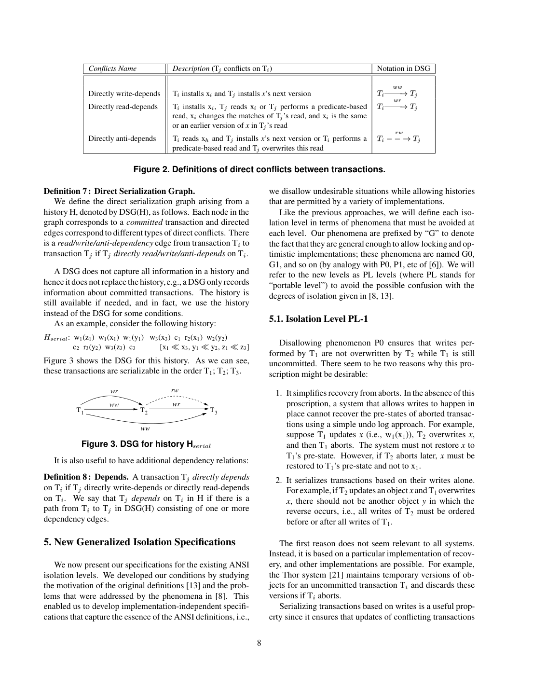
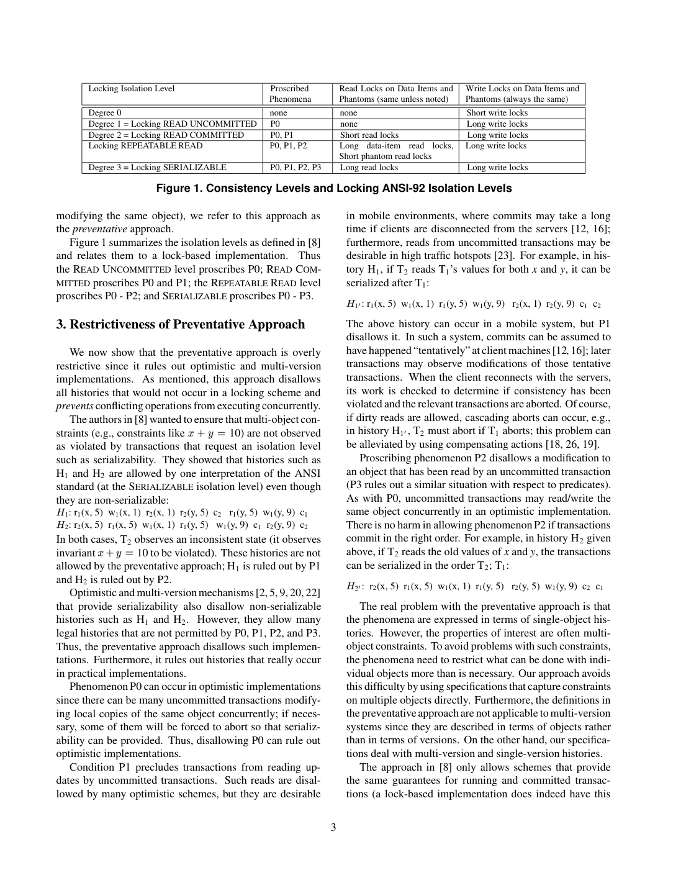

> 本组第 65 篇 · 事务与并发控制 · [全部论文]() · [上一篇]() · [下一篇]()

论文把隔离要求从“并发时不准发生哪些单对象操作”转向“已完成历史中哪些版本依赖与环不被允许”。历史包含事件偏序和每对象已提交版本的全序；DSG只含已提交事务。PL-1禁止纯ww环G0；PL-2禁止G1a中止读、G1b中间版本读及wr/ww依赖环G1c；PL-2.99再禁止含item-rw的环；PL-3禁止所有含rw的环，因而排除全部DSG环。

三个容易误读的边界尤其重要：PL-2可以暂时读未提交值，只要提交历史满足约束；谓词依赖不等同于“扫过所有行都冲突”；PL-3提供的是本文模型下冲突可串行化，不是自动给予运行中事务一致观察、外部副作用安全或真实时间顺序。混合级别要另建MSG，不能仅给每个事务贴标签后忽略跨级别义务。

本文保留论文陈述、读者推断与待验证方案的区别；实验数字只适用于原文条件。原文和翻译来自已有 AI 辅助精读报告，已做来源匹配与编辑复核，不等于人工逐项核验或独立实验复现。所有页码均为 PDF 物理页。

## 论文与阅读范围

Atul Adya、Barbara Liskov、Patrick O’Neil，Generalized Isolation Level Definitions，IEEE ICDE，San Diego，March 2000。本地12页，物理页=正文页。本文为隔离语义定义论文，不是实现性能基准；Snapshot Isolation、Cursor Stability与PL-2+的细节被转引至1999博士论文[1]，不可假装本篇已完整给出。

[论文集中的原始 PDF](https://github.com/lonng/db-papers/blob/4ff1331069c7cf52ac97dd769e5f484c1c35c200/papers/transaction/generalized-isolation-level-definitions.pdf) · 本地来源：`transaction/generalized-isolation-level-definitions.pdf`，共 12 页。

本篇保留 24 组原文精读和 24 条证据。截图为原始 PDF 的局部页选，不是重新生成的图表；未将整份 PDF 复制到博客。

## 研究问题与贡献

**从实现手段转向提交语义**
早期P0-P3现象按单对象操作交错来禁止情况，易把锁实现的行为当作隔离本身。例如两个未提交事务同时改本地副本可以由验证中止来解决，没必要在运行阶段一律禁止。本文希望给锁、乐观和多版本实现同一个可检查契约。

**多对象与谓词是核心**
问题不仅是重复读同一值：x+y约束、谓词匹配集合、插入和删除都会形成跨对象关系。只用单对象禁止模式可能过严或漏掉跨对象异常。论文选择历史加带标签图，描述允许提交的组合。

**贡献边界**
对PL-3，作者声明冲突可串行化的正确和完备；对弱级别没有声称已证明全部完备，只说明更宽松。它是语义定义论文，不是宣称某个新并发控制引擎更快。

依据：论文陈述；PDF 物理页 2, 3, 4, 5, 8, 10。证据：[IL-SRC-01](#evidence-il-src-01), [IL-SRC-02](#evidence-il-src-02), [IL-SRC-03](#evidence-il-src-03), [IL-SRC-06](#evidence-il-src-06), [IL-SRC-07](#evidence-il-src-07), [IL-SRC-13](#evidence-il-src-13), [IL-SRC-18](#evidence-il-src-18), [IL-SRC-19](#evidence-il-src-19)。

## 架构与模型

**历史有两层**
H包含事务内部顺序与read-from等约束组成的事件偏序，以及每对象已提交版本的总序。版本序不必等于写入顺序或提交顺序。事务反复改同一对象产生中间版本，最终修改才被安装为该事务已提交版本。

**对象生命期**
Tinit概念上产生所有unborn对象；插入产生可见版本，删除产生dead版本，删除后重插视为新对象。它是统一建模插删的技巧，不要求实现预创建未来行、永久物理保留全部版本或执行全表扫描。

**谓词版本集合**
Vset(P)为涉及关系的每个对象选择版本，包括不匹配及unborn/dead。谓词事件记录匹配集合观察，若读取返回行属性，再另加item read；COUNT也有predicate read，不一定有逐对象读值事件。谓词UPDATE建模为这种读再逐对象写。

**图不是历史替代品**
DSG只有已提交事务及wr/ww/rw边，G1a/G1b还需历史中中止状态及中间版本信息。MSG用于混合隔离，只保留对应级别相关及义务边。

依据：论文陈述；PDF 物理页 4, 5, 6, 7, 8, 11。证据：[IL-SRC-03](#evidence-il-src-03), [IL-SRC-04](#evidence-il-src-04), [IL-SRC-05](#evidence-il-src-05), [IL-SRC-06](#evidence-il-src-06), [IL-SRC-07](#evidence-il-src-07), [IL-SRC-08](#evidence-il-src-08), [IL-SRC-09](#evidence-il-src-09), [IL-SRC-12](#evidence-il-src-12), [IL-SRC-13](#evidence-il-src-13), [IL-SRC-22](#evidence-il-src-22)。

*原论文 PDF 物理页 8，版权归原作者或出版方。点击图片可查看原尺寸。页面文本中定位到：Figure 2. Definitions of direct conflicts between transactions.；Figure 3 shows the DSG for this history. As we can see,；Figure 3. DSG for history H。这是页面定位信息，不表示本次已复核图内所有数据。*

## 定义与判定算法

**三类边，方向不可倒置**
ww由前一安装版本的写者指向紧邻后继写者；item-wr由被读版本写者指向读者；item-rw由早版本读者指向安装紧邻后继的写者。谓词wr/rw则关注匹配集合改变，而非所有物理扫描冲突。谓词反依赖可关联后来改变成员的版本，并不限紧邻版本。

**最小的级别判定表**
PL-1：排除纯ww环G0。
PL-2：排除G1a中止读、G1b中间读和仅wr/ww构成的G1c环；G1c已包含G0。
PL-2.99：再排除任何含item-rw的环G2-item，仍可能允许仅靠predicate-rw闭合的环。
PL-3：再排除含任意rw的环G2，于是DSG全部环被排除。

**不要把定义误作在线实现算法**
图规则是判定契约。实现可以用锁、验证或多版本元数据避免坏历史，论文未要求生产系统提交时完整扫描全历史图。

**混合级别**
第11页的明确规则针对PL-1/2/3：保留全部ww，保留PL-2/3读者的入wr，保留PL-3读者的出rw。再要求MSG无环且对相应事务无G1a/b。本文未在此给出含PL-2.99的完整扩展规则，不应擅自补成作者定理。

依据：论文陈述；PDF 物理页 7, 8, 9, 10, 11。证据：[IL-SRC-10](#evidence-il-src-10), [IL-SRC-11](#evidence-il-src-11), [IL-SRC-12](#evidence-il-src-12), [IL-SRC-13](#evidence-il-src-13), [IL-SRC-14](#evidence-il-src-14), [IL-SRC-15](#evidence-il-src-15), [IL-SRC-16](#evidence-il-src-16), [IL-SRC-17](#evidence-il-src-17), [IL-SRC-18](#evidence-il-src-18), [IL-SRC-20](#evidence-il-src-20), [IL-SRC-21](#evidence-il-src-21), [IL-SRC-22](#evidence-il-src-22)。

## 正确性与保证边界

**约束生效时点**
本文只保证提交历史，允许运行中事务观察后来导致中止的状态。PL-2可读未提交的最终版本，但读者提交必须等写者成功；若写者中止，读者不能提交。PL-3也不是运行中每次观察都一致的opacity。

**最终不等于最新**
G1b排除读取另一事务对同一对象的中间修改；它不要求读数据库最新提交值。没有G1a/b的DSG仍可能有各种环；相反，一个没有环的DSG也可能遗漏一个中止写者导致的G1a。因此历史和图条件都必须检查。

**谓词相关性**
T1改变部门，T2只改电话，查询Sales成员的谓词依赖不能机械地指向最近写电话的T2；若返回电话属性，另加真正item-wr。定义2/3及其说明需结合版本序和成员变化阅读，不能只按物理索引触及页连边。

**可串行化与业务正确分开**
PL-3在模型内给冲突可串行化，不保证严格真实时间顺序，也不保证任意业务不变量。混合级别脚注明确：低级别事务若已不一致地写库，强级别读者不会自动修复。运行中发出的不可撤销外部动作也不在本文保证之内。

依据：论文陈述；PDF 物理页 4, 5, 6, 7, 8, 9, 10, 11。证据：[IL-SRC-03](#evidence-il-src-03), [IL-SRC-06](#evidence-il-src-06), [IL-SRC-08](#evidence-il-src-08), [IL-SRC-10](#evidence-il-src-10), [IL-SRC-11](#evidence-il-src-11), [IL-SRC-13](#evidence-il-src-13), [IL-SRC-15](#evidence-il-src-15), [IL-SRC-16](#evidence-il-src-16), [IL-SRC-17](#evidence-il-src-17), [IL-SRC-18](#evidence-il-src-18), [IL-SRC-19](#evidence-il-src-19), [IL-SRC-22](#evidence-il-src-22), [IL-SRC-23](#evidence-il-src-23)。

## 证据与例子

**没有性能评测章节**
这篇12页论文用历史、定义和图展示表达能力，没有硬件、吞吐、尾延迟、Abort率曲线或等负载基线。引言对乐观机制适合某些环境的描述来自引用，不是本文新测量。

**原例的证明角色**
H1/H2展示旧ANSI一种解释的不足；H1′/H2′展示预防式定义可能排除合法历史；Hwrite-order说明版本顺序的独立性；Hwcycle和Hphantom分别解释G0与谓词rw环。这些是反例和定义示范，不是系统运行追踪。

**本报告实际测试等级**
仅运行小型带标签图读者检查：纯ww环各级禁止；两条item-rw环可通过纯G1c图但不通过PL-2.99/3；predicate-rw加wr的环由PL-2.99允许而PL-3禁止。图例没有实现完整版本、谓词或数据库并发控制，不是验证了某品牌隔离级别。

依据：论文陈述；PDF 物理页 2, 3, 5, 8, 9, 10, 12。证据：[IL-SRC-01](#evidence-il-src-01), [IL-SRC-02](#evidence-il-src-02), [IL-SRC-06](#evidence-il-src-06), [IL-SRC-13](#evidence-il-src-13), [IL-SRC-14](#evidence-il-src-14), [IL-SRC-17](#evidence-il-src-17), [IL-SRC-18](#evidence-il-src-18), [IL-SRC-20](#evidence-il-src-20), [IL-SRC-21](#evidence-il-src-21), [IL-SRC-24](#evidence-il-src-24)。

*原论文 PDF 物理页 3，版权归原作者或出版方。点击图片可查看原尺寸。页面文本中定位到：Figure 1. Consistency Levels and Locking ANSI-92 Isolation Levels；Figure 1 summarizes the isolation levels as defined in \[8\]。这是页面定位信息，不表示本次已复核图内所有数据。*

## 设计权衡

**允许更多运行交错，承担更晚验证**
把约束放在提交历史使OCC/MVCC有更大空间，但可能发生中止、依赖等待或级联中止。定义不保证性能更优；高冲突负载可能把原来锁等待转成重复工作。

**精准谓词冲突与元数据复杂度**
按成员变化而非全部扫描建立依赖更宽松，也更难实现和观测。读者检测器若只知道返回行而不知道空范围和插删身份，可能漏掉幻象。

**弱级别与全局不变量**
PL-2排除某些信息环但容许rw参与的异常；PL-2.99对item较强却仍容许谓词相关环。应用不能只凭名称选择，需要列出具体业务约束、访问形态及允许的异常。

**混合模式不是高级别万能保护罩**
MSG把低级别事务的义务纳入分析，但不会阻止业务代码主动写错。隔离强度、约束检查、外部副作用及故障恢复是分开的契约。

依据：读者推断；PDF 物理页 3, 4, 5, 6, 7, 9, 10, 11。证据：[IL-SRC-02](#evidence-il-src-02), [IL-SRC-03](#evidence-il-src-03), [IL-SRC-07](#evidence-il-src-07), [IL-SRC-08](#evidence-il-src-08), [IL-SRC-10](#evidence-il-src-10), [IL-SRC-11](#evidence-il-src-11), [IL-SRC-15](#evidence-il-src-15), [IL-SRC-17](#evidence-il-src-17), [IL-SRC-20](#evidence-il-src-20), [IL-SRC-21](#evidence-il-src-21), [IL-SRC-22](#evidence-il-src-22), [IL-SRC-23](#evidence-il-src-23)。

## 比较与定位

**P现象与G现象**
前者在操作时点限制个体交错，本文后者在完成历史中限制版本依赖和环；因此G可容纳旧定义拒绝的一些多版本/乐观历史。不能把这理解为P系论文全部错误，本文是在更换所要刻画的实现无关契约。

**锁、OCC和MVCC**
它们是实现家族，不是与隔离级别一一对应的产品标签。锁实现可满足PL，乐观实现也可通过验证满足，但每个具体版本和配置都需单独证明或测试。

**DSG与MSG**
DSG保留所有已提交直接冲突；MSG按照级别相关性和高级别义务删边。只对各级事务分别看局部子图会漏掉跨级约束。

**不展开本文未给出的SI理论**
SI、Cursor Stability、PL-2+的完整定义在[1]。本报告没有读被引博士论文，不把记忆中的危险结构等现代解释冒充本篇原文，也不把任何当前数据库的同名Repeatable Read等同于PL-2.99。

依据：读者推断；PDF 物理页 2, 3, 4, 8, 10, 11, 12。证据：[IL-SRC-01](#evidence-il-src-01), [IL-SRC-02](#evidence-il-src-02), [IL-SRC-03](#evidence-il-src-03), [IL-SRC-13](#evidence-il-src-13), [IL-SRC-17](#evidence-il-src-17), [IL-SRC-19](#evidence-il-src-19), [IL-SRC-20](#evidence-il-src-20), [IL-SRC-22](#evidence-il-src-22), [IL-SRC-23](#evidence-il-src-23), [IL-SRC-24](#evidence-il-src-24)。

## 复现计划

**已完成**
实读12页文本，视觉核对第3、6、7、8、9、10、11页，包含全部图1-6、版本/谓词定义和混合级别脚注。运行纯Python有限图检查并保存输入边与输出；它按给定标签判环，不构造真实历史，不声称验证全部定理。

**完整检测器计划，未执行**
1. 输入事务结果、每对象版本总序、逐次写入及read-from；先检查历史完备、读自己最新写等模型约束。删除重插分配新身份，不拿SQL键值直接代替对象。
2. 从相邻版本生成ww和item-rw，从实际观察生成item-wr。谓词要记录Vset与成员变化；COUNT也保留谓词观察，不用物理扫描冲突代替语义冲突。
3. 先单独检查G1a/G1b，再按标签检查G0/G1c/G2-item/G2。保留触发环的最短证据链，不能只有一个布尔值。
4. 对照原Hwcycle、Hphantom及合法H1′/H2′，加入只变无关属性、空范围插入、重复写中间版本及删除重插。
5. 再扩展PL-1/2/3的MSG义务；强读遇到低级别已写错状态，应区分混合隔离条件通过与业务不变量失败。

这些不是已完成的数据库验证。要应用到当前实现，仍需固定源码commit、事务日志观测方式和配置，并检查原论文之外的运行中安全及真实时间需求。

依据：待验证的工程设想；PDF 物理页 4, 5, 6, 7, 8, 9, 10, 11。证据：[IL-SRC-03](#evidence-il-src-03), [IL-SRC-04](#evidence-il-src-04), [IL-SRC-05](#evidence-il-src-05), [IL-SRC-06](#evidence-il-src-06), [IL-SRC-07](#evidence-il-src-07), [IL-SRC-08](#evidence-il-src-08), [IL-SRC-09](#evidence-il-src-09), [IL-SRC-10](#evidence-il-src-10), [IL-SRC-11](#evidence-il-src-11), [IL-SRC-12](#evidence-il-src-12), [IL-SRC-13](#evidence-il-src-13), [IL-SRC-14](#evidence-il-src-14), [IL-SRC-15](#evidence-il-src-15), [IL-SRC-16](#evidence-il-src-16), [IL-SRC-17](#evidence-il-src-17), [IL-SRC-18](#evidence-il-src-18), [IL-SRC-20](#evidence-il-src-20), [IL-SRC-21](#evidence-il-src-21), [IL-SRC-22](#evidence-il-src-22), [IL-SRC-23](#evidence-il-src-23)。

## 结论

这篇论文的关键不是记住PL编号，而是学会完整描述：读到了哪个版本、版本序如何确定、哪些谓词成员发生变化、哪些事务最终提交。只有这些信息齐全，带标签依赖图才有语义。

PL-2的最终提交限制不等于运行时禁脏读；PL-2.99的item保证不等于消灭幻象；PL-3的冲突可串行化不等于真实时间或运行中无不一致。混合级别更不能省略低级别事务对高级别观察的义务。

本报告保留API记录并补充精确原页引文与读者例子。结构、引文及有限图检查通过，不代表已实现通用隔离检测器、证明所有弱级别完备性，或验证任何现行数据库产品。

依据：读者推断；PDF 物理页 2, 4, 5, 6, 7, 8, 9, 10, 11, 12。证据：[IL-SRC-01](#evidence-il-src-01), [IL-SRC-03](#evidence-il-src-03), [IL-SRC-06](#evidence-il-src-06), [IL-SRC-08](#evidence-il-src-08), [IL-SRC-11](#evidence-il-src-11), [IL-SRC-13](#evidence-il-src-13), [IL-SRC-15](#evidence-il-src-15), [IL-SRC-16](#evidence-il-src-16), [IL-SRC-17](#evidence-il-src-17), [IL-SRC-18](#evidence-il-src-18), [IL-SRC-19](#evidence-il-src-19), [IL-SRC-20](#evidence-il-src-20), [IL-SRC-21](#evidence-il-src-21), [IL-SRC-22](#evidence-il-src-22), [IL-SRC-23](#evidence-il-src-23), [IL-SRC-24](#evidence-il-src-24)。

## 原文精读：从句子回到机制

以下保留原文、忠实翻译、含义与边界；假设示例不作为论文实验结果。

原文中形如 `[U+0000]` 的标记表示 PDF 提取文本中的不可见控制字符，不是论文中的变量，也不是补写的公式；原始报告不变，字形需对照原 PDF。

### P001 · PDF 物理页 2

**原文**

<blockquote class="paper-source-quote"><pre><code>They&#10;are also complete (they allow all good histories) for&#10;serializability; in particular, they provide conflict-&#10;serializability [9]. It is difficult to prove completeness&#10;for lower isolation levels, but we can easily show that&#10;our definitions are more permissive than those given&#10;in [8].</code></pre></blockquote>

**忠实翻译**

> 对可串行化，定义正确且完备，具体为冲突可串行化；较低隔离级别的完备性难证明，只能容易展示比此前定义更宽松。

**技术含义与边界**

> 作者没有对每个弱级别都声称允许全部好历史并给完整证明。

**常见误读**

> 不能把serializable层次的完备性泛化至所有PL级别。

**读者构造的假设示例**

> 审查PL-2实现时分开问是否禁止规定坏历史，和是否接受所有可接受历史。

### P002 · PDF 物理页 3

**原文**

<blockquote class="paper-source-quote"><pre><code>Phenomenon P0 can occur in optimistic implementations&#10;since there can be many uncommitted transactions modify-&#10;ing local copies of the same object concurrently; if neces-&#10;sary, some of them will be forced to abort so that serializ-&#10;ability can be provided. Thus, disallowing P0 can rule out&#10;optimistic implementations.</code></pre></blockquote>

**忠实翻译**

> 乐观实现可让多个未提交事务同时修改同一对象的私有副本，再按需中止部分事务以保持可串行化。

**技术含义与边界**

> 临时操作并发与最终提交历史的序列化不是同一约束。

**常见误读**

> 不要说本文禁止所有未提交重叠写；那正是它批评的限制。

**读者构造的假设示例**

> 两个工作区都计算x新值不必立即阻塞，验证阶段可只允许一个提交。

### P003 · PDF 物理页 4

**原文**

<blockquote class="paper-source-quote"><pre><code>Our definitions allow different isolation guar-&#10;antees for committed and runningtransactions; in this paper,&#10;we only present guarantees for committed transactions.</code></pre></blockquote>

**忠实翻译**

> 定义允许运行中和已提交事务获得不同保证，本篇只呈现已提交事务的保证。

**技术含义与边界**

> 读到不一致后中止，可能不违反提交历史条件。

**常见误读**

> 不能由PL-3推出opacity，或允许运行中读取后产生不可撤销外部副作用。

**读者构造的假设示例**

> 事务中先发真实邮件再发现冲突中止，不会因可串行化定义自动撤回邮件。

### P004 · PDF 物理页 4

**原文**

<blockquote class="paper-source-quote"><pre><code>If an object x is deleted from the committed database&#10;state and inserted later, we consider the two incarnations of&#10;x to be distinct objects. When a transaction T&#10;i performs an&#10;insert operation, the system selects a unique object x that&#10;has never been selected for insertion before and T&#10;i creates a&#10;visible version of x if it commits.</code></pre></blockquote>

**忠实翻译**

> 对象删除后再插入，两个化身视为不同对象，插入选择从未插入的唯一对象。

**技术含义与边界**

> 身份是模型中的持久逻辑身份，不只SQL主键值。

**常见误读**

> 不能把相同主键删除重插强行作为同一对象版本链并复用dead状态。

**读者构造的假设示例**

> key=7的旧行死亡后，新key=7行在模型中分配另一个对象身份。

### P005 · PDF 物理页 4

**原文**

<blockquote class="paper-source-quote"><pre><code>We assume object versions exist forever in the committed&#10;state to simplify the handling of inserts and deletes, i.e., we&#10;simply treat inserts/deletes as write (update) operations. An&#10;implementation only needs to maintain visible versions of&#10;objects, and a single-version implementation can maintain&#10;just one visible version at a time.</code></pre></blockquote>

**忠实翻译**

> 为简化插删，概念上已提交版本永久存在；实现只需保存可见版本，单版本实现可一次只保留一个。

**技术含义与边界**

> 形式模型的版本历史不是强制物理存储所有历史。

**常见误读**

> 不能说为了满足PL定义必须无限保留所有版本或预分配所有将来行。

**读者构造的假设示例**

> 测试轨迹保留逻辑版本ID，与生产系统GC策略可独立。

### P006 · PDF 物理页 5

**原文**

<blockquote class="paper-source-quote"><pre><code>The version order in a history H can be different from&#10;the order of write or commit events in H. This flexibility is&#10;needed to allow certain optimistic and multi-version imple-&#10;mentations where it is possible that a version x&#10;i is placed&#10;before version x&#10;j in the version order (x&#10;i&#10;[U+001C] x&#10;j) even though&#10;x&#10;i is installed in the committed state after version x&#10;j was&#10;installed.</code></pre></blockquote>

**忠实翻译**

> 版本顺序可以不同于写入或提交事件顺序，允许后安装版本在版本序中更早。

**技术含义与边界**

> 分析图边必须使用给定version order，不能用时间戳或提交顺序偷换。

**常见误读**

> 排序事务ID、提交时间或读取日志位置不自动得到本文版本序。

**读者构造的假设示例**

> 原Hwrite-order给x2先于x1，即使c1早于c2；检测器应接受显式版本序输入。

### P007 · PDF 物理页 5

**原文**

<blockquote class="paper-source-quote"><pre><code>Since we select a version for all possible&#10;tuples in P’s relations, this set will be very large (it includes&#10;unborn and possibly dead versions of some tuples). For&#10;convenience, in our examples we will only show visible ver-&#10;sions in a version set; to better explain some examples, we&#10;will sometimes also show some unborn and dead versions.&#10;Our approach of observing some version of each tuple&#10;allows us to handle the phantom problem [14] in a simple&#10;manner. Of course, this does not constrain implementations&#10;to performthese observations; e.g., an implementationcould&#10;use an index.</code></pre></blockquote>

**忠实翻译**

> 为谓词关系的全部可能元组选版本，使集合包含unborn和dead；这只是概念模型。

**技术含义与边界**

> Vset区分谓词未匹配、尚未插入及已删除，以捕获幻象。

**常见误读**

> 不能要求执行器真实扫描未来所有元组，也不能说COUNT没有读依赖。

**读者构造的假设示例**

> 空集合查询也可被后来匹配插入覆盖，需产生predicate-rw。

### P008 · PDF 物理页 6

**原文**

<blockquote class="paper-source-quote"><pre><code>if T&#10;i had just determined the number of tuples&#10;matching the predicate (using SELECT COUNT), the event&#10;r&#10;i(x1) would not have been included.Thus, the history only&#10;shows reads of versions that were actually observed by T&#10;i.</code></pre></blockquote>

**忠实翻译**

> 若只用SELECT COUNT确定匹配数，不增加逐对象值读取事件；历史只显示实际观察的版本读取。

**技术含义与边界**

> 没有item read事件不意味着没有predicate read事件或幻象冲突。

**常见误读**

> 不能把投影列/聚合不返回行解释成不需要隔离保护。

**读者构造的假设示例**

> COUNT员工=2后另一事务插入第三名，改变的是成员集合，仍影响查询。

### P009 · PDF 物理页 6

**原文**

<blockquote class="paper-source-quote"><pre><code>A modification based on a predicate P is modeled as a&#10;predicate-based read followed by write operations on tuples&#10;that match P. (Although this approach is weaker than the one&#10;used in [1], it models the behaviorof commercialdatabases.)</code></pre></blockquote>

**忠实翻译**

> 谓词修改被建模为谓词读，再写匹配元组；作者注明弱于博士论文中的处理但符合商业数据库行为。

**技术含义与边界**

> 谓词更新不是单个不可分的抽象写，本文故意选了较弱模型。

**常见误读**

> 不要把每条UPDATE天然原子于所有其他谓词操作当作模型公理。

**读者构造的假设示例**

> 一个UPDATE可按其Vset只更新已匹配行，未匹配插入的约束须由隔离级别另定。

### P010 · PDF 物理页 7

**原文**

<blockquote class="paper-source-quote"><pre><code>even though T3’s version set contains x2, we add a predicate-&#10;read-dependency from T1 to T3 because T2’s update of x is&#10;irrelevant for T3’s read.</code></pre></blockquote>

**忠实翻译**

> 虽然T3版本集合含x2，仍从改变部门的T1向T3建立谓词读依赖，因为T2只改电话与本次谓词无关。

**技术含义与边界**

> 谓词成员关系相关性与读取该行全部属性不同。

**常见误读**

> 若查询实际返回并读了电话，还应另加item-wr，不能删去真正读依赖。

**读者构造的假设示例**

> 查询Sales人数与返回Sales员工电话对同次电话更新可能产生不同边。

### P011 · PDF 物理页 7

**原文**

<blockquote class="paper-source-quote"><pre><code>For item-anti-depends, the overwriting transaction must&#10;produce the very next version of the read object, while for&#10;predicate-anti-depends it simply produces a later version&#10;that changes the matched tuples of the predicate.</code></pre></blockquote>

**忠实翻译**

> item反依赖要求写出被读版本的紧邻后继；predicate反依赖只要求后来版本改变匹配集合。

**技术含义与边界**

> 两种rw边的版本邻接条件不同。

**常见误读**

> 不能用同一个“只连下一版本”规则处理全部谓词冲突。

**读者构造的假设示例**

> 读x0后版本x1只改电话、x2改部门，谓词覆盖应检查x2的成员变化。

### P012 · PDF 物理页 7

**原文**

<blockquote class="paper-source-quote"><pre><code>Note that there is no notion of predicate-write-dependssince&#10;predicate-based modifications are modeled as queries fol-&#10;lowed by writes on individual tuples.</code></pre></blockquote>

**忠实翻译**

> 没有predicate-write-depends，因为谓词修改已分解为查询及单元组写。

**技术含义与边界**

> ww约束来源于对象版本顺序，谓词相关性进入读与反依赖。

**常见误读**

> 不要自造第四类predicate-ww并宣称原文定义如此。

**读者构造的假设示例**

> UPDATE产生predicate read和每个目标对象write，再依规则连边。

### P013 · PDF 物理页 8

**原文**

<blockquote class="paper-source-quote"><pre><code>Each node in the&#10;graph corresponds to a committed transaction and directed&#10;edges correspondto different types of direct conflicts.</code></pre></blockquote>

**忠实翻译**

> DSG每个节点是一个已提交事务，边是不同直接冲突。

**技术含义与边界**

> 中止读和中间值等信息可能不在图里，需要保留原历史。

**常见误读**

> 只检测DSG无环不足以排除G1a/G1b。

**读者构造的假设示例**

> 写者中止、读者提交时，写者不在DSG里；必须另查read-from与事务结果。

### P014 · PDF 物理页 9

**原文**

<blockquote class="paper-source-quote"><pre><code>G0: Write Cycles. A history H exhibits phenomenon&#10;G0 if DSG(H) contains a directed cycle consisting&#10;entirely of write-dependency edges.</code></pre></blockquote>

**忠实翻译**

> 若DSG含完全由写依赖组成的有向环，则为G0。

**技术含义与边界**

> PL-1只要求已提交写可排序，不对读提供同等约束。

**常见误读**

> 没有ww环不代表读一致，也不代表所有谓词更新整体串行。

**读者构造的假设示例**

> x版本T1→T2而y版本T2→T1形成两条ww边，所有PL级别均不允许。

### P015 · PDF 物理页 9

**原文**

<blockquote class="paper-source-quote"><pre><code>Proscribing G1a ensures that if T2 reads from T1 and T1&#10;aborts, T2 must also abort; these aborts are also called cas-&#10;caded aborts [9]. In a real implementation, the condition&#10;also implies that if T2 reads from an uncommitted transac-&#10;tion T1, T2’s commit must be delayed until T1’s commit has&#10;succeeded [9, 14].</code></pre></blockquote>

**忠实翻译**

> 禁止G1a意味着若T2读T1且T1中止，则T2也必须中止；实现中T2的提交要等T1成功。

**技术含义与边界**

> 允许读未提交值与不允许提交脏依赖并不冲突。

**常见误读**

> 不要把PL-2翻译为运行时绝不能读未提交值。

**读者构造的假设示例**

> r2(x1)可先发生，但c2不得在仍可能a1时安全完成；最终a1则T2不能提交。

### P016 · PDF 物理页 9

**原文**

<blockquote class="paper-source-quote"><pre><code>Proscribing G1b ensures that transactions are allowed to&#10;commit only if they have read final versions of objects cre-&#10;ated by other transactions.</code></pre></blockquote>

**忠实翻译**

> 事务只有读取了其他事务最终版本才允许提交。

**技术含义与边界**

> 最终版本是该写者对同一对象最后一次修改，不是数据库全局最新值。

**常见误读**

> 不能把G1b误写为必须读最新已提交版本。

**读者构造的假设示例**

> T1先x=1再x=2，T2读第一次即便T1最终提交仍涉及中间读。

### P017 · PDF 物理页 10

**原文**

<blockquote class="paper-source-quote"><pre><code>that G1c includes G0.&#10;We could have defined a weaker&#10;version of G1c that only concerned cycles with at least one&#10;read-dependency edge, but it seemed simpler not to do this.</code></pre></blockquote>

**忠实翻译**

> G1c包含G0，作者为简洁没有只定义含至少一条wr的依赖环。

**技术含义与边界**

> dependency在此指wr和ww，不包含rw。

**常见误读**

> 把所有边都叫dependency后再解释G1c会误禁止PL-2允许的rw环。

**读者构造的假设示例**

> 两条rw边的write-skew读者图无G1c，但有G2；需按标签检测。

### P018 · PDF 物理页 10

**原文**

<blockquote class="paper-source-quote"><pre><code>We define PL-3 as an isolation level that proscribes G1 and&#10;G2. Thus, all cycles are precluded at this level.</code></pre></blockquote>

**忠实翻译**

> PL-3禁止G1和G2，因此该级别禁止全部环。

**技术含义与边界**

> 还要检查图外G1a/G1b，而不是只有一次拓扑排序。

**常见误读**

> 无环DSG不自动约束现实时间先后或运行中观察。

**读者构造的假设示例**

> 先验证read-from终态，再检测所有已提交节点的标签图是否无环。

### P019 · PDF 物理页 10

**原文**

<blockquote class="paper-source-quote"><pre><code>our specification for PL-3 provides conflict-&#10;serializability</code></pre></blockquote>

**忠实翻译**

> PL-3定义提供冲突可串行化。

**技术含义与边界**

> 原文刻意区分view serializability与conflict serializability，不应混写等价。

**常见误读**

> 本文未添加真实时间边，不能升级为strict serializability。

**读者构造的假设示例**

> 若需要先完成的外部事务必须排在后来事务之前，检测器还要另加外部顺序。

### P020 · PDF 物理页 10

**原文**

<blockquote class="paper-source-quote"><pre><code>We define level PL-2.99 as one that proscribes G1 and&#10;G2-item:</code></pre></blockquote>

**忠实翻译**

> PL-2.99禁止G1与G2-item。

**技术含义与边界**

> 这是比PL-3弱的边标签约束，不是简单删掉所有谓词边。

**常见误读**

> 有item-rw的混合环仍要禁；只有predicate-rw的环可能允许。

**读者构造的假设示例**

> T1→T2为predicate-rw、T2→T1为wr，可被PL-2.99允许而PL-3禁止。

### P021 · PDF 物理页 10

**原文**

<blockquote class="paper-source-quote"><pre><code>This his-&#10;tory is ruled out by PL-3 but permitted by PL-2.99 because&#10;the DSG contains a cycle only if predicate anti-dependency&#10;edges are considered.</code></pre></blockquote>

**忠实翻译**

> Hphantom在PL-3被排除，但PL-2.99允许，因为只有计入谓词反依赖才出现环。

**技术含义与边界**

> 员工集合和另存总额的组合可能不一致，即使已读普通对象不变。

**常见误读**

> 不能把repeatable read同名级别解释成消除所有幻象。

**读者构造的假设示例**

> 先数到两人20，另事务插人并改总额30，再读总额会暴露跨表示不一致。

### P022 · PDF 物理页 11

**原文**

<blockquote class="paper-source-quote"><pre><code>Since write-dependencies&#10;are relevant at all levels, we retain all such edges.&#10;For&#10;a PL-2 or PL-3 node T&#10;i, since reads are important, read-&#10;dependencies coming into T&#10;i are added. Similarly, we add&#10;all outgoing anti-dependency edges from PL-3 transactions&#10;to other nodes.</code></pre></blockquote>

**忠实翻译**

> MSG保留所有ww；对PL-2/PL-3节点保留入wr；保留PL-3节点到其他节点的出rw。

**技术含义与边界**

> 边是否相关由读者/被覆盖读事务的级别决定，不是只看写者。

**常见误读**

> 不能把低级别事务从图里全删掉；它可能承担对高级别事务的义务。

**读者构造的假设示例**

> PL-3读者到PL-1写者的rw仍需保留，否则可误放过混合级别环。

### P023 · PDF 物理页 11

**原文**

<blockquote class="paper-source-quote"><pre><code>this does not imply that a PL-3 transaction observes&#10;a consistent state since lower level transactions may have modified the&#10;database inconsistently; if we want a PL-3 transaction to observe a consis-&#10;tent state, lower level transactions must update the database consistently&#10;even if they observe an inconsistent state.</code></pre></blockquote>

**忠实翻译**

> 这不保证PL-3观察一致业务状态；若低级别事务可能不一致地更新数据库，强级别读者仍会见到其结果。

**技术含义与边界**

> 隔离保证不创造业务不变量。

**常见误读**

> 不能承诺一个serializable只读事务自动修复低级别已提交的损坏状态。

**读者构造的假设示例**

> 低级别事务把总账写成错误值并提交，后续强读可一致地读到这个错误。

### P024 · PDF 物理页 12

**原文**

<blockquote class="paper-source-quote"><pre><code>the&#10;details can be found in [1]. PL-2+ is the the weakest level&#10;that guarantees consistent reads and causal consistency; it is&#10;useful in client-server systems [3, 1] and broadcast environ-&#10;ments [25].</code></pre></blockquote>

**忠实翻译**

> SI、Cursor Stability及PL-2+细节见博士论文[1]，后者用于一致读与因果一致。

**技术含义与边界**

> 这篇12页论文只说明框架可扩展，没有给这些级别全部规则。

**常见误读**

> 不得把外部记忆中的SI边模式伪装成本篇定理。

**读者构造的假设示例**

> 在报告中列为下一步阅读，不据此给当前数据库品牌贴PL标签。

## 尚未解决的问题

1. 如何从真实执行中得到本文要求的版本序、read-from、对象身份和谓词Vset，而不把物理扫描误当语义冲突？
2. 第6-7页定义3与“latest relevant change”的解释，应怎样在多次谓词成员变化的历史中精确落实？本报告未把描述性的简化直接扩成实现。
3. 本文对较弱PL级别未给完整完备性证明，还存在哪些允许历史与实现选择的空间？
4. 混合PL-1/2/3的MSG规则如何在增量检测器中保持跨级别义务？含PL-2.99的扩展规则需另查来源。
5. 若应用要求运行中事务不可观察矛盾，或要求真实时间顺序，需在本篇提交历史条件外增加什么？
6. SI、Cursor Stability与PL-2+细节转引[1]；在读完该来源之前不能补成这篇论文已证明的内容。

## 证据索引

证据编号沿用原报告，便于将上文判断追溯到原句。引文匹配只验证位置，不证明解读正确。

**IL-SRC-01 · PDF 物理页 2**

作者没有对每个弱级别都声称允许全部好历史并给完整证明。

<blockquote class="paper-source-quote"><pre><code>They&#10;are also complete (they allow all good histories) for&#10;serializability; in particular, they provide conflict-&#10;serializability [9]. It is difficult to prove completeness&#10;for lower isolation levels, but we can easily show that&#10;our definitions are more permissive than those given&#10;in [8].</code></pre></blockquote>

**IL-SRC-02 · PDF 物理页 3**

临时操作并发与最终提交历史的序列化不是同一约束。

<blockquote class="paper-source-quote"><pre><code>Phenomenon P0 can occur in optimistic implementations&#10;since there can be many uncommitted transactions modify-&#10;ing local copies of the same object concurrently; if neces-&#10;sary, some of them will be forced to abort so that serializ-&#10;ability can be provided. Thus, disallowing P0 can rule out&#10;optimistic implementations.</code></pre></blockquote>

**IL-SRC-03 · PDF 物理页 4**

读到不一致后中止，可能不违反提交历史条件。

<blockquote class="paper-source-quote"><pre><code>Our definitions allow different isolation guar-&#10;antees for committed and runningtransactions; in this paper,&#10;we only present guarantees for committed transactions.</code></pre></blockquote>

**IL-SRC-04 · PDF 物理页 4**

身份是模型中的持久逻辑身份，不只SQL主键值。

<blockquote class="paper-source-quote"><pre><code>If an object x is deleted from the committed database&#10;state and inserted later, we consider the two incarnations of&#10;x to be distinct objects. When a transaction T&#10;i performs an&#10;insert operation, the system selects a unique object x that&#10;has never been selected for insertion before and T&#10;i creates a&#10;visible version of x if it commits.</code></pre></blockquote>

**IL-SRC-05 · PDF 物理页 4**

形式模型的版本历史不是强制物理存储所有历史。

<blockquote class="paper-source-quote"><pre><code>We assume object versions exist forever in the committed&#10;state to simplify the handling of inserts and deletes, i.e., we&#10;simply treat inserts/deletes as write (update) operations. An&#10;implementation only needs to maintain visible versions of&#10;objects, and a single-version implementation can maintain&#10;just one visible version at a time.</code></pre></blockquote>

**IL-SRC-06 · PDF 物理页 5**

分析图边必须使用给定version order，不能用时间戳或提交顺序偷换。

<blockquote class="paper-source-quote"><pre><code>The version order in a history H can be different from&#10;the order of write or commit events in H. This flexibility is&#10;needed to allow certain optimistic and multi-version imple-&#10;mentations where it is possible that a version x&#10;i is placed&#10;before version x&#10;j in the version order (x&#10;i&#10;[U+001C] x&#10;j) even though&#10;x&#10;i is installed in the committed state after version x&#10;j was&#10;installed.</code></pre></blockquote>

**IL-SRC-07 · PDF 物理页 5**

Vset区分谓词未匹配、尚未插入及已删除，以捕获幻象。

<blockquote class="paper-source-quote"><pre><code>Since we select a version for all possible&#10;tuples in P’s relations, this set will be very large (it includes&#10;unborn and possibly dead versions of some tuples). For&#10;convenience, in our examples we will only show visible ver-&#10;sions in a version set; to better explain some examples, we&#10;will sometimes also show some unborn and dead versions.&#10;Our approach of observing some version of each tuple&#10;allows us to handle the phantom problem [14] in a simple&#10;manner. Of course, this does not constrain implementations&#10;to performthese observations; e.g., an implementationcould&#10;use an index.</code></pre></blockquote>

**IL-SRC-08 · PDF 物理页 6**

没有item read事件不意味着没有predicate read事件或幻象冲突。

<blockquote class="paper-source-quote"><pre><code>if T&#10;i had just determined the number of tuples&#10;matching the predicate (using SELECT COUNT), the event&#10;r&#10;i(x1) would not have been included.Thus, the history only&#10;shows reads of versions that were actually observed by T&#10;i.</code></pre></blockquote>

**IL-SRC-09 · PDF 物理页 6**

谓词更新不是单个不可分的抽象写，本文故意选了较弱模型。

<blockquote class="paper-source-quote"><pre><code>A modification based on a predicate P is modeled as a&#10;predicate-based read followed by write operations on tuples&#10;that match P. (Although this approach is weaker than the one&#10;used in [1], it models the behaviorof commercialdatabases.)</code></pre></blockquote>

**IL-SRC-10 · PDF 物理页 7**

谓词成员关系相关性与读取该行全部属性不同。

<blockquote class="paper-source-quote"><pre><code>even though T3’s version set contains x2, we add a predicate-&#10;read-dependency from T1 to T3 because T2’s update of x is&#10;irrelevant for T3’s read.</code></pre></blockquote>

**IL-SRC-11 · PDF 物理页 7**

两种rw边的版本邻接条件不同。

<blockquote class="paper-source-quote"><pre><code>For item-anti-depends, the overwriting transaction must&#10;produce the very next version of the read object, while for&#10;predicate-anti-depends it simply produces a later version&#10;that changes the matched tuples of the predicate.</code></pre></blockquote>

**IL-SRC-12 · PDF 物理页 7**

ww约束来源于对象版本顺序，谓词相关性进入读与反依赖。

<blockquote class="paper-source-quote"><pre><code>Note that there is no notion of predicate-write-dependssince&#10;predicate-based modifications are modeled as queries fol-&#10;lowed by writes on individual tuples.</code></pre></blockquote>

**IL-SRC-13 · PDF 物理页 8**

中止读和中间值等信息可能不在图里，需要保留原历史。

<blockquote class="paper-source-quote"><pre><code>Each node in the&#10;graph corresponds to a committed transaction and directed&#10;edges correspondto different types of direct conflicts.</code></pre></blockquote>

**IL-SRC-14 · PDF 物理页 9**

PL-1只要求已提交写可排序，不对读提供同等约束。

<blockquote class="paper-source-quote"><pre><code>G0: Write Cycles. A history H exhibits phenomenon&#10;G0 if DSG(H) contains a directed cycle consisting&#10;entirely of write-dependency edges.</code></pre></blockquote>

**IL-SRC-15 · PDF 物理页 9**

允许读未提交值与不允许提交脏依赖并不冲突。

<blockquote class="paper-source-quote"><pre><code>Proscribing G1a ensures that if T2 reads from T1 and T1&#10;aborts, T2 must also abort; these aborts are also called cas-&#10;caded aborts [9]. In a real implementation, the condition&#10;also implies that if T2 reads from an uncommitted transac-&#10;tion T1, T2’s commit must be delayed until T1’s commit has&#10;succeeded [9, 14].</code></pre></blockquote>

**IL-SRC-16 · PDF 物理页 9**

最终版本是该写者对同一对象最后一次修改，不是数据库全局最新值。

<blockquote class="paper-source-quote"><pre><code>Proscribing G1b ensures that transactions are allowed to&#10;commit only if they have read final versions of objects cre-&#10;ated by other transactions.</code></pre></blockquote>

**IL-SRC-17 · PDF 物理页 10**

dependency在此指wr和ww，不包含rw。

<blockquote class="paper-source-quote"><pre><code>that G1c includes G0.&#10;We could have defined a weaker&#10;version of G1c that only concerned cycles with at least one&#10;read-dependency edge, but it seemed simpler not to do this.</code></pre></blockquote>

**IL-SRC-18 · PDF 物理页 10**

还要检查图外G1a/G1b，而不是只有一次拓扑排序。

<blockquote class="paper-source-quote"><pre><code>We define PL-3 as an isolation level that proscribes G1 and&#10;G2. Thus, all cycles are precluded at this level.</code></pre></blockquote>

**IL-SRC-19 · PDF 物理页 10**

原文刻意区分view serializability与conflict serializability，不应混写等价。

<blockquote class="paper-source-quote"><pre><code>our specification for PL-3 provides conflict-&#10;serializability</code></pre></blockquote>

**IL-SRC-20 · PDF 物理页 10**

这是比PL-3弱的边标签约束，不是简单删掉所有谓词边。

<blockquote class="paper-source-quote"><pre><code>We define level PL-2.99 as one that proscribes G1 and&#10;G2-item:</code></pre></blockquote>

**IL-SRC-21 · PDF 物理页 10**

员工集合和另存总额的组合可能不一致，即使已读普通对象不变。

<blockquote class="paper-source-quote"><pre><code>This his-&#10;tory is ruled out by PL-3 but permitted by PL-2.99 because&#10;the DSG contains a cycle only if predicate anti-dependency&#10;edges are considered.</code></pre></blockquote>

**IL-SRC-22 · PDF 物理页 11**

边是否相关由读者/被覆盖读事务的级别决定，不是只看写者。

<blockquote class="paper-source-quote"><pre><code>Since write-dependencies&#10;are relevant at all levels, we retain all such edges.&#10;For&#10;a PL-2 or PL-3 node T&#10;i, since reads are important, read-&#10;dependencies coming into T&#10;i are added. Similarly, we add&#10;all outgoing anti-dependency edges from PL-3 transactions&#10;to other nodes.</code></pre></blockquote>

**IL-SRC-23 · PDF 物理页 11**

隔离保证不创造业务不变量。

<blockquote class="paper-source-quote"><pre><code>this does not imply that a PL-3 transaction observes&#10;a consistent state since lower level transactions may have modified the&#10;database inconsistently; if we want a PL-3 transaction to observe a consis-&#10;tent state, lower level transactions must update the database consistently&#10;even if they observe an inconsistent state.</code></pre></blockquote>

**IL-SRC-24 · PDF 物理页 12**

这篇12页论文只说明框架可扩展，没有给这些级别全部规则。

<blockquote class="paper-source-quote"><pre><code>the&#10;details can be found in [1]. PL-2+ is the the weakest level&#10;that guarantees consistent reads and causal consistency; it is&#10;useful in client-server systems [3, 1] and broadcast environ-&#10;ments [25].</code></pre></blockquote>

## 版本与使用边界

- 原 PDF SHA256：`5ac2c466bea65e87d41be38d18c3b49ea52f18e410badf2bc12c9bfce5a926fd`。
- 报告来源：`codex-current-session`；此处按已完成报告整理，没有重新请求模型。
- OCR 记录页：[]；低文本页：[]。
- 本次新增页面截图，未据此自动重写原报告的数值、公式或实验结论；原有“未进行图像识别”限制仍适用于分析生成过程。
- 截图与短引仅服务于论文评论，版权归原作者或出版方；正式发布前复查转载范围和授权。
- 本文保留未核实的书目信息及研究问题，不用现代产品行为替代历史论文的证据。

前序报告保留的书目与阅读过程记录

Atul Adya、Barbara Liskov、Patrick O’Neil，Generalized Isolation Level Definitions，IEEE ICDE，San Diego，March 2000。本地12页，物理页=正文页。本文为隔离语义定义论文，不是实现性能基准；Snapshot Isolation、Cursor Stability与PL-2+的细节被转引至1999博士论文[1]，不可假装本篇已完整给出。

本报告由当前Codex会话离线撰写，不是API生成的成功报告：原API阶段因ResearchError未产生最终报告，失败调用和原始分块笔记未修改。实读本地PDF物理1-12页全部文本，视觉核对3、6、7、8、9、10、11页；24段精读引文逐字截取。有限标签图读者测试已运行，但未实现完整版本/谓词检测器、原数据库或生产基准；没有读取凭证、调用API或写共享清单。当前Codex用量不可获得，usage为null，不把失败API调用用量算成当前报告生成用量。这是AI来源复核稿，仍需人工研究复核。

