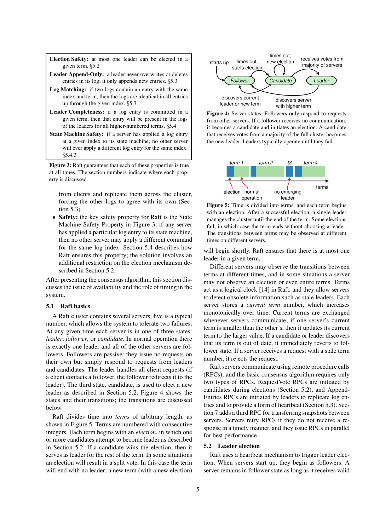
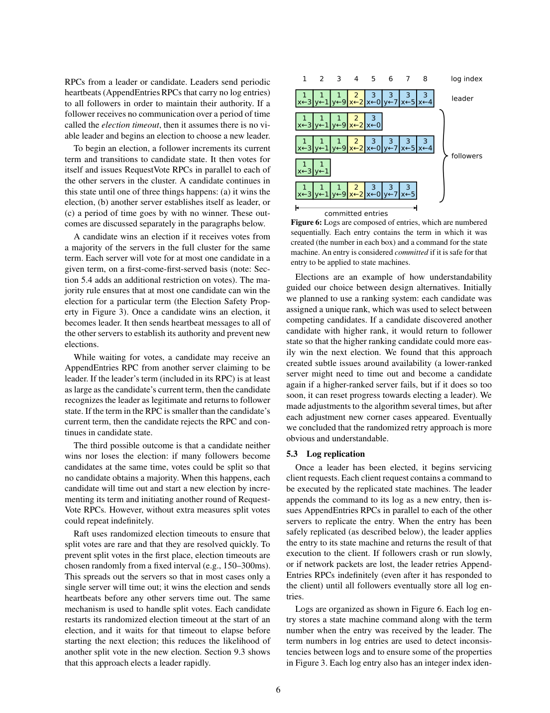

> 本组第 33 篇 · 共识协议 · [全部论文]() · [上一篇]() · [下一篇]()

Raft 以可理解性为设计目标，将复制日志分解为选主、复制和安全约束，并讨论联合配置、快照与客户端交互。安全性的关键不是仅有多数副本，而是持久化任期与投票、日志匹配、选举新旧限制和本任期提交规则的组合：只有本任期条目可按多数副本直接判定提交，旧任期前缀可随之间接提交。核心日志安全性不依赖时序，但稳定选主及进展依赖通信、持久化和故障间隔；只读 lease 还会额外依赖有界时钟偏移。本文实际展示了学生理解测验及领导者故障后的选主停顿实验，没有给出 Raft/Paxos 吞吐基准对比。第 5 节安全证明的报告范围也不能扩大到全部扩展协议或实现。此次 Codex 已完整阅读 18 页并查看 14 页原图；以下严格区分原文事实、读者推断与尚未执行的复现建议，保留 API 来源、引文和调用记录。

本文保留论文陈述、读者推断与待验证方案的区别；实验数字只适用于原文条件。原文和翻译来自已有 AI 辅助精读报告，已做来源匹配与编辑复核，不等于人工逐项核验或独立实验复现。所有页码均为 PDF 物理页。

## 论文与阅读范围

Diego Ongaro and John Ousterhout. In Search of an Understandable Consensus Algorithm (Extended Version). Stanford University, May 20, 2014. 来源为本地 18 页扩展技术报告；物理页与印刷页均为 1-18。第 1 页说明这是 ATC'14 论文 [32] 的扩展版，灰色边栏标识增补材料；[31] 的 2014 年学位论文在本版本中标为 work in progress。本次仅阅读这份 PDF，不把学位论文、后续版本、当前实现或参考文献指向的材料视作已核验来源。

[论文集中的原始 PDF](https://github.com/lonng/db-papers/blob/4ff1331069c7cf52ac97dd769e5f484c1c35c200/papers/consensus/in-search-of-an-understandable-consensus-algorithm-%28extended-version%29.pdf) · 本地来源：`consensus/in-search-of-an-understandable-consensus-algorithm-(extended-version).pdf`，共 18 页。

本篇保留 10 组原文精读和 58 条证据。截图为原始 PDF 的局部页选，不是重新生成的图表；未将整份 PDF 复制到博客。

## 研究问题与适用边界

【原文事实】论文针对确定性复制状态机：各节点按同一日志顺序应用相同命令，从而产生相同状态与输出。Raft 解决的是复制日志的一致性，不单独定义任意数据库事务、外部副作用或分布式锁的完整语义。作者选择可理解性作为核心目标，以问题分解和状态空间约束帮助开发者理解为何协议正确；对 Paxos 单决议分解与工程描述的批评应归于本文作者的观点，而非本文证明的普遍优劣定理。

故障模型是非拜占庭的崩溃/恢复，允许消息延迟、分区、丢失、重复和乱序，恢复依赖稳定存储。日志安全性与可用性必须分开：即使网络异常也不能应用相同索引的不同命令，但不能由“存活节点过半”推出完全异步环境中必定及时完成操作。多数节点及客户端须能有效通信，且需要足够稳定的领导者；第 5.6 节进一步给出时序条件。

broadcastTime << electionTimeout << MTBF 描述稳定选主及进展的工程条件，不是日志安全性的时钟假设或完整活性定理。broadcastTime 包含并行 RPC 往返及通常需要的持久化开销，MTBF 指单节点平均故障间隔。150-300ms 是文中例子和实验条件下的保守建议，不是所有部署的固定参数。

【边界说明】本报告不据此判定哪些现代数据库控制面或数据面适合 Raft，也不把本文扩展为拜占庭协议、任意分区下的可用读写保证或事务协调器规范。应用选型需要额外来源和实现验证。

依据：论文陈述；PDF 物理页 1, 2, 3, 10。证据：[C001N08](#evidence-c001n08), [RAFT-SRC01](#evidence-raft-src01), [RAFT-SRC02](#evidence-raft-src02), [RAFT-SRC08](#evidence-raft-src08)。

## 架构、状态与协议边界

【原文事实】Raft 先选举领导者，再由它组织日志追加与复制。日志从 leader 流向 follower；新 leader 从当选时起便应包含此前已提交条目，而不是选后再从 follower 补齐缺失的已提交日志。服务器角色为 follower、candidate、leader。任期是单调递增的逻辑编号，并非同步墙钟；不同节点可以在不同时间获知任期变化。每任期至多选出一个领导者，不等于分区时不会同时存在不同任期、自认为仍是 leader 的节点。

图 2 按恢复职责划分状态：
1. 所有节点持久化 currentTerm、votedFor、log[]，更新须在相关 RPC 响应前进入稳定存储。
2. 所有节点的 commitIndex 与 lastApplied 在基本算法中列为易失状态，分别表示已知提交边界和已应用边界，两者不可混同。
3. 新 leader 初始化各 follower 的 nextIndex 为自身日志末尾后一项，matchIndex 为 0；它们分别表示下次发送位置和已知复制位置。

核心共识使用 RequestVote 与 AppendEntries 两类 RPC；第 7 节增加 InstallSnapshot。两类基本 RPC 不是关于消息种类的通用理论下界；图 2 也明确不包含成员变更和日志压缩。把它单独当成包含客户端、配置、快照和持久状态机的完整产品实现会遗漏约束。

一般规则是遇到更高任期便更新任期并退回 follower，拒绝过期请求；第 6 节还为被移除节点的选举干扰增加了特定 RequestVote 忽略窗口，须在对应成员变更语境中理解，不能只摘录图 2 而删掉该扩展。

依据：论文陈述；PDF 物理页 3, 4, 5, 12。证据：[C001N06](#evidence-c001n06), [C001N12](#evidence-c001n12), [C002N02](#evidence-c002n02), [C002N03](#evidence-c002n03), [RAFT-SRC03](#evidence-raft-src03), [RAFT-SRC12](#evidence-raft-src12)。

*原论文 PDF 物理页 5，版权归原作者或出版方。点击图片可查看原尺寸。页面文本中定位到：Figure 3: Raft guarantees that each of these properties is true；Figure 4: Server states. Followers only respond to requests；Figure 5: Time is divided into terms, and each term begins。这是页面定位信息，不表示本次已复核图内所有数据。*

## 核心算法与边界推演

【原文事实：选举】follower 超时后增加任期、自投一票、重置计时器并发送 RequestVote。同一任期每节点至多投给一个候选者，候选者获得全集群多数票才当选。投票还要求候选日志至少与本地一样新：先比较最后条目的任期，仅当任期相同才比较最后索引。不是“日志最长者总能当选”。候选者收到不低于自身任期的 leader AppendEntries 时退回 follower。每轮重新随机化超时，降低反复分票概率；它不承诺固定期限内选主成功。作者放弃了排名退让方案，这是设计经历而非所有排名选举不可能正确的证明。

【原文事实：复制与跟随者提交边界】leader 追加命令并发 AppendEntries。跟随者依次检查任期、prevLogIndex/prevLogTerm，只有新条目与本地同索引不同任期发生冲突时才删除该项及后缀，再追加尚不存在的新条目。空心跳也不能跳过一致性检查，更不能无条件截断长日志。若 leaderCommit 更大，图 2 要求 commitIndex=min(leaderCommit, index of last new entry)，不是直接赋为 leaderCommit；理解时要保留该已证匹配范围的界限。复制、持久化、提交、应用和响应客户端是不同事件，状态机按索引顺序应用。

【原文事实：本任期直接提交与旧前缀间接提交】leader 仅当 N>commitIndex、多数节点 matchIndex>=N 且 log[N].term==currentTerm，才按副本计数推进到 N；这会同时提交此前的日志前缀，包括旧任期条目。绝不是“旧任期条目永远不能提交”。图 8(c) 中任期 2 的 index 2 已有多数副本，却仍可在分支 (d) 被另一条目覆盖；分支 (e) 在多数上复制本任期条目后才把前缀锁定。

【原文事实：日志修复】leader 用 nextIndex 回退寻找匹配前缀，再修复 follower。第 7-8 页已提出可选加速：拒绝时返回冲突任期及该任期最早索引，按任期跳过，减少逐条重试；这不是本文实测的性能收益。读者对基础算法的复杂度推断：在稳定日志、通信成功且每次仅后退一项的简化条件下，查找跨度为 D 时会有 O(D) 次拒绝重试；这不是存在任意丢包时的耗时上界，也不等于整个修复总 RPC 数。

【原文事实：联合配置】直接从 Cold 切到 Cnew 可形成两组互不相交多数。先写入 Cold,new，并按“旧配置多数且新配置多数”提交，再创建 Cnew 并按新多数提交；不是并集多数或任选一组多数。节点在把最新配置条目写入本地日志时就采用它，即使尚未提交。新节点先以 non-voting 身份追赶；若 leader 不在 Cnew，在 Cnew 提交后才退位，期间不把自己计入新多数。近期听到当前 leader 后、最小选举超时窗口内忽略 RequestVote，不更新 term 或投票，以缓解被移除节点的干扰。能继续服务请求不等于在任意故障组合下零停顿。

【原文事实：快照】各节点独立为已提交且已应用的状态生成快照，保留 lastIncludedIndex、lastIncludedTerm 和该索引处最新配置。快照写完后才可丢弃覆盖前缀和旧快照。leader 对落后到缺失日志已被压缩的 follower 发送分块 InstallSnapshot；边界 index/term 与本地日志匹配则保留后续有效条目，否则丢弃现有日志并用快照恢复状态及配置。不是每次安装快照都删除全部后缀，也不是 follower 可以独立决定新的命令。

【原文事实：客户端与只读】命令唯一序号及每客户端最近序号/响应用于抑制重试重复执行；核心日志复制本身不自动提供端到端恰好一次。无日志只读还需两项防护：新 leader 在本任期先提交 no-op，以获知提交边界；响应读请求前再与多数交换心跳，确认未被新 leader 取代。仅当选、仅拥有完整日志或仅提交一次 no-op 都不足以排除陈旧读。读者实现检查：还应确认供读取的状态机已应用相应已知提交状态，这一应用屏障不能冒充本文给出的完整只读伪码。

【读者构造的假设示例】三节点中 leader 日志任期序列为 [1,1,2]，follower 为 [1,1,1]。RPC 的 prevLogIndex=2、prevLogTerm=1 先验证公共前缀，再携带 index 3/term 2 的条目触发 follower 的冲突删除。若当前 leader 任期为 2 且该条目已复制到包括自己在内的两节点，可直接提交 index 3，并间接提交前缀。此例不是作者实验，也不覆盖跨任期旧条目已在多数但尚不可直接提交的图 8 反例。

依据：论文陈述；PDF 物理页 4, 6, 7, 8, 9, 10, 11, 12, 13。证据：[C001N10](#evidence-c001n10), [C001N11](#evidence-c001n11), [C001N13](#evidence-c001n13), [C002N04](#evidence-c002n04), [C002N06](#evidence-c002n06), [C002N11](#evidence-c002n11), [RAFT-SRC04](#evidence-raft-src04), [RAFT-SRC05](#evidence-raft-src05), [RAFT-SRC06](#evidence-raft-src06), [RAFT-SRC09](#evidence-raft-src09), [RAFT-SRC10](#evidence-raft-src10), [RAFT-SRC11](#evidence-raft-src11), [RAFT-SRC12](#evidence-raft-src12), [RAFT-SRC13](#evidence-raft-src13), [RAFT-SRC14](#evidence-raft-src14)。

## 正确性论证及证明范围

【原文事实】图 3 列出 Election Safety、Leader Append-Only、Log Matching、Leader Completeness 和 State Machine Safety。安全结论建立在非拜占庭模型、正确持久化、日志匹配、任期/投票和提交规则共同成立的基础上。不能仅以“两个多数必有交集”替代完整论证。

第 5.4.3 节提供 Leader Completeness 的反证草图：取最小的未来任期 U，其 leader 缺少任期 T 已直接提交的条目。提交多数与选举多数有交集投票者；该节点必须先接受 T 的条目再投 U，否则会拒绝旧任期 RPC。依最小 U 假设和日志只在冲突时被替换，它投票时仍有该条目。若 U 的最后条目任期与投票者相同，则日志新旧和长度限制结合 Log Matching 得出 U 也有该条目；若 U 的最后任期更高，则产生该条目的更早 leader 应已含 T 的条目，再由 Log Matching 得出同样矛盾。最后扩展到间接提交前缀，并以按序应用导出 State Machine Safety。

这是一份正文证明草图，不是对整个产品的完整机器证明。第 9.2 节报告的是第 5 节共识机制的约 400 行 TLA+ 规范：某完整性性质的机械证明仍依赖未被机械检查的不变量，类型安全未证；State Machine Safety 的约 3500 字证明被描述为非形式化且依赖该规范。成员变更、快照、客户端重试、只读优化、实现代码或一般活性不能一并称为已获机器验证。本次未打开论文引用的外部证明文件。

客户端请求去重是第 8 节额外机制：提交后响应前崩溃可能导致客户端重试，状态机按每客户端序号/响应避免再次执行。论文的简述不完整规定任意并发、乱序请求、会话回收、外部副作用或去重元数据持久化，不能扩展为任意系统端到端恰好一次保证。只读多数心跳方案与依赖有界时钟偏移的可选 lease 方案也不能混为一个无时钟前提的安全定理。

【源文措辞问题】第 9 页第 9 步将间接提交例子指为 Figure 8(d)，但图中 (d) 是覆盖反例，安全分支是 (e)；原文第 9/14 页出现 Log Completeness，而图 3 命名为 Leader Completeness。本报告指出不一致，保留原始引用文字，不据误指认定 (d) 已提交。

依据：论文陈述；PDF 物理页 4, 5, 8, 9, 10, 13, 14, 15。证据：[C002N01](#evidence-c002n01), [C003N03](#evidence-c003n03), [C003N04](#evidence-c003n04), [C003N05](#evidence-c003n05), [C004N10](#evidence-c004n10), [RAFT-SRC06](#evidence-raft-src06), [RAFT-SRC07](#evidence-raft-src07), [RAFT-SRC13](#evidence-raft-src13), [RAFT-SRC14](#evidence-raft-src14), [RAFT-SRC15](#evidence-raft-src15), [RAFT-SRC16](#evidence-raft-src16), [RAFT-SRC22](#evidence-raft-src22)。

## 实际评估、条件与证据缺口

【原文事实：实现与学生测验】作者报告 RAMCloud 配置状态机中的 Raft 约 2000 行 C++，不含测试、注释和空行；这不是性能实验数据。本次已直接阅读第 13-15 页并查看图 14-16/表 1，不再把它们称为“截断 OCR，缺少第 9.3 节”。

理解研究包含 Stanford/Berkeley 的 43 名高年级本科生及研究生。每人学习两算法并答两份测验，约半数交换顺序；15 人有 Paxos 经验，Paxos 视频长 14%。同讲师、配对难度问题、评分量表与随机评分顺序是偏差缓解措施，不是消除所有偏差。满分 60，Raft 均值 25.7、Paxos 20.8，实际差 4.9，33/43 对 Raft 得分更高；作者报告配对 t 检验的 95% 结论为均值差至少 2.5 分。回归预测的 12.5 分不是测得均值差。图 15 两项实现/讲解问卷各有 33/41 偏向 Raft，是主观报告，作者承认可能受到研究假设影响。测验成绩不是主观问卷，也不证明工程师实现质量或生产故障率。

【原文事实：选主停顿实验】第 9.3 节及图 16 实测领导者崩溃后的检测与重新选主时间，不是只有可理解性实验。五节点，broadcast time 约 15ms；日志长度不同以使部分候选者无资格，杀进程前同步广播心跳以促分票。心跳间隔为最小选举超时的一半，崩溃时刻在该间隔内均匀随机，故最小可能停顿约为最小超时的一半。每条曲线 1000 次，唯固定 150-150ms 为 100 次；九节点仅称相似，未展示完整数据。上图横轴为对数，下图为线性，纵轴均为累计百分比。

不同配置不可混算：无随机化时测试中选主持续超过 10 秒；150-155ms 的 5ms 随机宽度对应中位停顿 287ms；50ms 随机宽度的 1000 次观测最大完成时间 513ms。12-24ms 超时对应平均 35ms、最长 152ms，不是 150-300ms 的结果。作者指出继续降低超时会导致不必要的选举并伤害可用性，建议保守选取。样本最大值不是协议最坏上界或 SLA，均值也不是中位数，不能脱离此硬件/通信与注入方式直接迁移参数。

【分析、建议与未提供证据】稳态本任期条目一轮多数 RPC 是消息路径分析；batching/pipelining 和其他优化的可用性讨论不是吞吐实测。本文没有同环境对 Paxos、VR、ZAB、EPaxos 的吞吐/P99/WAN 基准，没有给出完整硬件、存储与实验复现配置。本次也未复现实验或运行外部代码。证明状态应按上一节的范围报告，不作为另一份已执行 benchmark。

依据：论文陈述；PDF 物理页 13, 14, 15。证据：[C004N07](#evidence-c004n07), [C004N08](#evidence-c004n08), [C004N10](#evidence-c004n10), [RAFT-SRC16](#evidence-raft-src16), [RAFT-SRC17](#evidence-raft-src17), [RAFT-SRC18](#evidence-raft-src18), [RAFT-SRC19](#evidence-raft-src19), [RAFT-SRC20](#evidence-raft-src20), [RAFT-SRC21](#evidence-raft-src21)。

*原论文 PDF 物理页 6，版权归原作者或出版方。点击图片可查看原尺寸。页面文本中定位到：Figure 6: Logs are composed of entries, which are numbered。这是页面定位信息，不表示本次已复核图内所有数据。*

## 设计权衡与失败条件

【原文事实】强 leader 与日志单向流动降低机制复杂度，但也限制一些无 leader 的优化；第 10 节对 EPaxos 可交换命令和 WAN 情形的讨论是相关工作分析，非本论文实测。随机超时替代排名规则是可理解性取舍，不是无条件快速收敛证明。发生持久化变慢或心跳延迟时，多数节点仍存活也可能频繁换主；调参不能只看网络均值而忽视稳定存储。

日志修复的基本逐索引回退与已提出的冲突任期跳跃，是简洁与重试次数的取舍。不能再声称全文未提及跳跃优化，也不宜把所有重试成本都写成不一致条目数的严格 O(N) 上界。

本地快照利用各节点已有已提交状态，避免只由 leader 生成再逐个传输的带宽和并行协调成本。本文同时讨论日志固定字节阈值：过频浪费带宽，过稀增加空间及恢复回放成本；这不是严格最优策略。作者实现使用 fork/COW 接受新更新与生成快照并行；LSM 可用同样快照接口的说法不是该压缩方案的性能实验。

联合配置避免旧新配置独立决策的危险，但过渡需同时满足两组多数；新成员先追赶、被移除 leader 的提交后退位及抑制被移除节点干扰都属于必要工程细节。协议允许持续处理正常请求，不代表所有配置和故障场景均不失去可用性。

不落日志的只读路径需要本任期 no-op 和响应前的多数心跳；不能称为仅凭本地状态“免费读取”。lease 可减少通信，但增加有界时钟偏移的安全假设，不能称为只影响活性。任何方案都仍有非拜占庭、存储与协议正确执行等前提，不使用“绝对安全性”描述。

依据：论文陈述；PDF 物理页 6, 7, 8, 10, 11, 12, 13, 15, 16。证据：[C002N06](#evidence-c002n06), [C004N01](#evidence-c004n01), [C004N02](#evidence-c004n02), [RAFT-SRC05](#evidence-raft-src05), [RAFT-SRC08](#evidence-raft-src08), [RAFT-SRC09](#evidence-raft-src09), [RAFT-SRC11](#evidence-raft-src11), [RAFT-SRC12](#evidence-raft-src12), [RAFT-SRC14](#evidence-raft-src14), [RAFT-SRC15](#evidence-raft-src15), [RAFT-SRC21](#evidence-raft-src21)。

## 相关工作与待验证的数据库联系

【论文中的比较】作者将 Raft 的强 leader、选举内嵌和日志单向流动与 Paxos、VR、ZooKeeper 的描述作比较。消息类型“Raft 4、VR/ZooKeeper 各 10”的计数明确排除压缩及客户端交互；基本共识“两种 RPC”与“两请求加两响应四消息类型”是不同计数口径，不能互相当作复杂度下界。作者也指出强 leader 排除某些 EPaxos 式优化。这些是本文在 2014 年的分析，不是对当前实现源码的审计或同环境实测排名。

【来源边界】第 17-18 页参考文献列出既有 Paxos 高性能存储、Paxos 工程经验和复制状态机教程，不能据书目声称本报告已读这些文献或复现其性能。与学位论文 [31]、会议论文 [32] 的关系按本报告书目信息说明，不把多个版本的结果混合。

【读者推断及待验证问题】把 Raft 日志接到数据库状态机时，需要检查持久化、应用索引、请求去重与快照的一致恢复；这由本文机制启发，但本文不提供任意数据库 WAL 融合或事务恢复规范。多个 Raft group 的调度、存算分离快照、全局事务和查询计划协调亦须另查系统源码，不能由一个复制日志算法推出实现事实。本报告不列未查证的现代产品架构断言，也不把 leader 模式自动等同于数据库并发控制或分布式事务协议。

依据：读者推断；PDF 物理页 1, 2, 3, 13, 15, 16, 17, 18。证据：[C001N06](#evidence-c001n06), [C001N08](#evidence-c001n08), [C005N01](#evidence-c005n01), [C005N02](#evidence-c005n02), [C005N06](#evidence-c005n06), [RAFT-SRC01](#evidence-raft-src01), [RAFT-SRC21](#evidence-raft-src21)。

## 可执行的复现设计与验收标准

【读者提出，均未执行】以下是根据论文设计的测试计划，不是论文已完成实验，也不是本次报告审核已运行的代码或故障注入。应先实现基本算法，再分别验证扩展模块；图 2 本身不覆盖所有扩展。

1. 持久化/重启：在任期更新、投票、日志写入以及响应之间设置崩溃点；确认恢复后同任期不重复投票、已确认的持久条目不回退。具体存储接口需按设备及实现验证，不能把 O_DIRECT 等同于持久化保证。
2. 日志与提交：复现图 8(c)/(d)/(e)，断言旧条目即使多数复制也不能直接按计数提交，当前任期条目提交后前缀才间接提交。对 follower 验证 leaderCommit 边界、不匹配心跳拒绝、重复 RPC 幂等及无冲突时不任意删后缀。
3. 故障与时序：先测含持久化的 broadcast time，再扫选举区间及随机宽度；复制第 15 页五节点、不同日志长度、同步末次心跳、随机崩溃时刻与试验次数。分别报告均值/中位数/分位数/样本最大值，记录无 leader 时间、无谓换主及误触发。不要直接给所有 LAN/WAN 设 10-50ms，也不要宣称测到最大值即严格上界。
4. 修复机制：在相同稳定分歧上比较逐项 nextIndex 与文中已提出的冲突任期跳跃，另测通信丢失；分别统计拒绝次数、传输条目与总耗时，检查 Log Matching。不把自行加入的二分查找说成论文方案。
5. 配置：检查两组多数、配置进入本地日志即生效、联合配置先提交再创建最终配置；覆盖新节点追赶、非新配置 leader 退位边界和移除节点 RequestVote 干扰。成功标准不是任意故障下无停顿，而是安全不被破坏且满足前提后能恢复进展。
6. 快照：保存已应用边界的 index/term/configuration，完成写入再回收前缀；分别测试匹配边界保留后缀、不匹配丢弃日志、分块重复/中断和落后恢复。检查新更新与 COW 快照的状态一致性。
7. 客户端：在提交后响应前杀 leader，观察同一序号不重复执行；明确会话串行性、并发/乱序和去重状态持久化的实现约定。隔离旧 leader 后读请求必须先确认领导权；新 leader 未提交本任期条目时不能跳过 no-op 防护。另做状态机应用屏障检查，并把这是实现验收补充与原文伪码区分。lease 若实现，独立列时钟假设与故障模型。

验收记录应同时包括不变量断言、输入条件、未覆盖分支和可复现配置。本次未做这些复现，不因所有引文匹配便声称协议实现已被验证。

依据：待验证的工程设想；PDF 物理页 4, 8, 9, 10, 11, 12, 13, 15。证据：[C001N12](#evidence-c001n12), [RAFT-SRC04](#evidence-raft-src04), [RAFT-SRC05](#evidence-raft-src05), [RAFT-SRC06](#evidence-raft-src06), [RAFT-SRC08](#evidence-raft-src08), [RAFT-SRC09](#evidence-raft-src09), [RAFT-SRC10](#evidence-raft-src10), [RAFT-SRC11](#evidence-raft-src11), [RAFT-SRC12](#evidence-raft-src12), [RAFT-SRC13](#evidence-raft-src13), [RAFT-SRC14](#evidence-raft-src14), [RAFT-SRC19](#evidence-raft-src19), [RAFT-SRC20](#evidence-raft-src20)。

## 结论与未决边界

【基于全文的归纳】Raft 的贡献在于把复制日志机制及其安全直觉组织得清楚，并以特定学生测验和选主实验支持部分设计目标。不能把作者关于与 Paxos 效率相当的概述改写成所有环境中的性能等价证明，更不能从易理解推出更少生产故障。

需要记住的技术边界是：当前任期条目按多数直接提交、旧前缀间接提交；leaderCommit 传播还受 follower 已验证范围约束；多数和随机化不消除时序对活性的影响；联合配置要求两组多数而非并集多数；快照保存已提交且已应用状态、边界任期及配置；不落日志的只读需要 no-op 与多数心跳，lease 另加时钟安全假设；证明声明仅按第 5 节及第 9.2 节的限定范围解释。

【读者判断】这些约束可作为数据库复制状态机接入时的检查清单，但不替代应用层事务、持久恢复、去重与读状态一致性的设计。本文没有给 WAL 融合、跨组事务或后续产品优化的结论，相关问题保留为未决。原始 API 模型、用量与审查意见继续保留；本次只是基于同一份原文的 AI 编辑复核，不冒充独立人工审查、机器证明或实验复现。

依据：读者推断；PDF 物理页 1, 4, 8, 9, 10, 11, 12, 13, 14, 15, 16, 18。证据：[RAFT-SRC01](#evidence-raft-src01), [RAFT-SRC04](#evidence-raft-src04), [RAFT-SRC06](#evidence-raft-src06), [RAFT-SRC08](#evidence-raft-src08), [RAFT-SRC09](#evidence-raft-src09), [RAFT-SRC11](#evidence-raft-src11), [RAFT-SRC14](#evidence-raft-src14), [RAFT-SRC16](#evidence-raft-src16), [RAFT-SRC17](#evidence-raft-src17), [RAFT-SRC20](#evidence-raft-src20), [RAFT-SRC21](#evidence-raft-src21)。

## 原文精读：从句子回到机制

以下保留原文、忠实翻译、含义与边界；假设示例不作为论文实验结果。

### P001 · PDF 物理页 1

**原文**

<blockquote class="paper-source-quote"><pre><code>state space reduction (relative to Paxos, Raft reduces the&#10;degree of nondeterminism and the ways servers can be in-&#10;consistent with each other). A user study with 43 students&#10;at two universities shows that Raft is significantly easier&#10;to understand than Paxos: after learning both algorithms,&#10;33 of these students were able to answer questions about&#10;Raft better than questions about Paxos.</code></pre></blockquote>

**忠实翻译**

> 状态空间缩减（相对于 Paxos，Raft 降低了非确定性的程度以及服务器之间可能不一致的方式）。一项在两所大学对 43 名学生进行的用户研究表明，Raft 比 Paxos 明显更容易理解：在学习了两种算法之后，这些学生中有 33 人能够比回答关于 Paxos 的问题更好地回答关于 Raft 的问题。

**技术含义与边界**

> 原文陈述了 Raft 相比 Paxos 在状态空间上的缩减效果，即减少了非确定性分支和服务器间不一致的可能路径。同时报告了一项包含 43 名学生的用户研究结果，作为 Raft 更易理解的实证支持。适用边界为该特定实验的受试群体与测试条件。

**常见误读**

> 不要将33/43测验表现外推为所有工程师或所有实现都必然更好。测验得分是该材料下的观测成绩，不应称为主观自评；主观实现/讲解问卷另在第14页，样本为41人，且不是系统正确性或吞吐优势的证据。

**读者构造的假设示例**

> 读者构造的假设示例：假设有 5 名数据库内核方向的研究生参加类似测验，其中 4 人在学习 Raft 后能更准确地描述日志复制流程，但这仅代表这 5 人的情况，不能推导出 Raft 在所有人群中都比 Paxos 易懂。

### P002 · PDF 物理页 18

**原文**

<blockquote class="paper-source-quote"><pre><code>K. The design&#10;and implementation of a log-structured file system. ACM&#10;Trans. Comput. Syst. 10 (February 1992), 26–52.&#10;[37] SCHNEIDER, F. B. Implementing fault-tolerant services&#10;using the state machine approach: a tutorial. ACM Com-&#10;puting Surveys 22, 4 (Dec. 1990), 299–319.&#10;[38] SHVACHKO,&#10;K.,&#10;KUANG,&#10;H.,&#10;RADIA,&#10;S.,&#10;AND&#10;CHANSLER, R.&#10;The Hadoop distributed file system.</code></pre></blockquote>

**忠实翻译**

> K.《日志结构文件系统的设计与实现》。ACM Transactions on Computer Systems 10（1992年2月），26-52页。
> [37] SCHNEIDER, F. B.《使用状态机方法实现容错服务：教程》。ACM Computing Surveys 22(4)（1990年12月），299-319页。
> [38] SHVACHKO, K., KUANG, H., RADIA, S., CHANSLER, R.《Hadoop分布式文件系统》。

**技术含义与边界**

> 这是保留的原始参考文献片段，开头截断了前一条的作者信息，末尾也不含[38]完整出版信息。它只给书目，不能拿来替代Raft机制或性能证据；本次没有打开所列外部论文。

**常见误读**

> 容易误认为引用某篇论文即代表本文采用了该论文的全部机制或结论。参考文献列表仅表明相关工作背景，不构成对引用内容的技术背书或实现细节说明。

**读者构造的假设示例**

> 读者构造的假设示例：若某研究者看到引用 [37] Schneider 的状态机教程，可能会假设本文的复制状态机实现完全遵循该教程的所有约束，但原文此处仅为书目罗列，未作此声明。

### P003 · PDF 物理页 9

**原文**

<blockquote class="paper-source-quote"><pre><code>2. leaderT replicated the entry on a majority of the clus-&#10;ter, and leaderU received votes from a majority of&#10;the cluster. Thus, at least one server (“the voter”)&#10;both accepted the entry from leaderT and voted for&#10;leaderU, as shown in Figure 9. The voter is key to&#10;reaching a contradiction.&#10;3.</code></pre></blockquote>

**忠实翻译**

> 2. leaderT 在集群的多数节点上复制了该条目，并且 leaderU 收到了来自集群多数节点的选票。因此，至少有一个服务器（“投票者”）既接受了来自 leaderT 的条目又投票给了 leaderU，如图 9 所示。该投票者是得出矛盾的关键。
> 3.

**技术含义与边界**

> 两个固定配置多数相交，得到既存过任期T条目又投过U票的节点；这里只是Leader Completeness反证的一步。全文还用最小违反任期、持久化/任期约束、日志匹配和选举新旧限制证明矛盾，交集自身并不保证所有未来leader安全。

**常见误读**

> 不能省略leaderT在本任期提交条目的上下文，也不能将图8(c)旧任期条目已有多数副本当作同一证明前提。投票时日志新旧及此前leader都保留条目的条件才使交集有证明作用。原片段末尾的“3.”仅为下一步骤编号，不补写成原引文。

**读者构造的假设示例**

> 读者构造的假设示例：在一个 5 节点集群中，leaderT 将条目复制到节点 A、B、C（多数派），leaderU 从节点 C、D、E 获得选票（多数派），则节点 C 必然是那个既接受条目又投票的“投票者”。这是读者基于原文逻辑构造的具体数字示例。

### P004 · PDF 物理页 5

**原文**

<blockquote class="paper-source-quote"><pre><code>Election Safety: at most one leader can be elected in a&#10;given term. §5.2&#10;Leader Append-Only: a leader never overwrites or deletes&#10;entries in its log; it only appends new entries. §5.3&#10;Log Matching: if</code></pre></blockquote>

**忠实翻译**

> 选举安全（Election Safety）：在一个给定的任期（term）内最多只能选出一个领导者。§5.2
> 领导者只追加（Leader Append-Only）：领导者永远不会覆盖或删除其日志中的条目；它只追加新条目。§5.3
> 日志匹配（Log Matching）：如果

**技术含义与边界**

> 这里完整列出Election Safety与基本日志复制中的Leader Append-Only，Log Matching仅保留开头。Election Safety是每个任期最多选出一个leader，不排除分区中有不同任期的节点各自误以为是leader。完整Log Matching定义已在正文依据第5/7页补充，不改这段原始截断引文。

**常见误读**

> Leader Append-Only不能解释为所有角色和压缩阶段永不删除物理日志：follower可删除冲突后缀，第7节可压缩已提交前缀。核心安全性也不是仅靠leader不删除自己日志便成立。

**读者构造的假设示例**

> 读者构造的假设示例：任期3中A已获得多数票，则同任期B不能再获得合法多数；隔离的任期2旧leader尚未获知新任期时仍可能自认为有权服务，但不能绕过提交或只读校验。A在基本追加过程中不改写已有条目。

### P005 · PDF 物理页 13

**原文**

<blockquote class="paper-source-quote"><pre><code>Raft handles this by having the leader exchange heart-&#10;beat messages with a majority of the cluster before re-&#10;sponding to read-only requests. Alternatively, the leader&#10;could rely on the heartbeat mechanism to provide a form&#10;of lease [9], but this would rely on timing for safety (it&#10;assumes bounded clock skew).&#10;9&#10;Implementation and evaluation&#10;We have implemented Raft as part of a replicated&#10;state machine that stores configuration information for&#10;RAMCloud [33] and assists in failover of the RAMCloud&#10;coordinator.</code></pre></blockquote>

**忠实翻译**

> Raft 通过让领导者在响应只读请求之前与集群的多数节点交换心跳消息来处理这个问题。或者，领导者可以依赖心跳机制来提供某种形式的租约（lease）[9]，但这将依赖时间来保证安全性（它假设有界的时钟偏移）。
> 9 实现与评估
> 我们已将 Raft 实现为一个复制状态机的一部分，该状态机存储 RAMCloud [33] 的配置信息并协助 RAMCloud 协调器的故障转移。

**技术含义与边界**

> 片段讲响应只读前与多数交换心跳，及有界时钟偏移的可选lease。第13页前文还有另一项必要防护：新leader需先提交本任期no-op，以获知提交前缀。两个条件共同使用，不能仅把心跳当作任意新leader读的充分条件。随后是RAMCloud配置状态机用途，不是吞吐对比。

**常见误读**

> lease是添加时间安全假设的替代，不是无条件更快或已实测最优。多数心跳方案的核心安全性不靠同步物理时钟，但活性仍依赖时序；实现还需保证读用的状态已应用相应提交内容，该应用屏障是本报告工程检查补充，非此段完整伪码。

**读者构造的假设示例**

> 读者构造的假设示例：三节点中新leader已完成本任期no-op提交，并确认相应状态可读。它响应只读前联系另外两节点，收到其中一个同任期有效回复，连同自己形成多数以确认未被取代。若尚未完成前述no-op，不能只因一次心跳成功就返回任意本地状态。

### P006 · PDF 物理页 6

**原文**

<blockquote class="paper-source-quote"><pre><code>If a candidate discovered another&#10;candidate with higher rank, it would return to follower&#10;state so that the higher ranking candidate could more eas-&#10;ily win the next election. We found that this approach&#10;created subtle issues around availability (a lower-ranked&#10;server might need to time out and become a candidate&#10;again if a higher-ranked server fails, but if it does so too&#10;soon, it can reset progress towards electing a leader).</code></pre></blockquote>

**忠实翻译**

> 如果一个候选者发现另一个具有更高排名的候选者，它将返回跟随者状态，以便排名更高的候选者能更容易地赢得下一次选举。我们发现这种方法在可用性方面产生了微妙的问题（如果排名较高的服务器发生故障，排名较低的服务器可能需要超时并再次成为候选者，但如果它过早这样做，可能会重置选举领导者的进度）。

**技术含义与边界**

> 原文描述了一种曾被考虑但最终被放弃的设计选择：基于排名（rank）的选举退让机制。作者指出该机制会导致可用性问题，因为低排名节点在高排名节点故障后重新发起选举的时机难以把握——过早重试会干扰其他节点的选举进度。这是作者陈述的设计权衡过程。

**常见误读**

> 这是作者放弃的一个设计，不是最终Raft的排名规则；也不能由这段推出任何排名选举都不可能正确。该尝试的问题被作者归于可用性边界，不能改写为已证明安全性必然失败。

**读者构造的假设示例**

> 读者构造的假设示例：假设节点 A 排名高于节点 B。A 和 B 同时成为候选者，B 发现 A 排名更高于是退回 follower。若此时 A 宕机，B 需要等待超时才能再次竞选；如果 B 设置的超时时间极短并立即竞选，而此时其他节点正在处理 A 失败后的状态转换，B 的频繁竞选可能会打乱集群收敛过程。

### P007 · PDF 物理页 11

**原文**

<blockquote class="paper-source-quote"><pre><code>A new leader will eventually be&#10;elected, but the removed servers will time out again and&#10;the process will repeat, resulting in poor availability.&#10;To prevent this problem, servers disregard RequestVote&#10;RPCs when they believe a current leader exists. Specif-&#10;ically, if a server receives a RequestVote RPC within&#10;the minimum election timeout of hearing from a cur-&#10;rent leader, it does not update its term or grant its vote.</code></pre></blockquote>

**忠实翻译**

> 新领导者最终会被选出，但被移除服务器会再次超时，重复过程将使可用性变差。为防止这一问题，当服务器认为存在当前领导者时会忽略RequestVote RPC。具体地，自听到当前领导者消息起尚未经过最小选举超时这段时间内收到RequestVote时，它不更新任期，也不投票。

**技术含义与边界**

> 原文解释了集群成员变更时可能出现的一种活性（liveness）问题：被移除的服务器因不再接收心跳而不断超时发起选举，干扰新领导者产生。解决方案是引入“最小选举超时”保护期：在此期间内收到投票请求不予理睬。这是作者陈述的防御机制。

**常见误读**

> 该保护只针对最近听到当前leader后的窗口，不是永久屏蔽或无条件忽略任意更高任期消息。越过窗口也只是恢复正常RequestVote检查，仍须满足任期、每任期投票和日志新旧限制。开头的最终选主措辞须结合第5.6节的可用性前提。

**读者构造的假设示例**

> 读者构造的假设示例：最小选举超时为150ms，X在t=0收到当前leader消息；t=50ms收到移除节点RequestVote时按该扩展规则不更新term、不投票。如果此后未再收到leader消息，t=160ms处理投票请求恢复一般检查，但不会自动授予选票。

### P008 · PDF 物理页 2

**原文**

<blockquote class="paper-source-quote"><pre><code>We hypothesize that Paxos’ opaqueness derives from&#10;its choice of the single-decree subset as its foundation.&#10;Single-decree Paxos is dense and subtle: it is divided into&#10;two stages that do not have simple intuitive explanations&#10;and cannot be understood independently. Because of this,&#10;it is difficult to develop intuitions about why the single-&#10;decree protocol works. The composition rules for multi-&#10;Paxos add significant additional complexity and subtlety.</code></pre></blockquote>

**忠实翻译**

> 我们假设 Paxos 的不透明性源于其选择单决议子集（single-decree subset）作为基础。单决议 Paxos 密集且微妙：它被分为两个阶段，这两个阶段没有简单直观的解释，也不能独立理解。因此，很难建立关于单决议协议为何有效的直觉。Multi-Paxos 的组合规则增加了显著的额外复杂性和微妙性。

**技术含义与边界**

> 原文陈述了作者对 Paxos 难以理解这一现象的归因分析（hypothesis）。作者认为根本原因在于 Paxos 以 single-decree 为基础，而该基础本身分为不可独立理解的两个阶段，缺乏直观解释；再加上 Multi-Paxos 组合规则的复杂性，进一步加剧了理解难度。这是作者的主观推断与分析。

**常见误读**

> 容易将作者的“假设（hypothesize）”当作已被严格证明的客观事实。原文使用的是推测性语气，表达的是作者团队对 Paxos 教学困难的归因观点，而非形式化验证的结论。不应以此段否定 Paxos 在工程实践中的有效性。

**读者构造的假设示例**

> 读者构造的假设示例：学生只看Prepare而未学习Accept，可能难以理解作者认为两阶段相互依赖的理由。是否一定学不会并不是此段证明的结论；这里只展示作者的教学归因观点。

### P009 · PDF 物理页 14

**原文**

<blockquote class="paper-source-quote"><pre><code>As summarized in Table 1, we&#10;have taken steps to mitigate potential sources of bias. All&#10;of our materials are available for review [28, 31].&#10;On average, participants scored 4.9 points higher on the&#10;Raft quiz than on the Paxos quiz (out of a possible 60&#10;points, the mean Raft score was 25.7 and the mean Paxos&#10;score was 20.8); Figure 14 shows their individual scores.</code></pre></blockquote>

**忠实翻译**

> 如表 1 所总结，我们已采取措施减轻潜在的偏差来源。我们所有的材料均可供审查 [28, 31]。
> 平均而言，参与者在 Raft 测验中的得分比 Paxos 测验高 4.9 分（满分 60 分，Raft 平均分为 25.7，Paxos 平均分为 20.8）；图 14 显示了他们的个人得分。

**技术含义与边界**

> 原文报告了用户研究的具体量化结果：Raft 平均分 25.7，Paxos 平均分 20.8，差值 4.9 分。作者声明已采取减轻偏差的措施并公开了材料。适用边界为该次特定测验的评分体系与受试者群体。

**常见误读**

> 4.9是60分制的实测均值差，不是4.9%或回归预测12.5分。低于满分一半并不能单独证明题目难度、算法易学程度或教学质量；偏差缓解也不等于所有偏差消失。33/43测验结果与各33/41的主观问卷必须分开。

**读者构造的假设示例**

> 读者构造的假设示例：假设另一组资深分布式系统研究员参加同样的 60 分测验，可能 Raft 平均得 55 分、Paxos 得 50 分，差值仍为 5 分左右，但绝对分数远高于学生群体。这说明原文的 25.7/20.8 仅反映特定受试群体的表现。

### P010 · PDF 物理页 17

**原文**

<blockquote class="paper-source-quote"><pre><code>Diego Ongaro&#10;is supported by The Junglee Corporation Stanford Gradu-&#10;ate Fellowship.&#10;References&#10;[1] BOLOSKY, W. J., BRADSHAW, D., HAAGENS, R. B.,&#10;KUSTERS, N. P., AND LI, P.&#10;Paxos replicated state&#10;machines as the basis of a high-performance data store.&#10;In Proc. NSDI’11, USENIX Conference on Networked&#10;Systems Design and Implementation (2011), USENIX,&#10;pp. 141–154.&#10;[2] BURROWS, M.</code></pre></blockquote>

**忠实翻译**

> Diego Ongaro 受到 The Junglee Corporation Stanford Graduate Fellowship 的资助。
> 参考文献
> [1] BOLOSKY, W. J., BRADSHAW, D., HAAGENS, R. B., KUSTERS, N. P., AND LI, P. Paxos replicated state machines as the basis of a high-performance data store. In Proc. NSDI'11, USENIX Conference on Networked Systems Design and Implementation (2011), USENIX, pp. 141–154.
> [2] BURROWS, M.

**技术含义与边界**

> 此段包含致谢信息（奖学金资助）以及参考文献列表的开头部分，列出了关于 Paxos 复制状态机用于高性能数据存储的会议论文。原文仅为元数据和书目信息，不包含技术论述。页码为 PDF 物理页码 17。

**常见误读**

> 容易将参考文献 [1] 的标题内容（Paxos 用于高性能数据存储）误认为是本文的实验结论或主张。参考文献仅表示引用关系，不代表本文复现或验证了该文献的性能数据。

**读者构造的假设示例**

> 读者构造的假设示例：若某读者看到引用 [1] 提到“high-performance data store”，可能会假设本文的 Raft 实现也达到了同等性能水平，但原文此处仅为列出参考书目，未做任何性能对比声明。

## 尚未解决的问题

1. 如何在具体持久化状态机实现中原子恢复日志、快照、应用索引与客户端去重状态？本文未给出完整产品协议，需实现级验证。
2. 第 5 节之外的成员变更、快照和客户端读写交互，还需要哪些独立规范、不变量和证明义务？本次未查看外部证明。
3. 当持久化长尾、网络抖动或故障频率改变时，选举随机区间如何通过实测选择？不能把第 15 页样本最大值当作 SLA。
4. 联合配置过渡同时要求两组多数时，哪些故障组合造成暂停，如何验证恢复后的安全和进展？
5. 单客户端最新序号方案在并发、乱序、会话回收及外部副作用下需要哪些补充约定？
6. 快照及日志修复的带宽、重放与停顿开销在目标工作负载中如何测量？本文没有提供完整吞吐或压缩性能基准。

## 证据索引

证据编号沿用原报告，便于将上文判断追溯到原句。引文匹配只验证位置，不证明解读正确。

**C001N03 · PDF 物理页 1**

摘要报告两校43名学生中33人Raft测验较好。它只给结果概述，不能据这一页宣称全文没有统计检验或设计；第14页实际给出配对设计、均值、t检验和偏差缓解措施，详见补充源文证据。测验是学习表现，不是生产性能。

<blockquote class="paper-source-quote"><pre><code>A user study with 43 students at two universities shows that Raft is significantly easier to understand than Paxos: after learning both algorithms, 33 of these students were able to answer questions about Raft better</code></pre></blockquote>

**C001N06 · PDF 物理页 1**

Leader 选举使用随机定时器（randomized timers），在心跳机制基础上仅增加少量逻辑即可解决冲突。随机化在此处被用作一种有意引入的非确定性手段，其目的是通过统一处理所有可能选择来缩小整体状态空间，属于可理解性启发式设计。

<blockquote class="paper-source-quote"><pre><code>Leader election: Raft uses randomized timers to elect leaders. This adds only a small amount of mechanism to the heartbeats already required for any consensus algorithm</code></pre></blockquote>

**C001N08 · PDF 物理页 2**

作者认为single-decree分解难以建立直觉，且multi-Paxos描述和工程实现有缺口。这是本文对既有文献的分析及设计动机，不是对所有Paxos实现或学习者的形式化结论。

<blockquote class="paper-source-quote"><pre><code>Single-decree Paxos is dense and subtle: it is divided into two stages that do not have simple intuitive explanations and cannot be understood independently.</code></pre></blockquote>

**C001N10 · PDF 物理页 4**

Figure 2 定义了 RequestVote RPC 的参数与接收方处理规则。关键不变量包括：若请求 term 小于 currentTerm 则拒绝；仅在 votedFor 为空或等于 candidateId，且候选人日志至少与接收方一样新时才投票。日志新旧比较依赖 lastLogIndex 和 lastLogTerm，这是选举安全性的核心约束。

<blockquote class="paper-source-quote"><pre><code>If votedFor is null or candidateId, and candidate’s log is at least as up-to-date as receiver’s log, grant vote (§5.2, §5.4)</code></pre></blockquote>

**C001N11 · PDF 物理页 4**

Figure 2 定义了 AppendEntries RPC 的参数与接收方处理规则。关键步骤包括：term 检查、prevLogIndex/prevLogTerm 一致性检查（不匹配则返回 false）、冲突条目删除（相同 index 但不同 term 时删除该条目及之后所有条目）、追加新条目、以及根据 leaderCommit 更新 commitIndex。这些规则共同维护日志匹配不变量。

<blockquote class="paper-source-quote"><pre><code>If an existing entry conflicts with a new one (same index but different terms), delete the existing entry and all that follow it (§5.3)</code></pre></blockquote>

**C001N12 · PDF 物理页 4**

Figure 2 明确区分了三类状态：所有服务器的持久化状态（currentTerm、votedFor、log[]，在响应 RPC 前必须写入稳定存储）、所有服务器的易失状态（commitIndex、lastApplied）、以及 leader 的易失状态（nextIndex[]、matchIndex[]，选举后重新初始化）。这种分类是崩溃恢复正确性的基础数据结构设计。

<blockquote class="paper-source-quote"><pre><code>Persistent state on all servers: (Updated on stable storage before responding to RPCs) currentTerm latest term server has seen (initialized to 0 on first boot, increases monotonically)</code></pre></blockquote>

**C001N13 · PDF 物理页 4**

图2要求N>commitIndex、多数matchIndex>=N且log[N].term==currentTerm，才按副本计数推进commitIndex到N。限制的是直接按计数判定的条目任期；更早的旧任期前缀随之间接提交，不是只能提交当前任期日志。结合选举限制和Log Matching保障安全。

<blockquote class="paper-source-quote"><pre><code>If there exists an N such that N &gt; commitIndex, a majority of matchIndex[i] ≥N, and log[N].term == currentTerm: set commitIndex = N (§5.3, §5.4).</code></pre></blockquote>

**C002N01 · PDF 物理页 5**

图3列出五种核心安全属性：同任期最多选出一个leader，基本复制过程leader只追加，匹配index/term保证前缀一致，已提交条目存在于未来leader，且同索引不会应用不同命令。append-only需在基本日志复制语境解释，不否定第7节已提交前缀的快照压缩。

<blockquote class="paper-source-quote"><pre><code>Election Safety: at most one leader can be elected in a given term.</code></pre></blockquote>

**C002N02 · PDF 物理页 5**

Term作为逻辑时钟使用，单调递增。服务器通信时交换current term，若发现对方term更大则更新自身term；candidate或leader发现自身term过时会立即退化为follower；收到过期term的请求会被拒绝。这保证了陈旧信息能被检测并丢弃。

<blockquote class="paper-source-quote"><pre><code>Terms act as a logical clock [14] in Raft, and they allow servers to detect obsolete information such as stale leaders.</code></pre></blockquote>

**C002N03 · PDF 物理页 5**

核心共识有RequestVote与AppendEntries两类RPC，第7节另有InstallSnapshot。两类RPC是本文机制数量，不是通信复杂度理论下界；第10节计消息类型时还明确排除压缩和客户端交互。

<blockquote class="paper-source-quote"><pre><code>Raft servers communicate using remote procedure calls (RPCs), and the basic consensus algorithm requires only two types of RPCs.</code></pre></blockquote>

**C002N04 · PDF 物理页 6**

选举触发依赖心跳机制：follower在election timeout内未收到有效RPC即认为无可用leader，自增term转为candidate，投自己一票，并行向其他server发送RequestVote。获得全集群多数票即获胜。多数规则是Election Safety的保证。

<blockquote class="paper-source-quote"><pre><code>A candidate wins an election if it receives votes from a majority of the servers in the full cluster for the same term.</code></pre></blockquote>

**C002N05 · PDF 物理页 6**

每轮从区间随机选超时以降低分票和重复分票概率；150-300ms是示例和特定条件下建议。它服务于可用性，不是固定时间内终止或完全异步活性的证明。第15页确有选主实验，不能把本笔记块未含数据误作全文没有数据。

<blockquote class="paper-source-quote"><pre><code>Raft uses randomized election timeouts to ensure that split votes are rare and that they are resolved quickly.</code></pre></blockquote>

**C002N06 · PDF 物理页 6**

作者描述并放弃了排名退让设计，因为反复出现可用性边界问题。这是其设计经历，不证明所有排名式方案不能正确工作。

<blockquote class="paper-source-quote"><pre><code>We found that this approach created subtle issues around availability</code></pre></blockquote>

**C002N07 · PDF 物理页 7**

创建条目的leader把本任期条目复制至多数时可直接提交，连同此前前缀间接提交。leader切换后，旧任期条目即使在多数上也不能单凭计数判定提交；必须按第5.4节的当前任期规则解释第5.3节概述。

<blockquote class="paper-source-quote"><pre><code>A log entry is committed once the leader that created the entry has replicated it on a majority of the servers</code></pre></blockquote>

**C002N09 · PDF 物理页 7**

基础修复让nextIndex逐索引回退。读者推断：在稳定分歧且成功通信条件下，向后查找跨度D可导致O(D)次拒绝，不是任意故障下总耗时上界。原文第7-8页已给冲突任期及其首索引以按任期跳跃的可选优化，非实测收益。

<blockquote class="paper-source-quote"><pre><code>the leader decrements nextIndex and retries the AppendEntries RPC.</code></pre></blockquote>

**C002N11 · PDF 物理页 8**

选举限制是实现Leader Completeness的关键：candidate必须在RequestVote中包含自身日志信息，voter若自身日志更新则拒绝投票。日志新旧比较规则：先比最后entry的term，term大者更新；term相同比长度，长者更新。这确保当选leader包含所有已提交entry，无需额外传输机制。

<blockquote class="paper-source-quote"><pre><code>If the logs have last entries with different terms, then the log with the later term is more up-to-date.</code></pre></blockquote>

**C003N03 · PDF 物理页 9**

Leader Completeness Property 的安全性论证采用反证法。假设 term T 的 leader 提交了其 term 的条目，但未来 term U (U>T) 的 leader 未存储该条目。取满足此条件的最小 term U。由于 leaderT 将条目复制到多数派，且 leaderU 从多数派获得选票，必然存在至少一个服务器（voter）既接受了该条目又投票给了 leaderU。通过分析 voter 接受条目和投票的先后顺序、 intervening leaders 不删除条目的不变量，以及选举时日志 up-to-date 的比较规则，推导出矛盾。

<blockquote class="paper-source-quote"><pre><code>at least one server (“the voter”) both accepted the entry from leaderT and voted for leaderU</code></pre></blockquote>

**C003N04 · PDF 物理页 9**

正文从Leader Completeness、应用前缀与leader一致、仅应用已提交条目及按序应用导出State Machine Safety。此原引文用了Log Completeness命名；图3称Leader Completeness，应注明原文命名不一致而不改引文。

<blockquote class="paper-source-quote"><pre><code>consider the lowest term in which any server applies a given log index; the Log Completeness Property guarantees</code></pre></blockquote>

**C003N05 · PDF 物理页 10**

重试和RPC幂等处理follower/candidate崩溃及重复请求，依赖正确持久化、服务器恢复和有效通信。无限重试不等于节点永久故障或永久分区时必定成功，也不等于任意客户端命令自动恰好执行一次。

<blockquote class="paper-source-quote"><pre><code>Raft handles these failures by retrying indefinitely; if the crashed server restarts, then the RPC will complete successfully</code></pre></blockquote>

**C003N07 · PDF 物理页 10**

broadcastTime<<electionTimeout<<MTBF是本文稳定选主与进展的工程时序要求，不是日志安全性时钟前提或一般活性证明。broadcastTime包含并行往返及通常的持久化，MTBF为单节点平均故障间隔；参数应按实际条件选择。

<blockquote class="paper-source-quote"><pre><code>broadcastTime ≪electionTimeout ≪MTBF</code></pre></blockquote>

**C003N10 · PDF 物理页 11**

第6节包含无投票权追赶、Cnew提交后被移除leader退位、以及移除节点干扰抑制。最近收到当前leader消息后的最小选举超时内忽略RequestVote，既不更新term也不投票；不是永久拒绝投票，也不能省掉联合配置的两组多数及生效规则。

<blockquote class="paper-source-quote"><pre><code>servers disregard RequestVote RPCs when they believe a current leader exists</code></pre></blockquote>

**C003N11 · PDF 物理页 12**

各节点为已提交且已应用的状态独立生成快照，保存lastIncludedIndex、lastIncludedTerm和该边界的最新配置。完整写入后可回收覆盖前缀及旧快照；不能把未应用提交条目或未提交状态直接当作快照状态。

<blockquote class="paper-source-quote"><pre><code>the last included index is the index of the last entry in the log that the snapshot replaces</code></pre></blockquote>

**C003N12 · PDF 物理页 12**

leader向日志已落后于压缩边界的follower发送分块快照；逐块可重置选举计时器。边界index/term与既有日志匹配时保留后续有效日志，否则丢弃原日志并恢复快照状态及配置；不是所有安装均删除后缀。

<blockquote class="paper-source-quote"><pre><code>The leader uses a new RPC called InstallSnapshot to send snapshots to followers that are too far behind</code></pre></blockquote>

**C004N01 · PDF 物理页 13**

论文对比了leader-based快照方案（仅leader创建快照并发送给follower）与当前采用的follower各自本地快照方案。作者认为leader发送方案有两个缺点：一是浪费网络带宽且拖慢快照过程，因为从本地状态生成快照通常比网络传输更廉价；二是增加leader实现复杂度，例如leader需要在发送快照的同时并行复制新日志条目以避免阻塞客户端请求。这属于架构设计权衡，非实验结论。

<blockquote class="paper-source-quote"><pre><code>We considered an alternative leader-based approach in which only the leader would create a snapshot, then it would send this snapshot to each of its followers.</code></pre></blockquote>

**C004N02 · PDF 物理页 13**

关于快照触发时机，存在性能权衡问题：过于频繁会浪费磁盘带宽和能量；过于稀疏则有耗尽存储容量的风险，并增加重启时回放日志的时间。文中提出一种简单启发式策略：当日志达到固定字节大小时触发快照。若该阈值显著大于预期快照大小，则快照带来的磁盘带宽开销将较小。这是启发式策略而非严格的最优解。

<blockquote class="paper-source-quote"><pre><code>One simple strategy is to take a snapshot when the log reaches a fixed size in bytes.</code></pre></blockquote>

**C004N04 · PDF 物理页 13**

序号及状态机记录的每客户端最近序号/响应用于抑制提交后重试带来的重复执行。这是第8节额外客户端机制，非核心日志复制自动产生的端到端恰好一次保证；并发乱序、会话回收及外部副作用的完整规则未给出。

<blockquote class="paper-source-quote"><pre><code>The solution is for clients to assign unique serial numbers to every command. Then, the state machine tracks the latest serial number processed for each client</code></pre></blockquote>

**C004N06 · PDF 物理页 13**

不写日志的只读先要求leader在本任期提交no-op以获知提交边界，再在响应前与多数交换心跳确认未失去领导权。lease是另一个依赖有界时钟偏移以保证安全的可选方案，不能与核心日志时序无关的安全性混同。

<blockquote class="paper-source-quote"><pre><code>Alternatively, the leader could rely on the heartbeat mechanism to provide a form of lease [9], but this would rely on timing for safety</code></pre></blockquote>

**C004N07 · PDF 物理页 13**

实现方面，Raft作为RAMCloud配置信息复制状态机的一部分实现，包含约2000行C++代码（不含测试、注释或空行）。评估分为三个维度：可理解性、正确性和性能。可理解性评估通过在斯坦福大学和加州大学伯克利分校的高级操作系统和分布式计算课程中进行用户实验完成。

<blockquote class="paper-source-quote"><pre><code>The Raft implementation contains roughly 2000 lines of C++ code, not including tests, comments, or blank lines.</code></pre></blockquote>

**C004N08 · PDF 物理页 14**

43名参与者做两算法配对测验，约半数交换学习顺序。满分60，Raft25.7/Paxos20.8，差4.9；作者报告95%下均值差至少2.5。33/43测验Raft较高与两项问卷各33/41偏向Raft不同；回归12.5是预测而非实测差。

<blockquote class="paper-source-quote"><pre><code>On average, participants scored 4.9 points higher on the Raft quiz than on the Paxos quiz (out of a possible 60 points</code></pre></blockquote>

**C004N10 · PDF 物理页 14**

第9.2节仅报告第5节核心机制约400行TLA+规范及相关安全证明；机械证明依赖未机械验证的不变量，类型安全未证。State Machine Safety约3500字证明是非形式化且仅在此被描述并引用。不能扩大为扩展模块、实现或活性均获机器证明。

<blockquote class="paper-source-quote"><pre><code>However, this proof relies on invariants that have not been mechanically checked (for example, we have not proven the type safety of the specification).</code></pre></blockquote>

**C005N01 · PDF 物理页 17**

第17页列出NSDI'11的Paxos高性能数据存储文献标题。这是历史书目，不是本文实际运行的性能基线，也不代表本次阅读了该论文或核验了其系统实现。

<blockquote class="paper-source-quote"><pre><code>Paxos replicated state machines as the basis of a high-performance data store.</code></pre></blockquote>

**C005N02 · PDF 物理页 17**

第17页列出Paxos made live工程论文，是作者引用的背景文献；本次未读该外部材料，不能据书目给外部实现或实验背书。

<blockquote class="paper-source-quote"><pre><code>Paxos made live: an engineering perspective.</code></pre></blockquote>

**C005N06 · PDF 物理页 18**

第18页列出Schneider复制状态机教程。它是引用关系，不是当前页给出的机制证明，也不代表本报告读过该教程全文。

<blockquote class="paper-source-quote"><pre><code>Implementing fault-tolerant services using the state machine approach: a tutorial.</code></pre></blockquote>

**C005N08 · PDF 物理页 18**

第18页提供用户研究的历史网址指针，没有在该书目条目中重述实验。实际设计和结果在本PDF第13-15页；本次不访问外部网址。

<blockquote class="paper-source-quote"><pre><code>Raft user study. http://ramcloud.stanford. edu/˜ongaro/userstudy/.</code></pre></blockquote>

**C005N10 · PDF 物理页 18**

[31]列2014年work in progress学位论文，[32]列ATC'14会议论文；第1页明确当前PDF是[32]的扩展版。不能称当前PDF等同学位论文或断言本次已核验其中完整证明。

<blockquote class="paper-source-quote"><pre><code>Consensus: Bridging Theory and Practice. PhD thesis, Stanford University, 2014 (work in progress).</code></pre></blockquote>

**C005N11 · PDF 物理页 17**

第17-18页主要是致谢与参考文献，因此本条只说明该局部页的内容范围。它不能用于声称全文缺少机制、实验或证明。

<blockquote class="paper-source-quote"><pre><code>References [1] BOLOSKY, W. J., BRADSHAW, D., HAAGENS, R. B.</code></pre></blockquote>

**RAFT-SRC01 · PDF 物理页 1**

这是 2014-05-20 的 18 页扩展版，不是学位论文，也不是当前实现规范。灰色边栏标识增补内容。[31] 仅作为本文指向的工作中论文，不能据此宣称已读或已验证其全文证明。

<blockquote class="paper-source-quote"><pre><code>This tech report is an extended version of [32]; additional material is&#10;noted with a gray bar in the margin. Published May 20, 2014.</code></pre></blockquote>

**RAFT-SRC02 · PDF 物理页 2**

安全性面向非拜占庭故障，含分区、延迟、丢包、重复及乱序；崩溃恢复依赖稳定存储。第 2 节的多数派可用概述必须结合第 5.6 节的稳定领导者和时序条件解释，不是完全异步下的终止定理。

<blockquote class="paper-source-quote"><pre><code>Servers are assumed to fail by&#10;stopping; they may later recover from state on stable&#10;storage and rejoin the cluster.</code></pre></blockquote>

**RAFT-SRC03 · PDF 物理页 4**

图 2 中 currentTerm、votedFor、log 必须在回复 RPC 前持久化；每任期至多选出一个领导者不等于任意瞬间全网至多有一个自认为领导者的节点。任期是逻辑时钟，不要求同步时钟。候选者收到不小于自身任期的 AppendEntries 时退回 follower。图 2 不覆盖成员变更或压缩。

<blockquote class="paper-source-quote"><pre><code>A condensed summary of the Raft consensus algorithm (excluding membership changes and log compaction).</code></pre></blockquote>

**RAFT-SRC04 · PDF 物理页 4**

leaderCommit 是领导者已知的提交前缀边界，经 AppendEntries 传播；跟随者还必须通过 prevLogIndex/prevLogTerm 检查，并将 commitIndex 限为 min(leaderCommit, index of last new entry)。不能直接令 commitIndex=leaderCommit，也不能把心跳当作可绕过一致性检查的特殊成功 RPC。持久化、复制、提交、应用、客户端响应是不同事件。

<blockquote class="paper-source-quote"><pre><code>If leaderCommit &gt; commitIndex, set commitIndex =&#10;min(leaderCommit, index of last new entry)</code></pre></blockquote>

**RAFT-SRC05 · PDF 物理页 4**

日志修复依靠 nextIndex 回退寻找公共前缀；只有同位置不同任期的冲突才触发删除该项及其后缀，不是每次心跳都无条件截断长日志。领导者不修改自己已有日志。冲突任期跳跃回退只是第 7-8 页可选优化，作者怀疑实践中是否必要，没有对其做性能实验。

<blockquote class="paper-source-quote"><pre><code>If an existing entry conflicts with a new one (same index&#10;but different terms), delete the existing entry and all that&#10;follow it</code></pre></blockquote>

**RAFT-SRC06 · PDF 物理页 9**

领导者只对本任期条目按多数副本直接判定提交；旧任期前缀由本任期条目提交而间接提交。不能把任何旧任期条目已在多数节点上误作提交。图 8(c) 的 term-2/index-2 虽已在 S1/S2/S3，仍可在分支 (d) 被 term-3 条目替换；分支 (e) 复制 term-4 条目才锁定前缀。

<blockquote class="paper-source-quote"><pre><code>Only log entries from the leader’s current&#10;term are committed by counting replicas; once an entry&#10;from the current term has been committed in this way,&#10;then all prior entries are committed indirectly because&#10;of the Log Matching Property.</code></pre></blockquote>

**RAFT-SRC07 · PDF 物理页 8**

选举日志新旧比较按最后条目任期优先、相同任期再比较长度，不是最长日志优先。多数交集本身不足以证明 Leader Completeness；必须同时用持久化投票、任期拒绝、领导者只追加、日志匹配和选举新旧限制。第 9 页用最小违反任期及交集投票者给出反证草图，而非对所有扩展模块的完整证明。

<blockquote class="paper-source-quote"><pre><code>If the logs have last entries with different terms, then&#10;the log with the later term is more up-to-date. If the logs&#10;end with the same term, then whichever log is longer is&#10;more up-to-date.</code></pre></blockquote>

**RAFT-SRC08 · PDF 物理页 10**

broadcastTime << electionTimeout << MTBF 是第 5.6 节稳态选主及可用性的工程时序条件，不是安全性必要条件或普适确定性活性证明。broadcastTime 包括并行 RPC 往返及通常所需稳定存储；MTBF 是单节点平均故障间隔。150-300ms 是本文示例及该实验下保守建议，不是任何部署的标准常数；随机化降低分票概率，不承诺固定期限内必定成功。

<blockquote class="paper-source-quote"><pre><code>However, availability (the ability&#10;of the system to respond to clients in a timely manner)&#10;must inevitably depend on timing.</code></pre></blockquote>

**RAFT-SRC09 · PDF 物理页 11**

联合配置选举和提交要求旧配置多数且新配置多数，不是并集多数或旧/新任一多数。必须先提交 Cold,new 后才创建 Cnew；进入本地日志即采用最新配置，而非等提交才生效。图 10 展示直接切换的两组不相交多数，图 11 展示两个独立决定窗口不会重叠。持续处理请求是机制能力而非故障下零停顿保证。

<blockquote class="paper-source-quote"><pre><code>Agreement (for elections and entry commitment) re-&#10;quires separate majorities from both the old and new&#10;configurations.</code></pre></blockquote>

**RAFT-SRC10 · PDF 物理页 11**

新成员先以无投票权方式追赶。被新配置排除的原领导者在 Cnew 提交后退位，提交期间不把自己算入新多数。移除节点发起高任期选举的干扰由最近听到当前领导者后的最小超时窗口内忽略 RequestVote（不更新 term、不投票）处理；不能把该特定扩展规则误删为违反图 2，也不能混入论文未描述的 PreVote/CheckQuorum 名词。

<blockquote class="paper-source-quote"><pre><code>if a server receives a RequestVote RPC within&#10;the minimum election timeout of hearing from a cur-&#10;rent leader, it does not update its term or grant its vote.</code></pre></blockquote>

**RAFT-SRC11 · PDF 物理页 12**

各节点独立为已提交且已应用的状态生成快照；保存 lastIncludedIndex、lastIncludedTerm 和该索引处最新配置。写完快照后才丢弃覆盖前缀及旧快照。图 12 的边界是 index=5/term=3，状态 x=0,y=9，保留条目 6-7。不能快照未提交状态，也不能丢掉边界任期或配置。独立本地压缩不是 follower 可自行决定新的命令。

<blockquote class="paper-source-quote"><pre><code>Each server takes snapshots independently, covering just&#10;the committed entries in its log.</code></pre></blockquote>

**RAFT-SRC12 · PDF 物理页 12**

InstallSnapshot 分块、offset/data/done 和逐块存活信号属于图 13。边界 index/term 与既有日志匹配时保留之后的有效后缀，否则丢弃整段日志并重置状态及配置。不能说安装任何快照都会删除所有后缀。COW/fork 是本文实现声明；LSM 接口兼容与频率阈值是设计讨论，不是本文的压缩吞吐实测。

<blockquote class="paper-source-quote"><pre><code>If existing log entry has same index and term as snapshot’s&#10;last included entry, retain log entries following it and reply</code></pre></blockquote>

**RAFT-SRC13 · PDF 物理页 13**

核心日志复制并不自动提供请求恰好执行一次：提交后响应前崩溃会导致重试再执行。第 8 节增加每客户端命令唯一序号及状态机记录的最近序号和响应，避免重复执行。不要把此简述扩展成论文已给出并发客户端乱序、会话 GC、外部副作用或去重状态快照的完整协议；这些只能作为明确标注的复现或工程检查问题。

<blockquote class="paper-source-quote"><pre><code>the state machine tracks the latest&#10;serial number processed for each client, along with the as-&#10;sociated response.</code></pre></blockquote>

**RAFT-SRC14 · PDF 物理页 13**

不落日志的线性一致读需要两项额外防护：新任领导者先提交本任期 no-op 以获知提交边界，响应只读请求前再与多数节点交换心跳确认未失去领导权。单有 Leader Completeness、一次当选或一次 no-op 都不足以排除隔离旧领导者的陈旧读。该源文没有正式命名 ReadIndex 算法，也没有宣称任意 follower 本地读线性一致。已知提交状态和用于读取的状态应用完成应分清；显式应用屏障属于实现复现检查，不伪作原文逐条伪码。

<blockquote class="paper-source-quote"><pre><code>Raft handles this by having the leader exchange heart-&#10;beat messages with a majority of the cluster before re-&#10;sponding to read-only requests.</code></pre></blockquote>

**RAFT-SRC15 · PDF 物理页 13**

lease 是文中提出的可选替代，依赖有界时钟偏移以保证安全，不能和不依赖时序的核心日志安全性混为一谈，也不能说 lease 仅影响活性。

<blockquote class="paper-source-quote"><pre><code>this would rely on timing for safety (it&#10;assumes bounded clock skew).</code></pre></blockquote>

**RAFT-SRC16 · PDF 物理页 14**

第 9.2 节报告对第 5 节共识机制约 400 行 TLA+ 规范及安全证明；机械证明仍依赖未经机械检查的不变量，类型安全未证。State Machine Safety 的约 3500 字证明是非形式化的，本文仅描述并指向 [31]。不能声称端到端实现、活性、成员变更、压缩、只读客户端协议全部获机器证明。

<blockquote class="paper-source-quote"><pre><code>this proof relies&#10;on invariants that have not been mechanically checked&#10;(for example, we have not proven the type safety of the&#10;specification).</code></pre></blockquote>

**RAFT-SRC17 · PDF 物理页 14**

43 名 Stanford/Berkeley 高年级本科及研究生做配对测验；约半数交换授课顺序，15 人有 Paxos 经验，Paxos 视频长 14%。满分 60，Raft 均值 25.7、Paxos 20.8，实际差 4.9；33/43 Raft 较高。配对 t 检验所述 95% 结论是均值差至少 2.5 分。回归预测 12.5 分不是测得均值差，更不是百分比。它支持特定材料/学生群体学习效果，不是所有工程师或实现可靠性的普遍定律。

<blockquote class="paper-source-quote"><pre><code>the mean Raft score was 25.7 and the mean Paxos&#10;score was 20.8</code></pre></blockquote>

**RAFT-SRC18 · PDF 物理页 14**

实现/讲解难易的两项问卷各有 33/41 倾向 Raft，与 43 人测验及 33/43 分开。作者承认主观问卷可靠性较弱且可能被研究假设影响。表 1 的同讲师、配对题、评分量表与随机评分顺序是偏差缓解措施，不是消除所有偏差的证明。

<blockquote class="paper-source-quote"><pre><code>these self-reported feelings may be less&#10;reliable than participants’ quiz scores</code></pre></blockquote>

**RAFT-SRC19 · PDF 物理页 15**

图 16 是五节点、broadcast time 约 15ms 的反复杀领导者实验；日志长度不一、杀进程前同步心跳以促分票，崩溃时刻在半个最小选举超时的心跳间隔内均匀随机。每曲线 1000 次，唯 150-150ms 为 100 次；九节点仅称类似，没有展示完整曲线。图顶横轴为对数尺度、底图线性尺度，纵轴为累计百分比。论文未在此给出充分硬件和持久化细节，不应补造。

<blockquote class="paper-source-quote"><pre><code>Each line represents 1000 trials (except for 100 tri-&#10;als for “150–150ms”)</code></pre></blockquote>

**RAFT-SRC20 · PDF 物理页 15**

无随机性测试选主持续超过 10s；150-155ms 的 5ms 随机宽度对应停顿中位数 287ms；50ms 随机宽度对应 1000 次观测最大值 513ms。12-24ms 超时对应平均 35ms、最大 152ms，不是 150-300ms 的结果。样本最大值不是最坏情况上界或 SLA，均值不是中位数，低超时继续下降会破坏稳定领导者所需条件。

<blockquote class="paper-source-quote"><pre><code>With&#10;an election timeout of 12–24ms, it takes only 35ms on&#10;average to elect a leader (the longest trial took 152ms).</code></pre></blockquote>

**RAFT-SRC21 · PDF 物理页 15**

稳态一轮多数 RPC 是协议分析，~2000 行 C++ 是实现规模声明，batching/pipelining 和多种优化是可用/未来方向。本文没有 Raft 对 Paxos/VR/EPaxos 的吞吐量或延迟基准实验，也没有证明所有环境性能等价。4 对 10 消息类型比较排除了压缩和客户端交互；其他系统和 EPaxos WAN 优势是作者对相关工作的讨论，不是本文运行的对照实验。

<blockquote class="paper-source-quote"><pre><code>many of these could be ap-&#10;plied to Raft, but we leave this to future work.</code></pre></blockquote>

**RAFT-SRC22 · PDF 物理页 9**

视觉核对发现第 9 页证明第 9 步把间接提交例子写为 Figure 8(d)，但图 8(d) 是覆盖旧条目的反例分支，安全提交分支是 (e)。第 9/14 页还出现 Log Completeness 命名，而图 3 是 Leader Completeness。报告应保留原引文，明确这是原文交叉引用/命名不一致，不能静默改引文或推出 (d) 已提交。

<blockquote class="paper-source-quote"><pre><code>entries that are committed&#10;indirectly, such as index 2 in Figure 8(d).</code></pre></blockquote>

## 版本与使用边界

- 原 PDF SHA256：`5a5c679b6a7c88007faeff8c3eef19a77e9e5caa8bd7390922584fe8ecf0ce1f`。
- 报告来源：`qwen3.8-max`；此处按已完成报告整理，没有重新请求模型。
- OCR 记录页：[]；低文本页：[]。
- 本次新增页面截图，未据此自动重写原报告的数值、公式或实验结论；原有“未进行图像识别”限制仍适用于分析生成过程。
- 截图与短引仅服务于论文评论，版权归原作者或出版方；正式发布前复查转载范围和授权。
- 本文保留未核实的书目信息及研究问题，不用现代产品行为替代历史论文的证据。
