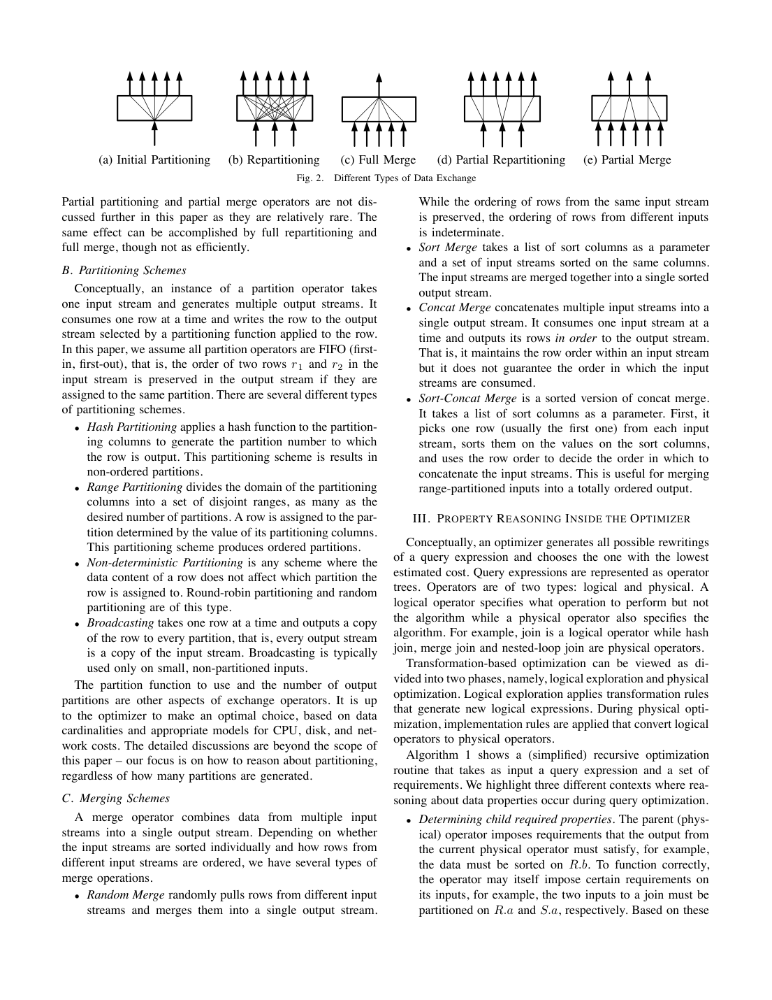
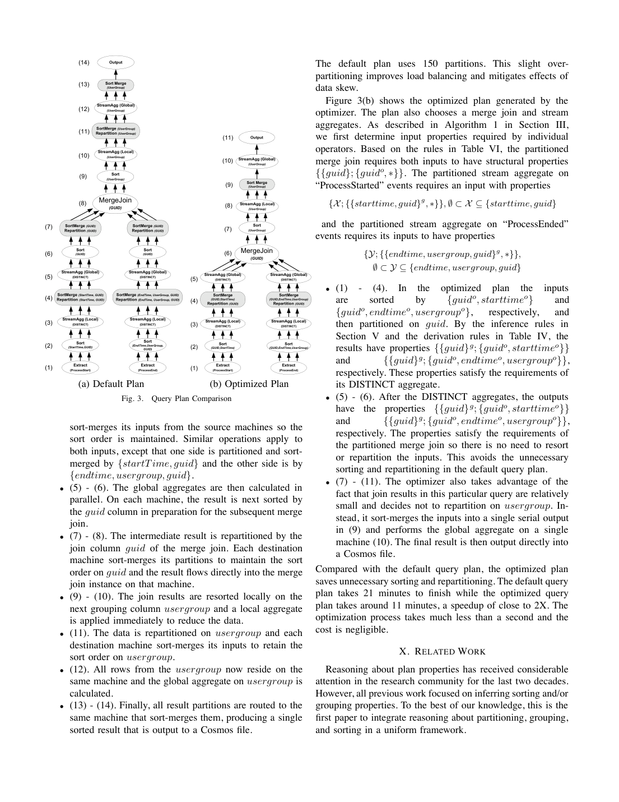

> 本组第 14 篇 · 属性与函数依赖 · [全部论文]() · [上一篇]() · [下一篇]()

本文把 partitioning、grouping、sorting 的结构属性推理纳入基于 Cascades 的 SCOPE 代价优化，使串行、并行和混合计划共同参与选择，而不是只把串行计划事后并行化。partitioning 是全局属性，grouping/sorting 是分区内局部属性；required properties 表达合法需求及范围，delivered properties 表达候选计划实际交付的保证，匹配判断语义蕴含而非字符串或列集相等。FD 和等价类须预先正确推导；FIFO partition 的保序不能扩大成所有 exchange 都保序，pair-wise join 还需两侧路由及分区数兼容。Pmin/Pmax 与 enforcer 减少预先展开的实现组合，但论文明确提及成本启发式优先级和剪枝，未给出完整搜索复杂度、全局最优证明或详细成本公式。实验是一条约 173 GB+264 GB 事件日志查询，在 84 台机器上默认计划用 150 个分区，执行由 21 分钟降至约 11 分钟，本例优化远低于 1 秒；这些不是全工作负载或数千节点保证。

本文保留论文陈述、读者推断与待验证方案的区别；实验数字只适用于原文条件。原文和翻译来自已有 AI 辅助精读报告，已做来源匹配与编辑复核，不等于人工逐项核验或独立实验复现。所有页码均为 PDF 物理页。

## 论文与阅读范围

Jingren Zhou, Per-Ake Larson, Ronnie Chaiken. Incorporating Partitioning and Parallel Plans into the SCOPE Optimizer. Microsoft. 本地 PDF 共 12 个物理页；本次已通读匹配 SHA 的全部提取文本和参考文献 [1]-[18]，并视觉检查第 7、8、11 页的表 IV-VI 与图 3。所读文本未明确给出本篇出版年份、正式会议/期刊信息或 DOI；不从 PDF 创建时间或另一篇 SCOPE 2008 文献 [2] 推定本篇书目信息。被引文献未独立核实。

[论文集中的原始 PDF](https://github.com/lonng/db-papers/blob/4ff1331069c7cf52ac97dd769e5f484c1c35c200/papers/functional-dependencies/incorporating-partitioning-and-parallel-plans-into-the-scope-optimizer.pdf) · 本地来源：`functional-dependencies/incorporating-partitioning-and-parallel-plans-into-the-scope-optimizer.pdf`，共 12 页。

本篇保留 10 组原文精读和 63 条证据。截图为原始 PDF 的局部页选，不是重新生成的图表；未将整份 PDF 复制到博客。

## 研究问题与适用边界

论文面向 Cosmos 上的大规模共享无集群分析：重分区需要跨共享网络搬运数据，所以应把数据布局及其与排序、分组的交互纳入代价优化。减少不必要的 exchange 是重要目标，但不意味着仅按 exchange 个数选计划；输入/中间数据量、join 选择率和执行代价同样重要。SCOPE 使用基于 Cascades 的 transformation-based optimizer，目标是统一考虑 serial、parallel 和 mixed plans，而非先选一个串行计划再添加并行性。

引言示例是假设 R、S 为数十 TB、分布在约 500 台机器，按 R.a=S.a 且 R.b=S.b 连接后按 R.c,S.d 聚合。若两侧兼容地按 R.a/S.a 分区，且 R.c→R.a，则相同 R.c 的行必有相同 R.a，从而共置于同一分区；因此按 {R.c,S.d} 的分组也不会被拆散，可省去 join 后的一次重分区。这个推理方向不能反过来，也不表示实际路由自动由 hash(R.a) 改成 hash(R.c)。原文附近 prose 的 R.c,R.d 与 SQL 不一致，此处按 SQL 的 R.c,S.d 解释，原引文不改。

作者明确说计划便宜与否依赖数据大小和选择率，须按代价比较两个方案。引言数字不是后面的测量环境，也不构成算法仅适用于数十 TB、数百节点的门槛。论文结尾认为技术也可用于并行数据库；没有测量单机或内存系统收益，不能直接断言那些环境不受益。

适用前提包括：正确的语义 FD/列等价信息、与推导规则一致的算子行为、可实现的分区和合并方式，以及用于计划选择的基数及成本估计。统计相关性或样本上碰巧成立的依赖，不能直接代替消除正确性必需 enforcer 所用的语义约束。

依据：论文陈述；PDF 物理页 1, 2, 4, 12。证据：[S02](#evidence-s02), [S03](#evidence-s03), [S04](#evidence-s04), [S05](#evidence-s05), [S12](#evidence-s12), [S37](#evidence-s37), [S36](#evidence-s36)。

## 系统架构与算子模型

Exchange 是 n 个输入到 m 个输出的逻辑数据交换；物理上可由 source 端 partition、destination 端 merge 中一个或两个部分构成。完整 n→m 重分区用 n 个 partition 实例各产生 m 路子流，再由 m 个 merge 实例收集对应输入。这将并行拓扑封装起来，使标准关系算子可在各分区独立执行；仍须由优化器满足其输入共置和排序需求。

论文列出 initial partition、full repartition、full merge、partial partition 和 partial merge 五种拓扑，但明确不再展开两种 partial 形式，不能声称它们都已在后文算法中完整实现。分区方式有 hash、range、non-deterministic（round-robin/random）和 broadcast。hash 不保证分区之间的值范围顺序，range 可给出有序、不相交的范围；broadcast 让每个目标收到完整输入副本，通常针对小型、原先非分区输入。

四种 merge 策略须分开理解。random merge 可保持单一来源内的相对次序，但任意交错后通常无法推导完整输出的局部排序/分组；这不是证明结果在任何具体数据实例上都必定无序。sort merge 要求输入分别按相同键有序，并只保证它合成的那条输出流有序；若 exchange 有多个输出，仍是每个输出的局部有序。concat 保持每个来源内顺序但不保证来源消费顺序；需与分区键兼容的局部分组条件，才能保留相应 grouping/suffix。sort-concat 不是用首行采样对任意重叠流进行通用排序；要得到全序，需兼容的有序范围分区与局部排序前提。

Cosmos Storage 把文件分为分布、复制、压缩的 extents；Execution Environment 用 DAG 表达进程和数据流，job manager 调度并在失败时重执行部分 DAG。本文环境中间结果物化到磁盘，以减少失败重算并简化调度，同时讨论 partition 阶段之间的算子 pipeline；不能直接写成全内存、全流水线网络执行。以上是本文所述环境，不外推为当前产品实现。

依据：论文陈述；PDF 物理页 2, 3, 4, 6, 7, 10。证据：[S06](#evidence-s06), [S07](#evidence-s07), [S08](#evidence-s08), [S10](#evidence-s10), [S13](#evidence-s13), [S18](#evidence-s18), [S19](#evidence-s19), [S27](#evidence-s27)。

*原论文 PDF 物理页 3，版权归原作者或出版方。点击图片可查看原尺寸。页面文本中定位到：Fig. 2.。这是页面定位信息，不表示本次已复核图内所有数据。*

## 属性推导、匹配与Enforcer算法

1. 属性表示与蕴含
结构属性记为 {Pθ;{A1,…,An}}，前半为全局 partitioning，后半为局部有序动作序列。grouping 动作作用于无序列集合，要求相同键的行连续；它不是执行聚合或去重本身。sorting 动作指定一列及方向，连续动作表示前序键相等范围内的后续结构。{C1g,C2g} 可推出 {{C1,C2}g}，反向不成立。特殊状态 ⊥、∅、⊤ 分别表示 nonpartitioned、randomly partitioned、fully duplicated，不能将 ∅ 当作普通空分组键而误推全部行共置。

推导方向尤其重要：局部动作序列可截去后缀；全局键一般不能截断。按 C1 分区可推出相同 (C1,C2) 的行共置，按 (C1,C2) 分区却不能一般推出按 C1 共置。ordered partition 的扩展还须保留原词典序前缀。sorted 可蕴含 grouped，但各分区局部 sorted 不等于全关系全序。FD 可按规则 (6)-(7) 简化全局属性及单个局部动作；跨前序动作删除被决定动作的规则 (8) 只适用于局部序列，不能用于任意全局键删除。

2. Required 与 delivered
DetermineChildReqdProperties 结合父需求和当前物理算子的输入要求；递归选子计划后，DeriveDlvdProperties 依据其实际交付属性与当前算子行为推导当前输出，再由 PropertyMatch 测 delivered⇒required。Algorithm 1 是简化说明，不能把显示的单一 child 或函数参数直接当作完整实现。FD/等价类被假设已自底向上计算。匹配先用等价类代表列归一化，再使用有效 FD 简化，分别检查全局和局部蕴含；这里是满足关系，不是已证明的任意推理系统完备性或字符串/列集相等。

需求可编码 nonpartitioned/broadcast/partitioned 模式；partitioned 模式允许 Pmin⊆P⊆Pmax，并在 Pmin=∅ 时另记是否必须 P非空；还包括 sorting 列表与 grouping 集合。读者构造的假设示例：全局聚合键 G={a,b} 时，可要求 Pmin=∅、Pmax=G 且显式非空，于是 {a}、{b}、{a,b} 都可，而 random partition 不能保证相同 G 共置。stream aggregate 还要求各分区按完整 G grouped；hash aggregate 无此局部分组要求。

pair-wise join 需两边按 join 键的对应等价子集、相同方式及相同分区数分布；仅归一化后的键相同还不足以证明已有 hash/range 路由兼容。merge join 另外要求 join 键作为相容局部排序前缀。broadcast join 将一个完整、原非分区输入复制给另一个分区输入，不能把已含重复副本的数据不加区分再次复制。

3. Enforcer 与示例
候选算子可能自产生所需属性、保留并下推需求，或需加 enforcer。串行输出可加 full merge 并向下请求并行计划；并行输出可对并行子计划 repartition，或对串行子计划 initial partition。FIFO partition 本身保持同一输出中的相对行序，但完整 repartition 还包含 merge，后者必须另外满足保序/保组条件。Algorithm 2 明确省略 sorting/grouping 和部分分区细节。

读者构造的假设示例：Filter 被明确要求交付“按 {a,b} 共置”的属性。Filter 不创造布局，但能保留已有布局，所以必须先考虑需求下推、无需新增 exchange 的方案；也可考虑 enforcer 改变上下游需求。若把该需求限定为确切分区列集合，可设 Pmin=Pmax={a,b}；若意指语义共置，则需按属性蕴含检验。不能套用上段聚合的 Pmin=∅、Pmax={a,b} 后，就认定所有候选都满足原 Filter 的确切物理方案。论文 Example 5 的算子位置文字和一般 enforcer 叙述须结合表达式/数据流方向解释；它没有给出过滤与 exchange 在所有代价条件下都可互换的定理。原模型 critique 将两种不同需求场景强制合并，不能作为当前结论。

依据：论文陈述；PDF 物理页 4, 5, 6, 7, 8, 9。证据：[S11](#evidence-s11), [S12](#evidence-s12), [S14](#evidence-s14), [S15](#evidence-s15), [S16](#evidence-s16), [S17](#evidence-s17), [S18](#evidence-s18), [S20](#evidence-s20), [S21](#evidence-s21), [S22](#evidence-s22), [S23](#evidence-s23), [S24](#evidence-s24), [S25](#evidence-s25), [S26](#evidence-s26), [C003N04](#evidence-c003n04)。

## 正确性论证与边界条件

正确性依据是结构语义和满足算子输入条件，而不是“形式化就自动证明实现不会出错”。FD、等价类、分区函数兼容性、行序传播及具体算子实现均须正确，才可安全省去 exchange/sort。要求被满足并不等于代价估计准确或选到了全局最优计划。

第 7-8 页明确：对 G 的 partitioned aggregate，分区键需为 G 的非空子集；stream aggregate 还要局部完整 G 分组。pair-wise join 需要两侧对应键、分区数和路由方式兼容。第 5 页为结构推理而省略精确 partition function/count，不代表实际执行器可以忽略这些条件。一个关系“满足按 c 共置”的事实，也不等于另一个关系独立按 hash(c) 分布后可与之直接逐分区连接。

父需求的处理不能只看 Table VI 的算子固有输入规则。例如 merge join 以 C3 为连接键，却被要求直接交付无法由 C3 排序推出的 {C1,C2} 顺序，优化器检查这种不相容的实现并立即丢弃。原报告说这证明“只作单独过滤、不是提前剪枝”，与正文的立即排除不符。可以另考虑上加 Sort 的不同候选，但并非所有有效计划必须只剩这一种实现路径。

FIFO 的边界是 partition operator 对路由到同一输出的行保留相对次序，不是要求网络数据包物理上必须按序到达；缓冲、重排等实现也可能交付正确行序。random merge 通常不提供可用的输出排序保证，sort-concat 只有在有序、不交叠范围及相容局部顺序等条件下才可替代逐行 sort merge。

论文给出概念性的候选生成及成本选择，并明确提及启发式优先级与剪枝。文中未证明完整搜索、全局最优或具体复杂度，也没有足够细节判断每一种实际剪枝是否保持最优性。既不能把“有 heuristics”自动说成作者证明了不完备，也不能保证真实实现永不产生错误计划；应分别验证重写语义、需求满足、搜索覆盖和成本质量。

依据：论文陈述；PDF 物理页 2, 3, 4, 5, 6, 7, 8, 9。证据：[S08](#evidence-s08), [S10](#evidence-s10), [S12](#evidence-s12), [S15](#evidence-s15), [S18](#evidence-s18), [S20](#evidence-s20), [S21](#evidence-s21), [S24](#evidence-s24), [S26](#evidence-s26), [S37](#evidence-s37)。

## 实验设计与结果分析

实验为第 IX 节的一条事件日志分析脚本，计算最近一个月各用户组消耗的机器时间。ProcessStarted 约 173 GB，ProcessEnded 约 264 GB，随机分布并有副本；分别按完整选取列 DISTINCT 后以 ProcessGUID 连接，再按 UserGroupName 汇总并排序。表达式是 EndTime-StartTime 的经过时间相加并换算小时，虽然别名为 TotalCPUHours，不能据此当成 CPU 利用率、指令周期或精确 CPU 活跃时间测量。

环境为 84 台测试机器：每台两个双核 Xeon、2 GHz、8 GB DRAM、四块 500 GB SATA，Windows Server 2003 Enterprise X64 SP1。默认计划使用 150 个 partitions，以轻度 overpartitioning 改善负载均衡和倾斜影响；150 不是节点数，文中未明确给出优化计划分区数，更没有证明该并行度全局最优。引言中数十 TB、约 500 台机器是另一假设示例，不能替代这组实验数字。

基线并非只有一个时间数字：图 3(a) 及第 10-11 页逐段描述默认计划，先做局部 DISTINCT，再按完整去重键重分区/全局 DISTINCT，随后重新按 guid 排序并重分区以执行 merge join，join 后按 usergroup 再排序、重分区/聚合，最终合成单条有序输出。论文没有给出 baseline 生成器的完整实现，但已足以说明它与优化计划的具体结构差异，不能声称完全未描述默认计划。

图 3(b) 将输入排序改为 guid 优先，再带完整 DISTINCT 的其他列，并按 guid 分区，通过相应 sort merge 保持局部顺序。guid 是 DISTINCT 键的合法子集；DISTINCT 仍以全部原列去重，其输出可直接用于 guid merge join，省去中间再次排序和重分区。这里不需要额外假设 guid 唯一决定时间戳/用户组；也不能从按 guid 分区就推断只按 guid 去重。由于本查询 join 结果相对小，后段先局部汇总，经 sort-merge full merge 形成串行输出，单机完成最终 usergroup 聚合，而不再按 usergroup repartition。

报告时间为默认 21 分钟、优化后约 11 分钟，作者称接近 2X；21/11 若写成小数只能标为读者算术推导，不是额外实测。优化过程在本例远少于 1 秒，没有更细毫秒数。未报告多轮方差/置信区间、网络字节分解、规则独立消融、完整 benchmark suite 或集群伸缩曲线，因此不能将总收益归因于某条规则的固定比例，也不能外推为任意查询、规模或现代硬件的 2X 保证。

依据：论文陈述；PDF 物理页 10, 11。证据：[S28](#evidence-s28), [S29](#evidence-s29), [S30](#evidence-s30), [S31](#evidence-s31), [S32](#evidence-s32), [S33](#evidence-s33), [S34](#evidence-s34), [S38](#evidence-s38), [C003N08](#evidence-c003n08)。

*原论文 PDF 物理页 11，版权归原作者或出版方。点击图片可查看原尺寸。页面文本中定位到：Fig. 3.；Figure 3(b) shows the optimized plan generated by the。这是页面定位信息，不表示本次已复核图内所有数据。*

## 工程权衡与设计取舍

以下为基于论文机制的工程分析，不是作者测得的额外性能结果。

属性范围编码减少在表达算子需求时立即生成大量独立实现的负担，但不自动给 Memo 大小或优化时间设定上界。分区候选、局部动作序列、FD/等价类及算子备选仍可能增多；论文用成本启发式优先级与剪枝应对，却未提供策略细节、最坏复杂度或实际 Memo 状态计数。需区分一种范围的紧凑表示与其后具体候选的搜索规模。

partition-only 的 FIFO 性质为下游复用局部排序创造机会，但完整 exchange 中还要选择 merge 策略。sort merge 要求来源已排序，sort-concat 依赖有序范围，random merge 通常不交付顺序。它们的 CPU、缓冲、磁盘和网络代价不能从“都能改变分区”推成相同，也不能把行序接口约束错误地下沉成必须禁止所有网络乱序。

在实验中，较小的 postjoin 数据适合 full merge 后串行最终聚合；如果中间结果不同、估计有偏或网络/存储条件改变，代价选择可能不同。这是需要测量和校准的风险，不是该文给出的失败阈值或运行时自动纠正机制。论文明确说分区函数和分区数量的选择依赖基数及 CPU、disk、network 成本，详细讨论不在范围内；没有可直接照搬的 network_bytes/bandwidth 公式或启动成本常数。

工程上可分别验证三层：属性满足保证结果正确，候选生成/剪枝影响可选计划，成本估计影响选择质量。更多属性推理不等于自动获得更准确基数或正确故障/调度模型。Cosmos 的中间结果落盘与故障重算策略属于实验环境，不能省略后直接推断全内存环境中的收益。

依据：读者推断；PDF 物理页 3, 6, 7, 9, 10, 11。证据：[S08](#evidence-s08), [S09](#evidence-s09), [S10](#evidence-s10), [S18](#evidence-s18), [S22](#evidence-s22), [S25](#evidence-s25), [S26](#evidence-s26), [S27](#evidence-s27), [S32](#evidence-s32)。

## 相关工作与系统对比

相关工作第 11-12 页按历史脉络讨论：System R 跟踪中间结果顺序以影响 sort-merge join 选择；Simmen 等利用 FD 推导排序；Wang 等把 grouping 与 sorting 结合并采用后处理方式消除冗余操作；Neumann/Moerkotte 的排序/分组框架及数据结构可与本文整合。本文的 first-known 声明针对统一推理 partitioning、grouping、sorting 且纳入优化过程，需保留作者所知范围的限定，不能扩大为首次发明并行计划、Exchange 或整个属性优化。

本篇使用 Cascades [8]（Data Engineering Bulletin 18(3), 1995）作为优化框架。Exchange 并行封装相关的是 Volcano parallelism [7]（SIGMOD 1990）；Volcano optimizer generator 是另一参考 [9]（ICDE 1993），不可混名。[2] 是独立的 SCOPE 语言/执行系统 VLDB 2008 论文，[10] 是 Dryad EuroSys 2007，均不能直接用作本篇出版年份。

论文还讨论 Cosmos/Dryad、MapReduce/Hadoop、Pig Latin、DryadLINQ 等背景，但本篇测量不是这些系统的横向性能比较。结尾陈述 SCOPE 优化器已经生产使用，可作为作者的部署说明；定量证据仍是所展示的事件查询。未读取其他现代引擎源码，不在此报告中列举或暗示其内部属性框架与本文相同。

依据：论文陈述；PDF 物理页 1, 11, 12。证据：[S02](#evidence-s02), [S35](#evidence-s35), [S36](#evidence-s36), [C003N11](#evidence-c003n11)。

## 复现指南与缺失信息

以下均为尚未执行的读者建议，区分验证机制与复现实验。

1. 建立小型属性测试器。表示 global mode、ordered/nonordered partition keys、local action sequence、required Pmin/Pmax 与非空标记；分别输入已知语义 FD 和等价类。单机原型可测试蕴含逻辑，但不等于复现了 Cosmos 分布式性能。FD 推导或并查集可以是读者实现选项，本文没有指定其具体数据结构或给出复杂度。

2. 做有反例的语义测试。验证 partition(a)⇒co-location(a,b) 而反向不成立；验证 local sort(a,b)⇒group(a,b)，但不推出全局有序；用 (a,b) 已分组但 a 不连续的序列区分联合 grouping 与分级 grouping。验证 R.c→R.a 的正确方向，并用已兼容的路由检查 join；故意给两边不同 hash/range 映射或分区数，确保仅键等价不会误放行。

3. 测试 required/delivered 与 enforcer。聚合需求 G={a,b} 允许非空子集，确切分区实现需求则需另行表达。Filter 可保留并下推需求，不必总加 exchange。测试 full merge、initial partition、repartition 的 serial/parallel 转换；排序和分组组合需补全 Algorithm 2 省略部分，不能将其直接粘贴成完整优化器。额外测试父排序需求与 merge join 固有顺序的冲突，比较直接交付、改用其他实现或加 Sort 的不同候选。

4. 若需性能复现，先明确原查询、数据语义/重复度、分布、副本和硬件差异。采集输入及各阶段基数、实际 shuffle 字节、sorting/merge 代价、default/optimized 计划和规划开销，并进行多次测量。约 437 GB 的输入总和或每节点平均值只是读者算术，不能替代实际扫描/网络流量；副本与中间数据也不能忽略。计划结果应与基线逐组核对，而非只比较耗时。

5. 尚缺详细成本公式、分区函数和并行度选择、精确剪枝策略、完整 FD 推导、所有 ordering/grouping enforcer 交互及 benchmark 数据。删除原报告的 O(Kα(K))、O(K²) 和“FD 闭包最坏指数级”等无来源估算；仅标为读者推测也不足以让它们成为本篇保证。单例远低于一秒的观察无法证明任意属性推理的复杂度很低。

依据：待验证的工程设想；PDF 物理页 3, 4, 5, 6, 7, 8, 9, 10, 11。证据：[S09](#evidence-s09), [S11](#evidence-s11), [S12](#evidence-s12), [S14](#evidence-s14), [S15](#evidence-s15), [S16](#evidence-s16), [S17](#evidence-s17), [S18](#evidence-s18), [S20](#evidence-s20), [S21](#evidence-s21), [S22](#evidence-s22), [S23](#evidence-s23), [S24](#evidence-s24), [S25](#evidence-s25), [S26](#evidence-s26), [S28](#evidence-s28), [S29](#evidence-s29), [S30](#evidence-s30)。

## 总结与工程启示

本文的实质贡献是把全局数据共置与分区内顺序/分组纳入统一结构属性系统，并通过 required/delivered 蕴含匹配和 enforcer 让串行、并行、混合计划在同一代价搜索中竞争。它没有提出“分区越多越好”或“省一个 shuffle 就一定更快”的规则。

对内核工程的启示首先是维护精确边界：全局与局部不能混淆，属性蕴含与实际两输入路由兼容不能混淆，grouped 与已聚合不能混淆，FIFO partition 与包含 merge 的完整 exchange 不能混淆。FD/等价类简化只有在语义约束正确、作用域合法时才可消去 enforcer；排序/分组同样是数据布局的结构属性，不应误标为与物理布局相对的“逻辑属性”。

其次要将正确性、搜索覆盖与成本质量分开。文中允许需求范围和成本启发式，没有证明任意计划搜索全局最优、没有提供整套可执行伪代码或复杂度界；对不满足父需求的实现也会立即排除。范围表示带来便利，但不能变成无条件的完备性或低开销保证。

最后，定量结论保留原范围：一条约 173/264 GB 事件查询，84 台机器，default 150 partitions，21 分钟到约 11 分钟，本例规划远低于 1 秒。生产使用是作者陈述，普遍加速、现代系统适用性及更大规模扩展仍需额外证据。

本次独立通读匹配 SHA 的全部 12 页提取文本、书目及完整报告/10 段精读，并视觉核对物理页 7、8、11 的表和计划图。未完整视觉检查所有页面、独立验证被引文献或执行性能复现；未调用生成 API。原模型 critique 保留用于追踪，其中 Filter 需求与聚合范围的错误混同不作为本次结论。

依据：读者推断；PDF 物理页 4, 5, 7, 9, 10, 11, 12。证据：[S11](#evidence-s11), [S13](#evidence-s13), [S15](#evidence-s15), [S20](#evidence-s20), [S21](#evidence-s21), [S25](#evidence-s25), [S26](#evidence-s26), [S28](#evidence-s28), [S29](#evidence-s29), [S30](#evidence-s30), [S33](#evidence-s33), [S34](#evidence-s34), [S36](#evidence-s36)。

## 原文精读：从句子回到机制

以下保留原文、忠实翻译、含义与边界；假设示例不作为论文实验结果。

### P001 · PDF 物理页 2

**原文**

<blockquote class="paper-source-quote"><pre><code>It is thus valid to partition R and S on R.a and&#10;S.a, respectively, and evaluate the join, producing a result&#10;that is partitioned on R.a (or S.a). If a functional dependency&#10;R.c →R.a exists (for instance, R.c is the primary key of&#10;R), the join result is also partitioned on R.c so that we can&#10;safely perform aggregation without repartitioning the data.&#10;Depending on data size and join selectivity, plan (b) can&#10;be significantly cheaper than plan (a). The optimizer should&#10;consider both plans in a cost-based fashion.</code></pre></blockquote>

**忠实翻译**

> 因此，分别在 R.a 和 S.a 上对 R 和 S 进行分区并计算连接是有效的，产生的结果在 R.a（或 S.a）上被分区。如果存在函数依赖 R.c → R.a（例如，R.c 是 R 的主键），那么连接结果也在 R.c 上被分区，因此我们可以安全地执行聚合而无需重新分区数据。根据数据大小和连接选择率，计划 (b) 可能比计划 (a) 显著更便宜。优化器应以基于代价的方式考虑这两种计划。

**技术含义与边界**

> 这里用语义 FD R.c→R.a 推断共置：同 c 必同 a，而数据已兼容地按 a 分区，所以同 c 不会跨分区。实际数据路由没有自动变成 hash(c)。全文 SQL 的后续分组为 R.c,S.d，c 已共置足以保证相同 (c,d) 共置。计划代价优势有数据大小/选择率前提；若没有这个 FD，只能说不能沿用这一条论证，不代表不存在其他可证明共置的约束或计划。

**常见误读**

> 不能颠倒 FD 为 a→c，不能以统计相关性代替语义 FD，也不能从单个关系满足某个共置属性推断任意另一份同键数据都能直接 pair-wise join。此例的约 500 机器/数十 TB 是引言假设，非后文 84 台机器实验；两计划仍需成本比较。

**读者构造的假设示例**

> 读者构造的假设示例：假设表 R 有列 c（主键）和 a，表 S 有列 a。按 R.a 和 S.a 哈希分区后做等值连接。因为 c 是主键，存在 c → a 的函数依赖，所以连接后的结果不仅在 a 上分区，也在 c 上分区。此时若需按 c 做 GROUP BY，可直接在各分区本地执行，无需再次 shuffle。

### P002 · PDF 物理页 11

**原文**

<blockquote class="paper-source-quote"><pre><code>After the DISTINCT aggregates, the outputs&#10;have&#10;the&#10;properties&#10;{{guid}g; {guido, starttimeo}}&#10;and&#10;{{guid}g; {guido, endtimeo, usergroupo}},&#10;respectively. The properties satisfy the requirements of&#10;the partitioned merge join so there is no need to resort&#10;or repartition the inputs. This avoids the unnecessary&#10;sorting and repartitioning in the default query plan.&#10;• (7) - (11).</code></pre></blockquote>

**忠实翻译**

> 在执行 DISTINCT 聚合之后，输出分别具有属性 {{guid}g; {guido, starttimeo}} 和 {{guid}g; {guido, endtimeo, usergroupo}}。这些属性满足分区归并连接（partitioned merge join）的要求，因此无需对输入进行重新排序或重新分区。这避免了默认查询计划中不必要的排序和重新分区。• (7) - (11)。

**技术含义与边界**

> 属性写法分号前的 {guid}g 是全局非有序分区，分号后才是分区内排序序列；不能把它整体解释为本地按 guid 分组。相容输入按 guid 共置、局部排序以 guid 为前缀，故满足本例 pair-wise merge join 要求。这是属性蕴含，不是普通集合的超集测试。DISTINCT 的完整键仍是开始侧 (guid,starttime) 与结束侧 (guid,endtime,usergroup)，未假设 guid 是唯一键。

**常见误读**

> 不要把按 guid 分区改写为只按 guid 去重，也不要推定 GUID 唯一决定时间戳或用户组。两边仍须实际分区方式和数量兼容，局部 sorted 不能自动提升成全局全序。原文仅在本例的具体属性下避免重新排序/分区。

**读者构造的假设示例**

> 读者构造的假设示例：开始记录 (g1,t1)、(g1,t2) 若时间不同，应在完整 DISTINCT 后保留两行；结束记录也按其完整键去重。两侧兼容地以 guid 分区并以 guid 为排序前缀，可以直接做 guid merge join，但不能因共享 g1 就先把两条开始记录合成一条。非作者额外实验。

### P003 · PDF 物理页 5

**原文**

<blockquote class="paper-source-quote"><pre><code>, ˆAm−1} and, in addition,&#10;∀ri, rj, i &lt; j, ri[ ˆA1, . . . , ˆAm−1] = rj[ ˆA1, . . . , ˆAm−1] ⇒&#10;ri[C] op rj[C].&#10;where op =′≤′ when o = o↑and op =′≥′ when o = o↓.&#10;Wang et, al. [17] also used an ordered sequence of annotated&#10;columns to represent secondary ordering or grouping. But their&#10;approach is more limited because each step in their sequence&#10;can only be either grouping or sorting on a single column. Note&#10;that {Cg&#10;1, Cg&#10;2} ⇒{{C1, C2}g} but {{C1, C2}g} ⇏{Cg&#10;1, Cg&#10;2}.&#10;There are two major classes of partitioning schemes, or-&#10;dered and non-ordered.</code></pre></blockquote>

**忠实翻译**

> ……, Âm−1} 并且，此外，∀ri, rj, i < j, ri[Â1, . . . , Âm−1] = rj[Â1, . . . , Âm−1] ⇒ ri[C] op rj[C]。其中当 o = o↑ 时 op =′≤′，当 o = o↓ 时 op =′≥′。Wang 等人 [17] 也使用了带注释列的有序序列来表示次级排序或分组。但他们的方法更为受限，因为其序列中的每一步只能是对单列的分组或排序。注意 {Cg1, Cg2} ⇒ {{C1, C2}g} 但 {{C1, C2}g} ⇏ {Cg1, Cg2}。存在两大类分区方案：有序和非有序。

**技术含义与边界**

> 前面的公式是 local sorting action：在前序动作所涉及的列值相等范围内，当前列遵循升/降序；前序动作可包含对多列集合的 grouping，不限于 m-1 个单列排序。本文允许集合分组动作；分级 {C1g,C2g} 蕴含联合 {{C1,C2}g}，反向不成立。这是局部动作语义，不是全局分区键可截断的规则。

**常见误读**

> 容易混淆分组属性的单向蕴含关系，误以为按多列联合分组等价于依次按各列独立分组。原文明确用 ⇏ 否定了反向推导。此外，不应将引文 [17] 的描述视为本文采用的方法，原文是在对比中指出其局限性。

**读者构造的假设示例**

> 读者构造的假设示例：假设有两列 C1（省份）和 C2（城市）。{Cg1, Cg2} 表示数据先按省份分组，再在每个省份内按城市分组；这必然意味着数据也是按 {C1, C2} 联合分组的。但反过来，{{C1, C2}g} 只保证相同（省份，城市）组合的行在一起，并不保证不同城市的行是按省份严格隔离成独立分组的，因此不能反推 {Cg1, Cg2}。

### P004 · PDF 物理页 8

**原文**

<blockquote class="paper-source-quote"><pre><code>This requirement is satisfied by hash or range partition with&#10;column set P where Pmin ⊂P ⊆Pmax.&#10;The rules in Table VI do not consider requirements imposed&#10;on the operator by its parent. For instance, if a merge join&#10;is required to produce a result sorted on {C1, C2} but its&#10;equality join predicates are on {C3}, there is no merge join&#10;implementation that could satisfy its sorting requirements,&#10;assuming that sorting on {C3} does not imply sorting on&#10;{C1, C2}.</code></pre></blockquote>

**忠实翻译**

> 该要求由使用列集 P 的哈希或范围分区满足，其中 Pmin ⊂ P ⊆ Pmax。表 VI 中的规则不考虑父算子对该算子施加的要求。例如，如果要求归并连接产生在 {C1, C2} 上排序的结果，但其等值连接谓词在 {C3} 上，那么没有归并连接实现能够满足其排序要求，假设在 {C3} 上排序不蕴含在 {C1, C2} 上排序。

**技术含义与边界**

> 开头 Pmin⊂P⊆Pmax 来自全文该聚合例：Pmin=∅ 且要求实际 P 非空。一般需求允许下界包含关系，并有显式非空标记，不能把该例严格子集符号推广为每个需求都必须严格大于 Pmin。Table VI 只列算子固有输入条件，全文紧接着说明优化器会立即排除与父需求不相容的实现，不是父需求从不进入优化。C3 排序与目标排序间缺少所需蕴含才是关键，任意 FD 的存在本身并不保证另一个列序。

**常见误读**

> 不要把 Table VI 的局部适用范围误读成整个优化流程忽略父需求或只能后置过滤；不要把 grouping 的 FD 简化当作任意排序键交换/映射。若 merge join 不能直接交付要求，可以考虑上加 Sort 或其他候选实现，不是只能选一种修复。

**读者构造的假设示例**

> 读者构造的假设示例：父节点要按 (order_date,customer_id) 排序，当前 merge join 只能保证 product_id 的顺序，且没有目标顺序蕴含。不能直接放行此交付需求；可另建 join 上方的 Sort 候选，也可尝试其他能满足要求的实现，再按成本选择。非作者实验或完备性证明。

### P005 · PDF 物理页 4

**原文**

<blockquote class="paper-source-quote"><pre><code>Equivalence classes are generated by equality predicates,&#10;typically equijoin conditions and equality comparisons with a&#10;constant.&#10;Functional dependencies and column equivalence classes&#10;can be computed bottom up in an expression tree. As this&#10;issue is well covered elsewhere&#10;[4], [16], [13], [12], we&#10;omit the details but assume that functional dependencies and&#10;equivalence classes have been computed.&#10;B.</code></pre></blockquote>

**忠实翻译**

> 等价类由等值谓词生成，通常是等值连接条件和与常量的等值比较。函数依赖和列等价类可以在表达式树中自底向上计算。由于该问题在其他文献 [4], [16], [13], [12] 中已有充分论述，我们省略细节，但假设函数依赖和等价类已被计算。B.

**技术含义与边界**

> 原文陈述了等价类的来源（等值谓词、等值连接、常量比较）以及计算方法（在表达式树中自底向上推导）。作者明确表示不展开具体算法细节，而是将其作为已知前提，假设这些属性已经被预先计算好供后续优化阶段使用。

**常见误读**

> 容易误认为本文提出了新的函数依赖或等价类推导算法。原文明确说“省略细节”，并将此归功于引用的其他文献。读者不应将引文中的指令或算法当作本文的贡献。此外，“自底向上计算”是原文陈述的事实，但未说明是否支持跨子查询或复杂嵌套的推导。

**读者构造的假设示例**

> 读者构造的假设示例：在符合相应算子语义的输出中，A.id=B.id 可产生列等价类。比较 required 与 delivered 属性时，先把二者的这些列映射到统一代表列，再检查其分区/排序蕴含。A.status='active' 可作为常量约束参与简化；不由此额外声称任意 join 可消除或过滤可下推。非论文实现细节。

### P006 · PDF 物理页 3

**原文**

<blockquote class="paper-source-quote"><pre><code>That is, it maintains the row order within an input stream&#10;but it does not guarantee the order in which the input&#10;streams are consumed.&#10;• Sort-Concat Merge is a sorted version of concat merge.&#10;It takes a list of sort columns as a parameter. First, it&#10;picks one row (usually the first one) from each input&#10;stream, sorts them on the values on the sort columns,&#10;and uses the row order to decide the order in which to&#10;concatenate the input streams.</code></pre></blockquote>

**忠实翻译**

> 也就是说，它保持输入流内的行顺序，但不保证输入流被消耗的顺序。• Sort-Concat Merge 是 concat merge 的排序版本。它将排序列列表作为参数。首先，它从每个输入流中选取一行（通常是第一行），在排序列的值上对它们进行排序，并使用该行顺序来决定拼接输入流的顺序。

**技术含义与边界**

> 全文上文明确第一句指普通 concat merge，无须猜测。sort-concat 根据每条输入的一行确定流的消费顺序；当输入是兼容有序范围分区且各流内部按同样键排序等条件成立时，拼接可得到全序。仅有首行有序或各流分别有序，不足以处理值范围交叠；这不是通过采样保证任意输入有序的启发式。

**常见误读**

> 不能把排序输入流首行等同于对全部行排序，也不能将“各流局部有序”当成“各流范围不重叠”。应核查 ordered range partition 与 local order 前提；不满足时可能需要逐行 sort merge 或显式排序。

**读者构造的假设示例**

> 读者构造的假设示例：三个流分别按键升序且取值范围为 [1,9]、[10,19]、[20,29]，按其代表行确定范围顺序后拼接可全序。反例：流 A=[1,100]、流 B=[2,3] 都局部有序，按首行决定 A 后 B 得到 [1,100,2,3]，并非全序。非作者实验，旨在说明范围前提。

### P007 · PDF 物理页 6

**原文**

<blockquote class="paper-source-quote"><pre><code>∃Columns[ ˆA1, . . . , ˆAi−1] →Columns[ ˆAi] :&#10;{∗; { ˆA1, . . . , ˆAi−1, ˆAi, ˆAi+1, . . .}} ⇒&#10;{∗; { ˆA1, . . . , ˆAi−1, ˆAi+1, . . .}}&#10;(8)&#10;V. DERIVING STRUCTURAL PROPERTIES&#10;We now consider how to derive the structural properties of&#10;the output of a physical operator.</code></pre></blockquote>

**忠实翻译**

> ∃Columns[Â1, . . . , Âi−1] → Columns[Âi] : {∗; {Â1, . . . , Âi−1, Âi, Âi+1, . . .}} ⇒ {∗; {Â1, . . . , Âi−1, Âi+1, . . .}} (8) V. 推导结构属性 我们现在考虑如何推导物理算子输出的结构属性。

**技术含义与边界**

> 这是局部结构属性的规则 (8)：若前序动作涉及的列函数决定当前动作涉及的列，则在已满足前序动作的范围内，当前动作不再增加约束，可从 local action sequence 删除。Ai 可以是多列 grouping 动作，不只是一个列；规则不直接用于全局 partitioning，也不删除真实数据列或改变行内容。

**常见误读**

> 不要把 ∗ 误解为也可随意简化 global partition key；全文明确该规则 local-only。删除冗余局部动作需正确 FD 和前序动作上下文，不能任意丢排序前缀或由单向 FD 推出两个不同排序全局等价。

**读者构造的假设示例**

> 读者构造的假设示例：假设输出属性要求按 {employee_id, department_id, salary} 排序。如果已知存在函数依赖 employee_id → department_id（即每个员工只属于一个部门），那么根据公式 (8)，排序属性可以简化为 {employee_id, salary}，因为 department_id 的顺序完全由 employee_id 决定，无需显式指定。

### P008 · PDF 物理页 9

**原文**

<blockquote class="paper-source-quote"><pre><code>In such a&#10;plan, no additional enforcer (partitioning) is needed.&#10;The number of alternatives generated by enforcer rules&#10;could be large so usually the optimizer applies cost-based&#10;heuristics to prioritize alternatives and prune out less promis-&#10;ing ones.</code></pre></blockquote>

**忠实翻译**

> 在这样的计划中，不需要额外的强制算子（分区）。由强制规则生成的替代方案数量可能很大，因此优化器通常应用基于代价的启发式方法来优先处理替代方案并剪枝掉希望较小的方案。

**技术含义与边界**

> 原文在已满足需求的计划中可省去新增 partition enforcer，同时明确备选数量可能很大，优化器通常用成本启发式设优先级并剪掉较少希望的候选。它没有给出实际剪枝完整策略、每种剪枝的安全性/最优性证明或多项式优化时间界。应区分正确性约束与成本搜索覆盖，不把 heuristics 一词本身当作已证明丧失全局最优。

**常见误读**

> 容易误认为强制规则生成的所有替代方案都会被完整评估。原文明确指出“替代方案数量可能很大”，因此必须“剪枝掉希望较小的方案”。不能将“不需要额外的强制算子”泛化为所有情况，原文限定了“在这样的计划中”（即属性已满足的特定情况）。

**读者构造的假设示例**

> 读者构造的假设示例：pair-wise join 左侧已按某 hash 函数和分区数布局。右侧必须匹配相同路由或通过有效 exchange 修复，不能只因都写列 X 就把右侧改为独立 range partition 并直接本地 join。哪一组兼容方案成本更低需模型评估；非作者额外实验或固定剪枝策略。

### P009 · PDF 物理页 7

**原文**

<blockquote class="paper-source-quote"><pre><code>However, this approach would generate a large number of&#10;alternatives, making optimization more expensive. Instead, we&#10;allow required properties to cover a range of possibilities and&#10;rely on enforcer rules, described in Section VIII, to generate&#10;valid rewrites.&#10;To this end, our optimizer encodes required structural prop-&#10;erties as follows.</code></pre></blockquote>

**忠实翻译**

> 然而，这种方法会生成大量替代方案，使优化变得更加昂贵。相反，我们允许所需属性覆盖一系列可能性，并依赖第八节中描述的强制规则来生成有效的重写。为此，我们的优化器对所需的结构属性进行如下编码。

**技术含义与边界**

> 这里的范围表示针对同一个 physical operator 的多种合法输入属性可能性，避免一开始为每种需求组合各生成独立备选；不必然是生成不同逻辑查询分支。enforcer 后续生成有效重写，范围本身既不改变查询语义，也不证明搜索覆盖或时间上界。

**常见误读**

> 容易误认为“允许所需属性覆盖一系列可能性”意味着优化器放弃了精确性。原文澄清了这是通过“依赖强制规则来生成有效的重写”来保证正确性的。这是一种解耦设计，而非降低要求。不能脱离第八节的强制规则孤立理解这里的属性编码。

**读者构造的假设示例**

> 读者构造的假设示例：对 {a,b} 做 partitioned hash aggregation，可把需求编码为 Pmin=∅、Pmax={a,b} 且 P 必须非空。按 {a}、{b}、{a,b} 的适当分区都能保证同组共置；输入若仅随机分区则不满足。若还用 stream aggregation，另需局部按完整 {a,b} grouped。非作者额外实验。

### P010 · PDF 物理页 10

**原文**

<blockquote class="paper-source-quote"><pre><code>The “ProcessStarted” event in the queried period contains&#10;about 173 GB of data while the “ProcessEnded” event contains&#10;about 264 GB of data. Both Cosmos files are randomly&#10;distributed and replicated across the cluster.&#10;We ran the query against on a small test cluster of 84&#10;machines. Each machine has two dual-core Xeon processors&#10;running at 2GHz, 8 GB of DRAM, and four 500GB SATA&#10;disks. All machines run Windows Server 2003 Enterprise X64&#10;Edition SP1.&#10;B.</code></pre></blockquote>

**忠实翻译**

> 在查询期间内，“ProcessStarted”事件包含约 173 GB 的数据，而“ProcessEnded”事件包含约 264 GB 的数据。这两个 Cosmos 文件都是随机分布并在集群中复制的。我们在一个由 84 台机器组成的小型测试集群上运行了该查询。每台机器有两个双核 Xeon 处理器，运行频率为 2GHz，8 GB DRAM，以及四个 500GB SATA 磁盘。所有机器均运行 Windows Server 2003 Enterprise X64 Edition SP1。B.

**技术含义与边界**

> 这些是本例输入和测试环境：约 173/264 GB 原始事件文件，84 台机器，各有两个双核 Xeon、2 GHz、8 GB DRAM、四块 500 GB SATA，运行 Windows Server 2003 Enterprise X64 SP1。将两个双核折算四核、四块盘折算名义 2 TB 是读者算术，不是可用容量或吞吐量测量；副本与中间数据也影响实际资源使用。

**常见误读**

> 容易将这些实验结果泛化为现代系统的性能基线。原文提供的硬件（2GHz 双核 Xeon、SATA 磁盘、Windows Server 2003）反映了论文发表时的技术背景，不能直接用于推断现代 NVMe SSD 或百核 CPU 环境下的表现。此外，数据是“随机分布并复制的”，这一前提直接影响 I/O 和网络传输的代价评估。

**读者构造的假设示例**

> 读者构造的假设示例：若要评估 shuffle，需实测过滤/去重后的各阶段字节、路由、本地传输比例、副本和链路条件，不能直接用原始输入除以 84 得到实际每机网络量，更不能臆设 1 Gbps 后当作论文性能解释。此例仅为测量建议，未执行实验。

## 尚未解决的问题

1. 在固定可实现算子与需求组合下，Pmin/Pmax 候选如何排序和剪枝，各种剪枝是否保留最佳 estimated-cost plan？本文未给具体策略或证明。
2. 如何在不混淆结构属性蕴含的前提下维护两输入实际 partition function、边界和分区数的兼容性？
3. 排序、分组与分区 enforcer 的组合如何避免重复状态、无用循环和不满足父需求的实现？简化伪代码未给完整细节。
4. 在不同中间结果规模、倾斜和资源条件下，parallel repartition 与 full-merge 后串行最终聚合的成本交叉点如何校准？
5. 相同语义查询在不同输入副本、失败重算、存储/网络环境及更大规模集群中能否维持收益？本文没有相关实验曲线。

## 证据索引

证据编号沿用原报告，便于将上文判断追溯到原句。引文匹配只验证位置，不证明解读正确。

**C001N02 · PDF 物理页 2**

引言假设 R.c→R.a，在按 R.a/S.a 兼容分区的 join 结果中，可由相同 R.c 必有相同 R.a 推出按 R.c 的共置性质，供按 R.c,S.d 的后续聚合使用；没有物理改成 hash(R.c)。这是属性满足后省略冗余 enforcer，而非搜索剪枝，也不保证所有大小/选择率下更便宜。

<blockquote class="paper-source-quote"><pre><code>If a functional dependency R.c →R.a exists (for instance, R.c is the primary key of R), the join result is also partitioned on R.c so that we can safely perform aggregation without repartitioning the data.</code></pre></blockquote>

**C001N04 · PDF 物理页 2**

Exchange算子在物理层由Partition和Merge两类算子组成。将n个输入分区重分区为m个输出分区时，需要在n台输入机器上各执行一个Partition算子（将数据切分为m个子分区），并在m台输出机器上各执行一个Merge算子（收集对应的n个子分区）。这种解耦使得标准关系算子无需修改即可支持并行执行。

<blockquote class="paper-source-quote"><pre><code>The processing is done by n partition operators, one on each input machine, and m merge operators, one on each output machine.</code></pre></blockquote>

**C001N07 · PDF 物理页 3**

合并策略包括：Random Merge（随机拉取，保留单流顺序但跨流顺序不确定）、Sort Merge（要求输入已按相同列排序，输出全局有序）、Concat Merge（逐流连贯拼接，不保证流间消费顺序）和Sort-Concat Merge（根据各流首行排序决定拼接顺序，适用于将Range分区合并为全序输出）。不同合并策略对输出排序属性的保持能力不同，是属性推导的关键环节。

<blockquote class="paper-source-quote"><pre><code>Sort-Concat Merge is a sorted version of concat merge. It takes a list of sort columns as a parameter. First, it picks one row (usually the first one) from each input stream, sorts them</code></pre></blockquote>

**C001N09 · PDF 物理页 4**

PropertyMatch 判断 delivered properties 是否蕴含 required properties，允许更强属性满足需求；这不是论文证明了所有语义推理完备性的结论。

<blockquote class="paper-source-quote"><pre><code>The match does not have to be exact – a result with properties that exceed the requirements is acceptable.</code></pre></blockquote>

**C001N10 · PDF 物理页 4**

属性推理依赖于函数依赖（FD）和列等价类。文中列举了FD的来源：平凡FD、键约束、列等值约束（如等值连接谓词 Ri = Sk 蕴含 {Ri}→{Sk} 和 {Sk}→{Ri}）、常量约束（选择谓词 Ri = constant 蕴含 ∅→Ri）以及Group By后的分组列成为结果的键。前提假设是这些FD和等价类已经在表达式树中自底向上计算完毕，本文省略了其具体计算细节。

<blockquote class="paper-source-quote"><pre><code>Functional dependencies and column equivalence classes can be computed bottom up in an expression tree. As this issue is well covered elsewhere [4], [16], [13], [12], we omit the details</code></pre></blockquote>

**C001N11 · PDF 物理页 4**

本文将结构属性划分为全局属性和局部属性。分区（Partitioning）作用于整个关系，属于全局结构属性；而分组（Grouping）和排序（Sorting）定义的是每个分区内部的数据组织方式，属于分区局部（partition-local）属性。这种区分对于理解算子如何传播和改变属性至关重要。

<blockquote class="paper-source-quote"><pre><code>Partitioning applies to the whole relation; it is a global structural property. Grouping and sorting properties define how the data within each partition is organized and are thus partition-local properties</code></pre></blockquote>

**C001N12 · PDF 物理页 4**

分组（Grouping）的形式化定义（Definition IV.1）：行序列 r1...rm 在列集 X 上分组，当且仅当对于任意 i < j，若 ri[X] = rj[X]，则对所有 i < k < j 都有 rk[X] = ri[X]。这意味着具有相同X值的行必须在序列中连续出现。这是一个严格的数据不变量，是判断下游算子（如Stream Aggregation）能否正确执行的数学基础。

<blockquote class="paper-source-quote"><pre><code>Definition IV.1 (Grouping) A sequence of rows r1, r2, . . . , rm is grouped on a set of columns X = {C1, C2, . . . , Cn}, if ∀ri, rj, i &lt; j, ri[X] = rj[X] ⇒</code></pre></blockquote>

**C002N01 · PDF 物理页 5**

局部结构属性被建模为有序动作序列 {Â1, Â2, ..., Âm}，每个动作要么是对列集合 X 的分组（X g），要么是对单列带方向的排序（C o）。分组动作的定义要求：在满足前序属性的前提下，若两行在前序属性和当前分组列上相等，则它们之间的所有行也必须相等。排序动作的定义要求：在满足前序属性的前提下，若两行在前序属性上相等，则它们在排序列上必须满足指定方向的不等关系。这种将分组定义为列集合、排序定义为列列表的设计，明确了分组内列顺序无关而排序中列顺序关键的语义差异。

<blockquote class="paper-source-quote"><pre><code>Local structural properties can be represented by an ordered sequence of actions { ˆA1, ˆA2, . . . , ˆAm}. Each action is either grouping on a set of columns X g, or sorting on a single column Co.</code></pre></blockquote>

**C002N04 · PDF 物理页 6**

在 FIFO partition-only 前提下，每个输出保留被路由到该输出的行相对次序，继承输入局部属性；不代表完整 repartition/exchange 的 merge 一定保序，也不要求物理网络数据包按序到达。

<blockquote class="paper-source-quote"><pre><code>Partition operators are assumed to be FIFO, that is, they output rows in the same order that they are read from the input. Thus, they affect the global properties but not local properties.</code></pre></blockquote>

**C002N05 · PDF 物理页 6**

Full merge 的属性取决于合并方式和输入保证；random merge 通常不能推导输出局部顺序，sort merge 需输入有序，concat 需兼容分组前提，sort-concat 需相容 range/local order。分区内 sorted 不等于全关系 sorted。

<blockquote class="paper-source-quote"><pre><code>A sort-concat merge produces a sorted result if inputs are range partitioned and each partition is also sorted on the same columns as it is partitioned on.</code></pre></blockquote>

**C002N07 · PDF 物理页 7**

Required partition properties 可用 Pmin/Pmax 及必要的非空标记表示多种合法候选；聚合 G={C1,C2} 的例子允许非空子集。这减少需求表示时的组合展开，不是搜索复杂度或全局最优/完备性保证。

<blockquote class="paper-source-quote"><pre><code>Instead, we allow required properties to cover a range of possibilities and rely on enforcer rules, described in Section VIII, to generate valid rewrites.</code></pre></blockquote>

**C002N08 · PDF 物理页 8**

属性匹配（Property Matching）检查 P1⇒P2，通过将全局属性和局部属性分开匹配来实现。由于函数依赖和列等价可能导致语法不同但语义等价的属性，匹配前必须进行归一化：(a) 将每个属性中的列替换为其等价类的代表列；(b) 移除被其他列函数决定的冗余列。Example 4 详细展示了归一化过程：利用等价类 {C1,C6} 和 {C2,C7} 替换列，再利用 FD {C1,C2}→{C3} 消除 C3，最后分别应用全局扩展规则和局部截断+排序蕴含分组规则完成匹配。

<blockquote class="paper-source-quote"><pre><code>The basic idea of the normalization procedure is as follows: a) in each partitioning, sorting, grouping property, and functional dependency, replace each column with the representative column in its equivalence class</code></pre></blockquote>

**C002N09 · PDF 物理页 8**

Table VI 仅列算子固有输入条件，不代表父需求被忽略；优化器另外检查与父输出需求不相容的实现并立即丢弃。原文不支持“不提前剪枝”的流程断言。

<blockquote class="paper-source-quote"><pre><code>The rules in Table VI do not consider requirements imposed on the operator by its parent. For instance, if a merge join is required to produce a result sorted on {C1, C2} but its equality join predicates are on {C3}</code></pre></blockquote>

**C002N10 · PDF 物理页 5**

Wang et al. [17] 也使用带注释的列有序序列来表示次级排序或分组，但其方法更受限：序列中每一步只能是对单列的分组或排序。本文的模型允许分组动作作用于列集合（如 {C1,C2}g），从而能表达更丰富的结构属性。论文指出 {C1g, C2g} ⇒ {{C1,C2}g} 但反向不成立，说明多列分组比逐列分组更弱（信息更少），这是表达能力上的本质区别。

<blockquote class="paper-source-quote"><pre><code>Wang et, al. [17] also used an ordered sequence of annotated columns to represent secondary ordering or grouping. But their approach is more limited because each step in their sequence can only be either grouping or sorting on a single column.</code></pre></blockquote>

**C002N11 · PDF 物理页 6**

第 5-8 页分块主要是结构语义和推导，没有本块内的性能测量；不能由此说全文无实验，第 IX 节/第 10-11 页另有事件查询实验。

<blockquote class="paper-source-quote"><pre><code>V. DERIVING STRUCTURAL PROPERTIES</code></pre></blockquote>

**C003N01 · PDF 物理页 9**

Enforcer 可通过 Sort/Exchange 等改变结构属性需求与布局。普通分区/合并保持逻辑数据内容；broadcast 会在物理输出流间复制行，不能把逻辑行语义不变误解为无物理副本。

<blockquote class="paper-source-quote"><pre><code>We rely on a series of enforcer rules (explained below) to modify requirements for structural properties</code></pre></blockquote>

**C003N02 · PDF 物理页 9**

Algorithm 2展示了强制分区的简化伪代码。当需求为串行输出时，添加FullMerge交换并生成并行需求递归优化；当需求为并行输出时，枚举所有满足Pmin⊆P⊆Pmax的有效分区模式P，对每个P尝试两种情况：Case 1添加Repartition交换并生成新的并行需求（移除特定分区列）；Case 2添加InitialPartition交换并强制子节点生成串行输出。该算法不包含排序和分组需求的处理细节。

<blockquote class="paper-source-quote"><pre><code>foreach valid partition schema P do&#10;/*Case 1: repartition&#10;*/&#10;AddExchange(Repartition);</code></pre></blockquote>

**C003N03 · PDF 物理页 9**

论文明确提及 cost-based heuristics 来优先考虑候选并剪去较少希望的候选；未给出所有搜索/剪枝细节或全局最优证明，不能擅自断言全部实现候选都已穷举、也不能仅由 heuristics 词汇推断每种剪枝都不保最优。

<blockquote class="paper-source-quote"><pre><code>The number of alternatives generated by enforcer rules could be large so usually the optimizer applies cost-based heuristics</code></pre></blockquote>

**C003N04 · PDF 物理页 9**

Filter 本身不创造分区但保留已有分区，因此可把需求下推而无需新增 enforcer；还可考虑初始分区/重分区备选。不能说面对分区需求就必须插入 enforcer，也不能把本例确切布局需求直接替换成聚合允许的键子集范围。

<blockquote class="paper-source-quote"><pre><code>Assume we optimize a filter operator with a requirement that its results must be partitioned on {C1, C2}.</code></pre></blockquote>

**C003N05 · PDF 物理页 10**

实验运行在Cosmos平台上，该平台包含分布式存储子系统（文件被划分为extent并分布复制和压缩）和执行环境（计算作业建模为DAG，中间结果物化到磁盘以减少故障时的重计算量）。测试集群由84台机器组成，每台配备两个双核Xeon处理器（2GHz）、8GB DRAM和四块500GB SATA磁盘，运行Windows Server 2003 Enterprise X64 Edition SP1。

<blockquote class="paper-source-quote"><pre><code>We ran the query against on a small test cluster of 84 machines. Each machine has two dual-core Xeon processors</code></pre></blockquote>

**C003N06 · PDF 物理页 10**

示例查询使用约 173 GB ProcessStarted、264 GB ProcessEnded，完整键 DISTINCT、按 ProcessGUID 连接，并汇总 elapsed process machine time。TotalCPUHours 是脚本别名，不代表测量 CPU 利用率。

<blockquote class="paper-source-quote"><pre><code>The “ProcessStarted” event in the queried period contains about 173 GB of data while the “ProcessEnded” event contains about 264 GB of data.</code></pre></blockquote>

**C003N08 · PDF 物理页 11**

优化计划以 guid 作为原 DISTINCT 键子集、排序前缀，保留完整去重键和相容 merge-join 输入属性，省去重复排序/重分区；小 postjoin 结果允许 full merge 后单机最终聚合。它不要求 guid→timestamp/usergroup 的额外 FD，也不取消 DISTINCT。

<blockquote class="paper-source-quote"><pre><code>The properties satisfy the requirements of the partitioned merge join so there is no need to resort or repartition the inputs.</code></pre></blockquote>

**C003N09 · PDF 物理页 11**

本文这条示例报告默认 21 分钟、优化后约 11 分钟、接近 2X，以及本例优化远少于 1 秒。不是 suite 平均加速、精确毫秒数据或普遍低规划代价保证。

<blockquote class="paper-source-quote"><pre><code>The default query plan takes 21 minutes to finish while the optimized query plan takes around 11 minutes, a speedup of close to 2X.</code></pre></blockquote>

**C003N10 · PDF 物理页 9**

Algorithm 2的伪代码被作者明确声明为高度简化的版本，省略了排序和分组需求的处理逻辑。当存在排序需求时，系统会同时考虑sort-merge exchange和常规exchange操作，但这些细节未在伪代码中体现。此外，分区需求的具体细节也被忽略。这意味着该伪代码不能直接作为完整实现的规范。

<blockquote class="paper-source-quote"><pre><code>Although the pseudo-code is much simplified, it captures the core ideas of enforcing partitioning requirements.</code></pre></blockquote>

**C003N11 · PDF 物理页 11**

作者以 to the best of our knowledge 限定首次统一 partitioning/grouping/sorting 的声明，未声称首次发明 Exchange、并行查询优化或所有属性推理。

<blockquote class="paper-source-quote"><pre><code>To the best of our knowledge, this is the first paper to integrate reasoning about partitioning, grouping, and sorting in a uniform framework.</code></pre></blockquote>

**S01 · PDF 物理页 1**

The title is Incorporating Partitioning and Parallel Plans into the SCOPE Optimizer; these are its three authors. Do not infer venue/year from PDF creation metadata or from the distinct SCOPE 2008 paper in reference [2].

<blockquote class="paper-source-quote"><pre><code>Jingren Zhou, Per-Ake Larson, Ronnie Chaiken</code></pre></blockquote>

**S02 · PDF 物理页 1**

SCOPE is a SQL-like scripting language for Cosmos; its transformation-based optimizer integrates serial, parallel and mixed plans instead of merely parallelizing one chosen serial plan afterward.

<blockquote class="paper-source-quote"><pre><code>based on the&#10;Cascades framework [8]</code></pre></blockquote>

**S03 · PDF 物理页 2**

For appropriate join/group-by inputs, partitioning on a subset of join/grouping keys suffices for equal-key co-location. This does not remove two-input compatibility requirements or justify random partitioning for a global group-by.

<blockquote class="paper-source-quote"><pre><code>any subset&#10;suffices.</code></pre></blockquote>

**S04 · PDF 物理页 2**

In the introductory query, partitioning on R.a can satisfy the group-by involving R.c if R.c determines R.a. The FD direction is R.c -> R.a, not R.a -> R.c; the SQL group-by is R.c,S.d, despite a nearby prose typo R.c,R.d. This is an illustrative conditional plan, not the measured experiment.

<blockquote class="paper-source-quote"><pre><code>R.c →R.a exists</code></pre></blockquote>

**S05 · PDF 物理页 2**

The introductory fewer-repartition plan is potentially cheaper, not invariably optimal. The optimizer should consider both alternatives cost-wise; the 500-machine introduction is hypothetical, not the 84-machine experiment.

<blockquote class="paper-source-quote"><pre><code>Depending on data size and join selectivity</code></pre></blockquote>

**S06 · PDF 物理页 2**

A logical n-input/m-output exchange may have source partition and destination merge physical components. It is not a one-machine-only operator or simply an extra thread.

<blockquote class="paper-source-quote"><pre><code>one or&#10;two physical operators: a partition operator and/or a merge&#10;operator.</code></pre></blockquote>

**S07 · PDF 物理页 3**

The paper lists initial partitioning, full repartitioning, full merge, partial partitioning and partial merge, but does not develop the partial variants further.

<blockquote class="paper-source-quote"><pre><code>Partial partitioning and partial merge operators are not dis-&#10;cussed further</code></pre></blockquote>

**S08 · PDF 物理页 3**

A partition operator preserves relative order only for rows routed to the same output. Hash partitioning's unordered global layout does not by itself destroy per-output local order; a following merge can destroy it.

<blockquote class="paper-source-quote"><pre><code>we assume all partition operators are FIFO</code></pre></blockquote>

**S09 · PDF 物理页 3**

Partition function and partition-count choices are said to depend on cardinalities and CPU/disk/network cost models; detailed models are explicitly omitted. The formal reasoning is not a fully specified scheduling, skew, failure or runtime estimator.

<blockquote class="paper-source-quote"><pre><code>The detailed discussions are beyond the scope of&#10;this paper</code></pre></blockquote>

**S10 · PDF 物理页 3**

Concat merge preserves each input's row order but not the order of input streams. Random merge likewise preserves within-source order but generally no useful output-local grouping/order. Sort merge requires individually sorted inputs; sort-concat additionally needs compatible ordered range partitions for global sortedness.

<blockquote class="paper-source-quote"><pre><code>it does not guarantee the order in which the input&#10;streams are consumed.</code></pre></blockquote>

**S11 · PDF 物理页 4**

DetermineChildReqdProperties propagates parent/operator needs; DeriveDlvdProperties derives actual delivered properties using chosen child plans and current-operator behavior; PropertyMatch tests implication, not syntactic equality. Algorithm 1 is simplified pseudocode, not a complete binary-tree search implementation.

<blockquote class="paper-source-quote"><pre><code>The match does not have to be exact</code></pre></blockquote>

**S12 · PDF 物理页 4**

FD/equivalence inference is an assumed input. The paper lists trivial FDs, keys, equality predicates, constants and group-by keys, but does not propose discovering approximate FDs from data; statistical correlation is not a semantic FD proof.

<blockquote class="paper-source-quote"><pre><code>we&#10;omit the details but assume that functional dependencies and&#10;equivalence classes have been computed.</code></pre></blockquote>

**S13 · PDF 物理页 4**

Grouping and sorting are partition-local structural properties. Local sortedness on every partition is not automatically global total order.

<blockquote class="paper-source-quote"><pre><code>Partitioning applies to the whole&#10;relation; it is a global structural property.</code></pre></blockquote>

**S14 · PDF 物理页 5**

Grouping uses an unordered set and means equal-key rows are contiguous, not that an aggregate has been computed. Sorting uses a column list whose order and directions matter; the local action sequence supports grouping on multiple columns at one step, not just one column per step.

<blockquote class="paper-source-quote"><pre><code>grouping is performed on a set of columns</code></pre></blockquote>

**S15 · PDF 物理页 5**

The abstract structural property is global partitioning plus ordered local grouping/sorting actions. Special states bottom, empty and top mean nonpartitioned, randomly partitioned and fully duplicated respectively; they must not be conflated with an ordinary empty grouping-key co-location predicate. Omitting function/count from this abstract notation does not waive pair-wise join compatibility.

<blockquote class="paper-source-quote"><pre><code>For our purpose, the&#10;exact partitioning function or the number of partitions are not&#10;needed</code></pre></blockquote>

**S16 · PDF 物理页 5**

Global key expansion is valid: partitioned by C1 implies equal (C1,C2) tuples co-locate; partitioned by (C1,C2) does not generally imply partitioned by C1. Local action suffix truncation and sorting-implies-grouping are different inference rules. Ordered global extension keeps the existing lexicographic prefix.

<blockquote class="paper-source-quote"><pre><code>Global properties cannot be truncated</code></pre></blockquote>

**S17 · PDF 物理页 6**

FD simplification rules (6)-(7) can apply globally or to individual local actions; rule (8), which removes an action determined by earlier actions, is local-only. This is not arbitrary column deletion or arbitrary reordering of sort keys.

<blockquote class="paper-source-quote"><pre><code>the following rule applies only to local structural&#10;properties</code></pre></blockquote>

**S18 · PDF 物理页 6**

The partition-only inheritance statement depends on FIFO. Repartition includes a merge, so full end-to-end repartition may lose local properties. Table III must not be quoted as saying every complete exchange preserves sorting.

<blockquote class="paper-source-quote"><pre><code>Every output partition inherits the local properties</code></pre></blockquote>

**S19 · PDF 物理页 7**

Tables IV-V distinguish random, sort, concat and sort-concat merges and their premises. Full merge produces one nonpartitioned output, not an automatically sorted stream. Concat can retain grouping/suffix structure only when local structure is compatible with partition keys.

<blockquote class="paper-source-quote"><pre><code>STRUCTURAL PROPERTIES OF THE RESULT AFTER A FULL MERGE</code></pre></blockquote>

**S20 · PDF 物理页 7**

Partitioned hash aggregation requires nonempty partition keys contained in grouping keys; stream aggregation additionally needs local grouping. Scalar aggregation on an empty group key is not covered by this partitioned nonempty-key rule and requires an appropriate serial/final combination.

<blockquote class="paper-source-quote"><pre><code>partitioned&#10;on a subset of the grouping columns.</code></pre></blockquote>

**S21 · PDF 物理页 7**

Pair-wise joins require compatible partitioning on corresponding equivalent subsets, with matching numbers of partitions; matching key names/FD implications alone does not establish identical hash/range routing. Merge join additionally requires compatible local sorting with join keys as a prefix.

<blockquote class="paper-source-quote"><pre><code>the same set&#10;of equivalent columns into the same number of partitions.</code></pre></blockquote>

**S22 · PDF 物理页 7**

Required properties may encode a range of key sets between Pmin and Pmax rather than one exact key set. When Pmin is empty, an explicit flag can require a nonempty partition key. Required properties also encode nonpartitioned/broadcast mode, sorting list and grouping set.

<blockquote class="paper-source-quote"><pre><code>Pmin and maximum partitioning column set&#10;Pmax</code></pre></blockquote>

**S23 · PDF 物理页 8**

Matching first normalizes column-equivalence representatives and applies valid FD simplifications, then checks global/local implication separately. Example 4 removes C3 from delivered partition keys using (C1,C2)->C3 and succeeds by global expansion/local sort-prefix reasoning, not merely set equality.

<blockquote class="paper-source-quote"><pre><code>remove columns&#10;that are functionally determined by some other columns.</code></pre></blockquote>

**S24 · PDF 物理页 8**

The optimizer checks compatibility with parent requirements, not just Table VI's intrinsic input requirements. A merge join that cannot deliver an unrelated required ordering is an invalid implementation alternative unless an appropriate enforcer is considered elsewhere.

<blockquote class="paper-source-quote"><pre><code>discards&#10;them immediately.</code></pre></blockquote>

**S25 · PDF 物理页 9**

Enforcers add full merge for a requested serial output, initial partitioning over serial input for parallel output, or repartition over partitioned input; order/group needs require additional handling. Algorithm 2 explicitly omits sorting/grouping and some partitioning details. Broadcast duplicates rows across streams, so the enforcer's logical-row-preservation statement must not be read as denying physical replication.

<blockquote class="paper-source-quote"><pre><code>we model data exchange operators as enforcers of&#10;structural properties.</code></pre></blockquote>

**S26 · PDF 物理页 9**

Cost-based prioritization/pruning is explicit. The all-alternatives language in conceptual descriptions is not an exhaustive-global-optimum, polynomial-search or exact-runtime guarantee. Encoding required-property ranges reduces up-front alternatives but does not eliminate exponential choices.

<blockquote class="paper-source-quote"><pre><code>cost-based&#10;heuristics to prioritize alternatives and prune out less promis-&#10;ing ones.</code></pre></blockquote>

**S27 · PDF 物理页 10**

The reported Cosmos environment materializes intermediate results to reduce recomputation after failures and simplify independent scheduling. This paper must not be silently described as a fully pipelined in-memory system; it nevertheless discusses operator pipelines between partitioning stages.

<blockquote class="paper-source-quote"><pre><code>intermediate results are materialized on disk.</code></pre></blockquote>

**S28 · PDF 物理页 10**

The experiment joins deduplicated ProcessStarted and ProcessEnded logs from a last-month query; raw input sizes are approximately 173 GB and 264 GB. The script computes elapsed process machine time in hours by user group, labelled TotalCPUHours; it does not measure CPU utilization or individual hardware cycles.

<blockquote class="paper-source-quote"><pre><code>about 173 GB of data while the “ProcessEnded” event contains&#10;about 264 GB of data.</code></pre></blockquote>

**S29 · PDF 物理页 10**

The experiment uses 84 machines, each with two dual-core Xeon processors at 2 GHz, 8 GB DRAM and four 500 GB SATA disks, Windows Server 2003 Enterprise X64 SP1. This is not an experiment on the hundreds/thousands-of-machines production scale mentioned elsewhere.

<blockquote class="paper-source-quote"><pre><code>a small test cluster of 84&#10;machines.</code></pre></blockquote>

**S30 · PDF 物理页 11**

150 is the default plan's partition count, not its machine count and not a proved optimal degree of parallelism. The stated purpose is slight overpartitioning for load balance/skew mitigation; the text does not explicitly report the optimized plan's partition count.

<blockquote class="paper-source-quote"><pre><code>The default plan uses 150 partitions.</code></pre></blockquote>

**S31 · PDF 物理页 11**

The optimized plan sorts by guid first plus distinct columns, partitions by guid, preserves compatible order through sort merge and DISTINCT, and reuses those properties for merge join. DISTINCT still groups on all deduplication columns, not only guid; the plan does not generally remove the deduplication operator.

<blockquote class="paper-source-quote"><pre><code>there is no need to resort&#10;or repartition the inputs.</code></pre></blockquote>

**S32 · PDF 物理页 11**

The optimizer chooses not to repartition the small postjoin result by usergroup; it performs a local aggregate and sort-merge full merge to one serial output, then a final global aggregate on one machine. This is a workload-sensitive mixed serial/parallel choice, not a rule to serialize all large aggregations.

<blockquote class="paper-source-quote"><pre><code>join results in this particular query are relatively&#10;small</code></pre></blockquote>

**S33 · PDF 物理页 11**

One example reports approximately 21 to 11 minutes, close to 2X. The arithmetic 21/11 is a reader calculation, not a separate measured speedup. No suite-wide average, scaling curve, confidence interval, per-component network breakdown or general 2X guarantee is supplied.

<blockquote class="paper-source-quote"><pre><code>21 minutes to finish while the optimized query&#10;plan takes around 11 minutes</code></pre></blockquote>

**S34 · PDF 物理页 11**

The optimization-time statement applies to this example. It is not a numeric millisecond figure, formal complexity result or guarantee that planning is negligible on all workloads.

<blockquote class="paper-source-quote"><pre><code>much less than a second</code></pre></blockquote>

**S35 · PDF 物理页 12**

[8] is Cascades (Data Engineering Bulletin 18(3), 1995); [7] concerns Volcano parallelism (SIGMOD 1990); [9] is Volcano optimizer generator (ICDE 1993), not interchangeable system names. [2] is the separate SCOPE VLDB 2008 language/runtime paper; [10] is Dryad EuroSys 2007.

<blockquote class="paper-source-quote"><pre><code>[8] G. Graefe.&#10;The Cascades framework for query optimization.</code></pre></blockquote>

**S36 · PDF 物理页 12**

The conclusion states production deployment and effectiveness, but the measured evidence presented here remains the example query. The novelty claim is qualified as the authors' first-known uniform integration of partitioning, grouping and sorting, not the invention of all parallel optimization or property reasoning.

<blockquote class="paper-source-quote"><pre><code>The&#10;optimizer is in production use at Microsoft</code></pre></blockquote>

**S37 · PDF 物理页 2**

FD R.c -> R.a establishes the semantic co-location property for equal R.c values on data routed by R.a; it does not physically reroute rows or change the implementation into hash(R.c). Single-relation property implication must not be confused with proof of two-input partition-function compatibility.

<blockquote class="paper-source-quote"><pre><code>the join result is also partitioned on R.c</code></pre></blockquote>

**S38 · PDF 物理页 11**

In the measured event-query plan, GUID is an allowed subset of each DISTINCT grouping key and a prefix of the reordered local sort keys. The optimization need not assume ProcessGUID uniquely determines timestamp or usergroup; DISTINCT remains on its complete original key. Do not import the introductory R.c->R.a FD as a fact about event data.

<blockquote class="paper-source-quote"><pre><code>These properties satisfy the requirements of&#10;its DISTINCT aggregate.</code></pre></blockquote>

## 版本与使用边界

- 原 PDF SHA256：`459a7fdad9783118fe96b57fe582cef328180035d09ec5e67d6b5c18806ec699`。
- 报告来源：`qwen3.8-max`；此处按已完成报告整理，没有重新请求模型。
- OCR 记录页：[]；低文本页：[]。
- 本次新增页面截图，未据此自动重写原报告的数值、公式或实验结论；原有“未进行图像识别”限制仍适用于分析生成过程。
- 截图与短引仅服务于论文评论，版权归原作者或出版方；正式发布前复查转载范围和授权。
- 本文保留未核实的书目信息及研究问题，不用现代产品行为替代历史论文的证据。
