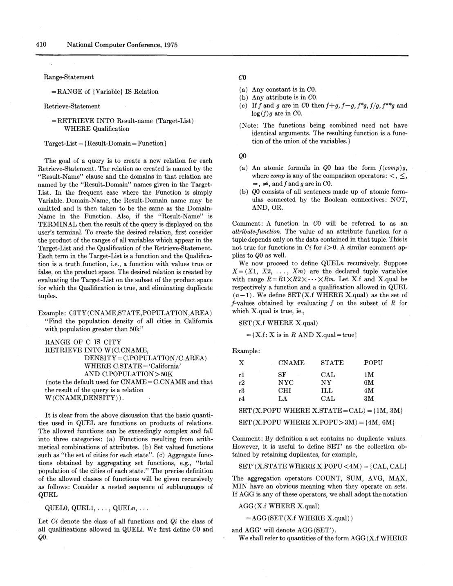
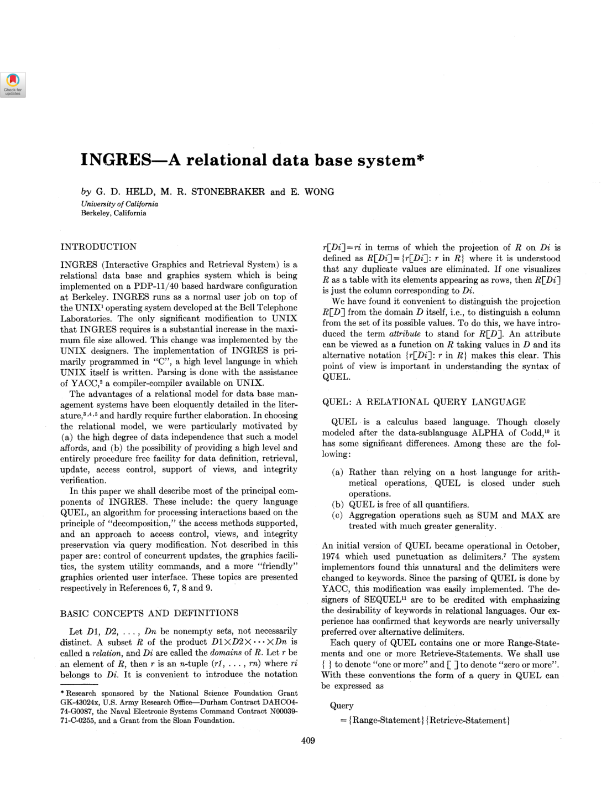

> 本组第 43 篇 · 关系模型与查询语言 · [全部论文]() · [上一篇]() · [下一篇]()

INGRES的处理路线有两条轴：降低函数/聚合语言层次，以及减少元组变量数量，不能把QUEL下标直接当成表数。本文同时展示集合与多重集聚合、局部筛选和投影、元组替换启发式、可插拔访问调用，以及访问控制、完整性和视图的查询修改。

原文明确承认启发式非最优并标出实现进度，未提供系统性能基准。完整性示例按更新后值过滤，不等于整句原子回滚；视图定义和重写间还有需保留的展示缺口。报告用原页引文及有限算例解释这些边界，不补造现代实现。

本文保留论文陈述、读者推断与待验证方案的区别；实验数字只适用于原文条件。原文和翻译来自已有 AI 辅助精读报告，已做来源匹配与编辑复核，不等于人工逐项核验或独立实验复现。所有页码均为 PDF 物理页。

## 论文与阅读范围

G. D. Held, M. R. Stonebraker, E. Wong. INGRES—A Relational Data Base System. National Computer Conference, 1975, pp.409-416. 共8个PDF物理页；印刷页=物理页+408。

[论文集中的原始 PDF](https://github.com/lonng/db-papers/blob/4ff1331069c7cf52ac97dd769e5f484c1c35c200/papers/essentials/ingres%3A-a-relational-data-base-system.pdf) · 本地来源：`essentials/ingres_-a-relational-data-base-system.pdf`，共 8 页。

本篇保留 22 组原文精读和 22 条证据。截图为原始 PDF 的局部页选，不是重新生成的图表；未将整份 PDF 复制到博客。

## 研究问题与实现边界

INGRES尝试在关系模型上提供非过程化的查询、更新、访问控制、视图与完整性设施。PDP-11/40、UNIX普通用户作业、C与YACC是实现背景；作者说主要操作系统修改是扩展最大文件大小。它不是一份所有年代都适用的安装说明，也不支持“普通用户作业必不能自管I/O”之类推断。

并发更新控制、图形、系统工具与友好界面被明确排除。排除并发章节不证明系统只允许单用户，也不能据此给它认定某种隔离或恢复保证。本文关注语言与处理机制，尚未提供完整生产系统性能评测。

实现进度也要逐项读：写作时QUEL0可用，QUEL1预计1975年4月，访问控制已工作，其他查询修改较远。预计不是确认日期，简单示意不是全部功能成熟的证据。

依据：论文陈述；PDF 物理页 1, 7。证据：[ING01](#evidence-ing01), [ING02](#evidence-ing02), [ING21](#evidence-ing21), [ING22](#evidence-ing22)。

## 语言层次、执行分解与访问接口

最先纠正下标：QUELn按函数Cn和qualification Qn的递归能力分层，n不是元组变量数。QUEL0能有多个RANGE变量及跨变量属性比较；“多变量QUEL0”在第5页被直接作为算法输入。因此只支持QUEL0不能被改写成只支持单表、完全没有join。

查询语义先以变量范围积空间定义，再在qualification为真的组合上求目标列表、去重生成关系；这不是要求实现先物化整个笛卡尔积。SET与SET′、AGG与AGG′显式区分去重与保留重复。全局aggregate只依赖范围R，aggregate-function还通过分组表达式X.g依赖当前元组X。

处理层把聚合层次降低与变量数降低分开，底层执行单变量QUEL0或QUEL1请求。访问方法共同提供取下一元组、键定位、扫描起点等动作，细节指向其他文献。不能把这一早期调用族直接称成完整现代Volcano接口。

依据：论文陈述；PDF 物理页 2, 3, 5, 6。证据：[ING03](#evidence-ing03), [ING04](#evidence-ing04), [ING05](#evidence-ing05), [ING06](#evidence-ing06), [ING12](#evidence-ing12), [ING14](#evidence-ing14)。

*原论文 PDF 物理页 2，版权归原作者或出版方。点击图片可查看原尺寸。这是页面定位信息，不表示本次已复核图内所有数据。*

## 两条分解轴与具体步骤

**聚合层次QUELn→QUEL(n−1)**
对AGG(X.f BY X.g WHERE qual)，TEMP0先保留满足内部qual的f、g；TEMP1求已有g组的聚合；TEMP2为在原范围里出现、但没有合格内部元组的g组补空集聚合值。再把临时结果按g连接回原查询，以Z.C替换原聚合表达式。若缺少g或qual，原文另规定跳过部分补组步骤，不能照抄为所有情况都做五步。

**多变量QUEL0→单变量QUEL0**
把qualification写成合取范式。对每个变量先收集所需属性及仅依赖它的子条件，执行投影与局部筛选以缩小范围；再取元组数最少的变量，逐个实际元组代入，减少一个变量，对每次结果继续递归。

读者构造例：部门关系只有D1、D2两条，员工关系有dept与name。先筛选本地条件，再依次把部门变量代成D1、D2，执行带常量部门条件的单变量员工查询，集合并结果。这是语义演示而非真实基准，不能仅凭两条部门记录证明总成本最优。

此外，后半算法明确排除set-valued functions，但允许集合。用集合函数代替全称量化仍可能造成按条件取值反复求集合的组合开销；不能将该限制隐去后宣称完整语言所有查询已有统一高效解。

依据：论文陈述；PDF 物理页 4, 5, 6。证据：[ING07](#evidence-ing07), [ING08](#evidence-ing08), [ING09](#evidence-ing09), [ING11](#evidence-ing11), [ING12](#evidence-ing12), [ING13](#evidence-ing13)。

## 空集、改写与完成度不能混淆

集合与bag不同会改变聚合值：读者测试[10,10,20]的SUM(SET)为30，SUM′(SET′)为40。投影和临时结果的去重不能随意省略，否则分解语义可能变化。一般基数顺序启发式非最优也只涉及代价，不等于结果不正确。

第5页约定空SUM与COUNT为0、AVG未定义且报错、MAX为域最小可能值、MIN为域最大值。第3页纽约组MAX显示0，应结合人口域最小值解释，不把它自动当SQL NULL，也不仅凭负无穷记号就宣布矛盾。

完整性示例增加的是对更新后1.1*salary的约束。第7页原图为≤21K，文本层丢失等号；字面机制是过滤掉超限涨薪元组，不是整条语句报错回滚。18000变19800，19500仍19500的读者算例不证明原系统有事务级原子约束。

视图示例DEFINE片段未列F.E#=J.E#，后面的更新重写却补出了这条条件；报告保留这个展示缺口，不暗补后称原段完整。重写更新目标是JOB工资列，FAMILY用于定位，不是同时修改两张表，更不是任意连接视图都可更新的通用证明。

依据：读者推断；PDF 物理页 2, 5, 7。证据：[ING04](#evidence-ing04), [ING05](#evidence-ing05), [ING10](#evidence-ing10), [ING19](#evidence-ing19), [ING20](#evidence-ing20)。

## 论文证据与读者测试

原文给出语言示例、处理流程、访问方式和进度陈述，但没有自有查询基准的吞吐、延迟、I/O对照、数据规模、重复次数及误差。PDP-11/40是实现环境，不能据硬件名自行填性能结果；访问控制可工作也不是安全性和故障恢复的完整验证。

本报告实际运行的是Python有限列表算例，记录于qa/ingres-reader-tests.json：集合SUM为30对保留重复SUM′40；对工资[18000,19500]按字面重写得到[19800,19500]。这不是原INGRES运行、SQL执行或多用户故障测试。

文本与图像之间的差异也列为证据边界：第7页≤被提取为<，结尾QUEL1下标也易丢；第3页0与第5页域底值需要上下文。视觉核对只覆盖3、5、7页，不声称所有公式或被引实现均已验证。

依据：读者推断；PDF 物理页 1, 2, 5, 7。证据：[ING01](#evidence-ing01), [ING05](#evidence-ing05), [ING10](#evidence-ing10), [ING19](#evidence-ing19), [ING21](#evidence-ing21), [ING22](#evidence-ing22)。

*原论文 PDF 物理页 1，版权归原作者或出版方。点击图片可查看原尺寸。这是页面定位信息，不表示本次已复核图内所有数据。*

## 访问方法与统一改写的取舍

五种存储模式是无序表、哈希、保序地址计算，以及后两者各自的压缩版。哈希面向键等值访问；保序映射可缩小局部扫描；前缀压缩有空间/I/O收益，也有每次编码解码的CPU代价。没有压缩率与盈亏点实验，不能给出选型倍数。

保序地址计算的参数可从无到数据页数，设计和参数选择在另文讨论。不能无证据断言参数越多则扫描范围必单调缩小或维护成本已测得。存储和二级索引目前由关系所有者选择，自动选择是将来时。

query modification以广义query涵盖更新，将权限、完整性与视图放到同一语言改写路径。统一机制的价值不等于零额外开销，原文也没有证明它一定比任何直接路径慢。更不能因同用合取谓词，就把行访问过滤、更新后约束、视图语义与事务恢复归为同一正确性命题。

依据：论文陈述；PDF 物理页 6, 7。证据：[ING14](#evidence-ing14), [ING15](#evidence-ing15), [ING16](#evidence-ing16), [ING17](#evidence-ing17), [ING18](#evidence-ing18), [ING19](#evidence-ing19)。

## 对现代内核的研究问题

可保留的比较维度是职责边界，而非未经源码核对的继承谱。语言的聚合层次和变量数量是两条轴；等价变换、执行顺序启发式与物理访问代价也应分开。只写“早期贪心、现代CBO”会掩盖这些不同问题。

若研究现代优化器，可问：局部谓词/列裁剪如何保持引用与重数；相关聚合空组如何处理；选择变量替换时有哪些成本；权限与视图重写如何保持目标身份及失败语义。具体StarRocks、Calcite、DuckDB或其他引擎的规则与代码，本次均未读，不能从这些提问反推它们已采用或已解决某项机制。

原文有清晰的工程坦诚：最少元组启发式一般非最优，完整语言优化远未充分解决，自动物理选择还属计划。应保留这些限制，而非把所有原型选择美化为已验证的普遍规律。

依据：读者推断；PDF 物理页 2, 5, 6, 7。证据：[ING03](#evidence-ing03), [ING08](#evidence-ing08), [ING11](#evidence-ing11), [ING13](#evidence-ing13), [ING15](#evidence-ing15), [ING20](#evidence-ing20)。

## 可做的最小语义复现

先写只处理有限关系集合的QUEL0解释器，覆盖多变量属性比较、布尔组合、目标投影与去重。用直接枚举积空间作为小输入参考语义，再与局部筛选/投影及tuple substitution结果比较。参考枚举只是测试oracle，不是建议实际大表全乘积。

再增加SET/SET′及一个聚合层次，明确空SUM、COUNT、AVG、MIN、MAX的域规则，逐步验证TEMP0/1/2及回接；把语言下标与变量数分别记录。必须单独验证分组键存在而内部筛选为空的情形。

最后模拟权限合取、更新后约束过滤和一个明确补足键条件的视图重写，同时保留原文展示缺口。若希望整句失败回滚，需另设计事务语义，不能冒称原文已有。原PDP/UNIX代码、实际物理访问和并发恢复未复现；上述除两个有限算例外均为计划。

依据：待验证的工程设想；PDF 物理页 2, 5, 6, 7。证据：[ING03](#evidence-ing03), [ING04](#evidence-ing04), [ING05](#evidence-ing05), [ING08](#evidence-ing08), [ING09](#evidence-ing09), [ING10](#evidence-ing10), [ING12](#evidence-ing12), [ING18](#evidence-ing18), [ING19](#evidence-ing19), [ING20](#evidence-ing20)。

## 结论

这篇早期INGRES论文展示了把高层关系语言分解到可执行请求、把访问方式藏在共同调用后、以及用查询改写统一处理若干系统问题的路线。最重要的阅读纪律是沿语言语义、算法变换、代价选择和实现进度逐层判断，不从一个示意跨越到完整成熟系统结论。

本报告由当前Codex实际补写，含22段原文精读，修正了QUELn等于n个变量、QUEL0无join、完整性必整句拒绝等误读。原API draft及其费用记录保持原样，不修补为“接口成功”。方法和视觉范围已显式说明，技术解释仍需人工复核。

依据：读者推断；PDF 物理页 2, 5, 6, 7。证据：[ING03](#evidence-ing03), [ING08](#evidence-ing08), [ING13](#evidence-ing13), [ING19](#evidence-ing19), [ING21](#evidence-ing21), [ING22](#evidence-ing22)。

## 原文精读：从句子回到机制

以下保留原文、忠实翻译、含义与边界；假设示例不作为论文实验结果。

### P001 · PDF 物理页 1

**原文**

<blockquote class="paper-source-quote"><pre><code>INGRES runs as a normal user job on top of &#10;the UNIX1 operating system developed at the Bell Telephone &#10;Laboratories.</code></pre></blockquote>

**忠实翻译**

> INGRES以普通用户作业运行在贝尔实验室开发的UNIX之上。

**技术含义与边界**

> PDP-11/40、C、YACC与扩展最大文件大小是原文环境；不是不经核查的现代移植方案。

**常见误读**

> 不能推断普通用户作业就绝不可能自主管理页缓存或I/O。

**读者构造的假设示例**

> 读者例：操作系统承载方式与数据库访问方法契约是两个层次。

### P002 · PDF 物理页 1

**原文**

<blockquote class="paper-source-quote"><pre><code>Not described in this &#10;paper are: control of concurrent updates, the graphics facili-&#10;ties, the system utility commands, and a more "friendly" &#10;graphics oriented user interface.</code></pre></blockquote>

**忠实翻译**

> 本文不描述并发更新控制、图形设施、系统工具命令及更友好的图形界面。

**技术含义与边界**

> 这些是排除项，不表示系统必然单用户或没有对应研究。

**常见误读**

> 没有并发章节不能反推已证明某隔离级别。

**读者构造的假设示例**

> 读者例：查询分解实验不能代替事务恢复与并发正确性测试。

### P003 · PDF 物理页 2

**原文**

<blockquote class="paper-source-quote"><pre><code>Let Ci denote the class of all functions and Qi the class of &#10;all qualifications allowed in QUELi.</code></pre></blockquote>

**忠实翻译**

> Ci表示QUELi允许的函数类，Qi表示其允许的qualification类。

**技术含义与边界**

> 语言下标表示递归函数/聚合层次，不是元组变量个数。

**常见误读**

> QUEL0不等于零变量或单表，QUELn也不等于n表join。

**读者构造的假设示例**

> 读者例：两个变量只用属性比较和布尔连接，仍可处于Q0。

### P004 · PDF 物理页 2

**原文**

<blockquote class="paper-source-quote"><pre><code>evaluating the Target-List on the subset of the product space &#10;for which the Qualification is true, and eliminating duplicate &#10;tuples.</code></pre></blockquote>

**忠实翻译**

> 在qualification为真的积空间子集上计算目标列表，并消除重复元组。

**技术含义与边界**

> 这是查询的关系集合结果语义，不要求实际物化整个笛卡尔积。

**常见误读**

> 逻辑定义不能直接当作实现必须全乘积的性能下界。

**读者构造的假设示例**

> 读者例：同一名字经多个匹配组合生成，最终集合结果会去重。

### P005 · PDF 物理页 2

**原文**

<blockquote class="paper-source-quote"><pre><code>By definition a set contains no duplicate values. &#10;However, it is useful to define SET' as the collection ob-&#10;tained by retaining duplicates</code></pre></blockquote>

**忠实翻译**

> 集合按定义不含重复；不过定义保留重复的SET′也很有用。

**技术含义与边界**

> 未加撇AGG作用于集合，加撇AGG′作用于SET′，二者对重复计数不同。

**常见误读**

> 不能把SUM与SUM′在所有输入上当成相同函数。

**读者构造的假设示例**

> 已运行读者例：[10,10,20]的集合SUM为30，保留重复SUM′为40。

### P006 · PDF 物理页 3

**原文**

<blockquote class="paper-source-quote"><pre><code>unlike ag-&#10;gregates, is a function of both X and R and will be called an &#10;aggregate-function. It is a function of X through X.g and &#10;only through X.g.</code></pre></blockquote>

**忠实翻译**

> aggregate-function不同于全局aggregate，它既依赖X也依赖整个R，对X的依赖只通过分组表达式X.g。

**技术含义与边界**

> 全局聚合对当前X不变，分组聚合随X的分组值而变。

**常见误读**

> 不能把变量出现次数直接理解为新增独立循环变量。

**读者构造的假设示例**

> 读者例：两条同州城市记录可得到同一州分组聚合值。

### P007 · PDF 物理页 4

**原文**

<blockquote class="paper-source-quote"><pre><code>The &#10;role of set functions in the Qualification is to take the place &#10;of the universal quantifier. They are not allowed in the Target &#10;List because the result would be a relation with set-valued &#10;elements, i.e., an unnormalized relation.</code></pre></blockquote>

**忠实翻译**

> qualification里的集合函数代替全称量词；目标列表不允许它们，否则结果元素为集合、形成非规范化关系。

**技术含义与边界**

> 语言无显式量词不等于无法表达相应筛选；集合与计数可承担角色。

**常见误读**

> 不能把set-valued与普通标量aggregate混称同一类。

**读者构造的假设示例**

> 读者例：返回每州一个城市集合与筛选满足集合等式的州，是不同结果类型。

### P008 · PDF 物理页 5

**原文**

<blockquote class="paper-source-quote"><pre><code>those queries in QUEL &#10;which do not contain set functions. Sets, however, will be &#10;allowed.</code></pre></blockquote>

**忠实翻译**

> 后续分解算法针对不含集合值函数的QUEL查询，但允许集合。

**技术含义与边界**

> 常量集合或已求得集合与依赖当前条件的集合函数有别。

**常见误读**

> 不要把该段宣称为已无条件解决所有允许的集合值函数查询。

**读者构造的假设示例**

> 读者例：判断x是否属于常量集合，不必生成随每个外层组变化的集合对象。

### P009 · PDF 物理页 5

**原文**

<blockquote class="paper-source-quote"><pre><code>The purpose of this statement is twofold: &#10;to convert the multivariable range R into a single &#10;relation TEMPO and to delineate the tuples which &#10;satisfy qual.</code></pre></blockquote>

**忠实翻译**

> TEMP0步骤既把多变量范围转成一个关系，也划定满足qual的元组。

**技术含义与边界**

> 后续TEMP1聚合已出现组，TEMP2补缺少组，再回接原查询。

**常见误读**

> 这是聚合层次降低；不是选了最小表就自动完成所有聚合处理。

**读者构造的假设示例**

> 读者例：分组键在范围里出现但无行满足内部筛选时，仍需定义空聚合。

### P010 · PDF 物理页 5

**原文**

<blockquote class="paper-source-quote"><pre><code>MAX(&lt;£) = — oo (i.e., the smallest possible value &#10;for that domain)</code></pre></blockquote>

**忠实翻译**

> MAX空集取负无穷，原文将其解释为该域最小可能值。（保留文本层空集符号。）

**技术含义与边界**

> 第3页纽约组示例给0；若人口域最小为0，这与域最小值约定可以一致。

**常见误读**

> 不要自动当成现代SQL NULL，也不应仅凭0与−∞文字就宣告矛盾。

**读者构造的假设示例**

> 读者例：限定非负人口域时，底值与一般实数扩展域的负无穷需要区分。

### P011 · PDF 物理页 5

**原文**

<blockquote class="paper-source-quote"><pre><code>limit the &#10;range of each variable in the original query to as small &#10;a relation as possible by projecting and by enforcing &#10;the part of the Qualification which operates only on &#10;this variable.</code></pre></blockquote>

**忠实翻译**

> 通过投影及执行仅作用于该变量的qualification，把每个变量范围缩到尽可能小。

**技术含义与边界**

> 先做局部筛选和列裁剪，再选变量替换；这是成本与状态缩减。

**常见误读**

> 不能删掉仍被跨变量条件或目标引用的列。

**读者构造的假设示例**

> 读者例：只需部门号和名字时，不必携带不参与后续计算的大字段。

### P012 · PDF 物理页 5

**原文**

<blockquote class="paper-source-quote"><pre><code>Take the variable with the fewest tuples in its range &#10;and substitute in turn the actual values of its tuples. &#10;This reduces the number of variables by 1.</code></pre></blockquote>

**忠实翻译**

> 选取范围元组数最少的变量，依次代入真实元组值，将变量数降低1。

**技术含义与边界**

> 这是多变量QUEL0阶段的tuple substitution；不要与QUELn降低聚合层次混淆。

**常见误读**

> 它是顺序选择启发式，不是代价最优证明或搜索剪枝完备性结论。

**读者构造的假设示例**

> 读者例：先把一个两行部门关系代入，再执行带部门常量的员工查询。

### P013 · PDF 物理页 6

**原文**

<blockquote class="paper-source-quote"><pre><code>Our criterion of &#10;choosing the variable with the fewest values is by no &#10;means optimal in general.</code></pre></blockquote>

**忠实翻译**

> 选择值最少变量这一标准，一般并不最优。

**技术含义与边界**

> 作者把最耗时步骤的顺序选择明确列为工程近似。

**常见误读**

> 最小基数不等于考虑所有索引、选择率和中间结果后的最小总成本。

**读者构造的假设示例**

> 读者例：较大但有高选择性索引的另一变量可能产生不同代价；本文未给实测反例。

### P014 · PDF 物理页 6

**原文**

<blockquote class="paper-source-quote"><pre><code>more can &#10;be added easily by implementing a common set of access &#10;calls (get next tuple, get unique tuple with equality on &#10;offered key, find starting point of a scan, etc.).</code></pre></blockquote>

**忠实翻译**

> 实现一组共同访问调用即可增加访问方式，如get-next、按提供键等值取唯一元组、找扫描起点。

**技术含义与边界**

> 统一的是逻辑调用契约；完整参数与细节在引用资料中，不在本文给出。

**常见误读**

> 不能倒套成已实现现代Volcano全部open/next/close接口。

**读者构造的假设示例**

> 读者例：堆扫描与哈希定位可提供同一类上层所需动作，但成本与能力不同。

### P015 · PDF 物理页 6

**原文**

<blockquote class="paper-source-quote"><pre><code>a &#10;relation owner can decide both the relation storage and what &#10;secondary indices (if any) to construct. Soon both decisions &#10;will be done automatically by the system.</code></pre></blockquote>

**忠实翻译**

> 目前关系所有者决定存储方式与二级索引；很快两项将由系统自动决定。

**技术含义与边界**

> 自动物理设计是计划，不是本文已发布的自动调参控制器。

**常见误读**

> 不要拿将来时作为已工作功能。

**读者构造的假设示例**

> 读者例：复现应先固定人工选择的存储布局，再评测机制。

### P016 · PDF 物理页 6

**原文**

<blockquote class="paper-source-quote"><pre><code>These two access methods are useful when a large &#10;space saving will result in decreased I/O activity. Of &#10;course, the price paid is coding and decoding tuples &#10;at each access.</code></pre></blockquote>

**忠实翻译**

> 这两种压缩访问方式在大幅节省空间可减少I/O时有用，代价是每次访问的元组编码和解码。

**技术含义与边界**

> 五种存储模式含无序、哈希、保序地址计算及后两者压缩版，不是五个独立顶级索引族。

**常见误读**

> 未提供压缩率与CPU/I/O盈亏点实验，不能填具体收益。

**读者构造的假设示例**

> 读者例：节省一页读取是否抵消解码成本，需要负载与硬件实测。

### P017 · PDF 物理页 6

**原文**

<blockquote class="paper-source-quote"><pre><code>QUERY MODIFICATION &#10;A high-level and nonprocedural language has benefits be-&#10;yond its power and ease of use. For our purposes a major &#10;benefit will be the possibility of solving a number of system &#10;problems in a unified way, viz., by query modification. Here &#10;"query" is to be interpreted broadly to include the update &#10;commands as well.</code></pre></blockquote>

**忠实翻译**

> 这里query按广义理解，也包括更新命令。（摘录从词query开始。）

**技术含义与边界**

> query modification统一讨论权限、完整性和视图，不能只理解成只读SELECT优化。

**常见误读**

> 它并未因此证明任意更新语义的原子性或可串行化。

**读者构造的假设示例**

> 读者例：给更新条件增加约束，与决定事务失败后是否整条回滚是两回事。

### P018 · PDF 物理页 6

**原文**

<blockquote class="paper-source-quote"><pre><code>The Qualification of every RESTRICT state-&#10;ment for a given user is appended to the Qualification of &#10;every one of his interactions by conjunction (i.e., AND).</code></pre></blockquote>

**忠实翻译**

> 对特定用户，将每条RESTRICT的qualification与其每次交互条件作合取AND。

**技术含义与边界**

> 重写把准入条件推入操作路径；聚合等复杂情况另有说明和引用。

**常见误读**

> 不能仅凭简单行谓词推导完备无泄露的现代安全证明。

**读者构造的假设示例**

> 读者例：查JONES工资还要满足自己是JONES或其经理，否则无结果。

### P019 · PDF 物理页 7

**原文**

<blockquote class="paper-source-quote"><pre><code>Each update command which potentially vio-&#10;lates the integrity constraint will be filtered by the INTEG-&#10;RITY statement. This is done by appending qualification &#10;from the INTEGRITY Statement.</code></pre></blockquote>

**忠实翻译**

> 可能违反完整性约束的更新用INTEGRITY过滤，办法是附加其qualification。

**技术含义与边界**

> 示例检查的是更新后的1.1*SALARY≤21K；原文图像有≤，提取层漏掉等号。

**常见误读**

> 过滤掉违规元组不同于整条语句报错并原子回滚。

**读者构造的假设示例**

> 已运行读者例：18000升为19800，而19500的涨薪被过滤，仍19500。

### P020 · PDF 物理页 7

**原文**

<blockquote class="paper-source-quote"><pre><code>Any interaction referencing a relation which is &#10;the "Result" of a DEFINE statement is translated into an &#10;interaction referencing the relations declared in the RANGE &#10;of the DEFINE statement.</code></pre></blockquote>

**忠实翻译**

> 引用DEFINE结果关系的交互，被翻译成引用其RANGE所声明实际关系的交互。

**技术含义与边界**

> 示例用JOB、FAMILY解释旧EMPLOYEE视图；DEFINE片段未写连接条件，而后面的更新重写补出F.E#=J.E#。

**常见误读**

> 保留这个展示缺口，不能悄悄补定义后声称原片段完全自洽。

**读者构造的假设示例**

> 读者例：需明确实体键关系后再判断旧视图重建，不能把笛卡尔积误认为预期员工行。

### P021 · PDF 物理页 7

**原文**

<blockquote class="paper-source-quote"><pre><code>At the time of writing of this paper only &#10;QUELO queries are permitted.</code></pre></blockquote>

**忠实翻译**

> 撰写时只允许QUEL0查询。

**技术含义与边界**

> 这是语言层次完成度，QUEL0自身可含多个元组变量；不等于仅单表无join。

**常见误读**

> 结尾预计QUEL1于1975年4月实现，访问控制已工作，其他重写仍在较远计划。

**读者构造的假设示例**

> 读者例：只用属性与布尔比较的两变量查询可仍为QUEL0，不能因有两个RANGE就改称QUEL2。

### P022 · PDF 物理页 7

**原文**

<blockquote class="paper-source-quote"><pre><code>Access control is the first of the query-modification &#10;features to be implemented, and is now working.</code></pre></blockquote>

**忠实翻译**

> 访问控制是首个实现的query-modification功能，且已在工作。

**技术含义与边界**

> 实现进度须逐项看：不把视图和完整性示意全算成熟功能，也不把整篇全算空想。

**常见误读**

> 预计时间不是实际完成日期，更不是完整性能验证。

**读者构造的假设示例**

> 读者例：功能可工作与已对照验证吞吐、恢复和权限边界是不同证据等级。

## 尚未解决的问题

1. 原DEFINE示例未列连接条件，完整版本如何声明并保存键条件？
2. QUEL1聚合分解对bag与空组的完整证明及实现细节需另核查。
3. 如何把原文更新过滤与期望的事务原子失败语义明确区分并实现？

## 证据索引

证据编号沿用原报告，便于将上文判断追溯到原句。引文匹配只验证位置，不证明解读正确。

**ING01 · PDF 物理页 1**

PDP-11/40、C、YACC与扩展最大文件大小是原文环境；不是不经核查的现代移植方案。 不能推断普通用户作业就绝不可能自主管理页缓存或I/O。

<blockquote class="paper-source-quote"><pre><code>INGRES runs as a normal user job on top of &#10;the UNIX1 operating system developed at the Bell Telephone &#10;Laboratories.</code></pre></blockquote>

**ING02 · PDF 物理页 1**

这些是排除项，不表示系统必然单用户或没有对应研究。 没有并发章节不能反推已证明某隔离级别。

<blockquote class="paper-source-quote"><pre><code>Not described in this &#10;paper are: control of concurrent updates, the graphics facili-&#10;ties, the system utility commands, and a more "friendly" &#10;graphics oriented user interface.</code></pre></blockquote>

**ING03 · PDF 物理页 2**

语言下标表示递归函数/聚合层次，不是元组变量个数。 QUEL0不等于零变量或单表，QUELn也不等于n表join。

<blockquote class="paper-source-quote"><pre><code>Let Ci denote the class of all functions and Qi the class of &#10;all qualifications allowed in QUELi.</code></pre></blockquote>

**ING04 · PDF 物理页 2**

这是查询的关系集合结果语义，不要求实际物化整个笛卡尔积。 逻辑定义不能直接当作实现必须全乘积的性能下界。

<blockquote class="paper-source-quote"><pre><code>evaluating the Target-List on the subset of the product space &#10;for which the Qualification is true, and eliminating duplicate &#10;tuples.</code></pre></blockquote>

**ING05 · PDF 物理页 2**

未加撇AGG作用于集合，加撇AGG′作用于SET′，二者对重复计数不同。 不能把SUM与SUM′在所有输入上当成相同函数。

<blockquote class="paper-source-quote"><pre><code>By definition a set contains no duplicate values. &#10;However, it is useful to define SET' as the collection ob-&#10;tained by retaining duplicates</code></pre></blockquote>

**ING06 · PDF 物理页 3**

全局聚合对当前X不变，分组聚合随X的分组值而变。 不能把变量出现次数直接理解为新增独立循环变量。

<blockquote class="paper-source-quote"><pre><code>unlike ag-&#10;gregates, is a function of both X and R and will be called an &#10;aggregate-function. It is a function of X through X.g and &#10;only through X.g.</code></pre></blockquote>

**ING07 · PDF 物理页 4**

语言无显式量词不等于无法表达相应筛选；集合与计数可承担角色。 不能把set-valued与普通标量aggregate混称同一类。

<blockquote class="paper-source-quote"><pre><code>The &#10;role of set functions in the Qualification is to take the place &#10;of the universal quantifier. They are not allowed in the Target &#10;List because the result would be a relation with set-valued &#10;elements, i.e., an unnormalized relation.</code></pre></blockquote>

**ING08 · PDF 物理页 5**

常量集合或已求得集合与依赖当前条件的集合函数有别。 不要把该段宣称为已无条件解决所有允许的集合值函数查询。

<blockquote class="paper-source-quote"><pre><code>those queries in QUEL &#10;which do not contain set functions. Sets, however, will be &#10;allowed.</code></pre></blockquote>

**ING09 · PDF 物理页 5**

后续TEMP1聚合已出现组，TEMP2补缺少组，再回接原查询。 这是聚合层次降低；不是选了最小表就自动完成所有聚合处理。

<blockquote class="paper-source-quote"><pre><code>The purpose of this statement is twofold: &#10;to convert the multivariable range R into a single &#10;relation TEMPO and to delineate the tuples which &#10;satisfy qual.</code></pre></blockquote>

**ING10 · PDF 物理页 5**

第3页纽约组示例给0；若人口域最小为0，这与域最小值约定可以一致。 不要自动当成现代SQL NULL，也不应仅凭0与−∞文字就宣告矛盾。

<blockquote class="paper-source-quote"><pre><code>MAX(&lt;£) = — oo (i.e., the smallest possible value &#10;for that domain)</code></pre></blockquote>

**ING11 · PDF 物理页 5**

先做局部筛选和列裁剪，再选变量替换；这是成本与状态缩减。 不能删掉仍被跨变量条件或目标引用的列。

<blockquote class="paper-source-quote"><pre><code>limit the &#10;range of each variable in the original query to as small &#10;a relation as possible by projecting and by enforcing &#10;the part of the Qualification which operates only on &#10;this variable.</code></pre></blockquote>

**ING12 · PDF 物理页 5**

这是多变量QUEL0阶段的tuple substitution；不要与QUELn降低聚合层次混淆。 它是顺序选择启发式，不是代价最优证明或搜索剪枝完备性结论。

<blockquote class="paper-source-quote"><pre><code>Take the variable with the fewest tuples in its range &#10;and substitute in turn the actual values of its tuples. &#10;This reduces the number of variables by 1.</code></pre></blockquote>

**ING13 · PDF 物理页 6**

作者把最耗时步骤的顺序选择明确列为工程近似。 最小基数不等于考虑所有索引、选择率和中间结果后的最小总成本。

<blockquote class="paper-source-quote"><pre><code>Our criterion of &#10;choosing the variable with the fewest values is by no &#10;means optimal in general.</code></pre></blockquote>

**ING14 · PDF 物理页 6**

统一的是逻辑调用契约；完整参数与细节在引用资料中，不在本文给出。 不能倒套成已实现现代Volcano全部open/next/close接口。

<blockquote class="paper-source-quote"><pre><code>more can &#10;be added easily by implementing a common set of access &#10;calls (get next tuple, get unique tuple with equality on &#10;offered key, find starting point of a scan, etc.).</code></pre></blockquote>

**ING15 · PDF 物理页 6**

自动物理设计是计划，不是本文已发布的自动调参控制器。 不要拿将来时作为已工作功能。

<blockquote class="paper-source-quote"><pre><code>a &#10;relation owner can decide both the relation storage and what &#10;secondary indices (if any) to construct. Soon both decisions &#10;will be done automatically by the system.</code></pre></blockquote>

**ING16 · PDF 物理页 6**

五种存储模式含无序、哈希、保序地址计算及后两者压缩版，不是五个独立顶级索引族。 未提供压缩率与CPU/I/O盈亏点实验，不能填具体收益。

<blockquote class="paper-source-quote"><pre><code>These two access methods are useful when a large &#10;space saving will result in decreased I/O activity. Of &#10;course, the price paid is coding and decoding tuples &#10;at each access.</code></pre></blockquote>

**ING17 · PDF 物理页 6**

query modification统一讨论权限、完整性和视图，不能只理解成只读SELECT优化。 它并未因此证明任意更新语义的原子性或可串行化。

<blockquote class="paper-source-quote"><pre><code>QUERY MODIFICATION &#10;A high-level and nonprocedural language has benefits be-&#10;yond its power and ease of use. For our purposes a major &#10;benefit will be the possibility of solving a number of system &#10;problems in a unified way, viz., by query modification. Here &#10;"query" is to be interpreted broadly to include the update &#10;commands as well.</code></pre></blockquote>

**ING18 · PDF 物理页 6**

重写把准入条件推入操作路径；聚合等复杂情况另有说明和引用。 不能仅凭简单行谓词推导完备无泄露的现代安全证明。

<blockquote class="paper-source-quote"><pre><code>The Qualification of every RESTRICT state-&#10;ment for a given user is appended to the Qualification of &#10;every one of his interactions by conjunction (i.e., AND).</code></pre></blockquote>

**ING19 · PDF 物理页 7**

示例检查的是更新后的1.1*SALARY≤21K；原文图像有≤，提取层漏掉等号。 过滤掉违规元组不同于整条语句报错并原子回滚。

<blockquote class="paper-source-quote"><pre><code>Each update command which potentially vio-&#10;lates the integrity constraint will be filtered by the INTEG-&#10;RITY statement. This is done by appending qualification &#10;from the INTEGRITY Statement.</code></pre></blockquote>

**ING20 · PDF 物理页 7**

示例用JOB、FAMILY解释旧EMPLOYEE视图；DEFINE片段未写连接条件，而后面的更新重写补出F.E#=J.E#。 保留这个展示缺口，不能悄悄补定义后声称原片段完全自洽。

<blockquote class="paper-source-quote"><pre><code>Any interaction referencing a relation which is &#10;the "Result" of a DEFINE statement is translated into an &#10;interaction referencing the relations declared in the RANGE &#10;of the DEFINE statement.</code></pre></blockquote>

**ING21 · PDF 物理页 7**

这是语言层次完成度，QUEL0自身可含多个元组变量；不等于仅单表无join。 结尾预计QUEL1于1975年4月实现，访问控制已工作，其他重写仍在较远计划。

<blockquote class="paper-source-quote"><pre><code>At the time of writing of this paper only &#10;QUELO queries are permitted.</code></pre></blockquote>

**ING22 · PDF 物理页 7**

实现进度须逐项看：不把视图和完整性示意全算成熟功能，也不把整篇全算空想。 预计时间不是实际完成日期，更不是完整性能验证。

<blockquote class="paper-source-quote"><pre><code>Access control is the first of the query-modification &#10;features to be implemented, and is now working.</code></pre></blockquote>

## 版本与使用边界

- 原 PDF SHA256：`ce3f853e902ffb1c7bce5ba6e083a5d60313127b7c8852e13dcfb0c650a45a77`。
- 报告来源：`codex-current-session`；此处按已完成报告整理，没有重新请求模型。
- OCR 记录页：[]；低文本页：[]。
- 本次新增页面截图，未据此自动重写原报告的数值、公式或实验结论；原有“未进行图像识别”限制仍适用于分析生成过程。
- 截图与短引仅服务于论文评论，版权归原作者或出版方；正式发布前复查转载范围和授权。
- 本文保留未核实的书目信息及研究问题，不用现代产品行为替代历史论文的证据。

前序报告保留的书目与阅读过程记录

G. D. Held, M. R. Stonebraker, E. Wong. INGRES—A Relational Data Base System. National Computer Conference, 1975, pp.409-416. 共8个PDF物理页；印刷页=物理页+408。

本报告由当前Codex会话实际撰写，实读PDF物理1-8页，视觉核对3、5、7页。API两块全文笔记为背景；draft call395虽finish_reason=stop且JSON完整，但paper段缺证据ID，并含QUEL层次等误读，原响应保留，不当完成稿或伪补原API。读者算例已用Python运行，不是原INGRES性能或事务测试。engine=codex-current-session，usage=None；不将先前API用量算成本稿用量。仍为AI待复核稿。

