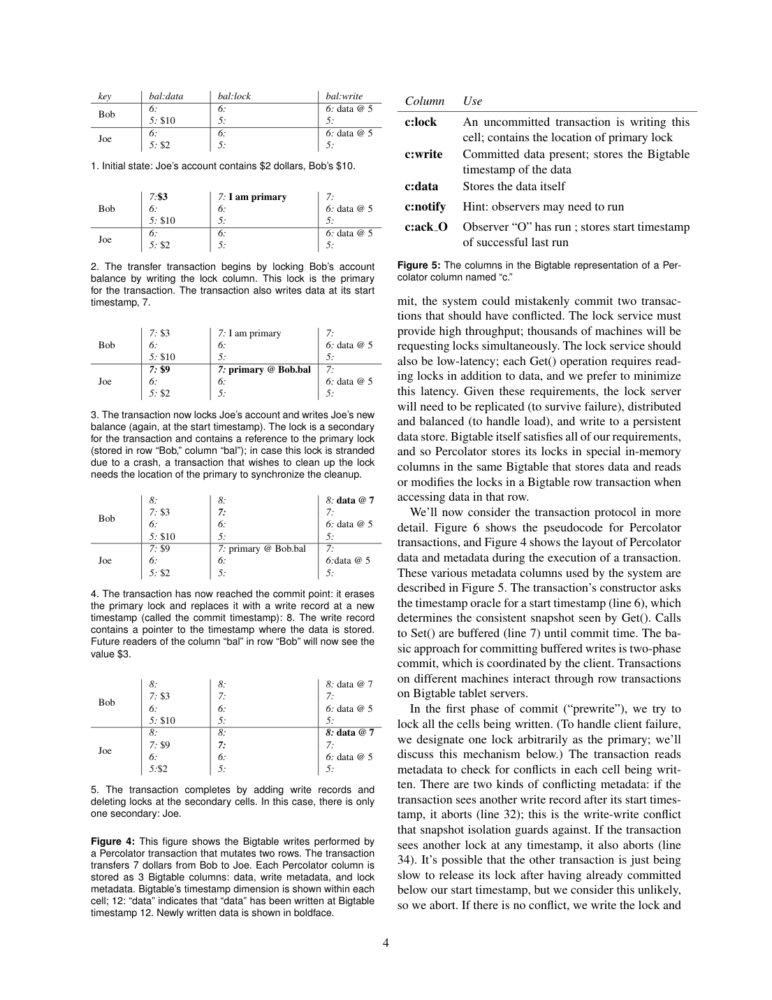
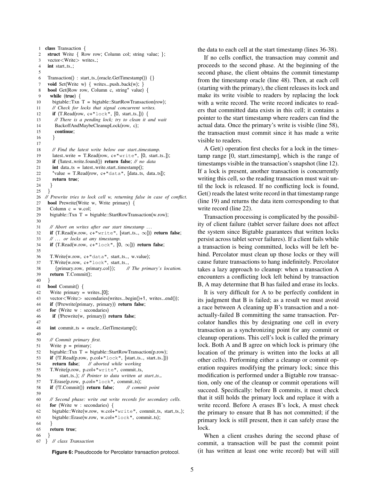

> 本组第 66 篇 · 事务与并发控制 · [全部论文]() · [上一篇]() · [下一篇]()

Percolator把Bigtable的随机访问与单行原子性组合为跨行/跨表快照隔离事务，并以observer组织增量处理。事务在start_ts写data和持久锁，所有prewrite成功后才取commit_ts，在primary行事务内以write记录替换主锁决定提交，secondary可随后完成或由读者roll-forward。读者先查可能影响其快照的锁，再由commit_ts下的write指向start_ts数据，不能直接选data最新版本。

它不是可串行化数据库，也不是每事件exactly-once工作流。强通知允许多写折叠，保证的是相应observer事务至多一个提交；weak notification还允许单次通知导致多个提交。通知与触发写是不同事务，不能承载必须同时成立的数据库不变量。资源换新鲜度是核心权衡：生产Caffeine约两倍资源；TPC-E-like取消一项热点写且不满足延迟要求，不能当官方TPC-E成绩。

本文保留论文陈述、读者推断与待验证方案的区别；实验数字只适用于原文条件。原文和翻译来自已有 AI 辅助精读报告，已做来源匹配与编辑复核，不等于人工逐项核验或独立实验复现。所有页码均为 PDF 物理页。

## 论文与阅读范围

Daniel Peng、Frank Dabek，Large-scale Incremental Processing Using Distributed Transactions and Notifications。本地14页，页脚与物理页一致；正文说明系统自2010年4月用于Google索引。此报告只读本地版本，不核查当前实现或后继产品。

[论文集中的原始 PDF](https://github.com/lonng/db-papers/blob/4ff1331069c7cf52ac97dd769e5f484c1c35c200/papers/transaction/large-scale-incremental-processing-using-distributed-transactions-and-notifications.pdf) · 本地来源：`transaction/large-scale-incremental-processing-using-distributed-transactions-and-notifications.pdf`，共 14 页。

本篇保留 36 组原文精读和 42 条证据。截图为原始 PDF 的局部页选，不是重新生成的图表；未将整份 PDF 复制到博客。

## 研究问题与适用边界

**为何需要增量而非再跑全库**
网页去重、反向链接与规范URL之间有跨新旧文档关系，只对新增页做旧MapReduce流程不够；全库重扫则让新文档等待与仓库大小相关。Percolator希望用随机访问和索引，让新增文档只触发有关状态与后续工作。

**适用边界**
作者明确不替代所有批处理：整体排序等难拆小更新的任务适合MapReduce，不需要强一致的任务可只用Bigtable，小规模计算可用DBMS。数据库能力与大规模随机访问之间的空隙是背景，不是2026产品能力排名。

**两个原语**
跨行快照隔离事务维持一次变更的原子性；observer跟踪哪些计算需要再做。两者必须分开：通知不与触发写同事务，不能仅用observer保证触发时即时不变量。

依据：论文陈述；PDF 物理页 2, 3, 4, 6, 7, 13。证据：[PC-SRC-01](#evidence-pc-src-01), [PC-SRC-02](#evidence-pc-src-02), [PC-SRC-03](#evidence-pc-src-03), [PC-SRC-04](#evidence-pc-src-04), [PC-SRC-12](#evidence-pc-src-12), [PC-SRC-13](#evidence-pc-src-13), [PC-SRC-26](#evidence-pc-src-26)。

## 系统架构与核心组件

**库式事务叠在Bigtable上**
worker把Get/Set/Commit转成Bigtable行事务和RPC；Bigtable依靠GFS持久化。data、lock、write列分别存值、意图/primary位置及提交指针；notify和每observer的ack组织增量工作。普通扫描建议锁无须持久，而事务锁必须跨失败保留。

**两个小服务角色不同**
严格递增时间戳oracle确定start/commit先后；Chubby活跃token和锁墙钟帮助判断何时清理；轻量建议锁只减少重复扫描。不能将其中任一个误写成负责所有事务提交的中心协调器。

**触发图**
初始加载触发文档处理，再触发聚类及导出。observer代码静态链接并显式注册，用户须避免无限通知环。强通知可折叠，多次写合成一次处理；weak通知甚至允许重复提交。这是重算最新状态的增量系统，而不是保留每个事件的流日志。

依据：论文陈述；PDF 物理页 4, 5, 6, 7。证据：[PC-SRC-04](#evidence-pc-src-04), [PC-SRC-06](#evidence-pc-src-06), [PC-SRC-08](#evidence-pc-src-08), [PC-SRC-10](#evidence-pc-src-10), [PC-SRC-12](#evidence-pc-src-12), [PC-SRC-13](#evidence-pc-src-13), [PC-SRC-14](#evidence-pc-src-14), [PC-SRC-15](#evidence-pc-src-15), [PC-SRC-16](#evidence-pc-src-16), [PC-SRC-17](#evidence-pc-src-17)。

*原论文 PDF 物理页 4，版权归原作者或出版方。点击图片可查看原尺寸。页面文本中定位到：Figure 4: This figure shows the Bigtable writes performed by；Figure 5: The columns in the Bigtable representation of a Per-。这是页面定位信息，不表示本次已复核图内所有数据。*

## 事务算法与执行流程

**事务四个关键步骤**
1. 取start_ts，Get读取其快照，Set缓冲写集合。
2. prewrite每个目标cell：检查start之后write与任意lock；无冲突则在start_ts写data和含primary引用的持久锁。
3. 全部预写完成后才取commit_ts。在primary的Bigtable行事务中检查主锁仍在，写commit_ts→start_ts记录并删主锁；此原子动作决定提交。
4. 在secondary补write并清锁；此阶段失败不能撤销已经提交的primary，须前滚。

**Get与帮助恢复**
读者先查[0,start_ts]的锁，有锁则等待/检查primary；primary已提交就补secondary，未提交则与其提交争夺原子主锁清理。再从快照范围内最新write找到真正data位置。不能直接读最大的data_ts，因为预写数据尚未提交。

**时间戳顺序为何必要**
写者在所有锁已存在后请求commit_ts，读者在收到start_ts后才读。若commit_ts早于reader start，则读者会遇到已提交write或相应锁。第6页证明末尾的“W will block”与上下文Get读者主语不一致；本报告按前文读者遇锁等待解释，不把该代词误写成写者等待读者。

**通知判定**
观察列更新后扫描notify，事务读取观察值及ack，必要时运行observer并更新ack；重复执行靠ack写冲突限制提交。notify仅是提示，不能单凭其存在赋予事务语义。

依据：论文陈述；PDF 物理页 4, 5, 6, 7。证据：[PC-SRC-04](#evidence-pc-src-04), [PC-SRC-05](#evidence-pc-src-05), [PC-SRC-06](#evidence-pc-src-06), [PC-SRC-07](#evidence-pc-src-07), [PC-SRC-08](#evidence-pc-src-08), [PC-SRC-09](#evidence-pc-src-09), [PC-SRC-10](#evidence-pc-src-10), [PC-SRC-11](#evidence-pc-src-11), [PC-SRC-12](#evidence-pc-src-12), [PC-SRC-13](#evidence-pc-src-13), [PC-SRC-14](#evidence-pc-src-14), [PC-SRC-15](#evidence-pc-src-15), [PC-SRC-17](#evidence-pc-src-17)。

## 正确性保证与理论边界

**原子提交与快照隔离不是可串行化**
图3明确同cell并发写最多一个提交，但不同cell的write skew仍可发生。若不变量涉及多个读取对象，要显式设计冲突或更强协议，不能仅因2PC原子写就假定任意读约束成立。

**主锁让误判仍可安全**
故障检测不完美，清理活跃客户端可能浪费工作；安全来自清理和提交都在primary行事务内竞争。主锁提交成功后，secondary必须roll-forward；未提交主锁被清后，原客户端再检查应失败。墙钟超时是何时尝试的策略，不是原子性证明。

**读不主动加锁仍可能等待**
快照读取不获取普通read lock，但Get遇可见区间pending lock必须解决，故不存在无条件无等待读。oracle重启不倒退及prewrite取号顺序支撑快照时点。

**通知边界**
强通知保证的是提交效果，不是每次函数只运行一次，也不保证每次写都独立处理。weak模式更弱。外部副作用、无限通知环及跨中心不变量未被这些保证自动覆盖。

依据：论文陈述；PDF 物理页 2, 3, 4, 5, 6, 7, 13。证据：[PC-SRC-01](#evidence-pc-src-01), [PC-SRC-02](#evidence-pc-src-02), [PC-SRC-03](#evidence-pc-src-03), [PC-SRC-05](#evidence-pc-src-05), [PC-SRC-06](#evidence-pc-src-06), [PC-SRC-07](#evidence-pc-src-07), [PC-SRC-08](#evidence-pc-src-08), [PC-SRC-09](#evidence-pc-src-09), [PC-SRC-10](#evidence-pc-src-10), [PC-SRC-11](#evidence-pc-src-11), [PC-SRC-12](#evidence-pc-src-12), [PC-SRC-13](#evidence-pc-src-13), [PC-SRC-14](#evidence-pc-src-14), [PC-SRC-15](#evidence-pc-src-15), [PC-SRC-17](#evidence-pc-src-17), [PC-SRC-26](#evidence-pc-src-26)。

## 实验设计与性能评估

**生产转换与合成测试分开**
Caffeine处理相同抓取率约两倍资源，文档集合约三倍，文档处理延迟大幅下降；摘要的结果年龄下降50%还包含抓取等其他等待，不能与处理延迟100倍相混。第2页写average、第9页写median over100x，本报告保留各处口径，不把两者视为同一统计量。

**图7：240机器合成聚类**
十亿文档、三个聚类键，键均匀选自750M可能值，平均簇3.3，93%非单例，未覆盖现实极大簇尾部。低抓取率Percolator随机查找显著降低等待；输入接近全库规模时扫描更高效。40%处虚线是超过处理能力后的外推，不能当实测稳态。MapReduce误差条为三运行min/median/max，Percolator为文档P5/P95，不是共同95%置信区间。

**图8与图9**
单tablet缓存内微基准、关闭batch，读相对吞吐0.94，单cell写0.23；时间戳成本不在这个受限瓶颈测量里。TPC-E-like省略broker热点写、不满足TPC-E延迟目标、人工规划索引，磁盘共享大集群而非瓶颈；11至15000总CPU核近线性并非单机结果或官方tpsE。约30倍CPU差距是粗估，非等硬件等语义横评。

**图10故障**
15台tablet server杀三分之一，吞吐下降后在重载及允许重启下恢复。它不证明跨中心故障、零停顿或数据丢失情况下的可用性。

依据：论文陈述；PDF 物理页 8, 9, 10, 11, 12, 13。证据：[PC-SRC-18](#evidence-pc-src-18), [PC-SRC-19](#evidence-pc-src-19), [PC-SRC-20](#evidence-pc-src-20), [PC-SRC-21](#evidence-pc-src-21), [PC-SRC-22](#evidence-pc-src-22), [PC-SRC-23](#evidence-pc-src-23), [PC-SRC-24](#evidence-pc-src-24), [PC-SRC-25](#evidence-pc-src-25), [PC-SRC-26](#evidence-pc-src-26)。

*原论文 PDF 物理页 5，版权归原作者或出版方。点击图片可查看原尺寸。页面文本中定位到：Figure 6: Pseudocode for Percolator transaction protocol.。这是页面定位信息，不表示本次已复核图内所有数据。*

## 工程权衡与设计取舍

**吞吐、鲜度、资源**
避免全库重扫降低小更新等待，但付出大量细粒度RPC、事务元数据、复制与compaction。延迟数秒batch可省RPC，也扩大冲突窗口；作者低竞争负载结论不可无条件套到热点。

**分层与内核集成**
利用Bigtable/GFS减少重新实现持久化和扩展成本，却付出多层序列化、网络、日志和整理的CPU费用。约30倍粗估不是不可优化下界，作者把这留作研究问题。

**快速失败还是惰性清理**
没有全局死锁检测，遗留锁惰性解决可接受十秒级等待，这是增量索引而非交互OLTP的选择。

**通知折叠与事件完整性**
折叠适合“重新计算最新状态”，不适合必须单独处理每个历史事件的协议。weak降低热点冲突却削弱至多一提交语义。复制局限也说明强单中心事务并非免费变成跨地域服务。

依据：读者推断；PDF 物理页 2, 4, 5, 6, 7, 8, 9, 11, 13。证据：[PC-SRC-02](#evidence-pc-src-02), [PC-SRC-05](#evidence-pc-src-05), [PC-SRC-07](#evidence-pc-src-07), [PC-SRC-08](#evidence-pc-src-08), [PC-SRC-12](#evidence-pc-src-12), [PC-SRC-13](#evidence-pc-src-13), [PC-SRC-15](#evidence-pc-src-15), [PC-SRC-17](#evidence-pc-src-17), [PC-SRC-18](#evidence-pc-src-18), [PC-SRC-19](#evidence-pc-src-19), [PC-SRC-23](#evidence-pc-src-23), [PC-SRC-24](#evidence-pc-src-24), [PC-SRC-26](#evidence-pc-src-26)。

## 与相关技术的对比分析

**MapReduce与Percolator**
一个擅长顺序扫描整个集合，一个擅长小比例更新加随机查找。图7展示的是特定仓库/抓取率交叉，不是前者过时或后者永远更快。

**Bigtable与Percolator**
Bigtable提供行级原子及存储；Percolator以客户端协议加跨行快照事务和observer。其代价与适用语义应一起比较，而非只对吞吐数值。

**数据库trigger、物化视图与observer**
observer独立事务且可折叠，不能直接等同同事务trigger。作者也指出原文档解析难全部表达为传统IVM；能被视图维护描述的局部任务不代表整个索引流程都属于同一种代数增量。

**历史其他系统**
文中讨论Sinfonia、CloudTPS等是2010语境，本报告未读其源码或当前版本，不据此作现代功能结论。也不把其他后继系统的事务/复制功能自动归给原Percolator。

依据：读者推断；PDF 物理页 2, 3, 4, 6, 7, 9, 10, 11, 13。证据：[PC-SRC-01](#evidence-pc-src-01), [PC-SRC-03](#evidence-pc-src-03), [PC-SRC-04](#evidence-pc-src-04), [PC-SRC-12](#evidence-pc-src-12), [PC-SRC-13](#evidence-pc-src-13), [PC-SRC-14](#evidence-pc-src-14), [PC-SRC-15](#evidence-pc-src-15), [PC-SRC-17](#evidence-pc-src-17), [PC-SRC-19](#evidence-pc-src-19), [PC-SRC-21](#evidence-pc-src-21), [PC-SRC-22](#evidence-pc-src-22), [PC-SRC-23](#evidence-pc-src-23), [PC-SRC-26](#evidence-pc-src-26)。

## 复现指南与工程挑战

**已经完成的读者例子**
通读14页，视觉核对物理3、4、5、6、9、10、11、12页的协议、图表与伪代码。运行两个医生的SI例子：各从快照读到两人值班，写不同对象，因此可都提交，最后无人值班；这只是人为给定SI规则的有限例子，不是原代码执行。另检查图8吞吐比及改动TPC-E-like的单位，不将它们称作官方成绩。

**未执行的原型计划**
1. 用持久KV和原子行事务建data/lock/write，枚举prewrite中、primary提交前后、secondary处理中崩溃。核对帮助者与客户端主锁竞争，不能只测试正常路径。
2. oracle故障重启跳过预留范围；故意把commit取号移到prewrite前，检查读者是否漏写，区分逻辑顺序与墙钟。
3. 强通知重复扫描、并发执行及message collapsing分别测；weak模式允许重复提交。外部调用加独立幂等/事务投递设计，不把ack当自动exactly-once。
4. 固定更新占仓库比例、热点簇大小、资源及磁盘预算，分别测排队增长、P50/P95/P99、重试与RPC；保留无batch微基准和真实batch路径。
5. 若重跑TPC-E-like，恢复被省略热点写或明确标注差异，并记录延迟约束；不向官方TPC榜单比较认证分数。

依据：待验证的工程设想；PDF 物理页 3, 4, 5, 6, 7, 9, 10, 11, 12, 13。证据：[PC-SRC-03](#evidence-pc-src-03), [PC-SRC-05](#evidence-pc-src-05), [PC-SRC-06](#evidence-pc-src-06), [PC-SRC-07](#evidence-pc-src-07), [PC-SRC-08](#evidence-pc-src-08), [PC-SRC-09](#evidence-pc-src-09), [PC-SRC-10](#evidence-pc-src-10), [PC-SRC-11](#evidence-pc-src-11), [PC-SRC-12](#evidence-pc-src-12), [PC-SRC-13](#evidence-pc-src-13), [PC-SRC-14](#evidence-pc-src-14), [PC-SRC-15](#evidence-pc-src-15), [PC-SRC-17](#evidence-pc-src-17), [PC-SRC-20](#evidence-pc-src-20), [PC-SRC-21](#evidence-pc-src-21), [PC-SRC-22](#evidence-pc-src-22), [PC-SRC-23](#evidence-pc-src-23), [PC-SRC-24](#evidence-pc-src-24), [PC-SRC-25](#evidence-pc-src-25), [PC-SRC-26](#evidence-pc-src-26)。

## 结论与内核工程启示

Percolator把跨行原子提交、可见性时间戳和工作发现组合为大规模增量系统。学习重点是提交决定集中在primary，数据与提交时间分离，secondary能被帮助前滚，以及notify仅提供发现提示而非事务真相。

同样应记住未承诺的内容：SI不保证可串行化，Get可能等待，通知不是每事件exactly-once，跨中心复制不自动保存多行不变量。低更新比例下显著降低新鲜度等待，也须付资源和细粒度操作成本。

新增引文、有限读者测试及结构校验提升的是来源可追溯性；本报告未运行原始Bigtable/GFS/Percolator、生产故障或官方TPC-E，不把它们伪装成已经完成的系统验证。

依据：读者推断；PDF 物理页 2, 3, 5, 6, 7, 9, 10, 11, 13。证据：[PC-SRC-01](#evidence-pc-src-01), [PC-SRC-02](#evidence-pc-src-02), [PC-SRC-03](#evidence-pc-src-03), [PC-SRC-06](#evidence-pc-src-06), [PC-SRC-07](#evidence-pc-src-07), [PC-SRC-08](#evidence-pc-src-08), [PC-SRC-09](#evidence-pc-src-09), [PC-SRC-10](#evidence-pc-src-10), [PC-SRC-11](#evidence-pc-src-11), [PC-SRC-12](#evidence-pc-src-12), [PC-SRC-13](#evidence-pc-src-13), [PC-SRC-14](#evidence-pc-src-14), [PC-SRC-15](#evidence-pc-src-15), [PC-SRC-17](#evidence-pc-src-17), [PC-SRC-19](#evidence-pc-src-19), [PC-SRC-21](#evidence-pc-src-21), [PC-SRC-23](#evidence-pc-src-23), [PC-SRC-24](#evidence-pc-src-24), [PC-SRC-26](#evidence-pc-src-26)。

## 原文精读：从句子回到机制

以下保留原文、忠实翻译、含义与边界；假设示例不作为论文实验结果。

### P001 · PDF 物理页 2

**原文**

<blockquote class="paper-source-quote"><pre><code>Percolator was built specifically for incremental pro-&#10;cessing and is not intended to supplant existing solutions&#10;for most data processing tasks. Computations where the&#10;result can’t be broken down into small updates (sorting&#10;a file, for example) are better handled by MapReduce.&#10;Also, the computation should have strong consistency&#10;requirements; otherwise, Bigtable is sufficient.</code></pre></blockquote>

**忠实翻译**

> Percolator专为增量处理，不打算取代大部分现有处理方案。不能拆成小更新的计算，如文件排序，更适合MapReduce；计算还应需要较强一致性，否则Bigtable已足够。

**技术含义与边界**

> 作者划定的是机制适配边界，而非禁止Percolator应用进行任何批量工作。后文初始载入仍用MapReduce，事务RPC也进行batch；所谓strong必须结合第3页明确的snapshot isolation理解，不是可串行化。

**常见误读**

> 不能把增量等同无batch，也不能凭此段认为所有索引一致性都可交给异步observer即时维护。

**读者构造的假设示例**

> 文档新增后读取有关去重键并更新关联状态适合随机访问；若计算必须遍历所有记录做全局排序，小更新接口未必省工作。这是设计判断，不是本报告复现比较。

### P002 · PDF 物理页 13

**原文**

<blockquote class="paper-source-quote"><pre><code>We considered building the new&#10;indexing system directly on Bigtable, but the complexity&#10;of reasoning about concurrent state modification without&#10;the aid of strong consistency was daunting. Percolator&#10;does not inherit all of Bigtable’s features: it has limited&#10;support for replication of tables across data centers, for&#10;example.</code></pre></blockquote>

**忠实翻译**

> 作者曾考虑直接用Bigtable构建索引，但缺少较强一致性辅助时并发状态推理太复杂。Percolator也没继承Bigtable全部功能，例如跨数据中心表复制支持有限。

**技术含义与边界**

> 后续原文说明底层跨中心复制只按tablet一致，可能破坏多行事务不变量。这里是原系统明确的边界，不应把后继系统跨地域能力反向当作本篇特性。

**常见误读**

> 增加一个“补偿机制”并不自动提供跨中心强事务；SI本身也不保证任意业务不变量。需要完整故障与复制协议，本文没有给出。

**读者构造的假设示例**

> 一次事务改两个tablet的状态，若只复制其中一个后切换地域，可能出现组合不完整。这是解释风险的读者场景，不是原系统已观察到的故障记录。

### P003 · PDF 物理页 7

**原文**

<blockquote class="paper-source-quote"><pre><code>To preserve the transac-&#10;tional semantics of the rest of Percolator, we restrict these&#10;weak notifications to a special type of column that can-&#10;not be written, only notified. The weaker semantics also&#10;mean that multiple observers may run and commit as a&#10;result of a single weak notification (though the system&#10;tries to minimize this occurrence).</code></pre></blockquote>

**忠实翻译**

> weak通知仅能用于一种不能写值、只能通知的特殊列，以免破坏其他事务语义。较弱语义允许单次weak通知触发多个observer运行并提交，系统只尽量减少。

**技术含义与边界**

> “不能写、只能通知”不是普通只读数据列；它是更弱的工作提示接口。强通知依靠ack冲突限制提交，weak模式不具同样承诺，因而可减轻热点通知的事务竞争。

**常见误读**

> 不能把它称为exactly-once投递，也不能把一次通知多个提交仅仅说成多个不同observer：重复同一处理逻辑也应按弱语义考虑。

**读者构造的假设示例**

> 若下游是重新计算某簇的最新规范URL，重复计算可设计成可接受；若每次执行都给账户加钱，就必须另建幂等或事件计数协议。

### P004 · PDF 物理页 12

**原文**

<blockquote class="paper-source-quote"><pre><code>In exchange, we get scalability (our fastest result, though&#10;not directly comparable to TPC-E, is more than 3x the&#10;current official record [33]), and we inherit the useful&#10;features of the systems we build upon, like resilience to&#10;failures. To demonstrate the latter, we ran the benchmark&#10;with 15 tablet servers and allowed the performance to&#10;stabilize. Figure 10 shows the performance of the system&#10;over time. The dip in performance at 17:09 corresponds&#10;to a failure event: we killed a third of the tablet servers.&#10;Performance drops immediately after the failure event&#10;but recovers as the tablets are reloaded by other tablet&#10;servers.</code></pre></blockquote>

**忠实翻译**

> 作者以可扩展性和继承底层容错说明分层收益，并明确其最快数字不能直接与官方TPC-E比较。故障演示用15台tablet server，在17:09杀三分之一，吞吐下降后随其他服务器重载tablet回升。

**技术含义与边界**

> 完整下一句还说明允许被杀服务器重启，最终才恢复原性能。图10是具体配置的故障恢复证据，不是任意规模、永久失去三分之一资源仍零损吞吐的保证。历史三倍官方记录字样亦不构成认证分数比较。

**常见误读**

> 不能把tablet server进程失效等同永久数据丢失，也不能把最终恢复解释成整个过程中无停顿或跨中心容灾成功。

**读者构造的假设示例**

> 读者复现实验应分别记录停止、tablet重分配、恢复服务和服务器重启时点，并量化吞吐下降与积压，而不只输出最终又达到原吞吐。

### P005 · PDF 物理页 4

**原文**

<blockquote class="paper-source-quote"><pre><code>Figure 4: This figure shows the Bigtable writes performed by&#10;a Percolator transaction that mutates two rows. The transaction&#10;transfers 7 dollars from Bob to Joe. Each Percolator column is&#10;stored as 3 Bigtable columns: data, write metadata, and lock&#10;metadata. Bigtable’s timestamp dimension is shown within each&#10;cell; 12: “data” indicates that “data” has been written at Bigtable&#10;timestamp 12.</code></pre></blockquote>

**忠实翻译**

> 图4展示跨两行转账：Bob向Joe转7美元。事务层的data、write元数据、lock元数据分别存于Bigtable列，格内数字表示Bigtable时间戳，如12处写入某值。

**技术含义与边界**

> 需结合图4逐状态阅读：data在start_ts=7预写，write在commit_ts=8指向7；数据存在不等于提交。图5另列通知和ack，因此“三列”是事务状态核心表示，不是所有被观察列永远总共只有三种物理列。

**常见误读**

> 不能直接按data最大时间戳取值，也不能把物理时间戳都当提交序。primary和secondary锁的角色不同，锁信息还包括primary位置。

**读者构造的假设示例**

> 图示初值Bob10/Joe2，预写3/9后总额仍12；在primary提交但secondary未收尾时，读者须依据primary帮助前滚，不能返回半笔转账。

### P006 · PDF 物理页 3

**原文**

<blockquote class="paper-source-quote"><pre><code>tects against write-write conflicts: if transactions A and&#10;B, running concurrently, write to the same cell, at most&#10;one will commit. Snapshot isolation does not provide&#10;serializability; in particular, transactions running under&#10;snapshot isolation are subject to write skew [5]. The main&#10;advantage of snapshot isolation over a serializable proto-&#10;col is more efficient reads.</code></pre></blockquote>

**忠实翻译**

> 并发事务若写同一cell，最多一个提交；快照隔离不是可串行化，可能有write skew。作者以较高效读取说明选择SI的动机。

**技术含义与边界**

> 原子写集合加同cell冲突检查，不能替代对跨对象读约束的验证。读者已运行两医生有限SI例子：都读两人在线、各写自己离线，写集合不相交，最终可同时离线。这个结果是给定SI规则的算例，不是运行Percolator。

**常见误读**

> 既不能把SI夸成消除一切异常，也不能把论文“读较高效”扩成对所有可串行协议、硬件和负载的性能定理。

**读者构造的假设示例**

> 若业务必须至少一人值班，需要引入能让相关事务发生必要冲突或更强隔离的设计；仅把两次更新包进各自2PC不会自动解决。

### P007 · PDF 物理页 5

**原文**

<blockquote class="paper-source-quote"><pre><code>Transaction processing is complicated by the possibil-&#10;ity of client failure (tablet server failure does not affect&#10;the system since Bigtable guarantees that written locks&#10;persist across tablet server failures). If a client fails while&#10;a transaction is being committed, locks will be left be-&#10;hind. Percolator must clean up those locks or they will&#10;cause future transactions to hang indefinitely.</code></pre></blockquote>

**忠实翻译**

> 客户端在提交中失败会留下锁；若不清理，后续事务可能永久等待。括号强调Bigtable保证已写锁跨tablet server失败仍持久。

**技术含义与边界**

> 这里“不受tablet server失败影响”指锁不会消失从而破坏协议，而非吞吐、延迟和可用性完全不受影响。图10恰好展示tablet server故障导致性能下降。客户端遗留锁则由碰到冲突的事务惰性检查/清理。

**常见误读**

> 不要把孤儿锁一律称作死锁，也不要编造有定时GC线程立即清理所有锁；本篇描述的是backoff与按需帮助。

**读者构造的假设示例**

> 客户端完成prewrite后崩溃，后来Get遇锁，通过primary确认未提交并原子清理；若客户端已越过primary提交点，则走前滚而非回滚。

### P008 · PDF 物理页 6

**原文**

<blockquote class="paper-source-quote"><pre><code>We must perform roll-forward on&#10;these transactions. A transaction that encounters a lock&#10;can distinguish between the two cases by inspecting the&#10;primary lock: if the primary lock has been replaced by a&#10;write record, the transaction which wrote the lock must&#10;have committed and the lock must be rolled forward, oth-&#10;erwise it should be rolled back (since we always commit&#10;the primary first, we can be sure that it is safe to roll back&#10;if the primary is not committed).</code></pre></blockquote>

**忠实翻译**

> 需要前滚已越过提交点却遗留锁的事务。遇锁者检查primary：若已由write记录替代则已提交，必须前滚；否则回滚，因为协议总先提交primary。

**技术含义与边界**

> “先主后次”还必须结合第5页主锁行事务同步：清理和原提交都要原子修改同一个primary，所以错误怀疑活客户端也不会让两种结论同时赢。单纯读取主锁后去删secondary不足以避免竞态。

**常见误读**

> 不能见primary仍是锁就绕过主锁原子竞争直接删所有secondary；客户端可能同时提交。也不能把前滚说成重新执行用户业务逻辑。

**读者构造的假设示例**

> 帮助者若先在primary原子清理成功，原客户端之后主锁检查失败；若客户端先写primary提交记录，帮助者补secondary的同一commit_ts写记录，不再回滚。

### P009 · PDF 物理页 8

**原文**

<blockquote class="paper-source-quote"><pre><code>Percolator attempts to predict, each time a column is&#10;read, what other columns in a row will be read later in&#10;the transaction. This prediction is made based on past be-&#10;havior. Prefetching, combined with a cache of items that&#10;have already been read, reduces the number of Bigtable&#10;reads the system would otherwise do by a factor of 10.&#10;Early in the implementation of Percolator, we decided&#10;to make all API calls blocking and rely on running thou-&#10;sands of threads per machine to provide enough par-&#10;allelism to maintain good CPU utilization.</code></pre></blockquote>

**忠实翻译**

> 读取某列时，系统按历史访问行为预取同一行将来可能读取的其他列。预取加缓存使作者系统原本需要的Bigtable读取减少约十倍。应用API选择阻塞调用，并靠每机大量线程保持并行。

**技术含义与边界**

> 同一SSTable块读取/解压的局部性是预取背景；十倍是报告的系统经验而非每种负载承诺。阻塞的应用API与内部网络是否使用异步设施不是同一概念，本文没有凭此证明任何内核调度器普遍高效。

**常见误读**

> 不能把Bigtable读请求数减少十倍等同总运行时间或字节数减少十倍；作者也报告高线程数需要内核/基础设施修复。

**读者构造的假设示例**

> 读者示意：读姓名时顺带缓存常接着访问的地址，能减少后来查找；若地址不再访问则多取了数据。测请求数、字节、命中率和尾延迟才可评价。

### P010 · PDF 物理页 13

**原文**

<blockquote class="paper-source-quote"><pre><code>The utility of parallel databases and, by extension,&#10;a system like Percolator, has been questioned several&#10;times [17] over their history. Hardware trends have, in&#10;the past, worked against parallel databases. CPUs have&#10;become so much faster than disks that a few CPUs in&#10;a shared-memory machine can drive enough disk heads&#10;to service required loads without the complexity of dis-&#10;tributed transactions: the top TPC-E benchmark results&#10;today are achieved on large shared-memory machines&#10;connected to a SAN.</code></pre></blockquote>

**忠实翻译**

> 作者回顾并行数据库的历史质疑：CPU相对磁盘越来越快，少数CPU驱动很多磁盘有时已够用，可避免分布式事务复杂性；当时顶尖TPC-E成绩来自连接SAN的大型共享内存机器。

**技术含义与边界**

> 这是2010语境的背景论证，下一段转向互联网级数据过大而需分布。它不是今天TPC排名事实，也不证明所有本地工作负载都应或不应分布式。

**常见误读**

> 不能给假设机器编造十万tps再当历史证据，不能把SAN吞吐、事务CPU效率和可容纳数据规模当同一尺度。

**读者构造的假设示例**

> 读者选型表分开列容量、单机可用内存、数据访问模式、故障目标和事务延迟；若单机已满足需求，分布式复杂性未必值得；超出容量则需另评扩展代价。

### PC-READ-01 · PDF 物理页 2

**原文**

<blockquote class="paper-source-quote"><pre><code>we currently&#10;implement snapshot isolation semantics [5].</code></pre></blockquote>

**忠实翻译**

> 系统目前实现快照隔离语义。

**技术含义与边界**

> ACID字样不能代替明确的隔离级别，SI仍有write skew。

**常见误读**

> 不能把论文称为可串行化跨行事务实现。

**读者构造的假设示例**

> 两个医生各读到两人值班，再各写不同记录离岗，可没有同cell写冲突但破坏至少一人值班。

### PC-READ-02 · PDF 物理页 2

**原文**

<blockquote class="paper-source-quote"><pre><code>Relaxed latency&#10;requirements let us take, for example, a lazy approach&#10;to cleaning up locks left behind by transactions running&#10;on failed machines. This lazy, simple-to-implement ap-&#10;proach potentially delays transaction commit by tens of&#10;seconds.</code></pre></blockquote>

**忠实翻译**

> 放宽延迟目标允许惰性清理失败事务遗留锁，可能把提交延迟数十秒。

**技术含义与边界**

> 这是为大规模增量处理主动接受的代价。

**常见误读**

> 不能从“增量”推导适合毫秒OLTP或零阻塞。

**读者构造的假设示例**

> 读者碰到遗留锁会等待或清理，与执行器没有主动获取读锁并不矛盾。

### PC-READ-03 · PDF 物理页 3

**原文**

<blockquote class="paper-source-quote"><pre><code>Snapshot isolation does not provide&#10;serializability; in particular, transactions running under&#10;snapshot isolation are subject to write skew [5].</code></pre></blockquote>

**忠实翻译**

> 快照隔离不提供可串行化，尤其会出现write skew。

**技术含义与边界**

> 跨行原子提交确保写集合一起生效，但不保护任意读集合约束。

**常见误读**

> 不要把两阶段提交的原子性与串行隔离混为一谈。

**读者构造的假设示例**

> 两个事务读同一快照却写不同cell，prewrite写冲突检查不必相撞。

### PC-READ-04 · PDF 物理页 4

**原文**

<blockquote class="paper-source-quote"><pre><code>Calls&#10;to Set() are buffered (line 7) until commit time. The ba-&#10;sic approach for committing buffered writes is two-phase&#10;commit, which is coordinated by the client. Transactions&#10;on different machines interact through row transactions&#10;on Bigtable tablet servers.</code></pre></blockquote>

**忠实翻译**

> Set先缓冲至提交，由客户端协调基本两阶段提交，通过Bigtable行事务交互。

**技术含义与边界**

> 写意图暂存与持久prewrite分开，Bigtable提供局部原子支点。

**常见误读**

> 客户端库没有存储访问拦截器，不可依赖进程内锁保证远端一致性。

**读者构造的假设示例**

> Set返回不代表已写入Bigtable，也不代表事务完成。

### PC-READ-05 · PDF 物理页 4

**原文**

<blockquote class="paper-source-quote"><pre><code>if the&#10;transaction sees another write record after its start times-&#10;tamp, it aborts (line 32); this is the write-write conflict&#10;that snapshot isolation guards against. If the transaction&#10;sees another lock at any timestamp, it also aborts (line&#10;34). It’s possible that the other transaction is just being&#10;slow to release its lock after having already committed&#10;below our start timestamp, but we consider this unlikely,&#10;so we abort.</code></pre></blockquote>

**忠实翻译**

> prewrite见start之后的write记录或任意时点的锁均中止；即使锁可能只是旧已提交事务清理慢，也选择中止。

**技术含义与边界**

> 协议故意保守避免复杂推理，但会制造可避免的冲突。

**常见误读**

> 不能说任何锁都证明写者未提交，也不能把预写中止等同于实际逻辑冲突。

**读者构造的假设示例**

> 旧事务已提交而secondary未清，另一个prewrite仍可能失败并退避。

### PC-READ-06 · PDF 物理页 5

**原文**

<blockquote class="paper-source-quote"><pre><code>The write record indicates to read-&#10;ers that committed data exists in this cell; it contains a&#10;pointer to the start timestamp where readers can find the&#10;actual data. Once the primary’s write is visible (line 58),&#10;the transaction must commit since it has made a write&#10;visible to readers.</code></pre></blockquote>

**忠实翻译**

> write记录表示已有提交数据并指向存放data的start时间戳；primary可见后事务必须提交。

**技术含义与边界**

> 提交决定和payload物理时间分开，write是可见性索引。

**常见误读**

> 不能把data在start_ts出现当成已提交，也不能随意回滚已提交primary。

**读者构造的假设示例**

> 图4 data@7与write@8→7：快照8读data7，快照6读旧版本。

### PC-READ-07 · PDF 物理页 5

**原文**

<blockquote class="paper-source-quote"><pre><code>A Get() operation first checks for a lock in the times-&#10;tamp range [0, start timestamp], which is the range of&#10;timestamps visible in the transaction’s snapshot (line 12).&#10;If a lock is present, another transaction is concurrently&#10;writing this cell, so the reading transaction must wait un-&#10;til the lock is released. If no conflicting lock is found,&#10;Get() reads the latest write record in that timestamp range&#10;(line 19) and returns the data item corresponding to that&#10;write record (line 22).</code></pre></blockquote>

**忠实翻译**

> Get先查[0,start]锁，遇锁等待释放；否则读范围内最新write，再按其指针取data。

**技术含义与边界**

> 不获取普通读锁不等于遇到pending写锁时绝不阻塞。

**常见误读**

> 不能直接取data列小于快照的最大时间戳；它可能是未提交预写。

**读者构造的假设示例**

> start=9读secondary时见lock7，须查primary并roll-forward或rollback，再选write。

### PC-READ-08 · PDF 物理页 5

**原文**

<blockquote class="paper-source-quote"><pre><code>Performing either a cleanup or commit op-&#10;eration requires modifying the primary lock; since this&#10;modification is performed under a Bigtable row transac-&#10;tion, only one of the cleanup or commit operations will&#10;succeed.</code></pre></blockquote>

**忠实翻译**

> 清理或提交都必须修改primary锁，Bigtable行事务使二者最多一个成功。

**技术含义与边界**

> 安全依赖主锁上的原子竞争，不依赖完美故障判定。

**常见误读**

> 不能说墙钟超时足以证明对方死亡，或直接删secondary就安全。

**读者构造的假设示例**

> 活跃客户端被误判后若清理赢，客户端提交检查主锁失败并中止；若提交赢则清理转前滚。

### PC-READ-09 · PDF 物理页 6

**原文**

<blockquote class="paper-source-quote"><pre><code>if the primary lock has been replaced by a&#10;write record, the transaction which wrote the lock must&#10;have committed and the lock must be rolled forward, oth-&#10;erwise it should be rolled back</code></pre></blockquote>

**忠实翻译**

> 若primary锁已被write记录替代，则事务已提交，应前滚；否则回滚。

**技术含义与边界**

> secondary引用primary使分散状态共享一个提交结论。

**常见误读**

> 不要为已提交事务的残留secondary选择rollback。

**读者构造的假设示例**

> primary committed、secondary locked时，帮助者补写相同commit_ts的write而不是丢弃data。

### PC-READ-10 · PDF 物理页 6

**原文**

<blockquote class="paper-source-quote"><pre><code>The oracle periodically allocates&#10;a range of timestamps by writing the highest allocated&#10;timestamp to stable storage; given an allocated range of&#10;timestamps, the oracle can satisfy future requests strictly&#10;from memory. If the oracle restarts, the timestamps will&#10;jump forward to the maximum allocated timestamp (but&#10;will never go backwards).</code></pre></blockquote>

**忠实翻译**

> oracle预先把分配范围上界持久化，内存发号；重启跳到已分配上界而不倒退。

**技术含义与边界**

> 批量持久化减少每次时间戳的磁盘开销，安全依靠不重复和严格顺序。

**常见误读**

> 逻辑时间戳不必等于墙钟，也不能只用普通本地时钟替换。

**读者构造的假设示例**

> 已保留1..1000而只发到400，重启后应跳过可能使用范围，不能从401盲续。

### PC-READ-11 · PDF 物理页 6

**原文**

<blockquote class="paper-source-quote"><pre><code>W wrote locks before requesting&#10;its commit timestamp TW . Therefore, the above property&#10;guarantees that W must have at least written all its locks&#10;before R did any reads</code></pre></blockquote>

**忠实翻译**

> 写者先把所有锁写好才请求commit_ts；若TW<TR，读者开始读之前写者锁已存在。

**技术含义与边界**

> 预写、取提交时间、读开始三者顺序是快照可见性的论证核心。

**常见误读**

> 不能先取commit_ts再慢慢prewrite，否则读者可能既看不到锁也看不到已提交写。

**读者构造的假设示例**

> 这是因果顺序，不是要求所有机器墙钟紧同步；图6取号位置不可任意移动。

### PC-READ-12 · PDF 物理页 6

**原文**

<blockquote class="paper-source-quote"><pre><code>the triggered observer runs in a separate trans-&#10;action from the triggering write, so the triggering write&#10;and the triggered observer’s writes are not atomic.</code></pre></blockquote>

**忠实翻译**

> observer在触发写之外的独立事务中运行，二者写不是原子的。

**技术含义与边界**

> 通知组织增量计算而不是自动维护触发时就必须成立的约束。

**常见误读**

> 不要把observer当与原写同事务的数据库trigger。

**读者构造的假设示例**

> 保存新文档后聚类索引可暂时未更新；若该约束必须即时成立，应放入同一事务。

### PC-READ-13 · PDF 物理页 7

**原文**

<blockquote class="paper-source-quote"><pre><code>at most one observer’s&#10;transaction will commit for each change of an observed&#10;column. The converse is not true, however: multiple&#10;writes to an observed column may cause the correspond-&#10;ing observer to be invoked only once. We call this feature&#10;message collapsing, since it helps avoid computation by&#10;amortizing the cost of responding to many notifications.</code></pre></blockquote>

**忠实翻译**

> 每次被观察列变化至多一个observer事务提交，但多次写可只调用一次，称message collapsing。

**技术含义与边界**

> 保证针对提交和被覆盖变化，不是每事件一次调用或外部动作一次。

**常见误读**

> 不能宣称通知队列保存了所有中间事件或exactly-once函数执行。

**读者构造的假设示例**

> 同URL连续新增多条链接，可仅重处理最新整体状态一次。

### PC-READ-14 · PDF 物理页 7

**原文**

<blockquote class="paper-source-quote"><pre><code>if Percolator accidentally starts two transac-&#10;tions concurrently for a particular notification, they will&#10;both see the dirty notification and run the observer, but&#10;one will abort because they will conflict on the acknowl-&#10;edgment column. We promise that at most one observer&#10;will commit for each notification.</code></pre></blockquote>

**忠实翻译**

> 同一通知两个事务都可能运行observer，但它们写ack冲突，最多一个提交。

**技术含义与边界**

> 应用逻辑可被执行多次，事务数据库效果至多一个提交。

**常见误读**

> 在observer内直接发不可回滚外部邮件不能靠ack自动去重。

**读者构造的假设示例**

> 两次函数计算都已执行，一次提交失败后外部HTTP副作用仍需另行处理。

### PC-READ-15 · PDF 物理页 7

**原文**

<blockquote class="paper-source-quote"><pre><code>Since the notify&#10;column is just a Bigtable column, not a Percolator col-&#10;umn, it has no transactional properties and serves only as&#10;a hint to the scanner to check the acknowledgment col-&#10;umn to determine if the observer should be run.</code></pre></blockquote>

**忠实翻译**

> notify仅是普通Bigtable列、无Percolator事务属性，扫描器须再查ack确定是否运行。

**技术含义与边界**

> 提示索引用于发现工作，ack才是事务判定的一部分。

**常见误读**

> 不能把notify单独当权威exactly-once日志。

**读者构造的假设示例**

> 重复或迟到的notify只应导致重查ack，不能直接强制重复提交。

### PC-READ-16 · PDF 物理页 7

**原文**

<blockquote class="paper-source-quote"><pre><code>This lock server need not persist state since it is advisory&#10;and thus is very scalable.</code></pre></blockquote>

**忠实翻译**

> 扫描前的轻量锁是建议性锁，无须持久状态。

**技术含义与边界**

> 它减少重复扫描，与持久事务锁的安全角色不同。

**常见误读**

> 不要把这个锁服务和Bigtable中的primary/secondary锁混淆。

**读者构造的假设示例**

> 扫描建议锁丢失可浪费工作，但不应决定是否允许两个冲突事务都提交。

### PC-READ-17 · PDF 物理页 7

**原文**

<blockquote class="paper-source-quote"><pre><code>The weaker semantics also&#10;mean that multiple observers may run and commit as a&#10;result of a single weak notification (though the system&#10;tries to minimize this occurrence).</code></pre></blockquote>

**忠实翻译**

> weak notification允许单次通知导致多个observer运行并提交，系统只尽量减少。

**技术含义与边界**

> 热点减冲突以更弱去重语义为代价。

**常见误读**

> 强通知的至多一提交不能外推到weak模式。

**读者构造的假设示例**

> 拆成两个observer用weak热点通知衔接时，下游应容忍重算及重复提交效果。

### PC-READ-18 · PDF 物理页 8

**原文**

<blockquote class="paper-source-quote"><pre><code>We create&#10;batches by delaying lock operations for several seconds&#10;to collect them into batches. Because locks are acquired&#10;in parallel, this adds only a few seconds to the latency&#10;of each transaction; we compensate for the additional la-&#10;tency with greater parallelism. Batching also increases&#10;the time window in which conflicts may occur, but in our&#10;low-contention environment this has not proved to be a&#10;problem.</code></pre></blockquote>

**忠实翻译**

> 锁操作延迟数秒收集批次，以更多并行补偿延迟；也扩大冲突窗口，在作者低竞争负载中未成问题。

**技术含义与边界**

> 吞吐优化明确牺牲响应时间且依赖低竞争条件。

**常见误读**

> 不能把batch当所有场景都无代价的加速。

**读者构造的假设示例**

> 同键热点增多时，应同时测batch等待、冲突率和重试总工作。

### PC-READ-19 · PDF 物理页 9

**原文**

<blockquote class="paper-source-quote"><pre><code>Caffeine uses&#10;roughly twice as many resources to process the same&#10;crawl rate.</code></pre></blockquote>

**忠实翻译**

> Caffeine处理相同抓取率约用两倍资源。

**技术含义与边界**

> 文中鲜度收益不是免费，更不是计算资源减半。

**常见误读**

> 100倍处理延迟下降、50%搜索结果年龄下降、两倍资源是不同指标。

**读者构造的假设示例**

> 结果年龄还含抓取前等待，即使索引阶段大幅缩短也不必同倍改善年龄。

### PC-READ-20 · PDF 物理页 9

**原文**

<blockquote class="paper-source-quote"><pre><code>For MapReduce, all&#10;documents finish processing at the same time and error bars&#10;represent the min, median, and max of three runs of the clus-&#10;tering MapReduce. For Percolator, we are able to measure the&#10;delay of individual documents, so the error bars represent the&#10;5th- and 95th-percentile delay on a per-document level.</code></pre></blockquote>

**忠实翻译**

> MapReduce误差条为三次运行的最小/中位/最大；Percolator为逐文档5/95分位。

**技术含义与边界**

> 两组误差条统计单位不同。

**常见误读**

> 不可把它们都叫95%置信区间或同一P95。

**读者构造的假设示例**

> 图7两条曲线的误差范围不能直接用统一显著性判定。

### PC-READ-21 · PDF 物理页 10

**原文**

<blockquote class="paper-source-quote"><pre><code>The dotted asymptote at 40%&#10;is an extrapolation of Percolator’s performance beyond&#10;this breaking point.</code></pre></blockquote>

**忠实翻译**

> 40%处虚线渐近线是超过崩溃容量点后的性能外推。

**技术含义与边界**

> 当输入超过持续处理能力，积压无界增长，不是某个有限高延迟稳态。

**常见误读**

> 别把虚线说成实际测得无限延迟，也不能以低负载结果保证高输入。

**读者构造的假设示例**

> 观测队列增长率比只记录已完成任务延迟更能识别过载。

### PC-READ-22 · PDF 物理页 10

**原文**

<blockquote class="paper-source-quote"><pre><code>All data was in the tablet&#10;server’s cache during the experiments and Percolator’s&#10;batching optimizations were disabled.</code></pre></blockquote>

**忠实翻译**

> 微基准全部数据在单tablet server缓存中，禁用Percolator批处理优化。

**技术含义与边界**

> 约四倍写开销属于单cell提交且无batch的特定路径。

**常见误读**

> 不能直接代表磁盘吞吐、分布式端到端开销或时间戳服务成本。

**读者构造的假设示例**

> 图8读14590/15513≈0.9405，写7232/31003≈0.2333，吞吐比例不是增加的延迟百分比。

### PC-READ-23 · PDF 物理页 11

**原文**

<blockquote class="paper-source-quote"><pre><code>we don’t attempt to meet the&#10;TPC-E latency targets. Our average transaction latency is&#10;2 to 5 seconds, but outliers can take several minutes. Out-&#10;liers are caused by, for example, exponential backoff on&#10;conflicts and Bigtable tablet unavailability. Finally, we&#10;made a small modification to the TPC-E transactions. In&#10;TPC-E, each trade result increases the broker’s commis-&#10;sion and increments his trade count. Each broker services&#10;a hundred customers, so the average broker must be up-&#10;dated once every 5 seconds, which causes repeated write&#10;conflicts in Percolator. In Percolator, we would imple-&#10;ment this feature by writing the increment to a side table&#10;and periodically aggregating each broker’s increments;&#10;for the benchmark, we choose to simply omit this write.</code></pre></blockquote>

**忠实翻译**

> TPC-E-like不满足延迟目标，平均事务2-5秒、尾部分钟；为避broker热点省去佣金/交易计数写。

**技术含义与边界**

> 它是有意修改的合成扩展性测试，不能作为官方TPC-E结果。

**常见误读**

> 不能把未实现side-table聚合方案写成此基准已做的优化。

**读者构造的假设示例**

> 恢复被省略broker写，预期需重新测冲突，不能沿用原吞吐数字。

### PC-READ-24 · PDF 物理页 11

**原文**

<blockquote class="paper-source-quote"><pre><code>disk bandwidth&#10;is not a factor in the system’s performance. In this ex-&#10;periment, we configured the benchmark with increasing&#10;numbers of customers and measured both the achieved&#10;performance and the number of cores used by all parts&#10;of the system including cores used for background main-&#10;tenance such as Bigtable compactions. The relationship&#10;between performance and resource usage is essentially&#10;linear across several orders of magnitude, from 11 cores&#10;to 15,000 cores.</code></pre></blockquote>

**忠实翻译**

> 测试共享较大生产集群磁盘资源，磁盘带宽不构成瓶颈；总CPU含compaction等后台，11到15000核近线性。

**技术含义与边界**

> CPU横轴不是单机核数，线性条件不覆盖磁盘瓶颈。

**常见误读**

> 不能称单节点15000核实验，或把含后台总核与仅应用线程不加区别比较。

**读者构造的假设示例**

> 固定磁盘预算后加CPU可能不再落在该曲线。

### PC-READ-25 · PDF 物理页 12

**原文**

<blockquote class="paper-source-quote"><pre><code>we killed a third of the tablet servers.&#10;Performance drops immediately after the failure event&#10;but recovers as the tablets are reloaded by other tablet&#10;servers. We allowed the killed tablet servers to restart so&#10;performance eventually returns to the original level.</code></pre></blockquote>

**忠实翻译**

> 实验杀死三分之一tablet server，性能先降、表在其他服务器重载后回升，并允许被杀服务器重启恢复原水平。

**技术含义与边界**

> 这是15台tablet server故障恢复测试，不是永久丢失三分之一数据。

**常见误读**

> 不能宣称零抖动、零停顿或跨数据中心容灾已由该图证明。

**读者构造的假设示例**

> 图10约17:09下降，最终恢复伴随后来重启，不等于只靠剩余机器永远同吞吐。

### PC-READ-26 · PDF 物理页 13

**原文**

<blockquote class="paper-source-quote"><pre><code>not inherit all of Bigtable’s features: it has limited&#10;support for replication of tables across data centers, for&#10;example. Since Bigtable’s cross data center replication&#10;strategy is consistent only on a per-tablet basis, replica-&#10;tion is likely to break invariants between writes in a dis-&#10;tributed transaction. Unlike Dynamo and PNUTS which&#10;serve responses to users, Percolator is willing to accept&#10;the lower availability of a single data center in return for&#10;stricter consistency.</code></pre></blockquote>

**忠实翻译**

> 跨数据中心复制支持有限，Bigtable按tablet一致的复制可能破坏分布式事务不变量；系统接受单中心较低可用性换强语义。

**技术含义与边界**

> 原系统不自动继承底层全部能力。

**常见误读**

> 不要把后继系统的跨地域协议倒灌为本篇功能。

**读者构造的假设示例**

> 多行事务分属不同tablet时，逐tablet复制切换不保证它们在同一提交边界。

## 尚未解决的问题

1. 图6省略了哪些实现细节，例如同事务Get读取尚在Set缓冲的写、只读事务提交、失败回执和幂等重试？不能把简化伪代码当完整API。
2. 活跃快照下的版本/锁/write记录回收协议在本篇未完整展开，如何证明不会删除读者所需版本？
3. notify只是提示时，崩溃、迟到清理与新通知交错的完整发现/重试协议是什么？本文并未给所有状态机。
4. strong与weak通知混用时，哪些业务变更可折叠，哪些必须逐事件保留并另行幂等？
5. TPC-E-like恢复被省略的broker热点写后，冲突率、延迟和总CPU曲线如何变化？尚未执行。
6. 在固定磁盘资源、包含现实大簇尾部和持续过载下，批处理与增量处理的交叉点怎样移动？

## 证据索引

证据编号沿用原报告，便于将上文判断追溯到原句。引文匹配只验证位置，不证明解读正确。

**C001N02 · PDF 物理页 2**

适用边界与前提假设：Percolator专为增量处理设计，不适用于无法分解为小更新的计算（如排序文件），此类任务更适合MapReduce。若计算无强一致性要求则直接用Bigtable即可。若计算规模较小，传统DBMS更合适。系统设计受“无需极低延迟”这一前提影响，允许采用惰性锁清理策略。

<blockquote class="paper-source-quote"><pre><code>Computations where the result can’t be broken down into small updates (sorting a file, for example) are better handled by MapReduce.</code></pre></blockquote>

**C001N03 · PDF 物理页 2**

Observer机制：Percolator提供observer抽象，当用户指定的列发生变化时由系统调用。应用被结构化为一系列observer，每个observer完成任务后通过写表为下游observer生成工作。外部进程通过向表中写入初始数据触发链中的第一个observer。Worker进程扫描Bigtable寻找变更列（notifications）并以函数调用方式执行observer。

<blockquote class="paper-source-quote"><pre><code>Percolator provides observers: pieces of code that are invoked by the system whenever a user-specified column changes.</code></pre></blockquote>

**C001N07 · PDF 物理页 4**

数据结构与不变量：Percolator利用Bigtable的(row, column, timestamp)多维有序映射。为支持快照隔离，内部将每个cell表示为按时间戳索引的一系列值。每个Percolator列在Bigtable中表示为3个特殊列：c:data（存数据）、c:write（已提交数据的元数据，存data的Bigtable时间戳）、c:lock（未提交事务正在写此cell，包含primary lock的位置）。另有c:notify和c:ack O用于observer。

<blockquote class="paper-source-quote"><pre><code>Each Percolator column is stored as 3 Bigtable columns: data, write metadata, and lock metadata.</code></pre></blockquote>

**C001N11 · PDF 物理页 3**

正确性与完备性限制：Percolator实现的是ACID快照隔离语义，但不提供可串行化（serializability）。具体而言，快照隔离下的事务会受到write skew异常的影响。其相对于可串行化协议的主要优势在于读操作更高效：因为任何时间戳都代表一致性快照，读cell只需在给定时间戳执行Bigtable查找，无需获取锁。

<blockquote class="paper-source-quote"><pre><code>Snapshot isolation does not provide serializability; in particular, transactions running under snapshot isolation are subject to write skew</code></pre></blockquote>

**C002N01 · PDF 物理页 5**

Percolator事务采用两阶段提交（2PC）。每个事务指定writes[0]为primary cell。Prewrite阶段按顺序先锁primary再锁secondaries；Commit阶段先在primary上写入write record并删除lock（此为commit point），随后异步在secondaries上执行相同操作。一旦primary的write可见，事务即视为已提交，不可回滚。Get操作读取[start_ts, start_ts]范围内的最新write record，并通过其指向的start timestamp读取data列。

<blockquote class="paper-source-quote"><pre><code>Once the primary’s write is visible (line 58), the transaction must commit since it has made a write visible to readers.</code></pre></blockquote>

**C002N03 · PDF 物理页 6**

客户端崩溃后的惰性清理机制：当且仅当事务A遇到事务B遗留的lock时，A才尝试清理。为避免活着的B与清理者A发生竞态，所有清理和提交操作必须同步于primary lock。由于修改primary lock在Bigtable行事务内执行，保证了互斥。若primary lock仍存在，说明B未提交，A可安全回滚（擦除lock）；若primary lock已被替换为write record，说明B已越过commit point，A必须前滚（roll-forward），替B补全secondary的write record。

<blockquote class="paper-source-quote"><pre><code>if the primary lock has been replaced by a write record, the transaction which wrote the lock must have committed and the lock must be rolled forward</code></pre></blockquote>

**C002N04 · PDF 物理页 5**

正确性前提假设：1) Bigtable保证tablet server故障不会导致已写入的lock丢失（持久化）；2) 时间戳Oracle严格单调递增；3) 总是先提交primary，因此若primary未提交则可安全判定整个事务未提交并回滚。此外，判断客户端存活依赖Chubby中的token及lock中记录的wall time，长事务需周期性更新wall time以免被误杀。

<blockquote class="paper-source-quote"><pre><code>tablet server failure does not affect the system since Bigtable guarantees that written locks persist across tablet server failures</code></pre></blockquote>

**C002N05 · PDF 物理页 6**

Timestamp Oracle是单点服务，负责分配严格递增的时间戳。为提高吞吐，Oracle将一段连续时间戳的最高值写入稳定存储进行批量分配，后续请求直接由内存满足。重启后时间戳会向前跳跃但绝不回退。客户端worker通过维护单个pending RPC来跨事务批量请求时间戳，负载越高批处理自然越大。单机Oracle每秒可分发约2百万个时间戳。

<blockquote class="paper-source-quote"><pre><code>Our oracle serves around 2 million timestamps per second from a single machine.</code></pre></blockquote>

**C002N08 · PDF 物理页 7**

分布式扫描notify列以发现脏数据的工程优化：notify列存放在独立的Bigtable locality group中，使扫描只需读取百万级脏单元而非万亿级总单元。Worker随机选择tablet和key开始扫描。为防止多线程聚集（platooning/bus clumping现象）导致局部过载，当线程发现自己正扫描其他线程所在的同一行时，会重新随机选择表中的位置跳转。扫描前行级advisory lock避免重复工作。

<blockquote class="paper-source-quote"><pre><code>when a scanning thread discovers that it is scanning the same row as another thread, it chooses a new random location in the table to scan</code></pre></blockquote>

**C002N09 · PDF 物理页 7**

弱通知（weak notification）机制作为反例和补充：当大量重复页面并发处理导致热点冲突时，强事务性通知会导致频繁abort。为此引入仅写Bigtable notify列的非事务性弱通知，限制其只能用于特殊类型的列。代价是丧失了“至多一个observer提交”的保证，单次弱通知可能导致多个observer运行并提交。这反映了在低冲突环境与高冲突热点之间模型适用边界的权衡。

<blockquote class="paper-source-quote"><pre><code>The weaker semantics also mean that multiple observers may run and commit as a result of a single weak notification</code></pre></blockquote>

**C002N10 · PDF 物理页 8**

RPC开销优化：原始Prewrite需要读-改-写两步RPC。通过扩展Bigtable API增加conditional mutations将其合并为单步RPC。进一步将发往同一tablet server的条件写延迟数秒进行批处理（batching），利用并行加锁掩盖延迟。读操作同样延迟批处理，并结合基于历史行为预测的预取（prefetching）——因为读取同行多列与读一列的SSTable块I/O成本相同。这些优化将Bigtable读次数降低了10倍。

<blockquote class="paper-source-quote"><pre><code>Prefetching, combined with a cache of items that have already been read, reduces the number of Bigtable reads the system would otherwise do by a factor of 10.</code></pre></blockquote>

**C003N10 · PDF 物理页 12**

容错实验在TPC-E基准稳定运行时，杀掉15个tablet server中的三分之一（33% tablet server mortality）。图10显示TPS在故障后立即下降，随着tablet被其他服务器重新加载而恢复，最终重启被杀节点后性能回到原始水平。这验证了系统依赖底层Bigtable/GFS机制实现故障恢复的能力。

<blockquote class="paper-source-quote"><pre><code>To demonstrate the latter, we ran the benchmark with 15 tablet servers and allowed the performance to stabilize. Figure 10 shows the performance of the system over time. The dip in performance at 17:09 corresponds to a failure event: we killed a third of the tablet servers.</code></pre></blockquote>

**C003N11 · PDF 物理页 12**

相关工作指出Percolator通过为聚类键建立索引避免了MapReduce重复扫描全量仓库的开销。对于DryadInc等允许worker随机读取基础仓库同时仅map新数据的中间方案，若用于聚类可能需要为每个聚类阶段维护独立仓库。Percolator实现了snapshot isolation，通过在分布式系统中扩展multi-version timestamp ordering并使用two-phase commit。Observer的角色类比于传统数据库中物化视图的增量维护。

<blockquote class="paper-source-quote"><pre><code>Percolator implements snapshot isolation [5] by extending multi-version timestamp ordering [6] across a distributed system using two-phase commit.</code></pre></blockquote>

**C004N02 · PDF 物理页 13**

硬件趋势曾不利于并行数据库：CPU速度远超磁盘，使得共享内存机器上少量CPU即可驱动足够多的磁头满足负载，无需分布式事务的复杂性。当前顶级TPC-E基准测试结果由连接SAN的大型共享内存机器取得。但该趋势正在逆转，因为互联网级数据集已超出单机处理能力。

<blockquote class="paper-source-quote"><pre><code>CPUs have become so much faster than disks that a few CPUs in a shared-memory machine can drive enough disk heads</code></pre></blockquote>

**C004N05 · PDF 物理页 13**

Percolator在Bigtable之上扩展了多行分布式事务，并提供observer接口使应用围绕数据变更通知进行结构化。作者曾考虑直接在Bigtable上构建新索引系统，但在缺乏强一致性辅助的情况下推理并发状态修改的复杂性令人望而生畏。这解释了引入事务层的动机。

<blockquote class="paper-source-quote"><pre><code>the complexity of reasoning about concurrent state modification without the aid of strong consistency was daunting.</code></pre></blockquote>

**C004N07 · PDF 物理页 13**

与直接面向用户服务的Dynamo和PNUTS不同，Percolator愿意接受单数据中心的较低可用性，以换取更严格的一致性。这表明Percolator的设计前提是后台索引构建场景可以容忍短暂不可用，但不容忍不一致。

<blockquote class="paper-source-quote"><pre><code>Percolator is willing to accept the lower availability of a single data center in return for stricter consistency.</code></pre></blockquote>

**PC-SRC-01 · PDF 物理页 2**

ACID字样不能代替明确的隔离级别，SI仍有write skew。

<blockquote class="paper-source-quote"><pre><code>we currently&#10;implement snapshot isolation semantics [5].</code></pre></blockquote>

**PC-SRC-02 · PDF 物理页 2**

这是为大规模增量处理主动接受的代价。

<blockquote class="paper-source-quote"><pre><code>Relaxed latency&#10;requirements let us take, for example, a lazy approach&#10;to cleaning up locks left behind by transactions running&#10;on failed machines. This lazy, simple-to-implement ap-&#10;proach potentially delays transaction commit by tens of&#10;seconds.</code></pre></blockquote>

**PC-SRC-03 · PDF 物理页 3**

跨行原子提交确保写集合一起生效，但不保护任意读集合约束。

<blockquote class="paper-source-quote"><pre><code>Snapshot isolation does not provide&#10;serializability; in particular, transactions running under&#10;snapshot isolation are subject to write skew [5].</code></pre></blockquote>

**PC-SRC-04 · PDF 物理页 4**

写意图暂存与持久prewrite分开，Bigtable提供局部原子支点。

<blockquote class="paper-source-quote"><pre><code>Calls&#10;to Set() are buffered (line 7) until commit time. The ba-&#10;sic approach for committing buffered writes is two-phase&#10;commit, which is coordinated by the client. Transactions&#10;on different machines interact through row transactions&#10;on Bigtable tablet servers.</code></pre></blockquote>

**PC-SRC-05 · PDF 物理页 4**

协议故意保守避免复杂推理，但会制造可避免的冲突。

<blockquote class="paper-source-quote"><pre><code>if the&#10;transaction sees another write record after its start times-&#10;tamp, it aborts (line 32); this is the write-write conflict&#10;that snapshot isolation guards against. If the transaction&#10;sees another lock at any timestamp, it also aborts (line&#10;34). It’s possible that the other transaction is just being&#10;slow to release its lock after having already committed&#10;below our start timestamp, but we consider this unlikely,&#10;so we abort.</code></pre></blockquote>

**PC-SRC-06 · PDF 物理页 5**

提交决定和payload物理时间分开，write是可见性索引。

<blockquote class="paper-source-quote"><pre><code>The write record indicates to read-&#10;ers that committed data exists in this cell; it contains a&#10;pointer to the start timestamp where readers can find the&#10;actual data. Once the primary’s write is visible (line 58),&#10;the transaction must commit since it has made a write&#10;visible to readers.</code></pre></blockquote>

**PC-SRC-07 · PDF 物理页 5**

不获取普通读锁不等于遇到pending写锁时绝不阻塞。

<blockquote class="paper-source-quote"><pre><code>A Get() operation first checks for a lock in the times-&#10;tamp range [0, start timestamp], which is the range of&#10;timestamps visible in the transaction’s snapshot (line 12).&#10;If a lock is present, another transaction is concurrently&#10;writing this cell, so the reading transaction must wait un-&#10;til the lock is released. If no conflicting lock is found,&#10;Get() reads the latest write record in that timestamp range&#10;(line 19) and returns the data item corresponding to that&#10;write record (line 22).</code></pre></blockquote>

**PC-SRC-08 · PDF 物理页 5**

安全依赖主锁上的原子竞争，不依赖完美故障判定。

<blockquote class="paper-source-quote"><pre><code>Performing either a cleanup or commit op-&#10;eration requires modifying the primary lock; since this&#10;modification is performed under a Bigtable row transac-&#10;tion, only one of the cleanup or commit operations will&#10;succeed.</code></pre></blockquote>

**PC-SRC-09 · PDF 物理页 6**

secondary引用primary使分散状态共享一个提交结论。

<blockquote class="paper-source-quote"><pre><code>if the primary lock has been replaced by a&#10;write record, the transaction which wrote the lock must&#10;have committed and the lock must be rolled forward, oth-&#10;erwise it should be rolled back</code></pre></blockquote>

**PC-SRC-10 · PDF 物理页 6**

批量持久化减少每次时间戳的磁盘开销，安全依靠不重复和严格顺序。

<blockquote class="paper-source-quote"><pre><code>The oracle periodically allocates&#10;a range of timestamps by writing the highest allocated&#10;timestamp to stable storage; given an allocated range of&#10;timestamps, the oracle can satisfy future requests strictly&#10;from memory. If the oracle restarts, the timestamps will&#10;jump forward to the maximum allocated timestamp (but&#10;will never go backwards).</code></pre></blockquote>

**PC-SRC-11 · PDF 物理页 6**

预写、取提交时间、读开始三者顺序是快照可见性的论证核心。

<blockquote class="paper-source-quote"><pre><code>W wrote locks before requesting&#10;its commit timestamp TW . Therefore, the above property&#10;guarantees that W must have at least written all its locks&#10;before R did any reads</code></pre></blockquote>

**PC-SRC-12 · PDF 物理页 6**

通知组织增量计算而不是自动维护触发时就必须成立的约束。

<blockquote class="paper-source-quote"><pre><code>the triggered observer runs in a separate trans-&#10;action from the triggering write, so the triggering write&#10;and the triggered observer’s writes are not atomic.</code></pre></blockquote>

**PC-SRC-13 · PDF 物理页 7**

保证针对提交和被覆盖变化，不是每事件一次调用或外部动作一次。

<blockquote class="paper-source-quote"><pre><code>at most one observer’s&#10;transaction will commit for each change of an observed&#10;column. The converse is not true, however: multiple&#10;writes to an observed column may cause the correspond-&#10;ing observer to be invoked only once. We call this feature&#10;message collapsing, since it helps avoid computation by&#10;amortizing the cost of responding to many notifications.</code></pre></blockquote>

**PC-SRC-14 · PDF 物理页 7**

应用逻辑可被执行多次，事务数据库效果至多一个提交。

<blockquote class="paper-source-quote"><pre><code>if Percolator accidentally starts two transac-&#10;tions concurrently for a particular notification, they will&#10;both see the dirty notification and run the observer, but&#10;one will abort because they will conflict on the acknowl-&#10;edgment column. We promise that at most one observer&#10;will commit for each notification.</code></pre></blockquote>

**PC-SRC-15 · PDF 物理页 7**

提示索引用于发现工作，ack才是事务判定的一部分。

<blockquote class="paper-source-quote"><pre><code>Since the notify&#10;column is just a Bigtable column, not a Percolator col-&#10;umn, it has no transactional properties and serves only as&#10;a hint to the scanner to check the acknowledgment col-&#10;umn to determine if the observer should be run.</code></pre></blockquote>

**PC-SRC-16 · PDF 物理页 7**

它减少重复扫描，与持久事务锁的安全角色不同。

<blockquote class="paper-source-quote"><pre><code>This lock server need not persist state since it is advisory&#10;and thus is very scalable.</code></pre></blockquote>

**PC-SRC-17 · PDF 物理页 7**

热点减冲突以更弱去重语义为代价。

<blockquote class="paper-source-quote"><pre><code>The weaker semantics also&#10;mean that multiple observers may run and commit as a&#10;result of a single weak notification (though the system&#10;tries to minimize this occurrence).</code></pre></blockquote>

**PC-SRC-18 · PDF 物理页 8**

吞吐优化明确牺牲响应时间且依赖低竞争条件。

<blockquote class="paper-source-quote"><pre><code>We create&#10;batches by delaying lock operations for several seconds&#10;to collect them into batches. Because locks are acquired&#10;in parallel, this adds only a few seconds to the latency&#10;of each transaction; we compensate for the additional la-&#10;tency with greater parallelism. Batching also increases&#10;the time window in which conflicts may occur, but in our&#10;low-contention environment this has not proved to be a&#10;problem.</code></pre></blockquote>

**PC-SRC-19 · PDF 物理页 9**

文中鲜度收益不是免费，更不是计算资源减半。

<blockquote class="paper-source-quote"><pre><code>Caffeine uses&#10;roughly twice as many resources to process the same&#10;crawl rate.</code></pre></blockquote>

**PC-SRC-20 · PDF 物理页 9**

两组误差条统计单位不同。

<blockquote class="paper-source-quote"><pre><code>For MapReduce, all&#10;documents finish processing at the same time and error bars&#10;represent the min, median, and max of three runs of the clus-&#10;tering MapReduce. For Percolator, we are able to measure the&#10;delay of individual documents, so the error bars represent the&#10;5th- and 95th-percentile delay on a per-document level.</code></pre></blockquote>

**PC-SRC-21 · PDF 物理页 10**

当输入超过持续处理能力，积压无界增长，不是某个有限高延迟稳态。

<blockquote class="paper-source-quote"><pre><code>The dotted asymptote at 40%&#10;is an extrapolation of Percolator’s performance beyond&#10;this breaking point.</code></pre></blockquote>

**PC-SRC-22 · PDF 物理页 10**

约四倍写开销属于单cell提交且无batch的特定路径。

<blockquote class="paper-source-quote"><pre><code>All data was in the tablet&#10;server’s cache during the experiments and Percolator’s&#10;batching optimizations were disabled.</code></pre></blockquote>

**PC-SRC-23 · PDF 物理页 11**

它是有意修改的合成扩展性测试，不能作为官方TPC-E结果。

<blockquote class="paper-source-quote"><pre><code>we don’t attempt to meet the&#10;TPC-E latency targets. Our average transaction latency is&#10;2 to 5 seconds, but outliers can take several minutes. Out-&#10;liers are caused by, for example, exponential backoff on&#10;conflicts and Bigtable tablet unavailability. Finally, we&#10;made a small modification to the TPC-E transactions. In&#10;TPC-E, each trade result increases the broker’s commis-&#10;sion and increments his trade count. Each broker services&#10;a hundred customers, so the average broker must be up-&#10;dated once every 5 seconds, which causes repeated write&#10;conflicts in Percolator. In Percolator, we would imple-&#10;ment this feature by writing the increment to a side table&#10;and periodically aggregating each broker’s increments;&#10;for the benchmark, we choose to simply omit this write.</code></pre></blockquote>

**PC-SRC-24 · PDF 物理页 11**

CPU横轴不是单机核数，线性条件不覆盖磁盘瓶颈。

<blockquote class="paper-source-quote"><pre><code>disk bandwidth&#10;is not a factor in the system’s performance. In this ex-&#10;periment, we configured the benchmark with increasing&#10;numbers of customers and measured both the achieved&#10;performance and the number of cores used by all parts&#10;of the system including cores used for background main-&#10;tenance such as Bigtable compactions. The relationship&#10;between performance and resource usage is essentially&#10;linear across several orders of magnitude, from 11 cores&#10;to 15,000 cores.</code></pre></blockquote>

**PC-SRC-25 · PDF 物理页 12**

这是15台tablet server故障恢复测试，不是永久丢失三分之一数据。

<blockquote class="paper-source-quote"><pre><code>we killed a third of the tablet servers.&#10;Performance drops immediately after the failure event&#10;but recovers as the tablets are reloaded by other tablet&#10;servers. We allowed the killed tablet servers to restart so&#10;performance eventually returns to the original level.</code></pre></blockquote>

**PC-SRC-26 · PDF 物理页 13**

原系统不自动继承底层全部能力。

<blockquote class="paper-source-quote"><pre><code>not inherit all of Bigtable’s features: it has limited&#10;support for replication of tables across data centers, for&#10;example. Since Bigtable’s cross data center replication&#10;strategy is consistent only on a per-tablet basis, replica-&#10;tion is likely to break invariants between writes in a dis-&#10;tributed transaction. Unlike Dynamo and PNUTS which&#10;serve responses to users, Percolator is willing to accept&#10;the lower availability of a single data center in return for&#10;stricter consistency.</code></pre></blockquote>

## 版本与使用边界

- 原 PDF SHA256：`7a9e42fc3e58da94339eec8cba0468871815808fca5eef9158d46313331cea06`。
- 报告来源：`qwen3.8-max`；此处按已完成报告整理，没有重新请求模型。
- OCR 记录页：[]；低文本页：[]。
- 本次新增页面截图，未据此自动重写原报告的数值、公式或实验结论；原有“未进行图像识别”限制仍适用于分析生成过程。
- 截图与短引仅服务于论文评论，版权归原作者或出版方；正式发布前复查转载范围和授权。
- 本文保留未核实的书目信息及研究问题，不用现代产品行为替代历史论文的证据。

前序报告保留的书目与阅读过程记录

Daniel Peng、Frank Dabek，Large-scale Incremental Processing Using Distributed Transactions and Notifications。本地14页，页脚与物理页一致；正文说明系统自2010年4月用于Google索引。此报告只读本地版本，不核查当前实现或后继产品。

Codex当前会话实读本地PDF物理1-14页全部文本；视觉核对物理[3, 4, 5, 6, 9, 10, 11, 12]页。新增引文逐字截取本地文本层并校验物理页；关键公式/表格另经原页图像核对。未查被引论文、原始软件源码或当前产品，无API调用；读者例子不是原软件复现或作者基准。API模型、usage及critique原样保留，当前Codex编辑用量未测量。这是AI来源复核稿，不是独立人工认证。

