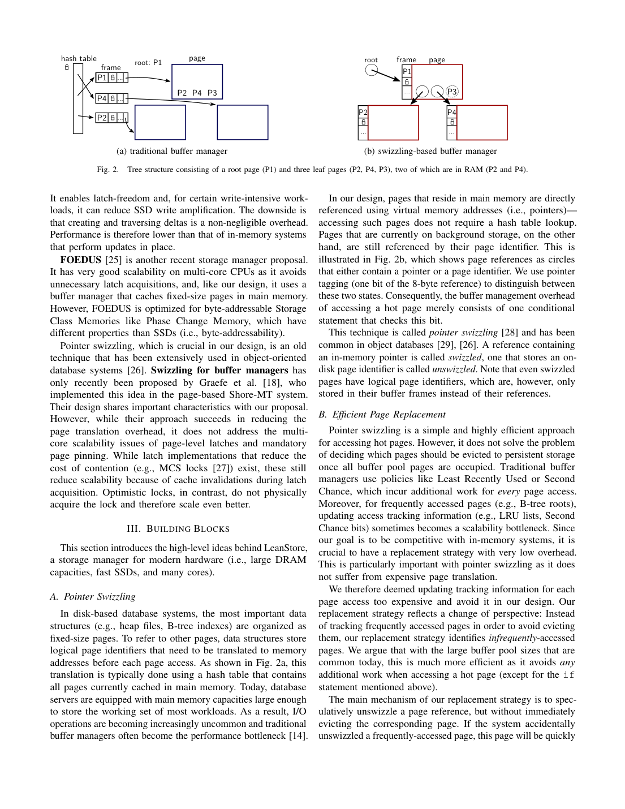
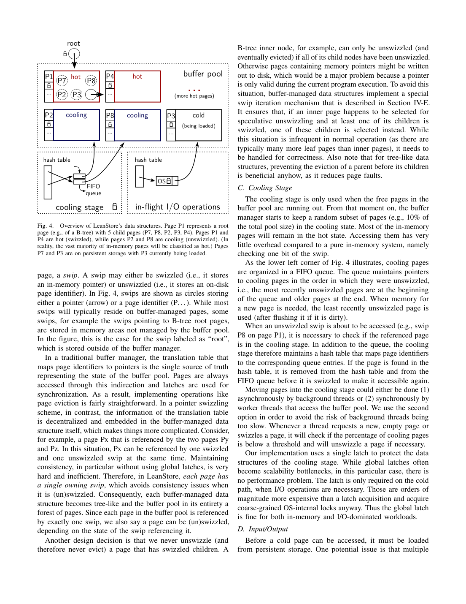

> 本组第 60 篇 · 存储结构与索引 · [全部论文]() · [上一篇]() · [下一篇]()

LeanStore把已swizzle的热页翻译下沉到引用中，借助随机投机unswizzle和FIFO cooling减少逐访问替换元数据写入，并以乐观版本校验配合epoch延迟回收。接近纯内存结构的结果针对规定配置和存储访问工作负载，不是完整ACID数据库的保证：TPC-C测试没有事务语义，比较存储引擎关闭事务、日志、压缩和compaction。实现要求固定大小页面及单一owning swip构成的树/森林；多父引用仅为扩展讨论。epoch保护生命周期而不提供事务隔离，缺页异常重启的是小型数据结构操作，不是自动回滚事务。20GB池/10至50GB数据增长实验仍将工作集留在内存，不能等同所有超内存工作集都维持内存速度。原稿误列的命中率表、tag极性及grace period来源已纠正，历史版本与实验限制均保留。

本文保留论文陈述、读者推断与待验证方案的区别；实验数字只适用于原文条件。原文和翻译来自已有 AI 辅助精读报告，已做来源匹配与编辑复核，不等于人工逐项核验或独立实验复现。所有页码均为 PDF 物理页。

## 论文与阅读范围

Viktor Leis, Michael Haubenschild, Alfons Kemper, Thomas Neumann. LeanStore: In-Memory Data Management Beyond Main Memory。作者单位TUM/Tableau，依据本地12页稿；首页未印确切出版年/会议，不作外部补证。

[论文集中的原始 PDF](https://github.com/lonng/db-papers/blob/4ff1331069c7cf52ac97dd769e5f484c1c35c200/papers/storage-structure/leanstore%3A-in-memory-data-management-beyond-main-memory.pdf) · 本地来源：`storage-structure/leanstore_-in-memory-data-management-beyond-main-memory.pdf`，共 12 页。

本篇保留 20 组原文精读和 68 条证据。截图为原始 PDF 的局部页选，不是重新生成的图表；未将整份 PDF 复制到博客。

## 问题与历史适用边界

本文追问能否保留传统buffer manager统一管理大于RAM数据与索引的能力，同时去掉内存驻留访问上的主要管理开销。经典路径每次将页ID经hash翻译为指针，还要维护访问/替换状态及获取latch；在作者关心的多核热数据路径中，这些共享写入和cacheline争用可能比I/O本身更常见。它并非断言所有缓冲池或所有I/O负载都无效。

作者将Anti-Caching和Siberia作为历史替代路线讨论。第2页明确说Anti-Caching索引覆盖冷热元组、不能下放冷存储，并称OLTP索引占总内存一半并不罕见；这个数字确在原文，只是引自[11]，本次没有独立读取[11]。Siberia的内存索引只覆盖热元组，另有过滤结构与冷热管理器，不能把两种系统都简化为所有索引必须留在RAM。

论文对OS swapping/mmap的批评是数据库失去驱逐控制、访问模式知识不足及其测试表现，且明确有MonetDB等OLAP例外。这是作者针对其目标设计的评价，不是操作系统映射机制在所有数据库里都不能做恢复或in-place更新的定理。DRAM/SSD带宽与价格比只保留为当时语境，不作为现行规格或购买依据。目标是热驻留路径低成本、缺页时透明加载，不是让SSD访问在所有场景都和内存同速。

依据：论文陈述；PDF 物理页 1, 2, 3。证据：[C001N01](#evidence-c001n01), [C001N02](#evidence-c001n02), [C001N03](#evidence-c001n03), [C001N10](#evidence-c001n10), [C001N11](#evidence-c001n11), [LX01](#evidence-lx01), [LX02](#evidence-lx02), [LX33](#evidence-lx33)。

## 状态分工、所有权与冷路径

三项职能使用不同结构：热页翻译状态嵌入拥有它的swip；冷却页用FIFO和页ID到条目的hash管理；正在加载的页用in-flight I/O hash与I/O frame管理。消除的是每次热页访问的集中翻译查找，不是整个引擎不再有hash、全局latch或页标识符。即使swizzled页也有页ID，存于buffer frame；冷却/冷状态的owning reference用逻辑页ID寻址。

实现中每个页恰有一个owning swip，因此页面所有权组成森林。根引用可以在受管页之外；epoch保护的短期读指针不应被误称为第二个owning swip。父页若仍含swizzled子引用就不能unswizzle/evict，以免把进程局部指针写入持久页面。受管结构提供迭代回调和自描述类型；选中内部候选时，可改选其swizzled子页。frame内parent pointer用于找到拥有引用，并不持久化。

当前设计不直接容纳任意多父引用图；多parent pointer或fat swip是作者提出的替代实现，不是已评测功能。固定页大小、所有权及回调约束和可自定义页内布局应同时交代，不能只保留“支持任意数据结构”的宣传式概括。B+-tree扫描用fence keys拆为范围查找，避免叶间链接。

buffer frame与页内容交错以改善局部性及关联冲突。NUMA池/空闲链表分区只提供尽力本地分配，无本地页可分配远程页；cooling等其他结构仍集中维护全局替换。同步cooling迁移不等于没有后台工作：实现另有脏页writer、预取和扫描hint。

依据：论文陈述；PDF 物理页 3, 4, 5, 6, 7, 8。证据：[C001N04](#evidence-c001n04), [C001N08](#evidence-c001n08), [C002N01](#evidence-c002n01), [C002N05](#evidence-c002n05), [C002N07](#evidence-c002n07), [C002N11](#evidence-c002n11), [LX02](#evidence-lx02), [LX03](#evidence-lx03), [LX05](#evidence-lx05), [LX06](#evidence-lx06), [LX09](#evidence-lx09), [LX10](#evidence-lx10), [LX17](#evidence-lx17), [LX18](#evidence-lx18), [LX19](#evidence-lx19)。

*原论文 PDF 物理页 3，版权归原作者或出版方。点击图片可查看原尺寸。页面文本中定位到：Fig. 2.。这是页面定位信息，不表示本次已复核图内所有数据。*

## Swip、冷却与缺页重启

8字节swip以其中一个tag bit区分指针与页ID。本文没有在这段明确指定哪一位及0/1对应关系，本报告删去原稿最低位1即swizzled的“实现事实”，不借用Umbra位图替它补实现。一个可预测分支描述已swizzle热页的管理开销，不是完整树查找、校验或内存分配只需一个分支。

页面加载后成为hot；随机投机unswizzle使页面成为仍在RAM的cooling，而不是立即写盘。FIFO中较早unswizzle的候选渐到队尾，再访问则从FIFO/hash移除并reswizzle，无须磁盘读。grace period确是第4页作者自己的表述，但不是一个有固定毫秒时限的定时器。冷却仅在空闲页耗尽后启用，约10%是默认示例而非每一瞬间严格不变的全局不变量。到队尾仍须满足安全回收条件，脏页在重用前要刷出。

工作线程请求新页或swizzle时按阈值补充冷却候选，选择同步处理以避免后台迁移落后。cooling与in-flight组件共用全局latch；创建I/O frame并取得该frame mutex后，先释放全局latch再做阻塞pread。其他线程请求同页时等同一frame，避免同一逻辑页出现多个并发加载副本；不同页仍能并行I/O。该全局latch不在正常hot查找上，不意味着冷路径永不会在未来硬件/规模下排队。

乐观latch以版本计数等协议验证页内容，读者通常不物理获取页latch，写者通常锁修改的叶页，split/merge需更多锁并可能从根重试。这不是没有锁或没有验证。epoch另行保护尚被读取的页帧：线程进入前发布当前epoch，完成后设为无活跃epoch；unswizzle候选记录退休epoch，仅当所有本地epoch最小值严格大于它才可重用。

I/O缺页时释放全部页锁、退出epoch，再执行I/O；完成后以C++异常触发当前小数据结构操作从根重启。大扫描拆成多个小操作以便退出epoch、限制重做。后台writer周期遍历cooling FIFO刷脏；scan可用in-flight结构发起预取，并把加载的扫描页直接作为cooling候选，避免吞没全部热区。

依据：论文陈述；PDF 物理页 3, 4, 5, 6, 7, 8。证据：[C001N04](#evidence-c001n04), [C001N06](#evidence-c001n06), [C002N02](#evidence-c002n02), [C002N03](#evidence-c002n03), [C002N04](#evidence-c002n04), [C002N05](#evidence-c002n05), [C002N06](#evidence-c002n06), [C002N08](#evidence-c002n08), [C002N09](#evidence-c002n09), [C002N10](#evidence-c002n10), [LX02](#evidence-lx02), [LX03](#evidence-lx03), [LX04](#evidence-lx04), [LX06](#evidence-lx06), [LX07](#evidence-lx07), [LX08](#evidence-lx08), [LX09](#evidence-lx09), [LX10](#evidence-lx10), [LX12](#evidence-lx12), [LX13](#evidence-lx13), [LX14](#evidence-lx14), [LX15](#evidence-lx15), [LX16](#evidence-lx16), [LX18](#evidence-lx18), [LX19](#evidence-lx19), [LX32](#evidence-lx32)。

## 生命周期不变量与未证明内容

以下把作者的机制整理为可检查的条件，而非声称本文给出完整形式化证明。单owning-swip使迁移时只需更新一个拥有引用，parent pointer定位它；子页先unswizzle避免父页持久化进程指针。该规则约束的是所有权状态转换，不要求所有叶数据都已实际写到SSD后才能处理父页。把unswizzle和物理evict当成同一事件，会错误描述协议。

版本校验与内存生命周期有不同义务。计数变化让读操作放弃可能不一致的内容；epoch防止读者仍可能持有页指针时，页帧被改作别的页。仅一次结束时版本相等，不足以自行证明writer状态、内存顺序、计数回绕和C++并发访问全都安全；这些需要完整实现协议。本次未做源码或内存模型审计，不能把乐观读叫作天然无数据竞争的通用算法。

回收条件是min(local epochs)>retire epoch，严格大于。图6全局9、本地9/无活跃/5时，退休4的P8可回收，退休7的P2不可回收；退休5也不满足条件。活跃短epoch不等于立即阻塞所有旧页，但一个长期滞留的最小epoch可使后续候选无法回收，最终停顿驱逐。退出epoch前也不能保留将在重启后未经验证使用的旧指针。

I/O coalescing避免重复页帧，不提供事务日志或持久化原子性。C++异常表示小数据结构操作重走，不等于撤销一个事务此前所有更新，更不等于任意查询算子状态能自动回滚。epoch不是MVCC快照，latch不是事务锁。测试显式没有事务语义，因此本文性能数据不能证明串行化、ACID或崩溃后的恢复；这些边界是后续集成要验证的内容。

依据：读者推断；PDF 物理页 5, 6, 7, 8。证据：[C002N01](#evidence-c002n01), [C002N02](#evidence-c002n02), [C002N05](#evidence-c002n05), [C002N07](#evidence-c002n07), [C002N08](#evidence-c002n08), [C002N09](#evidence-c002n09), [C002N10](#evidence-c002n10), [LX05](#evidence-lx05), [LX06](#evidence-lx06), [LX09](#evidence-lx09), [LX10](#evidence-lx10), [LX12](#evidence-lx12), [LX13](#evidence-lx13), [LX14](#evidence-lx14), [LX15](#evidence-lx15), [LX16](#evidence-lx16), [LX17](#evidence-lx17)。

## 匹配基线、消融与超内存实验

本次已查看第9-12页实验图表；并非沿用API稿“所有图表仅OCR且未视觉核对”的旧免责声明。主环境是Linux4.8、Xeon E5-2687W v3 3.1GHz/10核20线程/64GB，BDB6.0与WT2.9配置B-tree；16KB页、每表一棵树、直接链接存储管理器。TPS沿用论文计数名，但TPC-C无think time且没有事务语义，比较引擎关闭事务、日志、compaction和压缩。匹配的in-memory B-tree与受管树共享页布局/同步协议，这是量化管理成本更强的基线，不是完整SQL/ACID系统排行。

100warehouse初始约10GB且全部驻留时，单线程LeanStore67K、in-memory69K、BDB10K、WT16K。图7逐项启用传统baseline、swizzling、lean eviction、optimistic latch，1线程为30/48/62/67K，10线程为18/23/109/597K。它说明该组合在所测条件下重要，但逐步加项不是完全独立的边际效应实验。10线程8.8倍、HT后12.6倍都是相对单线程的历史吞吐观察，未给尾延迟分布。

60核四路Ivy Bridge NUMA实验用60warehouse：1线程45K；60线程基线1500K/33.3倍，warehouse affinity2270K/50.4倍，prefault2370K/52.7倍，NUMA2560K/56.9倍。末项远程访问75%降14%，不是“全局latch造成的远程访问都已消除”。这些按顺序加入，不能把加速比相乘。

20GB池、数据10至50GB增长的TPC-C中，工作集仍保留在池里，后台约500MB/s写出，故数据超RAM不等于热访问集合超RAM。P3700 SSD、O_DIRECT及绕过ext4直接块设备是该实验设置，不提供破坏性原始设备操作命令。冷启动10GB测试PCIe约8秒、SATA35秒、HDD约15分钟低吞吐反映随机加载及具体设备，不是所有存储的通用时延。

点查用5GB/41M键值对、8B键/120B值、1GB池、20线程与均匀/Zipf分布。图10吞吐随命中驻留改善而上升，不能把图中的lookup/s和I/O/s当作同一指标。图11归一到10%cooling，5-20%通常较稳，但约1.6偏斜/工作集接近容量时更敏感。

第11页trace模拟表正确对应为：Random92.5%、FIFO92.5%、LeanEvict5/10/20/50%=92.7/92.8/92.9/93.0%、LRU93.1%、2Q93.8%、OPT96.3%。原API稿的FIFO/LRU/2Q多项错位已纠正。该表是命中率模拟，未计LRU/2Q维护时间，不能直接推出吞吐排行。

扫描实验是两线程连续扫描10GB orderline和0.7GB order、池2-12GB并预取。图12上为scan GB/s，下为SSD I/O GB/s，小表虚线与大表各池容量曲线不同。10GB池略小于两表总量，出现约25/50秒周期性I/O；不是所有并发扫描都能无损保护任意热点的证明。

依据：论文陈述；PDF 物理页 8, 9, 10, 11, 12。证据：[C002N12](#evidence-c002n12), [C003N01](#evidence-c003n01), [C003N02](#evidence-c003n02), [C003N03](#evidence-c003n03), [C003N04](#evidence-c003n04), [C003N05](#evidence-c003n05), [C003N06](#evidence-c003n06), [C003N07](#evidence-c003n07), [C003N08](#evidence-c003n08), [C003N09](#evidence-c003n09), [C003N10](#evidence-c003n10), [C003N11](#evidence-c003n11), [C003N12](#evidence-c003n12), [LX20](#evidence-lx20), [LX21](#evidence-lx21), [LX22](#evidence-lx22), [LX23](#evidence-lx23), [LX24](#evidence-lx24), [LX25](#evidence-lx25), [LX26](#evidence-lx26), [LX27](#evidence-lx27), [LX28](#evidence-lx28), [LX29](#evidence-lx29), [LX30](#evidence-lx30), [LX31](#evidence-lx31)。

*原论文 PDF 物理页 5，版权归原作者或出版方。点击图片可查看原尺寸。页面文本中定位到：Fig. 4.。这是页面定位信息，不表示本次已复核图内所有数据。*

## 低热路径开销的代价

读者推断：LeanStore不是以最精确替换决定为唯一目标，而是在实际命中率与每次访问管理写入之间取舍。随机挑选和FIFO候选避免hot页每次更新LRU；代价包括误选后reswizzle、cooling容量、冷路径hash与latch操作。不能称追踪开销严格为零，或从工作集很小就推出所有策略无任何差异。10%是作者默认权衡，不是理论最优。

单owning-swip和固定页大小换取便宜的状态定位；代价是别名丰富结构或大对象可能需要额外层次。fat-swip替代方案的真实内存/CPU成本本文未测，不能断言它一定破坏整个性能目标。frame交错有局部性收益，也不是证明任意页尺寸、CPU cache都无冲突。

epoch将页级频繁pin写入转为线程epoch管理，但上层需要可安全退出、重新寻址和分段的小操作边界。并非整个事务必须切成独立事务，也非每个活跃epoch都无条件阻塞所有驱逐。同步cooling工作使调用方承担候选挑选，可能影响延迟；本文没有p99或长期停顿分布，不能把偶发重试都说成已证实可忽略。

NUMA本地分配与集中替换并存，未来更高并发/更快I/O的cold-path排队需另测。in-place与delta方案的写放大、读放大和并发取舍是相关工作讨论，而本文没有同等事务/日志语义下的SSD耐久度或TCO实验；不能把它补成极端写负载的确定排名。后台脏页writer/预取是实现的一部分，不要把同步unswizzle翻成引擎没有后台I/O。

依据：读者推断；PDF 物理页 2, 3, 5, 6, 7, 8, 10, 11。证据：[C001N11](#evidence-c001n11), [C002N01](#evidence-c002n01), [C002N04](#evidence-c002n04), [C002N07](#evidence-c002n07), [C002N10](#evidence-c002n10), [C003N05](#evidence-c003n05), [C003N09](#evidence-c003n09), [C003N10](#evidence-c003n10), [LX05](#evidence-lx05), [LX11](#evidence-lx11), [LX13](#evidence-lx13), [LX14](#evidence-lx14), [LX17](#evidence-lx17), [LX19](#evidence-lx19), [LX29](#evidence-lx29), [LX30](#evidence-lx30)。

## 比较的证据强度与不等条件

最接近控制实验的是匹配in-memory/受管B-tree及图7渐进消融，前者页布局和同步协议相同。67K相对69K吞吐低约2.90%，是读者按(69-67)/69计算；若用逆吞吐看每操作时间则约增加2.99%，不是同一分母。该局部近似不能变成整个系统所有操作开销为3%。

BDB6.0/WT2.9比较约束为当时配置的存储管理器B-tree、关闭事务/日志等功能；并非当前产品、LSM模式、SQL执行器或持久ACID性能排名。作者报告同机Silo805K、FOEDUS1109K、LeanStore845K，但前二者无法关闭事务且TPC-C实现不同，FOEDUS另含工作负载专用布局。作者对原因的解释不等于在控制其他变量后证明差距完全由某项机制产生。

Shore-MT约70K是作者引用相近配置的他文数据，不是本次直接跑同一二进制得到的匹配实验。Anti-Caching/Siberia、Bw-tree/LLAMA、FOEDUS与OS paging的架构讨论均是本论文对历史路线的叙述；外部原文与代码本次没有读，不能据此给出它们现在的实现状态。

原API比较稿说对所有固定大小数据结构一视同仁，仍须加上单拥有引用、回调、自描述页等条件；它并非对任意图和对象大小都透明的无约束allocator。报告删除现代产品/优化器的未经核实关联，不用外部实现猜测填补本论文的缺口。

依据：论文陈述；PDF 物理页 1, 2, 3, 8, 9。证据：[C001N01](#evidence-c001n01), [C001N02](#evidence-c001n02), [C001N10](#evidence-c001n10), [C001N11](#evidence-c001n11), [C003N02](#evidence-c003n02), [C003N04](#evidence-c003n04), [C003N12](#evidence-c003n12), [LX20](#evidence-lx20), [LX24](#evidence-lx24), [LX33](#evidence-lx33)。

## 实际核对与后续验证建议

本次实际完成12页有界分批全文阅读、10页关键图表查看、源SHA和引文匹配、全部继承精读四字段改写、以及小型epoch/算术核对。不是实现或集群复现；不读API keys，不调用API，不改程序/源PDF/共享manifest。原API evidence及10段英文原文保留；旧critique声称grace period非原文、索引半数内存数字无来源，已依据第4/2页更正，但不删除历史critique。

读者算例检验严格回收边界：本地epoch9和5、另线程无活跃时，退休4安全，退休5/7不安全。还比较67/69吞吐与逆时间分母，以及Table I末项2560/2370-1约8.02%、远程访问降低61个百分点。这些有限检查不证明整个并发实现安全。

建议复现先匹配历史编译/版本、16KB布局、单树每表、线程与禁用功能边界，确认结果正确，再分别测热路径、reswizzle、同页I/O合并、不同页并行、延迟回收和dirty writeback。不要把更高版本库或新SSD称为精确重现；也不要因本文写raw block就对用户设备执行覆写。

若增加事务/日志，应另列隔离、日志持久边界、错误中止及恢复的正确性用例；这些与epoch重启不同。测试长持有epoch、缺页退出、split/merge与父指针重定向、扫描分段、版本校验与页帧复用的交互，记录尾延迟与停顿。替换比较应同时计命中率和维护成本，固定trace，再改变cold pool、skew和容量。以上为建议，未执行这些benchmark/故障注入。

依据：待验证的工程设想；PDF 物理页 3, 4, 5, 6, 7, 8, 9, 10, 11, 12。证据：[C001N04](#evidence-c001n04), [C002N05](#evidence-c002n05), [C002N08](#evidence-c002n08), [C002N10](#evidence-c002n10), [C002N12](#evidence-c002n12), [C003N01](#evidence-c003n01), [C003N06](#evidence-c003n06), [C003N10](#evidence-c003n10), [LX04](#evidence-lx04), [LX05](#evidence-lx05), [LX06](#evidence-lx06), [LX09](#evidence-lx09), [LX13](#evidence-lx13), [LX20](#evidence-lx20), [LX31](#evidence-lx31), [LX32](#evidence-lx32)。

## 结论与可迁移判断

本文有力展示的是：已缓存页的管理热路径不必维持一次集中翻译和每访问替换写入，多核存储结构可以围绕swip、低成本候选区和分离的生命周期保护共同设计。这个组合在指定无事务语义的TPC-C与微基准里接近匹配纯内存结构，并支持透明缺页处理。它不是完整数据库ACID性能/恢复证明，也不是一个分支解决全部存储成本。

判断机制时应分开四件事：页内容版本校验、页帧生命周期、页面持久格式、事务隔离与日志。前两者由乐观协议和epoch配合，所有权/父子规则避免持久化进程指针，最后一项并未由本次禁日志测试覆盖。可扩展设计仍有同步冷路径、后台写入和可重启操作边界。

性能结论要区分数据库大小、活动工作集、pool容量、设备速率、命中率与CPU维护时间。20GB池下总量长至50GB并不证明任意50GB热点可留在20GB中，trace命中率更高也不必然吞吐更高。保留这些口径，才能把LeanStore当作可研究的设计证据，而非现行产品或任意负载的部署保证。本报告仍需人工复核。

依据：读者推断；PDF 物理页 1, 3, 5, 7, 8, 9, 10, 11, 12。证据：[C003N02](#evidence-c003n02), [C003N06](#evidence-c003n06), [LX01](#evidence-lx01), [LX02](#evidence-lx02), [LX05](#evidence-lx05), [LX13](#evidence-lx13), [LX20](#evidence-lx20), [LX30](#evidence-lx30), [LX31](#evidence-lx31)。

## 原文精读：从句子回到机制

以下保留原文、忠实翻译、含义与边界；假设示例不作为论文实验结果。

### P001 · PDF 物理页 1

**原文**

<blockquote class="paper-source-quote"><pre><code>While this design succeeds in minimizing the number of I/O&#10;operations, it incurs a large overhead for in-memory workloads,&#10;which are increasingly common. In the canonical buffer pool&#10;implementation [1], each page access requires a hash table&#10;lookup in order to translate a logical page identifier into an&#10;in-memory pointer. Even worse, in typical implementations&#10;the data structures involved are synchronized using multiple&#10;latches, which does not scale on modern multi-core CPUs.</code></pre></blockquote>

**忠实翻译**

> 经典设计减少I/O，但对日益常见的内存驻留工作负载增加管理开销；典型缓冲池逐次hash翻译逻辑页ID，并以多个latch同步，作者认为这在当时多核上扩展较差。

**技术含义与边界**

> 作者批评典型实现热路径的管理成本，不是全部I/O缓存的价值。后文LeanStore降低物理取latch但仍需版本与epoch协议，不能把动机预先译成完整无锁系统。

**常见误读**

> 热驻留场景与miss-heavy场景瓶颈不同。多个latch也不意味着每次查找必然获取某个指定的共享加排他组合，原文未给那种固定流程。

**读者构造的假设示例**

> 读者构造的假设示例：20个线程反复访问同一热根页，每次更新共享管理cacheline可能产生争用，即使没有任何磁盘读取；这是机制说明，不是作者延迟测量。

### P002 · PDF 物理页 11

**原文**

<blockquote class="paper-source-quote"><pre><code>As a result, the working set&#10;is a significant fraction of the total data size.&#10;To model common workloads, we therefore implemented&#10;a read-only micro benchmark similar to YCSB workload C.&#10;Our data set has 5 GB and consists of one B-tree storing&#10;41 M key/value pairs (the keys are 8 bytes, the values are 120&#10;bytes) and the buffer pool size is 1 GB. We perform lookups&#10;with 20 threads by drawing keys from a uniform or Zipf&#10;distribution and use a cooling stage size of 10%. Fig.</code></pre></blockquote>

**忠实翻译**

> 起句承接前面对TPC-C工作集特性的讨论。随后作者另建类似YCSB-C的只读微基准：5GB、41M键值对、8B键/120B值、1GB池、20线程、均匀或Zipf键和10%cooling；末尾Fig.被原始摘录截断。

**技术含义与边界**

> 开头working set大不是该新微基准已测出的3GB热集。完整第11页图10有吞吐/I/O结果，虽本摘录末尾截断，本次上下文已读，不应把截段缺图号说成整篇无法得知图。

**常见误读**

> 分布偏斜改变命中驻留与缺页率，不能仅以数据5倍于池推断所有访问都miss，也不能把10%当任意负载最优。

**读者构造的假设示例**

> 读者构造的假设示例：同样5GB数据/1GB池，若90%请求集中在0.5GB热点，实际I/O比例可以远低于均匀请求；这不是原文测得的90%数据。

### P003 · PDF 物理页 6

**原文**

<blockquote class="paper-source-quote"><pre><code>Like traditional buffer managers, we therefore manage and&#10;serialize in-flight I/O operations explicitly. As Fig. 4 (lower-&#10;right corner) illustrates, we maintain a hash table for all pages&#10;currently being loaded from disk (P3 in the figure). The hash&#10;table maps page identifiers to I/O frames, which contain an&#10;operating system mutex and a pointer to a newly allocated&#10;page.</code></pre></blockquote>

**忠实翻译**

> 作者显式管理并合并在途I/O，图4右下以hash记录正加载的页，把页ID映射到含OS mutex及新分配页指针的I/O frame。

**技术含义与边界**

> 这是只服务在途冷页的表，不是热页每访问必须经过的全局翻译表。完整上下文规定阻塞pread前释放全局latch，同页等待frame而不同页可并发。

**常见误读**

> serialize在此不能译成所有磁盘请求都串行，也不能称LeanStore完全消灭了hash。它解决重复加载，不替代数据读写latch或事务恢复。

**读者构造的假设示例**

> 读者构造的假设示例：A加载P，B请求P则等待同一frame；C请求Q可建立另一个frame并发读，不必等P读完。

### P004 · PDF 物理页 3

**原文**

<blockquote class="paper-source-quote"><pre><code>It enables latch-freedom and, for certain write-intensive work-&#10;loads, it can reduce SSD write amplification. The downside is&#10;that creating and traversing deltas is a non-negligible overhead.&#10;Performance is therefore lower than that of in-memory systems&#10;that perform updates in place.&#10;FOEDUS [25] is another recent storage manager proposal.</code></pre></blockquote>

**忠实翻译**

> 承接的delta设计可实现latch-freedom，某些写密集场景减少SSD写放大，但创建和遍历delta有明显开销；作者称其低于就地更新内存系统性能，随后引入FOEDUS。

**技术含义与边界**

> 这是作者对相关工作的历史权衡描述，并未在这一段控制相同事务、日志、布局和负载来直接测量所有delta方案。也不能让段末FOEDUS自动成为前句it的指代。

**常见误读**

> 不能由latch-free推出吞吐总是高，也不能由这一比较反推全部in-place方案都更快或更省写。针对certain workloads的限定不能删。

**读者构造的假设示例**

> 读者构造的假设示例：追加5个delta可能减少当次重写叶页，但读者需合并多个版本才能得到结果；净收益取决于读写比例与合并策略，不能仅以是否有latch决定。

### P005 · PDF 物理页 9

**原文**

<blockquote class="paper-source-quote"><pre><code>We believe that this is due to Shore-MT&#10;having been designed for a disk-based setting (and therefore&#10;having higher CPU overhead) and the scalability issues of&#10;fine-grained latches.&#10;Silo [6] and FOEDUS [25] are more recent systems. While&#10;they cannot be configured to disable transactions and use&#10;different TPC-C implementations, a comparison with these&#10;systems is still interesting. Silo achieves 805K and FOEDUS&#10;1,109K TPC-C transactions per second on our machine.&#10;LeanStore’s performance lies in between with 845K txns/sec.</code></pre></blockquote>

**忠实翻译**

> 作者把Shore-MT差距归因为面向磁盘的CPU成本与细粒度latch扩展问题。又说Silo/FOEDUS不能禁事务且TPC-C实现不同，同机分别805K/1109K，LeanStore845K。

**技术含义与边界**

> belief标明原因是作者解释；Shore-MT为引用的相近设置，Silo/FOEDUS同机也不消除实现与事务语义混杂。本段不能确定逐项开销贡献。

**常见误读**

> 同机不等于完全公平，不能把845K与805K差值当成缓冲管理收益，也不能猜64核或特定内存分配策略来解释这些数。

**读者构造的假设示例**

> 读者构造的假设示例：系统A计入日志和事务，B只运行同形状存储操作；即使同机B快5%，这也不足以判定A的页面翻译慢5%。

### P006 · PDF 物理页 2

**原文**

<blockquote class="paper-source-quote"><pre><code>Indexes cover both hot as well as cold tuples. Given that it is&#10;not uncommon for indexes to consume half of the total memory&#10;in OLTP databases [11], not being able to move indexes to&#10;cold storage is a major limitation. Thus, Anti-Caching merely&#10;eases memory pressure for applications that almost fit into&#10;main memory and is not a general solution.</code></pre></blockquote>

**忠实翻译**

> Anti-Caching索引覆盖热和冷元组；作者引用[11]说OLTP索引占总内存一半并不罕见，所以不能将索引移到冷存储是重要限制，其缓压作用不等于通用超RAM解决方案。

**技术含义与边界**

> 这确为第2页原句，旧critique称半数数字不存在不准确。但它是作者对外部工作的文献性陈述，不是本次重测所有数据库的内存构成。

**常见误读**

> 不能把一半当成每个OLTP库的固定比例，也不能把Siberia的热索引设计混入Anti-Caching。索引50GB在64GB上不等于仅索引已耗尽64GB，算例须说明剩余资源。

**读者构造的假设示例**

> 读者构造的假设示例：给定32GB内存预算而不可下放索引需40GB，单独移出冷tuple仍无法满足预算；这些数值是算例，不是原文测量。

### P007 · PDF 物理页 4

**原文**

<blockquote class="paper-source-quote"><pre><code>The pages in the&#10;cooling state are organized in a FIFO queue. Over time, pages&#10;move further down the queue and are evicted if they reach&#10;the end of the queue. Accessing a page in the cooling state&#10;will, however, prevent eviction as it will cause the page to be&#10;removed from the FIFO queue and the page to be swizzled.&#10;cold&#10;(SSD)&#10;hot&#10;(RAM)&#10;cooling&#10;(RAM)&#10;swizzle&#10;unswizzle&#10;evict&#10;load,&#10;swizzle&#10;Fig. 3.&#10;The possible states of a page.</code></pre></blockquote>

**忠实翻译**

> cooling页按FIFO排队，渐进队尾并成为驱逐候选；再访问会将其移出队列并swizzle。图3的hot/cooling都在RAM，cold在SSD，另示load/swizzle/unswizzle/evict边。

**技术含义与边界**

> 被摘录嵌入的图中文字是状态图，不是正文新句。进入cooling只改变拥有引用与候选管理，未立即读写磁盘；物理重用仍需后文epoch/刷脏条件。

**常见误读**

> 不能把FIFO队尾理解成不顾活跃读者立刻覆写，也不能给图没有规定的tag0/1极性。grace period是源文用词，但不带固定时间保证。

**读者构造的假设示例**

> 读者构造的假设示例：P仍在RAM而引用改成页ID，访问时经cooling表找回同一页并恢复指针；只有后来安全回收后再次访问才可能需要磁盘读。

### P008 · PDF 物理页 5

**原文**

<blockquote class="paper-source-quote"><pre><code>Since each page in the buffer pool is referenced&#10;by exactly one swip, we also say a page can be (un)swizzled,&#10;depending on the state of the swip referencing it.&#10;Another design decision is that we never unswizzle (and&#10;therefore never evict) a page that has swizzled children. A&#10;B-tree inner node, for example, can only be unswizzled (and&#10;eventually evicted) if all of its child nodes have been unswizzled.</code></pre></blockquote>

**忠实翻译**

> 每页恰由一个swip拥有，页的swizzle状态取决于它。父页有任何swizzled子页时绝不unswizzle或驱逐；全部子引用unswizzle后才可成为候选。

**技术含义与边界**

> 规则避免把内存指针持久化；所有权森林与读者暂时指针需区分。子页先unswizzle不等于它必须已实际evict，父页才可unswizzle。

**常见误读**

> 旧示例L到I到R若说成唯一物理写盘顺序会过强，也不能假设L有其他owning路径，因为实现正排除多拥有引用。epoch还另行约束帧重用。

**读者构造的假设示例**

> 读者构造的假设示例：先把L引用由指针改成页ID，L可仍留cooling RAM；此时I不再含swizzled子引用，才可能进一步处理I，但两者是否立即写盘取决于候选和安全条件。

### P009 · PDF 物理页 8

**原文**

<blockquote class="paper-source-quote"><pre><code>Out-&#10;of-memory workloads are evaluated in Section VI.&#10;A. Experimental Setup&#10;The implementation of LeanStore and the B-tree (actually&#10;a B+-tree) amounts to around 4 K lines of heavily-templated&#10;C++11 code (excluding the benchmarking code). Both the in-&#10;memory B-tree and the buffer-managed B-tree have the same&#10;page layout and synchronization protocol.</code></pre></blockquote>

**忠实翻译**

> 超内存负载在第六节；LeanStore及B+-tree约4K行重模板C++11，不含benchmark，内存树与受管树使用相同页布局和同步协议。

**技术含义与边界**

> 共同布局/协议增强比较缓冲管理开销的可比性，不直接证明模板类名、全部代码相同或唯一差异只有一个函数。第9页实验页大小为16KB。

**常见误读**

> 不要凭这段编造BTree模板API、4KB实际页或项目总行数；相同协议也不使测试变为完整事务数据库比较。

**读者构造的假设示例**

> 读者构造的假设示例：用相同16KB节点与同一同步规则比较直接内存访问和受管访问，可减少布局差异混杂；具体代码接口仍须查源码，本文未查。

### P010 · PDF 物理页 7

**原文**

<blockquote class="paper-source-quote"><pre><code>To be competitive with pure in-memory systems (in&#10;terms of performance and scalability), for a buffer manager it&#10;is therefore crucial to offer means for efficient synchronization.&#10;The first important technique is to replace the conventional&#10;per-page latches with optimistic latches [31], [32], [33]. Inter-&#10;nally, these latches have an update counter that is incremented&#10;after every modification.</code></pre></blockquote>

**忠实翻译**

> 为在性能和扩展上竞争，buffer manager需高效同步；首个技术是以乐观latch替代传统逐页latch，其内部更新计数器在修改后递增。

**技术含义与边界**

> 这是内容验证机制的一部分，后文还有writer保护和epoch生命周期协议。计数器不能独自防止旧页帧复用，也不是事务提交时间戳。

**常见误读**

> 未验证writer状态和完整协议时，前后计数相等不足以自行证明所有并发读安全。原稿示例说写前后都递增不是本段明确给定算法，不能当源码规则。

**读者构造的假设示例**

> 读者构造的假设示例：在完整乐观协议及epoch保护已成立时，读者观察版本10，结束时11就必须重试；至于版本仍10如何排除进行中写者，需完整协议，不能由这个数字单独断言。

### P011 · PDF 物理页 7

**原文**

<blockquote class="paper-source-quote"><pre><code>Only if the minimum is larger than the&#10;associated epoch, the page can be safely reused</code></pre></blockquote>

**忠实翻译**

> 只有本地epoch最小值大于关联退休epoch，页才可安全重用。

**技术含义与边界**

> strictly greater是边界条件；无活跃线程的无限值不拖住最小值。保护的是可能尚引用它的读者生命周期。

**常见误读**

> 大于等于会过早回收；版本验证不是这项生命周期约束的替代，epoch也非事务SI。

**读者构造的假设示例**

> 读者构造的假设示例：最小活跃epoch5，退休4安全、5和7不安全；这是回收算例，不是事务结果。

### P012 · PDF 物理页 7

**原文**

<blockquote class="paper-source-quote"><pre><code>To make epochs robust, threads should exit their epoch&#10;frequently, because any thread that holds onto its epoch for too&#10;long can completely stop page eviction and reclamation.</code></pre></blockquote>

**忠实翻译**

> 线程应频繁退出epoch，长期持有可能完全阻塞驱逐与回收。

**技术含义与边界**

> 长期的最小epoch挡住后续退休候选，说明可扩展正常路径与进展保证是两件事。

**常见误读**

> 不能说任意短epoch立即挡住所有更旧候选，或称算法已有无等待进展保证。

**读者构造的假设示例**

> 读者构造的假设示例：线程停在epoch5，后来候选退休于7/8/9都不满足最小值大于退休值；拆分操作并退出才允许推进。

### P013 · PDF 物理页 7

**原文**

<blockquote class="paper-source-quote"><pre><code>a page fault occurs, the faulting&#10;thread (1) unlocks all page locks, (2) exits the epoch, and&#10;(3) executes an I/O operation.</code></pre></blockquote>

**忠实翻译**

> 缺页时线程先解全部页锁、退出epoch，再执行I/O。

**技术含义与边界**

> 避免长I/O期间保持回收阻塞；返回后当前小数据结构操作重启并重新寻址。

**常见误读**

> 不可以跨退出边界继续无验证使用旧页指针，也不等于已撤销整个事务早先写入。

**读者构造的假设示例**

> 读者构造的假设示例：根到叶路径遇cold子页，加载完成后重新从根取有效路径，而非照用加载前缓存的parent/leaf裸指针。

### P014 · PDF 物理页 5

**原文**

<blockquote class="paper-source-quote"><pre><code>each page has&#10;a single owning swip</code></pre></blockquote>

**忠实翻译**

> 每页只有一个owning swip。

**技术含义与边界**

> 所有权状态可唯一定位，但同时可能有受epoch保护的临时读指针；后者不是另一个可持久拥有引用。

**常见误读**

> 不能把单owner翻译成系统任何时刻仅一个线程持有该页地址，也不把fat-swip扩展当作已实现。

**读者构造的假设示例**

> 读者构造的假设示例：两个读者都可在本地持叶页指针，但树里指向该页的owning swip仍只有一个，复用受两个线程epoch共同约束。

### P015 · PDF 物理页 5

**原文**

<blockquote class="paper-source-quote"><pre><code>we never unswizzle (and&#10;therefore never evict) a page that has swizzled children.</code></pre></blockquote>

**忠实翻译**

> 有swizzled子节点的页绝不unswizzle，因此也不evict。

**技术含义与边界**

> 避免父页持久内容含仅本次进程有效的指针；迭代回调据此重选候选。

**常见误读**

> 子引用变成页ID就可能满足条件，不等于全部子页先物理写盘；不要抹掉unswizzle与evict区别。

**读者构造的假设示例**

> 读者构造的假设示例：P引用C的内存地址时不能把P直接刷成永久页；先将该引用换回C逻辑ID后，仍须各自满足刷脏/epoch条件。

### P016 · PDF 物理页 8

**原文**

<blockquote class="paper-source-quote"><pre><code>Both the in-&#10;memory B-tree and the buffer-managed B-tree have the same&#10;page layout and synchronization protocol.</code></pre></blockquote>

**忠实翻译**

> in-memory树与受buffer管理的树具有相同页面布局与同步协议。

**技术含义与边界**

> 比较尽量控制了结构和同步差异，比跨实现排名更适合观察管理开销。

**常见误读**

> 这不是完整二进制、CPU路径或所有测试条件完全一致的证明，也不能推出统一3%开销。

**读者构造的假设示例**

> 读者构造的假设示例：67K比69K吞吐低2/69约2.90%；反向看每操作时间多69/67-1约2.99%，两个分母不同。

### P017 · PDF 物理页 9

**原文**

<blockquote class="paper-source-quote"><pre><code>both storage managers, we disabled transactions, logging,&#10;compaction, and compression.</code></pre></blockquote>

**忠实翻译**

> 两个对比存储管理器禁用事务、日志、compaction和压缩。

**技术含义与边界**

> 此配置服务于管理路径比较，不能用TPS名字误导为具有完整事务/持久语义的认证基准。

**常见误读**

> 不要把禁用日志只当微小调参，或与保留事务的Silo/FOEDUS宣称完全公平。

**读者构造的假设示例**

> 读者构造的假设示例：把刷日志时延纳入系统A而从B去掉，即便B吞吐更高，也不等于相同持久语义下B更快。

### P018 · PDF 物理页 9

**原文**

<blockquote class="paper-source-quote"><pre><code>While&#10;they cannot be configured to disable transactions and use&#10;different TPC-C implementations, a comparison with these&#10;systems is still interesting.</code></pre></blockquote>

**忠实翻译**

> Silo和FOEDUS不能关闭事务且使用不同TPC-C实现，作者仍认为比较有参考价值。

**技术含义与边界**

> 同机结果是带混杂的参考，不是缓冲策略的控制实验。

**常见误读**

> 不能把845K与805K/1109K差值全部归因swizzling或事务成本，本文没有分离这些因素。

**读者构造的假设示例**

> 读者构造的假设示例：一种实现用数组、另一种用树，吞吐差还可能来自布局；要隔离管理成本需固定布局后再改变管理路径。

### P019 · PDF 物理页 11

**原文**

<blockquote class="paper-source-quote"><pre><code>page&#10;hit rates do not directly translate into performance</code></pre></blockquote>

**忠实翻译**

> 页面命中率不能直接转成性能。

**技术含义与边界**

> trace模拟没有包括LRU/2Q实际维护时间；正确表值仅是命中率，非吞吐。

**常见误读**

> 原稿多项表值错位已按图表纠正，但即使数值正确，也不能用93.8/92.8直接当作吞吐比。

**读者构造的假设示例**

> 读者构造的假设示例：每百万请求多一万命中可能节约I/O，也可能被每请求共享链表维护抵消；需要实际两项成本才能比较。

### P020 · PDF 物理页 4

**原文**

<blockquote class="paper-source-quote"><pre><code>a speculatively&#10;unswizzled page will have a grace period before it is evicted.</code></pre></blockquote>

**忠实翻译**

> 投机unswizzle的页在被驱逐前有一个grace period。

**技术含义与边界**

> 这是原文术语，来自FIFO冷却候选提供再次访问的机会，不是仅读者发明，也没有固定毫秒参数。

**常见误读**

> 不能继承旧critique把它说成无源术语，或把它与固定时长的定时淘汰/事务宽限窗口混同。

**读者构造的假设示例**

> 读者构造的假设示例：候选队列推进快慢改变P停留时间，但P再访问能离开候选区；不能仅凭系统已过10毫秒就断言P必被淘汰。

## 尚未解决的问题

1. 完整实现如何在C++内存模型下结合writer状态、版本校验、epoch发布与页复用，且处理计数回绕？本次未审计源码。
2. 存储操作遇I/O重启时，上层未提交修改、日志记录及错误中止如何组合？本文测试不提供ACID/恢复答案。
3. 更高cold-path并发、更快设备及NUMA拓扑下，全局cooling/I/O latch何时成为可测排队点？
4. 近容量工作集、不同写入/扫描混合与长期epoch滞留如何影响p99、停顿和中止/重试？
5. 多父引用、fat swip或不同页布局的真实额外开销是什么？原文仅讨论可选扩展，未给控制实验。

## 证据索引

证据编号沿用原报告，便于将上文判断追溯到原句。引文匹配只验证位置，不证明解读正确。

**C001N01 · PDF 物理页 1**

经典缓冲池逐页翻译及同步是本文针对内存驻留工作负载的开销动机，不是所有实现/负载均无效的结论。

<blockquote class="paper-source-quote"><pre><code>each page access requires a hash table lookup in order to translate a logical page identifier into an in-memory pointer</code></pre></blockquote>

**C001N02 · PDF 物理页 2**

作者历史讨论Anti-Caching不能下放覆盖冷热tuple的索引；第2页确有索引占OLTP总内存一半并不罕见的引文陈述，未独立核实[11]。Siberia内存索引只覆盖hot tuple，不能与其混为一谈。

<blockquote class="paper-source-quote"><pre><code>not being able to move indexes to cold storage is a major limitation</code></pre></blockquote>

**C001N03 · PDF 物理页 1**

硬件带宽/价格比是论文当时背景；目标为驻留working set热路径低成本，不作当前硬件事实。

<blockquote class="paper-source-quote"><pre><code>modern SSDs are still at least 10 times slower than DRAM in terms of bandwidth</code></pre></blockquote>

**C001N04 · PDF 物理页 3**

8字节引用一个tag bit区分指针/页ID；本地稿此段未指定最低位极性。热分支不是完整操作成本，冷页加载仍以逻辑ID寻址，不能靠已复用frame寻址。

<blockquote class="paper-source-quote"><pre><code>We use pointer tagging (one bit of the 8-byte reference) to distinguish between these two states</code></pre></blockquote>

**C001N05 · PDF 物理页 3**

随机投机unswizzle进入RAM中的FIFO候选区；grace period确为作者原文，且无固定时间保证。冷却比例为策略目标，不是启动后始终精确固定。

<blockquote class="paper-source-quote"><pre><code>Instead of tracking frequently accessed pages in order to avoid evicting them, our replacement strategy identifies infrequently-accessed pages</code></pre></blockquote>

**C001N06 · PDF 物理页 4**

cooling仍在RAM，再访问可回hot而无读盘；到队尾还需刷脏及满足epoch安全才能重用。

<blockquote class="paper-source-quote"><pre><code>Accessing a page in the cooling state will, however, prevent eviction as it will cause the page to be removed from the FIFO queue</code></pre></blockquote>

**C001N07 · PDF 物理页 4**

已swizzle查找避免物理获取页latch，但仍有epoch和验证；写通常锁叶页，结构修改例外。不等于全引擎无锁。

<blockquote class="paper-source-quote"><pre><code>lookups on swizzled pages do not acquire any latches at all, while insert/update/delete operations usually only acquire a single latch</code></pre></blockquote>

**C001N08 · PDF 物理页 4**

热翻译状态、cooling及in-flight I/O分开；没有全局热翻译表不表示完全没有hash或全局latch。

<blockquote class="paper-source-quote"><pre><code>for performance reasons, it uses 3 separate, customized data structures</code></pre></blockquote>

**C001N09 · PDF 物理页 1**

摘要概述TPC-C和微基准；具体环境、无事务语义与数值在后文，本次已通读，不能把当前chunk缺数据写成整篇没有结果。

<blockquote class="paper-source-quote"><pre><code>Our evaluation, which is based on TPC-C and micro benchmarks, shows that our approach has little overhead</code></pre></blockquote>

**C001N10 · PDF 物理页 2**

这是作者对OS驱逐失控和其目标负载的批评，含MonetDB等例外；不作为所有mmap数据库不能恢复/in-place更新的普遍定理。

<blockquote class="paper-source-quote"><pre><code>the database system loses control over page eviction, which virtually precludes in-place updates and full-blown ARIES-style recovery</code></pre></blockquote>

**C001N11 · PDF 物理页 3**

作者讨论delta设计与in-place更新的CPU/写放大权衡及FOEDUS目标，非同等事务语义下的全面性能或TCO实验。

<blockquote class="paper-source-quote"><pre><code>creating and traversing deltas is a non-negligible overhead. Performance is therefore lower than that of in-memory systems</code></pre></blockquote>

**C002N01 · PDF 物理页 5**

当前实现单一owning swip使页面所有权为森林；暂时读指针不等于额外owner。多parent/fat-swip属于提出的替代实现，并未实测。

<blockquote class="paper-source-quote"><pre><code>each page has a single owning swip, which avoids consistency issues when it is (un)swizzled. Consequently, each buffer-managed data structure becomes tree-like</code></pre></blockquote>

**C002N02 · PDF 物理页 5**

有swizzled子引用的父页不能unswizzle/evict，避免持久化进程指针；子引用unswizzle不等于所有子数据先写到SSD。

<blockquote class="paper-source-quote"><pre><code>we never unswizzle (and therefore never evict) a page that has swizzled children.</code></pre></blockquote>

**C002N03 · PDF 物理页 5**

空闲页耗尽后维持cooling候选及FIFO/hash，需考虑刷脏和epoch门限后重用；10%为默认示例，不是LRU精确排名。

<blockquote class="paper-source-quote"><pre><code>starts to keep a random subset of pages (e.g., 10% of the total pool size) in the cooling state.</code></pre></blockquote>

**C002N04 · PDF 物理页 5**

由工作线程同步补cooling，而不是后台迁移；实现仍有独立脏页writer和I/O预取。全局latch冷路径成本较低是该设计/测试论证，不是任意规模保证。

<blockquote class="paper-source-quote"><pre><code>We use the second option in order to avoid the risk of background threads being too slow.</code></pre></blockquote>

**C002N05 · PDF 物理页 6**

同一逻辑页共享in-flight frame/mutex合并加载，执行阻塞I/O前释放全局latch；不串行化所有不同页I/O，也不解决事务持久化。

<blockquote class="paper-source-quote"><pre><code>we maintain a hash table for all pages currently being loaded from disk</code></pre></blockquote>

**C002N06 · PDF 物理页 6**

自描述页与swip迭代回调用于发现swizzled子引用，必要时改选子候选；必须满足具体受管结构约束。

<blockquote class="paper-source-quote"><pre><code>every buffer-managed data structure therefore implements an “iteration callback”.</code></pre></blockquote>

**C002N07 · PDF 物理页 6**

frame保存非持久parent pointer；固定页及单所有权约束下可定制内部布局，非任意别名丰富图结构都已支持。

<blockquote class="paper-source-quote"><pre><code>Our implementation uses parent pointers, which are stored in the buffer frame.</code></pre></blockquote>

**C002N08 · PDF 物理页 7**

乐观版本协议验证内容，epoch另保生命周期；读不物理取latch不是无同步、无内存模型义务或事务串行化。

<blockquote class="paper-source-quote"><pre><code>replace the conventional per-page latches with optimistic latches</code></pre></blockquote>

**C002N09 · PDF 物理页 7**

回收要求所有本地epoch最小值严格大于候选退休epoch，无活跃用无限值；不等于等号可回收或epoch即MVCC快照。

<blockquote class="paper-source-quote"><pre><code>its associated epoch is compared with the minimum of all local epochs.</code></pre></blockquote>

**C002N10 · PDF 物理页 7**

长期停留最小epoch会阻塞后续候选回收；I/O前解锁并退出，异常重启小数据结构操作，不是自动回滚整个事务。

<blockquote class="paper-source-quote"><pre><code>it might be disastrous to perform a large full table scan while staying in the same local epoch.</code></pre></blockquote>

**C002N11 · PDF 物理页 8**

frame/page交错并尽力NUMA本地分配；本地耗尽可远程，cooling等集中管理仍在。

<blockquote class="paper-source-quote"><pre><code>buffer frames are physically interleaved with the page content</code></pre></blockquote>

**C002N12 · PDF 物理页 8**

匹配B-tree布局/同步协议为控制缓冲管理成本的基线；约4K行不含benchmark。后文提供硬件与数据，不能把本chunk缺失当整篇缺失。

<blockquote class="paper-source-quote"><pre><code>amounts to around 4 K lines of heavily-templated C++11 code</code></pre></blockquote>

**C003N01 · PDF 物理页 9**

历史机器、16KB页及无think-time TPC-C；没有事务语义，比较引擎禁用事务/日志/compaction/压缩，非ACID性能认证。

<blockquote class="paper-source-quote"><pre><code>The experiments were performed on a Linux 4.8 system with an Intel Xeon E5-2687W v3 CPU (3.1 GHz, Haswell EP, 10 cores, 20 hardware threads) and 64 GB of main memory.</code></pre></blockquote>

**C003N02 · PDF 物理页 9**

驻留100warehouse时67K/69K单线程及8.8/12.6倍扩展为指定历史测试数据，不是全部负载缓冲开销常数。

<blockquote class="paper-source-quote"><pre><code>LeanStore achieves a speedup of 8.8× with 10 threads, and 12.6× with HyperThreading.</code></pre></blockquote>

**C003N03 · PDF 物理页 9**

图7为逐步添加机制的消融，1线程30/48/62/67K、10线程18/23/109/597K；不可把每项效应当完全独立相乘。

<blockquote class="paper-source-quote"><pre><code>In the single-threaded case, pointer swizzling and our replacement strategy (labeled as “lean evict”) are the largest factors, which together result in around 2× performance gain.</code></pre></blockquote>

**C003N04 · PDF 物理页 9**

同机Silo/FOEDUS保留事务且TPC-C实现不同，845K/805K/1109K对比存在明显混杂，原因分析不是控制实验。

<blockquote class="paper-source-quote"><pre><code>While they cannot be configured to disable transactions and use different TPC-C implementations, a comparison with these systems is still interesting.</code></pre></blockquote>

**C003N05 · PDF 物理页 10**

60核Table I顺序增加亲和/prefault/NUMA；最后项75%到14%、吞吐额外约8%，56.9倍是相对单线程总体加速。

<blockquote class="paper-source-quote"><pre><code>explicit NUMA-awareness, reduces the percentage of NUMA-remote DRAM accesses from 75% to 14% and improves performance by 8%.</code></pre></blockquote>

**C003N06 · PDF 物理页 10**

20GB池、数据10到50GB增长仍保持working set在池里；直接I/O与原始块设备是历史实验设置，不可推出任意超RAM热集维持内存性能。

<blockquote class="paper-source-quote"><pre><code>I/O operations are therefore performed using direct I/O (O_DIRECT), which prevents operating system caching and makes performance more stable.</code></pre></blockquote>

**C003N07 · PDF 物理页 10**

8秒/35秒/HDD低吞吐为特定设备和随机冷加载场景，不是所有SSD/磁盘速度或部署建议。

<blockquote class="paper-source-quote"><pre><code>The disk can only read in pages into the buffer pool at around 5 MB/sec, whereas the random access pattern does not impede the performance of SSDs.</code></pre></blockquote>

**C003N08 · PDF 物理页 11**

只读5GB数据/1GB池/20线程均匀或Zipf点查；随偏斜改变命中与I/O，不是全部真实负载或完整YCSB实现的证明。

<blockquote class="paper-source-quote"><pre><code>Our data set has 5 GB and consists of one B-tree storing 41 M key/value pairs (the keys are 8 bytes, the values are 120 bytes) and the buffer pool size is 1 GB.</code></pre></blockquote>

**C003N09 · PDF 物理页 11**

10%为默认折中，5-20%常较稳；近容量working set约1.6偏斜更敏感，不是最优性保证。

<blockquote class="paper-source-quote"><pre><code>Only for very specific skew settings (around 1.6), one can observe performance that is more than 10% off from the optimum.</code></pre></blockquote>

**C003N10 · PDF 物理页 11**

视觉核对表为Random/FIFO92.5%，LeanEvict5/10/20/50%=92.7/92.8/92.9/93.0%，LRU93.1%，2Q93.8%，OPT96.3%。命中率模拟不含维护时间，原API数值错位已纠正。

<blockquote class="paper-source-quote"><pre><code>Also note that the page hit rates do not directly translate into performance, as more complex strategies like LRU and 2Q would also result in a higher runtime overhead</code></pre></blockquote>

**C003N11 · PDF 物理页 11**

两线程10GB与0.7GB表、池2-12GB并预取的特定扫描实验；图12 scan与SSD I/O曲线不同，不能外推任意并发扫描保证。

<blockquote class="paper-source-quote"><pre><code>The smaller scan, which is shown as the dotted black line, is unaffected by the different buffer pool sizes because the replacement strategy always successfully keeps its pages in the buffer pool.</code></pre></blockquote>

**C003N12 · PDF 物理页 11**

作者指出TPC-C特殊访问模式可能不代表真实工作负载；Shore-MT是文献数据比较，非本次匹配直接运行。

<blockquote class="paper-source-quote"><pre><code>All experiments so far were based on TPC-C, which—while certainly being challenging—may not be representative of many real-world workloads.</code></pre></blockquote>

**LX01 · PDF 物理页 1**

摘要近内存开销明确针对全部数据驻留主存。

<blockquote class="paper-source-quote"><pre><code>when all data resides in main&#10;memory</code></pre></blockquote>

**LX02 · PDF 物理页 3**

8字节引用一个tag bit区分两态；此段不指定极性。

<blockquote class="paper-source-quote"><pre><code>We use pointer&#10;tagging (one bit of the 8-byte reference) to distinguish between&#10;these two states.</code></pre></blockquote>

**LX03 · PDF 物理页 3**

swizzled页仍有逻辑页ID，存于frame而不是当前指针引用。

<blockquote class="paper-source-quote"><pre><code>even swizzled&#10;pages have logical page identifiers, which are, however, only&#10;stored in their buffer frames instead of their references.</code></pre></blockquote>

**LX04 · PDF 物理页 4**

cooling页再访问移出FIFO并reswizzle，不需读盘。

<blockquote class="paper-source-quote"><pre><code>Accessing a page in the cooling state&#10;will, however, prevent eviction as it will cause the page to be&#10;removed from the FIFO queue and the page to be swizzled.</code></pre></blockquote>

**LX05 · PDF 物理页 5**

实现要求一个owning swip，页面所有权为森林。

<blockquote class="paper-source-quote"><pre><code>each page has&#10;a single owning swip</code></pre></blockquote>

**LX06 · PDF 物理页 5**

有swizzled子引用的父页不能unswizzle/evict。

<blockquote class="paper-source-quote"><pre><code>we never unswizzle (and&#10;therefore never evict) a page that has swizzled children.</code></pre></blockquote>

**LX07 · PDF 物理页 5**

选择工作线程同步迁移以免后台跟不上，不意味着没有后台脏页写入。

<blockquote class="paper-source-quote"><pre><code>We use the second&#10;option in order to avoid the risk of background threads being&#10;too slow.</code></pre></blockquote>

**LX08 · PDF 物理页 5**

队尾旧候选在脏时先flush再重用，且还受epoch门限约束。

<blockquote class="paper-source-quote"><pre><code>the least recently unswizzled page is&#10;used (after flushing it if it is dirty).</code></pre></blockquote>

**LX09 · PDF 物理页 6**

全局latch在I/O系统调用前释放，允许不同页I/O并发。

<blockquote class="paper-source-quote"><pre><code>this&#10;latch is released before doing any I/O system calls.</code></pre></blockquote>

**LX10 · PDF 物理页 6**

同页其他加载者等待已有I/O frame的mutex。

<blockquote class="paper-source-quote"><pre><code>Other threads will find the existing&#10;I/O frame and block on its mutex until the first thread finishes&#10;the read operation.</code></pre></blockquote>

**LX11 · PDF 物理页 6**

单owning-swip不是作者认为所有替代设计的根本不可能限制；多owner方案仅讨论。

<blockquote class="paper-source-quote"><pre><code>However, this is not a fundamental limitation of our approach.</code></pre></blockquote>

**LX12 · PDF 物理页 7**

乐观读不物理获取latch，而须版本验证。

<blockquote class="paper-source-quote"><pre><code>Readers can proceed without acquiring&#10;any latches, but validate their reads using the version counters&#10;instead</code></pre></blockquote>

**LX13 · PDF 物理页 7**

安全重用的epoch最小值必须严格大于退休epoch。

<blockquote class="paper-source-quote"><pre><code>Only if the minimum is larger than the&#10;associated epoch, the page can be safely reused</code></pre></blockquote>

**LX14 · PDF 物理页 7**

长持有epoch可能停止后续页面驱逐和回收。

<blockquote class="paper-source-quote"><pre><code>To make epochs robust, threads should exit their epoch&#10;frequently, because any thread that holds onto its epoch for too&#10;long can completely stop page eviction and reclamation.</code></pre></blockquote>

**LX15 · PDF 物理页 7**

缺页线程在I/O前解全部页锁、退出epoch。

<blockquote class="paper-source-quote"><pre><code>a page fault occurs, the faulting&#10;thread (1) unlocks all page locks, (2) exits the epoch, and&#10;(3) executes an I/O operation.</code></pre></blockquote>

**LX16 · PDF 物理页 7**

用C++异常重启小数据结构操作，并非事务回滚。

<blockquote class="paper-source-quote"><pre><code>by throwing a C++ exception</code></pre></blockquote>

**LX17 · PDF 物理页 8**

NUMA分配尽力而为，本地无页可用远程页。

<blockquote class="paper-source-quote"><pre><code>NUMA-awareness is a best effort&#10;optimization: if no more local pages are available, a remote&#10;NUMA page will be assigned.</code></pre></blockquote>

**LX18 · PDF 物理页 8**

fence-key范围查找免叶间链接，满足单owner结构。

<blockquote class="paper-source-quote"><pre><code>breaking up range lookups obviates the need for the leaf links</code></pre></blockquote>

**LX19 · PDF 物理页 8**

实现确有后台脏页writer，不能概括为没有后台I/O。

<blockquote class="paper-source-quote"><pre><code>we use a separate background&#10;writer thread</code></pre></blockquote>

**LX20 · PDF 物理页 8**

in-memory与受管B-tree共享页布局和同步协议。

<blockquote class="paper-source-quote"><pre><code>Both the in-&#10;memory B-tree and the buffer-managed B-tree have the same&#10;page layout and synchronization protocol.</code></pre></blockquote>

**LX21 · PDF 物理页 9**

比较存储管理器关闭事务/日志/compaction/压缩。

<blockquote class="paper-source-quote"><pre><code>both storage managers, we disabled transactions, logging,&#10;compaction, and compression.</code></pre></blockquote>

**LX22 · PDF 物理页 9**

TPC-C工作负载明确没有事务语义。

<blockquote class="paper-source-quote"><pre><code>even&#10;without transactional semantics, TPC-C</code></pre></blockquote>

**LX23 · PDF 物理页 9**

实验16KB页、每关系单棵树，没有水平拆表。

<blockquote class="paper-source-quote"><pre><code>We use 16 KB&#10;pages and each relation is represented as a single B-tree</code></pre></blockquote>

**LX24 · PDF 物理页 9**

Silo/FOEDUS不能关闭事务且TPC-C实现不同，比较不对等。

<blockquote class="paper-source-quote"><pre><code>While&#10;they cannot be configured to disable transactions and use&#10;different TPC-C implementations, a comparison with these&#10;systems is still interesting.</code></pre></blockquote>

**LX25 · PDF 物理页 10**

增长实验中工作集仍留在buffer pool，不等于所有热集超过RAM。

<blockquote class="paper-source-quote"><pre><code>the working set, which stays in the&#10;buffer pool</code></pre></blockquote>

**LX26 · PDF 物理页 10**

direct I/O用于排除OS caching影响，是实验设置。

<blockquote class="paper-source-quote"><pre><code>I/O operations are therefore performed&#10;using direct I/O (O_DIRECT), which prevents operating system&#10;caching and makes performance more stable.</code></pre></blockquote>

**LX27 · PDF 物理页 10**

直接块设备避免文件系统开销，只记方法，不提供覆写设备操作。

<blockquote class="paper-source-quote"><pre><code>we therefore access the SSD directly as a&#10;block device avoiding file system overhead altogether.</code></pre></blockquote>

**LX28 · PDF 物理页 11**

点查类似YCSB-C只读微基准，不是完整通用基准排名。

<blockquote class="paper-source-quote"><pre><code>a read-only micro benchmark similar to YCSB workload C.</code></pre></blockquote>

**LX29 · PDF 物理页 11**

10%cooling为作者默认推荐而非理论最优。

<blockquote class="paper-source-quote"><pre><code>We can generally&#10;recommend a value of 10% for the cooling stage size as a&#10;default setting</code></pre></blockquote>

**LX30 · PDF 物理页 11**

trace命中率不能直接换算成运行吞吐。

<blockquote class="paper-source-quote"><pre><code>page&#10;hit rates do not directly translate into performance</code></pre></blockquote>

**LX31 · PDF 物理页 12**

10GB扫描池下周期性I/O是工作集略超池的该测试现象。

<blockquote class="paper-source-quote"><pre><code>we see a cyclical&#10;I/O pattern (at 25 and 50 seconds).</code></pre></blockquote>

**LX32 · PDF 物理页 4**

grace period明确是论文用词，不是仅由读者发明的名称；原文未给固定等待时长。

<blockquote class="paper-source-quote"><pre><code>a speculatively&#10;unswizzled page will have a grace period before it is evicted.</code></pre></blockquote>

**LX33 · PDF 物理页 2**

本论文第2页确有索引可能占OLTP总内存一半的文献性陈述，本次未独立检查[11]。

<blockquote class="paper-source-quote"><pre><code>not uncommon for indexes to consume half of the total memory&#10;in OLTP databases [11]</code></pre></blockquote>

## 版本与使用边界

- 原 PDF SHA256：`c070f7f12514d6e8da54b10639f0fe70829f7a19d97b93c064eb66fea9cb2f33`。
- 报告来源：`qwen3.8-max`；此处按已完成报告整理，没有重新请求模型。
- OCR 记录页：[]；低文本页：[]。
- 本次新增页面截图，未据此自动重写原报告的数值、公式或实验结论；原有“未进行图像识别”限制仍适用于分析生成过程。
- 截图与短引仅服务于论文评论，版权归原作者或出版方；正式发布前复查转载范围和授权。
- 本文保留未核实的书目信息及研究问题，不用现代产品行为替代历史论文的证据。

前序报告保留的书目与阅读过程记录

Viktor Leis, Michael Haubenschild, Alfons Kemper, Thomas Neumann. LeanStore: In-Memory Data Management Beyond Main Memory。作者单位TUM/Tableau，依据本地12页稿；首页未印确切出版年/会议，不作外部补证。方法：保留API的source/SHA/model/usage/critique、原始引文及10段英文，由codex-current-session通读12页含全部37条参考文献，并查看物理页3-12共10页后，实际改写九节正文和全部继承精读，再补源证据与精读。API critique针对旧稿，不代表本次编辑已再次被API或人工审查。文本提取不等于OCR；本次关键图表已实际查看。未读实现源码、外部参考文献，也未复现benchmark或故障恢复。

