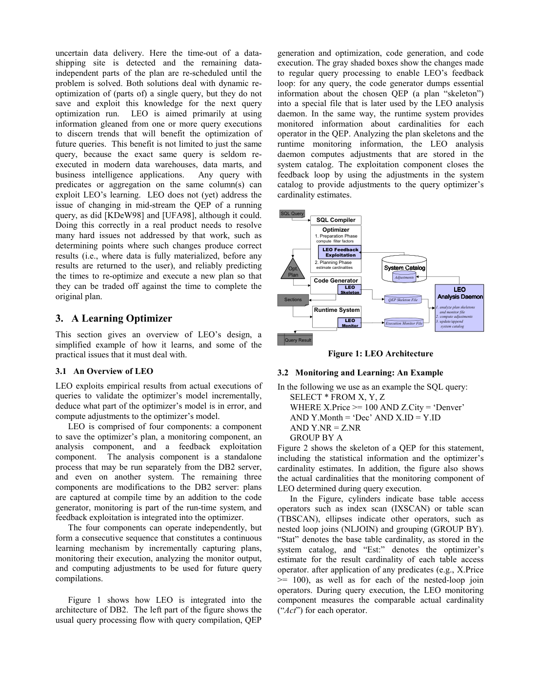
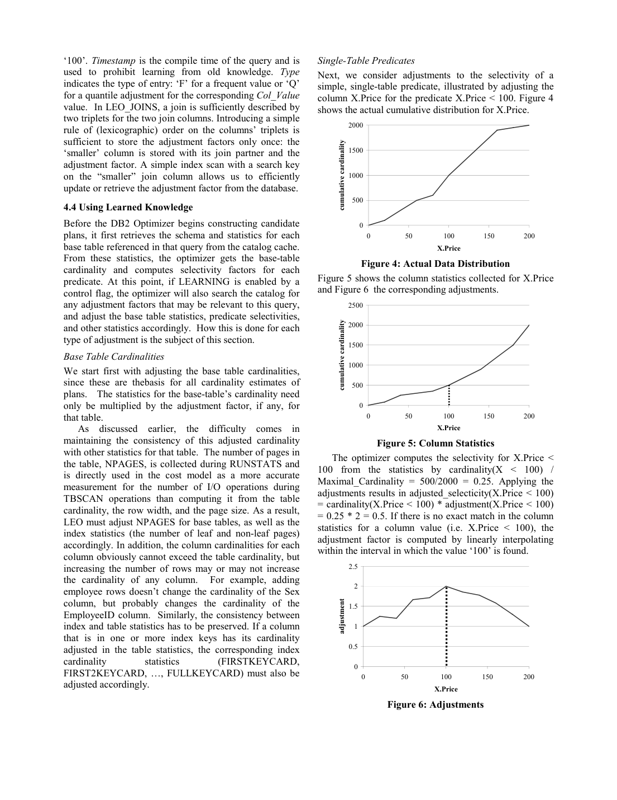

> 本组第 50 篇 · 统计与基数估计 · [全部论文]() · [上一篇]() · [下一篇]()

LEO把已执行查询的实际行流计数与编译估计匹配，经独立分析组件生成统计修正，供未来优化复用。编译期QEP skeleton、运行期section计数、表/列/join统计身份以及第二修正层各有用途，不能混同为完整规范化查询图或现代端到端ML优化器。adj=act*old_adj/old_est锚定当时基础统计；扫描截断、merge early out、统计更新和旧因子身份限制可学内容。框架能扩展的算子不等于原型已实现，GROUP BY/DISTINCT等仍未完成。10GB TPC-H的Q2/Q14 Serial/SMP仅支持特定监控开销观察；两个动态测试库的up to14x不是平均或所有查询收益。图9仍有未修正上层估计，学习也不自动rebind、清cache或中途换计划。API来源、模型、用量、critique、英文引文和原始段落保持，正文及配对解读已按完整源文校正。

本文保留论文陈述、读者推断与待验证方案的区别；实验数字只适用于原文条件。原文和翻译来自已有 AI 辅助精读报告，已做来源匹配与编辑复核，不等于人工逐项核验或独立实验复现。所有页码均为 PDF 物理页。

## 论文与阅读范围

Michael Stillger, Guy Lohman, Volker Markl, Mokhtar Kandil，LEO – DB2’s LEarning Optimizer，Proceedings of the 27th VLDB Conference，Roma, Italy, 2001。所供PDF共10个物理页，本文定位均用物理页。完整阅读pp.1-10（含脚注、算法、公式及全部参考文献），视觉检查9页及图1-9；仅此版本，不倒填2003后续文章、现代DB2或现代神经基数估计器。目录probabilistic-counting只是归档路径，不表示LEO是概率计数sketch。未外查文献、审计实现或执行DB/SQL。

[论文集中的原始 PDF](https://github.com/lonng/db-papers/blob/4ff1331069c7cf52ac97dd769e5f484c1c35c200/papers/probabilistic-counting/leo-%E2%80%93-db2%E2%80%99s-learning-optimizer.pdf) · 本地来源：`probabilistic-counting/leo-–-db2’s-learning-optimizer.pdf`，共 10 页。

本篇保留 10 组原文精读和 52 条证据。截图为原始 PDF 的局部页选，不是重新生成的图表；未将整份 PDF 复制到博客。

## 历史问题与学习的含义

成本模型选择QEP依赖各步基数，过时统计、局部均匀、谓词独立和join inclusion等假设失效会放大估计偏差。作者称给定基数后成本误差相对小，而基数可错数量级；这是2001年的动机性陈述，不是所有优化器的15%误差定理。关于直方图未用于join/聚合是当时作者视角，不是理论上不能或今日产品仍不能。

LEO的learning是利用历史查询反馈修正传统模型，不是神经网络训练、embedding、强化学习选计划或概率计数。所讨论是VLDB2001十页原型，DB2 UDB平台原型描述不证明所有功能已随某产品版交付。

反馈主要服务未来查询编译；不要求完全相同SQL，相关表、列、谓词统计可共享。它补充而非替代RUNSTATS：常被访问区域更有信息，未预期查询仍需基础统计。不能把“收益最大于相似查询”说成只有相同SQL可学，也不能声称任意陌生表达式都能凭空得到真值。

依据：论文陈述；PDF 物理页 1, 2, 3, 4, 5, 9, 10。证据：[C001N01](#evidence-c001n01), [C001N02](#evidence-c001n02), [C001N03](#evidence-c001n03), [C002N01](#evidence-c002n01), [LEO-SRC01](#evidence-leo-src01), [LEO-SRC02](#evidence-leo-src02), [LEO-SRC04](#evidence-leo-src04)。

## 四组件与两种关联

图1闭环包含：编译期保存被选中QEP的精简skeleton；运行期section植入逐行计数器，查询完成后保存；独立daemon匹配估计与actual并分析；优化器在后续计划构造前读取修正。分析可离线批处理、另机执行，或完成查询后增量进行；其余组件仍需DB2内部改动，不是无需内核配合的外置SQL工具。低优先级利用空闲周期是减少干扰的设计，不是零开销保证。

必须区分两种关联。第一，执行记录通过hash表找到该次编译的skeleton，再把section细粒度算子计数映射回QEP；两者非一一对应，被执行优化跳过的算子还需补偿。第二，长期修正按统计对象保存：LEO_TABLES、LEO_COLUMNS、LEO_JOINS，列由tablespaceID/tableID/columnID定位，含值、F/Q类型、编译timestamp；join列对按字典序存一份。不是单靠SQL文本签名，也不是后续论文可能采用的完整规范化query-graph匹配协议。

LEO从不覆写原始catalog统计，而保留可忽略的第二修正层。这样可关闭/回退、保留基础统计，并记录计划实际使用的旧因子以防重复调整。修正层也有过时与依赖维护问题；表行数、NPAGES、列distinct和索引统计必须一致。RUNSTATS后简单清除会丢join信息，论文提出重校准要求，没有给出所有DDL/统计版本失效的完备协议。

依据：论文陈述；PDF 物理页 3, 4, 5, 6, 7。证据：[C001N06](#evidence-c001n06), [C001N08](#evidence-c001n08), [C001N09](#evidence-c001n09), [C001N10](#evidence-c001n10), [C002N02](#evidence-c002n02), [C002N03](#evidence-c002n03), [C002N04](#evidence-c002n04), [C002N08](#evidence-c002n08), [LEO-SRC03](#evidence-leo-src03), [LEO-SRC04](#evidence-leo-src04), [LEO-SRC05](#evidence-leo-src05), [LEO-SRC06](#evidence-leo-src06), [LEO-SRC11](#evidence-leo-src11)。

*原论文 PDF 物理页 3，版权归原作者或出版方。点击图片可查看原尺寸。页面文本中定位到：Figure 1 shows how LEO is integrated into the；Figure 1: LEO Architecture；Figure 2 shows the skeleton of a QEP for this statement,。这是页面定位信息，不表示本次已复核图内所有数据。*

## 遍历、去旧因子与泛化

图3先preprocess构造全局状态并下推属性，再递归处理所有孩子；若孩子返回error，相关上层分析停止；返回后按opcode调用分析例程。它是递归后序框架及省略号示意，不是完整可运行代码，也不能把该error返回码直接等同“估计偏差超过5%就停止整条查询学习”。

p6对col<X的示例检测条件是|old_est-act|/act>0.05；act为监控所得选择率，old_est已可能含编译时old_adj。令stats=old_est/old_adj，则adj=act/stats=act*old_adj/old_est。它消去旧因子并锚定编译时基础估计；不能要求直接读取当前catalog旧值，也不能忽略RUNSTATS更新后的重校准。本文没有完整规定act=0、old_est=0或异常值的处理，5%不是执行加速阈值或统计显著性检验。

范围谓词以<与>=互补方向调整，不能把一侧factor直接乘另一侧。源文>/>=标签有不一致，不能据示例推得任意NULL语义的补集定理。缺少精确常量时可插值复用范围反馈，不保证所有未见阈值准确。示例old_adj2已把基础0.25变0.5，actual0.6时新factor=2.4，应作用于基础0.25，不再乘到0.5。

读者构造的假设示例：基础选择率0.2、编译使用factor1.5得到old_est0.3，完整可靠观测act0.4，则新factor=0.4*1.5/0.3=2，基础0.2乘2得0.4。若统计换版或观测被提前截断，不能直接照用。该数字例非作者实验。

个体谓词先隔离纠正、组合后再谨慎分析相关性；当前仅利用join列相关。不是任何组合误差都唯一证明相关性，相关也不必总使独立性估计偏低。

依据：论文陈述；PDF 物理页 3, 5, 6, 7, 8, 9。证据：[C002N06](#evidence-c002n06), [C002N10](#evidence-c002n10), [C002N11](#evidence-c002n11), [C003N04](#evidence-c003n04), [LEO-SRC06](#evidence-leo-src06), [LEO-SRC07](#evidence-leo-src07), [LEO-SRC08](#evidence-leo-src08), [LEO-SRC09](#evidence-leo-src09), [LEO-SRC13](#evidence-leo-src13)。

## actual与统计一致性的边界

actual首先是执行路径实际读到的行流计数，不是每个逻辑表达式的无偏完整真值。IXSCAN start/stop不扫全表，不能据输出知道真实表行数；输入只可借已有修正估计。merge join一侧结束会使另一侧剩余行从未请求，除非SORT/TEMP等dam先完整物化，否则该输入计数不可靠。取消、失败、部分取结果也不能凭本文当作已有完备协议。

表基数变化牵连NPAGES和索引页数；列distinct不能超过表行数，增加行不一定同比增加各列distinct，前导key相关索引统计需保持一致。论文给出设计约束和例子，没有完整级联更新算法、并发统计发布协议、收敛/单调收益或最优计划证明。

框架抽象上将改变基数的操作都视为可反馈对象，p8却明确GROUP BY、DISTINCT和集合算子调整未在当前原型实现。图2顶层GROUP BY的Est10/Act117不证明该算子已学习；图9修正X/Y扫描后，HSJOIN与上层NLJOIN和GROUP BY仍有误差。

源例还有应显式保留的不一致：图2 X实际表行数7623，p6计算改用7632；SQL示例>=100而图标签>100。不能静默修英文原段或把该示例直接当可执行正确性测试。误差修正是条件性模型机制，不是完整语义与执行正确性证明。

依据：论文陈述；PDF 物理页 3, 4, 5, 6, 7, 8, 9。证据：[C001N09](#evidence-c001n09), [C002N07](#evidence-c002n07), [C002N09](#evidence-c002n09), [C002N12](#evidence-c002n12), [LEO-SRC05](#evidence-leo-src05), [LEO-SRC07](#evidence-leo-src07), [LEO-SRC08](#evidence-leo-src08), [LEO-SRC10](#evidence-leo-src10), [LEO-SRC12](#evidence-leo-src12), [LEO-SRC15](#evidence-leo-src15), [LEO-SRC19](#evidence-leo-src19)。

## 监控开销与计划收益证据

监控实验使用10GB TPC-H，图8只给Q2和Q14的Serial单CPU/SMP结果；正文说monitoring低于总查询执行时间5%。这是原型测量，不是所有TPC-H平均值、所有硬件最坏界、完整daemon/catalog/compile总开销或当前DB2 SLA。图中未标出精确柱高，本报告不伪造小数；产品进一步优化是作者预期，不能当已测结果。硬件型号、重复次数、误差线及完整配置缺失。

收益实验在artificial与TPC-H两种高动态测试数据库报告up to14x，缺少完整查询清单、运行时原始值及分布。该数是观测最大值，不是平均、吞吐量普遍增益或任意查询下界。摘要和结论措辞更宽，称潜在/实用收益可达orders of magnitude；这是作者概括，不能以之覆盖正文具体观测，更不必把潜在收益与14x误判为严格数学矛盾。

p9构造X库存、Y十二月销售增长与偏斜情境，先执行相关谓词查询取得反馈，再让优化器将X/Y nested-loop改为hash、Y index scan改table scan。正文确写X超过21623、Y17949；图9标X Act21623、Y17949，来源不是未知。对照是同一变化后数据的新旧计划，报告超过一个数量级，不是拿变更前后数据库耗时直接比较。

图9两扫描Adjusted Est12487/11083与shown actual吻合，但HSJOIN2023/3295、上层NLJOIN528/1317和GROUP BY10/119仍不准。这展示局部修正足以改变计划，不展示全计划精确。p10把真实用户查询集收益测量列为未来工作；本次也没有运行这些实验。

依据：论文陈述；PDF 物理页 1, 3, 4, 6, 8, 9, 10。证据：[C001N11](#evidence-c001n11), [C003N01](#evidence-c003n01), [C003N03](#evidence-c003n03), [C003N05](#evidence-c003n05), [C003N10](#evidence-c003n10), [LEO-SRC14](#evidence-leo-src14), [LEO-SRC15](#evidence-leo-src15), [LEO-SRC16](#evidence-leo-src16), [LEO-SRC19](#evidence-leo-src19), [LEO-SRC20](#evidence-leo-src20)。

*原论文 PDF 物理页 7，版权归原作者或出版方。点击图片可查看原尺寸。页面文本中定位到：Figure 4: Actual Data Distribution；Figure 5 shows the column statistics collected for X.Price；Figure 5: Column Statistics；Figure 6: Adjustments。这是页面定位信息，不表示本次已复核图内所有数据。*

## 开销、覆盖与计划生效

以下为基于源文机制的工程推断，不冒充原型实测。

第二修正层使回退与来源分离更清晰，却增加检索、版本、依赖和过时反馈管理问题。保存skeleton与旧因子节省事后反推，不消除所有section映射复杂性。

监控更多查询可增加反馈覆盖，但逐行计数、文件、分析和catalog维护都可能竞争资源。低优先daemon和按查询启停是降低干扰手段，不保证不影响前台，也不能将图8的5%推广到整个闭环。关闭监控的关键查询可借其他查询反馈，但需共享相关统计对象且有充分信息。

插值及跨查询复用扩大范围，稀疏、偏置或过时证据也可能误导。RUNSTATS后的重校准及相关性隔离需明确，不能用实际行数的名义掩盖截断输入。

即使学到更好估计，缓存计划也未必重编译：原型不因学习自动rebind静态SQL或flush statement cache，何时重优化仍未解决，更不在执行中途换QEP。因此反馈存储、优化器读取、计划重新编译及执行改善是不同事件。

本文没有实现admission queue或并发阈值控制；daemon受scheduler调度不等于提出负载准入算法。sort heap、buffer pool和按用户资源分配属于设想，也不能归成本文自动调参实验。

依据：读者推断；PDF 物理页 3, 4, 5, 6, 7, 8, 9, 10。证据：[C003N02](#evidence-c003n02), [LEO-SRC02](#evidence-leo-src02), [LEO-SRC03](#evidence-leo-src03), [LEO-SRC04](#evidence-leo-src04), [LEO-SRC05](#evidence-leo-src05), [LEO-SRC06](#evidence-leo-src06), [LEO-SRC10](#evidence-leo-src10), [LEO-SRC11](#evidence-leo-src11), [LEO-SRC13](#evidence-leo-src13), [LEO-SRC14](#evidence-leo-src14), [LEO-SRC17](#evidence-leo-src17), [LEO-SRC18](#evidence-leo-src18)。

## 历史相关工作与版本区分

本文将CR94的简单谓词曲线反馈、AC99的单表反馈直方图，与LEO拟议的更一般算子框架比较。p2对连接/聚合覆盖的批评指当时被引工作的描述，不是今日所有多维统计的能力边界；本次没有追访引用作品或代码。

KDeW98/UFA98侧重中途QEP调整，作者强调LEO积累知识给未来查询；当前LEO不实现mid-stream重规划。这种定位不意味着所有动态执行系统永不保存历史知识，也不证明LEO已实现任意QEP节点。

2001版的已选物理QEP skeleton和表/列/join身份关联，不能借LEO名称倒填后续文章的完整query graph/subgraph canonicalization。它也不同于现代神经基数估计与端到端计划学习；本文没有训练数据泛化比较或强化学习策略。

Advanced Topics中的网络/磁盘速率、sort heap和buffer pool反馈是可探索方向，不是本次开销或14x实验证明的功能。数据库自动诊断、SQL优化器反馈、配置调参与准入控制的责任范围应分开。

依据：论文陈述；PDF 物理页 1, 2, 3, 5, 6, 7, 8, 9, 10。证据：[C001N05](#evidence-c001n05), [C001N12](#evidence-c001n12), [C003N07](#evidence-c003n07), [C003N08](#evidence-c003n08), [LEO-SRC01](#evidence-leo-src01), [LEO-SRC02](#evidence-leo-src02), [LEO-SRC06](#evidence-leo-src06), [LEO-SRC11](#evidence-leo-src11), [LEO-SRC12](#evidence-leo-src12), [LEO-SRC18](#evidence-leo-src18)。

## 未执行的验证路径

以下是读者提出的离线验证/另行授权实验方案，不是已完成复现，也不要求真实DB/SQL操作。

1. 用合成skeleton与section计数构建非一一映射，保留编译时估计、旧因子和统计版本；核验preprocess、子先父后、error返回及跳过算子补偿，不假设保存了所有候选QEP或完整查询图。

2. 构造完整扫描、start/stop范围、merge early out和dam输入，对照完整逻辑行数与执行实际计数，检验哪些量可学习。测试零输入/零输出、NULL和<与>=边界，未规定处应报告缺口，不猜测源实现处理。

3. 固定基础选择率，验证去旧因子公式与同版本应用；再改变基础统计，展示盲用旧factor的风险。测试表/列/index一致性与历史失效，不把所有distinct机械同比放大。

4. 对同一数据、同一查询、相同执行条件比较无反馈与反馈后的重新编译计划，分开统计监控、dump、分析、catalog和编译成本。显式记录缓存是否失效、学习是否被利用及失败/退化查询，不能直接拿缓存旧计划宣称学习无效或立即改善。

原文缺完整数据、二进制、硬件与配置、skeleton schema和并发发布协议，故无法据本文精确重做5%或14x。模拟中每行加计数的常数操作也不等于实际系统完整成本界。

依据：待验证的工程设想；PDF 物理页 3, 4, 5, 6, 7, 8, 9。证据：[C002N02](#evidence-c002n02), [C002N03](#evidence-c002n03), [C003N01](#evidence-c003n01), [LEO-SRC04](#evidence-leo-src04), [LEO-SRC05](#evidence-leo-src05), [LEO-SRC06](#evidence-leo-src06), [LEO-SRC07](#evidence-leo-src07), [LEO-SRC08](#evidence-leo-src08), [LEO-SRC10](#evidence-leo-src10), [LEO-SRC11](#evidence-leo-src11), [LEO-SRC17](#evidence-leo-src17), [LEO-SRC19](#evidence-leo-src19)。

## 结论与未完成部分

读者综合：LEO2001把编译估计、可见执行计数与未来优化联系起来，用独立修正层和编译时旧因子来源避免重复修正，并保持基础统计的价值。它不是只按完整SQL记一个答案，也不是任意关系表达式已获正确真值的现代ML系统。

可信度应分层：公式解释的是同源估计去旧因子的计算，图/架构说明闭环和映射；局部扫描/互补/相关性及统计依赖有前提；10GB Q2/Q14监控和动态库up to14x是条件内观测，没有全负载保证或自动最优收敛证明。

未实现算子、真实用户集评估、确定相关性、基数以外参数学习和健壮中途重规划均列未来工作。缓存重优化未自动触发也限制实际生效。工程应用应保存原始估计、旧因子、统计版本、完整性标签和变更后实测，而非只留一个比率。

本次已读全部10页并视觉核验9页，修订现有九章及精读，保留API原始来源/模型/用量/critique/英文引用。图形字体乱码与源数字/记号冲突按原样保留并解释；这是单源AI复核，不是独立人审、源码验证或数据库实验。

依据：读者推断；PDF 物理页 1, 2, 3, 4, 5, 6, 7, 8, 9, 10。证据：[LEO-SRC01](#evidence-leo-src01), [LEO-SRC02](#evidence-leo-src02), [LEO-SRC03](#evidence-leo-src03), [LEO-SRC04](#evidence-leo-src04), [LEO-SRC05](#evidence-leo-src05), [LEO-SRC06](#evidence-leo-src06), [LEO-SRC07](#evidence-leo-src07), [LEO-SRC08](#evidence-leo-src08), [LEO-SRC09](#evidence-leo-src09), [LEO-SRC10](#evidence-leo-src10), [LEO-SRC11](#evidence-leo-src11), [LEO-SRC12](#evidence-leo-src12), [LEO-SRC13](#evidence-leo-src13), [LEO-SRC14](#evidence-leo-src14), [LEO-SRC15](#evidence-leo-src15), [LEO-SRC16](#evidence-leo-src16), [LEO-SRC17](#evidence-leo-src17), [LEO-SRC18](#evidence-leo-src18), [LEO-SRC19](#evidence-leo-src19)。

## 原文精读：从句子回到机制

以下保留原文、忠实翻译、含义与边界；假设示例不作为论文实验结果。

原文中形如 `[U+0000]` 的标记表示 PDF 提取文本中的不可见控制字符，不是论文中的变量，也不是补写的公式；原始报告不变，字形需对照原 PDF。

### P001 · PDF 物理页 1

**原文**

<blockquote class="paper-source-quote"><pre><code>While query optimizers do a remarkably good job of &#10;estimating both the cost and the cardinality of most &#10;queries, many assumptions underlie this mathematical &#10;model.  Examples of these assumptions include:  &#10;Currency of information:  The statistics are assumed &#10;to reflect the current state of the database, i.e. that the &#10;database characteristics are relatively stable.</code></pre></blockquote>

**忠实翻译**

> 虽然查询优化器在估计大多数查询的成本和基数方面做得非常出色，但这个数学模型建立在许多假设之上。这些假设的例子包括：信息的时效性：假设统计信息反映数据库的当前状态，即数据库特征相对稳定。

**技术含义与边界**

> 作者在2001年语境中指出，成本/基数模型依赖假设，时效性是其中一项：统计反映当前数据库且特征相对稳定。由此可推断变更未被统计反映时估计可能偏离，但该段没有给错误频率、通用误差界或充分诊断规则。

**常见误读**

> “大多数查询做得好”不是所有查询准确；currency是建模假设而非现状保证。也不能把2001年的产品观察或模型名称直接当成当前DB2行为。

**读者构造的假设示例**

> 读者构造的假设示例：假设一个电商数据库在促销期间订单表每分钟新增一万行，若统计信息仍为促销前收集，则“信息时效性”假设被违反，优化器可能低估扫描行数。

### P002 · PDF 物理页 10

**原文**

<blockquote class="paper-source-quote"><pre><code>If dynamic adaptation is possible even during &#10;connections, open but inactive connections could transfer &#10;resources to highly active connections. &#10;Another application of adjustments is to “debug” the &#10;cost model of the query optimizer: If – despite correct &#10;base statistics – the cost prediction for a query is way off, &#10;analyzing the adjustment factors permits locating which &#10;of the assumptions of the cost model are violated.</code></pre></blockquote>

**忠实翻译**

> 如果连连接存续期间也能进行动态适应，那么已打开但不活跃的连接就可以把资源转移给高度活跃的连接。
> 调整的另一个应用是“调试”查询优化器的成本模型：如果尽管基础统计正确，某查询的成本预测仍偏差很大，分析调整因子可用于定位哪些成本模型假设被违反。

**技术含义与边界**

> 这是Advanced Topics中的条件性应用设想。“如果能”不是当前原型已实现的资源转移。第二部分提出在基础统计正确的前提下借修正定位模型问题，也没有证明任何偏差都可唯一归因或自动修复。

**常见误读**

> 不要把could/if改写为实测的连接资源调度或admission control。基础统计正确也不让某个调整因子成为相关性或某一假设的唯一因果证明；本段没有完整诊断算法。

**读者构造的假设示例**

> 读者构造的假设示例：若未来系统能安全识别空闲连接并收回其内存，才可把额度转给忙连接；这不是LEO2001已测功能。另在基础行数正确而多列估计偏差时，factor可提示继续调查独立性等假设，但还需排除其他原因。

### P003 · PDF 物理页 5

**原文**

<blockquote class="paper-source-quote"><pre><code>LEO vs. Database Statistics &#10;LEO is not a replacement for statistics, but a rather a &#10;complement: LEO gives the most improvement to the &#10;modeling of queries that are either repetitive or are similar &#10;to earlier queries, i.e., queries for which the optimizer’s &#10;model exploits the same statistical information.</code></pre></blockquote>

**忠实翻译**

> LEO 与数据库统计信息
> LEO 不是统计信息的替代品，而是一种补充：对于重复出现的查询或与早期查询相似的查询，即优化器模型利用相同统计信息的查询，LEO 能带来最大的改进。

**技术含义与边界**

> LEO定位为补充统计，对复用相关统计信息的重复/相似查询收益最大，而不是只有完全相同SQL可学。新SQL也可能共享已学列或join统计；不共享反馈的部分仍需RUNSTATS及模型，不能凭空产生真值。

**常见误读**

> “最大改进”不等于“仅这些查询有改进”；也不意味着从未出现过的SQL文本必然毫无帮助。反面同样不能宣称LEO可替代所有基础统计。

**读者构造的假设示例**

> 读者构造的假设示例：一个已执行查询对Price的范围留下反馈，另一个SQL文本不同但用同一列附近范围时可能借插值受益；是否准确还取决于统计版本与反馈覆盖，不能保证所有新阈值都准确。

### P004 · PDF 物理页 3

**原文**

<blockquote class="paper-source-quote"><pre><code>Any query with &#10;predicates or aggregation on the same column(s) can &#10;exploit LEO’s learning.  LEO does not (yet) address the &#10;issue of changing in mid-stream the QEP of a running &#10;query, as did [KDeW98] and [UFA98], although it could.</code></pre></blockquote>

**忠实翻译**

> 任何在相同列上具有谓词或聚合的查询都可以利用LEO的学习。LEO（尚）未处理像[KDeW98]和[UFA98]那样，在执行过程中更改正在运行查询的QEP的问题，尽管其框架可以朝此方向扩展。

**技术含义与边界**

> 第一句是作者对框架复用范围的宽泛陈述；全文p8另说GROUP BY/DISTINCT等调整未在当前原型实现，不能把这句当实现清单。第二句明确未来查询学习与执行中途重规划不同，could指潜力而非已完成功能。

**常见误读**

> 不能据聚合一词或图里GROUP BY节点推断原型已经学会聚合基数，也不能因当前不支持就断言架构永远无法扩展。same columns也不是完整SQL文本必须相同。

**读者构造的假设示例**

> 读者构造的假设示例：两条后续编译的查询共享同一列的范围统计，已有反馈可能帮助其过滤估计；其中一个带GROUP BY也不证明原型能学习分组输出。若当前运行中想换join算法，这不属于本文已实现能力。

### P005 · PDF 物理页 2

**原文**

<blockquote class="paper-source-quote"><pre><code>Multiple predicates can be used to detect correlation and &#10;update multi-dimensional histograms. This approach &#10;effectively deals with single-table predicates applied &#10;while accessing a base table, but the paper does not deal &#10;with join predicates, aggregation, and other operators, nor &#10;does it specify how the user is supposed to know on &#10;which columns multi-dimensional histograms should be &#10;created.</code></pre></blockquote>

**忠实翻译**

> 多个谓词可用于检测相关性并更新多维直方图。这种方法有效地处理了在访问基表时应用的单表谓词，但该论文未处理连接谓词、聚合和其他算子，也没有说明用户应该如何知道应在哪些列上创建多维直方图。

**技术含义与边界**

> 这里的“该论文”指上下文AC99等前期工作，不是LEO自身完整功能清单。作者认为该工作有效处理基表局部谓词，但没有处理join、聚合等，且列组合选择未说明。本次只核对本文的历史比较，没有独立验证那些作品或所有后来算法。

**常见误读**

> 不能把对一篇相关工作的评价推广为多维直方图数学上无法用于join，更不能反推LEO2001当前原型已实现所有被批评的算子。

**读者构造的假设示例**

> 读者构造的假设示例：某先前方案用age和salary的局部谓词反馈更新二维直方图，但文档未说明join后结果的处理；这只能标记该方案描述的覆盖缺口，不能据此判定所有直方图路线都无解。

### P006 · PDF 物理页 9

**原文**

<blockquote class="paper-source-quote"><pre><code>Our performance measurements on a 10 GB TPC-H &#10;database [TPC00] show that for our prototype of LEO the &#10;monitoring overhead is below 5% of the total query &#10;execution time, and therefore may be neglected for most &#10;applications.</code></pre></blockquote>

**忠实翻译**

> 我们在 10 GB TPC-H 数据库 [TPC00] 上的性能测量表明，对于我们的 LEO 原型，监控开销低于总查询执行时间的 5%，因此对于大多数应用程序可以忽略不计。

**技术含义与边界**

> 作者报告10GB TPC-H原型monitoring低于查询执行时间5%，并据此判断多数应用可忽略。全文图8只展示Q2/Q14 Serial/SMP；既不是全闭环成本，也不是所有查询/硬件的最坏界。

**常见误读**

> 不要把监控成本等同daemon、存储、目录和编译的端到端成本，也不要把作者“多数可忽略”的评价套到任意延迟敏感应用。图中柱高未标精确小数，不能伪造读数。

**读者构造的假设示例**

> 读者构造的假设示例：在可控条件下基线100秒，监控额外计数消耗4秒，可用于理解约4%的额外成本；若分析daemon另花10秒CPU，不能因4秒这一指标就说完整闭环只有4%。数字并非源文实测。

### P007 · PDF 物理页 7

**原文**

<blockquote class="paper-source-quote"><pre><code>For example, adding &#10;employee rows doesn’t change the cardinality of the Sex &#10;column, but probably changes the cardinality of the &#10;EmployeeID column.  Similarly, the consistency between &#10;index and table statistics has to be preserved. If a column &#10;that is in one or more index keys has its cardinality &#10;adjusted in the table statistics, the corresponding index &#10;cardinality &#10;statistics &#10;(FIRSTKEYCARD, &#10;FIRST2KEYCARD, …, FULLKEYCARD) must also be &#10;adjusted accordingly.</code></pre></blockquote>

**忠实翻译**

> 例如，添加员工行不会改变 Sex 列的基数，但可能会改变 EmployeeID 列的基数。类似地，必须保持索引统计信息与表统计信息之间的一致性。如果某个位于一个或多个索引键中的列在表统计信息中调整了其基数，则相应的索引基数统计信息（FIRSTKEYCARD、FIRST2KEYCARD、……、FULLKEYCARD）也必须相应地进行调整。

**技术含义与边界**

> 这里cardinality对列指distinct值数，而不是非空行数。行增长对不同列不同，表/索引统计依赖必须一致；accordingly不表示所有prefix统计都简单按同一倍率放大。原段未规定完整维护算法与并发协议。

**常见误读**

> 不能从员工例推定Sex永远只有两个取值或所有表新增行都增加新EmployeeID；那是例子语境。也不能只修表行数就声称整个cost model已正确。

**读者构造的假设示例**

> 读者构造的假设示例：新插100条记录，其Sex值均已存在而EmployeeID全新，则两列distinct增量分别0和100。若EmployeeID为前导索引键，相关key统计需协调；其他复合prefix仍需按实际语义维护，不一律加100。

### P008 · PDF 物理页 4

**原文**

<blockquote class="paper-source-quote"><pre><code>NL-JOIN&#10;Est: 1149&#10;Act: 2283&#10;Est: 290&#10;Act: 500&#10;Est: 1120&#10;Act: 2112&#10;Est: 513&#10;Act: 1007&#10;Est: 149&#10;Act: 133&#10;Stat: 7200&#10;Act: 7623&#10;Stat: 2100&#10;Act: 5949&#10;Stat: 23410&#10;Act: 23599&#10;X.Price &gt; 100 &#10;TBSCAN X&#10;Y.Month = “Dec”&#10;,;6&amp;$1[U+0003]&lt;&#10;,;6&amp;$1[U+0003]&lt;&#10;,;6&amp;$1[U+0003]&lt;&#10;,;6&amp;$1[U+0003]&lt;&#10;Z.City = "Denver“&#10;IXSCAN Z&#10;NL-JOIN&#10;Est: 10&#10;Act: 117&#10;GROUP&#10;BY&#10; &#10;Figure 2: Optimal QEP (Skeleton) &#10;Comparing actual and estimated cardinalities enables &#10;LEO to give feedback to the statistics that were used for &#10;obtaining the base table cardinalities, as well as to the &#10;cardinality model that was used for computing the &#10;estimates.</code></pre></blockquote>

**忠实翻译**

> 图2：最优QEP（骨架）。按原图节点归属：X表统计7200、实际7623，TBSCAN X上X.Price>100的输出估计1149、实际2283；Y表统计2100、实际5949，IXSCAN Y上Month='Dec'的输出估计290、实际500；Z表统计23410、实际23599，IXSCAN Z上City='Denver'输出估计149、实际133。X/Y的NL-JOIN输出估计1120、实际2112；上层NL-JOIN估计513、实际1007；GROUP BY估计10、实际117。
> 原提取中反复出现的不可读字形串保持在英文原段中，此处不猜译乱码，IXSCAN Y标签来自已查看原图。
> 比较实际与估计基数，使LEO能够对获得基表基数所用的统计信息，以及计算这些估计所用的基数模型，提供反馈。

**技术含义与边界**

> 这是图2的计划/数字示例及机制说明，不是所有原型算子支持列表。已按原图确认10/117属于GROUP BY而非NL-JOIN，X基表实际7623；p6另用7632，二者冲突保留。原始英文包含损坏字体映射及线性化丢失，未被编辑覆盖。

**常见误读**

> 不能把提取的相邻文本当图边连接或数值所属节点；原精读把10/117归NL-JOIN不正确。图中有GROUP BY不等于p8明确未实现的分组调整已可用，也不能把一张估计误差图当通用加速或收敛证明。

**读者构造的假设示例**

> 读者构造的假设示例：另一个计划某scan估100行、实200行，父join也偏差时，应先检查输入统计和计数完整性，再分析join；不能把父子所有比率直接乘回根部。此例不用图2数值冒充新增实验，也不声称每个算子都可学。

### P009 · PDF 物理页 6

**原文**

<blockquote class="paper-source-quote"><pre><code>If the predicate on Price cannot be applied &#10;as a start/stop key, it is executed as a push-down predicate &#10;on every row returned from the start/stop key search. &#10;When using a start/stop key predicate, we scan neither the &#10;index nor the base table completely, and hence cannot &#10;determine the actual base table cardinality.</code></pre></blockquote>

**忠实翻译**

> 如果 Price 上的谓词不能作为 start/stop key 应用，它将作为下推谓词在 start/stop key 搜索返回的每一行上执行。当使用 start/stop key 谓词时，我们既不会完全扫描索引也不会完全扫描基表，因此无法确定实际的基表基数。

**技术含义与边界**

> start/stop使实际读取范围只覆盖一部分索引/表；计数可描述该执行流，却不能给整表真实行数。普通push-down谓词也只作用于start/stop已返回的行，不能脱离输入范围解释为全表选择率。

**常见误读**

> 不能因有逐行actual counter就认为所有逻辑输入均完整可见。即使非start/stop的Color谓词被逐行判断，其输入仍可能是Price范围，故不足推全表Color分布。

**读者构造的假设示例**

> 读者构造的假设示例：Price索引只扫10到20，随后逐行检查Color='Red'；可计数该Price范围内返回/通过的行，却不知道范围外行数或全表Red比例。这不是完整扫描的替代。

### P010 · PDF 物理页 8

**原文**

<blockquote class="paper-source-quote"><pre><code>0&#10;0.5&#10;1&#10;1.5&#10;2&#10;2.5&#10;3&#10;3.5&#10;0&#10;50&#10;100&#10;150&#10;200&#10;X.Price&#10;adjustment&#10; &#10;Figure 7: Adjustments without Statistics &#10;In our model, an adjustment factor is always based on &#10;the systems statistics and never an adjustment of an older &#10;adjustment. The new factor is computed by act_selectivity &#10;* old_adj / est = 0.6 * 2 / 0.5 = 2.4. Thus any previously &#10;used adjustment factor must be saved with the QEP &#10;skeleton.</code></pre></blockquote>

**忠实翻译**

> 图7：没有统计信息时的调整。图轴为X.Price（标示0、50、100、150、200）与adjustment（0至3.5、间隔0.5）；坐标文字不是独立数据表。
> 在我们的模型中，调整因子总是以系统统计为基础，绝不是对较旧调整本身再作调整。新因子计算为act_selectivity*old_adj/est=0.6*2/0.5=2.4。因此，实际使用过的任何旧调整因子必须随QEP骨架保存。

**技术含义与边界**

> 公式消去编译时旧因子，使新的factor相对于基础估计。est0.5含old_adj2，故基础0.25；2.4*0.25=0.6，而非2.4*0.5。图7无统计的1.5factor示例与后文2.4更新例是不同说明，不应混成同一观测。需保存该计划实际使用的factor，不能查询当前表后假定仍相同。

**常见误读**

> 公式数字是教学例，不是固定常量或benchmark。统计更新后须重校准；act/est为零等边界未在本文完备规定，不能由代数正值例推出所有情况下安全或无误差。

**读者构造的假设示例**

> 读者构造的假设示例：基础选择率0.2，旧factor3使编译估计0.6，完整观测actual0.5，则新factor=0.5*3/0.6=2.5，应用于基础0.2得到0.5。若2.5再乘已调0.6得1.5则明显是错误的重复调整。

## 尚未解决的问题

1. 统计更新/DDL后哪些factor需删除、重校准或保留，如何处理依赖与并发版本？
2. section映射、跳过算子及取消/部分结果的实际完整性标记如何设计？
3. act或old_est为零、NULL和边界范围谓词的完整处理规则是什么？
4. 相关性归因如何区分剩余模型误差、取样偏差及特定值相关？
5. 何时重新编译静态/缓存计划才有收益，重优化成本和退化风险如何衡量？
6. 完整查询集与硬件、重复测量和端到端闭环开销缺失，真实用户收益仍未由本文建立。

## 证据索引

证据编号沿用原报告，便于将上文判断追溯到原句。引文匹配只验证位置，不证明解读正确。

**C001N01 · PDF 物理页 2**

作者在2001年的语境中称，给定基数后代价误差相对小（10%-15%），而基数误差可达数量级，用以说明反馈动机。这不是现代所有优化器固定误差上限或实测通用定理。

<blockquote class="paper-source-quote"><pre><code>Cost estimates might be off by 10 or 15 percent, at most, for a given cardinality, but cardinality estimates can be off by orders of magnitude</code></pre></blockquote>

**C001N02 · PDF 物理页 1**

本文列举时效性、局部均匀性、谓词独立性、join inclusion等建模假设。关于产品未用直方图估join是作者当时所知范围，不是当前产品事实或数学上不能建join统计。

<blockquote class="paper-source-quote"><pre><code>Examples of these assumptions include: Currency of information: The statistics are assumed to reflect the current state of the database</code></pre></blockquote>

**C001N03 · PDF 物理页 1**

作者讨论多维直方图在其当时所述局部谓词用途、列组合选择及规模困难；文中说未应用到join/聚合，不等于这些统计理论上或永远不可能使用。大量列导致的选择困难是动机，不证明所有传统统计失效。

<blockquote class="paper-source-quote"><pre><code>Applications common today have hundreds of columns in each table and thousands of tables, making it impossible to know on which subset(s)</code></pre></blockquote>

**C001N04 · PDF 物理页 1**

框架目标是比较历史执行actual与estimate、修正未来优化；抽象上可扩展任意改变基数的算子，但p8明确GROUP BY/DISTINCT/集合算子调整未在当前原型实现。不能把摘要泛化能力当实现清单。

<blockquote class="paper-source-quote"><pre><code>By monitoring previously executed queries, LEO compares the optimizer’s estimates with actuals at each step in a QEP</code></pre></blockquote>

**C001N05 · PDF 物理页 2**

本文历史相关工作比较：简单谓词反馈、单表多维直方图以及中途重优化。LEO强调知识用于未来查询与更一般框架；不能说原型已完成所有QEP节点，或据本文验证被引工作最新能力。

<blockquote class="paper-source-quote"><pre><code>This approach effectively deals with single-table predicates applied while accessing a base table, but the paper does not deal with join predicates</code></pre></blockquote>

**C001N06 · PDF 物理页 3**

LEO架构由四个组件构成：1) 计划保存组件（编译期代码生成器修改，将QEP骨架写入特殊文件）；2) 监控组件（运行时系统修改，提供每个算子的基数监控信息）；3) 分析组件（独立守护进程，可与DB2服务器分离运行，读取骨架和监控文件计算调整量）；4) 反馈利用组件（集成于优化器，从系统目录读取调整量修正基数估计）。

<blockquote class="paper-source-quote"><pre><code>The analysis component is a standalone process that may be run separately from the DB2 server, and even on another system.</code></pre></blockquote>

**C001N07 · PDF 物理页 4**

比较actual与estimate可对基础统计及模型提供正负反馈；图中GROUP BY显示误差不等于其调整已实现。相关性需先隔离个体误差并谨慎跨查询推断，当前仅利用join列相关性。

<blockquote class="paper-source-quote"><pre><code>Comparing actual and estimated cardinalities enables LEO to give feedback to the statistics that were used for obtaining the base table cardinalities</code></pre></blockquote>

**C001N08 · PDF 物理页 4**

关键设计决策：LEO从不更新原始目录统计信息，而是构建第二层统计信息（以特殊表形式存储在系统目录中）来调整第一层。新查询编译时同时读取基础统计和调整量。优势包括：1) 可通过忽略调整量禁用学习（用于调试或回退）；2) 将特定调整值与使用它的计划绑定存储，避免错误的重复调整（no deltas of deltas）；3) 允许高级用户手动更新。

<blockquote class="paper-source-quote"><pre><code>A key design decision is that LEO never updates the original catalog statistics. Instead, it constructs a second set of statistics</code></pre></blockquote>

**C001N09 · PDF 物理页 4**

DB2收集的统计信息（基表、列、索引、函数、表空间）存在相互依赖。LEO必须确保调整后的一致性不变量。例如，调整表的行数时，必须同步调整该表占用的磁盘页数，否则会导致计划选择产生偏差；同理，若作为索引键前缀的列基数被调整，对应的索引统计信息也需保持一致。

<blockquote class="paper-source-quote"><pre><code>When adjusting the number of rows of a table, LEO consequently also has to ensure consistency with the number of pages of that table</code></pre></blockquote>

**C001N10 · PDF 物理页 4**

统计信息收集代价高昂（需全表或全库扫描），因此常缺失或不准确。此时DB2会从操作系统文件大小和列大小等基础参数“捏造”（fabricate）统计信息。优化器面临决策问题：是相信可能过时的LEO调整和真实统计，还是相信模糊但当前的捏造统计。此外，当RUNSTATS更新统计信息时，LEO维护的调整集会失效，不能直接删除以免丢失实际连接选择率等信息，而应重新调整以保持与新统计的一致性。

<blockquote class="paper-source-quote"><pre><code>If statistics are expected to be outdated due to later changes of the database or if no statistics are present, DB2 fabricates statistics</code></pre></blockquote>

**C001N11 · PDF 物理页 1**

摘要提及在10 GB TPC-H数据集上的性能测量表明，LEO监控的运行时开销微不足道（insignificant），而更准确的基数和代价估计带来的响应时间收益可达数个数量级。但正文此部分尚未给出具体实验环境、基线对比和详细指标数据。

<blockquote class="paper-source-quote"><pre><code>Our technique is general and can be applied to any operation in a QEP, including joins, derived results after several predicates have been applied</code></pre></blockquote>

**C001N12 · PDF 物理页 3**

LEO目前主要旨在利用一次或多次查询执行中获得的信息发现趋势，以优化未来的查询，并不局限于完全相同的查询（因为数仓中极少重复执行完全相同的查询，但对相同列有谓词或聚合的任何查询均可受益）。论文明确指出，LEO尚未解决在运行中查询中途更改QEP的问题，并认为在产品中正确实现需要解决确定安全变更点（数据完全物化且未返回给用户前）以及可靠预测重优化和执行时间等难题。

<blockquote class="paper-source-quote"><pre><code>LEO does not (yet) address the issue of changing in mid-stream the QEP of a running query, as did [KDeW98] and [UFA98]</code></pre></blockquote>

**C002N01 · PDF 物理页 5**

LEO并非替代数据库统计信息，而是其补充。LEO对重复查询或与历史查询相似的查询改进最大，因为优化器模型复用了相同的统计信息。对于正确评估此前未预料到的查询，即使存在LEO，RUNSTATS收集的统计信息仍是必需的。适用边界在于：LEO随时间推移在被频繁查询的区域改进最大，而传统统计信息是均匀收集的。

<blockquote class="paper-source-quote"><pre><code>LEO is not a replacement for statistics, but a rather a complement: LEO gives the most improvement to the modeling of queries that are either repetitive or are similar to earlier queries</code></pre></blockquote>

**C002N02 · PDF 物理页 5**

由于运行时仅保留可执行的section而非最优QEP，且section算子与QEP算子非一一对应，反向工程极其复杂。因此LEO在编译时保存最优QEP的“骨架”子集作为分析路线图。该骨架包含LEO分析所需的基本信息，包括每个QEP算子的累积基数估计值。这是一个为了降低运行时开销和映射复杂度而做出的数据结构设计前提。

<blockquote class="paper-source-quote"><pre><code>we chose to save at compile-time a “skeleton” subset of the optimal QEP for each query, as an analysis “road map”.</code></pre></blockquote>

**C002N03 · PDF 物理页 5**

LEO通过在section中小心地植入运行时计数器来捕获每个算子处理的实际行数。每次算子处理一行时计数器递增，并在查询完成后保存。为使LEO最有效，需对所有工作负载查询开启监控，因此要求监控组件对常规查询执行性能施加极小的开销。文中声称增量计数器的开销已被测量为极小，但具体数字在第5.1节讨论，本块未提供实验数据。

<blockquote class="paper-source-quote"><pre><code>LEO captures the actual number of rows processed by each operator in the section by carefully instrumenting the section with run-time counters.</code></pre></blockquote>

**C002N04 · PDF 物理页 5**

分析daemon低优先利用空闲周期，可离线批处理或在线按完成查询增量分析。per-query粒度便于调度，不需要攒大量查询；这不是零前台影响或任意机器故障下无进度丢失的持久性保证。

<blockquote class="paper-source-quote"><pre><code>it is designed to analyze and to produce feedback data on a per-query basis. It is not necessary to accumulate the monitored data of a large set of queries</code></pre></blockquote>

**C002N06 · PDF 物理页 6**

公式adj=act*old_adj/old_est把已经用于编译估计的旧因子除出，令新因子锚定当时的基础选择率；old_adj要来自该QEP，不能用当前catalog值替代。RUNSTATS更新后还需重校准。>=与<按源示例互补，但原文>/>=记号不一致，不能据此承诺任意NULL/边界正确性。

<blockquote class="paper-source-quote"><pre><code>adj = act / stats = act/(old_est/old_adj) = act*(old_adj/old_est). Since the selectivity for the predicate (col &gt;= X) is 1 – selectivity(col &lt; X), we invert the computation</code></pre></blockquote>

**C002N07 · PDF 物理页 6**

当使用IXSCAN的start/stop key谓词时，不会完整扫描索引或基表，因此无法确定实际基表基数。为确定索引start/stop key谓词的真实选择率，只能使用旧的基数估计值来近似所需的输入基数（前提是之前计算过表调整因子）。此外，merge-join存在“隐式提前退出”问题：一侧数据流结束会立即停止算法，另一侧剩余行不会被监控计数。除非遇到SORT或TEMP等物化所有行的“dam”算子，否则merge-join输入流的监控数据是不可靠的。

<blockquote class="paper-source-quote"><pre><code>When using a start/stop key predicate, we scan neither the index nor the base table completely, and hence cannot determine the actual base table cardinality.</code></pre></blockquote>

**C002N08 · PDF 物理页 6**

调整因子存储在DB2系统目录的新表中：LEO_TABLES、LEO_COLUMNS和LEO_JOINS。列由(tablespaceID, tableID, columnID)唯一标识。Timestamp记录查询编译时间，用于禁止从过时知识中学习。Type指示条目类型（'F'表示频繁值，'Q'表示分位数调整）。在LEO_JOINS中，通过对两个连接列的三元组施加字典序规则，仅存储一次调整因子，通过简单索引扫描即可高效更新或检索。

<blockquote class="paper-source-quote"><pre><code>For storing the adjustments, the new tables LEO_TABLES, LEO_COLUMNS and LEO_JOINS have been introduced into the DB2 system catalog.</code></pre></blockquote>

**C002N09 · PDF 物理页 7**

调整基表基数后，必须维护与其他统计信息的一致性。NPAGES直接影响TBSCAN的I/O成本模型，因此LEO必须同步调整NPAGES及索引统计信息（叶和非叶页数）。列基数不能超过表基数，但增加行数不一定增加所有列的基数（如Sex列不变，EmployeeID列改变）。若某列在索引键中且其基数被调整，对应的索引基数统计（FIRSTKEYCARD等）也必须相应调整。这是代价模型正确性的前提假设。

<blockquote class="paper-source-quote"><pre><code>the consistency between index and table statistics has to be preserved. If a column that is in one or more index keys has its cardinality adjusted in the table statistics, the corresponding index cardinality statistics</code></pre></blockquote>

**C002N10 · PDF 物理页 8**

无精确值可按区间线性插值；无统计示例使用默认1/3（667行属于2000行的独立教学例）。新factor仍相对基础统计，0.6*2/0.5=2.4，不把2.4再乘到已调0.5。保存编译时实际使用的旧因子以避免delta-of-delta；插值泛化不是任意阈值准确性保证。

<blockquote class="paper-source-quote"><pre><code>an adjustment factor is always based on the systems statistics and never an adjustment of an older adjustment. The new factor is computed by act_selectivity * old_adj / est</code></pre></blockquote>

**C002N11 · PDF 物理页 8**

作者先用孤立谓词查询纠正个体过滤因子，再据组合偏差推断相关性；是依赖其他误差已控制的模型思路，不是任意组合误差都被正式证明为相关性。单查询限特定值证据，当前仅利用join列相关；相关可使独立性估计偏高也可偏低，不能一律低估。

<blockquote class="paper-source-quote"><pre><code>LEO’s approach is to first correct individual predicate filter factors, using queries that apply those predicates in isolation. Once these are adjusted, any errors when they are combined must be attributable to correlation.</code></pre></blockquote>

**C002N12 · PDF 物理页 8**

虽然GROUP BY、DISTINCT以及集合操作（UNION DISTINCT, UNION ALL, EXCEPT）的基数难以准确预测，且分析例程可以轻易计算调整因子（adj = act * old_adj / old_est）并通过乘法调整输出基数，但这些功能在当前原型中尚未实现。作者推断多维直方图方法难以提供此类SQL操作的调整，而LEO可通过分析自动检测多维直方图的良好候选者。缺少针对这些未实现特性的实验证据。

<blockquote class="paper-source-quote"><pre><code>Although not implemented in the current prototype, the analysis routine can readily compute the adjustment factor as adj = act * old_adj / old_est</code></pre></blockquote>

**C003N01 · PDF 物理页 9**

10GB TPC-H原型监控实验正文称低于查询执行时间5%，图8仅Q2/Q14的Serial/SMP。不是整个feedback pipeline、所有查询或硬件的最坏界；产品进一步优化是预期，不是本文实测。

<blockquote class="paper-source-quote"><pre><code>Our performance measurements on a 10 GB TPC-H database [TPC00] show that for our prototype of LEO the monitoring overhead is below 5%</code></pre></blockquote>

**C003N02 · PDF 物理页 9**

LEO架构支持按查询粒度动态启用或禁用监控。对于时间关键型应用，若无法接受即使很小的监控开销而关闭监控，只要其他非关键应用开启监控并为LEO提供足够信息，这些关键应用仍可间接受益于LEO的调整。这是一种基于工作负载混合的系统级设计前提。

<blockquote class="paper-source-quote"><pre><code>Our architecture permits dynamically enabling and disabling monitoring, on a per-query basis.</code></pre></blockquote>

**C003N03 · PDF 物理页 9**

p9在构造的数据增长/偏斜情境后比较计划：文字说X超过21623、Y17949，图9标X Act21623/Y17949；反馈使X/Y join改hash，Y indexscan改tablescan。新旧计划在同一变化后数据上比较；图示上层误差仍在，不是所有节点均修正。

<blockquote class="paper-source-quote"><pre><code>Suppose now that the database in our example has changed significantly since the collection of statistics:</code></pre></blockquote>

**C003N04 · PDF 物理页 9**

LEO对直方图执行插值，因此不需要运行具有完全相同谓词的查询即可产生有用的调整。例如，执行带有X.Price > 150谓词的查询所提供的调整信息，同样可用于修正X.Price > 100的估计。这是LEO处理范围谓词泛化的重要机制。

<blockquote class="paper-source-quote"><pre><code>Note that it is not necessary to run a query with exactly the predicate X.Price &gt; 100, since LEO performs interpolation for histograms.</code></pre></blockquote>

**C003N05 · PDF 物理页 9**

在人工和TPC-H两个高度动态的测试数据库上的实验表明，调整使优化器选择的QEP性能比无调整时最高提升14倍。文中另举的具体示例实现了超过一个数量级的加速。LEO的调整可改变几乎所有物理算子，最显著的变化包括表访问算子（IXSCAN, TBSCAN）、连接方法（NLJOIN, HSJOIN, MGJOIN）以及多路连接的连接顺序。

<blockquote class="paper-source-quote"><pre><code>Our experiments on two highly dynamic test databases (artificial and TPC-H) showed that the adjustments enabled the optimizer to choose a QEP that performed up to 14 times better</code></pre></blockquote>

**C003N06 · PDF 物理页 9**

当前LEO实现不支持因学习到的知识而重新绑定静态查询或刷新语句缓存。静态查询在编译时绑定计划，动态查询的计划存储在语句缓存中；随着调整积累，更优计划可能出现，但何时触发重优化仍是未来工作。必须权衡重优化代价与运行时改进，以确保重优化确实能带来性能提升。这是一个明确的系统完备性限制。

<blockquote class="paper-source-quote"><pre><code>Currently we do not support rebinding of static queries or flushing the statement cache because of learned knowledge.</code></pre></blockquote>

**C003N07 · PDF 物理页 10**

作者提出反馈循环不仅限于基数和选择率，还可用于自调优DBMS配置参数。例如检测到排序无法在内存完成时调整sort heap大小以避免外部排序；根据历史工作负载增减索引或表的buffer pool；甚至按用户而非统一假设维护资源，并在连接期间将不活跃连接的资源转移给高活跃连接。这些属于架构设想，本块未提供实验证据。

<blockquote class="paper-source-quote"><pre><code>Using a feedback loop, many configuration parameters of a DBMS can be made self-tuning.</code></pre></blockquote>

**C003N08 · PDF 物理页 10**

Advanced Topics提出用调整因子调试cost model及学习网络/磁盘有效速率，是应用方向；本论文未给完整诊断充分性、实现和这些参数的独立实测结果。

<blockquote class="paper-source-quote"><pre><code>Another application of adjustments is to “debug” the cost model of the query optimizer:</code></pre></blockquote>

**C003N10 · PDF 物理页 10**

未来工作明确列出了当前系统的未完成部分：需要完成对所有类型谓词调整的实现；需要在真实用户查询集上测量收益；需要找到确定谓词间相关性的决定性方法；需要将LEO方法应用于基数以外的参数；以及探索在查询执行期间动态改变计划的鲁棒工业级实现方式。这表明当前原型在谓词覆盖率和相关性处理上存在局限。

<blockquote class="paper-source-quote"><pre><code>Our future work includes completing the implementation of LEO’s adjustments for all types of predicates,</code></pre></blockquote>

**LEO-SRC01 · PDF 物理页 1**

来源是 VLDB 2001 的十页 LEO 原型论文，不是 2003 后续文章或现代 DB2 说明。LEarning 是运行反馈修正估计的历史用语，本文没有神经网络训练、embedding、RL plan policy 或端到端 learned optimizer；应保留作者当年对统计方法的观点，不扩展成当前技术比较。

<blockquote class="paper-source-quote"><pre><code>Proceedings of the 27th VLDB Conference, &#10;Roma, Italy, 2001</code></pre></blockquote>

**LEO-SRC02 · PDF 物理页 3**

主要目标是从已执行查询中获得反馈，帮助未来查询编译；复用不只限完全相同 SQL，而依赖可共享的表、列、谓词或 join 统计。不是当前查询执行中途自动换计划；不能把本次 actual 当作尚未执行候选计划的真实成本，亦不能声称未见过的任意查询都无需统计或探索。

<blockquote class="paper-source-quote"><pre><code>LEO does not (yet) address the &#10;issue of changing in mid-stream the QEP of a running &#10;query</code></pre></blockquote>

**LEO-SRC03 · PDF 物理页 3**

四组件是编译时保存计划 skeleton、执行时计数、分析 actual/estimate、优化阶段利用修正。只有分析进程可独立于服务器并在另一机器运行；其余组件需要 DB2 编译器/运行时/优化器改动，不能说无需内核改动的外置 SQL 工具。分析可离线批处理或完成查询后增量执行，不是固定仅 nightly batch 或强制每条同步阻塞分析。

<blockquote class="paper-source-quote"><pre><code>The analysis component is a standalone &#10;process that may be run separately from the DB2 server, &#10;and even on another system.</code></pre></blockquote>

**LEO-SRC04 · PDF 物理页 4**

LEO 不覆写原始 catalog statistics，而建可忽略/关闭的第二修正层，以便回退且防止重复修正。它补充 RUNSTATS 而非替代一切统计；修正层对常见查询区域最有效，未预期查询仍需基础统计。记录查询实际使用的旧修正很关键，不能只读当前 catalog 值。

<blockquote class="paper-source-quote"><pre><code>LEO never updates the &#10;original catalog statistics.</code></pre></blockquote>

**LEO-SRC05 · PDF 物理页 4**

基表 cardinality 修正必须维护 NPAGES、索引页和 key cardinality 等一致性，列 distinct 上限不能超过表行数；不能将所有相关值机械同比缩放视为本文完整算法。RUNSTATS 更新后旧修正可能失效，简单全部删除又会丢 join 信息，本文提出需重新校准的要求而非给出所有依赖失效/时间漂移的完备协议。

<blockquote class="paper-source-quote"><pre><code>any update of the &#10;statistics should re-adjust the adjustments appropriately</code></pre></blockquote>

**LEO-SRC06 · PDF 物理页 5**

编译时保存被选中物理 QEP 的精简 skeleton（含累计基数估计），不是保存所有候选 plan 或完整 EXPLAIN。分析先用 hash 表匹配某次执行和 skeleton，再把 section 细粒度算子计数映射回 QEP 算子；两者非一一对应，优化器/执行器跳过算子时还需补偿。本文描述的是 skeleton 树及其遍历，没有给出后续版本可能采用的完整规范化 query graph/QGM/subgraph feedback 匹配协议，不能借名词把后续机制倒填到此文。

<blockquote class="paper-source-quote"><pre><code>there is not a one-to-one relationship &#10;between the section’s operators and the QEP’s operators.</code></pre></blockquote>

**LEO-SRC07 · PDF 物理页 6**

图3 的分析先 preprocess 下推属性，再递归处理孩子，最后按 opcode 分派；子节点有错误会阻止相应上层分析，不是任意节点误差都无条件乘回根部。此处 error 返回码不应擅自等同为只要基数估计偏差超过5%就停止整条查询学习。运行计数每处理行递增、查询完成后保存；没有给出针对取消/失败/只取部分结果的完整可靠性保证。

<blockquote class="paper-source-quote"><pre><code>The analysis of the skeleton tree is a recursive post-&#10;order traversal</code></pre></blockquote>

**LEO-SRC08 · PDF 物理页 6**

当 old_est 已含 old_adj 时，新修正应相对基础统计计算：adj=act*old_adj/old_est，避免 delta-of-delta。第6页示例的检测条件是 |old_est-act|/act>0.05，不是执行时间提高5%或通用统计显著性检验。公式含除法，本文未完整给出 act=0、old_est=0、异常估计或置信度策略，不能宣称边界处理已完备。

<blockquote class="paper-source-quote"><pre><code>act*(old_adj/old_est)</code></pre></blockquote>

**LEO-SRC09 · PDF 物理页 8**

范围谓词采用互补方向修正，不能把 Price<100 的 factor 直接乘到 Price>=100 上。另一个独立分布例子，原 selectivity0.25、factor2 得0.5；无统计 default1/3 乘1.5 得0.5。若旧factor2已使 estimate0.5，而 actual0.6，则新factor2.4，应用于基础0.25而非再乘到0.5。线性插值可复用相邻常量反馈但不保证任意阈值/分布的准确性；补集关系还需数据语义前提，不能泛称所有 SQL NULL 情况都简单互补。

<blockquote class="paper-source-quote"><pre><code>0.6 * 2 / 0.5 = 2.4</code></pre></blockquote>

**LEO-SRC10 · PDF 物理页 6**

IXSCAN start/stop key 不扫描全表，故不能从其输出直接知道全表真实基数，输入仅在既有修正基础上近似。merge join 隐式 early out 会漏计另一侧未读行；只有 SORT/TEMP 等 dam 物化完整输入时才保证该输入完整计数。'actual' 是可见执行流计数，不是每个逻辑表达式的无偏完整真值。

<blockquote class="paper-source-quote"><pre><code>any monitor number for &#10;merge-join input streams is unreliable unless we have &#10;encountered a “dam” operator such as SORT or TEMP</code></pre></blockquote>

**LEO-SRC11 · PDF 物理页 6**

修正存于 LEO_TABLES/LEO_COLUMNS/LEO_JOINS。列用 tablespaceID/tableID/columnID 关联，另含 Col_Value、F/Q 类型与编译 timestamp；join 用两个列三元组并按字典序规范化存一份。该统计身份关联与 skeleton 执行匹配是不同层次，不应混作只按 SQL 文本签名查全计划反馈。本文未给 arbitrary join graph 多谓词归因/alias/表达式规范化的完整表结构。

<blockquote class="paper-source-quote"><pre><code>LEO_TABLES, LEO_COLUMNS and LEO_JOINS</code></pre></blockquote>

**LEO-SRC12 · PDF 物理页 8**

优化器在候选计划构造前读取相关修正；等值 join 调整乘到原估计上，需排除输入端先前估计误差。通用框架声称可扩展到表达式、UDF、未知参数以及 GROUP BY/DISTINCT/集合算子，但第8页 Other Operators 明说后者当前原型未实现。因此抽象能力、示例图里出现算子和实际支持不是同一件事，不能据图中 GROUP BY 断言学习已覆盖它。

<blockquote class="paper-source-quote"><pre><code>Although &#10;not &#10;implemented in the current prototype</code></pre></blockquote>

**LEO-SRC13 · PDF 物理页 8**

先用隔离谓词查询修正个体 filter，再分析组合误差才尝试归因相关性；单查询只提供特定值的证据，需多查询谨慎推断一般相关。当前实现只利用 join columns 之间的相关性，任意多列相关建模和可判定的相关发现仍是扩展/未来工作。本文独立性低估的说法不能推广到所有正负相关：不是任何相关都会使合取选择率上升。

<blockquote class="paper-source-quote"><pre><code>we only take &#10;advantage of correlations between join columns.</code></pre></blockquote>

**LEO-SRC14 · PDF 物理页 9**

开销实验是10GB TPC-H 数据上的原型监控，图8仅展示 Q2/Q14，各有 serial 单CPU 与 SMP 两种测量。正文称监控低于总查询执行时间5%，不是全TPC-H所有查询平均值、端到端含daemon/catalog/storage/compile的一揽子开销上界或当前DB2产品SLA；产品优化进一步减少开销是预期。没有完整硬件、重复次数、误差线或共享负载配置可复现。

<blockquote class="paper-source-quote"><pre><code>overhead for TPC-H queries Q2 and Q14, measured both &#10;on a single-CPU (serial) and on an SMP machine.</code></pre></blockquote>

**LEO-SRC15 · PDF 物理页 9**

图9是在X/Y数据增长及谓词分布变化后，借先前查询反馈把 X/Y 的 nested-loop 换为 hash join，Y 的 index scan 换为 table scan；该新旧计划在相同变化后的数据上比较，作者报告超过一个数量级。仍保留上层估计误差，未宣称所有节点都准确、所有查询都变快或查询图结构总被最优修正。不要把原数据执行与增大数据执行直接比成反馈收益。

<blockquote class="paper-source-quote"><pre><code>more than one order of &#10;magnitude over the earlier plan executing on the same &#10;data.</code></pre></blockquote>

**LEO-SRC16 · PDF 物理页 9**

两种高动态测试库（artificial 和 TPC-H）上报告 up to14x 是观测最大改善，不是平均、普遍下界、全工作负载吞吐或最新真实客户测量。文中未提供完整查询列表、原始运行时或统计分布。第10页把真实用户查询集收益评测列为未来工作，不能以结论中的 orders of magnitude 替换第9页有条件的实测数字。

<blockquote class="paper-source-quote"><pre><code>up &#10;to 14 times better than the QEP without adjustments</code></pre></blockquote>

**LEO-SRC17 · PDF 物理页 9**

学习结果用于后续优化，不自动保证已缓存动态计划或静态 section 获益。原型不因学习而自动 rebind static SQL 或 flush statement cache；何时重新优化、代价权衡仍是未来工作。更不能声称反馈立即修复正在运行的坏计划或承诺单次执行后收敛最优。

<blockquote class="paper-source-quote"><pre><code>Currently we do not support rebinding of static queries &#10;or flushing the statement cache because of learned &#10;knowledge.</code></pre></blockquote>

**LEO-SRC18 · PDF 物理页 10**

sort heap/buffer pools、按用户资源重分配、网络/磁盘速率修正以及中途计划适应是 Advanced Topics/未来设想，没有本文实验支持其已实现。即使分析 daemon 可被 scheduler 中断，也不是本论文提出 admission queue 策略或自适应并发控制；本次审查不执行数据库/SQL。

<blockquote class="paper-source-quote"><pre><code>Our &#10;future &#10;work &#10;includes &#10;completing &#10;the &#10;implementation of LEO’s adjustments for all types of &#10;predicates</code></pre></blockquote>

**LEO-SRC19 · PDF 物理页 6**

图2 X 的实际基表数是7623，第6页计算改用7632并写2283/7632=0.2994；两处数字不一致，且文本小数是近似。查询示例写 Price>=100，图2/图9标签写 >100，互补公式又讲 >= 与 <；应标为源文示例记号/数字不一致，不静默改原引文或将其当可直接执行的SQL正确性测试。

<blockquote class="paper-source-quote"><pre><code>The cardinality adjustment factor is 7632/7200</code></pre></blockquote>

**LEO-SRC20 · PDF 物理页 9**

p9正文确有变更后示例基表数字，图9有对应标注；不能因API短引文不含数字便说来源未知。文字的more than与图精确标签应分开，不能静默把它们等同。

<blockquote class="paper-source-quote"><pre><code>This results in an overall cardinality of more than &#10;21623 records for X and 17949 records for Y.</code></pre></blockquote>

## 版本与使用边界

- 原 PDF SHA256：`45c7c8f3ba3325285475226dfea6cfd30f8655baf558d9c18189d7c59e3363ac`。
- 报告来源：`qwen3.8-max`；此处按已完成报告整理，没有重新请求模型。
- OCR 记录页：[]；低文本页：[]。
- 本次新增页面截图，未据此自动重写原报告的数值、公式或实验结论；原有“未进行图像识别”限制仍适用于分析生成过程。
- 截图与短引仅服务于论文评论，版权归原作者或出版方；正式发布前复查转载范围和授权。
- 本文保留未核实的书目信息及研究问题，不用现代产品行为替代历史论文的证据。
