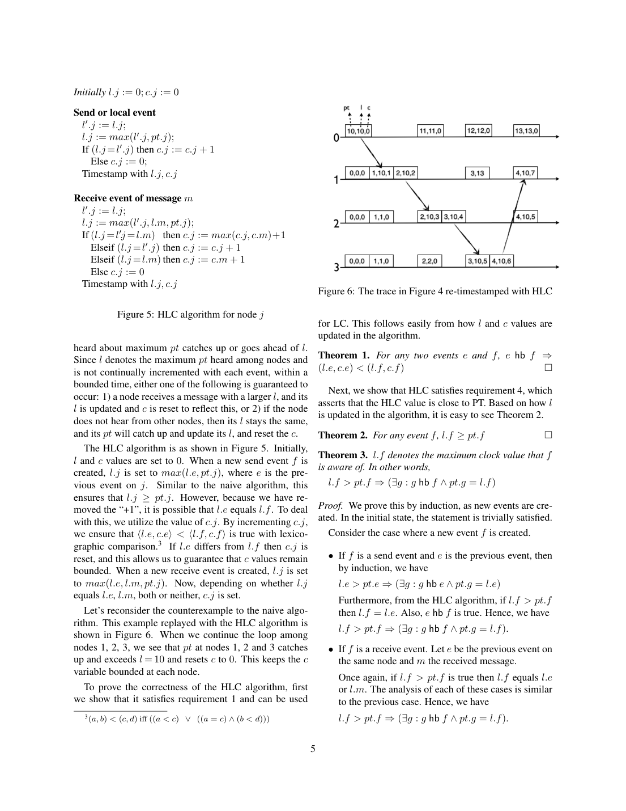
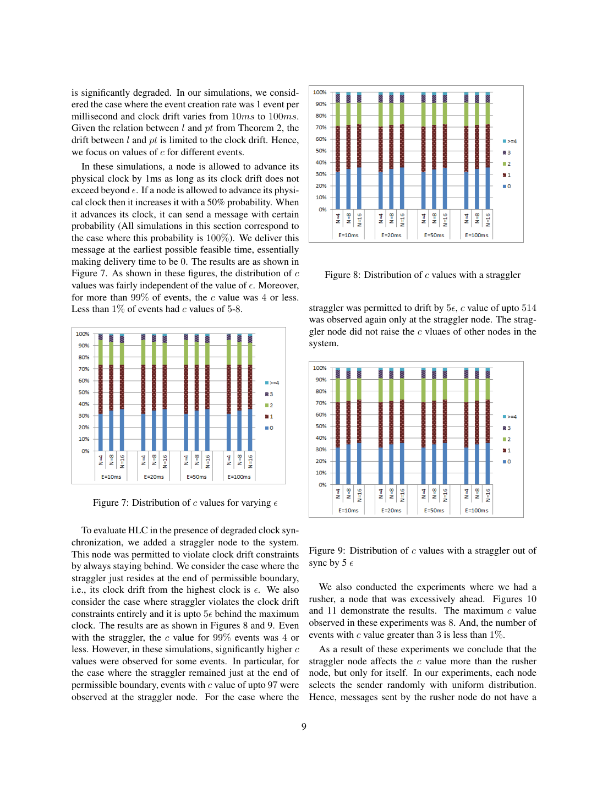

> 本组第 37 篇 · 分布式一致性 · [全部论文]() · [上一篇]() · [下一篇]()

HLC把时间戳分为l和c：l跟踪所见最大物理时间，c在相同l下记录逻辑递增。正常算法保证e hb f => HLC(e)<HLC(f)，但反向不成立；不同节点并发事件还可能同戳，单凭HLC不是唯一全局序列号或完整因果判定器。与物理时间接近、计数器有界、64位可表示分别需要同步、事件速率/粒度及编码假设，不能混为无条件保证。

论文用共同逻辑阈值和虚拟哑事件描述一致切面。无需为保留因果顺序等待物理时钟不确定区间，不等于无需等待数据到达、提交可见性或安全读取条件，也不自动提供事务原子性、串行化或外部一致性。第11页明确把外部一致性列为更强性质，并提出client-notification-wait；必须保留这一等待边界。

本次补齐Figure 5全部更新分支、检查具体数值算例，修正16位c的最大数值为65535（65536个状态）、截取与向上取整的混淆、Theorem 3前驱不一定是直接发送者等问题。原有10段API解读全部复核修订，原始英文片段保留。AWS和仿真只测c与l-pt分布，不是数据库吞吐/快照延迟对比；恢复重置与忽略消息不保证跨任意故障的连续因果单调。

本文保留论文陈述、读者推断与待验证方案的区别；实验数字只适用于原文条件。原文和翻译来自已有 AI 辅助精读报告，已做来源匹配与编辑复核，不等于人工逐项核验或独立实验复现。所有页码均为 PDF 物理页。

## 论文与阅读范围

Sandeep Kulkarni, Murat Demirbas, Deepak Madeppa, Bharadwaj Avva, Marcelo Leone. Logical Physical Clocks and Consistent Snapshots in Globally Distributed Databases. 本地13页稿件；年份、会议/期刊和DOI未独立核实，不补造出版字段。

[论文集中的原始 PDF](https://github.com/lonng/db-papers/blob/4ff1331069c7cf52ac97dd769e5f484c1c35c200/papers/consistency/logical-physical-clocks-and-consistent-snapshots-in-globally-distributed-databases.pdf) · 本地来源：`consistency/logical-physical-clocks-and-consistent-snapshots-in-globally-distributed-databases.pdf`，共 13 页。

本篇保留 18 组原文精读和 33 条证据。截图为原始 PDF 的局部页选，不是重新生成的图表；未将整份 PDF 复制到博客。

## 研究问题与实际审查范围

【方法】已读完整13页正文、脚注和参考文献；视觉核对仅限2、4、5、6、8、9、10、11页。来源是本地稿件，不是联网综述；保留原API来源、模型和实际用量，Codex另记editorial_review。原critique针对旧稿，不表示当前修订已获新的独立模型或人工审查。原有10段原文不重写，但其translation/interpretation/pitfall/example全部按源文复核；另补8段机制关键解读。

【原文事实】目标是在O(1)个整数与常数次操作内，保持类似LC的单向因果次序，同时让逻辑时间接近物理/NTP时钟。e hb f意味着完整二元HLC(e)<HLC(f)，而不是单独要求l严格增加：因果链上l可以相同、由c递增。逆命题不成立，事件时间戳更小不能证明存在因果；并发事件既可不同戳，也可同戳。[HX16-HX17,C001N10]

因果范围是建模到本系统的本地事件顺序与消息传递。应用带外通道或未携带时间戳的依赖不会自动被捕获；同一节点连续事件被模型视作有序，不代表HLC理解了全部业务依赖。论文对Kronos的比较也应作为该模型区别，而不是现代产品能力排名。[C002N12]

【边界】本文讨论的是时间戳与一致切面选择，不是一个完整的事务/复制实现。尤其不能把因果单调或物理近似替换成现实时间上先结束事务必排在后开始事务之前；论文把外部一致性列为更强要求，并另提通知等待。本报告所有系统名、NTP条件与实验环境均为原稿历史语境，未验证当前产品。[HX11-HX12]

依据：论文陈述；PDF 物理页 3, 5, 11。证据：[C001N10](#evidence-c001n10), [C002N12](#evidence-c002n12), [HX16](#evidence-hx16), [HX17](#evidence-hx17), [HX11](#evidence-hx11), [HX12](#evidence-hx12)。

## 二元时钟、故障层与64位布局

【原文事实】每节点状态为(l,c)，时间戳按字典序比较。l收集本地观察和消息中的最大物理时间信息，c在l相等时维持严格逻辑递增；本地、发送、接收是三个事件入口，不能用单个标量的每步+1替代Figure 5。[HX01-HX02]

HLC是物理时钟服务之上的只读叠加层：只读pt，不调节底层时钟，不负责NTP同步或修复物理误差。正常更新规则与故障恢复策略应分层：当漂移或损坏超出容许范围，原文提出将(l,c)重置为(pt,0)、忽略越界消息、记日志并通知管理员。该纠正可能打断旧时间戳的单调连续性，忽略消息也影响业务消息如何安全处理，不能称作无感恢复全部事务语义。[HX05-HX08]

紧凑布局不是任意Unix毫秒整数的48+16拆分，而是原稿的NTP格式：取物理时间的高48位并向上取整，把低16位位置留给c。不能把ceiling改成直接丢低位；查询t也要按相同规则取整。保留的是微秒量级粒度，不是物理时钟同步精度或端到端微秒延迟。[C002N10,HX13]

16位无符号字段有65536种状态，数值范围0..65535。原文“grow up to 65536”的措辞应与状态数区别；原文引文原样保留，本报告不再把65536当成可编码的最大c。常见样本c很小并不能证明所有高频同l事件都不会溢出；截断、回绕或复位都需要明确协议，不能默认对MVCC可见性安全。

依据：论文陈述；PDF 物理页 5, 6, 7, 11。证据：[HX01](#evidence-hx01), [HX02](#evidence-hx02), [HX05](#evidence-hx05), [HX06](#evidence-hx06), [HX07](#evidence-hx07), [HX08](#evidence-hx08), [HX13](#evidence-hx13), [C002N10](#evidence-c002n10)。

*原论文 PDF 物理页 5，版权归原作者或出版方。点击图片可查看原尺寸。页面文本中定位到：Figure 5: HLC algorithm for node j；Figure 6: The trace in Figure 4 re-timestamped with HLC。这是页面定位信息，不表示本次已复核图内所有数据。*

## Figure 5完整规则与分支算例

【原文事实】Figure 3朴素算法在本地/发送取max(l+1,pt)，接收取max(l+1,msg_l+1,pt)。它把所见物理最大值和人为逻辑增量混入同一l，Figure 4的循环可累积无界l-pt漂移。Figure 5才是正式二元算法；不能因API原有笔记缺少该图引用就声称源文没有精确规则。[C001N02,HX01-HX02]

本地或发送：保存old_l；L=max(old_l,pt)。若L==old_l，C=old_c+1；否则C=0。接收消息(m_l,m_c)：保存旧值后令L=max(old_l,m_l,pt)。分四支：若L==old_l==m_l，C=max(old_c,m_c)+1；否则若L==old_l，C=old_c+1；否则若L==m_l，C=m_c+1；否则C=0。输出(L,C)。这保证正常操作中完整时间戳大于本地前值，接收时间戳也大于消息时间戳。[HX01-HX02,HX17]

【读者构造的假设示例】旧值(100,2)、消息(100,7)、pt=99，接收为(100,8)；旧值(100,2)、消息(99,7)、pt=100，为(100,3)；旧值(99,2)、消息(100,7)、pt=100，为(100,8)；同样旧值和消息但pt=101，为(101,0)。特别注意第三个例子：l比本地旧值增大仍不能直接c=0，因为继承的是消息的l及其逻辑进度。

本地旧值(100,2)观察pt=99时为(100,3)，观察pt=101时为(101,0)。物理时钟与逻辑最大值恰好相等也必须走相应相等分支，不能因“物理时间也最大”绕开计数器。图6三元标签顺序是<pt,l,c>，不要倒读成<l,c,pt>。本次只运行这些算例及有限小状态空间检查，未完成分布式故障测试或实现完整时钟库。

依据：论文陈述；PDF 物理页 4, 5。证据：[C001N02](#evidence-c001n02), [C001N06](#evidence-c001n06), [HX01](#evidence-hx01), [HX02](#evidence-hx02), [HX17](#evidence-hx17)。

## 定理条件、一致切面与证明文本疑点

【原文事实】Theorem 1给出单向因果保持；Theorem 2是正常算法l>=pt；Theorem 3说当l.f>pt.f时，存在因果前驱g的物理时间pt.g等于l.f。该g不必是当前消息的直接发送者，消息也可能携带更上游继承来的最大值。[C001N06,HX17]

Corollary 1的|l-pt|<=epsilon依赖时钟同步约束，不能把样本平均NTP offset直接当作已认证的全系统最坏epsilon。Corollary 3的c<=N*(epsilon+1)还使用同节点相邻事件间物理时钟至少前进一个单位的条件；epsilon与单位/事件速率必须一致。进一步的epsilon/d+1界依赖额外传输期间各物理时钟至少增加d的假设，不能省略后宣称任意事件速率都只需固定16位。[HX03-HX04,HX18,C001N07]

【证明文字边界】Theorem 4陈述c=k意味着存在相应长度的同l因果前驱链，并非c精确等于所有同l前驱数量。原稿Corollary 3后文把相关pt区间写为[l.f,l.f+epsilon]，与同l事件需满足l.g>=pt.g的文字有明显张力；本报告保留原文，不默默改区间再宣称已独立认证完整证明。异常重置、计数回绕和忽略消息也不在正常无损坏单调定理的无条件覆盖内。[C001N07,HX06]

【切面解释】选共同二元阈值T，把每节点截至T的完整可见前缀纳入切面；若事件f被包含且e hb f，因HLC(e)<HLC(f)，前驱e也必须包含。允许包含发送而尚未包含接收，不允许只含接收漏掉发送。虚拟哑事件补的是逻辑边界，不是真实通信、写入或等待算法。<t,0>只是示例共同边界，脚注还允许<t,K>；它不是物理时刻t同时读取所有节点。[HX09-HX10]

【读者推断】在线数据库还需要保存所需版本、让可见前缀真正因果完整、处理未提交事务及迟到复制，并知道不会再有更早的可见更新补入。相同时间戳标签和虚拟事件不能替代这些数据可用性/安全读取义务。论文的[t-epsilon,t]是其同步模型下的物理近似窗口，不是无误差UTC瞬时快照，更不是自动的事务原子性证明。

依据：读者推断；PDF 物理页 3, 5, 6, 7, 10。证据：[C001N10](#evidence-c001n10), [C001N06](#evidence-c001n06), [C001N07](#evidence-c001n07), [HX03](#evidence-hx03), [HX04](#evidence-hx04), [HX06](#evidence-hx06), [HX09](#evidence-hx09), [HX10](#evidence-hx10), [HX17](#evidence-hx17), [HX18](#evidence-hx18)。

## AWS与仿真测量的实际对象

【原文事实】实验使用历史AWS xlarge实例、Ubuntu 14.04和stratum-2 NTP服务器，TCP全互发消息，总发送量75000-425000；表格给出4/8/16个m1.xlarge节点的c分布及l-pt统计。它们不是完整数据库事务吞吐、快照响应延迟或与Spanner的性能对比。[C002N05]

8节点平均offset=9ms时，c=0占65.56%，最大l-pt=107.9ms；offset=3ms时，c=0占91.18%，c=1占8.82%，表内c>=2为0，最大l-pt=7.4ms。不能把0%行写成c最大到2，也不能把平均offset=9ms与最坏epsilon=9ms等同，从107.9ms反推定理已经被实验推翻。16节点offset=6ms时c=0为75.43%，最大l-pt=46.8ms；均是特定负载的观测。[C002N05]

WAN在Ireland、US East、US West、Tokyo各一节点，offset约3ms，c=0约95%、c=1约5%，最大l-pt约0.02ms，p90为0。作者解释为传播耗时大于同步不确定区间，消息到达时发送l已落在接收pt之后；这不说明WAN事务更快或NTP本身更准确。[C002N06]

仿真采用每毫秒一个事件、epsilon约10-100ms，并尽早投递消息近似零传输等待；节点物理时钟在约束允许时以50%概率前进。>99%事件c<=4属于该实验，不是任意环境溢出风险已被证明极低。straggler在边界或落后5epsilon时尾部c达到97/514，rusher实验最大c=8；极小的多数值不能抹去尾部。[C002N07-C002N08,HX14-HX15]

本文没有独立重跑AWS或仿真，没有新增显著性检验、置信区间或当前云产品测量。复现实验需记录完整生成器、物理时钟推进与投递策略，不能把任意正态延迟分布称作真实网络分布。

依据：论文陈述；PDF 物理页 7, 8, 9。证据：[C002N05](#evidence-c002n05), [C002N06](#evidence-c002n06), [C002N07](#evidence-c002n07), [C002N08](#evidence-c002n08), [HX14](#evidence-hx14), [HX15](#evidence-hx15)。

*原论文 PDF 物理页 9，版权归原作者或出版方。点击图片可查看原尺寸。页面文本中定位到：Figure 7. As shown in these figures, the distribution of c；Figure 7: Distribution of c values for varying ϵ；Figure 8: Distribution of c values with a straggler；Figure 9: Distribution of c values with a straggler out of。这是页面定位信息，不表示本次已复核图内所有数据。*

## 因果信息、计数容量与恢复取舍

【读者推断】HLC相对向量时钟节省状态，但不识别精确因果图。二元时间戳的可比较性也不自动给出跨节点唯一ID：并发节点可以同戳；追加节点ID等打破平局是另一约定。不能从“能排序”直接推导事务串行化、冲突检测或外部一致性已完成。[C001N10,HX16]

16位计数器容量与物理粒度、事件速率、同步误差相耦合。48位物理部分的向上取整会改变精度；该布局的微秒量级分辨率不是全系统精确物理时间。若c到65535后继续需要同l递增，原始算术需要更大值，盲目截断为0会破坏顺序。原文有回绕/重置讨论，但不能据此把回绕当作无害的实现细节。[C002N10,HX03,HX13]

Delta是应用选择的异常容忍阈值，不是NTP误差的新物理保证；放宽到秒级只是避免过早触发保护，不会令原始epsilon界在异常后仍成立，也不证明99.9%的任意部署错误都被实测屏蔽。[C002N03]

当界限违反时，重置到(pt,0)可能相对已发出的膨胀时间戳倒退；忽略异常消息会影响消息业务语义和因果传播。需要记录异常、管理员处置及上层协议的隔离/重同步规则；“最终恢复合法状态”与“故障全过程保持所有此前时间戳承诺”是不同保证。[HX06-HX08]

对straggler的描述也应按四分支条件理解：接收方物理时间必须严格超过旧本地l和消息l才无条件进入c=0分支；若只是与消息l打平，仍可能继承消息计数器加1。原文直觉说明不是可以覆盖所有边界相等情况的另一套更新算法。[HX02]

依据：读者推断；PDF 物理页 3, 5, 6, 7, 11。证据：[C001N10](#evidence-c001n10), [C001N07](#evidence-c001n07), [C002N03](#evidence-c002n03), [C002N10](#evidence-c002n10), [HX02](#evidence-hx02), [HX03](#evidence-hx03), [HX06](#evidence-hx06), [HX07](#evidence-hx07), [HX08](#evidence-hx08), [HX13](#evidence-hx13), [HX16](#evidence-hx16)。

## LC、VC、物理时间与外部一致性的分工

【来源内对照】LC/HLC都保留hb到时间戳严格增加的单向关系，不能由时间戳逆推因果；VC在所述模型下能表达更完整的偏序，但需随节点增长的状态。HLC接近物理时间的性质另外依赖同步边界，不是仅有LC单调性就自动成立。[C001N10,HX16-HX17]

物理时间即使可以按数字排序，在同步不确定区间内也不能保证该顺序保留hb。HLC通过消息携带(l,c)及本地更新补上已跟踪的因果先后，但不调整物理时钟，也不捕获未进入消息链的外部真实时间关系。[HX05,C002N12]

论文用虚拟哑事件描述共同逻辑时刻的因果一致切面，并说无需为了这种因果排序等待时钟不确定区间；不能由此断言HLC可直接替代TrueTime并保留其全部事务保证。第11页明确说commit-wait还支持更强的external consistency/strict serializability，并另提client-notification-wait来获得该性质。[HX09-HX12]

例如两个互不传递消息的节点上，事务T1已在真实时间结束，T2后来才开始，T2本地物理时钟却较慢；HLC的消息因果规则本身不保证T1时间戳较小。需要客户端依赖传播或另一个真实时间协议；虚拟哑事件并没有创造缺失的依赖。作者的通知等待提案也没有在本文展开完整数据库事务协议或给出吞吐/延迟实测。

本次未核查任何当前Spanner或其他数据库实现，也不列泛泛产品关联来填充证据缺口。可迁移的问题是：依赖由谁传播、提交何时可见、快照何时安全、外部先后如何约束，而不是仅替换时间戳格式。

依据：读者推断；PDF 物理页 3, 5, 6, 10, 11。证据：[C001N10](#evidence-c001n10), [C002N12](#evidence-c002n12), [HX05](#evidence-hx05), [HX09](#evidence-hx09), [HX10](#evidence-hx10), [HX11](#evidence-hx11), [HX12](#evidence-hx12), [HX16](#evidence-hx16), [HX17](#evidence-hx17)。

## 尚未执行的验证与数据库集成计划

【读者提案，非已完成实验】首先按Figure 5建立确定性的事件序列测试。覆盖本地物理时间前进/持平/倒退、接收四分支及与pt相等的边界；断言完整时间戳大于前一本地值和发送消息值。已有6个算例以及720个接收、60个本地小状态检查仅验证正常整数更新，不覆盖溢出、并发实现或所有故障。[HX01-HX02]

第二步验证边界条件：把epsilon定义在明确物理单位上，控制每单位可产生事件数；分别启用/禁用同步约束与额外传输d假设，观察c的尾部，而不是把平均NTP offset代入最坏界。对c=65535、ceiling跨物理刻度、重启状态、Delta越界与消息拒绝，明确测试策略及上层失败结果，不允许无说明地回绕后继续声称单调。[HX03-HX04,HX06-HX07,HX13]

第三步验证切面：给消息图中每个事件分配HLC，以共同二元阈值取所有节点完整前缀；检查每条被包含接收都有发送前驱。对<t,0>和<t,K>都测。再故意延迟一个复制前驱，确认数据库不能只靠本地当前l超过T就报告安全快照；必须由实际版本与可见性协议阻止缺失依赖的读取。[HX09-HX10]

第四步单独验证外部一致性：在无消息依赖的两节点构造真实时间先后但物理时钟偏斜的事务对，区分仅HLC、客户端传播依赖、额外通知等待。检查用户观察到的提交先后，不把因果切面测试替代严格可串行化测试。原稿提出的client-notification-wait应作为待具体化协议，而不是本次已实现功能。[HX11-HX12]

最后才重做AWS/仿真分布实验，报告c分布、l-pt均值/分位/最大值、事件与投递模型、同步测量方法和重复次数；如集成数据库，再报告事务吞吐、读写延迟、复制等待和故障行为。没有版本可见性与原子提交设计前，不建议直接替换任意系统时间戳分配器并宣称等价。

依据：待验证的工程设想；PDF 物理页 5, 6, 7, 8, 9, 10, 11。证据：[HX01](#evidence-hx01), [HX02](#evidence-hx02), [HX03](#evidence-hx03), [HX04](#evidence-hx04), [HX06](#evidence-hx06), [HX07](#evidence-hx07), [HX09](#evidence-hx09), [HX10](#evidence-hx10), [HX11](#evidence-hx11), [HX12](#evidence-hx12), [HX13](#evidence-hx13), [C002N05](#evidence-c002n05), [C002N07](#evidence-c002n07)。

## 结论、来源索引与未验证事项

【结论】HLC的贡献是把跟踪到的物理最大值与同值逻辑进度分开，在正常规则下以常数个整数保留单向因果顺序。它不是完整因果判定器、唯一全局时间戳服务或无条件事务排序器。因果单调、物理接近、有界计数、故障后恢复和数据库可见性各有前提，应分别验证。[HX01-HX02,HX16-HX18]

共同逻辑阈值可定义因果向下封闭的切面，但实际读取需要数据版本和提交/复制可见性支持；“不等时钟不确定区间”不能删掉数据等待或外部一致性的额外要求。原文第11页的client-notification-wait是重要限定，不应被摘要中的wait-free措辞覆盖。[HX09-HX12]

【证据索引】第3页单向关系与建模；第4页朴素算法与循环漂移；第5页Figure 5全规则及定理；第6页有界性与事件/传输假设；第7页Delta、恢复与AWS设置；第8页部署数据；第9页仿真和straggler尾部；第10页快照与图12；第11页编码与外部一致性。第1-2页背景、图1-2以及第12-13页结论/参考文献同样完整阅读，但不以未核查外部文献补充保证。

【编辑范围】原有10段API解读全部修订，不仅追加新段落；10段原始英文片段按值保留，另加8段机制片段。保留原source/SHA/model/usage/critique及原证据quote字段，修改错误解读并补18条来源证据。原critique属于修订前API流程，未伪称它已审查本次Codex修订。

【未验证事项】没有独立形式化认证Corollary 3/4证明、实现审计、真实集群或数据库基准、当前产品比较。源文区间和16位措辞保留为可追溯疑点；引文和结构匹配不能替代语义正确性证明，最终仍待人工复核。

依据：读者推断；PDF 物理页 3, 4, 5, 6, 7, 8, 9, 10, 11。证据：[C001N02](#evidence-c001n02), [C001N06](#evidence-c001n06), [C001N07](#evidence-c001n07), [C001N10](#evidence-c001n10), [C002N01](#evidence-c002n01), [C002N02](#evidence-c002n02), [C002N03](#evidence-c002n03), [C002N04](#evidence-c002n04), [C002N05](#evidence-c002n05), [C002N06](#evidence-c002n06), [C002N07](#evidence-c002n07), [C002N08](#evidence-c002n08), [C002N09](#evidence-c002n09), [C002N10](#evidence-c002n10), [C002N12](#evidence-c002n12), [HX01](#evidence-hx01), [HX02](#evidence-hx02), [HX03](#evidence-hx03), [HX04](#evidence-hx04), [HX05](#evidence-hx05), [HX06](#evidence-hx06), [HX07](#evidence-hx07), [HX08](#evidence-hx08), [HX09](#evidence-hx09), [HX10](#evidence-hx10), [HX11](#evidence-hx11), [HX12](#evidence-hx12), [HX13](#evidence-hx13), [HX14](#evidence-hx14), [HX15](#evidence-hx15), [HX16](#evidence-hx16), [HX17](#evidence-hx17), [HX18](#evidence-hx18)。

## 原文精读：从句子回到机制

以下保留原文、忠实翻译、含义与边界；假设示例不作为论文实验结果。

### P001 · PDF 物理页 3

**原文**

<blockquote class="paper-source-quote"><pre><code>Based on the existing results in the literature, the fol-&#10;lowing are true:&#10;e hb f ⇒lc.e &lt; lc.f&#10;lc.e = lc.f ⇒e||f&#10;e hb f ⇔vc.e &lt; vc.f&#10;However, the following claims are not true:&#10;e hb f ⇐lc.e &lt; lc.f&#10;lc.e = lc.f ⇐e||f&#10;e hb f ⇒pt.e &lt; pt.f&#10;3&#10;HLC: Hybrid Logical Clocks&#10;In this section, we introduce our HLC algorithm starting&#10;with a naive solution first.</code></pre></blockquote>

**忠实翻译**

> 根据已有文献，e hb f推出lc.e<lc.f，lc.e=lc.f推出e与f并发，e hb f等价于向量时钟vc.e<vc.f。反过来，lc.e<lc.f不能推出e hb f；并发不能推出lc相等；hb也不保证物理时间戳严格增加。随后作者开始第3节，从朴素方案引入HLC。

**技术含义与边界**

> 方向要说准：lc.e<lc.f是hb的必要条件，不是据以认定hb的充分条件；若知道hb，则一定得到较小lc。HLC正常规则保留同类单向关系，不能说这些限制完全不适用于HLC。

**常见误读**

> 不要倒置必要/充分条件，或把时间戳可比较当作已查明因果；并发既可不同戳也可同戳，跨节点唯一排序还需额外约定。

**读者构造的假设示例**

> 读者构造的假设示例：互无消息的A、B分别产生e、f，HLC为(100,0)、(101,0)。e的戳更小却无hb；也可让二者同为(100,0)，并发不要求不同戳。

### P002 · PDF 物理页 11

**原文**

<blockquote class="paper-source-quote"><pre><code>Secondly, by tracking the pt,&#10;the size of l is by default 64-bits as the NTP timestamps.&#10;We propose the following scheme for combining l and&#10;c and storing it in single 64 bit timestamp. This scheme&#10;involves restricting l to track only the most significant 48&#10;bits of pt in the HLC algorithm presented in Figure 5.&#10;Rounding up pt values to 48 bits l values still gives us&#10;microsecond granularity tracking of pt.</code></pre></blockquote>

**忠实翻译**

> 其次，按NTP时间戳追踪pt时，l默认也占64位。作者提出把l和c合并到一个64位时间戳：在Figure 5算法中让l只追踪pt最高有效48位；将pt向上取整到这样的48位l，仍具有微秒量级粒度。

**技术含义与边界**

> 这里是NTP格式的高位与ceiling，不是任意48位Unix毫秒字段，也不是简单截断低位。剩余16位给c，共65536种状态、最大值65535；查询时间同样取整。

**常见误读**

> 旧解读的“截断/截取前48位”会混淆向上取整；表示粒度也不能等同于NTP同步精度、系统延迟或无条件足够的计数容量。

**读者构造的假设示例**

> 读者构造的假设示例：若NTP编码整数低16位非零，先将其向上对齐到下一高48位刻度，再拼接c=3；直接右移丢位与向上对齐可能得到不同的l。

### P003 · PDF 物理页 7

**原文**

<blockquote class="paper-source-quote"><pre><code>While Theorem 2 and Corollaries 3 and 2 state&#10;that l −pt stay within ϵ the clock synchronization uncer-&#10;tainty (crudely two times the NTP offset value), we set&#10;a very conservative value, ∆, on the l −pt bound. The&#10;bound ∆can be set to a constant factor of ϵ, and even on&#10;the order of seconds depending on the application seman-&#10;tics.</code></pre></blockquote>

**忠实翻译**

> 虽然作者将l-pt保持在时钟同步不确定度epsilon内（粗略描述为两倍NTP offset），实际仍在l-pt上设置非常保守的Delta；Delta可取epsilon的常数倍，甚至按应用语义取到秒量级。

**技术含义与边界**

> epsilon是定理同步模型中的边界，Delta是何时触发纠正/拒绝的应用阈值。把阈值放宽不会改善物理同步，也不会使同步假设失效后原定理仍成立。

**常见误读**

> 不要拿平均offset认证最坏epsilon；也不能说低于Delta便自动正常处理所有业务、维持所有数据库保证，或99.9%在所有部署已被实测证实。

**读者构造的假设示例**

> 读者构造的假设示例：设模型epsilon=10ms、保护阈值Delta=1s，观测漂移20ms未触发该阈值，但已不能用10ms同步模型直接保证原来的物理窗口。

### P004 · PDF 物理页 9

**原文**

<blockquote class="paper-source-quote"><pre><code>The results are as shown in&#10;Figure 7. As shown in these figures, the distribution of c&#10;values was fairly independent of the value of ϵ. Moreover,&#10;for more than 99% of events, the c value was 4 or less.&#10;Less than 1% of events had c values of 5-8.&#10;Figure 7: Distribution of c values for varying ϵ&#10;To evaluate HLC in the presence of degraded clock syn-&#10;chronization, we added a straggler node to the system.</code></pre></blockquote>

**忠实翻译**

> Figure 7所示仿真中，c的分布对所测epsilon值相当不敏感，超过99%的事件c为4或以下，不到1%的事件c为5-8；接着作者加入straggler，评估同步退化。

**技术含义与边界**

> 这是特定事件速率、时钟推进和尽早投递模型的统计结果，不是计数器绝对界，也不单独证明溢出风险极低。后续straggler实验有97/514的尾部。

**常见误读**

> 不能从多数小值忽略尾部或推出任意负载下c与epsilon无关；旧示例引入未测的5ms也不应伪装成论文实验条件。

**读者构造的假设示例**

> 读者构造的假设示例：假设在epsilon=10ms与50ms的相同生成器试验中，多数c都不超过4；仍应分别记录最大值和高分位，不能只报告99%就把计数器裁成3位。

### P005 · PDF 物理页 5

**原文**

<blockquote class="paper-source-quote"><pre><code>Based on how l&#10;is updated in the algorithm, it is easy to see Theorem 2.&#10;Theorem 2. For any event f, l.f ≥pt.f&#10;Theorem 3. l.f denotes the maximum clock value that f&#10;is aware of. In other words,&#10;l.f &gt; pt.f ⇒(∃g : g hb f ∧pt.g = l.f)&#10;Proof. We prove this by induction, as new events are cre-&#10;ated. In the initial state, the statement is trivially satisfied.&#10;Consider the case where a new event f is created.</code></pre></blockquote>

**忠实翻译**

> 按l的更新方式，定理2为任意事件f有l.f>=pt.f。定理3说l.f是f所知最大时钟值：若l.f>pt.f，则存在g hb f且pt.g=l.f。作者随新事件产生作归纳，初始状态平凡成立，再讨论新事件f。

**技术含义与边界**

> 前驱g可能经过多跳传播，不必等于当前消息的直接发送事件。正常l>=pt不等于接近真实UTC；接近本地pt的上界还依赖同步条件，紧凑向上取整要另考虑粒度。

**常见误读**

> 收到消息l=105不表示发送者当时pt必为105；它可能继承别处的105。只有l.f>pt.f的条件才要求存在相应更早物理来源。

**读者构造的假设示例**

> 读者构造的假设示例：X在pt=105产生g，B在pt=101收到并继承l=105，再转发给pt=100的A。A的l=105的物理来源可以是X的g，不必是B发送时的pt。

### P006 · PDF 物理页 8

**原文**

<blockquote class="paper-source-quote"><pre><code>Using 8 m1.xlarge nodes&#10;c&#10;offset=9ms&#10;offset=3ms&#10;0&#10;65.56 %&#10;91.18 %&#10;1&#10;15.39 %&#10;8.82 %&#10;2&#10;8.14 %&#10;0 %&#10;3&#10;5.90 %&#10;4&#10;2.74 %&#10;5&#10;1.39 %&#10;6&#10;0.56 %&#10;7&#10;0.20 %&#10;8&#10;0.08 %&#10;9&#10;0.03 %&#10;The experiments with 8 nodes highlights the lowered&#10;c values due to improved NTP synchronization. For the&#10;experiments with average NTP offset 9ms, the maximum&#10;l −pt difference was observed to be 107.9 ms.</code></pre></blockquote>

**忠实翻译**

> 8个m1.xlarge节点的表中，平均offset=9ms时c=0/1分别占65.56%/15.39%，依次列到c=9的0.03%；offset=3ms时c=0为91.18%、c=1为8.82%，c>=2在表中为0。作者称同步改善降低c；9ms条件下观察到最大l-pt为107.9ms。

**技术含义与边界**

> 表中百分比是所测事件频率，9ms是平均offset而非已认证最坏epsilon；不能由107.9ms直接与9ms相比便断言理论失效。该片段不支持3ms条件下c最大到2。

**常见误读**

> 不要把0%行变成一次c=2事件，不要把较小c解释为业务吞吐提高，也不要把这些观测最大值当作全局上界。

**读者构造的假设示例**

> 读者构造的假设示例：为核对表意，可假设抽样10000个事件，3ms列按显示百分比分成约9118个c=0、882个c=1；这只是频率算例，不是复原原论文实际样本数。

### P007 · PDF 物理页 4

**原文**

<blockquote class="paper-source-quote"><pre><code>The messaging loop among nodes 1,&#10;2, and 3 can be repeated forever, and at each turn of the&#10;loop the drift between logical clock and physical clock&#10;(the l −pt difference) will keep growing.&#10;The root of the unbounded drift problem is due to the&#10;naive algorithm using l to maintain both the maximum of&#10;pt values seen so far and the logical clock increments from&#10;new events (local, send, receive). This makes the clocks&#10;lose information: it becomes unclear if the new l value&#10;came from pt (as in the message from node 0 to node 1)&#10;or from causality (as is the case for the rest of messages).</code></pre></blockquote>

**忠实翻译**

> 节点1、2、3之间的消息循环可不断重复，每轮都会增加逻辑与物理时间的漂移。根源是朴素算法用同一l同时保存已知最大pt和新事件逻辑增量，无法分辨增长来自物理时间还是因果递增。

**技术含义与边界**

> 这是Figure 3标量方案的反例动机；正式Figure 5把物理最大值与同l计数分开。反例不等于任意三节点发几次消息就证明长期无界，完整论证依赖原图重复调度。

**常见误读**

> 不要把朴素算法当成正式HLC，或因正常方案可屏蔽某些时钟倒退就宣称任意损坏/计数回绕仍保持全部定理。

**读者构造的假设示例**

> 读者构造的假设示例：局部旧HLC=(100,2)、pt=99时，正式本地规则给(100,3)，不把l增加为101；这是说明分工的单步算例，不冒充图4完整无界反例。

### P008 · PDF 物理页 6

**原文**

<blockquote class="paper-source-quote"><pre><code>From Theorem 4, the following two corollaries follow.&#10;Corollary 2. For any event f,&#10;c.f ≤|{g : g hb f ∧l.g = l.f)}|.&#10;Corollary 3. For any event f, c.f ≤N ∗(ϵ + 1)&#10;Proof. From Corollary 2, for any event f, c.f ≤|{g :&#10;g hb f ∧l.g = l.f)}|. Also, from Theorem 2, l.g ≥pt.g.&#10;Also, by clock synchronization assumption of g hb f then&#10;pt.g ≤pt.f + ϵ.</code></pre></blockquote>

**忠实翻译**

> 由定理4，推论2给c.f不超过所有满足g hb f且l.g=l.f的事件数；推论3写为c.f<=N*(epsilon+1)。所引证明再用l.g>=pt.g和时钟同步关系pt.g<=pt.f+epsilon。

**技术含义与边界**

> 完整推导后文还依赖同节点相邻事件间物理时钟至少前进一个单位；N、epsilon和单位/事件速率须匹配。Theorem 4提供存在的因果链，不等于计数所有前驱。打印的相关pt区间另有需澄清的疑点，未在此独立认证证明。

**常见误读**

> 只保留同步假设仍不够；不能把无单位的毫秒epsilon与任意每纳秒事件率直接相乘，也不能由界小就断言任意故障下固定计数器足够。

**读者构造的假设示例**

> 读者构造的假设示例：若N=3、epsilon=2个物理单位且每节点两事件间至少前进一单位，并满足其余模型条件，代入作者界得9。去掉事件率条件后不能沿用同一个9。

### P009 · PDF 物理页 10

**原文**

<blockquote class="paper-source-quote"><pre><code>6.1&#10;Snapshots&#10;In snapshot read, the client is interested in obtaining a&#10;snapshot of the data at a given time. HLC can be used to&#10;perform snapshot read similar to that performed by True-&#10;Time. Moreover, unlike TT, there is no need to delay any&#10;transaction due to uncertainty in the clock values.&#10;To describe our approach more simply, we introduce&#10;the concept of virtual dummy events. Let e and f be two&#10;events on the same node such that l.e &lt; l.f.</code></pre></blockquote>

**忠实翻译**

> 第6.1节说，快照读取希望取得给定时间的数据快照；HLC可用于类似TrueTime的快照读取，并声称不必因时钟值不确定性延迟事务。随后引入虚拟哑事件，先考虑同节点l.e<l.f的两个事件。

**技术含义与边界**

> 应把主张限于逻辑因果排序无需等物理不确定区间。后文用共同<t,0>边界描述一致切面；在线读取仍需版本、提交/复制可见性与安全前缀，第11页还为外部一致性提出通知等待。

**常见误读**

> 不能写成HLC单独即可直接过滤任何副本获得事务一致快照，也不能用虚拟事件代替safe-time或数据到达条件；更不能抹去external consistency的额外等待。

**读者构造的假设示例**

> 读者构造的假设示例：发送s=(10,1)、对应接收r=(10,2)。共同阈值T=(10,1)可含发送不含接收，T=(10,2)要同时包含二者；若读取副本实际缺少s，不能只凭时间戳标签宣称已经拿到完整切面。

### P010 · PDF 物理页 7

**原文**

<blockquote class="paper-source-quote"><pre><code>This node will increment its c by 1 when it&#10;does not adopt a new l value, but this does not cause the c&#10;rise excessively for the other nodes in the system. Even if&#10;this node sends a message with high c number, the other&#10;nodes will have up-to-date time and ignore that c and will&#10;use c = 0. Similarly, HLC is also robust to the rushers,&#10;nodes with pt slightly ahead of others.</code></pre></blockquote>

**忠实翻译**

> 该节点未采用新l时c递增；作者说这不使其他节点的c过度上升，因为其他节点物理时间较新时可忽略该高c并使用0，也类似适用于pt稍领先的rusher。

**技术含义与边界**

> 这是同步条件下的直觉说明，精确行为仍按Figure 5。pt严格大于旧本地l和消息l时才c=0；若pt仅与消息最大l相等，需继承消息c加1。

**常见误读**

> 不能把拥有较新物理时间泛化为任何高c都自动归零，或把略有偏差的例子提升为任意时钟损坏都无害。

**读者构造的假设示例**

> 读者构造的假设示例：旧本地(99,2)、消息(100,50)，pt=101时输出(101,0)；pt=100时则输出(100,51)，物理时间打平消息l不能重置c。

### P011 · PDF 物理页 5

**原文**

<blockquote class="paper-source-quote"><pre><code>Initially l.j := 0; c.j := 0&#10;Send or local event&#10;l′.j := l.j;&#10;l.j := max(l′.j, pt.j);&#10;If (l.j =l′.j) then c.j := c.j + 1&#10;Else c.j := 0;&#10;Timestamp with l.j, c.j</code></pre></blockquote>

**忠实翻译**

> 初始l,c为0。本地或发送事件保存old_l，令l=max(old_l,pt)；若l仍等于old_l则c加1，否则c置0，再用l,c标记事件。

**技术含义与边界**

> l取最大物理观察值而不每次+1；逻辑增量由c在同l时承担。保存旧l是判断分支的必要步骤。

**常见误读**

> 不要把物理时间倒退时也令l倒退，或不保存旧值便误判所有事件都c+1。

**读者构造的假设示例**

> 读者构造的假设示例：旧(100,2)、pt=99输出(100,3)；pt=101输出(101,0)。

### P012 · PDF 物理页 5

**原文**

<blockquote class="paper-source-quote"><pre><code>Receive event of message m&#10;l′.j := l.j;&#10;l.j := max(l′.j, l.m, pt.j);&#10;If (l.j =l′.j =l.m) then c.j := max(c.j, c.m)+1&#10;Elseif (l.j =l′.j) then c.j := c.j + 1&#10;Elseif (l.j =l.m) then c.j := c.m + 1&#10;Else c.j := 0&#10;Timestamp with l.j, c.j</code></pre></blockquote>

**忠实翻译**

> 接收消息时l=max(old_l,msg_l,pt)。若新l同时等于old_l和msg_l，c=max(old_c,msg_c)+1；否则若等于old_l，c=old_c+1；否则若等于msg_l，c=msg_c+1；否则c=0。

**技术含义与边界**

> 这是四个有序分支。继承消息的更大l时必须让完整二元值严格超过消息；物理时间恰好打平也不应跳过相等分支。

**常见误读**

> 最常见误读是只要l大于旧l就把c重置为0，遗漏msg_l分支。

**读者构造的假设示例**

> 读者构造的假设示例：旧(99,2)、消息(100,7)、pt=100时输出(100,8)；只有pt进一步到101才变(101,0)。

### P013 · PDF 物理页 6

**原文**

<blockquote class="paper-source-quote"><pre><code>By our constraint that physical&#10;clock of a node is incremented by at least one between&#10;any two events on that node, there are at most ϵ + 1 such&#10;events on any one node.</code></pre></blockquote>

**忠实翻译**

> 按作者约束，同一节点任意两个事件之间，物理时钟至少增加一个单位，所以每个节点最多有epsilon+1个这样的事件。

**技术含义与边界**

> 这把计数上界与物理单位、事件生成速率联系起来，是推导前提而非实现可忽略的说明。

**常见误读**

> 不能把epsilon当毫秒却允许同一节点每纳秒无限事件，再声称N*(epsilon+1)仍用相同数字。

**读者构造的假设示例**

> 读者构造的假设示例：若把时钟单位从毫秒改为微秒，epsilon=2ms需变成2000个单位，不能继续在界中代入2。

### P014 · PDF 物理页 7

**原文**

<blockquote class="paper-source-quote"><pre><code>In that case, we take the physical clock as the&#10;authority, and reset l and c values to pt and 0 respectively.</code></pre></blockquote>

**忠实翻译**

> 出现这种情况时，作者以物理时钟为权威，将l和c分别重置为pt和0。

**技术含义与边界**

> 这是越界后的恢复动作，不是正常时钟更新。若已有膨胀的已发出时间戳，重置会相对其倒退，需上层隔离/重同步策略。

**常见误读**

> 自稳定表示最终回到合法状态，不能直接当作故障全程仍保留所有先前排序与事务可见性保证。

**读者构造的假设示例**

> 读者构造的假设示例：异常状态(10000,5)而pt=100，直接重置为(100,0)低于以前值；数据库若已用10000标记版本，不能视作无事继续。

### P015 · PDF 物理页 10

**原文**

<blockquote class="paper-source-quote"><pre><code>With the virtual dummy events adjustment, given a re-&#10;quest for snapshot read at time t, we can obtain the values&#10;at timestamp ⟨l = t, c = 0⟩.</code></pre></blockquote>

**忠实翻译**

> 有了虚拟哑事件的调整，对时间t的快照请求，可以取时间戳<l=t,c=0>处的值。

**技术含义与边界**

> 它定义共同逻辑边界，虚拟事件不改变真实事件时间戳；保证对应因果前缀仍要有实际版本数据可读。

**常见误读**

> 不要在每个节点按物理时间t直接读取，或把虚拟事件当成真实数据已经复制/提交的证据。

**读者构造的假设示例**

> 读者构造的假设示例：两个节点真实事件l分别从9跳到11，可以概念化10,0边界；这不意味着系统实际发生过一次写入10,0。

### P016 · PDF 物理页 11

**原文**

<blockquote class="paper-source-quote"><pre><code>these “commit-waits” also enable Spanner to&#10;provide a stronger property, external consistency (a.k.a,&#10;strict serializability)</code></pre></blockquote>

**忠实翻译**

> 这些commit-wait也使Spanner能提供更强的性质：external consistency，又称strict serializability。

**技术含义与边界**

> 作者明确区分外部一致性和前文HLC的因果切面。现实时间先后与消息hb并不完全相同。

**常见误读**

> 不能把“无需时钟不确定区间等待来记录因果”翻译成“无额外机制即可保留全部严格可串行化性质”。

**读者构造的假设示例**

> 读者构造的假设示例：A事务真实结束后B才开始，但两者无消息且B钟较慢，HLC正常局部规则并不自动保证A戳小于B戳。

### P017 · PDF 物理页 11

**原文**

<blockquote class="paper-source-quote"><pre><code>HLC can&#10;also be adopted for providing external consistency and&#10;still keeping the throughput on writes unrestricted by in-&#10;troducing client-notification-wait after a transaction ends.</code></pre></blockquote>

**忠实翻译**

> 作者提出也可采用HLC来提供外部一致性，并通过在事务结束后引入client-notification-wait来保持写入吞吐不受相同限制。

**技术含义与边界**

> 这是把等待放到客户端可观察完成之前的提案；不能据此断言客户端延迟也为零或完整事务协议已被实验验证。

**常见误读**

> 删掉notification-wait或把它说成完全消除等待，会把比因果切面更强的目标无条件化。

**读者构造的假设示例**

> 读者构造的假设示例：系统已在内部完成写入，但在满足外部先后约束前暂不向用户返回成功；内部进度与用户可观察结束时刻不同。

### P018 · PDF 物理页 11

**原文**

<blockquote class="paper-source-quote"><pre><code>The way we round up pt is to always take&#10;the ceiling to the 48th bit.</code></pre></blockquote>

**忠实翻译**

> 作者对pt取整的方法始终是向上取到第48位。

**技术含义与边界**

> ceiling保留的物理刻度不小于当前pt，对齐规则也需用于快照查询时间。它与简单截断低位并不等价。

**常见误读**

> 不要把高48位当作当前系统通用毫秒布局；表示粒度与物理同步误差是不同概念。

**读者构造的假设示例**

> 读者构造的假设示例：若编码pt=65537，按低16位边界向上对齐的高位刻度是2而非直接右移得到1；此整数算例仅说明取整差异。

## 尚未解决的问题

1. 实际实现怎样持久化时钟状态、处理16位计数溢出及恢复重置，而不破坏已经发出的时间戳承诺？
2. Corollary 3打印的物理时间区间如何与Theorem 2一致，事件速率/物理单位及Corollary 4传输假设应怎样形式化？
3. 在线多版本读取怎样判断共同阈值前的可见前缀已经完整，尤其是迟到复制、未提交事务和客户端带外依赖？
4. 要获得外部一致性，client-notification-wait或依赖传播应如何与实际提交协议组合，真实时间先后如何测试？
5. 与原稿相同的事件/物理推进/投递模型下，计数尾部怎样随节点数、同步偏差、straggler和事件速率变化？

## 证据索引

证据编号沿用原报告，便于将上文判断追溯到原句。引文匹配只验证位置，不证明解读正确。

**C001N02 · PDF 物理页 4**

Figure 3朴素标量算法把最大物理值与逻辑+1混合，可在循环中累积l-pt漂移；Figure 5正式算法另见新增证据，不能说源文没有伪代码。

<blockquote class="paper-source-quote"><pre><code>The root of the unbounded drift problem is due to the naive algorithm using l to maintain both the maximum of pt values seen so far and the logical clock increments</code></pre></blockquote>

**C001N06 · PDF 物理页 5**

正常HLC更新下，l大于本地pt时存在因果前驱g，其pt等于l；g可能在直接消息发送者更上游，不保证发送者本地pt就是该值。

<blockquote class="paper-source-quote"><pre><code>Theorem 3. l.f denotes the maximum clock value that f is aware of. In other words, l.f &gt; pt.f ⇒(∃g : g hb f ∧pt.g = l.f)</code></pre></blockquote>

**C001N07 · PDF 物理页 6**

原文Corollary 3给出c<=N*(epsilon+1)，依赖同步及每两个本地事件间物理时间至少增加一个单位；Theorem 4是存在同l前驱链而非与所有前驱数相等。打印区间存在需澄清的文字疑点，不在此认证完整证明。

<blockquote class="paper-source-quote"><pre><code>Corollary 3. For any event f, c.f ≤N ∗(ϵ + 1)</code></pre></blockquote>

**C001N10 · PDF 物理页 3**

此引文说明LC的时间戳顺序不能反推hb；HLC同样仅保留单向关系，正式HLC定理另有直接来源。并发事件不必同戳，也可能同戳。

<blockquote class="paper-source-quote"><pre><code>However, the following claims are not true: e hb f ⇐lc.e &lt; lc.f</code></pre></blockquote>

**C002N01 · PDF 物理页 7**

原文故障纠正可把l,c重置为pt,0；最终自稳定不等于跨损坏/重置全过程保持以前时间戳单调及事务语义。

<blockquote class="paper-source-quote"><pre><code>we take the physical clock as the authority, and reset l and c values to pt and 0 respectively</code></pre></blockquote>

**C002N02 · PDF 物理页 7**

原文提出忽略导致l偏离pt过大的消息，并讨论有界c的纠正；不能把忽略业务消息或计数回绕称作无害，正常因果单调证明不无条件覆盖这些恢复动作。保留原API引文的大小写，不伪称字面完全相同。

<blockquote class="paper-source-quote"><pre><code>we simply ignore reception of messages that cause l value to diverge too much from pt</code></pre></blockquote>

**C002N03 · PDF 物理页 7**

Delta为应用选择的保守漂移保护阈值，可大于epsilon；它不提高物理同步精度，也不证明所有异常下原epsilon界仍成立。

<blockquote class="paper-source-quote"><pre><code>we set a very conservative value, ∆, on the l −pt bound</code></pre></blockquote>

**C002N04 · PDF 物理页 7**

对straggler的直觉依赖接收方物理时间足够领先；只有pt严格大于旧l和消息l才进入c=0分支，边界相等须按Figure 5处理。不是任意时钟损坏免疫保证。

<blockquote class="paper-source-quote"><pre><code>the other nodes will have up-to-date time and ignore that c and will use c = 0</code></pre></blockquote>

**C002N05 · PDF 物理页 8**

历史AWS 4/8/16节点TCP负载测量c与l-pt分布，不是数据库性能。8节点平均offset=3ms时c=0为91.18%、c=1为8.82%、表内c>=2为0；平均offset不能直接作为全局最坏epsilon。

<blockquote class="paper-source-quote"><pre><code>The experiments with 8 nodes highlights the lowered c values due to improved NTP synchronization</code></pre></blockquote>

**C002N06 · PDF 物理页 8**

四区域WAN中较小c/l-pt是所报传播延迟大于同步不确定度的现象，不证明WAN更快或NTP更精确。

<blockquote class="paper-source-quote"><pre><code>message communication delays across WAN are much larger than the ϵ, the clock synchronization uncertainty</code></pre></blockquote>

**C002N07 · PDF 物理页 9**

特定事件/投递仿真中>99%事件c<=4；不代表所有环境溢出风险极低，straggler尾部另达97/514，需保留条件。

<blockquote class="paper-source-quote"><pre><code>for more than 99% of events, the c value was 4 or less</code></pre></blockquote>

**C002N08 · PDF 物理页 9**

所报rusher/straggler影响来自特定均匀随机交互仿真，不是任意故障、拓扑、负载的隔离定理。

<blockquote class="paper-source-quote"><pre><code>the straggler node affects the c value more than the rusher node, but only for itself</code></pre></blockquote>

**C002N09 · PDF 物理页 10**

第10页用虚拟哑事件和共同逻辑阈值描述一致切面，避免为因果排序等待时钟不确定区间；不是零数据/提交等待，也不单独建立外部一致性。

<blockquote class="paper-source-quote"><pre><code>unlike TT, there is no need to delay any transaction due to uncertainty in the clock values</code></pre></blockquote>

**C002N10 · PDF 物理页 11**

原稿紧凑布局为NTP高48位向上取整并留16位给c，查询t同样取整；16位有65536种状态、最大数值65535，不是允许数值65536，也不是直接截断。

<blockquote class="paper-source-quote"><pre><code>This scheme involves restricting l to track only the most significant 48 bits of pt</code></pre></blockquote>

**C002N12 · PDF 物理页 11**

LC/VC/PT/HLC在该模型中把同节点连续事件视为因果有序；这不意味着自动捕获未传播的业务/带外依赖。Kronos比较仅为原稿模型对照。

<blockquote class="paper-source-quote"><pre><code>LC/VC/PT/HLC assume that if a node performs two consecutive events then the second event causally depends upon the first one</code></pre></blockquote>

**HX01 · PDF 物理页 5**

Figure 5本地/发送更新保留old_l，相等时增加c，物理值严格推进才将c清零。

<blockquote class="paper-source-quote"><pre><code>Initially l.j := 0; c.j := 0&#10;Send or local event&#10;l′.j := l.j;&#10;l.j := max(l′.j, pt.j);&#10;If (l.j =l′.j) then c.j := c.j + 1&#10;Else c.j := 0;&#10;Timestamp with l.j, c.j</code></pre></blockquote>

**HX02 · PDF 物理页 5**

Figure 5接收四分支分别处理旧l、消息l和pt；继承消息l时需要msg_c+1，不能随意重置c。

<blockquote class="paper-source-quote"><pre><code>Receive event of message m&#10;l′.j := l.j;&#10;l.j := max(l′.j, l.m, pt.j);&#10;If (l.j =l′.j =l.m) then c.j := max(c.j, c.m)+1&#10;Elseif (l.j =l′.j) then c.j := c.j + 1&#10;Elseif (l.j =l.m) then c.j := c.m + 1&#10;Else c.j := 0&#10;Timestamp with l.j, c.j</code></pre></blockquote>

**HX03 · PDF 物理页 6**

计数界的推导使用同节点两个事件之间物理时钟至少增加一个单位的约束。

<blockquote class="paper-source-quote"><pre><code>By our constraint that physical&#10;clock of a node is incremented by at least one between&#10;any two events on that node, there are at most ϵ + 1 such&#10;events on any one node.</code></pre></blockquote>

**HX04 · PDF 物理页 6**

更小的epsilon/d+1界附加消息传输时各时钟至少推进d的条件。

<blockquote class="paper-source-quote"><pre><code>We&#10;assume that the time for message transmission is long&#10;enough so that the physical clock of every node is incre-&#10;mented by at least d, where d is a given parameter.</code></pre></blockquote>

**HX05 · PDF 物理页 6**

HLC只读物理时钟，不更新或替代物理同步服务。

<blockquote class="paper-source-quote"><pre><code>HLC only reads the&#10;physical clock but does not update it.</code></pre></blockquote>

**HX06 · PDF 物理页 7**

异常时可重置l,c到pt,0；跨重置旧承诺的保持需另行协议，不能由正常单调定理直接推出。

<blockquote class="paper-source-quote"><pre><code>In that case, we take the physical clock as the&#10;authority, and reset l and c values to pt and 0 respectively.</code></pre></blockquote>

**HX07 · PDF 物理页 7**

原文提出忽略使l偏离pt过大的消息；这不是完整业务消息恢复协议。

<blockquote class="paper-source-quote"><pre><code>We simply ignore reception of messages that cause&#10;l value to diverge too much from pt.</code></pre></blockquote>

**HX08 · PDF 物理页 7**

纠正/忽略动作伴随日志和管理员异常通知，非无感透明故障处理。

<blockquote class="paper-source-quote"><pre><code>If HLC fires either of these actions, it also logs&#10;the offending entries for inspection and raises an excep-&#10;tion to notify the administrator.</code></pre></blockquote>

**HX09 · PDF 物理页 10**

虚拟边界允许以共同<t,0>描述逻辑快照，实际在线可见前缀义务另需解决。

<blockquote class="paper-source-quote"><pre><code>With the virtual dummy events adjustment, given a re-&#10;quest for snapshot read at time t, we can obtain the values&#10;at timestamp ⟨l = t, c = 0⟩.</code></pre></blockquote>

**HX10 · PDF 物理页 10**

源文把该逻辑快照关联到[t-epsilon,t]物理时间窗口，不是精确物理同时读。

<blockquote class="paper-source-quote"><pre><code>this snapshot corre-&#10;sponds to the case where the global time is in the window&#10;[t −ϵ, t].</code></pre></blockquote>

**HX11 · PDF 物理页 11**

原文明示外部一致性/严格可串行化是更强性质，不能与HLC因果切面直接等同。

<blockquote class="paper-source-quote"><pre><code>these “commit-waits” also enable Spanner to&#10;provide a stronger property, external consistency (a.k.a,&#10;strict serializability)</code></pre></blockquote>

**HX12 · PDF 物理页 11**

原稿为外部一致性提出事务结束后的client-notification-wait，不是完全消除等待。

<blockquote class="paper-source-quote"><pre><code>HLC can&#10;also be adopted for providing external consistency and&#10;still keeping the throughput on writes unrestricted by in-&#10;troducing client-notification-wait after a transaction ends.</code></pre></blockquote>

**HX13 · PDF 物理页 11**

紧凑NTP布局取ceiling到48位，不是单纯丢低位。

<blockquote class="paper-source-quote"><pre><code>The way we round up pt is to always take&#10;the ceiling to the 48th bit.</code></pre></blockquote>

**HX14 · PDF 物理页 9**

straggler在同步边界处所报尾部计数达97，典型小计数不等于无尾部。

<blockquote class="paper-source-quote"><pre><code>for&#10;the case where the straggler remained just at the end of&#10;permissible boundary, events with c value of upto 97 were&#10;observed at the straggler node.</code></pre></blockquote>

**HX15 · PDF 物理页 9**

straggler落后5epsilon时所报尾部计数达514，只是该实验观察。

<blockquote class="paper-source-quote"><pre><code>straggler was permitted to drift by 5ϵ, c value of upto 514&#10;was observed again only at the straggler node.</code></pre></blockquote>

**HX16 · PDF 物理页 3**

HLC问题定义就是LC式单向因果检测并保持接近物理时间，非完整因果等价。

<blockquote class="paper-source-quote"><pre><code>The goal of HLC is to provide one-way causality detec-&#10;tion similar to that provided by LC, while maintaining the&#10;clock value to be always close to the physical/NTP clock.</code></pre></blockquote>

**HX17 · PDF 物理页 5**

正常算法的因果保持作用于完整(l,c)字典序，不要求l单独严格递增。

<blockquote class="paper-source-quote"><pre><code>Theorem 1. For any two events e and f, e hb f ⇒&#10;(l.e, c.e) &lt; (l.f, c.f)</code></pre></blockquote>

**HX18 · PDF 物理页 6**

物理接近界属于同步条件下的原文推论；平均NTP offset和故障保护阈值不等于该最坏界。

<blockquote class="paper-source-quote"><pre><code>Corollary 1. For any event f, |l.f −pt.f| ≤ϵ</code></pre></blockquote>

## 版本与使用边界

- 原 PDF SHA256：`d64d003ab28f8ccd12861d385587a1002ce6d48fe9294e90b8e32e67dc222ee8`。
- 报告来源：`qwen3.8-max`；此处按已完成报告整理，没有重新请求模型。
- OCR 记录页：[]；低文本页：[]。
- 本次新增页面截图，未据此自动重写原报告的数值、公式或实验结论；原有“未进行图像识别”限制仍适用于分析生成过程。
- 截图与短引仅服务于论文评论，版权归原作者或出版方；正式发布前复查转载范围和授权。
- 本文保留未核实的书目信息及研究问题，不用现代产品行为替代历史论文的证据。

前序报告保留的书目与阅读过程记录

Sandeep Kulkarni, Murat Demirbas, Deepak Madeppa, Bharadwaj Avva, Marcelo Leone. Logical Physical Clocks and Consistent Snapshots in Globally Distributed Databases. 本地13页稿件；年份、会议/期刊和DOI未独立核实，不补造出版字段。方法：原API报告经当前Codex来源复核；已完整阅读物理1-13页，渲染查看2、4、5、6、8、9、10、11页。保留API模型、用量、原始critique与10段原文片段；逐项修正原有10段解读，并补充8段来源解读。无新API请求、当前产品核查或分布式实验；待人工复核。

