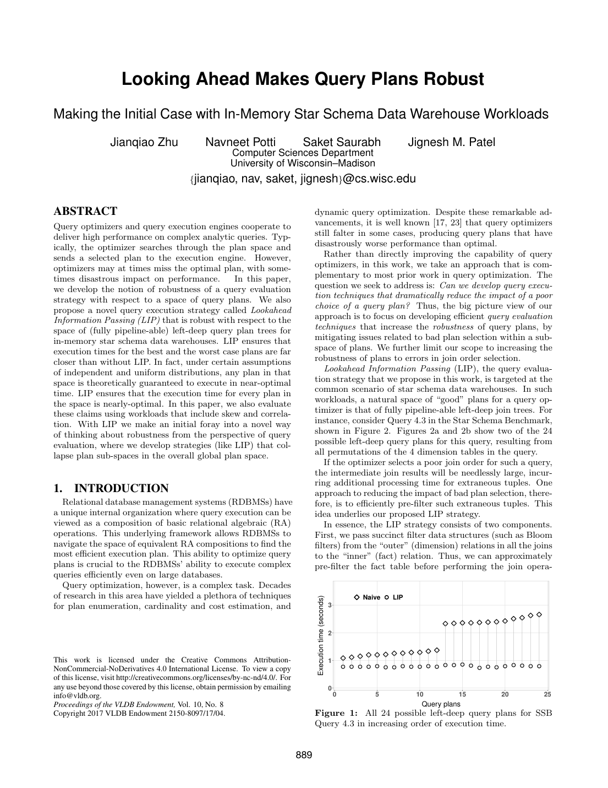
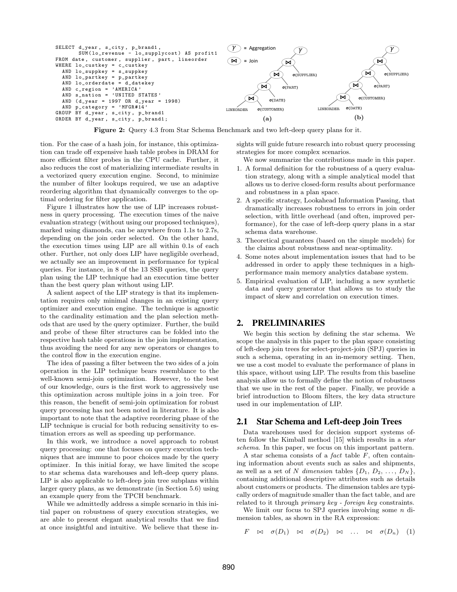

> 本组第 22 篇 · 查询执行引擎 · [全部论文]() · [上一篇]() · [下一篇]()

LIP 将各维表选择结果上的紧凑过滤器，从后续 join 的 build 侧传到事实表 probe 侧，在精确 hash join 之前排除不可能存活的元组；运行时重排的是过滤器，而不是优化器选定的 hash join 顺序。论文针对内存星型模式、主外键连接和全流水线左深树，研究最差与最好计划的归一化代价差，而非“最优时间的 Θ 倍”。在独立分布、忽略收敛开销和高阶假阳性项等模型条件下，作者给出 Θ-robustness 分析，并在典型低选择率、廉价过滤条件下论证接近最优。SSB SF100 的整套查询总时间为最差LIP计划17.4s、最好Naive计划17.6s、最差Naive计划90.9s；10个合成查询的采样计划平均极差由14s降至150ms。实验不证明任意相关性、任意拓扑或任意配置的保证。原论文的 miss-rate 排序方向、部分公式/样本置信度存在内部问题，本报告明确保留这些边界，不将其包装为无条件定理。

本文保留论文陈述、读者推断与待验证方案的区别；实验数字只适用于原文条件。原文和翻译来自已有 AI 辅助精读报告，已做来源匹配与编辑复核，不等于人工逐项核验或独立实验复现。所有页码均为 PDF 物理页。

## 论文与阅读范围

Jianqiao Zhu, Navneet Potti, Saket Saurabh, Jignesh M. Patel. Looking Ahead Makes Query Plans Robust: Making the Initial Case with In-Memory Star Schema Data Warehouse Workloads. University of Wisconsin–Madison, Proceedings of the VLDB Endowment, Vol. 10, No. 8, 2017, pp. 889-900（PDF物理页1-12）。本文仅审核所给单篇PDF，未联网核对DOI或引用文献。

[论文集中的原始 PDF](https://github.com/lonng/db-papers/blob/4ff1331069c7cf52ac97dd769e5f484c1c35c200/papers/execution-engine/looking-ahead%20-makes-query-plans-robust.pdf) · 本地来源：`execution-engine/looking-ahead -makes-query-plans-robust.pdf`，共 12 页。

本篇保留 10 组原文精读和 45 条证据。截图为原始 PDF 的局部页选，不是重新生成的图表；未将整份 PDF 复制到博客。

## 研究问题与适用边界

【论文陈述】本文不是重新设计基数估计或搜索更优 join order，而是从执行策略入手，降低选错连接顺序的代价。限定的主要计划空间为内存星型模式 SPJ：F 与选后的 D1...Dn 通过主外键连接，维表构建 hash table，事实表/中间事实流作为 probe 输入，n! 个维表排列构成全流水线左深 hash-join 子空间。SSB Q4.3 有四个维表，因此有24种顺序（图2，物理页2）。

【边界】不把“子空间内接近相同代价”写成全局计划最优性，也不声称 LIP 修复了估计值。独立均匀分布用于代价分析，join 谓词独立且块内随机分布用于收敛分析；鲁棒性定义的分母要求 σmax≠σmin。物理页10的TPC-H Q8实验只将方法应用到复杂计划中满足模式的星型子计划，并未把任意完整计划纳入同一定理。

【读者解释】若较晚的维表最终会拒绝某事实行，先执行低成本过滤便能减少该行在前面若干 join 的无效 probe 和物化；这缓和了顺序选择错误，但没有消除精确 join 或让优化器变得不再重要。

依据：论文陈述；PDF 物理页 1, 2, 3, 4, 10。证据：[exactsource-lip-plan-scope](#evidence-exactsource-lip-plan-scope), [C001N05](#evidence-c001n05), [C001N08](#evidence-c001n08), [C003N10](#evidence-c003n10), [exactsource-lip-identity](#evidence-exactsource-lip-identity)。

## 系统架构与组件交互

【论文机制，物理页5-6】每个维表先应用局部谓词，再用保留的连接键同时构建 hash table 和 Bloom filter。过滤信息从后续/下游 join 的维表 build 侧前传至事实表 probe 侧，在最底层 hash join probe 前应用。传的是键成员资格摘要，不是把事实表谓词反向推入维表。物理页1和3对 outer/inner 的用语不一致，本报告以事实表/维表、probe/build角色消歧。

多线程 build 使用同配置的线程本地 Bloom filter，最终按位 OR 合并。近似过滤后仍按原计划顺序 probe 精确 hash table，既删除假阳性，又取得后续聚合等所需的维表属性。Bloom filter 没有假阴性，因此按其否定结果排除元组不会删除真实匹配；允许通过的元组并不一定匹配。

【实际执行】Quickstep 将表水平分成数MB存储块。在块内，对一个批的元组引用逐个过滤器地进行 bulk probe，只让存活引用进入下一过滤器；过滤被嵌入最底层 hash join 的 probe 算子。一个批通过所有过滤器后先 probe 底层 hash table，其余 hash table 要等整个输出块产生后才继续 probe，不是逐元组一次性跑完整棵树，也不是强制物化整张预过滤事实表。

过滤器总尺寸可能大于CPU缓存，批量探测意在让当前过滤器获得缓存局部性；不能说所有过滤器永远同时驻留缓存。LIP增添统计、摘要和probe工作，并不完全替代 hash join。原文说可将构建/探测折叠入现有 hash join，避免必需的新算子或控制流重设计，不等于优化器及执行器完全不需修改。

依据：论文陈述；PDF 物理页 1, 2, 5, 6。证据：[exactsource-lip-direction](#evidence-exactsource-lip-direction), [exactsource-lip-hash-probe-purpose](#evidence-exactsource-lip-hash-probe-purpose), [exactsource-lip-build-union](#evidence-exactsource-lip-build-union), [exactsource-lip-execution](#evidence-exactsource-lip-execution), [C002N02](#evidence-c002n02), [C001N11](#evidence-c001n11)。

*原论文 PDF 物理页 1，版权归原作者或出版方。点击图片可查看原尺寸。页面文本中定位到：Figure 1:。这是页面定位信息，不表示本次已复核图内所有数据。*

## LIP 算法流程与示例

【论文流程】1. 对各维表选择结果构建 hash table 与过滤器。2. 对事实块的批量元组引用依次应用所有过滤器，收集 count/miss；某元组被拒绝就不进入后续过滤器。3. 在批间根据观测过滤效果重排，并逐轮翻倍 batch size。4. 对通过全部过滤器的元组执行精确 hash probe。自适应改变的是过滤器次序，hash join 次序保持优化器给定的排列。

【原文内部矛盾，物理页6】Algorithm 1 将 miss 定义为 probe 数减去通过数，却写按 miss/count 升序排序；§3.2.3也如此。这与“先应用最能排除元组的过滤器”以及物理页7按通过选择率升序的解释相冲突。读者按等成本probe推导，应采用拒绝率降序（等价于通过率升序）。这里披露的是源文不一致，未审核实际实现源码，不能声称作者代码已用该方向。Table 1把B计划写成不含自适应，但§4.1.3的B成本明确使用收敛后重排，也需以推导中的定义为准。

Algorithm 1 初始 batch size=64，实施文字说“几百个”元组；不能写成原文未给初值。每处理完一个事实存储块，batch size 和过滤器顺序重置。文中单批数据结构存元组引用，以避免来回复制。

【读者构造的假设示例，非作者实验】先用B1处理100个引用，其中80个被拒绝，剩20个送到B2，B2拒绝其中5个。当前观测拒绝率分别为80/100和5/20；按上述目标，下一批应优先B1。若原精确join顺序是H2→H1，过滤后仍按H2→H1执行，不能把B1优先解释为join-order已重写。统计是条件样本估计，不保证小样本排序永远正确。

依据：论文陈述；PDF 物理页 5, 6, 7。证据：[C002N02](#evidence-c002n02), [exactsource-lip-miss-rate-contradiction](#evidence-exactsource-lip-miss-rate-contradiction), [exactsource-lip-block-reset](#evidence-exactsource-lip-block-reset), [exactsource-lip-join-order](#evidence-exactsource-lip-join-order)。

## 正确性保证与理论界限

【结果正确性与性能论证要分开】Bloom filter无假阴性，否定结果可安全排除不匹配行；假阳性最终由精确 hash join 消除，所需build侧属性也由该join取得。这是本文场景内的语义保持机制，不是性能鲁棒性的数学定义。

【形式定义，物理页4式9】令R=(T(Ew)-T(Eb))/((σmax-σmin)|F|)，σmax≠σmin。θ-fragile指R的下界为θ，Θ-robust指R的上界为Θ；Θ越小，最差与最好计划的归一化代价差越小。它不是T(Ew)/T(Eb)，不是“Θ倍最优时间”，也不要求Θ接近1。讨论最优计划时还须区分最优LIP计划与最优Naive计划。

【成本模型】选择、hash插入、hash probe每元组成本为1，Bloom插入/probe为β。Naive build=Σ(1+σi)|Di|，probe=|F|Σ_i(∏_{j<i}σj)。在独立均匀分布等假设下，build与顺序无关、通过选择率升序最小化probe。LIP build=Σ(1+σi+βσi)|Di|；忽略收敛期间开销后，filter probe≈β|F|[1+Σ_{i=1}^{n-1}∏_{j=1}^{i}(σj′+ε)]，由收敛后的过滤器顺序决定而非原join顺序。通过全部过滤器的近似候选规模为|F|∏(σi+ε)，残余精确probe仍随原join顺序略有差异。

【已核对原图】物理页8式17确实为 Θ=(1/2)·(∏σi)/(σmin·σmax)·ε·n(n+1)，ε在分子。ε增大会使界更松，恰好符合过滤变差的方向，并非矛盾；本缓存不是OCR转写。此前模型审查的“ε位置不明”误判不适用于最终结论。该式沿用式13忽略O(ε²)及更高项，不能无条件当作精确有限ε界。小维表build代价、较小ε、β≪1和较小选择率乘积是§4.2.2近最优论证的重要条件；作者在§4.2.1以5%-30%描述其典型场景，不是对所有星型数据的事实保证。

【源文自身问题与读者推导】物理页7真的印有max(1,σi+ε)，与“至多N个命中”矛盾；σi+ε也是文中的加法近似，不是通用精确假阳性公式。式20以σmin构成的几何项被称作filter成本上界，但n=3、σ=(.1,.2,.3)、ε=0时，式11系数1.12大于该项1.11，故该项不能一般性作上界。收敛分析要求谓词独立和块内随机；把γ=.10、N=3800、δ=.05代入所列Chebyshev式，只得成功概率下界约.0526而不是.95。这不说明真实概率为.0526，只说明所列界未证明其95%数字。物理页8的0.21|F|与0.002|F|应标为作者六join解析例子而非实测，后者不能脱离ε取值及近似前提泛化。因此本报告保留作者的模型主张，并明确其推导与排印缺口，不宣称已完成严格无条件证明。

依据：论文陈述；PDF 物理页 3, 4, 5, 6, 7, 8。证据：[C001N05](#evidence-c001n05), [C001N08](#evidence-c001n08), [C002N04](#evidence-c002n04), [C002N06](#evidence-c002n06), [C002N08](#evidence-c002n08), [C002N09](#evidence-c002n09), [exactsource-lip-normalization](#evidence-exactsource-lip-normalization), [exactsource-lip-source-model-defects](#evidence-exactsource-lip-source-model-defects), [exactsource-lip-approximation](#evidence-exactsource-lip-approximation), [exactsource-lip-hash-probe-purpose](#evidence-exactsource-lip-hash-probe-purpose)。

## 实验评估与工作负载分析

【统一环境，物理页8-9】Quickstep内存关系引擎；160GB RAM，双路Intel Xeon E5-2660 v3，每路10物理核，开启超线程共40虚拟核（这不等于已给出每个查询的实际线程数）。buffer pool容纳全部工作集，时间为5次连续运行平均。未特别说明时SSB为SF100；TPC-H为SF100。Naive与LIP是在同一引擎、hash join上的比较，不是与其他DBMS竞赛。默认过滤器为1个identity hash，每个“估计的维表选择后元组”8bits。

【图1，物理页1-2】SSB Q4.3全部24种左深顺序：Naive 1.1-2.7s，LIP各计划时间彼此相差不超过0.1s；不是总执行时间小于0.1s。引言说13个SSB查询有8个使用LIP的计划快于最好Naive。

【图3，物理页9】对Q4.3每个配置取24种顺序中的最佳时间；比较1-4个hash函数，8-10bits/tuple、单identity函数在该数据集上最好。不是所有计划平均、不是全工作负载的通用参数最优性；估计基数误差只在最优大小附近的不敏感区间得到经验支持。

【图4-5，物理页9-10】Q4.1的Naive最好2.9s、最差18.1s，后者超过前者6倍；10/24种顺序至少慢一倍。LIP全部24种时间在彼此5%以内。整套13查询的总执行时间：每个查询均取最差LIP计划17.4s、最好Naive计划17.6s、最差Naive计划90.9s。原文明确写total execution time for the entire benchmark，不能称聚合方式缺失，也不能把这三个总数归到Q4.1。组1只有一个join；不可把全部SSB查询都说成24种不同顺序。

【图6，物理页9-11】10GB合成数据库，12个维表，大小1:10:100各四个，事实表为最大维表的10倍；字符列有均匀/逆指数后缀、部分维表两列以.80概率共享前缀。事实表外键仍独立均匀。仅展示10个随机查询，平均连接6维表，每个随机采样26个join order；“最佳”是采样内最佳，不是全空间最优。最佳Naive时间200-400ms，LIP使最佳时间平均改善约13%，3个查询变慢、最差4%；跨查询平均的最差-最好计划极差14s→150ms，不是平均查询耗时降到150ms。不能据此证明任意跨join相关性下的理论保证。

【图7，物理页10-11】固定（跟随join order）与自适应filter顺序消融。作者报告自适应开销最多8%；Q3.2某顺序相对最优顺序的减速57.6%→6.3%，不是总时间减少57.6%，更不是为所有工作负载给出8%开销上限。

【图8，物理页10-11】SSB SF10/50/100/200，SF200耗时约SF10的17倍，对应数据20倍，描述为运行时间次线性增长更清楚；不是CPU并行加速实验。作者称SF100→200时LIP speedup由34%增至63%，不能不加说明改写成延迟下降34%/63%，也不能外推所有规模。

【图9，物理页10-11】TPC-H Q8 SF100，优化器枚举675个计划，对符合模式的星型子计划应用LIP：LINEITEM为事实侧，ORDERS/PART/SUPPLIER相关子计划提供保留相应主键的维表侧。Naive范围2.1-58s，LIP范围1.3-7.4s，极差约缩小9倍；逐计划speedup为1.20-18倍、几何均值4.0倍，25%的LIP计划快于最好Naive。不是整个TPC-H基准，也不是证明枚举了所有可能全局计划。

【图10，物理页11-12】Q4.3全部24顺序的分解，作者报告5-10倍加速；Naive物化约63%、hash probe约37%，LIP物化平均4%、filter probe平均93%，hash probe很小，build相对很小；LIP filter probe绝对成本约Naive hash probe成本的20%。这些分量百分比不是跨策略同一分母，图10与图1/4的Q4.3时间量级也不应强行合并成一个端到端加速结论，论文未在所给文字中解释差异。本审核没有复跑实验、提取未标明的像素精确值或补造误差线。

依据：论文陈述；PDF 物理页 1, 2, 8, 9, 10, 11, 12。证据：[C001N09](#evidence-c001n09), [C003N01](#evidence-c003n01), [C003N02](#evidence-c003n02), [C003N03](#evidence-c003n03), [C003N04](#evidence-c003n04), [C003N05](#evidence-c003n05), [C003N06](#evidence-c003n06), [C003N07](#evidence-c003n07), [C003N08](#evidence-c003n08), [C003N09](#evidence-c003n09), [C003N10](#evidence-c003n10), [C003N11](#evidence-c003n11), [exactsource-lip-hardware](#evidence-exactsource-lip-hardware), [exactsource-lip-ssb-total](#evidence-exactsource-lip-ssb-total), [exactsource-lip-foreign-key-distribution](#evidence-exactsource-lip-foreign-key-distribution), [exactsource-lip-synthetic-sampling](#evidence-exactsource-lip-synthetic-sampling), [exactsource-lip-figure10](#evidence-exactsource-lip-figure10)。

*原论文 PDF 物理页 2，版权归原作者或出版方。点击图片可查看原尺寸。页面文本中定位到：Figure 2: Query 4.3 from Star Schema Benchmark and two left-deep query plans for it.；Figure 1 illustrates how the use of LIP increases robust-。这是页面定位信息，不表示本次已复核图内所有数据。*

## 工程权衡与设计局限

【论文权衡】降低ε可增大filter或增加hash函数，却会提高β；最小化假阳性并不等于最小化总查询时间。批量probe提高当前filter的缓存局部性，但大批延迟下一轮重排；翻倍批量和每块重置是其折中，并不保证所有过滤器常驻CPU缓存。线程本地构建再OR合并也需要额外内存和工作。

【模型与测量】一阶模型不包含hash table大小影响或输出属性数量对物化的影响（物理页4）；这些恰是向量化执行中可能显著的成本。图10中物化占比的下降是实测机制解释，不意味着物化已经纳入解析模型或模型被完整验证。σmax≈σmin时被忽略的因素可能主导计划差异，σmax=σmin使本文归一化定义不可用，不等于LIP算子本身执行错误或一定变慢。

【边界及读者推断】低过滤率、超缓存过滤器、大维表或资源竞争可能使额外build/probe不划算，应作为待测风险而非作者已量化的退化定律。主实验中build可忽略不能推广为零成本。对数据相关性或块内偏序，本文给了特定经验结果而不是无条件快速收敛证明。

【范围澄清】SSB原查询本就包含后续聚合/排序，TPC-H Q8也演示复杂计划中的子计划。限制在可识别星型左深区域内使用LIP，不等于任何含聚合或sort的完整查询都被排除；任意拓扑和区域间交互的普遍鲁棒性仍未建立。原文排序、公式和样本数字的问题见理论节，不用“缺少OCR”掩盖。

依据：论文陈述；PDF 物理页 4, 5, 6, 8, 9, 10, 12。证据：[C001N08](#evidence-c001n08), [C002N10](#evidence-c002n10), [C003N02](#evidence-c003n02), [exactsource-lip-execution](#evidence-exactsource-lip-execution), [exactsource-lip-build-union](#evidence-exactsource-lip-build-union), [C003N10](#evidence-c003n10), [exactsource-lip-figure10](#evidence-exactsource-lip-figure10), [exactsource-lip-future](#evidence-exactsource-lip-future)。

## 与现有技术的定位比较

【论文定位，物理页11-12】作者明确把LIP视为一般Sideways Information Passing（SIP）策略的特例，并强调自适应过滤器重排和鲁棒性视角。半连接缩减、Bloom filter和过滤器重排各有前序工作；本文的贡献不能概括成发明Bloom filter或首创所有跨算子过滤。引言关于“首个跨多个join激进使用”的表述仅是作者在其知识范围内的优先权主张，本审核未查阅其他文献验证。

【互补关系】本文把自适应作用于轻量filter probe顺序，不是Eddies式任意算子路由、候选计划切换或运行时重新优化的同义词；论文将其与采样纠正估计、运行反馈和重优化定位为互补。其有用性在于尽量保持既有hash join控制流，并减少指定子空间对join-order错误的敏感性，不是证明优化器设计可省略。

【待验证对照问题】若移植到其他向量化/MPP引擎，应检查过滤器能否在事实probe前全部就绪、是否支持块内独立filter排序、传输/等待/合并成本以及PK-FK语义边界。本报告没有阅读外部系统源码，不对StarRocks、Doris、Calcite或DuckDB当前是否实现这些机制做事实断言。

依据：读者推断；PDF 物理页 1, 2, 11, 12。证据：[C001N11](#evidence-c001n11), [exactsource-lip-sip](#evidence-exactsource-lip-sip), [exactsource-lip-future](#evidence-exactsource-lip-future)。

## 复现指南与缺失信息

【以下均为复现提案，未执行】先在Quickstep或可明确控制hash join顺序的实验引擎中建立Naive、固定filter顺序、LIP自适应三组。复用同一数据、物理算子和输出语义，验证结果完全一致，再比较计划极差与总时间；不得把重排精确join当作LIP自适应filter的复现。

采用SSB SF100作为主实验，Q4.3枚举24顺序，组1单join不伪造24个不同计划；扩展性再跑SF10/50/100/200。默认1个identity hash，按维表选择结果的估计基数分配8bits/tuple，同时重跑1-4个hash和大小扫描。记录实际工作线程数、编译版本/flags、缓存和NUMA设置；原文已给CPU双路E5-2660 v3、160GB内存、每路10物理核，并非CPU型号缺失。

实现选择后build、线程本地filter及OR合并、元组引用批、逐过滤器bulk probe、每批翻倍及每块重置，保留原hash join顺序。Algorithm 1初始批量64与文字“几百”需作为两种配置记录；拒绝率方向冲突要先查实际源码或分别测试，不能机械照抄升序miss。增加验证用精确bitmap选项，隔离假阳性影响。

合成实验照本文12维表、1:10:100、.80前缀相关、事实外键独立均匀构造10GB数据；保存随机种子、查询谓词、10个查询各26采样顺序，并报告采样内best/worst而非全空间最优。另把跨事实外键相关性作为新压力测试，明确不冒充原文实验。TPC-H仅先复现Q8 SF100及其合法星型子计划，记录所枚举计划集合，检查能否对齐675个计划。

工作集须放入内存；每次连续五轮取均值，同时附上各轮及误差度量（后者是新增建议）。分别计时build、filter probe、hash probe、物化，并解释组件计时与端到端计时的差别。验证Q4.1、全套SSB总数、合成极差和Q8范围的口径；不要强求现代硬件复现绝对秒数。论文未给出的具体代码版本、完整执行命令和随机种子需另核实；未提供可核实代码链接不等于可断言“原型未开源”。

依据：待验证的工程设想；PDF 物理页 5, 6, 8, 9, 10。证据：[C003N01](#evidence-c003n01), [C003N03](#evidence-c003n03), [C003N04](#evidence-c003n04), [C003N06](#evidence-c003n06), [C003N10](#evidence-c003n10), [exactsource-lip-hardware](#evidence-exactsource-lip-hardware), [exactsource-lip-miss-rate-contradiction](#evidence-exactsource-lip-miss-rate-contradiction), [exactsource-lip-block-reset](#evidence-exactsource-lip-block-reset), [exactsource-lip-build-union](#evidence-exactsource-lip-build-union)。

## 结论与内核工程启示

【可由本文支持的结论】LIP用维表选择结果产生的lookahead过滤信息，减少事实行在后续精确join前的无效probe与物化；自适应filter排序进一步降低原join order对执行时间的影响。实验证明了所测内存星型负载与TPC-H Q8特定子计划上的改进，但严格说测量的是计划时间极差等指标，不能把它随意改称统计方差，也不能把经验改进视作所有计划空间的最优性证明。

【理论结论的准确口径】Θ约束归一化最坏-最好代价差，不是最坏/最好比值。按论文的独立分布、小ε近似和收敛后模型，作者给出鲁棒性分析；典型参数下接近最优Naive是另一层性能论证。原文的排序比较方向、式20上界、假阳性表达和样本数字存在本报告已披露的问题，应在复用证明前处理。

【读者工程判断】在既有hash join中加入跨join摘要与批量自适应过滤，可能用有限机制改善差计划的损失，是值得复现的设计方向；收益须连同摘要build、内存、等待、缓存和统计成本一起测。本文不要求放弃优化器，也不证明Bloom filter永远廉价或build边际成本永远可忽略。更复杂模式/计划的普遍保证是作者未来工作，不用外部系统常识补齐证据。

依据：论文陈述；PDF 物理页 4, 7, 8, 11, 12。证据：[C002N08](#evidence-c002n08), [C003N11](#evidence-c003n11), [exactsource-lip-sip](#evidence-exactsource-lip-sip), [exactsource-lip-future](#evidence-exactsource-lip-future), [exactsource-lip-normalization](#evidence-exactsource-lip-normalization), [exactsource-lip-source-model-defects](#evidence-exactsource-lip-source-model-defects)。

## 原文精读：从句子回到机制

以下保留原文、忠实翻译、含义与边界；假设示例不作为论文实验结果。

### P001 · PDF 物理页 2

**原文**

<blockquote class="paper-source-quote"><pre><code>Figure 1 illustrates how the use of LIP increases robust-&#10;ness in query processing. The execution times of the naive&#10;evaluation strategy (without using our proposed techniques),&#10;marked using diamonds, can be anywhere from 1.1s to 2.7s,&#10;depending on the join order selected. On the other hand,&#10;the execution times using LIP are all within 0.1s of each&#10;other.</code></pre></blockquote>

**忠实翻译**

> 图1展示了使用LIP如何提高查询处理的鲁棒性。朴素评估策略（未使用我们提出的技术）的执行时间用菱形标记，根据所选的连接顺序不同，可以在1.1秒到2.7秒之间的任何位置。另一方面，使用LIP的执行时间彼此都在0.1秒以内。

**技术含义与边界**

> 原文陈述了实验观察结果：在不使用LIP的朴素策略下，不同连接顺序导致执行时间在1.1s至2.7s之间波动；而使用LIP后，不同连接顺序下的执行时间差异被压缩到0.1s以内。这表明LIP降低了查询性能对连接顺序选择的敏感度，从而提升了鲁棒性。适用边界为该特定实验环境。

**常见误读**

> 容易将“执行时间彼此在0.1秒以内”误解为“所有查询的绝对执行时间都小于0.1秒”。原文明确说的是不同连接顺序下的执行时间相互之间的差距（within 0.1s of each other），而非绝对值上限。此外，不能将此局部实验结果泛化为所有工作负载下的全局保证。

**读者构造的假设示例**

> 读者构造的假设示例：假设有3种连接顺序A、B、C。在朴素策略下，执行时间分别为1.1s、2.0s、2.7s；在使用LIP后，执行时间可能变为1.05s、1.10s、1.12s，最大差值为0.07s，满足“彼此在0.1秒以内”的描述。

### P002 · PDF 物理页 9

**原文**

<blockquote class="paper-source-quote"><pre><code>5.1&#10;Choice of Bloom Filter Configuration&#10;The configuration of a Bloom filter is defined by its size (r)&#10;as well as the number (k) and choice of hash functions.&#10;These parameter choices affect not only its false positive&#10;rate (denoted ϵ in this paper) but also the computational&#10;cost of operations on it (denoted β). While there are the-&#10;oretical results [20] about the former, optimizing the latter&#10;requires empirical study.</code></pre></blockquote>

**忠实翻译**

> 5.1 Bloom Filter配置的选择
> Bloom filter的配置由其大小（r）以及哈希函数的数量（k）和选择来定义。这些参数选择不仅影响其假阳性率（本文记为ϵ），还影响对其操作的计算成本（记为β）。虽然关于前者存在理论结果[20]，但优化后者需要实证研究。

**技术含义与边界**

> 作者区分假阳性率ε与相对操作成本β：filter大小r和hash函数数量k及其选择同时影响两者；配置应优化总执行成本，而非只压低假阳性率。r在Table 1中按每个插入对象的bit数描述，β相对单位hash操作成本定义。论文用实证测量配置性能，没有声称所有相关开销都不存在理论模型。

**常见误读**

> 不能以最小假阳性率直接推导最低总查询时间；也不能仅凭filter字节数和hash函数个数算出具体ε，尚需插入元素数与分布等条件。文献[20]只是作者引用，本次未读取该外部文献。

**读者构造的假设示例**

> 读者构造的假设示例：对同一批键比较8bits/tuple、1个hash与16bits/tuple、3个hash。后一配置可能减少错误通过，却增加hash计算和缓存访问；需实测总查询时间，不能只按ε排序。这里没有给出作者测得的ε数值。

### P003 · PDF 物理页 6

**原文**

<blockquote class="paper-source-quote"><pre><code>Both the batch size and&#10;the lookahead filter order are reset after completing all the&#10;probes for a given storage block of the fact table.&#10;3.2.4&#10;Convergence Rates&#10;To examine the convergence procedure in our model, we&#10;assume that join predicates are independent and that the&#10;tuples in a block are randomly distributed. The indepen-&#10;dence assumption ensures that the observed miss rate of a&#10;given filter does not depend on which filters were probed&#10;prior to it.</code></pre></blockquote>

**忠实翻译**

> 批处理大小和前瞻过滤器顺序在完成对事实表给定存储块的所有探测后都会被重置。
> 3.2.4 收敛率
> 为了检查我们模型中的收敛过程，我们假设连接谓词是独立的，并且块中的元组是随机分布的。独立性假设确保给定过滤器的观测未命中率不依赖于在它之前被探测的是哪些过滤器。

**技术含义与边界**

> 原文陈述了算法实现细节与数学建模前提。实现层面，在处理完事实表的一个存储块后，batch size和lookahead filter order会重置。建模层面，为了分析收敛率，作者引入了两个前提假设：连接谓词独立性和块内元组随机分布。独立性假设的直接推论是：某个filter的miss rate不受先前探测的其他filter的影响，这简化了概率模型的计算。

**常见误读**

> 容易将“假设连接谓词是独立的”误读为“系统要求或保证了连接谓词独立”。原文明确使用了“assume”一词，表明这是为了建立数学模型而引入的理论前提，实际数据中连接谓词可能存在相关性，此时该收敛模型的准确性可能会下降。

**读者构造的假设示例**

> 读者构造的假设示例：某块中F1和F2的拒绝事件独立，F1的总体拒绝概率为10%，则先经F2筛选的样本中F1的期望拒绝率仍为10%；有限样本的观测值会波动，并非每批都精确等于10%。处理下一存储块时重新开始batch size和filter顺序，有利于针对新块重新适应。

### P004 · PDF 物理页 4

**原文**

<blockquote class="paper-source-quote"><pre><code>In fact, if we assume that&#10;the selectivities (and hence cardinalities) are estimated with&#10;some error tolerance δ, i.e., if each estimate ˆσi is within δ of&#10;actual σi, then we expect the worst plan to be worse than&#10;the best in proportion to δ.&#10;Our cost model does not incorporate the second order&#10;effects such as the size of the hash table on probe cost and&#10;the impact of number of output attributes on materialization&#10;cost.</code></pre></blockquote>

**忠实翻译**

> 事实上，如果我们假设选择性（以及因此的基数）是以某种误差容限δ估计的，即如果每个估计值ˆσi在实际值σi的δ范围内，那么我们预期最差的计划比最好的计划差的比例与δ成正比。
> 我们的成本模型没有纳入二阶效应，例如哈希表大小对探测成本的影响，以及输出属性数量对物化成本的影响。

**技术含义与边界**

> 作者在这里给出对估计误差δ与最差-最好计划差异关系的直觉期望，并明确省略hash table大小、输出属性数量和物化成本的二阶影响。不能从这段直接推出某个以δ为常数的通用执行时间比值上界；Definition 1在随后另用事实基数与选择率跨度归一化。

**常见误读**

> 原文的expect不是无条件确定性定理。选择率完全相等时，Definition 1的归一化分母为零；不要用该情形来声称本模型证明了误差δ直接决定所有计划差异。忽略的cache/物化效应仍可主导实际时间。

**读者构造的假设示例**

> 读者构造的假设示例：两个join真实通过率为0.10、0.15，估计误差可能把顺序倒置。只按单位probe模型可以计算多处理多少事实行；若两个hash表尺寸导致缓存命中差异，该简单计数并不等于实测时间。此例不宣称作者给出了一个δ倍最优时间保证。

### P005 · PDF 物理页 11

**原文**

<blockquote class="paper-source-quote"><pre><code>Instead, the execution time in LIP&#10;strategy was dominated by the cost of probing LIP filters&#10;(93% on average).&#10;It is worth noting, however, that this&#10;dominant cost term of probing LIP filters was only about&#10;20% of the cost of probing hash tables in the naive strategy.&#10;Lastly, we observed that the cost of building hash tables and&#10;LIP filters was negligible in comparison to these other cost&#10;terms.</code></pre></blockquote>

**忠实翻译**

> 相反，LIP策略中的执行时间主要由探测LIP过滤器的成本主导（平均占93%）。
> 然而值得注意的是，探测LIP过滤器这一主导成本项仅约为朴素策略中探测哈希表成本的20%。
> 最后，我们观察到，与这些其他成本项相比，构建哈希表和LIP过滤器的成本可以忽略不计。

**技术含义与边界**

> 这是物理页11对Q4.3计划分量计时的描述：93%的分母为LIP自身总时间，20%的分母为Naive的hash probe时间，而非Naive总时间。精确hash probe并未在算法中取消。构建相对小是本实验观察，不能当作所有维表大小下的事实。

**常见误读**

> 不要混淆两个百分比的分母，也不要把平均分量占比拼成任意一个实际计划的总耗时。图10与图1/4的Q4.3量级应另核对；本段不能独立解释二者差异或证明一般性的5倍端到端加速。

**读者构造的假设示例**

> 读者构造的假设示例：某次虚构测量中Naive hash probe=100ms、LIP filter probe=20ms，后者又恰为其总时间93%，则该次LIP总时间约21.5ms。这只是人为令比例同时成立的算术示例，不能由论文平均比例反推出真实某计划时间。

### P006 · PDF 物理页 3

**原文**

<blockquote class="paper-source-quote"><pre><code>T(P12...n) = BuildCost(P12...n)&#10;+ HashTableProbeCost(P12...n)&#10;=&#10;n&#10;X&#10;i=1&#10;(1 + σi)|Di| +&#10;n&#10;X&#10;i=1&#10;σ0σ1...σi−1|F|&#10;(4)&#10;It is intuitively clear (and can be proved by induction on&#10;n) that the HashTableProbeCost above is minimized when&#10;the probes are done in ascending order of selectivities, and&#10;maximized when using descending order. These sorted join&#10;orders therefore also have the minimal (or maximal) total&#10;costs, since the BuildCost is independent of the join order.</code></pre></blockquote>

**忠实翻译**

> 式(4)：T(P12...n)=BuildCost(P12...n)+HashTableProbeCost(P12...n)=Σ_i(1+σi)|Di|+|F|Σ_i(σ0σ1...σi-1)，其中σ0=1。作者说，probe成本在通过选择率升序时最小、降序时最大，且可对n归纳证明；由于build成本不依赖连接顺序，总成本也相应取极值。

**技术含义与边界**

> 结论只针对论文§2.2在独立均匀数据、单位操作成本等假设下的Naive模型。通过率较低的join先执行，会减少后续probe行数；成本最小化不等于查询结果正确性，更不等于任意真实硬件上的最优计划保证。

**常见误读**

> 容易将“直观上很清楚”等同于不需要严格证明，或者忽略了公式成立的前提条件（如各维表选择性的独立性等隐含假设）。此外，该结论仅适用于公式(4)所定义的朴素策略成本模型，不能直接套用到包含LIP或其他优化的成本模型中。

**读者构造的假设示例**

> 读者构造的假设示例：假设事实表|F|=10000，有三个维表D1, D2, D3，选择性分别为σ1=0.1, σ2=0.5, σ3=0.9。根据原文公式，按升序（D1, D2, D3）探测时，HashTableProbeCost = 10000*(1 + 0.1*1 + 0.1*0.5*1) = 10000*(1+0.1+0.05)=11500。若按降序（D3, D2, D1）探测，成本将显著增大。BuildCost = (1+0.1)|D1|+(1+0.5)|D2|+(1+0.9)|D3|，无论探测顺序如何均保持不变。

### P007 · PDF 物理页 8

**原文**

<blockquote class="paper-source-quote"><pre><code>However, due to&#10;its small size, the Bloom filter is likely to be cache resident&#10;and hence make the probes much faster, i.e., β ≪1. But,&#10;there is a tradeoffhere as making ϵ smaller by increasing the&#10;Bloom filter size or number of hash functions also makes β&#10;larger (i.e., probes become more expensive).</code></pre></blockquote>

**忠实翻译**

> 然而，由于其体积小，Bloom filter很可能驻留在缓存中，从而使探测快得多，即β ≪1。但是，这里存在一个权衡，因为通过增加Bloom filter的大小或哈希函数的数量来使ϵ变小，也会使β变大（即探测变得更加昂贵）。

**技术含义与边界**

> 原文说单个紧凑filter更可能获得cache局部性，使相对hash操作成本β较低；不是保证全部filter常驻缓存。物理页6明确说过滤器总尺寸经常超过cache，因此采用逐过滤器批量probe。降低ε与提高β之间的取舍需要整体计时。

**常见误读**

> 容易将“β ≪1”理解为绝对的物理时间极短，而忽略它是相对于“per-tuple hash table operations”单位成本的比值。此外，不能脱离上下文认为“增大Bloom filter总是好的”，原文明确指出了增大filter以降低ϵ会同时增加β的负面效应。

**读者构造的假设示例**

> 读者构造的假设示例：假设一次哈希表探测的基准成本为100纳秒。如果一个很小的Bloom filter完全在L1缓存中，其探测成本β可能为0.1，即只需10纳秒。但如果为了将假阳性率ϵ从5%降到0.1%，将Bloom filter扩大到了超出L3缓存的容量，此时β可能上升到0.8甚至更高，单次探测就需要80纳秒以上。

### P008 · PDF 物理页 5

**原文**

<blockquote class="paper-source-quote"><pre><code>The&#10;resulting hash table probes now involve far fewer tuples.&#10;3.1&#10;LIP Algorithm Summary&#10;We now give an overview of the LIP strategy.&#10;1. Build Phase. For each dimension table in the join tree,&#10;we build both a hash table as well as a succinct filter data&#10;structure, such as a Bloom filter, on the selection result.&#10;This phase is discussed in detail in Section 3.1.1.&#10;2. Bloom Filter Probe Phase.</code></pre></blockquote>

**忠实翻译**

> 由此产生的哈希表探测现在涉及的元组少得多。
> 3.1 LIP算法总结
> 我们现在给出LIP策略的概述。
> 1. 构建阶段。对于连接树中的每个维表，我们在选择结果上同时构建一个哈希表和一个简洁的过滤器数据结构，例如Bloom filter。此阶段在第3.1.1节中详细讨论。
> 2. Bloom Filter探测阶段。

**技术含义与边界**

> 本摘录展示LIP概述的开头：对每个维表的选择结果构建hash table与紧凑filter，为减少后续精确probe做准备。完整§3.1还包括filter probe、自适应重排、精确hash probe；不能因摘录在第2步标题处截断就称算法只有两步。

**常见误读**

> 减少元组数不等于Bloom filter完成精确连接。物理页5§2.4明确其无假阴性、允许假阳性；真实匹配不会因正常成员过滤被错误剔除，但错误通过仍需精确hash probe处理并取得build侧属性。不要把“不可信来源”这一安全标记误写成论文内容没有证据价值。

**读者构造的假设示例**

> 读者构造的假设示例：假设事实表有100万个元组，原本需要全部去探测维表的哈希表。在LIP策略的Build Phase，为维表构建了哈希表和Bloom filter。在Bloom Filter Probe Phase，先用Bloom filter扫描事实表，过滤掉了90万不匹配的元组，最终只有10万元组进入后续的哈希表探测阶段，实现了“涉及的元组少得多”。

### P009 · PDF 物理页 10

**原文**

<blockquote class="paper-source-quote"><pre><code>Only three of the queries&#10;were negatively impacted, with a 4% slowdown at worst.&#10;More importantly from the perspective of robustness, the&#10;average difference in execution times between the worst and&#10;best plans went down from 14 seconds without LIP to just&#10;150 ms with LIP.&#10;5.4&#10;Importance of Adaptiveness&#10;In this experiment, we ran each SSB query using all pos-&#10;sible join orders, with the order of LIP filter probing either&#10;fixed or chosen adaptively using Algorithm 1.</code></pre></blockquote>

**忠实翻译**

> 只有三个查询受负面影响，最坏减速4%。从鲁棒性看，更重要的是：不使用LIP时最差和最好计划执行时间的平均差异为14秒，使用LIP后降至150毫秒。随后开始§5.4“自适应性的重要性”：在另一个实验中，每个SSB查询枚举所有可能连接顺序，LIP filter顺序固定或按Algorithm 1自适应选择。

**技术含义与边界**

> 此摘录跨越章节边界：4%和14s→150ms属于§5.3的10个展示合成查询，每查询26个采样计划；不是SSB结果，也不是平均查询延迟。§5.4才切换到SSB的固定/自适应filter次序消融；不能把两组实验合并，或把采样内best称为全空间最优。

**常见误读**

> 不能把最多4%退化推广为所有数据上的上限，也不能用后面的SSB字样给前段合成结果贴错工作负载标签。150ms是最差-最好计划差异的跨查询平均，不是每个计划都运行150ms。

**读者构造的假设示例**

> 读者构造的假设示例：某虚构合成查询的26个采样计划，Naive最好0.3s、最差14.3s；LIP最好0.31s、最差0.46s，极差由14s变.15s。此例只演示“极差”和单计划轻微退化可同时存在，不重建论文数据。另做SSB固定/自适应实验应单独记录。

### P010 · PDF 物理页 7

**原文**

<blockquote class="paper-source-quote"><pre><code>4.1&#10;Robustness Through LIP&#10;Corresponding to the plan P12...n in the naive evaluation&#10;strategy, consider the equivalent plan B12...n that uses LIP&#10;to whittle down the fact table before probing the hash tables&#10;in the order defined by the subscript sequence.&#10;4.1.1&#10;Cost Model&#10;Let us model the per-tuple cost of a Bloom filter insertion&#10;or probe by a factor β relative to the unit cost for per-tuple&#10;hash table operations. In the remainder of this subsection,&#10;we separately analyze each phase of query evaluation in the&#10;LIP strategy, as highlighted in the steps of the algorithm&#10;summary in Section 3.1.</code></pre></blockquote>

**忠实翻译**

> 4.1 通过LIP实现鲁棒性
> 对应于朴素评估策略中的计划P12...n，考虑使用LIP在按照下标序列定义的顺序探测哈希表之前缩减事实表的等效计划B12...n。
> 4.1.1 成本模型
> 让我们将Bloom filter插入或探测的每元组成本建模为相对于每元组哈希表操作单位成本的一个因子β。在本小节的其余部分，我们将分别分析LIP策略中查询评估的每个阶段，正如第3.1节算法总结步骤中所强调的那样。

**技术含义与边界**

> P12...n是Naive计划，B12...n是先应用LIP、再按原下标顺序probe hash table的对应计划。β是在选定配置/模型内相对hash单位操作的成本因子，可在该分析里当参数使用；改变filter配置或硬件后其数值可能变化。B的filter顺序可自适应，并不改写精确hash join的下标顺序。

**常见误读**

> 不要把filter probe的运行时重排理解成重新枚举或切换hash join计划。也不能断言模型里的β绝不能当常数：它是相对成本参数，特定配置下固定建模与跨配置变化并不冲突。

**读者构造的假设示例**

> 读者构造的假设示例：假设朴素计划P12表示先探测维表D1的哈希表再探测D2的哈希表。对应的LIP计划B12表示先用D1和D2的Bloom filter过滤事实表，然后再按D1、D2的顺序探测哈希表。如果设定一次哈希表probe的基准成本为1个单位，且测得Bloom filter probe的成本因子β=0.2，那么在成本模型中，每次Bloom filter probe计为0.2个单位的成本。

## 尚未解决的问题

1. 实际Quickstep实现如何处理Algorithm 1的miss-rate排序方向？Table 1与§4.1.3对B计划的标注差异如何解释？
2. 原文max(1,σi+ε)、式20过滤项上界以及3800样本/95%数字是否有勘误？修正后近最优论证的严谨前提与界是什么？
3. 图10组件计时与图1/4端到端Q4.3量级差异的原因是什么？需要原始实验脚本及计时范围，不能自行猜测。
4. 当跨join相关性、块内偏序、极低拒绝率、大维表或缓存压力增强时，自适应filter次序的收敛和净收益如何变化？
5. 如何将保证推广到非星型拓扑、磁盘溢出和更广泛子计划组合，同时计入摘要传递、等待与物化成本？
6. 需要补齐哪些代码版本、编译/运行命令、随机种子和逐轮时间，才能区分可重复的口径与特定机器绝对秒数？

## 证据索引

证据编号沿用原报告，便于将上文判断追溯到原句。引文匹配只验证位置，不证明解读正确。

**C001N05 · PDF 物理页 3**

在§2.2的独立均匀分布、单位hash成本模型内，Naive的probe成本在通过选择率升序时最小、降序时最大；这是模型性质，不是现实执行时间的无条件最优性或查询语义正确性保证。

<blockquote class="paper-source-quote"><pre><code>the HashTableProbeCost above is minimized when the probes are done in ascending order of selectivities, and maximized when using descending order.</code></pre></blockquote>

**C001N08 · PDF 物理页 4**

代价模型存在明确局限：未纳入二阶效应，例如 hash table 大小对 probe 代价的影响、输出属性数量对物化代价的影响。当所有谓词选择率相似（σmax-σmin 极小或为 0）时，这些二阶效应主导 plan 间代价差异，此时模型失效。作者明确将此情形排除在本文范围之外，并在鲁棒性定义中要求 σmax ≠ σmin。

<blockquote class="paper-source-quote"><pre><code>Our cost model does not incorporate the second order effects such as the size of the hash table on probe cost</code></pre></blockquote>

**C001N09 · PDF 物理页 2**

图 1 展示了 SSB Query 4.3 全部 24 种左深 plan 按执行时间递增排列的结果。朴素策略（Naive）的执行时间在 1.1s 到 2.7s 之间波动，而使用 LIP 后所有 plan 的执行时间差距在 0.1s 以内。此外，在 13 个 SSB 查询中有 8 个，使用 LIP 的 plan 执行时间优于不使用 LIP 时的最佳 plan。这些是文中的实验证据，非理论推导。

<blockquote class="paper-source-quote"><pre><code>the execution times of the naive evaluation strategy (without using our proposed techniques), marked using diamonds, can be anywhere from 1.1s to 2.7s</code></pre></blockquote>

**C001N11 · PDF 物理页 2**

本文将 LIP 中跨 join 传递 filter 的思想与半连接（semi-join）优化联系起来，但声称自己是首个在 join tree 中跨多个 join 激进使用该优化的工作，并指出此前文献未注意到半连接优化对鲁棒查询处理的价值。引用 [15] 为 Kimball 方法，[17, 23] 说明优化器仍会失败，[22] 为 Star Schema Benchmark。

<blockquote class="paper-source-quote"><pre><code>However, to the best of our knowledge, ours is the first work to aggressively use this optimization across multiple joins in a join tree.</code></pre></blockquote>

**C002N02 · PDF 物理页 5**

LIP算法分为四个阶段：(1) Build Phase：对每个维度表的选择结果同时构建hash table和Bloom filter；(2) Bloom Filter Probe Phase：用事实表同时探测所有filter并维护hit/miss统计；(3) Adaptive Reordering Phase：根据估计的选择性动态调整filter探测顺序；(4) Hash Table Probe Phase：探测hash table并消除false positive。该流程是LIP的执行骨架。

<blockquote class="paper-source-quote"><pre><code>1. Build Phase. For each dimension table in the join tree, we build both a hash table as well as a succinct filter data structure</code></pre></blockquote>

**C002N04 · PDF 物理页 6**

收敛性分析依赖两个前提假设：(1) join predicates相互独立，保证某filter的观测miss rate不受先前探测的filter影响；(2) block内元组随机分布，保证block开头的观测miss rate与block内其他位置大致相同。文中明确指出这不要求整张表全局随机分布，可处理分区表或插入偏序。这些假设是后续Chebyshev界成立的前提。

<blockquote class="paper-source-quote"><pre><code>we assume that join predicates are independent and that the tuples in a block are randomly distributed.</code></pre></blockquote>

**C002N06 · PDF 物理页 7**

代价模型将Bloom filter单次insert/probe的per-tuple代价设为hash table操作的β倍。BuildCost与join order无关，公式为Σ(1+σi+βσi)|Di|。BloomProbeCost在自适应重排序收敛后也与join order无关，仅取决于最优selectivity顺序1',2',...,n'，公式中包含β|F|乘以累积selectivity乘积之和。

<blockquote class="paper-source-quote"><pre><code>Let us model the per-tuple cost of a Bloom filter insertion or probe by a factor β relative to the unit cost for per-tuple hash table operations.</code></pre></blockquote>

**C002N08 · PDF 物理页 8**

原图式17为Θ=(1/2)·(∏σi)/(σminσmax)·ε·n(n+1)，ε在分子；它约束归一化最差-最好代价差而非代价比。该分析沿用小ε展开及忽略收敛开销等前提。作者以5%-30%作为典型场景描述；不作为所有星型数据事实。

<blockquote class="paper-source-quote"><pre><code>Θ = 1 2 σ1σ2...σn σminσmax ϵn(n + 1)</code></pre></blockquote>

**C002N09 · PDF 物理页 8**

作者§4.2.1的六join解析例子（5%,10%,...,30%）报告Naive极差至少0.21|F|、LIP至多0.002|F|。这不是运行时测量，后者需与ε和模型近似条件一起理解。

<blockquote class="paper-source-quote"><pre><code>let us take an example query with n = 6 joins with selectivities 5%, 10%, ..., 30%. Then, Pw and Pb have a cost difference of at least 0.21|F| units</code></pre></blockquote>

**C002N10 · PDF 物理页 8**

降低Bloom filter的false positive rate ε需要增大filter尺寸或hash函数数量，这会使β变大（即probe更昂贵）。因此存在ε与β之间的tradeoff。此外，大的batch size有利于cache resident但会减慢自适应算法的收敛速度，因为reordering只在batch之间进行。文中采用逐轮翻倍batch size的策略来平衡两者。

<blockquote class="paper-source-quote"><pre><code>there is a tradeoffhere as making ϵ smaller by increasing the Bloom filter size or number of hash functions also makes β larger</code></pre></blockquote>

**C003N01 · PDF 物理页 9**

实验通过修改查询优化器枚举所有可能的连接顺序来评估鲁棒性。所有连接均使用hash join算法，事实表用于探测维度表上构建的哈希表。LIP配置为使用1个identity hash function和每个tuple 8 bits的Bloom filter大小。执行时间为5次连续运行的平均值。这属于实验设置而非理论证明。

<blockquote class="paper-source-quote"><pre><code>we enhanced the query optimizer to produce all possible join orders for each query. All joins were performed using a hash join algorithm</code></pre></blockquote>

**C003N02 · PDF 物理页 9**

Bloom filter的配置由大小r、哈希函数数量k及选择决定，影响假阳性率ε和计算代价β。论文指出虽然假阳性率有理论结果，但优化计算代价需要实证研究。整体查询执行代价同时依赖这两个因素。这是LIP模型中关于过滤器的核心前提。

<blockquote class="paper-source-quote"><pre><code>These parameter choices affect not only its false positive rate (denoted ϵ in this paper) but also the computational cost of operations on it (denoted β).</code></pre></blockquote>

**C003N03 · PDF 物理页 9**

针对SSB Query 4.3（共24种可能连接顺序），测试了1到4个哈希函数及不同Bloom filter大小的最优执行时间。结果表明单个哈希函数配合每tuple 8-10 bits时性能最佳。且在最优大小附近，查询性能对Bloom filter大小不敏感。这一观察被用来论证即使基数估计有误，该技术依然有效。注意：文中称其他查询结果类似但未展示数据。

<blockquote class="paper-source-quote"><pre><code>the best performance is obtained using just a single hash function, and about 8-10 bits per tuple.</code></pre></blockquote>

**C003N04 · PDF 物理页 9**

论文发现identity hash function在该数据集上表现最好（图3中第一个哈希函数为identity，其余为Knuth乘法哈希变体）。作者解释这看似反直觉，但强调Bloom filter仅作为避免昂贵哈希表探测的近似过滤器，单identity函数最小化了计算代价同时足够降低假阳性率。此结论高度依赖于特定数据集和星型模式特征，不具备普遍正确性保证。

<blockquote class="paper-source-quote"><pre><code>the identity function yields the best performance for this dataset.</code></pre></blockquote>

**C003N05 · PDF 物理页 9**

SSB SF100 Q4.1：Naive最好2.9s、最差18.1s，24顺序中10个至少为最佳两倍；LIP24顺序彼此5%以内。17.4s/17.6s/90.9s另指整个13查询基准分别取最差LIP/最好Naive/最差Naive计划的总执行时间，不是Q4.1单查询。

<blockquote class="paper-source-quote"><pre><code>the worst plan (18.1s) is more than 6× worse than the best plan (2.9s), and 10 of the 24 possible join orders have a running time at least double the optimal.</code></pre></blockquote>

**C003N06 · PDF 物理页 9**

合成数据库包含1个事实表和12个维度表（n=12），总大小10GB。维度表大小比例为1:10:100各4个。字符列值由前缀和后缀组成，一半均匀分布，一半逆指数分布；一半表的两个字符列相关（共享前缀概率0.80），一半独立。事实表外键独立且均匀分布。该设计用于压力测试偏斜和相关性下的LIP表现。

<blockquote class="paper-source-quote"><pre><code>The synthetic data generator creates a star schema database consisting of a fact table and n dimension tables (we set n = 12).</code></pre></blockquote>

**C003N07 · PDF 物理页 10**

10个展示的合成查询各采样26种顺序；采样内最佳Naive200-400ms，LIP最佳时间平均改善约13%，3个查询退化、最坏4%；跨查询平均最差-最好极差由14s降至150ms，不是平均延迟，也非全空间最优保证。

<blockquote class="paper-source-quote"><pre><code>the average difference in execution times between the worst and best plans went down from 14 seconds without LIP to just 150 ms with LIP.</code></pre></blockquote>

**C003N08 · PDF 物理页 10**

对比固定顺序与自适应（Algorithm 1）探测LIP filter的执行时间。自适应执行引入的开销最多8%。但在某些查询（如3.2和3.3）中对维持鲁棒性至关重要：Query 3.2的某个连接顺序下，将Bloom filter探测从固定改为自适应后，偏离最优顺序的减速从57.6%降至6.3%。这验证了自适应重排是LIP鲁棒性的关键组件。

<blockquote class="paper-source-quote"><pre><code>the slowdown from the optimal ordering dropped from 57.6% to just 6.3%.</code></pre></blockquote>

**C003N09 · PDF 物理页 10**

SSB SF10/50/100/200，SF200耗时是SF10约17倍而数据20倍，指运行时间增长小于线性。作者报告LIP speedup在SF100至200时34%→63%，不是已给出相同比例的延迟下降或并行扩展实验。

<blockquote class="paper-source-quote"><pre><code>going from SF 100 to SF 200 increases the speedup due to LIP from 34% to 63%.</code></pre></blockquote>

**C003N10 · PDF 物理页 10**

仅TPC-H Q8 SF100的675个优化器枚举计划，将LIP用于合法星型子计划；Naive范围2.1-58s、LIP1.3-7.4s，极差约缩小9倍，逐计划speedup1.20-18倍、几何均值4.0倍。特定经验结果不能证明任意复杂查询整体计划的一般保证。

<blockquote class="paper-source-quote"><pre><code>applied LIP to star join subplans within each of the 675 query plans enumerated for this query by our optimizer.</code></pre></blockquote>

**C003N11 · PDF 物理页 11**

Q4.3全部24顺序的分解：Naive物化63%、hash probe37%；LIP物化平均4%、filter probe平均93%、hash probe很小，build相对很小；filter probe成本约Naive hash probe的20%。是特定分量计时结果，非完整模型验证或无条件零build开销。

<blockquote class="paper-source-quote"><pre><code>this dominant cost term of probing LIP filters was only about 20% of the cost of probing hash tables in the naive strategy.</code></pre></blockquote>

**exactsource-lip-direction · PDF 物理页 5**

Build filters on selected dimension keys and forward them from later/downstream build sides to the fact/probe side before expensive hash probes. Facts do not supply these filters to dimensions. Page 1 and page 3 inconsistently use outer/inner terminology; use build/probe and dimension/fact roles instead.

<blockquote class="paper-source-quote"><pre><code>a lookahead filter can be forwarded from the build tables&#10;involved in downstream joins to the probe table, where they&#10;can be applied prior to performing the hash table probe.</code></pre></blockquote>

**exactsource-lip-join-order · PDF 物理页 7**

Adaptive reordering changes the order of lookahead filters, not the optimizer-selected order of exact hash joins. Exact hash probes remain to remove false positives and collect required build-side attributes. LIP is not join-order search or runtime plan switching.

<blockquote class="paper-source-quote"><pre><code>Note that this cost has the optimal selectivity order&#10;1′, 2′, ..., n′ on the right hand side, but is independent of the&#10;selected join order 1, 2, ..., n.</code></pre></blockquote>

**exactsource-lip-miss-rate-contradiction · PDF 物理页 6**

The rendered Algorithm 1 defines miss as count minus surviving hits, but says to sort miss/count ascending; section 3.2.3 repeats ascending miss rate. This conflicts with the stated aim of applying the most selective filter first and section 4.1.3's increasing passing-selectivity order. At equal probe costs, descending rejection rate (equivalently ascending passing rate) follows the stated aim. This is a reader-derived resolution of an internal source inconsistency, not a claim about verified implementation source code.

<blockquote class="paper-source-quote"><pre><code>miss[f] ←miss[f] + |probe batch| - |result batch|</code></pre></blockquote>

**exactsource-lip-robustness-scope · PDF 物理页 4**

Scope is in-memory star-schema PK/FK SPJ and fully pipelineable left-deep hash-join plans with a fact probe input. Robustness is normalized worst-best cost spread, not global optimizer optimality, result correctness or immunity to all estimation errors. Definition 1 excludes equal selectivities. Independent/uniform data and block-level random distribution underlie modeling/convergence; convergence overhead and O(epsilon^2) terms are ignored. Typical near-optimality also needs small dimension build overhead, small epsilon, cheap filter probes and a small product of selectivities.

<blockquote class="paper-source-quote"><pre><code>Consequently, we assume&#10;that σmax −σmin is non-zero in the definitions below.</code></pre></blockquote>

**exactsource-lip-costs · PDF 物理页 4**

Selection, hash insertion and hash probe cost 1 per tuple; Bloom insertion/probe cost beta. Naive build=sum((1+sigma_i)|D_i|), probe=sum(prefix products)|F|. LIP adds beta*sigma_i dimension build work; filter probes use early rejection and adaptive order, then exact hash probes operate on an approximately reduced fact set. CPU filter cost is not zero, and memory/cache behavior trades epsilon against beta. The simplified model omits materialization and hash-size effects, whereas measured vectorized execution benefits substantially from reduced materialization.

<blockquote class="paper-source-quote"><pre><code>Our cost model does not incorporate the second order&#10;effects such as the size of the hash table on probe cost and&#10;the impact of number of output attributes on materialization&#10;cost.</code></pre></blockquote>

**exactsource-lip-execution · PDF 物理页 6**

Build thread-local identical-config Bloom filters and OR-union them. Probe in batches using tuple references, one filter at a time for cache locality. Algorithm 1 starts at 64 and doubles; implementation prose says a few hundred. Reset order and batch size for each fact storage block. Filtering is folded into the bottom-most hash join probe; remaining hash tables are probed only after an output block is produced. Aggregate filter size can exceed cache; not all filters are permanently cache-resident.

<blockquote class="paper-source-quote"><pre><code>The remaining hash tables are only probed&#10;after an entire output block is produced.</code></pre></blockquote>

**exactsource-lip-source-model-defects · PDF 物理页 7**

Rendered page 7 really prints max(1,sigma_i+epsilon), despite saying at most N hits and assuming sigma_i+epsilon<1. Its single-dimension example counts 200 hits for sigma=.1, epsilon=.1 over 1000 fact tuples; this is the paper's additive approximation, not an exact conditional false-positive calculation. Rendered Eq.20 uses sigma_min in a purported upper bound for the filter geometric sum; replacing every sorted passing-selectivity factor by the minimum does not in general yield an upper bound. Report these as source/model caveats, not OCR fixes or validated universal theorems.

<blockquote class="paper-source-quote"><pre><code>Thus the selectivity of this&#10;Bloom filter is max(1, σi +ϵ).</code></pre></blockquote>

**exactsource-lip-identity · PDF 物理页 1**

首页作者与正副标题；该来源的出版页码见实际物理页1-12页脚889-900。

<blockquote class="paper-source-quote"><pre><code>Looking Ahead Makes Query Plans Robust&#10;Making the Initial Case with In-Memory Star Schema Data Warehouse Workloads&#10;Jianqiao Zhu&#10;Navneet Potti&#10;Saket Saurabh&#10;Jignesh M. Patel</code></pre></blockquote>

**exactsource-lip-hash-probe-purpose · PDF 物理页 5**

过滤后仍做精确hash probe，清除假阳性并取得所需build侧属性。

<blockquote class="paper-source-quote"><pre><code>4. Hash Table Probe Phase. Subsequently, we probe the&#10;hash tables and eliminate the false positives as well as&#10;collect build-side attributes that are required for further&#10;processing.</code></pre></blockquote>

**exactsource-lip-build-union · PDF 物理页 5**

相同配置的线程本地filter按位OR合并。

<blockquote class="paper-source-quote"><pre><code>Finally, all the thread-local filters for a&#10;particular table are unioned together using the bitwise-OR&#10;operation on the bit array.</code></pre></blockquote>

**exactsource-lip-block-reset · PDF 物理页 6**

每个事实存储块处理结束后重置批量与filter顺序。

<blockquote class="paper-source-quote"><pre><code>Both the batch size and&#10;the lookahead filter order are reset after completing all the&#10;probes for a given storage block of the fact table.</code></pre></blockquote>

**exactsource-lip-approximation · PDF 物理页 7**

式13及后续相应分析忽略O(ε²)与更高项，不能称任意有限ε下精确界。

<blockquote class="paper-source-quote"><pre><code>If we ignore the terms that are O(ϵ2) or higher powers of&#10;ϵ, we can simplify the above equation to:</code></pre></blockquote>

**exactsource-lip-hardware · PDF 物理页 8**

论文明确提供160GB、双路E5-2660 v3、每路10物理核及共40虚拟核；未据此认定实际query线程数。

<blockquote class="paper-source-quote"><pre><code>The experiments were run on&#10;a machine with 160 GB of main memory and dual socket In-&#10;tel Xeon E5-2660 v3 processors, with 10 physical cores per&#10;socket (i.e. 40 virtual cores with hyperthreading).</code></pre></blockquote>

**exactsource-lip-ssb-total · PDF 物理页 9**

上下文明确是整个SSB基准的total execution time；最差LIP17.4s、最好Naive17.6s、最差Naive90.9s。

<blockquote class="paper-source-quote"><pre><code>even choosing the worst&#10;query plan for every query along with LIP is better (17.4s)&#10;than choosing the optimal query plan for every query with-&#10;out LIP (17.6s), and far better than the worst plan for every&#10;query (90.9s).</code></pre></blockquote>

**exactsource-lip-foreign-key-distribution · PDF 物理页 9**

合成实验的事实表外键独立均匀，不能扩大成任意跨join相关性测试。

<blockquote class="paper-source-quote"><pre><code>The foreign keys in&#10;the fact table are independent and uniformly distributed.</code></pre></blockquote>

**exactsource-lip-synthetic-sampling · PDF 物理页 10**

展示10个随机合成查询，各采样26个join order，并非穷尽所有计划。

<blockquote class="paper-source-quote"><pre><code>For brevity, we only show&#10;the results for 10 randomly selected such queries here.&#10;Query Plans. For each query, we randomly sampled 26&#10;different join orders from the plan space.</code></pre></blockquote>

**exactsource-lip-adaptive-baseline · PDF 物理页 10**

Q3.2数字57.6%→6.3%指相对最优顺序的减速，不是总延迟下降幅度。

<blockquote class="paper-source-quote"><pre><code>For instance, for a particular join order for query&#10;3.2, when we changed the bloom filter probes to be adaptive&#10;rather than the same fixed ordering as the join order, the&#10;slowdown from the optimal ordering dropped from 57.6% to&#10;just 6.3%.</code></pre></blockquote>

**exactsource-lip-q8-result · PDF 物理页 10**

TPC-H Q8 SF100的675枚举计划：Naive2.1-58s，LIP1.3-7.4s；上下文限定特定星型子计划。

<blockquote class="paper-source-quote"><pre><code>With the naive execution strategy, the running times&#10;for this query varied from 2.1 s to 58 s, whereas LIP reduced&#10;this spread to between 1.3 s and 7.4 s.</code></pre></blockquote>

**exactsource-lip-breakdown · PDF 物理页 11**

Q4.3分解的物化占比：Naive63%，LIP平均4%；不是解析模型已计入物化的证明。

<blockquote class="paper-source-quote"><pre><code>In the naive strategy, the execution time is dominated&#10;by the cost of materializing results, accounting for 63% of&#10;the total execution time. Using LIP however, this fraction&#10;was down to just 4% on average</code></pre></blockquote>

**exactsource-lip-sip · PDF 物理页 11**

作者称LIP是SIP特例，并附加自适应过滤器重排；未独立核查优先权。

<blockquote class="paper-source-quote"><pre><code>Our proposed LIP strategy can be considered a special&#10;case of the general SIP strategies, though with the additional&#10;crucial component of adaptive filter reordering.</code></pre></blockquote>

**exactsource-lip-future · PDF 物理页 12**

更复杂schema和plan的一般化仍是作者未来工作。

<blockquote class="paper-source-quote"><pre><code>As part of future&#10;work, we hope to generalize these ideas to more complex&#10;schemas and query plans.</code></pre></blockquote>

**exactsource-lip-plan-scope · PDF 物理页 2**

作者主要范围限定星型数据仓库与左深计划，可在更大计划内适用的左深子计划使用。

<blockquote class="paper-source-quote"><pre><code>In this initial foray, we have limited the scope&#10;to star schema data warehouses and left-deep query plans.</code></pre></blockquote>

**exactsource-lip-normalization · PDF 物理页 4**

Definition 1比较最差与最好计划的性能偏差，并用事实表基数和选择率跨度归一化；不是最差/最好代价比。

<blockquote class="paper-source-quote"><pre><code>Definition 1. An evaluation strategy E is said to be θ-&#10;fragile and Θ-robust and with respect to a plan space P if&#10;the maximum deviation in performance of any plan in P</code></pre></blockquote>

**exactsource-lip-figure10 · PDF 物理页 12**

图10对应SSB Q4.3全部24顺序的Naive/LIP时间分解；已与本地原图核对，未把其计时无条件合并到图1/4。

<blockquote class="paper-source-quote"><pre><code>Figure 10: Execution time breakdown for all 24 join orders&#10;of SSB Query 4.3. For each query plan, the breakdown with&#10;the Naive and the LIP strategies are shown.</code></pre></blockquote>

## 版本与使用边界

- 原 PDF SHA256：`b432a9a4500d78eb29d9cad547009a02321d33b43f9855eb0f68deda970a60c1`。
- 报告来源：`qwen3.8-max`；此处按已完成报告整理，没有重新请求模型。
- OCR 记录页：[]；低文本页：[]。
- 本次新增页面截图，未据此自动重写原报告的数值、公式或实验结论；原有“未进行图像识别”限制仍适用于分析生成过程。
- 截图与短引仅服务于论文评论，版权归原作者或出版方；正式发布前复查转载范围和授权。
- 本文保留未核实的书目信息及研究问题，不用现代产品行为替代历史论文的证据。
