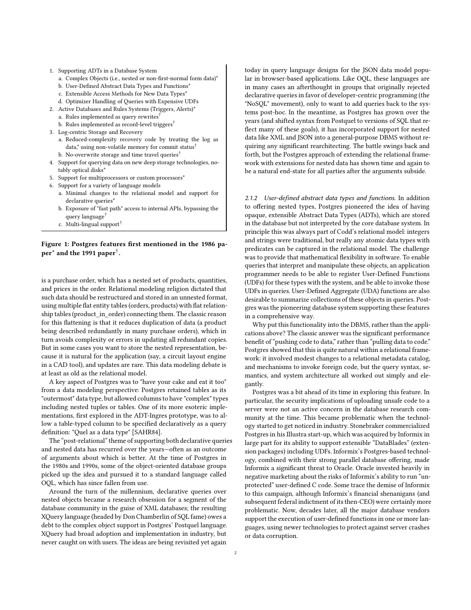

> 本组第 53 篇 · 数据库系统实践 · [全部论文]() · [上一篇]() · [下一篇]()

这篇回顾的主线是：Postgres以可扩展性作为稳定骨架，把复杂对象、ADT/UDF、可扩展索引、规则、版本存储、深层存储和并行优化装进同一研究系统。成功不等于每条路线都保留：昂贵函数优化被关闭/删除，原始no-overwrite与time travel后来被WAL方案替换，Inversion未延续；开源社区又重写并完善了许多内核部分。因此它最值得学习的不是一张功能成功清单，而是如何让实验可被替换，同时保留可组合的接口。

文中关于排名、收购金额、现代系统表现及产业走向的表述，属于2018-2019写作语境和作者判断，不是本报告核验过的2026事实。尤其不能把历史Postgres的日志方案等同于现代PostgreSQL MVCC，或把分两阶段的并行优化启发式说成全局最优。

本文保留论文陈述、读者推断与待验证方案的区别；实验数字只适用于原文条件。原文和翻译来自已有 AI 辅助精读报告，已做来源匹配与编辑复核，不等于人工逐项核验或独立实验复现。所有页码均为 PDF 物理页。

## 论文与阅读范围

Joseph M. Hellerstein，Looking Back at Postgres，本地arXiv:1901.01973v1，2019-01-07，9页。作者应Stonebraker图灵奖文集之邀撰写的个人/历史回顾，而非Postgres原始设计论文或当前PostgreSQL性能评测。物理页等于页脚页码。

[论文集中的原始 PDF](https://github.com/lonng/db-papers/blob/4ff1331069c7cf52ac97dd769e5f484c1c35c200/papers/rdbms/looking-back-at-postgres.pdf) · 本地来源：`rdbms/looking-back-at-postgres.pdf`，共 9 页。

本篇保留 30 组原文精读和 38 条证据。截图为原始 PDF 的局部页选，不是重新生成的图表；未将整份 PDF 复制到博客。

## 研究问题与适用边界

**先辨认论文类型**
这是参与者的回忆文章，问题是解释一个跨度十年的研究系统为何产生持续影响，而非提出一个新算法并用实验击败基线。作者明确把注意力放在Stonebraker的设计与领导，并承认具体代码由学生及工作人员完成。来源类型决定证据力度：亲历叙述、原论文引用、产业事件和个人判断应分别对待。

**技术动机是让关系系统承载新领域**
CAD的多维几何、复杂结构和约束，推动了嵌套类型、用户函数和访问方法扩展。Postgres并非只做对象关系：规则、版本历史、三级存储与并行也是独立目标。第2页图1的星号是1986设计提及，剑号是1991新增；它不是所有功能同一时刻完成的验收表。

**阅读收益**
对内核工程师最有用的问题是：哪些扩展只需目录/调用约定，哪些会穿透并发恢复？哪些实验机制能被移除而不推倒系统？为何接口可以传承，代码与策略仍需重写？

依据：论文陈述；PDF 物理页 1, 2, 3, 8。证据：[PG-SRC-01](#evidence-pg-src-01), [PG-SRC-02](#evidence-pg-src-02), [PG-SRC-03](#evidence-pg-src-03), [PG-SRC-06](#evidence-pg-src-06), [PG-SRC-20](#evidence-pg-src-20)。

## 系统架构与核心组件

**关系外壳与类型扩展**
外层仍是表，列可容纳嵌套元组、表或不透明ADT。目录记录类型和操作，执行器调用UDF/UDA。把代码推近数据降低搬运的可能代价，但引入服务器故障与权限边界；作者明确承认当时安全不是主要研究关注。

**访问方法是跨层协议**
R-tree例子要求优化器识别抽象谓词与访问方法的关系，并接入存储、并发和恢复。早期工作对并发关注不足，后续GiST工作才系统处理相关问题。不能把“能注册索引”理解为任意自定义索引天然事务安全。

**实验路线彼此独立**
规则可用查询重写或记录级动作；版本存储把历史与主数据统一；三级存储改变布局和调度尺度；XPRS讨论并行计划。它们共享系统骨架，却没有一个万能扩展接口消除各模块证明义务。Fast Path为直接调用内核提供入口，也没有自动解决多语言对象持久化。

依据：论文陈述；PDF 物理页 2, 3, 4, 5, 6。证据：[PG-SRC-03](#evidence-pg-src-03), [PG-SRC-04](#evidence-pg-src-04), [PG-SRC-05](#evidence-pg-src-05), [PG-SRC-06](#evidence-pg-src-06), [PG-SRC-07](#evidence-pg-src-07), [PG-SRC-11](#evidence-pg-src-11), [PG-SRC-12](#evidence-pg-src-12), [PG-SRC-13](#evidence-pg-src-13), [PG-SRC-15](#evidence-pg-src-15), [PG-SRC-16](#evidence-pg-src-16), [PG-SRC-18](#evidence-pg-src-18)。

*原论文 PDF 物理页 2，版权归原作者或出版方。点击图片可查看原尺寸。页面文本中定位到：Figure 1: Postgres features first mentioned in the 1986 pa-。这是页面定位信息，不表示本次已复核图内所有数据。*

## 关键算法与机制步骤

**昂贵谓词的顺序与放置**
当函数成本不再可忽略，选择下推不再总是好。应同时比较执行一次的成本与减少后续数据量的收益。文中概述先排序选择，再在连接树分支中交错，并保留System R式动态规划。这里没有完整公式，不能凭回顾复原原论文的最优性前提。

一个已运行的读者算例假定纯函数、独立固定通过率：A成本100、通过率0.1；B成本1、通过率0.5。每输入行A先的期望成本100+0.1×1=100.1，B先为1+0.5×100=51。这只解释为何需要成本模型；不是Postgres性能复现，也未涵盖相关谓词、副作用或join交错。

**版本链与历史读取**
历史方案把同一记录版本按事务ID串起来，配合提交状态和墙钟时间支持as-of查询。它避免日志表示向主表示翻译，但并不因此免除持久提交状态、空间回收和读放大的代价。

**先单机、后并行**
Wei Hong方法先选传统计划，再为各算子决定并行度与位置，减少优化搜索的交叉组合。它是启发式；所谓additive是优化决策分解，不是保证执行时间线性可加。三级存储路线则把数组切块与复制邻域、磁盘缓存及查询发车时机一起考虑。

依据：论文陈述；PDF 物理页 3, 4, 5。证据：[PG-SRC-08](#evidence-pg-src-08), [PG-SRC-09](#evidence-pg-src-09), [PG-SRC-13](#evidence-pg-src-13), [PG-SRC-15](#evidence-pg-src-15), [PG-SRC-16](#evidence-pg-src-16), [PG-SRC-17](#evidence-pg-src-17)。

## 正确性、前提假设与已知局限

**扩展能力不等于正确性封装完成**
第3页列出的并发和恢复问题说明一个新访问方法需要证明可达结果、结构修改和失败恢复，而不仅是抽象搜索接口。UDF的成本重排还隐含可重排性要求：若函数有副作用、异常或外部状态，不能仅按选择率交换次序。本段后者是读者工程推论，不是本文给出的形式证明。

**规则时机与恢复语义必须分开**
查询重写与逐行触发各有动作时机，多个规则交互可能难以理解。原始版本链提供历史选择能力，但回顾没有穷举崩溃状态、日志刷盘顺序及垃圾回收协议。因此不能从“简单”两字得出已经验证崩溃安全。

**最优性有边界**
昂贵选择局部优化与分阶段并行规划的主张分属不同算法；后者明确是heuristic。历史Postgres与现代PostgreSQL也不应按同一个状态机推导：WAL、MVCC、time travel和规则实现的演变意味着需要指定版本逐项核查。

依据：读者推断；PDF 物理页 2, 3, 4, 5。证据：[PG-SRC-05](#evidence-pg-src-05), [PG-SRC-06](#evidence-pg-src-06), [PG-SRC-07](#evidence-pg-src-07), [PG-SRC-08](#evidence-pg-src-08), [PG-SRC-09](#evidence-pg-src-09), [PG-SRC-11](#evidence-pg-src-11), [PG-SRC-12](#evidence-pg-src-12), [PG-SRC-13](#evidence-pg-src-13), [PG-SRC-14](#evidence-pg-src-14), [PG-SRC-17](#evidence-pg-src-17)。

## 实验证据、度量与缺失项

**没有受控的新性能实验**
本回顾没有为自己提供硬件、数据规模、查询集、重复次数和误差条，也没有一组可重新运行的“Postgres比X快”图。正文提到早期OODB学术基准、历史存储性能以及产业采用，但未在此报告实验细节。

**产业影响不是执行器吞吐**
排名、收购总额和开源采用是历史影响证据，不是内核设计因果实验。写作于2018-2019的“today”不得转写成当前事实；收购金额相加也不能隔离出一项技术的净经济贡献。文中Illustra叙述的1997与参考文献Mon96的1996存在内部日期张力，若要建立精确年表需另查原始公告，本报告未消解。

**评价的适用范围**
作者对事务存储慢、规则开销和未来cloud dominance的评价应保留为作者判断，而不是替他补造测量。唯一实际运行的本地工作是读者谓词成本算例；它不是原始Postgres、现代PostgreSQL或竞品benchmark。

依据：论文陈述；PDF 物理页 1, 3, 4, 6。证据：[PG-SRC-01](#evidence-pg-src-01), [PG-SRC-10](#evidence-pg-src-10), [PG-SRC-14](#evidence-pg-src-14), [PG-SRC-18](#evidence-pg-src-18), [PG-SRC-19](#evidence-pg-src-19)。

## 设计权衡与工程妥协

**可扩展性与信任边界**
UDF和自定义索引扩大适用领域，也让服务器承担外部代码错误、代价误估和恢复集成风险。目录接口只能描述和路由，不能替扩展作者证明语义。

**简单恢复与持久在线路**
“数据就是日志”减少表示转换，却可能增加版本遍历、空间及后台整理成本，且不天然方便后来厂商的日志复制。历史方案未胜出不说明其理念无用，只说明不能只以恢复代码长度评价整个系统。

**广度与可替换性**
第二系统承载很多想法，成功依赖能让失败路线退出。昂贵UDF优化被移除、规则重写与存储替换，恰恰说明可扩展架构允许策略与实现演化。并行分阶段优化用较小搜索成本交换潜在计划质量；三级存储以复制与调度复杂度交换更少昂贵装载。

依据：读者推断；PDF 物理页 2, 3, 4, 5, 8。证据：[PG-SRC-05](#evidence-pg-src-05), [PG-SRC-06](#evidence-pg-src-06), [PG-SRC-10](#evidence-pg-src-10), [PG-SRC-12](#evidence-pg-src-12), [PG-SRC-13](#evidence-pg-src-13), [PG-SRC-14](#evidence-pg-src-14), [PG-SRC-15](#evidence-pg-src-15), [PG-SRC-16](#evidence-pg-src-16), [PG-SRC-17](#evidence-pg-src-17), [PG-SRC-20](#evidence-pg-src-20)。

## 与现代系统及衍生版本的比较

**对象关系、OODB和ORM**
Postgres扩展关系数据与声明式查询；OODB尝试透明持久化语言对象；ORM在应用层映射对象和关系。三者不能因为都有“object”而合并。Fast Path缓解某些调用开销，并未实现通用透明语言持久化。

**Postgres、GiST和后续PostgreSQL**
原始访问方法骨架、后续GiST的并发恢复、开源社区长期重写，是不同贡献阶段。相似目录和进程结构是传承的历史线索，不是逐行代码相同的证明。

**MapReduce及商业分支**
作者把MapReduce视为UDF查询框架与并行思路的再组合，并列举Greenplum等商业演化。这是回顾视角，不是等语义等硬件性能比较。本文未核查当前产品功能、许可、排名或维护状态，因此这里只讨论作者当年的机制对照，不作2026选型排名。

依据：读者推断；PDF 物理页 2, 3, 4, 5, 6。证据：[PG-SRC-03](#evidence-pg-src-03), [PG-SRC-06](#evidence-pg-src-06), [PG-SRC-07](#evidence-pg-src-07), [PG-SRC-10](#evidence-pg-src-10), [PG-SRC-14](#evidence-pg-src-14), [PG-SRC-17](#evidence-pg-src-17), [PG-SRC-18](#evidence-pg-src-18), [PG-SRC-19](#evidence-pg-src-19)。

## 复现可能性与工程验证

**已经执行**
通读本地9页，视觉核对第2、4、5页及图1；逐条检查新增引文来自对应物理页，原文件SHA保持不变。运行纯Python谓词顺序算例，得到100.1与51期望成本；它只验证读者设定的算术。

**下一步源码研究，未执行**
1. 固定历史Postgres3.1与一个后续PostgreSQL版本，追踪类型目录、访问方法、谓词匹配与恢复入口。只把找到的路径/类名作为源码事实，本报告未读这些仓库，故不编造符号。
2. 找到昂贵选择原论文，列出成本、选择率、纯函数、可移动性假设，并对比其启用和删除的版本历史。
3. 用隔离测试库比较语句级/行级动作的触发次数和失败行为；再分别研究历史版本存储与后续WAL的持久化和空间回收。
4. 为分阶段并行优化构造两个单机成本接近、交换代价明显不同的候选，比较先选再并行与联合枚举；不要提前声称哪种总是更优。

历史回顾的复现重点是证据链与版本路线，不是把商业影响数字重复一遍当作基准。

依据：待验证的工程设想；PDF 物理页 3, 4, 5, 6, 8。证据：[PG-SRC-06](#evidence-pg-src-06), [PG-SRC-08](#evidence-pg-src-08), [PG-SRC-09](#evidence-pg-src-09), [PG-SRC-11](#evidence-pg-src-11), [PG-SRC-13](#evidence-pg-src-13), [PG-SRC-14](#evidence-pg-src-14), [PG-SRC-17](#evidence-pg-src-17), [PG-SRC-19](#evidence-pg-src-19), [PG-SRC-20](#evidence-pg-src-20)。

## 结论与内核工程启示

Postgres留下的最稳定资产是可扩展的关系内核及其开放接口，而非一个永不改变的功能集合。新类型必须有操作，新索引必须接入优化器和恢复，昂贵函数必须进入成本模型，深层存储必须进入布局与调度；这些都是跨层问题。

同样重要的是承认失败、禁用和重写。原版本历史方案与后来的MVCC/WAL不是同义词；分阶段并行优化不是全局最优；2019回顾里的产业判断不是当前基准。把这些限定写进正文，才能把“先驱性”转化为可核验的工程学习。

本报告是AI来源复核稿，保留API生成记录与用量。引用位置和结构校验通过不代表所有解释已被形式证明，也不替代历史原论文、指定版本源码与实际故障实验。

依据：读者推断；PDF 物理页 1, 3, 4, 5, 6, 8。证据：[PG-SRC-01](#evidence-pg-src-01), [PG-SRC-06](#evidence-pg-src-06), [PG-SRC-08](#evidence-pg-src-08), [PG-SRC-10](#evidence-pg-src-10), [PG-SRC-12](#evidence-pg-src-12), [PG-SRC-14](#evidence-pg-src-14), [PG-SRC-17](#evidence-pg-src-17), [PG-SRC-19](#evidence-pg-src-19), [PG-SRC-20](#evidence-pg-src-20)。

## 原文精读：从句子回到机制

以下保留原文、忠实翻译、含义与边界；假设示例不作为论文实验结果。

### P001 · PDF 物理页 2

**原文**

<blockquote class="paper-source-quote"><pre><code>This data modeling debate is&#10;at least as old as the relational model.&#10;A key aspect of Postgres was to "have your cake and eat it too"&#10;from a data modeling perspective: Postgres retained tables as its&#10;"outermost" data type, but allowed columns to have "complex" types&#10;including nested tuples or tables. One of its more esoteric imple-&#10;mentations, first explored in the ADT-Ingres prototype, was to al-&#10;low a table-typed column to be specified declaratively as a query&#10;definition: "Quel as a data type" [SAHR84].</code></pre></blockquote>

**忠实翻译**

> 这场建模争论至少与关系模型一样久远。Postgres希望两者兼得：最外层仍是表，列则允许复杂类型，如嵌套元组或表。一种较特殊的实现允许用查询定义表类型列，即先在ADT-Ingres探索的“Quel作为数据类型”。

**技术含义与边界**

> 类型扩展嵌在关系外壳中，而非取消声明式查询。末句是查询定义的表类型列，不能把普通数组字段与它视为同一实现。嵌套表示便利与冗余更新问题仍需分别评价。

**常见误读**

> 历史探索不等于当前PostgreSQL仍具有相同接口；这段未证明嵌套数据天然满足所有规范化约束。

**读者构造的假设示例**

> 读者建模例子：订单外层是表，某列有商品集合。若集合里复制商品价格，更新传播仍要定义；复杂类型本身不替应用解决冗余。

### P002 · PDF 物理页 8

**原文**

<blockquote class="paper-source-quote"><pre><code>It seems that “Berkeley&#10;Stonebraker” defies the later wisdom of “MIT Stonebraker,” and I&#10;have no issue with that.13 Of course there’s wisdom in the “one size&#10;doesn’t fit all” motto (it’s always possible to find modest markets&#10;for custom designs!), but the success of “Berkeley Stonebraker’s”&#10;signature system—well beyond its original intents—demonstrates&#10;that a broad majority of database problems can be solved well with&#10;a good general-purpose architecture. Moreover, the design of that&#10;architecture is a technical challenge and accomplishment in its&#10;own right.</code></pre></blockquote>

**忠实翻译**

> 作者认为“Berkeley时期的Stonebraker”反驳了后来“MIT时期的Stonebraker”的经验。专用设计有市场，但Postgres超出原意的成功让他认为良好通用架构能解决大部分数据库问题，设计这种架构本身也有技术价值。

**技术含义与边界**

> 这是作者关于两种研究战略的评价，不是已量化的市场覆盖定理。上下文同时承认专用设计有合理性；不应只摘一句写成通用系统全面优于专用系统。

**常见误读**

> “大部分”没有配套样本和比例；文章的历史影响也不能证明每个现代负载均适合通用内核。

**读者构造的假设示例**

> 读者决策问题：已有关系系统能否用受控扩展满足新类型需求，还是隔离/恢复与执行模型都需改写？这要测量，不由此段替代选型。

### P003 · PDF 物理页 5

**原文**

<blockquote class="paper-source-quote"><pre><code>Part of the grant proposal was to handle unprecedented volumes&#10;of digital satellite imagery requiring up to 100 terabytes of storage,&#10;far more data than could be reasonably stored on magnetic disks&#10;at the time. The center of the proposed solution was to explore the&#10;idea of a DBMS (namely Postgres) facilitating access to near-line&#10;“tertiary” storage provided by robotic “jukeboxes” for managing&#10;libraries of optical disks or tapes.</code></pre></blockquote>

**忠实翻译**

> 资助提案部分目标是处理需高达100TB的卫星影像，远超当时可合理放在磁盘上的量；方案核心是探索让Postgres访问由机器人光盘或磁带库提供的近线三级存储。

**技术含义与边界**

> 这是项目中期Sequoia背景下的目标与方案，不是Postgres最初设计时已完成的100TB部署验收。后文研究还涉及分块复制、磁盘缓存及查询调度，因此不能只理解为自动挂载介质。

**常见误读**

> 提案容量不等于已实现可用容量或查询性能；不要凭今天SQL习惯给当年原型编造接口。

**读者构造的假设示例**

> 读者调度例子：两条查询访问同一盘片时，先批处理可减少装载次数，但可能让另一个用户等待更久。这解释为何布局与调度要联合研究。

### P004 · PDF 物理页 4

**原文**

<blockquote class="paper-source-quote"><pre><code>Once they had write-ahead logs working well, the vendors also&#10;began to innovate on follow-on ideas such as transactional repli-&#10;cation based on log shipping, which would be difficult in the Post-&#10;gres scheme. In the end, the Postgres storage system never excelled&#10;on performance; versioning and time-travel were removed from&#10;PostgreSQL over time and replaced by write-ahead logging.6 But&#10;6Unfortunately, PostgreSQL still isn’t particularly fast for transaction processing: its&#10;embrace of write-ahead logging is somewhat half-hearted.</code></pre></blockquote>

**忠实翻译**

> 厂商完善WAL后，还发展了基于日志传送的事务复制，这在原Postgres方案中较难。作者说原存储性能未突出，版本历史与time travel后来被WAL方案替换。引文随后夹入脚注6的评价：作者认为PostgreSQL事务处理仍不够快、WAL采用不彻底。

**技术含义与边界**

> 主文讲历史路线变更；脚注是定性判断，不是本篇基准。必须结合脚注后半段理解：作者同时说保留了元组存储开销来提供MVCC，所以“移除versioning”不能翻译成现代PostgreSQL完全没有多版本。

**常见误读**

> 不要把历史time-travel、活跃事务MVCC及WAL恢复三件事混同，也不要凭脚注断言某现代数据库一定更慢。原引文保留了文本层脚注插入和未完的But，未把它伪装为连续完整段落。

**读者构造的假设示例**

> 读者对照表可分别列“能否查询任意历史时间”“并发事务读哪些版本”“崩溃如何恢复”。某系统支持后两项并不自动支持第一项。

### P005 · PDF 物理页 6

**原文**

<blockquote class="paper-source-quote"><pre><code>To compete with the OODB vendors, Postgres&#10;exposed a so-called “Fast Path” interface: basically a C/C++ API to&#10;the storage internals of the database. This enabled Postgres to be&#10;moderately performant in academic OODB benchmarks, but never&#10;really addressed the challenge of allowing programmers in multi-&#10;ple languages to avoid the impedance mismatch problem.</code></pre></blockquote>

**忠实翻译**

> 为与OODB厂商竞争，Postgres暴露Fast Path，基本是面向数据库存储内部的C/C++ API。它使学术OODB基准表现尚可，却未真正解决多语言程序员的阻抗失配挑战。

**技术含义与边界**

> 这是降低调用路径开销的一种接口，而不是透明持久化语言对象的完整方案。“moderately performant”是作者定性描述，此处没有基准配置或加速比。

**常见误读**

> 不能推断它直接暴露任意存储页、解决所有事务语义，也不能未读接口便断言其他语言永远无法通过绑定使用。

**读者构造的假设示例**

> 读者问题：即使C入口减少查询解析成本，调用者仍需解释对象标识、类型转换、事务边界及失败恢复；这些不由“Fast Path”名称自动给出。

### P006 · PDF 物理页 3

**原文**

<blockquote class="paper-source-quote"><pre><code>Relational databases&#10;evolved around the same time as B-trees in the early 1970s, and B-&#10;trees helped fuel Codd’s dream of "physical data independence":&#10;B-tree indexes provide a level of indirection that adaptively reor-&#10;ganizes physical storage without requiring applications to change.&#10;The main limitation of B-trees and related structures was that they&#10;only support equality lookups and 1-dimensional range queries.&#10;What if you have 2-dimensional range queries of the kind typical&#10;in mapping and CAD applications?</code></pre></blockquote>

**忠实翻译**

> 关系数据库与B-tree约在1970年代初同期发展；B-tree间接层让物理存储自适应重组而无需应用变更。作者用其等值及一维范围搜索特点，引出地图、CAD的二维范围需求。

**技术含义与边界**

> 这是多维访问方法的动机，并非关系模型不能表达多维查询。单一有序键路径与二维几何谓词的契合度不同，注册新访问方法还须接入优化器和事务机制。

**常见误读**

> 不能说二维查询用B-tree只能分别建X/Y索引求交；组合键、残余过滤等访问设计是否可用要具体分析，此段未穷举。

**读者构造的假设示例**

> 读者例子：矩形范围x∈[10,20]且y∈[30,40]可用某路径筛候选再检查完整谓词；空间索引是否更优取决于数据分布与候选量，不能只由维度判断。

### P007 · PDF 物理页 7

**原文**

<blockquote class="paper-source-quote"><pre><code>MADlib lives on today as an Apache project. Another interest-&#10;ing open-source project based on Greenplum is Apache HAWQ,&#10;a Pivotal design that runs the “top half” of Greenplum (i.e.,&#10;the parallelized PostgreSQL query processor and extensibility&#10;APIs) in a decoupled fashion over Big Data stores such as the&#10;Hadoop File System.&#10;4. EnterpriseDB was founded in 2004 as an open-source-based&#10;business, selling PostgreSQL in both a vanilla and enhanced&#10;edition with related services for enterprise customers.</code></pre></blockquote>

**忠实翻译**

> 在作者写作时，MADlib仍作为Apache项目存在；HAWQ把Greenplum“上半部分”，即并行PostgreSQL查询处理器与扩展API，以解耦方式运行在HDFS等存储之上。接着另一条目介绍2004年成立、售卖PostgreSQL版本及企业服务的EnterpriseDB。

**技术含义与边界**

> 这段并列不同生态路线：库、查询层/存储组合和商业发行服务，不是同一种产品清单或性能排序。“today”只指2018-2019写作语境，当前维护状态未核验。

**常见误读**

> 不能把上半部等同整个Greenplum，也不能从本地历史论文直接建议安装这些项目或保证其当前兼容性。

**读者构造的假设示例**

> 读者架构图将查询执行、扩展API、存储与企业服务分层，再标出原文每个项目涉及哪层，比把所有衍生物视作同一个完整数据库准确。

### P008 · PDF 物理页 6

**原文**

<blockquote class="paper-source-quote"><pre><code>It is also (according to one influential rank-&#10;ings site) the most popular widely used independent open source&#10;database in the world9 and its impact continues to grow: in both&#10;2017 and 2018 it was the fastest-growing database system in the&#10;world in popularity [DE19c] PostgreSQL is used across a wide vari-&#10;ety of industries and applications, which is perhaps not surprising&#10;given its ambition of broad functionality.</code></pre></blockquote>

**忠实翻译**

> 按一个有影响力的排名网站，PostgreSQL当时是最受欢迎的广泛使用独立开源数据库，并在2017、2018流行度增长最快；作者把其跨行业应用与追求广泛功能联系起来。

**技术含义与边界**

> 这是有来源指向和时间范围的排名转述，不是本报告已核验的当前事实。脚注将独立开源与公司控制产品区分；流行度指标、安装量、吞吐与代码质量也不等同。未独立核查不意味着可无根据将该网站判为不可信。

**常见误读**

> 不要把2019的today更新成2026，也不要把流行度增长归因于某个内核机制而不做因果研究。

**读者构造的假设示例**

> 读者引用方式应写“作者援引2017-2018排名趋势”，而非“已证实今天性能第一”。真实选型仍需读当前文档和测自己的负载。

### P009 · PDF 物理页 3

**原文**

<blockquote class="paper-source-quote"><pre><code>Questions of concurrency control were less of a focus in the orig-&#10;inal effort: the lack of a unidimensional ordering on keys made&#10;B-tree-style locking inapplicable.1&#10;PostgreSQL today leverages both the original software architec-&#10;ture of extensible access methods (it has B-tree, GiST, SP-GiST,&#10;and Gin indexes) and the extensibility and high concurrency of&#10;the Generalized Search Tree (GiST) interface as well.</code></pre></blockquote>

**忠实翻译**

> 早期工作较少关注并发控制，缺少一维键序使B-tree式锁不适用。作者写作时的PostgreSQL延续了可扩展访问方法架构，也使用GiST接口的可扩展与高并发能力。

**技术含义与边界**

> 此处明确分出初期接口架构与后来的GiST并发/恢复研究。多维索引仍可设计正确并发协议，只是不能把一维键序锁直接照搬；本报告未读其当前实现。

**常见误读**

> 不能把所有索引都说成同一种并发机制，也不能仅凭注册GiST逻辑就认为扩展作者所有语义责任自动消失。

**读者构造的假设示例**

> 读者验证列表：范围匹配、分裂期间候选可达性、锁/latch协议和崩溃恢复分别验证；不要只测静态树上的搜索结果。

### P010 · PDF 物理页 7

**原文**

<blockquote class="paper-source-quote"><pre><code>3.2&#10;Commercial Adaptations&#10;PostgreSQL has long been an attractive starting point for building&#10;commercial database systems, given its permissive open source li-&#10;cense, its robust codebase, its flexibility, and breadth of functional-&#10;ity. Summing the acquisition prices listed below, Postgres has led&#10;to over $2.6 billion in acquisitions.10 Many of the commercial ef-&#10;forts that built on PostgreSQL have addressed what is probably its&#10;key limitation: the ability to scale out to a parallel, shared-nothing&#10;architecture.11&#10;1.</code></pre></blockquote>

**忠实翻译**

> 宽松许可、健壮代码、灵活性和功能广度使PostgreSQL成为商业数据库起点。作者把下列收购价相加得到超过26亿美元，并认为许多商业分支针对其向并行shared-nothing扩展的局限。

**技术含义与边界**

> 收购额是作者列举交易的历史加总，不是某项技术净创造价值的因果估计，更不是本报告独立审计。shared-nothing横向分区也不等同计算存储分离；两种架构维度须分开。

**常见误读**

> 不能把衍生版能力直接归给上游默认版本；未独立核实的交易数据应称未核实，而非任意断言来源不可信。段落开头标题与结尾列表编号是原引文边界，不补造后续项目细节。

**读者构造的假设示例**

> 读者归因表可列出历史分支、改变的执行/存储/优化层、交易来源和日期；不把一家公司的全部收购价自动分配给某个索引或许可证。

### PG-READ-01 · PDF 物理页 1

**原文**

<blockquote class="paper-source-quote"><pre><code>This is a recollection of the UC Berkeley Postgres project, which&#10;was led by Mike Stonebraker from the mid-1980’s to the mid-1990’s.</code></pre></blockquote>

**忠实翻译**

> 本文回顾的是由Mike Stonebraker领导、从1980年代中期到1990年代中期的Berkeley Postgres项目。

**技术含义与边界**

> 研究对象是一个历史项目及其后续影响，作者亲历只是证据类型之一。

**常见误读**

> 不能把文章当作当前版本手册或独立量化评测。

**读者构造的假设示例**

> 把每个技术结论先标成原项目设计、后续开源演变或作者评价，再决定要查哪份源码。

### PG-READ-02 · PDF 物理页 1

**原文**

<blockquote class="paper-source-quote"><pre><code>The Postgres codebase was the work of a team of brilliant stu-&#10;dents and the occasional university “staffprogrammers” who had&#10;little more experience (and only slightly more compensation) than&#10;the students.</code></pre></blockquote>

**忠实翻译**

> 代码由出色的学生团队及少数大学工作人员完成，后者经验和报酬只略高于学生。

**技术含义与边界**

> 技术领导与实际实现贡献必须分开记录，历史归因不能只写项目负责人。

**常见误读**

> 不应把所有代码和研究成果都归到Stonebraker个人。

**读者构造的假设示例**

> 分析一种索引时，同时列出接口设计者、实现者和后续恢复协议贡献。

### PG-READ-03 · PDF 物理页 2

**原文**

<blockquote class="paper-source-quote"><pre><code>Postgres retained tables as its&#10;"outermost" data type, but allowed columns to have "complex" types&#10;including nested tuples or tables.</code></pre></blockquote>

**忠实翻译**

> Postgres保留表作为最外层类型，同时允许列具有包含嵌套元组或表的复杂类型。

**技术含义与边界**

> 扩展发生在关系框架内部，并非完全抛弃表和声明式查询。

**常见误读**

> 不能把对象关系直接等同于对象数据库的透明持久化或ORM。

**读者构造的假设示例**

> 订单外层仍为表，某列可承载结构化对象；具体冗余更新代价仍需单独处理。

### PG-READ-04 · PDF 物理页 2

**原文**

<blockquote class="paper-source-quote"><pre><code>Why put this functionality into the DBMS, rather than the appli-&#10;cations above? The classic answer was the significant performance&#10;benefit of “pushing code to data,” rather than “pulling data to code.”&#10;Postgres showed that this is quite natural within a relational frame-&#10;work: it involved modest changes to a relational metadata catalog,&#10;and mechanisms to invoke foreign code, but the query syntax, se-&#10;mantics, and system architecture all worked out simply and ele-&#10;gantly.</code></pre></blockquote>

**忠实翻译**

> 把功能放进数据库的经典理由是把代码推到数据旁，而非把数据拉到代码旁；它需要目录和调用外部代码机制。

**技术含义与边界**

> UDF是数据、元数据、执行器之间的接口问题，不只是增加函数语法。

**常见误读**

> 靠近数据并不自动保证代码安全或所有负载更快。

**读者构造的假设示例**

> 昂贵图像函数避免传输大图像，但若对全部行执行仍可能比先筛选更慢。

### PG-READ-05 · PDF 物理页 2

**原文**

<blockquote class="paper-source-quote"><pre><code>the security implications of uploading unsafe code to a&#10;server were not an active concern in the database research com-&#10;munity at the time.</code></pre></blockquote>

**忠实翻译**

> 当时上传不安全代码到服务器的安全影响，并非数据库研究界的活跃关注点。

**技术含义与边界**

> 可扩展性把第三方代码带入内核信任边界，安全和故障隔离是额外设计责任。

**常见误读**

> 不能从历史原型可调用C函数推断它已具现代沙箱。

**读者构造的假设示例**

> 给扩展API列出内存破坏、异常传播、权限和资源限额四个待验证接口。

### PG-READ-06 · PDF 物理页 3

**原文**

<blockquote class="paper-source-quote"><pre><code>Still,&#10;the invention of an index structure does not solve the end-to-end&#10;systems problem of DBMS support for multi-dimensional range&#10;queries. Many questions arise. Can you add an access method like&#10;R-trees to your DBMS easily? Can you teach your optimizer that&#10;said access method will be useful for certain queries? Can you get&#10;concurrency and recovery correct?</code></pre></blockquote>

**忠实翻译**

> 发明一种索引还没解决端到端问题：能否加入DBMS、让优化器识别有用查询，并保证并发和恢复正确？

**技术含义与边界**

> 访问方法扩展跨越目录、谓词语义、代价估计、存储和恢复。

**常见误读**

> 不能以单线程R-tree查找正确代替数据库级索引正确。

**读者构造的假设示例**

> 先证明范围谓词与索引过滤契合，再测并发插入、崩溃重放与假阳性回表。

### PG-READ-07 · PDF 物理页 3

**原文**

<blockquote class="paper-source-quote"><pre><code>Questions of concurrency control were less of a focus in the orig-&#10;inal effort: the lack of a unidimensional ordering on keys made&#10;B-tree-style locking inapplicable.</code></pre></blockquote>

**忠实翻译**

> 早期工作较少关注并发控制；键缺少一维顺序使B-tree式锁定不能直接套用。

**技术含义与边界**

> 本文把早期接口优雅与后续GiST并发/恢复工作明确区分。

**常见误读**

> 不要说最初Postgres已一次性解决任意索引的并发恢复。

**读者构造的假设示例**

> 二维重叠搜索需要定义覆盖范围及结构修改保护，不能只复制标量键区间锁。

### PG-READ-08 · PDF 物理页 3

**原文**

<blockquote class="paper-source-quote"><pre><code>if you have expensive UDFs&#10;in your selections, the order of executing UDFs can be critical to&#10;optimizing performance. Moreover, if a UDF in a selection is really&#10;time-consuming, it’s possible that it should happen after joins (i.e.,&#10;selection "pullup").</code></pre></blockquote>

**忠实翻译**

> 选择谓词中若有昂贵UDF，顺序很关键，极昂贵时甚至应放在连接之后，即选择上拉。

**技术含义与边界**

> 传统总是先过滤的启发式忽略函数成本；应同时考虑成本与选择率。

**常见误读**

> 这不是所有过滤都延后，也不是任意有副作用函数都可自由重排。

**读者构造的假设示例**

> 读者算例：A成本100、通过率0.1，B成本1、通过率0.5；A先为100.1，B先为51，假定独立且纯函数。

### PG-READ-09 · PDF 物理页 3

**原文**

<blockquote class="paper-source-quote"><pre><code>We approached the optimization problem by coming up with an&#10;optimal ordering of selections, and then an optimal interleaving&#10;of the selections along the branches of each join tree considered&#10;during plan search. This allowed for an optimizer that maintained&#10;the textbook dynamic programming architecture of System R, with&#10;a small additional sorting cost to get the expensive selections or-&#10;dered properly.</code></pre></blockquote>

**忠实翻译**

> 作者先求选择的最优顺序，再在搜索的每棵连接树分支上求最优交错，保留System R动态规划架构并增加少量排序代价。

**技术含义与边界**

> 局部子问题的最优性必须放在该算法模型和枚举范围下理解。

**常见误读**

> 文章没有给出完整递推、复杂度证明或可直接复用的实现。

**读者构造的假设示例**

> 读原论文及指定commit，确认UDF选择率、成本和可移动性的输入约束后再移植。

### PG-READ-10 · PDF 物理页 3

**原文**

<blockquote class="paper-source-quote"><pre><code>The expensive function optimization feature was disabled in&#10;the PostgreSQL source trees early on, in large part because there&#10;weren’t compelling use cases at that time for expensive user-defined&#10;functions.</code></pre></blockquote>

**忠实翻译**

> 昂贵函数优化早期在PostgreSQL源码树中被禁用，原因主要是当时缺乏有说服力的应用。

**技术含义与边界**

> 研究原型能力和发布版长期启用能力并不相同。

**常见误读**

> 不能用回顾里的研究成果宣称当前PostgreSQL必然执行该算法。

**读者构造的假设示例**

> 报告应写清已提出、已实现、已启用、已移除四种不同状态。

### PG-READ-11 · PDF 物理页 4

**原文**

<blockquote class="paper-source-quote"><pre><code>One option was to treat rules as query rewrites, remi-&#10;niscent of the work on rewriting views that Stonebraker pioneered&#10;in Ingres. In this scenario, a rule logic of "on condition then action"&#10;is recast as "on query then rewrite to a modified query and execute&#10;it instead."</code></pre></blockquote>

**忠实翻译**

> 一种规则方案把on condition then action改写为遇到查询时生成替代查询并执行。

**技术含义与边界**

> 规则可在查询层实现，而不必总在每条记录访问时触发。

**常见误读**

> 查询重写与逐行触发的行为、时机和副作用不应直接视为同义。

**读者构造的假设示例**

> 更新一万行时，语句重写与一万次行级动作的执行次数可能不同；这是读者问题，不是本文基准。

### PG-READ-12 · PDF 物理页 4

**原文**

<blockquote class="paper-source-quote"><pre><code>In the end, neither the query rewriting scheme nor the row-level&#10;locking scheme was declared a "winner" for implementing rules in&#10;Postgres—both were kept in the released system. Eventually all of&#10;the rules code was scrapped and rewritten in PostgreSQL, but the&#10;current source still retains both the notions of per-statement and&#10;per-row triggers.</code></pre></blockquote>

**忠实翻译**

> 重写和行级锁规则都未被宣布胜出，发布系统保留二者；后来代码重写，但仍保留按语句和按行触发的概念。

**技术含义与边界**

> 可扩展骨架延续不表示最初实现代码未被替换。

**常见误读**

> 不要把原PRS2规则锁机制写成现代行锁等候协议。

**读者构造的假设示例**

> 画出历史实现和后续概念两条线，不以同名接口假定相同实现。

### PG-READ-13 · PDF 物理页 4

**原文**

<blockquote class="paper-source-quote"><pre><code>At base, the idea was to keep each record in the data-&#10;base in a linked list of versions stamped with transaction IDs—in&#10;some sense, this is “the log as data” or “the data as a log,” depend-&#10;ing on your point of view. The only additional metadata required&#10;is a list of committed transaction IDs and wall-clock times.</code></pre></blockquote>

**忠实翻译**

> 基本想法是每条记录为带事务ID的版本链，额外元数据为已提交事务ID及墙钟时间列表。

**技术含义与边界**

> 原方案试图统一主数据与历史日志表示，使恢复不必在两种表示间翻译。

**常见误读**

> 这段架构概述不是完整崩溃持久性证明，也不是现代PostgreSQL存储说明。

**读者构造的假设示例**

> 读者模型按提交时间挑选版本；还必须另问提交表持久化、版本回收和失败写入如何处理。

### PG-READ-14 · PDF 物理页 4

**原文**

<blockquote class="paper-source-quote"><pre><code>In the end, the Postgres storage system never excelled&#10;on performance; versioning and time-travel were removed from&#10;PostgreSQL over time and replaced by write-ahead logging.</code></pre></blockquote>

**忠实翻译**

> 原Postgres存储性能未突出，版本和time travel后来被移除，并替换为WAL。

**技术含义与边界**

> 历史路线的淘汰本身是回顾的重要信息，不能只保留创新优势。

**常见误读**

> 移除历史time travel不等于现代MVCC完全没有行版本。

**读者构造的假设示例**

> 并排比较历史查询能力、活跃事务可见性和崩溃恢复，三者分别列出。

### PG-READ-15 · PDF 物理页 5

**原文**

<blockquote class="paper-source-quote"><pre><code>the basic ideas included breaking up&#10;the array into chunks, and storing chunks together that are fetched&#10;together—including replicating chunks to enable multiple physical&#10;“neighbors” for a given chunk of data.</code></pre></blockquote>

**忠实翻译**

> 多维数组被切块，把经常一起取的块相邻存储，并复制块以提供多个物理邻居。

**技术含义与边界**

> 深层存储优化涉及访问局部性和物理布局，不是简单加一层缓存。

**常见误读**

> 复制空间与减少装载次数之间需要成本权衡。

**读者构造的假设示例**

> 二维窗口横纵访问可能偏好不同布局，可用重复块换取两类请求的局部性。

### PG-READ-16 · PDF 物理页 5

**原文**

<blockquote class="paper-source-quote"><pre><code>cache—this affects both the plan chosen by a query optimizer, and&#10;the time at which that plan is scheduled for execution.</code></pre></blockquote>

**忠实翻译**

> （磁盘）缓存既影响优化器选择哪个计划，也影响计划何时被调度执行。

**技术含义与边界**

> 计划优劣与缓存/介质状态及调度相关。

**常见误读**

> 不能把历史磁带机器人模型不加修订地当作当前云对象存储成本。

**读者构造的假设示例**

> 先批处理同一介质上的请求可能改变响应延迟和吞吐；需标明调度目标。

### PG-READ-17 · PDF 物理页 5

**原文**

<blockquote class="paper-source-quote"><pre><code>The basic&#10;idea of what Stonebraker called “The Wei Hong Optimizer” was to&#10;cut the problem in two: run a traditional single-node query opti-&#10;mizer in the style of System R, and then “parallelize” the resulting&#10;single-node query plan by scheduling the degree of parallelism and&#10;placement of each operator based on data layouts and system con-&#10;figuration. This approach is heuristic, but it makes parallelism an&#10;additive cost to traditional query optimization, rather than a mul-&#10;tiplicative cost.</code></pre></blockquote>

**忠实翻译**

> Wei Hong优化器先运行传统单节点优化，再按布局和配置为结果计划安排并行度及放置；这是启发式，使优化工作由乘法组合转为相加。

**技术含义与边界**

> 缩减搜索成本的代价是先选单机计划可能错失更好的分布式计划。

**常见误读**

> additive指优化阶段工作分解，不是执行延迟、机器费用相加或全局最优证明。

**读者构造的假设示例**

> 本地更便宜但需大shuffle的连接顺序，可能在并行化后输给另一个单机候选。

### PG-READ-18 · PDF 物理页 6

**原文**

<blockquote class="paper-source-quote"><pre><code>Postgres&#10;supported storing nested objects and ADTs, but its relational-style&#10;declarative query interface meant that each roundtrip to the data-&#10;base was unnatural for the programmer (requiring a shift to declar-&#10;ative queries) and expensive to execute (requiring query parsing&#10;and optimization). To compete with the OODB vendors, Postgres&#10;exposed a so-called “Fast Path” interface: basically a C/C++ API to&#10;the storage internals of the database. This enabled Postgres to be&#10;moderately performant in academic OODB benchmarks, but never&#10;really addressed the challenge of allowing programmers in multi-&#10;ple languages to avoid the impedance mismatch problem.</code></pre></blockquote>

**忠实翻译**

> Postgres的声明式接口使往返有范式转换与解析优化成本；为竞争对象数据库而暴露Fast Path。

**技术含义与边界**

> Fast Path和对象关系模型是两个不同层面：前者是访问路径，后者是数据与查询语义。

**常见误读**

> Fast Path不自动解决多语言对象与数据库之间的阻抗失配。

**读者构造的假设示例**

> 绕过SQL入口仍须定义事务上下文和类型生命周期；本文没有给完整API契约。

### PG-READ-19 · PDF 物理页 6

**原文**

<blockquote class="paper-source-quote"><pre><code>The open source community around&#10;PostgreSQL deserves enormous credit for running a disciplined&#10;process that has soldiered on over decades to produce a remark-&#10;ably high-impact and long-running project.</code></pre></blockquote>

**忠实翻译**

> PostgreSQL开源社区因长期有纪律的过程而值得巨大认可。

**技术含义与边界**

> 学术原型的结构基础与几十年生产化工程共同构成结果。

**常见误读**

> 相似骨架不意味着现代源码全部由Berkeley实现，也不保证未读代码正确。

**读者构造的假设示例**

> 做源码阅读时固定版本，区分历史设计思想和当前维护者实际实现。

### PG-READ-20 · PDF 物理页 8

**原文**

<blockquote class="paper-source-quote"><pre><code>With exten-&#10;sibility as an architectural core, it is possible to be creative and&#10;stop worrying so much about discipline: you can try many exten-&#10;sions and let the strong succeed.</code></pre></blockquote>

**忠实翻译**

> 以可扩展性为架构核心，可以尝试许多扩展，让强的方案留下。

**技术含义与边界**

> 作者给的是设计经验和价值判断，不是取消工程约束的定理。

**常见误读**

> “不必过分担心纪律”不能当作忽略测试、安全、版本兼容的授权。

**读者构造的假设示例**

> 允许替换一个索引策略，但保持清晰恢复接口和回归测试，才有低成本试验空间。

## 尚未解决的问题

1. 昂贵UDF选择优化原论文的最优性需要哪些纯函数、成本和选择率假设？本回顾没有完整给出。
2. 历史Postgres3.1及后续版本中，访问方法接口、并发恢复与GiST分别由哪些具体实现承担？尚未查源码。
3. no-overwrite到WAL路线中，time travel、MVCC、提交状态和版本回收分别如何演变？
4. Illustra段落1997与参考文献Mon96的1996日期张力，应以何份原始公告核对？
5. 在固定负载和硬件下，分阶段并行优化相对联合搜索会错失哪些计划，换来多大搜索成本节省？

## 证据索引

证据编号沿用原报告，便于将上文判断追溯到原句。引文匹配只验证位置，不证明解读正确。

**C001N02 · PDF 物理页 2**

Postgres 在数据建模上的机制是保留表作为最外层数据类型，同时允许列具有复杂类型（包括嵌套元组或嵌套表）。一种实现方式是将表类型的列声明式地定义为一个查询（Quel as a data type）。这是一种启发式设计选择，旨在兼顾声明式查询和嵌套数据的优势，而非严格的规范化理论推导。其正确性依赖于应用场景更新频率低的假设。

<blockquote class="paper-source-quote"><pre><code>Postgres retained tables as its "outermost" data type, but allowed columns to have "complex" types including nested tuples or tables.</code></pre></blockquote>

**C001N03 · PDF 物理页 2**

Postgres 引入不透明的、可扩展的抽象数据类型（ADT），这些数据存储在数据库中但不由核心数据库系统解释。应用程序员可以注册用户定义函数（UDF）和用户定义聚合（UDA）来操作这些类型。该机制的前提是关系元数据目录只需适度修改，且查询语法和语义无需重构即可容纳外部代码调用。

<blockquote class="paper-source-quote"><pre><code>opaque, extensible Abstract Data Types (ADTs), which are stored in the database but not interpreted by the core database system.</code></pre></blockquote>

**C001N05 · PDF 物理页 3**

B-tree 及相关结构的主要局限是仅支持等值查找和一维范围查询。对于地图和 CAD 应用中典型的二维范围查询，需要新的索引结构（如 R-tree）。但发明索引结构本身不能解决 DBMS 支持多维范围查询的端到端系统问题，还需解决访问方法注册、优化器识别、并发与恢复等问题。

<blockquote class="paper-source-quote"><pre><code>The main limitation of B-trees and related structures was that they only support equality lookups and 1-dimensional range queries.</code></pre></blockquote>

**C001N06 · PDF 物理页 3**

Postgres 以不透明 ADT 风格演示了如何注册抽象描述的访问方法（如 R-tree），以及查询优化器如何识别抽象选择谓词（如范围选择）并将其匹配到该访问方法。这是一个跨越优化器、存储层和日志恢复系统的软件架构机制。文中未给出匹配算法的具体步骤或代价公式。

<blockquote class="paper-source-quote"><pre><code>how to register an abstractly described access method (the R-tree, in this case), and how a query optimizer could recognize an abstract selection predicate</code></pre></blockquote>

**C001N07 · PDF 物理页 3**

在原始的可扩展访问方法工作中，并发控制不是重点。由于键上缺乏一维排序，B-tree 风格的锁机制不适用。这一限制后来由 Marcel Kornacker 的博士论文通过 GiST 模板化方式解决并发和恢复问题。说明早期 Postgres 的可扩展索引在并发正确性上是不完备的。

<blockquote class="paper-source-quote"><pre><code>the lack of a unidimensional ordering on keys made B-tree-style locking inapplicable.</code></pre></blockquote>

**C001N08 · PDF 物理页 3**

传统查询优化旨在最小化元组流（及 I/O），因此倾向于尽早执行过滤（selection pushdown）并推迟连接。但当选择条件中包含昂贵的 UDF 时，UDF 的执行顺序对性能至关重要；若 UDF 极其耗时，甚至应在连接之后执行（selection pullup）。这改变了优化器的搜索空间和启发式规则。

<blockquote class="paper-source-quote"><pre><code>if you have expensive UDFs in your selections, the order of executing UDFs can be critical to optimizing performance.</code></pre></blockquote>

**C002N01 · PDF 物理页 4**

Postgres规则系统提供两种实现路径：一是将规则视为查询重写（query rewrite），把“on condition then action”转化为“on query then rewrite to a modified query and execute it instead”，例如将对某列表追加行的查询重写为加薪操作；二是物理层面的行级触发，利用数据库内部锁在行级别检查条件，遇到锁时不等待而是直接执行关联动作。最终两者均被保留在发布系统中，未被宣布哪一方胜出。

<blockquote class="paper-source-quote"><pre><code>One option was to treat rules as query rewrites</code></pre></blockquote>

**C002N02 · PDF 物理页 4**

行级规则实现在工程上极其复杂且难以维护。文中引用了约1991年Postgres 3.1源码中疑似Spyros Potamianos留下的注释，警告后续开发者若非被迫不要修改该代码，并以夸张措辞描述其为“tuple level rule system”的“gloomy labyrinth”。这属于原文事实，反映了早期主动数据库底层实现的软件工程代价。

<blockquote class="paper-source-quote"><pre><code>Welcome to the gloomy labyrinth of the tuple level rule system</code></pre></blockquote>

**C002N05 · PDF 物理页 4**

无WAL版本链存储模型的前提假设是存储开销可接受且不需要极高的事务处理性能。原文明确指出该存储系统在性能上从未表现优异（never excelled on performance）。PostgreSQL后来移除了版本化和时间旅行功能并替换为WAL。脚注进一步指出，PostgreSQL保留了大量Postgres元组存储开销用于MVCC，但这并非Berkeley Postgres项目的原始目标，导致其能模拟Oracle快照隔离但伴随额外I/O开销，且不支持原始的时间旅行或简单恢复。

<blockquote class="paper-source-quote"><pre><code>the Postgres storage system never excelled on performance; versioning and time-travel were removed from PostgreSQL over time</code></pre></blockquote>

**C002N06 · PDF 物理页 5**

Project Sequoia项目面临处理高达100TB数字卫星图像的问题，远超当时磁盘合理存储能力。解决方案探索由DBMS（Postgres）辅助访问近线“三级存储”（tertiary storage），即通过机械臂自动换盘机管理光盘或磁带库。Sunita Sarawagi的博士论文针对此问题，核心主题改变了空间管理（存储中的数据与内存层次）和时间管理（协调查询与缓存调度以最小化不良I/O）的思考尺度。

<blockquote class="paper-source-quote"><pre><code>requiring up to 100 terabytes of storage, far more data than could be reasonably stored on magnetic disks at the time.</code></pre></blockquote>

**C002N07 · PDF 物理页 5**

在三级存储中存取大型多维数组的基本思想包括：将数组切分为chunk，将一起获取的chunk存储在一起，并复制chunk以便为给定数据块提供多个物理“邻居”。此外，需将磁盘视为三级存储的缓存，且查询优化与调度必须考虑三级存储的长加载时间以及磁盘缓存命中的重要性——这同时影响优化器选择的计划及该计划的执行调度时机。这是针对深存储层次的具体算法与数据结构策略。

<blockquote class="paper-source-quote"><pre><code>breaking up the array into chunks, and storing chunks together that are fetched together</code></pre></blockquote>

**C002N11 · PDF 物理页 6**

Fast Path接口使Postgres在学术OODB基准测试中表现出中等性能（moderately performant），但并未真正解决多语言程序员避免阻抗失配的挑战。Stonebraker随后将Postgres模型品牌化为“Object-Relational”，并将OODB工作负载规避为“零十亿美元”市场。原文未提供具体的基准测试名称、指标数值或对比基线系统，仅给出了定性结论。

<blockquote class="paper-source-quote"><pre><code>enabled Postgres to be moderately performant in academic OODB benchmarks</code></pre></blockquote>

**C002N12 · PDF 物理页 6**

文章提及PostgreSQL的流行度排名依据DB Engines网站，指出其在2017和2018年是全球流行度增长最快的数据库系统，并在全球排名第四（位于Oracle、MySQL和MS SQL Server之后）。脚注引用了[DE19a]、[DE19b]和[DE19c]作为排名来源和方法论讨论。这些是外部排名数据，非作者自行开展的实验证据。

<blockquote class="paper-source-quote"><pre><code>in both 2017 and 2018 it was the fastest-growing database system in the world in popularity</code></pre></blockquote>

**C003N03 · PDF 物理页 7**

Apache HAWQ基于Greenplum设计，采用解耦架构：仅运行Greenplum的“上半部分”（即并行化的PostgreSQL查询处理器和可扩展性API），而将底层存储替换为Hadoop File System等大数据存储系统。这是一种将传统数据库执行引擎与分布式文件系统结合的工程模式。

<blockquote class="paper-source-quote"><pre><code>Apache HAWQ, a Pivotal design that runs the “top half” of Greenplum (i.e., the parallelized PostgreSQL query processor and extensibility APIs) in a decoupled fashion over Big Data stores</code></pre></blockquote>

**C003N04 · PDF 物理页 7**

ParAccel在PostgreSQL优化器基础上增加了针对多表连接查询的新启发式规则（new heuristics for queries with many joins），并采用了面向列的shared-nothing存储。这是文中唯一明确提及对优化器启发式进行增强的衍生系统，属于排序启发式层面的改进，但文中未给出该启发式的具体算法细节或剪枝策略。

<blockquote class="paper-source-quote"><pre><code>ParAccel enhanced the Postgres optimizer with new heuristics for queries with many joins.</code></pre></blockquote>

**C003N08 · PDF 物理页 8**

文中关于“one size fits many”优于“one size doesn't fit all”的论述是作者的观点推断，缺乏量化实验证据支撑。作者承认定制设计总能找到细分市场，但主张通用架构能很好地解决大多数数据库问题。文中没有提供对比通用架构与专用架构在具体工作负载下的性能数据、代价分析或复杂度比较。

<blockquote class="paper-source-quote"><pre><code>the success of “Berkeley Stonebraker’s” signature system—well beyond its original intents—demonstrates that a broad majority of database problems can be solved well with a good general-purpose architecture.</code></pre></blockquote>

**C003N09 · PDF 物理页 7**

文中列举了多个商业收购金额作为PostgreSQL商业价值的间接度量：Illustra约4亿美元，Netezza 17亿美元，Greenplum约3亿美元，Aster Data 2.63亿美元，总计超过26亿美元。脚注10强调这些是实际交易美元（real transaction dollars），而非被高估的股票估值。但这些数字并非数据库内核性能的实验指标，不包含任何查询延迟、吞吐量或资源消耗的测试数据。

<blockquote class="paper-source-quote"><pre><code>Summing the acquisition prices listed below, Postgres has led to over $2.6 billion in acquisitions.</code></pre></blockquote>

**C003N10 · PDF 物理页 8**

参考文献列表包含了数据库内核研究的关键文献，涉及索引结构（Guttman 1984 R-trees）、广义搜索树及其并发恢复（Hellerstein等1995 GiST, Kornacker等1997）、Ingres系统设计（Stonebraker等1976）、Postgres设计与存储系统（Stonebraker & Rowe 1986, Stonebraker 1987）、shared-nothing架构（Stonebraker 1986）以及MADlib分析库（Hellerstein等2012）。这些引用构成了PostgreSQL技术谱系的文献基础。

<blockquote class="paper-source-quote"><pre><code>Joseph M. Hellerstein, Jeffrey F. Naughton, and Avi Pfeffer. Generalized search trees for database systems.</code></pre></blockquote>

**PG-SRC-01 · PDF 物理页 1**

研究对象是一个历史项目及其后续影响，作者亲历只是证据类型之一。

<blockquote class="paper-source-quote"><pre><code>This is a recollection of the UC Berkeley Postgres project, which&#10;was led by Mike Stonebraker from the mid-1980’s to the mid-1990’s.</code></pre></blockquote>

**PG-SRC-02 · PDF 物理页 1**

技术领导与实际实现贡献必须分开记录，历史归因不能只写项目负责人。

<blockquote class="paper-source-quote"><pre><code>The Postgres codebase was the work of a team of brilliant stu-&#10;dents and the occasional university “staffprogrammers” who had&#10;little more experience (and only slightly more compensation) than&#10;the students.</code></pre></blockquote>

**PG-SRC-03 · PDF 物理页 2**

扩展发生在关系框架内部，并非完全抛弃表和声明式查询。

<blockquote class="paper-source-quote"><pre><code>Postgres retained tables as its&#10;"outermost" data type, but allowed columns to have "complex" types&#10;including nested tuples or tables.</code></pre></blockquote>

**PG-SRC-04 · PDF 物理页 2**

UDF是数据、元数据、执行器之间的接口问题，不只是增加函数语法。

<blockquote class="paper-source-quote"><pre><code>Why put this functionality into the DBMS, rather than the appli-&#10;cations above? The classic answer was the significant performance&#10;benefit of “pushing code to data,” rather than “pulling data to code.”&#10;Postgres showed that this is quite natural within a relational frame-&#10;work: it involved modest changes to a relational metadata catalog,&#10;and mechanisms to invoke foreign code, but the query syntax, se-&#10;mantics, and system architecture all worked out simply and ele-&#10;gantly.</code></pre></blockquote>

**PG-SRC-05 · PDF 物理页 2**

可扩展性把第三方代码带入内核信任边界，安全和故障隔离是额外设计责任。

<blockquote class="paper-source-quote"><pre><code>the security implications of uploading unsafe code to a&#10;server were not an active concern in the database research com-&#10;munity at the time.</code></pre></blockquote>

**PG-SRC-06 · PDF 物理页 3**

访问方法扩展跨越目录、谓词语义、代价估计、存储和恢复。

<blockquote class="paper-source-quote"><pre><code>Still,&#10;the invention of an index structure does not solve the end-to-end&#10;systems problem of DBMS support for multi-dimensional range&#10;queries. Many questions arise. Can you add an access method like&#10;R-trees to your DBMS easily? Can you teach your optimizer that&#10;said access method will be useful for certain queries? Can you get&#10;concurrency and recovery correct?</code></pre></blockquote>

**PG-SRC-07 · PDF 物理页 3**

本文把早期接口优雅与后续GiST并发/恢复工作明确区分。

<blockquote class="paper-source-quote"><pre><code>Questions of concurrency control were less of a focus in the orig-&#10;inal effort: the lack of a unidimensional ordering on keys made&#10;B-tree-style locking inapplicable.</code></pre></blockquote>

**PG-SRC-08 · PDF 物理页 3**

传统总是先过滤的启发式忽略函数成本；应同时考虑成本与选择率。

<blockquote class="paper-source-quote"><pre><code>if you have expensive UDFs&#10;in your selections, the order of executing UDFs can be critical to&#10;optimizing performance. Moreover, if a UDF in a selection is really&#10;time-consuming, it’s possible that it should happen after joins (i.e.,&#10;selection "pullup").</code></pre></blockquote>

**PG-SRC-09 · PDF 物理页 3**

局部子问题的最优性必须放在该算法模型和枚举范围下理解。

<blockquote class="paper-source-quote"><pre><code>We approached the optimization problem by coming up with an&#10;optimal ordering of selections, and then an optimal interleaving&#10;of the selections along the branches of each join tree considered&#10;during plan search. This allowed for an optimizer that maintained&#10;the textbook dynamic programming architecture of System R, with&#10;a small additional sorting cost to get the expensive selections or-&#10;dered properly.</code></pre></blockquote>

**PG-SRC-10 · PDF 物理页 3**

研究原型能力和发布版长期启用能力并不相同。

<blockquote class="paper-source-quote"><pre><code>The expensive function optimization feature was disabled in&#10;the PostgreSQL source trees early on, in large part because there&#10;weren’t compelling use cases at that time for expensive user-defined&#10;functions.</code></pre></blockquote>

**PG-SRC-11 · PDF 物理页 4**

规则可在查询层实现，而不必总在每条记录访问时触发。

<blockquote class="paper-source-quote"><pre><code>One option was to treat rules as query rewrites, remi-&#10;niscent of the work on rewriting views that Stonebraker pioneered&#10;in Ingres. In this scenario, a rule logic of "on condition then action"&#10;is recast as "on query then rewrite to a modified query and execute&#10;it instead."</code></pre></blockquote>

**PG-SRC-12 · PDF 物理页 4**

可扩展骨架延续不表示最初实现代码未被替换。

<blockquote class="paper-source-quote"><pre><code>In the end, neither the query rewriting scheme nor the row-level&#10;locking scheme was declared a "winner" for implementing rules in&#10;Postgres—both were kept in the released system. Eventually all of&#10;the rules code was scrapped and rewritten in PostgreSQL, but the&#10;current source still retains both the notions of per-statement and&#10;per-row triggers.</code></pre></blockquote>

**PG-SRC-13 · PDF 物理页 4**

原方案试图统一主数据与历史日志表示，使恢复不必在两种表示间翻译。

<blockquote class="paper-source-quote"><pre><code>At base, the idea was to keep each record in the data-&#10;base in a linked list of versions stamped with transaction IDs—in&#10;some sense, this is “the log as data” or “the data as a log,” depend-&#10;ing on your point of view. The only additional metadata required&#10;is a list of committed transaction IDs and wall-clock times.</code></pre></blockquote>

**PG-SRC-14 · PDF 物理页 4**

历史路线的淘汰本身是回顾的重要信息，不能只保留创新优势。

<blockquote class="paper-source-quote"><pre><code>In the end, the Postgres storage system never excelled&#10;on performance; versioning and time-travel were removed from&#10;PostgreSQL over time and replaced by write-ahead logging.</code></pre></blockquote>

**PG-SRC-15 · PDF 物理页 5**

深层存储优化涉及访问局部性和物理布局，不是简单加一层缓存。

<blockquote class="paper-source-quote"><pre><code>the basic ideas included breaking up&#10;the array into chunks, and storing chunks together that are fetched&#10;together—including replicating chunks to enable multiple physical&#10;“neighbors” for a given chunk of data.</code></pre></blockquote>

**PG-SRC-16 · PDF 物理页 5**

计划优劣与缓存/介质状态及调度相关。

<blockquote class="paper-source-quote"><pre><code>cache—this affects both the plan chosen by a query optimizer, and&#10;the time at which that plan is scheduled for execution.</code></pre></blockquote>

**PG-SRC-17 · PDF 物理页 5**

缩减搜索成本的代价是先选单机计划可能错失更好的分布式计划。

<blockquote class="paper-source-quote"><pre><code>The basic&#10;idea of what Stonebraker called “The Wei Hong Optimizer” was to&#10;cut the problem in two: run a traditional single-node query opti-&#10;mizer in the style of System R, and then “parallelize” the resulting&#10;single-node query plan by scheduling the degree of parallelism and&#10;placement of each operator based on data layouts and system con-&#10;figuration. This approach is heuristic, but it makes parallelism an&#10;additive cost to traditional query optimization, rather than a mul-&#10;tiplicative cost.</code></pre></blockquote>

**PG-SRC-18 · PDF 物理页 6**

Fast Path和对象关系模型是两个不同层面：前者是访问路径，后者是数据与查询语义。

<blockquote class="paper-source-quote"><pre><code>Postgres&#10;supported storing nested objects and ADTs, but its relational-style&#10;declarative query interface meant that each roundtrip to the data-&#10;base was unnatural for the programmer (requiring a shift to declar-&#10;ative queries) and expensive to execute (requiring query parsing&#10;and optimization). To compete with the OODB vendors, Postgres&#10;exposed a so-called “Fast Path” interface: basically a C/C++ API to&#10;the storage internals of the database. This enabled Postgres to be&#10;moderately performant in academic OODB benchmarks, but never&#10;really addressed the challenge of allowing programmers in multi-&#10;ple languages to avoid the impedance mismatch problem.</code></pre></blockquote>

**PG-SRC-19 · PDF 物理页 6**

学术原型的结构基础与几十年生产化工程共同构成结果。

<blockquote class="paper-source-quote"><pre><code>The open source community around&#10;PostgreSQL deserves enormous credit for running a disciplined&#10;process that has soldiered on over decades to produce a remark-&#10;ably high-impact and long-running project.</code></pre></blockquote>

**PG-SRC-20 · PDF 物理页 8**

作者给的是设计经验和价值判断，不是取消工程约束的定理。

<blockquote class="paper-source-quote"><pre><code>With exten-&#10;sibility as an architectural core, it is possible to be creative and&#10;stop worrying so much about discipline: you can try many exten-&#10;sions and let the strong succeed.</code></pre></blockquote>

## 版本与使用边界

- 原 PDF SHA256：`b0f27dae130d2f2c405e4f6977193046fcf1df633cd896a7de08d7a5addf9186`。
- 报告来源：`qwen3.8-max`；此处按已完成报告整理，没有重新请求模型。
- OCR 记录页：[]；低文本页：[]。
- 本次新增页面截图，未据此自动重写原报告的数值、公式或实验结论；原有“未进行图像识别”限制仍适用于分析生成过程。
- 截图与短引仅服务于论文评论，版权归原作者或出版方；正式发布前复查转载范围和授权。
- 本文保留未核实的书目信息及研究问题，不用现代产品行为替代历史论文的证据。

前序报告保留的书目与阅读过程记录

Joseph M. Hellerstein，Looking Back at Postgres，本地arXiv:1901.01973v1，2019-01-07，9页。作者应Stonebraker图灵奖文集之邀撰写的个人/历史回顾，而非Postgres原始设计论文或当前PostgreSQL性能评测。物理页等于页脚页码。

Codex当前会话实读本地PDF物理1-9页全部文本；视觉核对物理[2, 4, 5]页。新增引文逐字截取本地文本层并校验物理页；关键公式/表格另经原页图像核对。未查被引论文、原始软件源码或当前产品，无API调用；读者例子不是原软件复现或作者基准。API模型、usage及critique原样保留，当前Codex编辑用量未测量。这是AI来源复核稿，不是独立人工认证。

