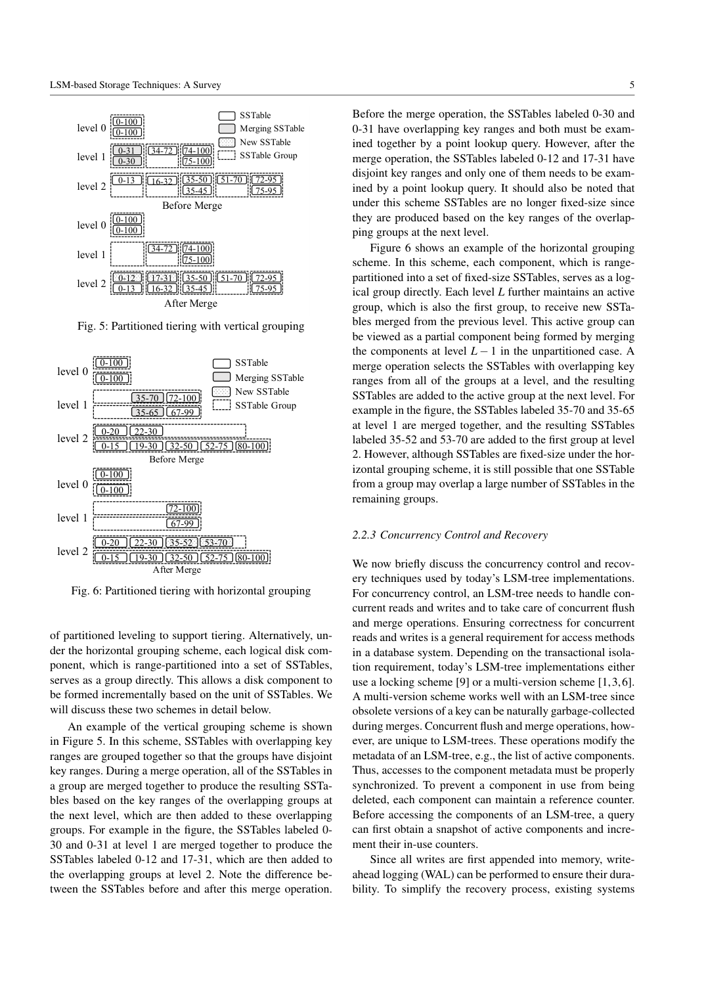
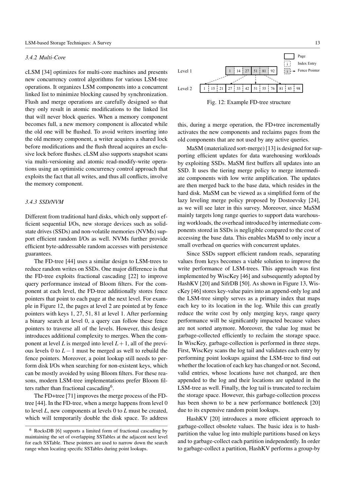

> 本组第 61 篇 · 存储结构与索引 · [全部论文]() · [上一篇]() · [下一篇]()

这是一份2019年的机制地图，不是所有LSM方案的统一跑分。它把写放大、归并实现、硬件、特殊负载、自动调优和二级索引放到共同读写空间代价框架中，尤其批评“只胜过未调优默认配置”不足以证明新结构价值。

报告补充25段原文精读，重点区分leveling/tiering与文件分区、每键过滤器内存与绝对内存、物理结构并发与事务语义。读者有限例实际重现了更新后错误过滤导致旧值复活，以及旧二级索引时间戳验证；没有新跑原系统性能数据。

本文保留论文陈述、读者推断与待验证方案的区别；实验数字只适用于原文条件。原文和翻译来自已有 AI 辅助精读报告，已做来源匹配与编辑复核，不等于人工逐项核验或独立实验复现。所有页码均为 PDF 物理页。

## 论文与阅读范围

Chen Luo, Michael J. Carey. LSM-based Storage Techniques: A Survey. 本地arXiv1812.07527v3，2019-07-19，25页；物理页码与正文编号一致，不猜测最终刊物元数据。

[论文集中的原始 PDF](https://github.com/lonng/db-papers/blob/4ff1331069c7cf52ac97dd769e5f484c1c35c200/papers/storage-structure/lsm-based-storage-techniques%3A-a-survey.pdf) · 本地来源：`storage-structure/lsm-based-storage-techniques_-a-survey.pdf`，共 25 页。

本篇保留 35 组原文精读和 63 条证据。截图为原始 PDF 的局部页选，不是重新生成的图表；未将整份 PDF 复制到博客。

## 研究问题与适用边界

**统一比较坐标，不统一制造冠军**
LSM先接收内存更新，再把后台归并成本摊到多条记录。其代价是跨分量检索、旧版本空间与突发后台工作。综述用六类组织研究：写放大、归并实现、硬件、特定负载、自动调优、二级索引；Table2允许主/次类别，不是互斥标签。

最有价值的批评是实验基线：许多新结构只与默认T=10的leveling LevelDB/RocksDB比较。先降低T或改tiering也可能提高写吞吐，所以不能把提高写吞吐本身都归功于新机制。作者建议先调到相近写吞吐，再比较查询与空间。

这是一份有模型与定性综合的综述，不是新增统一实现，本文也没逐个读取所有参考文献或2026版产品源码。

依据：读者推断；PDF 物理页 3, 6, 10, 23。证据：[LS01](#evidence-ls01), [LS08](#evidence-ls08), [LS13](#evidence-ls13), [LS25](#evidence-ls25)。

## 系统架构与核心组件

**策略、分区、组件索引是三个维度**
原始rolling merge与常见不可变磁盘分量的“构建新结果再发布”应分开。内存分量可用并发skip-list/B+-tree，磁盘可用页树或带index block的SSTable，不能把“LSM”缩成一种固定节点形式。

leveling每层一个逻辑分量，tiering每层最多T个；这与是否把分量分成多个文件并非同一轴。垂直分组把重叠SSTable聚成键域不交的组，组内仍重叠，按下层组边界产出文件可能不固定大小。水平分组把一次逻辑run切成固定大小文件作为一组，不同组仍可能重叠，以active group增量接收结果。

图3、5、6是机制示意，不是结果曲线。点查询从新到旧遇首个有效版本停止；范围查以优先队列协调多个分量及删除标记。每个文件内部有序不等于拼接输出全局正确。

依据：读者推断；PDF 物理页 3, 5。证据：[LS01](#evidence-ls01), [LS02](#evidence-ls02), [LS03](#evidence-ls03), [LS04](#evidence-ls04)。

*原论文 PDF 物理页 5，版权归原作者或出版方。点击图片可查看原尺寸。页面文本中定位到：Fig. 5: Partitioned tiering with vertical grouping；Fig. 6: Partitioned tiering with horizontal grouping；Figure 6 shows an example of the horizontal grouping。这是页面定位信息，不表示本次已复核图内所有数据。*

## 核心算法与优化机制

**优化常把工作挪到别处**
Bloom filter给点查否定剪枝；理想10bits/key、7hash的有限算术约0.819%误报，不是本机实测或当前产品默认。它不直接解决范围查询。Skip-tree跳过中间归并仅在这些层不存在同键时安全，另需mutable-buffer日志与原文件引用保留。

TRIAD保留热键以减少反复flush，但仍把热键复制到新日志，且直接拿日志作分量会让值无序而损害范围读。VT stitching复用不重叠页减少读拷贝，带来碎片与过滤器构建问题；这里是所述设计的约束，不是证明所有Bloom filter都不能合并。LSbM留旧文件保热点缓存，也可能增加冷读、范围读及空间工作。

KV separation让LSM只维护键与值日志位置，降低重复搬值，但范围读需散取值，GC还要验证、复制和更新位置。cLSM原子发布列表也仍有写者共享锁与flush排他锁；不能一概改写为无锁引擎。

依据：读者推断；PDF 物理页 10, 11, 13。证据：[LS11](#evidence-ls11), [LS12](#evidence-ls12), [LS14](#evidence-ls14), [LS15](#evidence-ls15), [LS16](#evidence-ls16), [LS17](#evidence-ls17)。

## 正确性、不变量与一致性保证

**不可变数据不免除可达性、版本和恢复协议**
查询需取得活跃分量快照并增加引用；发布新版本后，被旧查询引用的输入文件不能立刻删除。事务隔离又是另一层，综述分别讨论锁或多版本。WAL恢复“只REDO不UNDO”依赖no-steal、所有活跃写事务结束后才flush，不是任意LSM都天然如此。

未分区分量可用不相交时间范围重建，但分区后多个键域共同覆盖同一时间段，须记录文件结构变化。这个概述并非完整崩溃原子性规范，不能只凭墙钟挑最大范围文件并删其他文件。

**更新与过滤的微妙反例**
磁盘k1有T1旧值，内存改成T4；若过滤器只覆盖新记录T3..T4，查T<=T2会剪掉内存而返回旧k1。必须覆盖旧值T1与新值T4，让协调看见更新。有限Python例实际返回错误[k1,k2]与正确[k2]。

二级索引延后清理可用主键+时间戳验证旧候选；这能排除旧Alice索引，却不能凭空补出异步队列尚未写入的Bob索引。快照、更新可见性与漏候选语义仍要由具体协议定义，不以“验证过”替代完整一致性论证。

依据：读者推断；PDF 物理页 3, 5, 6, 18, 19, 23。证据：[LS02](#evidence-ls02), [LS05](#evidence-ls05), [LS06](#evidence-ls06), [LS07](#evidence-ls07), [LS21](#evidence-ls21), [LS22](#evidence-ls22), [LS24](#evidence-ls24)。

## 实验评估与工作负载分析

**综述的比较和本次的执行分开记账**
Table1是简化I/O模型，Table3是相对leveling的定性性能箭头；Write向上表示写性能改善，Space向下表示空间利用变差，不是空间放大数值下降、也不是量化倍数。被综述论文的结果属于二手综述归纳，不应混进本次测量。

本次只执行qa/lsm-survey-reader-tests.json中的有限例：更新过滤反例、二级索引旧时间戳剔除，以及理想Bloom公式算术。没有跑LevelDB/RocksDB、写放大、SSD寿命、吞吐、GC或尾延迟基准，也没有验证全部被引算法。

重新做实验应固定数据集、持久化、总内存与后台带宽；把过滤器、缓存、压缩、值日志、临时归并及空间算在同一预算内。既比较各自默认，也比较公平调优和同写吞吐点，负载覆盖点负查询、成功查询、短/长范围、热点、更新、删除及非覆盖二级查。

依据：待验证的工程设想；PDF 物理页 6, 10, 11, 13, 23。证据：[LS08](#evidence-ls08), [LS09](#evidence-ls09), [LS10](#evidence-ls10), [LS13](#evidence-ls13), [LS15](#evidence-ls15), [LS17](#evidence-ls17), [LS25](#evidence-ls25)。

*原论文 PDF 物理页 13，版权归原作者或出版方。点击图片可查看原尺寸。页面文本中定位到：Fig. 12: Example FD-tree structure。这是页面定位信息，不表示本次已复核图内所有数据。*

## 设计权衡与工程折中

**读写空间模型的适用范围**
原模型以未分区LSM和每页条目数B描述成本，L层、比率T：leveling写约O(TL/B)，tiering约O(L/B)；没有过滤器时点读约L与TL个分量。范围读不能只靠Bloom省略不匹配文件，长范围主要由输出扫描量与版本放大主导。

成功点查O(1)是误报很小的实用近似，不是任意层数、任意误报事件和全CPU/时延工作的最坏上界。空间放大在此是全部条目/唯一条目，非含WAL、临时文件、压缩、快照的磁盘字节比。RUM在这里是猜想/设计权衡框架，不是本报告证明的所有数据结构不可能定理。

Monkey纠正统一bits/key的浪费：较小、靠内存的分量可分更高每键bits，令其误报更低；最大层绝对内存多不等于每键预算也应最高。Dostoevsky把上层tiering与末层leveling结合，在某些负载更优但短范围仍可变差；Lim的模型先验知道键分布，动态漂移会改变估计。

优化不是只减小一个参数。CPU、缓存、GC、读候选、空间和排队都可能接手被省掉的工作，综述也把波动及系统调优列为开放方向。

依据：读者推断；PDF 物理页 6, 10, 16。证据：[LS08](#evidence-ls08), [LS09](#evidence-ls09), [LS10](#evidence-ls10), [LS13](#evidence-ls13), [LS18](#evidence-ls18), [LS19](#evidence-ls19), [LS20](#evidence-ls20)。

## 系统对比与相关工作定位

**按瓶颈选比较对象，而非按项目名排榜**
写放大类要比同吞吐下查询与空间；merge类要分归并CPU/I/O、缓存切换和前台延迟；硬件类要计GC、持久化屏障、设备预算；二级索引类要计主表回取、候选验证与清理。KV分离对大值可能有意义，但不能据键索引缩小直接推导任意范围读更快。

2019年的LevelDB、RocksDB、HBase、Cassandra、AsterixDB段落是实现举例，不是2026年安装选型结论。AsterixDB单分区记录级索引一致也不能扩大为全局可串行化。局部二级索引节约写通信，却可能让按二级键查找fan-out；全局索引改变路由及维护通信，非LSM独有取舍。

统计也有merge契约：等宽等可合并摘要先合并，不可合并的保留多份以估基数，不能把所有synopsis当普通数组相加。

依据：读者推断；PDF 物理页 10, 13, 19, 23。证据：[LS13](#evidence-ls13), [LS17](#evidence-ls17), [LS22](#evidence-ls22), [LS23](#evidence-ls23), [LS24](#evidence-ls24)。

## 复现指南与验证建议

**先验证语义，再公平测性能**
第一层实现小数据模型，区分逻辑run与物理文件，复现新旧版本、墓碑、垂直/水平分组及文件发布回收。对过滤器的更新扩界、异步二级漏候选与旧候选验证分别测试。已执行的两个有限例不足以代表数据库事务或崩溃正确。

第二层固定总预算，做leveling/tiering及不同T、文件大小、分组的参数扫描；记录实际写读字节、版本空间、峰值临时空间和前台排队。点读分成功/失败，范围分长短；每个方案给同吞吐点与延迟分位数，不仅平均ops/s。

第三层核对每个拟采用机制的原论文和具体源码版本，定义WAL、元数据发布、引用回收与故障注入。KV日志或NVM设备必须补齐持久化与GC边界。综述本身没有提供这些方案的统一可执行实现，以上是未执行计划，不伪装成复现完成。

依据：待验证的工程设想；PDF 物理页 5, 6, 10, 13, 18, 19, 23。证据：[LS05](#evidence-ls05), [LS06](#evidence-ls06), [LS07](#evidence-ls07), [LS13](#evidence-ls13), [LS17](#evidence-ls17), [LS21](#evidence-ls21), [LS22](#evidence-ls22), [LS25](#evidence-ls25)。

## 总结与工程启示

这篇综述的主要价值是共同成本语言与公平评价问题，而非找出一个适合所有工作负载的LSM结构。读者应将写放大、文件分组、过滤器内存、元数据生命期和多索引维护放在同一个预算与语义契约下。

新增25段逐句原文、译文、技术解释、误读提醒与读者例，保留2019历史范围、调优基线和未复现边界。后续真正落地需要选定实现版本、补读原研究并执行工作负载及故障测试，不能用此综述的箭头表替代。

依据：读者推断；PDF 物理页 3, 5, 10, 18, 19, 23。证据：[LS01](#evidence-ls01), [LS05](#evidence-ls05), [LS13](#evidence-ls13), [LS21](#evidence-ls21), [LS22](#evidence-ls22), [LS25](#evidence-ls25)。

## 原文精读：从句子回到机制

以下保留原文、忠实翻译、含义与边界；假设示例不作为论文实验结果。

### P001 · PDF 物理页 1

**原文**

<blockquote class="paper-source-quote"><pre><code>We then present the various improvements in&#10;detail and discuss their strengths and trade-offs. To reflect&#10;how LSM-trees are being used in real systems, we further&#10;survey five representative LSM-based open-source NoSQL&#10;systems, including LevelDB [4], RocksDB [6], HBase [3],&#10;Cassandra [1], and AsterixDB [9]. Finally, we also identify&#10;several interesting future research directions as the result of&#10;categorizing the existing LSM-tree improvements.</code></pre></blockquote>

**忠实翻译**

> 然后我们详细展示各种改进并讨论它们的优势与权衡。为了反映 LSM-tree 在真实系统中的使用方式，我们进一步调研了五个具有代表性的基于 LSM 的开源 NoSQL 系统，包括 LevelDB [4]、RocksDB [6]、HBase [3]、Cassandra [1] 和 AsterixDB [9]。最后，作为对现有 LSM-tree 改进进行分类的结果，我们还确定了几个有趣的未来研究方向。

**技术含义与边界**

> 原文陈述了该综述论文的组织结构：先详述改进与权衡，再调研五个具体系统以反映实际使用情况，最后基于分类提出未来方向。读者可推断这五个系统被作者选为代表性样本，但原文未声称它们覆盖了所有生产场景。适用边界限于该论文自身的章节安排。

**常见误读**

> 五系统是2019年综述的代表性样本，不代表全部生产系统，也不表示已统一实测所有改进。其默认参数与产品能力不能当2026年现状。

**读者构造的假设示例**

> 读者构造的假设示例：假设某研究者想了解 LSM-tree 在键值存储中的工程实践，他可能会参考该段落提到的 LevelDB 和 RocksDB 作为起点，但这并不意味着这两个系统在所有工作负载下都优于 HBase 或 Cassandra。

### P002 · PDF 物理页 25

**原文**

<blockquote class="paper-source-quote"><pre><code>LSM-based Storage Techniques: A Survey&#10;25&#10;35. Guttman, A.: R-trees: A dynamic index structure for spatial&#10;searching. In: ACM SIGMOD, pp. 47–57 (1984)&#10;36. Haerder, T., Reuter, A.: Principles of transaction-oriented database&#10;recovery. ACM CSUR 15(4), 287–317 (1983)&#10;37.</code></pre></blockquote>

**忠实翻译**

> 第25页参考文献片段：Guttman的R-tree空间索引论文，以及Haerder、Reuter的面向事务数据库恢复原则论文；第37条仅起始编号。

**技术含义与边界**

> 这是书目导航，不是在这一段提供R-tree算法或恢复协议。本次没有独立阅读这两份外部来源。

**常见误读**

> 容易将参考文献条目误读为正文的技术主张，例如认为本文采用了 R-tree 索引或特定的恢复协议。原文此处仅为引用列表，未陈述任何技术机制或结论。

**读者构造的假设示例**

> 读者核查路线：要分析no-steal依据，应从正文的策略前提出发再读恢复参考；不能据书目标题认定完成了实现或证明。

### P003 · PDF 物理页 12

**原文**

<blockquote class="paper-source-quote"><pre><code>Similarly, such immutable memory components can&#10;be merged via in-memory merge operations to improve query&#10;performance and reclaim space occupied by obsolete en-&#10;tries. Note that in-memory flush and merge operations do&#10;not involve any disk I/O, which reduces the overall disk I/O&#10;cost by leveraging large memory.</code></pre></blockquote>

**忠实翻译**

> 类似地，这种不可变的内存组件可以通过内存合并（in-memory merge）操作进行合并，以提高查询性能并回收被过时条目占用的空间。注意，内存刷写（flush）和合并（merge）操作不涉及任何磁盘 I/O，这通过利用大内存降低了整体磁盘 I/O 成本。

**技术含义与边界**

> 这里是Accordion式多层内存组件的in-memory flush/merge，能够回收被遮蔽旧版本并减少之后的磁盘工作；不是数据库无需日志或永不写盘。

**常见误读**

> 容易泛化为“使用大内存后 LSM-tree 完全没有磁盘 I/O”。原文明确限定为“in-memory flush and merge operations do not involve any disk I/O”，即只有这部分操作免除了磁盘 I/O，最终持久化仍可能需要磁盘写入。

**读者构造的假设示例**

> 读者例：多个内存分量重复更新同一键时，合并可在落盘前丢弃被覆盖版本。若全是不同键，单纯把两个文件合成一个，并不保证写出的总数据字节减少；收益须分离测量。

### P004 · PDF 物理页 18

**原文**

<blockquote class="paper-source-quote"><pre><code>Filters [11] augment each component of the primary and&#10;secondary indexes with a filter to enable data pruning based&#10;on a filter key during query processing. A filter stores the&#10;minimum and maximum values of the chosen filter key for&#10;the entries in a component. Thus, a component can be pruned&#10;by a query if the search condition is disjoint with the mini-&#10;mum and maximum values of its filter.</code></pre></blockquote>

**忠实翻译**

> Filters [11] 为主索引和二级索引的每个组件增加一个过滤器，以便在查询处理期间基于过滤键（filter key）进行数据剪枝。过滤器存储组件中条目所选过滤键的最小值和最大值。因此，如果搜索条件与其过滤器的最小值和最大值不相交（disjoint），则查询可以剪除该组件。

**技术含义与边界**

> 这是按filter-key的组件min/max剪枝，不要求它就是索引键。查询区间与安全覆盖范围不交时可否定，交叠时仍不确定。

**常见误读**

> Bloom也不精确确认存在，只保证正确构建时否定安全。Min/max同样能否定区间外的点，不能说不支持任何点查否定；更新/删除时还要覆盖旧值，否则可能剪掉遮蔽旧记录的新分量。

**读者构造的假设示例**

> 读者例：范围[10,50]可否定点100，却不能确认点30存在。已执行T1→T4更新例还表明过滤范围须涵盖旧值，才能避免旧磁盘值复活。

### P005 · PDF 物理页 16

**原文**

<blockquote class="paper-source-quote"><pre><code>ElasticBF then dynamically ac-&#10;tivates and deactivates these Bloom filters based on the ac-&#10;cess frequency to minimize the total amount of extra I/O.&#10;Their experiments reveal that ElasticBF is mainly effective&#10;when the overall Bloom filter memory is very limited, such&#10;as only 4 bits per key on average. In this case, the disk&#10;I/Os caused by the Bloom filter false positives will be dom-&#10;inant.</code></pre></blockquote>

**忠实翻译**

> ElasticBF 随后根据访问频率动态激活和停用这些 Bloom 过滤器，以最小化额外 I/O 的总量。他们的实验表明，ElasticBF 主要在整体 Bloom 过滤器内存非常有限时有效，例如平均每个键仅有 4 bits。在这种情况下，由 Bloom 过滤器假阳性引起的磁盘 I/O 将占据主导地位。

**技术含义与边界**

> 这是综述转述ElasticBF研究的实验，不是本综述重新跑出的结果。将总bits/key拆成多个小filter单元，按热度选择激活组合，以减少误报造成的I/O。

**常见误读**

> 容易将“在内存受限时有效”泛化为“在任何内存配置下都能提升性能”。原文使用了“mainly effective when... very limited”这一强限定条件，暗示在内存充裕、假阳性率本身就很低的情况下，ElasticBF 的动态管理收益可能不明显甚至带来额外开销。

**读者构造的假设示例**

> 读者说明：有限预算下，热组件可激活更多小filter单元而冷组件更少；这不意味着所有冷filter内存自动释放并转成任意更大的热filter。4BPK和10BPK效果差异是所述论文条件，非本机测量。

### P006 · PDF 物理页 6

**原文**

<blockquote class="paper-source-quote"><pre><code>6&#10;Chen Luo, Michael J. Carey&#10;typically employ a no-steal buffer management policy [36].&#10;That is, a memory component can only be flushed when all&#10;active write transactions have terminated. During recovery&#10;for an LSM-tree, the transaction log is replayed to redo all&#10;successful transactions, but no undo is needed due to the&#10;no-steal policy.</code></pre></blockquote>

**忠实翻译**

> 6
> Chen Luo, Michael J. Carey
> 通常采用 no-steal 缓冲区管理策略 [36]。也就是说，只有当所有活跃的写事务都已终止时，内存组件才能被刷写。在 LSM-tree 的恢复过程中，重放事务日志以重做（redo）所有成功的事务，但由于 no-steal 策略，不需要撤销（undo）。

**技术含义与边界**

> 不需数据UNDO源自no-steal：未提交事务不进入持久数据分量。WAL本身仍可能包含未提交日志，恢复须识别成功事务再REDO；“未进SSTable”不同于“任何字节都没落盘”。

**常见误读**

> 容易误认为 LSM-tree 绝对不需要 undo 操作是因为其 append-only 特性本身。原文将“no undo is needed”明确归因于“due to the no-steal policy”，即这是缓冲区管理策略的结果，而非仅仅因为数据结构是 out-of-place 的。如果采用 steal 策略，则可能需要 undo。

**读者构造的假设示例**

> 读者例：T1未提交时日志可能已持久，但内存分量在其结束前不flush；崩溃后只重做已提交的T2，而不是把T1的日志存在当已提交数据。具体日志/事务协议仍需实现验证。

### P007 · PDF 物理页 22

**原文**

<blockquote class="paper-source-quote"><pre><code>The motivation is that the maximum page&#10;size is limited to 4GB, but the index page of a huge com-&#10;ponent (stored as a single SSTable) could exceed this size&#10;limit. However, during large merges the disk space may still&#10;be temporarily doubled since RocksDB treats each SSTable&#10;group as a whole and only deletes old SSTables when the&#10;merge operation is fully completed. In the FIFO merge pol-&#10;icy, components are not merged at all, but old components&#10;will be deleted based on a specified lifetime.</code></pre></blockquote>

**忠实翻译**

> 动机是最大页面大小限制为 4GB，但巨大组件（作为单个 SSTable 存储）的索引页可能超过此大小限制。然而，在大型合并期间，磁盘空间可能仍会暂时翻倍，因为 RocksDB 将每个 SSTable 组视为一个整体，并且仅在合并操作完全完成时才删除旧的 SSTable。在 FIFO 合并策略中，组件根本不进行合并，而是根据指定的生命周期删除旧组件。

**技术含义与边界**

> 综述描述2019时点的分组tiering及4GB索引页限制；旧组等整次归并结束才删除会增加临时空间。FIFO按寿命删文件是另一种语义，不是任意键历史均可安全丢弃。

**常见误读**

> “可能暂时翻倍”不是所有归并普遍精确2倍，也不是当前RocksDB所有版本与策略的结论。FIFO不做merge不代表整个引擎没有文件切换、保留数据风险或任何峰值空间。

**读者构造的假设示例**

> 读者算术：旧输入20GB、无去重时新输出也20GB且输入暂留，归并工作集峰值约40GB，相对输入约2倍；若输出因重复版本变10GB，则30GB是1.5倍，不能拿它说明精确翻倍。

### P008 · PDF 物理页 3

**原文**

<blockquote class="paper-source-quote"><pre><code>In practice, for a stable&#10;workload where the volume of inserts equal the volume of&#10;deletes, the total number of levels remains static3. In general,&#10;the leveling merge policy optimizes for query performance&#10;since there are fewer components to search in the LSM-tree.&#10;The tiering merge policy is more write optimized since it re-&#10;duces the merge frequency. We will discuss the performance&#10;of these two merge policies further in Section 2.3.</code></pre></blockquote>

**忠实翻译**

> 在实践中，对于插入量等于删除量的稳定工作负载，总层数保持静态3。一般来说，leveling 合并策略优化查询性能，因为在 LSM-tree 中需要搜索的组件更少。tiering 合并策略更偏向写优化，因为它降低了合并频率。我们将在第 2.3 节进一步讨论这两种合并策略的性能。

**技术含义与边界**

> 作者在稳定数据量与容量模型下把L近似为常数，用它比较策略。真实系统还受记录字节大小、墓碑清理、快照保留、GC与配置影响。

**常见误读**

> 容易将“总层数保持静态”泛化为所有工作负载下的保证。原文严格限定了前提：“for a stable workload where the volume of inserts equal the volume of deletes”。若插入远大于删除，层数通常会增长。此外，“optimizes for query performance”是相对定性描述，不代表绝对延迟数值。

**读者构造的假设示例**

> 读者例：相同大小记录持续等量插删、历史能及时清理、配置不变时，可维持相近活跃容量。仅每秒插1000删1000并不足以保证层数恒定，因为删除项和旧版本可能暂留，键值大小也可不同。

### P009 · PDF 物理页 10

**原文**

<blockquote class="paper-source-quote"><pre><code>Moreover, since merge&#10;skipping essentially reduces some merges at the intermedi-&#10;ate levels, it is not clear how the skip-tree would compare&#10;against a well-tuned LSM-tree by reducing the size ratio.&#10;3.2.3 Exploiting Data Skew&#10;TRIAD [16] reduces write amplification for skewed update&#10;workloads where some hot keys are updated frequently.</code></pre></blockquote>

**忠实翻译**

> 此外，由于合并跳过（merge skipping）本质上减少了中间层级的一些合并，目前尚不清楚 skip-tree 与通过减小大小比（size ratio）进行良好调优的 LSM-tree 相比表现如何。
> 3.2.3 利用数据倾斜
> TRIAD [16] 针对某些热键被频繁更新的倾斜更新工作负载，降低了写放大。

**技术含义与边界**

> 对skip-tree和已调优LSM的优劣，作者明确说尚不清楚；此处不能断言新算法无效。上下文机制已在正文介绍，包括无中间同键与可变缓冲WAL条件。

**常见误读**

> 容易误读为作者断言 skip-tree 无效或不如调小 size ratio。原文使用的是“it is not clear how... would compare”，表达的是一种未知的研究空白或不确定性，而非否定性结论。同样，原文仅陈述 TRIAD 的目标，未给出其实际效果的量化保证。

**读者构造的假设示例**

> 读者方案：扫描T与merge-policy参数，在相近写吞吐比较读、空间及维护复杂度；T降低通常增层，但总TL、分区重叠与缓存代价一起变化，不能一句“每层少合并”替代实测。

### P010 · PDF 物理页 2

**原文**

<blockquote class="paper-source-quote"><pre><code>Moreover, in-&#10;dex pages can be fragmented by updates and deletes, thus&#10;reducing the space utilization.&#10;In contrast, an out-of-place update structure, such as an&#10;LSM-tree, always stores updates into new locations instead&#10;of overwriting old entries. For example in Figure 1b, the up-&#10;date (k1, v4) is stored into a new place instead of updating&#10;the old entry (k1, v1) directly.</code></pre></blockquote>

**忠实翻译**

> 此外，索引页可能因更新和删除而碎片化，从而降低空间利用率。
> 相比之下，异地更新（out-of-place update）结构（如 LSM-tree）总是将更新存储到新位置，而不是覆盖旧条目。例如图 1b 中，更新 (k1, v4) 被存储到一个新位置，而不是直接更新旧条目 (k1, v1)。

**技术含义与边界**

> 原文对比了原地更新（in-place update）结构与 LSM-tree 的核心差异。原地更新结构在发生更新和删除时会导致索引页碎片化和空间利用率下降；LSM-tree 作为 out-of-place update 结构，通过将新版本写入新位置来避免直接覆盖。原文提及了“Figure 1b”作为示例说明。

**常见误读**

> 容易将“总是将更新存储到新位置”误解为 LSM-tree 永远不会产生空间浪费或碎片。原文仅说明避免了“overwriting old entries”导致的索引页碎片化，但 out-of-place 写入会产生旧版本垃圾数据，需要通过 compaction 回收，这在原文此段中未提及，不应推断为无代价。

**读者构造的假设示例**

> 读者构造的假设示例：假设 B+ 树中键 k1 的值从 v1 更新为 v4，若 v4 比 v1 长，可能导致节点分裂和碎片；而在 LSM-tree 中，(k1, v4) 直接追加到 memtable 的新位置，旧记录 (k1, v1) 保留在底层 SSTable 中等待后续合并清理。此为读者构造的假设示例，用于辅助理解 out-of-place 概念。

### LSM-SURVEY-01 · PDF 物理页 3

**原文**

<blockquote class="paper-source-quote"><pre><code>Multiple disk components&#10;are merged2 together into a new one without modifying ex-&#10;isting components. This is different from the rolling merge&#10;process proposed by the original LSM-tree [52].</code></pre></blockquote>

**忠实翻译**

> 多个磁盘分量归并成新的分量，不修改已有分量；这与原始LSM的rolling merge不同。

**技术含义与边界**

> 历史沿革与当前常见文件机制须分开。

**常见误读**

> 原始LSM不等于今日所有不可变SSTable实现。

**读者构造的假设示例**

> 读者例：读者持有旧分量时，新归并结果可先构造后切换，旧文件回收仍需安全协议。

### LSM-SURVEY-02 · PDF 物理页 3

**原文**

<blockquote class="paper-source-quote"><pre><code>A query over an LSM-tree has to search multiple com-&#10;ponents to perform reconciliation, that is, to find the latest&#10;version of each key. A point lookup query, which fetches&#10;the value for a specific key, can simply search all compo-&#10;nents one by one, from newest to oldest, and stop immedi-&#10;ately after the first match is found. A range query can search&#10;all components at the same time, feeding the search results&#10;into a priority queue to perform reconciliation.</code></pre></blockquote>

**忠实翻译**

> 查询需检索多个分量并协调以找到各键的最新版本；范围结果可通过优先队列协调。

**技术含义与边界**

> 不能只看文件有序性，跨分量版本与墓碑仍需处理。

**常见误读**

> 逐文件独立输出会重复或复活旧值。

**读者构造的假设示例**

> 读者例：新分量删除k，旧分量保留k，范围归并应输出零条k而非旧值。

### LSM-SURVEY-03 · PDF 物理页 5

**原文**

<blockquote class="paper-source-quote"><pre><code>In this scheme, SSTables with overlapping key&#10;ranges are grouped together so that the groups have disjoint&#10;key ranges.</code></pre></blockquote>

**忠实翻译**

> 垂直分组把键域重叠的SSTable放在一起，使组与组的键域不相交。

**技术含义与边界**

> 不相交的是组，不是组内所有文件。

**常见误读**

> 不能据此说整个level的所有SSTable天然互不重叠。

**读者构造的假设示例**

> 图5中0-30与0-31同组，点查可能需检查两者。

### LSM-SURVEY-04 · PDF 物理页 5

**原文**

<blockquote class="paper-source-quote"><pre><code>each component, which is range-&#10;partitioned into a set of fixed-size SSTables, serves as a log-&#10;ical group directly.</code></pre></blockquote>

**忠实翻译**

> 水平分组中，每个分量被范围分成固定大小SSTable，并直接充当一个逻辑组。

**技术含义与边界**

> 同组文件范围可分开，但不同组仍可覆盖相同键。

**常见误读**

> 固定文件大小不保证不同组之间无重叠。

**读者构造的假设示例**

> 图6中35-70与35-65可跨组参与归并。

### LSM-SURVEY-05 · PDF 物理页 5

**原文**

<blockquote class="paper-source-quote"><pre><code>Thus, accesses to the component metadata must be properly&#10;synchronized. To prevent a component in use from being&#10;deleted, each component can maintain a reference counter.&#10;Before accessing the components of an LSM-tree, a query&#10;can first obtain a snapshot of active components and incre-&#10;ment their in-use counters.</code></pre></blockquote>

**忠实翻译**

> 分量元数据访问须正确同步；查询先取活跃分量快照并增加引用计数，以免正在用的分量被删除。

**技术含义与边界**

> 不可变内容与可变可达性/生命周期不同。

**常见误读**

> 不可变文件不是无锁或不需并发控制。

**读者构造的假设示例**

> 读者例：发布新文件列表后，仍被旧查询引用的输入文件不能立即删除。

### LSM-SURVEY-06 · PDF 物理页 6

**原文**

<blockquote class="paper-source-quote"><pre><code>During recovery&#10;for an LSM-tree, the transaction log is replayed to redo all&#10;successful transactions, but no undo is needed due to the&#10;no-steal policy.</code></pre></blockquote>

**忠实翻译**

> 恢复时重做成功事务，无需UNDO，这是no-steal策略的结果。

**技术含义与边界**

> 前句要求所有活跃写事务结束后才允许flush。

**常见误读**

> 不能把任何内存先写的数据库都概括为只需REDO。

**读者构造的假设示例**

> 读者例：若未提交数据已进入持久分量，就需另论其可见性与撤销机制。

### LSM-SURVEY-07 · PDF 物理页 6

**原文**

<blockquote class="paper-source-quote"><pre><code>For partitioned LSM-trees,&#10;this timestamp-based approach does not work anymore since&#10;each component is further range-partitioned. To address this,&#10;a typical approach, used in LevelDB [4] and RocksDB [6],&#10;is to maintain a separate metadata log to store all changes&#10;to the structural metadata, such as adding or deleting SSTa-&#10;bles. The state of the LSM-tree structure can then be recon-&#10;structed by replaying the metadata log during recovery.</code></pre></blockquote>

**忠实翻译**

> 分区LSM不能直接用上述时间戳办法；典型做法单独记录结构元数据变化，恢复时重放。

**技术含义与边界**

> 数据WAL与文件集合的版本记录是不同职责。

**常见误读**

> 不能按最大墙钟范围就随意删掉其他分片文件。

**读者构造的假设示例**

> 读者例：同一时间区间被分成多个键域文件，必须共同可达才覆盖全部键。

### LSM-SURVEY-08 · PDF 物理页 6

**原文**

<blockquote class="paper-source-quote"><pre><code>This analysis considers&#10;an unpartitioned LSM-tree and represents a worst-case cost.</code></pre></blockquote>

**忠实翻译**

> 该分析考虑未分区LSM，并以最坏情况成本为出发点。

**技术含义与边界**

> 正文还以页内条目数B、内存页数P及稳定层数建立模型。

**常见误读**

> 不能把它当任意分区并发实现的实测尾延迟。

**读者构造的假设示例**

> 读者例：同样的磁盘I/O数在缓存命中、压缩和排队不同情况下可有不同耗时。

### LSM-SURVEY-09 · PDF 物理页 6

**原文**

<blockquote class="paper-source-quote"><pre><code>Given&#10;that in practice the Bloom filter false positive rate is much&#10;smaller than 1, the successful point lookup I/O cost for both&#10;leveling and tiering will be O(1).</code></pre></blockquote>

**忠实翻译**

> 由于实践中Bloom误报率远小于1，作者将成功点查的I/O成本写为O(1)。

**技术含义与边界**

> 这里包含小误报率的实用近似。

**常见误读**

> 不是数学上对任意L、所有误报事件及CPU工作的恒定上界。

**读者构造的假设示例**

> 读者例：一个实际查询可能遇到多个误报文件，并非严格只读一页。

### LSM-SURVEY-10 · PDF 物理页 6

**原文**

<blockquote class="paper-source-quote"><pre><code>which is defined as the overall number of entries di-&#10;vided by the number of unique entries5.</code></pre></blockquote>

**忠实翻译**

> 空间放大定义为全部条目数除以唯一条目数。

**技术含义与边界**

> 脚注说明改了旧定义，使该比值至少为1。

**常见误读**

> 不要直接与包含WAL、临时归并、压缩等的磁盘字节比混用。

**读者构造的假设示例**

> 读者例：两个版本的同一键给条目比2，但其压缩后字节数不必刚好翻倍。

### LSM-SURVEY-11 · PDF 物理页 10

**原文**

<blockquote class="paper-source-quote"><pre><code>To ensure correctness, a key from&#10;level L can be pushed to level L + K only if this key does&#10;not appear in any of the intermediate levels L + 1,··· ,L +&#10;K −1. This condition can be tested efficiently by checking&#10;the Bloom filters of the intermediate levels.</code></pre></blockquote>

**忠实翻译**

> 正确跳层要求该键不出现在任何中间层，可检查中间层Bloom filter。

**技术含义与边界**

> 安全的否定可以证明不存在，误报通常只是阻止优化机会。

**常见误读**

> 不能发现某层可能有键还无视版本顺序跳过去。

**读者构造的假设示例**

> 读者例：上层新值若跨过中间层删除标记而排序失当，会复活已删数据。

### LSM-SURVEY-12 · PDF 物理页 10

**原文**

<blockquote class="paper-source-quote"><pre><code>Even though&#10;hot keys are not flushed to disk, they are periodically copied&#10;to a new transaction log so that the old transaction log can be&#10;reclaimed.</code></pre></blockquote>

**忠实翻译**

> 热键不flush到磁盘分量，但会定期复制到新事务日志以回收旧日志。

**技术含义与边界**

> TRIAD减少的是反复写分量成本，不是放弃持久化。

**常见误读**

> 热数据留内存不等于不写WAL。

**读者构造的假设示例**

> 读者例：崩溃重启仍需从日志找回尚未flush的热键版本。

### LSM-SURVEY-13 · PDF 物理页 10

**原文**

<blockquote class="paper-source-quote"><pre><code>a default (un-&#10;tuned) configuration of LevelDB or RocksDB, which use the&#10;leveling merge policy with a size ratio of 10.</code></pre></blockquote>

**忠实翻译**

> 这些改进主要对比未调优的LevelDB/RocksDB默认配置，后者采用leveling、size ratio10。

**技术含义与边界**

> 这是综述对历史实验方法的批评。

**常见误读**

> 不能把对默认配置的优势说成战胜所有调优基线。

**读者构造的假设示例**

> 读者方案：先调出相同写吞吐，再比点查、范围读、空间和延迟波动。

### LSM-SURVEY-14 · PDF 物理页 11

**原文**

<blockquote class="paper-source-quote"><pre><code>First, it can&#10;cause fragmentation since pages are no longer continuously&#10;stored on disk.</code></pre></blockquote>

**忠实翻译**

> stitching可能造成碎片，因为页不再连续存于磁盘。

**技术含义与边界**

> 免读免拷贝归并把部分代价转到布局与后续访问。

**常见误读**

> 减少归并I/O不保证范围扫描整体变快。

**读者构造的假设示例**

> 读者例：相同范围若需跳多个不连续区段，读路径代价会变化。

### LSM-SURVEY-15 · PDF 物理页 11

**原文**

<blockquote class="paper-source-quote"><pre><code>However, this&#10;approach is mainly effective for skewed workloads where&#10;only a small range of keys are frequently accessed. It can in-&#10;troduce extra overhead for queries accessing cold data that&#10;are not cached, especially for range queries since they can-&#10;not benefit from Bloom filters.</code></pre></blockquote>

**忠实翻译**

> 保留旧SSTable改善缓存主要适用于热点偏斜；访问未缓存冷数据和范围查可有额外代价。

**技术含义与边界**

> LSbM延迟删除，不是免费多一份热缓存。

**常见误读**

> 不应称所有查询无额外I/O且无空间成本。

**读者构造的假设示例**

> 读者例：冷范围需协调缓冲旧文件与新文件，工作集和候选数增加。

### LSM-SURVEY-16 · PDF 物理页 13

**原文**

<blockquote class="paper-source-quote"><pre><code>To avoid writers inserting into&#10;the old memory component, a writer acquires a shared lock&#10;before modifications and the flush thread acquires an exclu-&#10;sive lock before flushes.</code></pre></blockquote>

**忠实翻译**

> 为免写入旧内存分量，写者修改前取共享锁，flush线程先取排他锁。

**技术含义与边界**

> cLSM减轻阻塞但这里仍有锁。

**常见误读**

> 原子链表修改不等于整个引擎lock-free。

**读者构造的假设示例**

> 读者例：查找可不被列表切换阻塞，写入与flush仍按专门协议协调。

### LSM-SURVEY-17 · PDF 物理页 13

**原文**

<blockquote class="paper-source-quote"><pre><code>While this can greatly&#10;reduce the write cost by only merging keys, range query&#10;performance will be significantly impacted because values&#10;are not sorted anymore.</code></pre></blockquote>

**忠实翻译**

> KV分离只归并键可降写成本，但值不再有序，范围查询性能会受影响。

**技术含义与边界**

> LSM中的指针有序不意味着值日志读取连续。

**常见误读**

> 不能只量key-index写放大就宣布整体读写都赢。

**读者构造的假设示例**

> 读者方案：分别计索引、值随机读取与垃圾回收的I/O。

### LSM-SURVEY-18 · PDF 物理页 16

**原文**

<blockquote class="paper-source-quote"><pre><code>The proposed model assumes a priori knowl-&#10;edge of the key distribution using a probability mass func-&#10;tion fX(k) that measures the probability that a specific key&#10;k is written by a write request.</code></pre></blockquote>

**忠实翻译**

> 该模型先验知道由概率质量函数刻画的键分布，即某个键被写入的概率。

**技术含义与边界**

> Lim等的最优选择建立在分布与成本估计上。

**常见误读**

> 不是对未知漂移负载零代价精确优化。

**读者构造的假设示例**

> 读者例：热点更换后要重估或明确模型失配误差。

### LSM-SURVEY-19 · PDF 物理页 16

**原文**

<blockquote class="paper-source-quote"><pre><code>To minimize the overall false positive rates&#10;across all of the Bloom filters, Monkey analytically shows&#10;that more bits should be allocated to the components at the&#10;lower levels so that the Bloom filter false positive rates will&#10;be exponentially increasing.</code></pre></blockquote>

**忠实翻译**

> 为最小化总体误报率，应向较低编号/较小分量分配更多bits，使Bloom误报率指数递增。

**技术含义与边界**

> 结合前文最大层占多数数据的论证，这里重点是每键bits/误报率分配，不是最大文件绝对内存总量。

**常见误读**

> 不要只翻译lower levels而混淆靠内存还是最底大层。

**读者构造的假设示例**

> 读者例：小分量可用更高bits/key，整体绝对字节仍可能少于巨型末层。

### LSM-SURVEY-20 · PDF 物理页 16

**原文**

<blockquote class="paper-source-quote"><pre><code>It&#10;is worth noting that the performance evaluation of Dosto-&#10;evsky [24] is very thorough; it was performed against well-&#10;tuned LSM-trees to show that Dostoevsky strictly dominates&#10;the existing LSM-tree designs under certain workloads.</code></pre></blockquote>

**忠实翻译**

> 作者指出Dostoevsky对比调优良好LSM，在某些负载上严格支配已有设计。

**技术含义与边界**

> 限定词certain workloads不能省略。

**常见误读**

> 混合策略不是所有短范围、热点和空间条件的万能冠军。

**读者构造的假设示例**

> 读者例：lazy leveling保留末层leveling，却增加上层分量，短范围可受损。

### LSM-SURVEY-21 · PDF 物理页 18

**原文**

<blockquote class="paper-source-quote"><pre><code>the filter of the&#10;memory component must be maintained based on both the&#10;old record and the new record so that future queries will not&#10;miss new updates.</code></pre></blockquote>

**忠实翻译**

> 更新/删除时，内存分量过滤器须根据旧记录和新记录共同维护，以免未来查询漏掉新更新。

**技术含义与边界**

> 过滤不能把负责遮蔽旧磁盘记录的新分量剪掉。

**常见误读**

> 只按新值扩大min/max会让旧值复活。

**读者构造的假设示例**

> 已运行读者例：T1→T4后查T<=2，错误[3,4]内存界返回旧k1；正确覆盖[1,4]后只返回k2。

### LSM-SURVEY-22 · PDF 物理页 19

**原文**

<blockquote class="paper-source-quote"><pre><code>the primary keys returned by secondary indexes either&#10;by fetching records directly from the primary index or by&#10;searching the primary key index to ensure that the returned&#10;primary keys still have the latest timestamps.</code></pre></blockquote>

**忠实翻译**

> 查询必须通过取主记录或查主键索引来核验二级返回主键是否仍具最新时间戳。

**技术含义与边界**

> 延后清理以候选验证换同步更新成本。

**常见误读**

> 验证可删陈旧候选，但不能补出异步索引尚未插入的新候选；并发快照仍需定义。

**读者构造的假设示例**

> 已运行读者例：Alice旧索引t1与Bob主记录t2比较后被剔除，不会自动生成Bob新索引项。

### LSM-SURVEY-23 · PDF 物理页 19

**原文**

<blockquote class="paper-source-quote"><pre><code>To reduce the overhead dur-&#10;ing query optimization, mergeable statistics, such as equi-&#10;width histograms, are merged beforehand. For statistics that&#10;are not mergeable, multiple synopses are kept to improve the&#10;accuracy of cardinality estimation.</code></pre></blockquote>

**忠实翻译**

> 可合并统计如等宽直方图预先合并；不可合并的保留多个synopsis，以改善估计。

**技术含义与边界**

> LSM统计维护也有分量协调成本。

**常见误读**

> 不是所有histogram/wavelet任意直接相加就正确。

**读者构造的假设示例**

> 读者方案：每种摘要定义merge语义、版本覆盖和误差，再连接优化器。

### LSM-SURVEY-24 · PDF 物理页 23

**原文**

<blockquote class="paper-source-quote"><pre><code>AsterixDB uses a record-level&#10;transaction model to ensure that all of the indexes are kept&#10;consistent within each partition.</code></pre></blockquote>

**忠实翻译**

> AsterixDB用记录级事务模型，保证每个分区内各索引一致。

**技术含义与边界**

> 这里的保证范围是单分区索引维护。

**常见误读**

> 不能扩写成跨分区全局可串行化事务。

**读者构造的假设示例**

> 读者例：多个分区的联合更新仍需单独分析其协议，综述此段没有提供。

### LSM-SURVEY-25 · PDF 物理页 23

**原文**

<blockquote class="paper-source-quote"><pre><code>It would be useful as future work to sys-&#10;tematically evaluate these two schemes and possibly design&#10;new schemes that combine the advantages of both.</code></pre></blockquote>

**忠实翻译**

> 系统比较两种分组并结合优势被列为未来工作。

**技术含义与边界**

> taxonomy是研究路线图，不是此综述已经跑完的实验。

**常见误读**

> 不能从图5/6示例推出谁性能已被证明更好。

**读者构造的假设示例**

> 读者方案：统一文件大小、重叠、后台带宽与相同吞吐再比较。

## 尚未解决的问题

1. 同写吞吐/总预算下，垂直和水平tiering如何在真实重叠与冷热变化下比较？
2. 如何把队列与后台维护调度纳入端到端尾延迟，而非仅比较归并速率？
3. 二级索引候选验证和更新发布如何在指定隔离级别下避免漏结果？
4. 2019之后的具体产品差异尚未查验；不能把本文参数当当前默认。

## 证据索引

证据编号沿用原报告，便于将上文判断追溯到原句。引文匹配只验证位置，不证明解读正确。

**C001N02 · PDF 物理页 2**

LSM-tree属于out-of-place更新结构，始终将更新写入新位置而非覆盖旧条目。这利用了顺序I/O提升写性能，并通过不覆盖旧数据简化恢复过程。但其主要问题是牺牲了读性能，因为一条记录可能存储在多个位置中的任意一个。此外，这类结构通常需要独立的数据重组过程来持续改善存储和查询效率。

<blockquote class="paper-source-quote"><pre><code>an out-of-place update structure, such as an LSM-tree, always stores updates into new locations instead of overwriting old entries.</code></pre></blockquote>

**C001N06 · PDF 物理页 3**

Leveling merge policy每层只维护一个组件，第L层组件大小是第L-1层的T倍。因此第L层组件会与来自L-1层的传入组件多次合并直到填满，再合并入L+1层。该策略优化查询性能，因为需要搜索的组件更少。Tiering merge policy每层维护最多T个组件，当第L层满时，其T个组件一起合并为L+1层的一个新组件。该策略更偏向写优化，因为它降低了合并频率。

<blockquote class="paper-source-quote"><pre><code>the leveling merge policy optimizes for query performance since there are fewer components to search in the LSM-tree.</code></pre></blockquote>

**C001N07 · PDF 物理页 4**

Bloom Filter用于加速点查询。插入键时用多个哈希函数映射到位向量并置1；查询时若所有对应位均为1则报告可能存在。Bloom Filter可产生假阳性但不产生假阴性，因此不影响查询正确性，只会浪费一些I/O去搜索不存在的键。假阳性率公式为(1−e^(−kn/m))^k，其中k为哈希函数数，n为键数，m为总位数。最小化假阳性的最优哈希函数数为 k = (m/n)ln2。实践中多数系统默认使用10 bits/key，给出1%的假阳性率。

<blockquote class="paper-source-quote"><pre><code>The false positive rate of a Bloom filter can be computed as (1−e−kn/m)k, where k is the number of hash functions</code></pre></blockquote>

**C001N12 · PDF 物理页 1**

本文调研了五个代表性的基于LSM的开源NoSQL系统：LevelDB、RocksDB、HBase、Cassandra和AsterixDB。引用的Facebook报告指出RocksDB已被用于实时数据处理、图处理、流处理和OLTP工作负载。文章旨在提供分类法（taxonomy）来归类现有LSM-tree改进工作，并讨论各自的优势与权衡。

<blockquote class="paper-source-quote"><pre><code>we further survey five representative LSM-based open-source NoSQL systems, including LevelDB [4], RocksDB [6], HBase [3]</code></pre></blockquote>

**C002N01 · PDF 物理页 5**

垂直分组（vertical grouping）将键范围重叠的SSTable归为一组，使各组键范围互不相交。合并时，组内所有SSTable一起合并，产出SSTable依据下一层重叠组的键范围生成并加入对应组。合并前点查需同时检查多个重叠SSTable，合并后只需检查一个。该方案下SSTable不再固定大小，因为产出大小取决于下一层重叠组的键范围。

<blockquote class="paper-source-quote"><pre><code>SSTables with overlapping key ranges are grouped together so that the groups have disjoint key ranges.</code></pre></blockquote>

**C002N03 · PDF 物理页 5**

并发控制方面，LSM-tree需处理并发读写及并发flush和merge。根据事务隔离需求，实现采用锁方案或多版本方案。多版本方案与LSM-tree天然契合，因为过时版本可在合并期间被垃圾回收。并发flush和merge会修改元数据（如活跃组件列表），因此必须同步对组件元数据的访问。为防止正在使用的组件被删除，每个组件维护引用计数器；查询在访问前先获取活跃组件快照并递增其in-use计数器。

<blockquote class="paper-source-quote"><pre><code>A multi-version scheme works well with an LSM-tree since obsolete versions of a key can be naturally garbage-collected during merges.</code></pre></blockquote>

**C002N04 · PDF 物理页 6**

恢复方面，所有写入先追加到内存，通过WAL保证持久性。现有系统通常采用no-steal缓冲管理策略：内存组件仅在所有活跃写事务终止后才能flush。恢复时重放事务日志redo成功事务，因no-steal策略无需undo。对于非分区LSM-tree，为每个磁盘组件添加一对时间戳指示存储条目的时间戳范围，恢复时找到时间戳不相交的组件即可重建列表；若时间戳重叠，选择时间戳范围最大的组件，其余删除。

<blockquote class="paper-source-quote"><pre><code>typically employ a no-steal buffer management policy [36]. That is, a memory component can only be flushed when all active write transactions have terminated.</code></pre></blockquote>

**C002N05 · PDF 物理页 6**

基于时间戳的恢复方法不适用于分区LSM-tree，因为每个组件进一步按范围分区，导致时间戳可能跨分区重叠而无法简单判定。LevelDB和RocksDB采用的典型方法是维护单独的元数据日志记录结构元数据的所有变更（如添加或删除SSTable），恢复时通过重放元数据日志重建LSM-tree结构状态。

<blockquote class="paper-source-quote"><pre><code>For partitioned LSM-trees, this timestamp-based approach does not work anymore since each component is further range-partitioned.</code></pre></blockquote>

**C002N06 · PDF 物理页 6**

代价分析模型考虑非分区LSM-tree，表示最坏情况代价。假设size ratio为T，层数为L，页大小为B（每页条目数），内存组件页数为P。对于稳定LSM-tree（插入量等于删除量），L保持静态。内存组件最多含B·P个条目，第i层最多含T^{i+1}·B·P个条目。最大层约含N·T/(T+1)个条目。层数近似为L = ⌈log_T(N/(B·P) · T/(T+1))⌉。

<blockquote class="paper-source-quote"><pre><code>This analysis considers an unpartitioned LSM-tree and represents a worst-case cost.</code></pre></blockquote>

**C003N01 · PDF 物理页 10**

skip-tree在level L合并时，将部分key直接推入level L+K的mutable buffer以跳过中间层级合并，从而降低总写入代价。正确性前提：被跳过的key不能出现在任何中间层L+1至L+K-1中。该条件通过检查中间层的Bloom filter高效验证。为保证持久性，skip-tree对mutable buffer执行WAL，但仅记录key和原始SSTable ID，并阻止被引用的SSTable被删除。这是一种启发式写放大优化，非剪枝策略。

<blockquote class="paper-source-quote"><pre><code>a key from level L can be pushed to level L + K only if this key does not appear in any of the intermediate levels</code></pre></blockquote>

**C003N02 · PDF 物理页 10**

作者指出skip-tree引入的merge skipping本质上减少了中间层合并次数，但未明确其与通过减小size ratio来调优的标准LSM-tree相比的性能差异。此外，管理mutable buffer带来了显著的实现复杂度。这属于适用边界问题：skip-tree的优势可能仅是参数调优的替代方案而非结构性改进。

<blockquote class="paper-source-quote"><pre><code>it is not clear how the skip-tree would compare against a well-tuned LSM-tree by reducing the size ratio</code></pre></blockquote>

**C003N07 · PDF 物理页 11**

Ahmad等人的研究将大型合并卸载到远程服务器以减少对查询的影响，并提出smart cache warmup算法：合并完成后按chunk增量获取新组件，将查询从旧组件平滑重定向到新组件，从而将buffer cache miss的突发分解为大量较小的miss。局限性：必须依赖独立服务器执行合并。后续研究发现仅靠增量预热不够，因为新产生页面与现有热页面之间存在争用。

<blockquote class="paper-source-quote"><pre><code>switch to the new component incrementally, chunk by chunk, to smoothly redirect incoming queries</code></pre></blockquote>

**C003N08 · PDF 物理页 11**

LSbM-tree解决合并导致的cache miss问题：level L的SSTable合并到level L+1后，level L的旧SSTable不立即删除，而是追加到level L+1关联的buffer中。查询也会搜索这些buffered SSTable以减少cache miss，并根据访问频率逐步删除。不变量：level L+1的旧SSTable无需加入buffer，因为它们本就来自level L且之前已加入过。该方法不增加合并时的额外磁盘I/O。局限性：主要对倾斜负载有效；对访问冷数据的查询（尤其是无法利用Bloom filter的范围查询）会引入额外开销。

<blockquote class="paper-source-quote"><pre><code>the old SSTables at level L is appended to a buffer associated with level L + 1 instead of being deleted immediately</code></pre></blockquote>

**C003N10 · PDF 物理页 12**

FloDB为大内存组件设计两层结构：顶层小并发哈希表支持快速写入，底层大跳表支持范围查询。哈希表满时通过批处理算法迁移到跳表。局限性：包含写和范围查询的混合负载下两者存在争用导致效率低；跳表内存占用大导致利用率低。Accordion改进此设计，采用多层方法：顶层小mutable内存组件处理写入，满后通过in-memory flush进入更紧凑的immutable内存组件而非刷盘，immutable组件间也可in-memory合并。这些内存操作不涉及磁盘I/O。

<blockquote class="paper-source-quote"><pre><code>in-memory flush and merge operations do not involve any disk I/O, which reduces the overall disk I/O cost</code></pre></blockquote>

**C004N07 · PDF 物理页 15**

LSM-trie仅在KV对数量极大以至于元数据（index pages和Bloom filters）无法完全缓存时才主要有效。由于其优化严重依赖hashing，LSM-trie仅支持point lookups，不支持范围查询。SlimDB仅支持有限的范围查询形式（获取共享同一prefix key的所有值）。这些针对特殊工作负载的优化对通用工作负载可能无用甚至不适用。

<blockquote class="paper-source-quote"><pre><code>the LSM-trie is mainly effective when the number of key-value pairs is so large that even the metadata</code></pre></blockquote>

**C004N08 · PDF 物理页 15**

SlimDB针对semi-sorted data（key包含prefix x和suffix y），采用混合结构：低层使用tiering，高层使用leveling以减少write amplification。对于使用tiering的层，SlimDB使用multi-level cuckoo filters改善点查性能：在每个level，该filter将每个key映射到存储其最新版本的SSTable ID，使点查只需一次filter检查。元数据方面，先将prefix key映射到包含该prefix的page列表，再存储每个page的suffix key范围以支持基于prefix和suffix的点查。

<blockquote class="paper-source-quote"><pre><code>SlimDB adopts a hybrid structure with tiering on the lower levels and leveling on the higher levels.</code></pre></blockquote>

**C004N09 · PDF 物理页 16**

Lim et al. 提出的分析模型假设先验知道key分布，使用概率质量函数fX(k)衡量特定key k被写入的概率。给定p次总写入请求，唯一key数量的期望估计公式为Unique(p) = N - sum((1-fX(k))^p)。基于此公式，总写代价可通过累加所有flush和merge的代价计算，但在未来merge中排除重复key。该模型用于最小化总写代价以寻找最优系统参数。前提是该模型依赖准确的先验分布知识。

<blockquote class="paper-source-quote"><pre><code>Unique(p) = N −∑k∈K (1−fX(k))p, where N is the total number of unique keys</code></pre></blockquote>

**C004N10 · PDF 物理页 16**

Monkey证明通常为所有Bloom filter每key分配相同位数的方案是次优的，因为最后一层的T个components包含大部分数据且消耗大部分Bloom filter内存，但其Bloom filter最多只能为点查节省T次磁盘I/O。Monkey解析地证明应将更多位分配给较低层的components，使Bloom filter假阳性率呈指数递增。在此方案下，零结果点查的I/O代价由最后一层主导，leveling的新I/O代价变为O(e^{-M/N})，tiering变为O(T * e^{-M/N})。

<blockquote class="paper-source-quote"><pre><code>Monkey analytically shows that more bits should be allocated to the components at the lower levels</code></pre></blockquote>

**C004N12 · PDF 物理页 16**

ElasticBF动态调整Bloom filter假阳性率。给定每key k位的预算，构建多个较小的Bloom filter（k1...kn位，总和为k），全部使用时假阳性率与原单体filter相同，然后根据访问频率动态激活/停用以最小化额外I/O。实验表明ElasticBF主要在整体Bloom filter内存非常有限时有效（例如平均每key仅4位），此时假阳性导致的磁盘I/O占主导。当内存相对较大（如每key 10位）时，假阳性引起的磁盘I/O远小于定位key的实际磁盘I/O，ElasticBF的收益变得有限。

<blockquote class="paper-source-quote"><pre><code>ElasticBF is mainly effective when the overall Bloom filter memory is very limited, such as only 4 bits per key</code></pre></blockquote>

**C005N02 · PDF 物理页 18**

Filter机制为主索引和二级索引的每个组件附加一个过滤器，存储所选filter key的最小值和最大值。若查询条件与组件的min/max范围不相交，则可剪枝该组件。前提假设：组件按时间自然分区，因此Filter对时间相关字段才真正有效，此时各组件的filter range更可能互不相交。这属于正确性保证下的剪枝启发式。

<blockquote class="paper-source-quote"><pre><code>A filter stores the minimum and maximum values of the chosen filter key for the entries in a component. Thus, a component can be pruned by a query if the search condition is disjoint</code></pre></blockquote>

**C005N03 · PDF 物理页 18**

在更新或删除时维护Filter需要特殊处理：内存组件的Filter必须同时基于旧记录和新记录来维护，否则未来查询会错误地剪枝内存组件，从而读到已被逻辑删除的旧记录。例如upsert新记录(k1,v4,T4)后，Filter需扩展为[T1,T4]而非仅基于新值的[T3,T4]，以防T≤T2的查询漏掉内存中的删除标记。这是保证查询正确性的不变量要求。

<blockquote class="paper-source-quote"><pre><code>the filter of the memory component must be maintained based on both the old record and the new record so that future queries will not miss new updates.</code></pre></blockquote>

**C005N04 · PDF 物理页 18**

Qadar等人的实验研究未考虑在更新情况下清理二级索引，这意味着二级索引可能返回过期的主键。这是一个完备性问题：延迟清理虽然降低了写入开销，但牺牲了索引结果的即时准确性，查询端必须额外验证。

<blockquote class="paper-source-quote"><pre><code>However, the study did not consider cleaning up secondary indexes in the case of updates, which means that secondary indexes could return obsolete primary keys.</code></pre></blockquote>

**C005N05 · PDF 物理页 18**

主LSM-tree可以通过向内存组件盲写同key新条目来自动覆盖旧条目，但该机制不适用于二级索引，因为更新时二级键值可能发生变化。必须在更新期间执行额外工作以清理二级索引中的过期条目，这构成了LSM二级索引维护的核心挑战。

<blockquote class="paper-source-quote"><pre><code>this mechanism does not work for a secondary index since a secondary key value can change during an update. Extra work must be performed to clean up obsolete entries</code></pre></blockquote>

**C005N07 · PDF 物理页 19**

DELI通过扫描主索引组件来清理二级索引：当扫描遇到相同主键的多条记录时，利用过期记录生成反物质条目（anti-matter entries）清理二级索引。此过程可与主索引的merge自然集成。局限：由于二级索引不总是最新的，查询必须从主索引获取记录进行验证，因此DELI无法高效支持index-only queries。

<blockquote class="paper-source-quote"><pre><code>the obsolete records are used to produce anti-matter entries to clean up the secondary indexes. Note that this procedure can be naturally integrated with the merge process</code></pre></blockquote>

**C005N09 · PDF 物理页 19**

Mutable-bitmap策略为每个磁盘组件附加一个可变位图，使旧记录能被直接标记为已删除，从而避免基于旧记录维护Filter的复杂性。这是一种数据结构层面的优化，简化了Filter在更新时的维护不变量。

<blockquote class="paper-source-quote"><pre><code>It attaches a mutable bitmap to each disk component so that old records can be directly marked as deleted, thereby avoiding the need to maintain filters based on old records.</code></pre></blockquote>

**C006N03 · PDF 物理页 22**

RocksDB实际实现的tiering合并策略与论文理论模型不同：它由参数K（待合并组件数）和T（大小比率）控制。算法从最旧组件开始检查，对于组件Ci，若其K-1个较新组件的总大小大于T乘以Ci的大小，则合并这些组件；否则继续检查下一个较新组件。这是一个确定性的阈值触发规则，不是基于全局代价模型的剪枝或最优解搜索。

<blockquote class="paper-source-quote"><pre><code>RocksDB’s tiering merge policy is controlled by two parameters, namely, the number of components to merge (K) and the size ratio (T).</code></pre></blockquote>

**C006N04 · PDF 物理页 22**

RocksDB为tiering策略执行有限分区（类似horizontal grouping设计）以限制单个SSTable最大尺寸，动机是页面大小上限为4GB，巨大组件的索引页可能超限。然而在大合并期间磁盘空间仍可能临时翻倍，因为RocksDB将每个SSTable组视为整体，仅在合并操作完全完成后才删除旧SSTable。这是空间放大率在合并期间的一个已知局限。

<blockquote class="paper-source-quote"><pre><code>However, during large merges the disk space may still be temporarily doubled since RocksDB treats each SSTable group as a whole</code></pre></blockquote>

**C006N05 · PDF 物理页 22**

RocksDB使用漏桶（leaky bucket）机制实现速率限制，控制flush和合并操作的磁盘写入速度。系统维护一个令牌桶，按指定速率补充令牌；所有flush和合并在执行每次写入前必须请求一定数量的令牌。这将后台I/O的写入带宽上界绑定到令牌补充速率，用于缓解合并操作对查询性能的负面影响。适用边界：仅控制写入速率，不解决合并时机不可预测的根本问题。

<blockquote class="paper-source-quote"><pre><code>RocksDB supports rate limiting to control the disk write speed of merge operations based on the leaky bucket mechanism</code></pre></blockquote>

**C006N06 · PDF 物理页 22**

RocksDB支持read-modify-write操作：用户可直接向内存写入delta记录而无需先读取原始记录，避免读放大。Delta记录在查询处理和合并期间通过用户提供的组合逻辑与base记录结合。合并时若适用，RocksDB还会将多个delta记录进一步合并以提升后续查询性能。前提假设是用户能提供正确的组合函数且delta可结合。

<blockquote class="paper-source-quote"><pre><code>RocksDB allows users to write delta records directly into memory, thereby avoiding reading the original record.</code></pre></blockquote>

**C006N10 · PDF 物理页 23**

AsterixDB为LSM-based R-tree设计了特定数据结构：磁盘组件中的条目使用线性序（点数据用Hilbert曲线，非点数据用Z-order曲线）排序；内存组件中被删除的键记录在一个单独的B+-tree中，以避免删除时的多路径遍历。此外，AsterixDB支持correlated合并策略，将数据集所有索引的合并同步调度：当主索引的一组组件被合并时，其他索引的对应组件也一并合并，以改善带过滤条件的查询性能。

<blockquote class="paper-source-quote"><pre><code>For LSM-based R-trees, a linear order, such as a Hilbert curve for point data and a Z-order curve for non-point data, is used</code></pre></blockquote>

**C006N11 · PDF 物理页 23**

作者指出现有LSM-tree改进研究存在若干局限：(1) 许多工作未充分考虑可调性，通常仅对比LevelDB/RocksDB的默认（未调优）配置，不清楚改进相对于给定负载下精心调优基线的效果；(2) 多数提案主要评估查询性能，空间利用率常被忽略；(3) horizontal grouping与vertical grouping两种分区tiering方案的性能特征和权衡尚不明确；(4) 同质化合并策略（全leveling或全tiering）对某些负载已被证明是次优的。

<blockquote class="paper-source-quote"><pre><code>Work on improvements has typically been evaluated against a default (untuned) configuration of LevelDB or RocksDB.</code></pre></blockquote>

**C007N01 · PDF 物理页 25**

引用[52] O'Neil et al. (1996) 是 LSM-tree 的奠基性论文，发表于 Acta Informatica。该文献为整篇综述的核心数据结构提供原始定义，但本页仅为书目信息，不包含模型细节或算法步骤。

<blockquote class="paper-source-quote"><pre><code>O’Neil, P., et al.: The log-structured merge-tree (LSM-tree). Acta Inf. 33(4), 351–385 (1996)</code></pre></blockquote>

**C007N04 · PDF 物理页 25**

引用[39] NoveLSM (Kannan et al., USENIX ATC 2018) 针对非易失性内存重新设计 LSM。这表明综述覆盖了 NVM 介质上的 LSM 变体，但本页未提供关于持久化前提、写入顺序不变量或性能数据的任何证据。

<blockquote class="paper-source-quote"><pre><code>Kannan, S., et al.: Redesigning LSMs for nonvolatile memory with NoveLSM. In: USENIX Annual Technical Conference (ATC), pp. 993–1005 (2018)</code></pre></blockquote>

**C007N05 · PDF 物理页 25**

引用[56] Putze et al. (2010) 讨论 cache-, hash- 和 space-efficient Bloom filters。Bloom filter 在 LSM 中用于减少读放大，属于排序启发式之外的过滤机制。本页仅有标题，无法提取误判率参数或内存占用复杂度。

<blockquote class="paper-source-quote"><pre><code>Putze, F., et al.: Cache-, hash-, and space-efficient bloom filters. J. Exp. Algorithmics 14, 4:4.4–4:4.18 (2010)</code></pre></blockquote>

**C007N07 · PDF 物理页 25**

引用[53] dCompaction (Pan et al., JCST 2017) 通过延迟 compaction 加速 LSM-tree。这属于 compaction 调度启发式，可能影响写停顿但需权衡空间放大。本页未给出延迟阈值、正确性证明或实验环境。

<blockquote class="paper-source-quote"><pre><code>Pan, F.F., et al.: dCompaction: Speeding up compaction of the LSM-tree via delayed compaction. Journal of Computer Science and Technology (JCST) 32(1), 41–54 (2017)</code></pre></blockquote>

**C007N08 · PDF 物理页 25**

引用[84] Zhang et al. (IPDPS 2014) 提出 pipelined compaction。流水线化是一种并发执行策略，旨在重叠 I/O 与 CPU 代价。本页无法确认其是否保证 compaction 过程中的查询正确性或完备性。

<blockquote class="paper-source-quote"><pre><code>Zhang, Z., et al.: Pipelined compaction for the LSM-tree. In: IEEE International Parallel &amp; Distributed Processing Symposium (IPDPS), pp. 777–786 (2014)</code></pre></blockquote>

**C007N10 · PDF 物理页 25**

引用[57] Qader et al. (SIGMOD 2018) 比较 LSM-based NoSQL 数据库中的二级索引技术。二级索引在 LSM 中面临维护代价与一致性问题，但本页仅为书目条目，未提供具体的索引结构、更新算法或实验数据集。

<blockquote class="paper-source-quote"><pre><code>Qader, M.A., et al.: A comparative study of secondary indexing techniques in LSM-based NoSQL databases. In: ACM SIGMOD, pp. 551–566 (2018)</code></pre></blockquote>

**C007N12 · PDF 物理页 25**

本页全部内容为参考文献列表（第35至85条），不包含任何正文论述、公式、伪代码、实验配置或数据图表。所有关于问题定义、模型前提、算法步骤、代价复杂度和实验结论的信息均无法从此页直接获取，只能基于文献标题进行读者推断。不应将标题中的关键词等同于论文已验证的事实。

<blockquote class="paper-source-quote"><pre><code>LSM-based Storage Techniques: A Survey 25 35. Guttman, A.: R-trees: A dynamic index structure for spatial searching.</code></pre></blockquote>

**LS01 · PDF 物理页 3**

历史沿革与当前常见文件机制须分开。 原始LSM不等于今日所有不可变SSTable实现。

<blockquote class="paper-source-quote"><pre><code>Multiple disk components&#10;are merged2 together into a new one without modifying ex-&#10;isting components. This is different from the rolling merge&#10;process proposed by the original LSM-tree [52].</code></pre></blockquote>

**LS02 · PDF 物理页 3**

不能只看文件有序性，跨分量版本与墓碑仍需处理。 逐文件独立输出会重复或复活旧值。

<blockquote class="paper-source-quote"><pre><code>A query over an LSM-tree has to search multiple com-&#10;ponents to perform reconciliation, that is, to find the latest&#10;version of each key. A point lookup query, which fetches&#10;the value for a specific key, can simply search all compo-&#10;nents one by one, from newest to oldest, and stop immedi-&#10;ately after the first match is found. A range query can search&#10;all components at the same time, feeding the search results&#10;into a priority queue to perform reconciliation.</code></pre></blockquote>

**LS03 · PDF 物理页 5**

不相交的是组，不是组内所有文件。 不能据此说整个level的所有SSTable天然互不重叠。

<blockquote class="paper-source-quote"><pre><code>In this scheme, SSTables with overlapping key&#10;ranges are grouped together so that the groups have disjoint&#10;key ranges.</code></pre></blockquote>

**LS04 · PDF 物理页 5**

同组文件范围可分开，但不同组仍可覆盖相同键。 固定文件大小不保证不同组之间无重叠。

<blockquote class="paper-source-quote"><pre><code>each component, which is range-&#10;partitioned into a set of fixed-size SSTables, serves as a log-&#10;ical group directly.</code></pre></blockquote>

**LS05 · PDF 物理页 5**

不可变内容与可变可达性/生命周期不同。 不可变文件不是无锁或不需并发控制。

<blockquote class="paper-source-quote"><pre><code>Thus, accesses to the component metadata must be properly&#10;synchronized. To prevent a component in use from being&#10;deleted, each component can maintain a reference counter.&#10;Before accessing the components of an LSM-tree, a query&#10;can first obtain a snapshot of active components and incre-&#10;ment their in-use counters.</code></pre></blockquote>

**LS06 · PDF 物理页 6**

前句要求所有活跃写事务结束后才允许flush。 不能把任何内存先写的数据库都概括为只需REDO。

<blockquote class="paper-source-quote"><pre><code>During recovery&#10;for an LSM-tree, the transaction log is replayed to redo all&#10;successful transactions, but no undo is needed due to the&#10;no-steal policy.</code></pre></blockquote>

**LS07 · PDF 物理页 6**

数据WAL与文件集合的版本记录是不同职责。 不能按最大墙钟范围就随意删掉其他分片文件。

<blockquote class="paper-source-quote"><pre><code>For partitioned LSM-trees,&#10;this timestamp-based approach does not work anymore since&#10;each component is further range-partitioned. To address this,&#10;a typical approach, used in LevelDB [4] and RocksDB [6],&#10;is to maintain a separate metadata log to store all changes&#10;to the structural metadata, such as adding or deleting SSTa-&#10;bles. The state of the LSM-tree structure can then be recon-&#10;structed by replaying the metadata log during recovery.</code></pre></blockquote>

**LS08 · PDF 物理页 6**

正文还以页内条目数B、内存页数P及稳定层数建立模型。 不能把它当任意分区并发实现的实测尾延迟。

<blockquote class="paper-source-quote"><pre><code>This analysis considers&#10;an unpartitioned LSM-tree and represents a worst-case cost.</code></pre></blockquote>

**LS09 · PDF 物理页 6**

这里包含小误报率的实用近似。 不是数学上对任意L、所有误报事件及CPU工作的恒定上界。

<blockquote class="paper-source-quote"><pre><code>Given&#10;that in practice the Bloom filter false positive rate is much&#10;smaller than 1, the successful point lookup I/O cost for both&#10;leveling and tiering will be O(1).</code></pre></blockquote>

**LS10 · PDF 物理页 6**

脚注说明改了旧定义，使该比值至少为1。 不要直接与包含WAL、临时归并、压缩等的磁盘字节比混用。

<blockquote class="paper-source-quote"><pre><code>which is defined as the overall number of entries di-&#10;vided by the number of unique entries5.</code></pre></blockquote>

**LS11 · PDF 物理页 10**

安全的否定可以证明不存在，误报通常只是阻止优化机会。 不能发现某层可能有键还无视版本顺序跳过去。

<blockquote class="paper-source-quote"><pre><code>To ensure correctness, a key from&#10;level L can be pushed to level L + K only if this key does&#10;not appear in any of the intermediate levels L + 1,··· ,L +&#10;K −1. This condition can be tested efficiently by checking&#10;the Bloom filters of the intermediate levels.</code></pre></blockquote>

**LS12 · PDF 物理页 10**

TRIAD减少的是反复写分量成本，不是放弃持久化。 热数据留内存不等于不写WAL。

<blockquote class="paper-source-quote"><pre><code>Even though&#10;hot keys are not flushed to disk, they are periodically copied&#10;to a new transaction log so that the old transaction log can be&#10;reclaimed.</code></pre></blockquote>

**LS13 · PDF 物理页 10**

这是综述对历史实验方法的批评。 不能把对默认配置的优势说成战胜所有调优基线。

<blockquote class="paper-source-quote"><pre><code>a default (un-&#10;tuned) configuration of LevelDB or RocksDB, which use the&#10;leveling merge policy with a size ratio of 10.</code></pre></blockquote>

**LS14 · PDF 物理页 11**

免读免拷贝归并把部分代价转到布局与后续访问。 减少归并I/O不保证范围扫描整体变快。

<blockquote class="paper-source-quote"><pre><code>First, it can&#10;cause fragmentation since pages are no longer continuously&#10;stored on disk.</code></pre></blockquote>

**LS15 · PDF 物理页 11**

LSbM延迟删除，不是免费多一份热缓存。 不应称所有查询无额外I/O且无空间成本。

<blockquote class="paper-source-quote"><pre><code>However, this&#10;approach is mainly effective for skewed workloads where&#10;only a small range of keys are frequently accessed. It can in-&#10;troduce extra overhead for queries accessing cold data that&#10;are not cached, especially for range queries since they can-&#10;not benefit from Bloom filters.</code></pre></blockquote>

**LS16 · PDF 物理页 13**

cLSM减轻阻塞但这里仍有锁。 原子链表修改不等于整个引擎lock-free。

<blockquote class="paper-source-quote"><pre><code>To avoid writers inserting into&#10;the old memory component, a writer acquires a shared lock&#10;before modifications and the flush thread acquires an exclu-&#10;sive lock before flushes.</code></pre></blockquote>

**LS17 · PDF 物理页 13**

LSM中的指针有序不意味着值日志读取连续。 不能只量key-index写放大就宣布整体读写都赢。

<blockquote class="paper-source-quote"><pre><code>While this can greatly&#10;reduce the write cost by only merging keys, range query&#10;performance will be significantly impacted because values&#10;are not sorted anymore.</code></pre></blockquote>

**LS18 · PDF 物理页 16**

Lim等的最优选择建立在分布与成本估计上。 不是对未知漂移负载零代价精确优化。

<blockquote class="paper-source-quote"><pre><code>The proposed model assumes a priori knowl-&#10;edge of the key distribution using a probability mass func-&#10;tion fX(k) that measures the probability that a specific key&#10;k is written by a write request.</code></pre></blockquote>

**LS19 · PDF 物理页 16**

结合前文最大层占多数数据的论证，这里重点是每键bits/误报率分配，不是最大文件绝对内存总量。 不要只翻译lower levels而混淆靠内存还是最底大层。

<blockquote class="paper-source-quote"><pre><code>To minimize the overall false positive rates&#10;across all of the Bloom filters, Monkey analytically shows&#10;that more bits should be allocated to the components at the&#10;lower levels so that the Bloom filter false positive rates will&#10;be exponentially increasing.</code></pre></blockquote>

**LS20 · PDF 物理页 16**

限定词certain workloads不能省略。 混合策略不是所有短范围、热点和空间条件的万能冠军。

<blockquote class="paper-source-quote"><pre><code>It&#10;is worth noting that the performance evaluation of Dosto-&#10;evsky [24] is very thorough; it was performed against well-&#10;tuned LSM-trees to show that Dostoevsky strictly dominates&#10;the existing LSM-tree designs under certain workloads.</code></pre></blockquote>

**LS21 · PDF 物理页 18**

过滤不能把负责遮蔽旧磁盘记录的新分量剪掉。 只按新值扩大min/max会让旧值复活。

<blockquote class="paper-source-quote"><pre><code>the filter of the&#10;memory component must be maintained based on both the&#10;old record and the new record so that future queries will not&#10;miss new updates.</code></pre></blockquote>

**LS22 · PDF 物理页 19**

延后清理以候选验证换同步更新成本。 验证可删陈旧候选，但不能补出异步索引尚未插入的新候选；并发快照仍需定义。

<blockquote class="paper-source-quote"><pre><code>the primary keys returned by secondary indexes either&#10;by fetching records directly from the primary index or by&#10;searching the primary key index to ensure that the returned&#10;primary keys still have the latest timestamps.</code></pre></blockquote>

**LS23 · PDF 物理页 19**

LSM统计维护也有分量协调成本。 不是所有histogram/wavelet任意直接相加就正确。

<blockquote class="paper-source-quote"><pre><code>To reduce the overhead dur-&#10;ing query optimization, mergeable statistics, such as equi-&#10;width histograms, are merged beforehand. For statistics that&#10;are not mergeable, multiple synopses are kept to improve the&#10;accuracy of cardinality estimation.</code></pre></blockquote>

**LS24 · PDF 物理页 23**

这里的保证范围是单分区索引维护。 不能扩写成跨分区全局可串行化事务。

<blockquote class="paper-source-quote"><pre><code>AsterixDB uses a record-level&#10;transaction model to ensure that all of the indexes are kept&#10;consistent within each partition.</code></pre></blockquote>

**LS25 · PDF 物理页 23**

taxonomy是研究路线图，不是此综述已经跑完的实验。 不能从图5/6示例推出谁性能已被证明更好。

<blockquote class="paper-source-quote"><pre><code>It would be useful as future work to sys-&#10;tematically evaluate these two schemes and possibly design&#10;new schemes that combine the advantages of both.</code></pre></blockquote>

## 版本与使用边界

- 原 PDF SHA256：`4698c9c3eedde896379f53576733cbce9ad9a88f9af21972f608f957af90c574`。
- 报告来源：`qwen3.8-max`；此处按已完成报告整理，没有重新请求模型。
- OCR 记录页：[]；低文本页：[]。
- 本次新增页面截图，未据此自动重写原报告的数值、公式或实验结论；原有“未进行图像识别”限制仍适用于分析生成过程。
- 截图与短引仅服务于论文评论，版权归原作者或出版方；正式发布前复查转载范围和授权。
- 本文保留未核实的书目信息及研究问题，不用现代产品行为替代历史论文的证据。

前序报告保留的书目与阅读过程记录

Chen Luo, Michael J. Carey. LSM-based Storage Techniques: A Survey. 本地arXiv1812.07527v3，2019-07-19，25页；物理页码与正文编号一致，不猜测最终刊物元数据。

Codex实读本地25页综述及参考文献，视觉复核3、4、5、7、8、9、13、16、18、20页。封面为arXiv v3，2019-07-19；产品现状和默认参数仅指这一历史快照。运行有限Python语义/算术例，未执行原系统或统一基准，未独立阅读全部被引论文及当前源码。API来源、模型、用量及原始响应保留；Codex编辑用量未测量，仍为AI来源复核稿。

