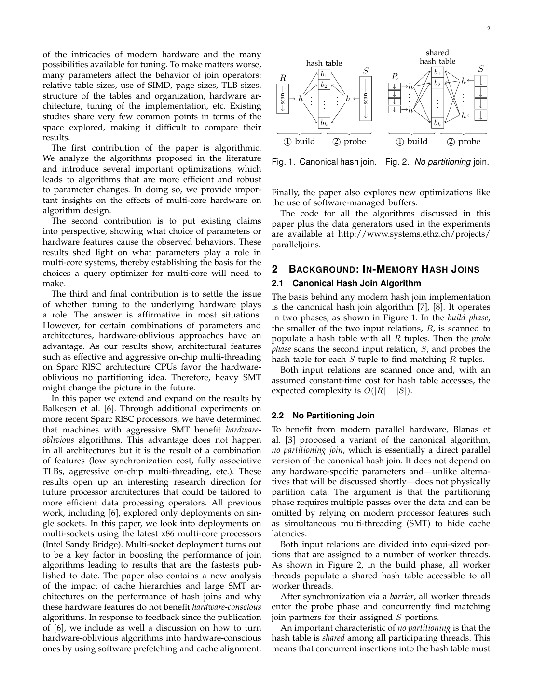
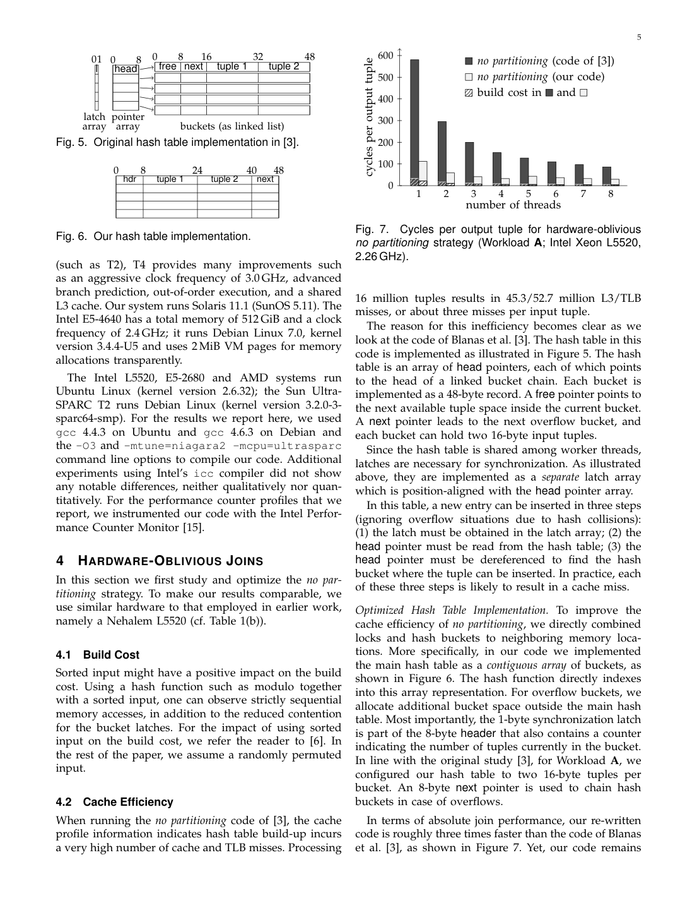

> 本组第 23 篇 · 查询执行引擎 · [全部论文]() · [上一篇]() · [下一篇]()

本篇比较主存、多核CPU上的共享表No Partitioning (NP)与按缓存/TLB特征调参的Parallel Radix Join。双方实现均优化后，radix在受测多数配置领先：单插槽Workload A的两Intel平台约有25%优势，Workload B的Intel约3.5倍、AMD/T2约2.5倍；但T2的A负载上NP更快，T4的每核8线程能让NP具有竞争力。不能把这些特定硬件结果推广为partitioned必胜或SMT普遍有效。A/B既改变表基数比例也改变元组宽度；原文还单独扫描build表规模。核心机制包括NP的锁/桶共址、radix配对分区及逐分区build紧接probe、分区pass扇出与TLB/cache限制，以及software-managed buffers的复制开销与翻译压力折衷。NP probe在build barrier之后只读，不取latch；64 B对齐/预取调参后的NP已非严格hardware-oblivious。单插槽196M/s、四插槽约400-650M/s与单核partitioning微基准必须分开，吞吐分子也不能误写为两表基数之和。

本文保留论文陈述、读者推断与待验证方案的区别；实验数字只适用于原文条件。原文和翻译来自已有 AI 辅助精读报告，已做来源匹配与编辑复核，不等于人工逐项核验或独立实验复现。所有页码均为 PDF 物理页。

## 论文与阅读范围

Cagri Balkesen, Jens Teubner, Gustavo Alonso, M. Tamer Özsu. Main-Memory Hash Joins on Modern Processor Architectures. 本次来源为完整14页本地PDF；首页标题与作者已核对，源文件未给出可核实的完整期刊卷期/年份，不补猜测，也不把参考文献[6]的2013年ICDE前作当成本篇。

[论文集中的原始 PDF](https://github.com/lonng/db-papers/blob/4ff1331069c7cf52ac97dd769e5f484c1c35c200/papers/execution-engine/main-memory-hash-joins-on-modern-processor-architectures.pdf) · 本地来源：`execution-engine/main-memory-hash-joins-on-modern-processor-architectures.pdf`，共 14 页。

本篇保留 10 组原文精读和 49 条证据。截图为原始 PDF 的局部页选，不是重新生成的图表；未将整份 PDF 复制到博客。

## 研究问题与适用边界

研究问题是：主存并行hash join是否仍需按cache/TLB等具体硬件特征调参，还是可依赖自动预取、乱序执行及SMT掩盖随机访问的延迟。hardware-oblivious在本文中指不需硬件特定参数，不等于没有关注一般局部性，也不能直接等同于cache-oblivious理论算法。[C001N01][C001N02]

作者把以往相反结论放回具体实现、工作负载与微架构中比较。sort-merge、SIMD、NUMA相关研究提供动机和背景，不构成本篇已经验证所有连接算法、拓扑或GPU的证据。[C001N10] 主结论是作者当时受测多数系统/配置中hardware-conscious有优势，特殊负载和aggressive on-chip multithreading可让NP有竞争力；它不是partitioned普遍优于nonpartitioned的定理。[SRHJ01][SRHJ20]

实验主体是整数窄key/payload、PK/FK连接，每条S恰好匹配一条R；除特殊说明外key均匀分布，后文输入随机排列。4/8 B是每个字段的宽度，不是整条元组；整条为8或16 B。[SRHJ05][C002N03] 这些是主要测量条件，不是hash join正确性必须满足的条件，也不是所有讨论都只涉及均匀数据：第8页还讨论skew和负载均衡，但详细实验委托给[6]，大页部分细节委托给[20]，本次未阅读那些外部资料。

本文未提供一般宽payload、任意多对多输出、磁盘溢出连接或当代其他处理器上的充分测量，不能推断宽元组必然降低cache miss或缩小算法差距。[C001N08] A/B同时改变表比例和元组宽度，不能把全部性能差异仅归因于表大小比例；第8-9页的Fig12才是A设定内进一步扫描build规模的对照。

依据：论文陈述；PDF 物理页 1, 2, 4, 5, 13。证据：[C001N01](#evidence-c001n01), [C001N02](#evidence-c001n02), [C001N10](#evidence-c001n10), [C002N03](#evidence-c002n03), [C001N08](#evidence-c001n08), [SRHJ01](#evidence-srhj01), [SRHJ05](#evidence-srhj05), [SRHJ20](#evidence-srhj20)。

## 架构、数据结构与关键不变量

NP把R和S各自划为等量输入片段分配给worker，但不做物理hash重分区。所有线程build同一张共享表，插入需bucket latch；build结束经barrier后，probe只读共享表，无需取latch。[SRHJ02] 输入片段分派不能写成每线程私有hash table。

论文明确描述并运行比较旧实现：独立latch数组、head指针数组与48 B bucket链，访问可能跨三个内存位置。优化实现把主表改为连续bucket数组，将1 B latch放入含计数器的8 B header；Workload A每桶两条16 B元组，另有8 B next指针，合计仍为48 B，overflow空间在主表外分配。[C002N01][C002N02] 图7的约3倍是优化NP对旧NP，不是radix对NP。此次审核依据论文描述，未下载或审计任何源代码包。

Radix对R、S使用相同的分区函数h1；相等key进入同号分区，只需在对应ri/si间连接。每个ri另建局部hash table，用h2作表内定位。希望装入cache的是build hash table，不能机械理解成两张原始关系或两个输入分区总和都要入cache。[SRHJ03]

并行first pass先统计每线程/分区的histogram，以prefix sum计算每个线程在每个输出分区内的独占区间，第二次扫描scatter时无写入争用；独占的是输出切片，不代表全部阶段没有同步或分区永久归一个线程。[SRHJ04] 后续独立分区任务由队列调度。局部build应紧接该分区的probe，避免先构建全部分区的表、到统一probe阶段时表已被逐出cache。[SRHJ08]

图8的Nehalem14 bits/AMD11 bits是特定B负载、pass配置下的折衷，不是全局常数。第6页另一实现比较中，旧radix最佳1 pass/2048分区，新代码最佳2 passes/16384分区，说明实现开销也改变调参最优点。[SRHJ18] T4则有16 KiB L1、32 B L1/L2 cache line、4-way L1和每核8硬件线程；作者认为全相联128-entry DTLB加大页后，分区瓶颈转为cache容量/冲突，约512 lines限制的是高效单pass扇出，不是整个算法最终总分区数。[C003N05]

依据：论文陈述；PDF 物理页 2, 3, 4, 5, 6, 7, 11。证据：[SRHJ02](#evidence-srhj02), [SRHJ03](#evidence-srhj03), [SRHJ04](#evidence-srhj04), [C002N01](#evidence-c002n01), [C002N02](#evidence-c002n02), [C003N05](#evidence-c003n05), [C003N06](#evidence-c003n06), [SRHJ08](#evidence-srhj08), [SRHJ18](#evidence-srhj18)。

*原论文 PDF 物理页 2，版权归原作者或出版方。点击图片可查看原尺寸。页面文本中定位到：Fig. 1. Canonical hash join.；Fig. 2. No partitioning join.。这是页面定位信息，不表示本次已复核图内所有数据。*

## 核心算法与读者构造的小例子

1. NP：各worker扫描各自R片段，在共享桶上取latch、插入并处理overflow、释放latch；所有build完成后通过barrier。随后各worker扫描S片段，按key定位并比较实际键，遍历必要的链，输出匹配项。probe只读，不获取latch。只有无碰撞/overflow的常见访问路径才可概括为访问一条桶记录，不能保证每tuple只发生一次内存访问。[SRHJ02]

2. Radix partitioning：两输入以相同h1分区；多pass分别消费h1的不同位段以继续细分，而不是每pass随意换不兼容的分区规则。普通scatter同时触及多个分区目标页，过大fanout会压垮TLB；多pass用受控扇出生成足够小的最终build hash tables。TLB条目约束主要是每pass活跃目标，不等于最终分区总数上限。[SRHJ03]

3. Parallel radix：先histogram，再prefix sum保留每线程在每分区的写区间，然后第二次扫描scatter。首pass后有足够独立任务时通过队列调度，完成必要的后续分区，再逐分区build并紧接probe。无同步scatter只针对已计算好且不重叠的写区间；histogram交接、阶段barrier、任务队列等仍可能需同步。[SRHJ04][SRHJ08]

4. Software-managed buffers：每个目标分区一个buffer，先缓存元组，满后才批量copy到最终分区。作者让每buffer恰占64 B，A为N=4，B为N=8，并利用完整cache-line写入的write combining。[SRHJ14] 这增加copy成本，但降低不断切换目标页的翻译压力。所有buffer能否入单页取决于fanout*N*tuple_size和布局，而非仅N小；超大fanout连buffer工作集也会耗尽TLB。[SRHJ15] 论文伪码只展示满buffer路径，读者实现还需正确管理目的偏移和结束时不足N条的尾部flush，这些是实现检查项，不是假称论文已给出完整可执行代码。

读者构造的假设示例：假设有两个线程，均向两个分区写入。T0在分区0有3条、T1有2条，则该分区可给T0区间[0,3)、T1区间[3,5)，第二遍直接scatter。两输入都按h1(key)的低位匹配分区；同一个key不会跨不同分区配对。数值仅说明exclusive ranges，不是论文测量或已执行复现。

复杂度是作者的理想模型：常数期望hash访问下canonical为O(|R|+|S|)，NP理想并行为O((|R|+|S|)/p)；固定硬件fanout、多pass数随log|R|增长时，radix为O((|R|+|S|)log|R|)，并行版本再除p。[SRHJ16] 这些不是最坏情况保证，也不证明实测总能线性扩展；不能把只需常数pass的固定测试规模与渐近模型混为一谈。

依据：论文陈述；PDF 物理页 2, 3, 4, 6, 7, 8, 12, 13。证据：[SRHJ02](#evidence-srhj02), [SRHJ03](#evidence-srhj03), [SRHJ04](#evidence-srhj04), [SRHJ08](#evidence-srhj08), [SRHJ14](#evidence-srhj14), [SRHJ15](#evidence-srhj15), [SRHJ16](#evidence-srhj16), [C003N09](#evidence-c003n09)。

## 正确性、复杂度与性能前提

以下是不变量层面的读者推导，不是作者提供的形式化证明、已审计源码结论或完成的并发验证。

分区不丢匹配的条件：两输入相等key使用兼容的h1位段进入相同分区；最终桶内还要比较真实key，hash碰撞不能直接当作相等。[SRHJ03] 输入的全部元组应恰写一次，histogram/prefix sum计算的区间必须足够且互不覆盖；任务调度不得漏处理或重复处理分区。两遍扫描本身不能自动保证这些性质，还需检查计数溢出、边界与写指针管理。[SRHJ04]

NP的并发条件包括build更新互斥、overflow链/计数器一致，以及barrier后所有worker可见完整且稳定的表；probe阶段不再插入，因此可只读而不取latch。[SRHJ02] 本文描述了这一结构，但未提供跨所有内存模型的正确性证明。不能只凭key哈希确定性和有锁就声称已证明无数据丢失、死锁或活锁。

Buffer版本需保证复制到各自目标分区的正确偏移、满块与尾部都恰处理一次。[SRHJ14] 这是由数据保持要求推导的检查项，论文简化伪码未展示完整尾部实现。

随机排列、均匀分布和PK/FK是主要性能实验条件，而不是算法正确性的必要条件。[SRHJ05][C002N03] Skew可能改变桶链、partition大小及负载平衡，但不能无证据宣称必然发生活锁。实验中|output|=|S|；一般多对多连接的输出规模可能不同，所以不能把本文吞吐与复杂度解释为对任意结果基数都成立。[SRHJ16] 作者第8页讨论细粒度任务分解及skew，但详细数据在[6]；此处不虚构倾斜曲线或证明。

依据：读者推断；PDF 物理页 2, 3, 4, 5, 8, 12, 13。证据：[SRHJ02](#evidence-srhj02), [SRHJ03](#evidence-srhj03), [SRHJ04](#evidence-srhj04), [SRHJ05](#evidence-srhj05), [SRHJ14](#evidence-srhj14), [SRHJ16](#evidence-srhj16), [C002N03](#evidence-c002n03)。

## 实验条件、基线、数字与证据缺口

工作负载（表1(a)，第4页）：A的key/payload各8 B，R=16*2^20、S=256*2^20行，分别256 MiB/4096 MiB，整行16 B；B两字段各4 B，R=S=128*10^6行，各约977 MiB，整行8 B。所有属性为整数、PK/FK、每条S恰有一个匹配；默认均匀且随机排列。[SRHJ05][C002N03] 两组既变表比例也变行宽，不能声称是纯比例控制变量实验。

六平台（表1(b)，第4页）：单插槽Nehalem L5520 2.26GHz为4核/8线程，Sandy Bridge E5-2680 2.7GHz为8/16，Bulldozer 6276 2.3GHz为16/16，Niagara T2 1.2GHz为8/64。四插槽E5-4640 2.4GHz整机32/64，T4 3.0GHz整机32/256；不能把这些整机核数当成每插槽核数。默认VM页依次4/4/4/8 KiB、2/4 MiB；T2和T4不是同一台机器。[SRHJ06] x86三种单插槽普通页TLB配置分别64/512、64/512、32/1024；T4为全相联128-entry DTLB。AMD模块共享L2，正文估算每核有效约1 MiB。

软件条件并非完全缺失：第5页列出L5520/E5-2680/AMD的Ubuntu kernel 2.6.32、T2的Debian kernel 3.2.0-3-sparc64-smp，gcc 4.4.3/4.6.3、-O3与相关SPARC flags，以及Intel Performance Counter Monitor；T4运行Solaris 11.1，E5-4640用Debian 7.0和2 MiB页。[SRHJ17][SRHJ06] 第10页另比较T4的Sun Studio 12.3（-xO4 -xipo -fast -xtarget=T4 -Bdynamic）与gcc 4.7.1（-mtune=niagara4 -mcpu=niagara4 -O3），前者约提升30%，不应混成所有图统一采用的编译设置。[SRHJ12]

基线与实现：第5页明确运行并分析[3]代码，第6页明确有旧radix及作者自己的实现，不是只有参考文献题名。NP优化约3倍与radix优化约3倍，分别是同算法新旧代码比较；不是两种算法之间固定3倍。旧radix最佳1 pass/2048 partitions，新代码2 passes/16384 partitions；新代码两pass比旧一pass约少40%指令，并逐分区build紧接probe。[SRHJ07][SRHJ08][SRHJ18] 表2不能概括成所有miss都下降：partition的L3由5M到7M、TLB load由9M到13M，而TLB store由325M降到170M；局部build/probe的miss改善显著。

Fig10（第7页）：双方均优化，线程分别Nehalem8、E5-2680为16、AMD16、T2为64。A下两Intel约25%性能优势，T2上NP更快；B下radix相对NP在Intel约3.5倍，AMD/T2约2.5倍。[SRHJ09] 因此“只有两表差异大NP才有竞争力”应限于该组讨论，不能排除后续T4架构例外。

Fig11（第8页）：B负载、单插槽最高radix约196 million tuples/s，图对应E5-2680最多16线程；分子为|R|=|S|的一张表基数，不是|R|+|S|，本PK/FK下也等于输出基数。T2上B的radix约50M/s、NP约22M/s。[SRHJ10] Fig12（第8-9页）：L5520 8线程，S固定256*2^20，R从1*2^20到256*2^20，S键域随R调整。每一点radix选最佳bits，范围13-15，而不是固定调参；radix成本相对稳健但非严格恒定。[SRHJ11]

Fig13（第9页）：四插槽T4/Sandy Bridge，B负载，以输出|S|/time计吞吐；T4 NP每核8线程比每核1线程加速超过4倍，是同算法不同线程配置比较，不是胜过radix4倍。T4的最佳线程策略可使NP有竞争力。正文第10页给radix跨插槽约400-650M/s，不能写成单插槽196M/s的同一实验。[SRHJ10][SRHJ19] Fig14/15为L5520 A：旧NP能从SMT受益，优化NP收益微小；radix也无显著SMT收益。Fig16则是T4 B的32对256线程：后者radix更慢，而NP受益，不能泛化为SMT总有害或总有效。[SRHJ12]

Fig17/18（第12页）：NP，A负载，L5520 8线程/AMD16线程，比较4KiB和2MiB页、alignment与prefetch。L5520单独对齐不显著提速，组合提升吞吐超过40%；AMD主要受益于对齐，组合约40%。这些优化已引入硬件特定参数。[SRHJ13] Fig19（第12-13页）仅为L5520 2.26GHz单核、128*10^6条8 B元组、single-pass partitioning，不是完整join。4KiB普通分区约8bits后退化，buffer推迟TLB压力；2MiB页有效TLB entries为32，普通分区5bits就严重受影响。buffer在小fanout有copy代价，在高fanout也会下降，不能声称全范围恒速。[SRHJ14][SRHJ15]

证据缺口：本篇不是任意宽表/多对多、全部NUMA放置策略或当代硬件的全面验证；有序输入、skew及大页的部分细节引向[6]/[20]。功耗/能效、逐点原始重复测量及统一误差统计没有在本篇中形成足以复核的完整数据，不能编造。

依据：论文陈述；PDF 物理页 4, 5, 6, 7, 8, 9, 10, 11, 12, 13。证据：[SRHJ05](#evidence-srhj05), [SRHJ06](#evidence-srhj06), [SRHJ07](#evidence-srhj07), [SRHJ08](#evidence-srhj08), [SRHJ09](#evidence-srhj09), [SRHJ10](#evidence-srhj10), [SRHJ11](#evidence-srhj11), [SRHJ12](#evidence-srhj12), [SRHJ13](#evidence-srhj13), [SRHJ14](#evidence-srhj14), [SRHJ15](#evidence-srhj15), [SRHJ17](#evidence-srhj17), [SRHJ18](#evidence-srhj18), [SRHJ19](#evidence-srhj19), [C002N03](#evidence-c002n03), [C002N05](#evidence-c002n05)。

*原论文 PDF 物理页 5，版权归原作者或出版方。点击图片可查看原尺寸。页面文本中定位到：Fig. 5. Original hash table implementation in \[3\].；Fig. 6. Our hash table implementation.；Fig. 7.；table is an array of head pointers, each of which points。这是页面定位信息，不表示本次已复核图内所有数据。*

## 性能、空间与工程取舍

Partitioning付出额外扫描、histogram、prefix sum和copy成本，换取局部hash table的cache命中；多pass限制每pass扇出以控制TLB压力。调参目标是分区开销和局部join成本的折衷，并非分区越多越好。[C002N05] 新radix比旧实现更高效，既来自代码路径简化，也来自逐分区build紧接probe的执行次序，不能只归因于partitioned算法名称。[SRHJ08]

“需要硬件参数”不等于“参数稍错就崩溃”：Fig8仅表明受测最优附近一段范围退化较小；极大fanout、共享cache被更多线程分割或页大小变化仍可能改变瓶颈。T4的全相联TLB和大页未消除所有约束，而把cache容量、相联度及同核资源争用暴露出来。[C003N05][SRHJ12]

NP的锁/桶共址和减少指针间接访问在作者分类中仍然hardware-oblivious。[C002N02] 不能把这些通用布局改进与后来64 B alignment、hardware-specific prefetch distance及大页组合混成同一步，更不能说所有NP优化都破坏oblivious属性。后者确实引入特定参数，原文明确称不再严格oblivious。[SRHJ13]

Cache miss数下降不等于吞吐等比例提升。48 B桶对64 B边界的跨行代价在表4得到解释，但L5520单独alignment收益有限，AMD上却明显；两者组合prefetch的收益组成依平台而异。[C003N06][SRHJ13] 对齐还会改变空间布局，选择时须测量而非写成普遍强制规则；原文此处解释的是cache-line crossing，未建立消除false sharing的普遍证明。

软件buffer把随机逐元组目标写入转换为按目标分区成批写入，减少翻译切换并利用write combining，但付出buffer空间及额外copy；高fanout还可能让buffer自身超出cache/TLB工作集。64 B、A N=4/B N=8是论文的配置，不是任意架构的常数。[SRHJ14][SRHJ15] 更多线程也不是免费资源：T4 radix的32/256线程比较表明，追求硬件上下文占满可能损失局部性；是否启用SMT应作为待测配置，而不是依据一个平台作统一开关。[SRHJ12]

依据：论文陈述；PDF 物理页 5, 6, 7, 8, 9, 10, 11, 12, 13。证据：[C002N02](#evidence-c002n02), [C002N05](#evidence-c002n05), [C003N05](#evidence-c003n05), [C003N06](#evidence-c003n06), [SRHJ08](#evidence-srhj08), [SRHJ12](#evidence-srhj12), [SRHJ13](#evidence-srhj13), [SRHJ14](#evidence-srhj14), [SRHJ15](#evidence-srhj15)。

## 与现代执行引擎的待验证对照

以下是读者提出的源码检查与实验问题，不是本篇对任何现代产品的事实结论；此次未检索外部系统、运行新benchmark或审计其实现。

对照实际执行引擎时，应检查join表是共享还是按partition独占、phase barrier在哪里、build/probe是否保留局部时间相邻性，以及histogram/prefix sum/scatter是否采用同样的不重叠写区间。检查这些机制比仅给算法贴“partitioned/nonpartitioned”标签更能检验论文所解释的实现差异。[SRHJ08]

可比较的参数包括hash table footprint、每核可用cache、普通页/大页各自TLB reach、radix pass/bit配置、prefetch distance、物理核与SMT线程映射。然后在同一CPU、相同行宽和基数比、同样输出口径下比较经同等优化的实现。T4与L5520的相反SMT行为说明，历史配置不能直接迁移成当代通用结论。[SRHJ01][SRHJ12][SRHJ15]

Sort-merge及宽SIMD在本篇中主要是研究动机和相关工作，本文并未完成所有现代hash-vs-sort的对决，不能从参考文献题名或这些hash join实验推出“缺乏宽SIMD时hash一定是首选”。[C001N10] 同样，hardware-oblivious和参考文献中cache-oblivious不是可以直接互换的术语。[C004N06] 任何产品支持何种优化、是否有自适应radix或哪种算法领先，都留待其源码与新实验验证。

依据：待验证的工程设想；PDF 物理页 1, 2, 6, 7, 8, 9, 10, 11, 12, 13, 14。证据：[C001N10](#evidence-c001n10), [C004N06](#evidence-c004n06), [SRHJ01](#evidence-srhj01), [SRHJ08](#evidence-srhj08), [SRHJ12](#evidence-srhj12), [SRHJ15](#evidence-srhj15)。

## 可执行的复现计划与检验标准

本节是读者拟定的复现计划，尚未下载代码、编译或执行测量；不是作者已完成的额外实验，也不承诺在替代硬件复现相同数字。

1. 固定来源与代码身份。先核对本地PDF SHA256，再依据论文提供的作者实现/生成器及[16]旧实现出处获取并记录版本。论文第5-6页已明确比较旧代码与作者优化代码；此次只核对论文，未核验现存下载链接或tarball内容。[SRHJ17][SRHJ18] 分开保留NP锁/桶共址、64 B alignment、prefetch及radix buffer等变体，不把全部优化捆在一个基线上。

2. 严格生成A/B。A分别16*2^20和256*2^20行，两字段各8 B；B两表各128*10^6行，两字段各4 B。保证R主键、S外键每条恰匹配一条、默认均匀和随机排列。先做正确性检查：输出数=|S|、校验匹配键；检查NP build/probe barrier、无锁只读probe、分区exclusive ranges及buffer尾部flush。[SRHJ02][SRHJ04][SRHJ05] 不能只用耗时认定实现正确。

3. 记录真实平台。按表1区分四台单插槽和两台四插槽，记录整机核/线程、cache/line/associativity、页大小对应的TLB、NUMA/线程放置、OS和compiler flags。[SRHJ06][SRHJ17] 原文有gcc和T4 Sun Studio比较，不能声称编译条件完全未知。替代机器只能复核机制与趋势，不能称复现原机绝对结果。

4. 做单因素消融。NP先比较旧/新布局，再分别对齐与预取并扫prefetch distance。采样表4同口径的L2/L3 build/probe miss per tuple，不误写L1；参考数为新布局L2 1.56/1.39、L3 1.56/1.36，对齐后1.01/1.00及1.00/0.99，但只作为原条件下的对照，不强制其他CPU命中这些数值。[C003N06] 同时测总吞吐，检验miss减少是否转化为时间收益，而非预设必然提高40%。[SRHJ13]

5. 对radix扫描每pass bits/最终分区数，区分原代码和新代码最佳配置；验证逐分区build接probe与先全建后全probe的差别。按Fig12固定S、改变R，并显式区分固定配置与逐点最佳13-15bits，不能把后者标为不调参实验。[SRHJ08][SRHJ11][SRHJ18]

6. 将Fig19微基准与完整join分开。复刻L5520单核、128*10^6条8 B元组的single-pass partitioning，分别测4KiB/2MiB页与buffer on/off，扫fanout。记录该页类型实际TLB entries，不假设开2MiB页在所有CPU都会变成32 entries；N=4/8对应64 B buffer，不误设N=64个tuple。[SRHJ14][SRHJ15] 检验copy开销、退化阈值与buffer工作集，不把图上的分区加速声称为总join同倍数加速。

7. 按物理核优先、再SMT的绑定顺序扫线程。分别画旧NP、优化NP及radix；L5520 A中旧NP的SMT收益与新NP不同。T4需分别32/256线程，不能用“Intel或更新架构”替代后仍预定SMT无效。[SRHJ12]

8. 统一吞吐口径。Fig11用单表基数|R|=|S|，Fig13用输出|S|，不要擅自用两表总行数。单插槽196M/s与四插槽约400-650M/s分开记录。[SRHJ10] 读者新增验证标准：保留每次原始时长、重复次数、离散度、数据seed、冷热状态与亲和性，先比较结果正确性，再比较趋势和各阶段耗时。本文未给出的宽payload或多对多扩展可另立实验，差异方向必须实测，不能预设宽表一定缩小差距。

依据：待验证的工程设想；PDF 物理页 2, 3, 4, 5, 6, 7, 8, 9, 10, 11, 12, 13。证据：[SRHJ02](#evidence-srhj02), [SRHJ04](#evidence-srhj04), [SRHJ05](#evidence-srhj05), [SRHJ06](#evidence-srhj06), [SRHJ07](#evidence-srhj07), [SRHJ10](#evidence-srhj10), [SRHJ11](#evidence-srhj11), [SRHJ12](#evidence-srhj12), [SRHJ13](#evidence-srhj13), [SRHJ14](#evidence-srhj14), [SRHJ15](#evidence-srhj15), [SRHJ17](#evidence-srhj17), [SRHJ18](#evidence-srhj18), [C003N06](#evidence-c003n06), [SRHJ08](#evidence-srhj08)。

## 结论、工程含义与未决边界

作者结论：在其当时受测多数系统和配置中，hardware-conscious hash join仍有优势，但aggressive on-chip multithreading等特定硬件组合能使hardware-oblivious NP有竞争力，未来处理器发展可能改变答案。[SRHJ01][SRHJ20] 因此不能把特定x86/T2/T4、窄整数PK/FK负载的比较推广为所有现代硬件或全部连接语义的排名。[SRHJ05]

本次核对纠正的关键机制是：NP的共享表build需同步，barrier后probe只读无latch；radix的关键不仅是最终分区小，还包括兼容的两输入分区、每pass扇出限制与逐分区build/probe时间局部性。[SRHJ02][SRHJ08] 单核partitioning微基准不是完整join，单插槽/四插槽吞吐也不可混用。[SRHJ10][SRHJ15]

读者工程含义：在保持公平实现与相同测量口径前提下，再讨论partitioned与nonpartitioned的取舍。布局改进、对齐、预取、页配置、buffer及线程数要逐项消融；测量cache/TLB变化，也测额外扫描、copy和同步成本。通用锁/桶共址仍可属于作者所说oblivious，硬件特定alignment/prefetch调参则是另一层改变；不能混淆它们的收益或属性。[SRHJ13] 这些是由论文导出的实验建议，不是所有内核必须采用的规则。

仍未解决的是一般宽payload、非一对一输出、未测新平台/拓扑及生产混合负载的收益边界；本次没有做源码审计、独立复现或外部文献复核。正文、全部证据解读及十段原文精读已由Codex对照完整14页来源复核，并检查全部表图；这是source-based AI review，不是人工审核，也不意味着新的实验或所有主张已获独立事实认证。[SRHJ12][SRHJ20]

依据：读者推断；PDF 物理页 1, 2, 3, 4, 5, 6, 7, 8, 9, 10, 11, 12, 13。证据：[SRHJ01](#evidence-srhj01), [SRHJ02](#evidence-srhj02), [SRHJ05](#evidence-srhj05), [SRHJ08](#evidence-srhj08), [SRHJ10](#evidence-srhj10), [SRHJ12](#evidence-srhj12), [SRHJ13](#evidence-srhj13), [SRHJ15](#evidence-srhj15), [SRHJ20](#evidence-srhj20)。

## 原文精读：从句子回到机制

以下保留原文、忠实翻译、含义与边界；假设示例不作为论文实验结果。

### P001 · PDF 物理页 1

**原文**

<blockquote class="paper-source-quote"><pre><code>In this paper we focus on main-memory, parallel hash&#10;join algorithms and address the question of whether it&#10;is important to tune the algorithms to the underlying&#10;hardware as claimed by Kim et al. [1] and by Albutiu et&#10;al. [4] or whether hardware-oblivious approaches provide&#10;sufficient performance to make the overhead of being&#10;hardware-conscious unnecessary.</code></pre></blockquote>

**忠实翻译**

> 在本文中，我们关注主存并行哈希连接算法，并探讨这样一个问题：是否如 Kim 等人 [1] 和 Albutiu 等人 [4] 所声称的那样，必须针对底层硬件对算法进行调优；还是说硬件无关（hardware-oblivious）的方法已能提供足够的性能，从而使硬件感知（hardware-conscious）所带来的开销变得不必要。

**技术含义与边界**

> 作者陈述了本文的研究范围是主存环境下的并行哈希连接算法，核心研究问题是硬件感知调优与硬件无关方法之间的性能权衡。原文引用了 Kim 等人和 Albutiu 等人的主张作为对比基线，但本段仅提出问题，未给出结论。适用边界限定在主存、并行、哈希连接三个条件同时满足的场景。

**常见误读**

> 容易误读为作者已经得出硬件无关方法更优或硬件感知不必要的结论。原文仅提出研究问题，未在此处给出答案。此外，不能将‘主存并行哈希连接’的讨论泛化到磁盘 I/O 密集型或非哈希连接算法。

**读者构造的假设示例**

> 读者构造的假设示例：方案A按目标CPU的cache容量和TLB可支持的扇出设置radix passes，方案B不设这类硬件参数而使用共享hash table。本段提出比较问题，不给出任何一方必胜的结论。

### P002 · PDF 物理页 14

**原文**

<blockquote class="paper-source-quote"><pre><code>REFERENCES&#10;[1]&#10;C. Kim, E. Sedlar, J. Chhugani, T. Kaldewey, A. D. Nguyen, A. D.&#10;Blas, V. W. Lee, N. Satish, and P. Dubey, “Sort vs. hash revisited:&#10;Fast join implementation on modern multi-core CPUs,” PVLDB,&#10;vol. 2, no. 2, pp. 1378–1389, 2009.&#10;[2]&#10;H. Lang, V. Leis, M.-C. Albutiu, T. Neumann, and A. Kemper,&#10;“Massively parallel numa-aware hash joins,” in IMDM, 2013.</code></pre></blockquote>

**忠实翻译**

> 参考文献
> [1]
> C. Kim, E. Sedlar, J. Chhugani, T. Kaldewey, A. D. Nguyen, A. D.
> Blas, V. W. Lee, N. Satish, and P. Dubey, “Sort vs. hash revisited:
> Fast join implementation on modern multi-core CPUs,” PVLDB,
> vol. 2, no. 2, pp. 1378–1389, 2009.
> [2]
> H. Lang, V. Leis, M.-C. Albutiu, T. Neumann, and A. Kemper,
> “Massively parallel numa-aware hash joins,” in IMDM, 2013.

**技术含义与边界**

> 这是论文的参考文献列表节选，列出了两篇文献的出版信息。文献 [1] 讨论了现代多核 CPU 上排序与哈希连接的快速实现，发表于 PVLDB 2009 年第 2 卷第 2 期第 1378-1389 页。文献 [2] 讨论了大规模并行 NUMA 感知的哈希连接，发表于 IMDM 2013。这些是作者引用的外部工作。

**常见误读**

> 参考文献只是被引外部工作的出版线索，不能据此证明本篇已经运行、复现或赞同它们的全部结果。本文自身的机制与实验应在相应正文页查证，不能把题名联想当证据。

**读者构造的假设示例**

> 读者构造的假设示例：若研究者想追溯硬件感知哈希连接的早期论述，可依据此参考文献列表去查找文献 [1] 的原始文本，但该查找行为与本论文正文的实验数据无关。

### P003 · PDF 物理页 7

**原文**

<blockquote class="paper-source-quote"><pre><code>Radix join is approximately 3.5 times&#10;faster than no partitioning on Intel machines and 2.5 times&#10;faster on AMD and Sun machines. That is, no partitioning&#10;has comparable performance to radix join only when&#10;the relative relation sizes are very different. This is&#10;because in such a situation, the cost of the build phase&#10;is minimized.</code></pre></blockquote>

**忠实翻译**

> 在Intel机器上，radix join的速度大约是no partitioning的3.5倍，在AMD和Sun机器上大约是2.5倍。也就是说，只有当两关系的相对大小差异很大时，no partitioning才具有与radix join相当的性能。这是因为在这种情形下，build阶段的成本被最小化了。

**技术含义与边界**

> 此段紧接Workload B（两表各约977 MiB）的Fig10(b)讨论，并与A对照，比较的是双方已优化实现在四种单插槽机器上的结果。3.5/2.5是B的约数；A的两Intel仅约25%优势，T2上A的NP更快。段中的only是这一组讨论的概括，不能脱离后文T4特定微架构的competitive结果变成跨硬件全局必要条件。

**常见误读**

> 不要把B负载的倍数泛化到全部表比例和硬件，也不要把两表极度不对称视为NP有竞争力的唯一普遍条件。A/B还改变了元组宽度；原文后面另做Fig12的build规模扫描，也展示T4的高线程例外。

**读者构造的假设示例**

> 读者构造的假设示例：固定某台CPU和16 B元组，分别测小R/大S与等大R/S，检查NP的build占比是否改变。这是待执行对照，不能在没有测量时断言小R必然追平或等大关系必然得到3.5倍差距。

### P004 · PDF 物理页 4

**原文**

<blockquote class="paper-source-quote"><pre><code>They are&#10;accessed by potentially many execution threads, creating&#10;a contention problem (the low-contention assumption of&#10;Section 2.2 no longer applies).&#10;To avoid this contention, for each thread a dedicated&#10;range is reserved within each output partition. To this&#10;end, both input relations are scanned twice. The first&#10;scan computes a set of histograms over the input data,&#10;so the exact output size is known for each thread and&#10;each partition.</code></pre></blockquote>

**忠实翻译**

> 它们可能被许多执行线程访问，从而产生争用问题（第 2.2 节的低争用假设不再适用）。
> 为了避免这种争用，为每个线程在每个输出分区内预留一个专用范围。为此，两个输入关系都被扫描两次。第一次扫描计算输入数据上的一组直方图，因此对于每个线程和每个分区，确切的输出大小是已知的。

**技术含义与边界**

> 作者陈述了多线程写入共享输出分区时会破坏低争用假设，导致性能问题。解决方案是采用双遍扫描：第一遍通过直方图精确计算每个线程在每个分区的输出量，从而为每个线程预分配不重叠的写入范围，消除写争用。适用边界是多线程并行分区且需要避免写冲突的场景。

**常见误读**

> 容易误认为只需扫描一次即可完成无争用分区。原文明确指出需要扫描两次，第一次专门用于计算直方图以确定精确的输出大小。此外，不能将此处的争用问题等同于第 2.2 节讨论的低争用场景，原文强调该假设在此处已不适用。

**读者构造的假设示例**

> 读者构造的假设示例：若线程0在分区3有120条，其他线程的prefix sum已经为它算出起点300，就预留[300,420)区间。第二遍直接写入这段，不必争用同一写指针。起点由所有相关histogram决定，并非任一线程都可自行从0写入。

### P005 · PDF 物理页 10

**原文**

<blockquote class="paper-source-quote"><pre><code>In case of 256 threads, each physical core runs&#10;eight threads concurrently where all the core resources&#10;are shared. Surprisingly, using more threads ruins the&#10;hardware-consciousness of radix join making it slower&#10;than the 32-thread case. The performance problem can&#10;be clearly seen in the actual join phase of the algorithm,&#10;which is the cache-sensitive, high IPC phase of the&#10;algorithm.</code></pre></blockquote>

**忠实翻译**

> 在 256 个线程的情况下，每个物理核心并发运行八个线程，所有核心资源被共享。令人惊讶的是，使用更多线程破坏了 radix join 的硬件感知特性，使其比 32 线程的情况更慢。该性能问题可以清楚地体现在算法的实际连接阶段，即算法中对缓存敏感、高 IPC 的阶段。

**技术含义与边界**

> 此段属于四插槽Sparc T4、Workload B的讨论：32线程对应每物理核1线程，256线程对应每核8线程。作者发现radix的实际局部join阶段因共享L1/L2等资源而退化，整体也比32线程慢。high IPC指每周期指令数高，不等于原文给出了指令级并行度的单独测量。

**常见误读**

> 不能推广成所有算法、所有硬件都应少用线程，也不能写成32线程是单线程。这里的actual join phase包含局部分区的build/probe工作，不是与build完全排斥的另一个阶段；NP在同一T4上对额外线程的反应不同。

**读者构造的假设示例**

> 读者构造的假设示例：假设某 CPU 物理核拥有 32KB L1 缓存，原本 1 个线程独占时可高效完成连接探测。当 8 个线程共享同一物理核时，L1 缓存被频繁替换，导致缓存命中率骤降，原本的高 IPC 优势丧失，整体耗时反而增加。

### P006 · PDF 物理页 5

**原文**

<blockquote class="paper-source-quote"><pre><code>For the impact of using sorted&#10;input on the build cost, we refer the reader to [6]. In&#10;the rest of the paper, we assume a randomly permuted&#10;input.&#10;4.2&#10;Cache Efficiency&#10;When running the no partitioning code of [3], the cache&#10;profile information indicates hash table build-up incurs&#10;a very high number of cache and TLB misses.</code></pre></blockquote>

**忠实翻译**

> 关于使用已排序输入对构建代价的影响，我们请读者参阅 [6]。在本文的其余部分，我们假设输入是随机排列的。
> 4.2 缓存效率
> 当运行 [3] 中的 no partitioning 代码时，缓存剖析信息表明哈希表的构建会产生极高数量的缓存未命中（cache misses）和 TLB 未命中（TLB misses）。

**技术含义与边界**

> 作者陈述了两个技术设定与观察：一是明确本文后续实验均基于随机排列的输入，排除了有序输入对构建代价的影响（该影响交由文献 [6] 讨论）；二是通过缓存剖析工具观察到，no partitioning 方法在构建哈希表时会引发大量 cache miss 和 TLB miss。适用边界限定在随机排列输入和文献 [3] 的具体实现上。

**常见误读**

> 容易忽略‘假设输入是随机排列的’这一前提，将高 cache/TLB miss 率的结论错误推广到已排序输入场景。此外，不能将文献 [3] 代码的剖析结果等同于所有 no partitioning 实现的必然表现，原文特指运行该特定代码时的观察。

**读者构造的假设示例**

> 读者构造的假设示例：可拟用性能计数器对同一输入的旧NP及优化NP分别测量L3/TLB misses，检查旧实现的指针与锁数组分离是否带来额外访问。这里没有真实运行，也不编造论文未给的50% miss率。

### P007 · PDF 物理页 12

**原文**

<blockquote class="paper-source-quote"><pre><code>Figure 18, in fact, illustrates how sensitive our code&#10;changes are to the underlying hardware platform. When&#10;running the same experiment on the AMD Opteron&#10;machine, aligning hash buckets to the cache line size&#10;has a significant impact on overall throughput. Software&#10;prefetching can improve only little over that. Together,&#10;both optimizations again yield a performance gain of&#10;⇡40 % over the baseline implementation.</code></pre></blockquote>

**忠实翻译**

> 图 18 实际上说明了我们的代码修改对底层硬件平台的敏感程度。当在 AMD Opteron 机器上运行相同的实验时，将哈希桶对齐到缓存行大小对整体吞吐量有显著影响。软件预取在此基础上只能带来很少的提升。两者结合，相对于基线实现再次产生了约 40% 的性能增益。

**技术含义与边界**

> 该段对应Fig18：AMD Bulldozer Opteron 6276、16线程、Workload A，并对照4KiB/2MiB页。作者观察alignment贡献主要收益，prefetch在此基础上提升有限，组合约40%。Fig17的L5520则单独alignment不显著，说明收益组成依平台而异。

**常见误读**

> 容易将‘约 40% 的性能增益’误认为是跨所有硬件平台的通用保证。原文明确强调这是在 AMD Opteron 机器上运行相同实验的结果，并用‘说明了我们的代码修改对底层硬件平台的敏感程度’来限定其适用范围。不能将缓存行对齐优于软件预取的结论泛化到 Intel 或其他架构。

**读者构造的假设示例**

> 读者构造的假设示例：假设基线为1000万条/秒，对齐后1350万、再预取后1400万，则合计约40%而预取的边际收益小。数字纯属假设，不是Fig18读数或已完成复现。

### P008 · PDF 物理页 6

**原文**

<blockquote class="paper-source-quote"><pre><code>Configurations with 14 and 11 radix bits are&#10;the best trade-offs between these opposing effects for&#10;the Nehalem and AMD architectures, respectively. But&#10;even more interestingly, the figure shows that radix&#10;join is fairly robust against parameter mis-configuration:&#10;within a relatively broad range of configurations, the&#10;performance of radix join degrades only marginally.&#10;5.2&#10;Hash Tables in Radix Join&#10;Various hash table implementations have been proposed&#10;for radix join. Manegold et al.</code></pre></blockquote>

**忠实翻译**

> 对于 Nehalem 和 AMD 架构，分别采用 14 位和 11 位 radix 位的配置是这些相反效应之间的最佳折衷。但更有趣的是，该图显示 radix join 对参数配置错误具有相当的鲁棒性：在一个相对较宽的配置范围内，radix join 的性能仅出现轻微下降。
> 5.2 Radix Join 中的哈希表
> 已有多种哈希表实现被提出用于 radix join。Manegold 等人

**技术含义与边界**

> Fig8使用Workload B；Nehalem是两pass，AMD是一pass，14/11是该比较中的radix bits折衷点，不只是CPU名就唯一决定的常数。作者说在受测最优附近较宽范围只轻微退化，不能据此取消硬件调参或保证极端参数下鲁棒。后续段落引出局部hash table实现。

**常见误读**

> 容易将 14 位和 11 位误认为是全局最优常数。原文明确限定了它们分别对应 Nehalem 和 AMD 架构，且是特定对立效应的折衷。此外，‘鲁棒性’仅指在‘相对较宽的配置范围内’性能‘轻微下降’，不能解读为任意极端参数下都不会崩溃。

**读者构造的假设示例**

> 读者构造的假设示例：在同一硬件与数据上扫描一段radix bits，画出partition和局部join各自成本，若最优附近总成本变化不大可称局部鲁棒。这里不为论文虚构3%-5%区间，也不认为换数据规模仍保持相同最优值。

### P009 · PDF 物理页 11

**原文**

<blockquote class="paper-source-quote"><pre><code>Due&#10;to the use of a fully-associative 128-way DTLB and large&#10;pages, TLB misses are no longer the main bottleneck&#10;in partitioning. However, the L1 cache can hold 512&#10;cache lines and puts a hard limit at around 512 for&#10;efficient partitioning fan-out per pass. Moreover, the 4-&#10;way associativity of the L1 cache does not match the&#10;number of eight hardware threads.</code></pre></blockquote>

**忠实翻译**

> 由于使用了128项的全相联DTLB和大页，TLB未命中不再是分区阶段的主要瓶颈。不过L1可容纳512条cache line，使高效的每pass分区扇出在大约512处受到硬限制。此外，L1的4路组相联性与8个硬件线程的数量并不匹配。

**技术含义与边界**

> 上下文是Sparc T4：16KiB L1和32 B L1 cache line给出512条line。作者指出全相联DTLB加大页后，TLB不再是主要瓶颈，但不是不存在TLB miss；L1容量与相联度/同核多线程冲突成为重要约束。这里约512是特定实现和该平台的高效单pass扇出限制，不是架构无关的定理。

**常见误读**

> 不要把不再是主要瓶颈写成消除TLB问题，也不能从只知道cache容量就无条件推导所有分区算法的精确fanout上限。512限制针对T4此处的每pass高效配置；最终总分区数可由多pass增加。

**读者构造的假设示例**

> 读者构造的假设示例：在假设16KiB/32 B的L1里，每活跃分区至少保留一条line且还需留出其他工作集空间时，512个活跃分区已接近容量约束。若使用不同buffer或写策略，需重新分析，不可仅按512就断言性能必然陡降。

### P010 · PDF 物理页 13

**原文**

<blockquote class="paper-source-quote"><pre><code>The effect is even more pronounced when we config-&#10;ure our system to use a 2 MiB page size (cf. Figure 19(b)).&#10;With now only 32 TLB entries available, conventional&#10;radix partitioning seriously suffers from TLB misses even&#10;for five radix bits (e.g., 32 partitions), while software-&#10;managed buffers can keep partitioning speed almost&#10;constant even for very large fanouts.</code></pre></blockquote>

**忠实翻译**

> 当我们将系统配置为使用 2 MiB 页大小时（参见图 19(b)），这种效应更加明显。由于现在只有 32 个 TLB 条目可用，传统的 radix 分区即使对于 5 个 radix 位（例如 32 个分区）也会严重受到 TLB 未命中的影响，而软件管理的缓冲区即使在非常大的扇出情况下也能保持分区速度几乎恒定。

**技术含义与边界**

> Fig19b是L5520单核、128*10^6条8 B元组的single-pass partitioning微基准。2MiB页对应的有效TLB entries只有32；普通分区约5bits即明显受影响。buffer把逐元组目标页切换变成满块批量copy，曲线比普通方法稳健，但极大fanout仍下降；almost constant不能理解为整个横轴严格恒速，更不代表完整join同倍数加速。

**常见误读**

> 32 entries是该处理器针对该页大小的测量前提，不是所有大页系统的规则；buffer在小fanout有复制成本，4KiB页下也有单独的对照（Fig19a）。不能声称大页总能提高TLB entry数量，或buffer在任何配置都更快。

**读者构造的假设示例**

> 读者构造的假设示例：若有64个目标分区，每个buffer为64 B，则buffer数据合计4096 B（未计额外状态）；先写这些每分区buffer，满后才复制到各目标页。buffer仍是一分区一个，不是把多个逻辑分区共用同一个槽；能否少占页取决于布局与页大小，目标页翻译也未消失。

## 尚未解决的问题

1. 在保持基数比和键分布不变时，单独改变key/payload宽度会怎样影响阶段成本和算法交叉点？原文不能确定一般宽表差距变化的方向。
2. 在超出主要PK/FK设置的多对多、重度skew负载中，输出成本与任务调度如何改变比较？本次未读取[6]的详细skew实验。
3. 相同CPU上大页对应的TLB entries/reach、radix扇出与software buffer footprint如何共同决定最优pass数？
4. 在未测处理器及NUMA拓扑上，优化后NP与radix的SMT收益怎样变化？不得预设T4或L5520结论适用。
5. 现代执行引擎源码是否保留逐分区build/probe局部性、正确的phase barrier与buffer尾部处理？此次未审计这些实现。
6. 如何在成本模型中量化布局、同步、分区、copy及输出开销，并区分固定参数和逐点最佳配置的比较？

## 证据索引

证据编号沿用原报告，便于将上文判断追溯到原句。引文匹配只验证位置，不证明解读正确。

**C001N01 · PDF 物理页 1**

本文的核心问题是：在多核架构上实现主存并行哈希连接时，是否必须针对底层硬件进行参数调优（如缓存和TLB大小），还是依赖现代硬件特性（SMT、预取、乱序执行）的硬件无关方法已足够。适用边界限定为主存（main-memory）环境下的并行哈希连接，不涉及磁盘I/O瓶颈场景。

<blockquote class="paper-source-quote"><pre><code>whether it is important to tune the algorithms to the underlying hardware as claimed by Kim et al. [1] and by Albutiu et al. [4] or whether hardware-oblivious approaches provide sufficient performance</code></pre></blockquote>

**C001N02 · PDF 物理页 1**

硬件无关算法（如 No Partitioning Join）的前提假设是：现代硬件通过自动预取、乱序执行或同时多线程（SMT）等机制，已经足够好地隐藏了自身多层存储层次的性能损失，使得无需仔细调优即可获得竞争力。该假设的正确性依赖于具体架构的SMT激进程度和同步开销。

<blockquote class="paper-source-quote"><pre><code>The assumption behind these algorithms is that hardware is now good enough at hiding its own limitations—through automatic hardware prefetching, out-of-order execution, or simultaneous multi-threading (SMT)</code></pre></blockquote>

**C001N05 · PDF 物理页 4**

Parallel Radix Join 解决多线程在首趟分区时写入共享分区导致的竞争问题。数据结构引入每线程直方图和前缀和偏移。算法步骤：首趟先扫描计算各线程在各分区的直方图，通过前缀和为每个线程在每个输出分区内预留专属连续内存范围，随后无同步地进行实际分区写入。后续趟次因独立任务充足，通常通过任务队列（task queueing）分配负载。预期复杂度为 O(1/p(|R|+|S|) log|R|)。

<blockquote class="paper-source-quote"><pre><code>To avoid this contention, for each thread a dedicated range is reserved within each output partition. To this end, both input relations are scanned twice.</code></pre></blockquote>

**C001N06 · PDF 物理页 4**

表1(a)：A的key和payload各8 B，元组16 B；R=16*2^20、S=256*2^20行，分别256 MiB/4096 MiB，基数比1:16。B的两字段各4 B，元组8 B；R=S=128*10^6行，各约977 MiB。整数PK/FK连接，每条S恰好匹配一条R；默认均匀分布。A/B不仅改变表比例，也改变元组宽度。

<blockquote class="paper-source-quote"><pre><code>We deliberately choose very narrow hkey, payloadi tuple configurations, where key and payload are four or eight bytes wide. As a side effect, narrow tuples better emphasize the effects</code></pre></blockquote>

**C001N08 · PDF 物理页 4**

作者刻意使用窄key/payload以凸显缓存效应；4/8 B是每个字段宽度，整行分别8/16 B。本篇未给出一般宽payload实验，不能据此断言宽元组必然降低miss率或缩小算法性能差距。脚注[13]只指向外部宽度研究。

<blockquote class="paper-source-quote"><pre><code>narrow tuples better emphasize the effects that we are interested in since they put more pressure on the caching system.1</code></pre></blockquote>

**C001N10 · PDF 物理页 1**

文献中存在关于排序合并连接（sort-merge join）与哈希连接相对性能的矛盾结论。Kim等认为随着SIMD变宽，排序合并将优于哈希连接；Albutiu等声称排序合并已经更好且无需SIMD；而作者此前的研究发现硬件感知的radix哈希连接仍保持优势。本文聚焦于哈希连接内部的硬件感知与硬件无关之争，将这些矛盾作为研究动机而非直接验证对象。

<blockquote class="paper-source-quote"><pre><code>Some of this work further emphasizes the impact of hardware by suggesting that, in the future, as SIMD becomes wider, sort-merge join is likely to perform better than hash joins</code></pre></blockquote>

**C002N01 · PDF 物理页 5**

原文 [3] 中的哈希表实现为 head 指针数组，每个 bucket 是 48 字节的记录，包含 free 指针、next 指针和两个 16 字节 tuple。latch 作为独立数组与 head 指针数组位置对齐。插入新条目需要三步：获取 latch、读取 head 指针、解引用 head 指针找到 bucket。这三步在实践中各自很可能导致一次 cache miss，造成严重的缓存与 TLB 缺失。

<blockquote class="paper-source-quote"><pre><code>The hash table is an array of head pointers, each of which points to the head of a linked bucket chain. Each bucket is implemented as a 48-byte record.</code></pre></blockquote>

**C002N02 · PDF 物理页 5**

作者优化的哈希表将主哈希表实现为连续的 bucket 数组，哈希函数直接索引该数组。溢出桶在主表外分配。关键改进是将 1 字节的同步 latch 放入 8 字节的 header 中，该 header 还包含指示当前桶内 tuple 数量的计数器。对于 Workload A，配置为每桶两个 16 字节 tuple，使用 8 字节 next 指针链接溢出桶。此优化使代码比 [3] 快约三倍，且仍保持硬件无关（无需硬件特定参数调优）。

<blockquote class="paper-source-quote"><pre><code>the 1-byte synchronization latch is part of the 8-byte header that also contains a counter indicating the number of tuples currently in the bucket.</code></pre></blockquote>

**C002N03 · PDF 物理页 5**

排序输入结合取模哈希函数可产生严格顺序的内存访问并减少 bucket latch 争用，从而降低 build 代价。但本文后续实验均假设输入为随机排列（randomly permuted input），以消除排序带来的额外收益干扰。

<blockquote class="paper-source-quote"><pre><code>In the rest of the paper, we assume a randomly permuted input.</code></pre></blockquote>

**C002N05 · PDF 物理页 6**

图8的Workload B中，Nehalem两pass的最佳折中为14 radix bits，AMD一pass为11 bits。2^bits是最终分区数；受测最优附近较宽范围仅轻微退化，不是任意硬件或所有参数均鲁棒的保证。

<blockquote class="paper-source-quote"><pre><code>radix join is fairly robust against parameter mis-configuration: within a relatively broad range of configurations, the performance of radix join degrades only marginally.</code></pre></blockquote>

**C002N08 · PDF 物理页 7**

图10比较双方优化实现：A下两Intel平台radix约有25%性能优势，T2上NP更快；B下Intel约3.5倍，AMD和T2约2.5倍。图中线程分别8/16/16/64。这些是四种单插槽平台及给定负载的结果；大小不对称并非NP获得竞争力的全局唯一条件，后文还有T4例外。

<blockquote class="paper-source-quote"><pre><code>no partitioning has comparable performance to radix join only when the relative relation sizes are very different.</code></pre></blockquote>

**C002N09 · PDF 物理页 7**

在 AMD Bulldozer Opteron 上，no partitioning 在 8-10 个线程时出现明显的性能波动（bump）。这是因为该芯片虽标称 16 核，内部实为两个互连的 CPU die。这种架构可能需要定制设计才能让算法表现良好。此外，NUMA 会对 no partitioning 使用的共享哈希表造成严重问题。

<blockquote class="paper-source-quote"><pre><code>Though the Opteron is marketed as a 16-core processor, the chip internally consists of two interconnected CPU dies [17].</code></pre></blockquote>

**C003N01 · PDF 物理页 10**

图14为L5520、Workload A：前四线程用独立物理核，第5-8为SMT。旧NP实现能从SMT受益，优化后高绝对性能的NP收益可忽略；不能写所有NP实现或所有Intel处理器上SMT都无用。

<blockquote class="paper-source-quote"><pre><code>SMT does not help the no partitioning strategy at all. As the result shows, in this particular Intel hardware</code></pre></blockquote>

**C003N02 · PDF 物理页 10**

图15中两种radix实现在物理核范围扩展良好；额外SMT线程的收益有限，且进入共享资源区有性能下降。曲线不意味着每多一个SMT线程都更慢，也不证明SMT在其他架构无效。

<blockquote class="paper-source-quote"><pre><code>Cache-efficient algorithms cannot benefit from SMT threads to the same extent since there are not many cache misses</code></pre></blockquote>

**C003N04 · PDF 物理页 10**

在Sparc T4的动态多线程架构下，物理核心资源（caches, load/store buffer entries, DTLB, hardware table-walk engine, branch prediction structures）被8个硬件线程动态共享。当使用256个线程（每核8线程）运行radix join时，实际join阶段（高IPC、cache-sensitive阶段）因8个线程争用L1/L2空间导致过多cache miss，性能反而劣于32线程（每核1线程）的情况。这说明过度使用线程会破坏硬件感知算法的优势。

<blockquote class="paper-source-quote"><pre><code>Surprisingly, using more threads ruins the hardware-consciousness of radix join making it slower than the 32-thread case.</code></pre></blockquote>

**C003N05 · PDF 物理页 11**

Sparc T4的缓存架构对硬件感知算法不友好：16 KiB L1较小，要求更高的partitioning fan-out从而增加代价；L1仅能容纳512个cache line，限制了单次pass的高效fan-out上限约为512；L1为4-way associativity，与8个硬件线程不匹配，易引发冲突缺失；32字节的L1/L2 cache line size降低了顺序写的收益；共享L3较小，每线程有效L3份额约64 KiB，小于L2大小。

<blockquote class="paper-source-quote"><pre><code>the L1 cache can hold 512 cache lines and puts a hard limit at around 512 for efficient partitioning fan-out per pass.</code></pre></blockquote>

**C003N06 · PDF 物理页 11**

表4中优化NP的L2 build/probe miss为1.56/1.39，L3为1.56/1.36次每元组；64 B对齐后分别1.01/1.00和1.00/0.99。原因是密排48 B桶平均跨1.5条64 B cache line。这里是L2/L3而非L1计数；不能由miss下降直接推出等比例吞吐提升。

<blockquote class="paper-source-quote"><pre><code>four 48-byte buckets will occupy three successive cache lines. On average, each bucket intersects with 1.5 cache lines</code></pre></blockquote>

**C003N08 · PDF 物理页 12**

在AMD Bulldozer Opteron 6276（16线程，Workload A）上重复上述实验（图18）。与Intel平台不同，在AMD上将hash bucket对齐到cache line size对整体吞吐量有显著影响，而software prefetching在此基础上提升有限。两者结合再次带来约40%的性能增益。这表明代码修改对底层硬件平台高度敏感。

<blockquote class="paper-source-quote"><pre><code>When running the same experiment on the AMD Opteron machine, aligning hash buckets to the cache line size has a significant impact</code></pre></blockquote>

**C003N09 · PDF 物理页 12**

每个输出分区分配可装N条元组的buffer，满后批量复制以减少目标页翻译频率，但增加copy成本。所有buffer能否占单页取决于fanout*N*tuple_size及布局，不能只看N。作者用64 B buffer：A N=4、B N=8。伪码未展开尾部flush与完整目标偏移管理。

<blockquote class="paper-source-quote"><pre><code>The idea is to allocate a set of buffers, one for each output partition and each with room for up to N input tuples.</code></pre></blockquote>

**C003N11 · PDF 物理页 13**

图19b是L5520单核、128*10^6个8 B元组的单pass分区微基准，非完整join。2 MiB页配置有效TLB entries为32，普通分区5 bits即明显退化；buffer曲线相对稳健但大fanout仍下降，不是恒定时间或普遍胜出。4 KiB结果见同图(a)。

<blockquote class="paper-source-quote"><pre><code>With now only 32 TLB entries available, conventional radix partitioning seriously suffers from TLB misses even for five radix bits</code></pre></blockquote>

**C004N01 · PDF 物理页 14**

参考文献[1]和[5]均以'Sort vs. hash revisited'为题，分别发表于PVLDB 2009和2013，表明本文处于多核CPU上排序连接与哈希连接性能对比的研究脉络中。这是理解本文问题域（join算法选择）的关键上下文，但本页未给出任何关于两者优劣的实验结论或适用边界。

<blockquote class="paper-source-quote"><pre><code>Sort vs. hash revisited: Fast join implementation on modern multi-core CPUs</code></pre></blockquote>

**C004N02 · PDF 物理页 14**

本页仅列出NUMA-aware hash join与sort-merge join的外部参考文献。引用关系本身不能证明本文实现或验证其全部机制；本文多插槽实验需以第4、9-10页为依据。

<blockquote class="paper-source-quote"><pre><code>Massively parallel numa-aware hash joins</code></pre></blockquote>

**C004N03 · PDF 物理页 14**

致谢部分明确指出实验使用了Oracle Labs提供的Sparc T4机器。参考文献[14]对应Sparc T4处理器的IEEE Micro论文。这表明本文的实验环境至少包含Sparc T4这一特定硬件平台，而非仅在x86上进行评估。读者可推断本文的性能数据受T4微架构特征约束。

<blockquote class="paper-source-quote"><pre><code>We thank Oracle Labs for access to the Sparc T4 machine</code></pre></blockquote>

**C004N05 · PDF 物理页 14**

本页的[16]给出Blanas和Patel代码包出处。是否运行比较不应只由该题名推断；第5页明确写运行[3]代码，第6页明确比较两个radix实现。此次Codex审核只查本地PDF，未下载或审计tarball。

<blockquote class="paper-source-quote"><pre><code>Source code of main-memory hash join algorithms for multi-core CPUs</code></pre></blockquote>

**C004N06 · PDF 物理页 14**

参考文献[26]和[27]引入了cache-oblivious databases和cache-oblivious algorithms的概念。结合参考文献[9]、[10]、[13]中的cache-conscious工作，可以看出本文的理论基础横跨缓存感知与缓存无关两种算法设计范式。但本页未说明本文提出的算法属于哪一类或其前提假设。

<blockquote class="paper-source-quote"><pre><code>Cache-oblivious databases: Limitations and opportunities</code></pre></blockquote>

**C004N07 · PDF 物理页 14**

参考文献[21]的题名只说明该外部工作的预取主题，不能单独证明本文瓶颈或实现。本文采用和调优软件预取的直接依据是第11-12页。

<blockquote class="paper-source-quote"><pre><code>Improving hash join performance through prefetching</code></pre></blockquote>

**C004N08 · PDF 物理页 14**

本条引文仅是AMD Opteron缓存/内存子系统参考文献的题名。本文六种硬件配置在第4页表1，Intel PCM采样工具在第5页说明，不能用此题名替代对应技术证据。

<blockquote class="paper-source-quote"><pre><code>Cache hierarchy and memory subsystem of the AMD Opteron processor</code></pre></blockquote>

**C004N09 · PDF 物理页 14**

本页[24]/[25]涉及stream/GPU join，仅属相关工作；不能据此把本篇CPU主存hash join实验扩展为流式或GPU连接的实测结论。

<blockquote class="paper-source-quote"><pre><code>How soccer players would do stream joins</code></pre></blockquote>

**C004N10 · PDF 物理页 14**

引文是作者简介中的研究方向，不能用个人简介限定论文范围。本文主存并行hash join的范围来自第1-2页正文，具体负载边界来自第4-5页实验设置。

<blockquote class="paper-source-quote"><pre><code>research topics are in-memory database processing on modern computing architectures</code></pre></blockquote>

**SRHJ01 · PDF 物理页 1**

结论是当时受测硬件与工作负载上 hardware-conscious 通常领先，不是 partitioned hash join 普遍优于 nonpartitioned 的定理；heavy SMT 是有条件的例外。全文不建立当代 CPU/GPU、所有 NUMA 拓扑或所有查询负载上的结论。

<blockquote class="paper-source-quote"><pre><code>However, on specific workloads and special&#10;architectures with aggressive simultaneous multi-threading, hardware-oblivious algorithms are competitive.</code></pre></blockquote>

**SRHJ02 · PDF 物理页 2**

No-partitioning 是线程划分输入、共同构建共享表，build 插入需 bucket latch；barrier 后 probe 只读而不取 latch。不能写成完全无同步或每线程一张私有表。

<blockquote class="paper-source-quote"><pre><code>After synchronization via a barrier, all worker threads&#10;enter the probe phase and concurrently find matching&#10;join partners for their assigned S portions.</code></pre></blockquote>

**SRHJ03 · PDF 物理页 3**

两输入按相同 key 分区规则配对，只需连接同号分区；radix 的不同 pass 消费同一分区哈希的不同位段，局部分区内建表另用 h2。目标是 build hash table 入 cache，不是要求两张原始关系或两个分区总和都装进 cache。普通分区每 pass 的活跃写目标受 TLB 等限制，不能把总分区数等同 TLB entries。

<blockquote class="paper-source-quote"><pre><code>In practice, each pass looks at a different set&#10;of bits from the hash function h1, which is why this&#10;is called radix partitioning.</code></pre></blockquote>

**SRHJ04 · PDF 物理页 4**

并行 first pass 用 histogram 和 prefix sum 为每线程在每分区内预留独占区间；这避免 scatter 写入时的同步，不代表 histogram、prefix、阶段交接整个算法都无同步。后续独立分区任务通过队列调度。

<blockquote class="paper-source-quote"><pre><code>each thread pre-computes the&#10;exclusive location where it writes its output. Finally, all&#10;threads perform their partitioning without any need to&#10;synchronize.</code></pre></blockquote>

**SRHJ05 · PDF 物理页 4**

表1(a)视觉核对：A 的 key/payload 各8 B，R=16*2^20、S=256*2^20 行，256 MiB/4096 MiB；B 各4 B，R=S=128*10^6 行，各约977 MiB。整数窄元组、PK/FK、一条S恰好一个结果、默认均匀且随机排列。A/B同时改变表比例和元组宽度，不能把所有差异只归因于表比例；Fig12才是在A设定内扫描R规模。

<blockquote class="paper-source-quote"><pre><code>That is, every tuple in S is guaranteed to find exactly&#10;one join partner in R. Most of our experiments (unless&#10;noted otherwise) assume a uniform distribution of key&#10;values from R in S.</code></pre></blockquote>

**SRHJ06 · PDF 物理页 4**

表1(b)视觉核对：单插槽L5520=4核/8线程2.26GHz、E5-2680=8/16 2.7GHz、6276=16/16 2.3GHz、T2=8/64 1.2GHz；四插槽E5-4640整机32/64 2.4GHz和T4整机32/256 3GHz。默认页分别4/4/4/8 KiB、2/4 MiB。核数/线程数不能误写为每插槽数字，T4不能误作T2。AMD模块共享L2，有效每核约1MiB。

<blockquote class="paper-source-quote"><pre><code>Among those platforms, Oracle Sparc T4 [14] and Intel&#10;E5-4640 are recent high-end multi-core servers in a four-&#10;socket configuration.</code></pre></blockquote>

**SRHJ07 · PDF 物理页 5**

优化no-partitioning将锁与数据桶共址，去掉独立head指针访问；A的桶仍是48 B，含8 B头、两个16 B元组、8 B overflow next。约3倍是优化实现对旧no-partitioning实现，不是radix对no-partitioning的算法加速比。通用布局优化仍称hardware-oblivious；后来的64 B alignment和prefetch调参则不再严格oblivious。

<blockquote class="paper-source-quote"><pre><code>the 1-byte synchronization latch&#10;is part of the 8-byte header that also contains a counter&#10;indicating the number of tuples currently in the bucket.</code></pre></blockquote>

**SRHJ08 · PDF 物理页 7**

必须保留逐分区build紧接probe的局部性，不是先把所有partition的表建完再统一probe。旧radix最优1 pass/2048 partitions，新实现2 passes/16384 partitions是特定实现和配置；约3倍同样是各自优化前后比较。Table2并非所有miss都减少：新partition L3 7M高于旧5M、TLB load 13M高于旧9M，而TLB store从325M降到170M。不能写所有counter全面降低。Fig8的Nehalem14 bits/AMD11 bits也非通用最优参数。

<blockquote class="paper-source-quote"><pre><code>Our code avoids these&#10;memory round-trips by running the build and probe&#10;phases for each partition together.</code></pre></blockquote>

**SRHJ09 · PDF 物理页 7**

Fig10是双方均优化的代码。A下两Intel约25%性能优势，T2上no-partitioning更快；B下Intel约3.5倍、AMD/T2约2.5倍。图中线程为Nehalem8、Sandy Bridge16、AMD16、Niagara64。不能把3.5倍用在所有负载、所有机器，或混成四插槽结果。

<blockquote class="paper-source-quote"><pre><code>Radix join is approximately 3.5 times&#10;faster than no partitioning on Intel machines and 2.5 times&#10;faster on AMD and Sun machines.</code></pre></blockquote>

**SRHJ10 · PDF 物理页 8**

Fig11的196 million tuples/s是单插槽Sandy Bridge E5-2680、B、最多16线程，分子为一张输入表基数，与此PK/FK的输出基数相同，非|R|+|S|。T2 B下radix约50M/s而no-partitioning约22M/s。Fig13分子明确为|S|/time；四插槽约400-650M/s不要与196M/s混写。

<blockquote class="paper-source-quote"><pre><code>Computed as&#10;input-size/execution-time where input-size = |R| = |S|.</code></pre></blockquote>

**SRHJ11 · PDF 物理页 8**

Fig12：L5520 8线程、S固定256*2^20，R从1*2^20至256*2^20；S的key分布随R调整以维持FK。radix每个点取最佳配置，bits从13至15，不是固定参数运行。图示radix相对稳健，但成本不是严格不变，也不能据此宣称数据规模无关。

<blockquote class="paper-source-quote"><pre><code>We vary&#10;the size of the primary key build relation R in the non-&#10;equal data set from 1 · 220 to 256 · 220 tuples.</code></pre></blockquote>

**SRHJ12 · PDF 物理页 10**

T4 no-partitioning每核8线程相对每核1线程提高超过4倍，是同算法线程配置比较，不是超过radix4倍。T2收益还依赖低同步代价、全相联TLB、页大小等组合。L5520上旧低效no-partitioning从SMT受益而新优化版本收益微小；radix也未显著受益。T4 radix 32线程好于256线程，因每核资源争抢；不能写线程越多越快或SMT一概无效。

<blockquote class="paper-source-quote"><pre><code>aggressive SMT can make hardware-oblivious al-&#10;gorithms competitive but this only occurs in particular&#10;hardware and cannot be generalized.</code></pre></blockquote>

**SRHJ13 · PDF 物理页 12**

48 B桶密排平均跨1.5个64 B cache lines；对齐降低miss但L5520单独对齐不显著提速。alignment与prefetch组合提升吞吐超过40%为L5520 A/8线程，AMD A/16线程约40%，主导因素不同。图17/18均比较4KiB/2MiB页；不能承诺仅开大页或仅对齐就普遍提升40%。p11提到A/B但图17实际caption为A，不能编造B的图17测量。

<blockquote class="paper-source-quote"><pre><code>we&#10;had to give up the strictly hardware-oblivious nature of&#10;no partitioning and introduce tuning parameters such as&#10;prefetch distance and cache line size.</code></pre></blockquote>

**SRHJ14 · PDF 物理页 12**

software-managed buffer每目标分区一个，满64 B再copy以降低翻译压力并利用write combining，有额外copy代价。只在缓冲区集合足够小时才可能装入单页，不能把任意fanout所有buffer总是占一个TLB entry。读者实现要flush尾部残余并维持目的偏移，正文伪码没展示这些细节，不能冒充已提供完整可执行算法。

<blockquote class="paper-source-quote"><pre><code>N such that one buffer will exactly fill one cache line&#10;(64 bytes); i.e., N = 4 for Workload A and N = 8&#10;for Workload B.</code></pre></blockquote>

**SRHJ15 · PDF 物理页 13**

Fig19是L5520 2.26GHz单核、128*10^6行8 B、single-pass partitioning吞吐，不是多线程完整join。4KiB页下普通方法约8bits后受TLB影响，buffer方案问题延后到14bits以后；2MiB页有效TLB entries为32，普通方案5bits便恶化。不能由页更大推断TLB容量更大，buffer也并非所有小fanout都更快。Table1为普通页64/512 TLB，不应抹掉此处large-page差异。

<blockquote class="paper-source-quote"><pre><code>With now only 32 TLB entries available, conventional&#10;radix partitioning seriously suffers from TLB misses even&#10;for five radix bits (e.g., 32 partitions)</code></pre></blockquote>

**SRHJ16 · PDF 物理页 2**

复杂度是作者理想模型：普通hash expected O(R+S)，并行除以p；固定每pass硬件fanout下radix O((R+S)log R)，并行除以p。不是最坏情况保证或实测线性扩展定理；需保留collision、skew、同步/带宽及输出条件。本文没有一般多对多输出规模证明，不能从一对一FK实验外推任意join。skew/load balance部分细节引用[6]、大页细节引用[20]，本篇未给数据就应记为证据缺口，不代替阅读这些外部资料。

<blockquote class="paper-source-quote"><pre><code>with an&#10;assumed constant-time cost for hash table accesses, the&#10;expected complexity is O(|R| + |S|).</code></pre></blockquote>

**SRHJ17 · PDF 物理页 5**

原文给出早期平台的OS、kernel和gcc版本、编译参数，并说明用Intel Performance Counter Monitor采样；不是编译器信息完全缺失。

<blockquote class="paper-source-quote"><pre><code>The Intel L5520, E5-2680 and AMD systems run&#10;Ubuntu Linux (kernel version 2.6.32); the Sun Ultra-&#10;SPARC T2 runs Debian Linux (kernel version 3.2.0-3-&#10;sparc64-smp). For the results we report here, we used&#10;gcc 4.4.3 on Ubuntu and gcc 4.6.3 on Debian and&#10;the -O3 and -mtune=niagara2 -mcpu=ultrasparc&#10;command line options to compile our code. Additional&#10;experiments using Intel’s icc compiler did not show&#10;any notable differences, neither qualitatively nor quan-&#10;titatively. For the performance counter profiles that we&#10;report, we instrumented our code with the Intel Perfor-&#10;mance Counter Monitor [15].</code></pre></blockquote>

**SRHJ18 · PDF 物理页 6**

原文明确对照Blanas等的radix代码与作者代码，分别调到1 pass/2048分区和2 passes/16384分区；新代码两pass指令数比旧代码一pass约少40%。这不等于本次审核下载或审计了源码。

<blockquote class="paper-source-quote"><pre><code>We had two implementations of radix join available.&#10;For the code of Blanas et al. [16], we found one pass&#10;and 2,048 partitions to be the optimal parameter config-&#10;uration (matching the configuration in their experiments&#10;[3]). Partitioning in that code turns out to be rather&#10;expensive. We attribute this to a coding style that leads to&#10;many function calls and pointer dereferences in critical&#10;code paths. Partitioning is much more efficient in our&#10;own code. This leads to a situation where two-pass&#10;partitioning with 16,384 partitions becomes the most&#10;efficient configuration. Table 2 illustrates how the dif-&#10;ferent implementations lead to significant differences in&#10;the executed instruction count. Our code performs two&#10;partitioning passes with 40 % fewer instructions than the&#10;Blanas et al.’s code [3] needs to perform one pass.</code></pre></blockquote>

**SRHJ19 · PDF 物理页 9**

图13的T4 no-partitioning每核8线程相对每核1线程加速超过4倍；radix使用物理核可扩展但不从额外hardware threads获益。作者称no-partitioning在此平台competitive，不是无条件胜过最优radix。

<blockquote class="paper-source-quote"><pre><code>6.6&#10;Evaluation on Recent Multi-Core Servers&#10;Figure 13 shows the performance of different algorithms&#10;on Sparc T4 and Sandy Bridge. First, the no partitioning&#10;algorithm draws its true benefit from effective on-chip&#10;multi-threading on T4. When eight threads are executed&#10;on a single physical core, the underlying system takes&#10;care of problems such as cache and TLB misses. The&#10;performance comparison of running a single thread per&#10;core (cf.&#10;) vs. eight threads per core (cf.&#10;) clearly&#10;demonstrates this phenomenon with a speedup factor of&#10;more than four. On the other hand, radix join also scales&#10;linearly while using all the physical cores. However,&#10;it does not benefit from hardware multi-threading. We&#10;will look into the issue of why hardware-conscious al-&#10;gorithms are not well suited to this architecture in detail&#10;in the next sub-section. Overall, no partitioning clearly&#10;becomes a competitive approach to hardware-conscious&#10;radix on this platform.</code></pre></blockquote>

**SRHJ20 · PDF 物理页 13**

全文结论限定在作者当时可用的受测硬件：hardware-conscious在多数系统和配置领先，特殊硬件的aggressive on-chip multi-threading能使hardware-oblivious有竞争力。

<blockquote class="paper-source-quote"><pre><code>8&#10;CONCLUSION&#10;In this paper we revisit the existing results in the&#10;literature regarding the design of main-memory, hash&#10;join algorithms on multi-core architectures. Through an&#10;extensive experimental evaluation, we trace back the ob-&#10;served differences in performance of existing algorithms&#10;to a wide range of causes: workload, caching effects, and&#10;multi-threading. In doing so, we provide optimizations&#10;to all existing algorithms that significantly increase their&#10;performance. The results in the latest hardware available&#10;to us indicate that hardware-conscious algorithms main-&#10;tain an edge over hardware-oblivious in most systems and&#10;configurations. However, there are specific cases where&#10;features of modern hardware such aggressive on-chip&#10;multi-threading make hardware-oblivious algorithms com-&#10;petitive, thereby establishing an interesting architectural&#10;option for future systems.</code></pre></blockquote>

## 版本与使用边界

- 原 PDF SHA256：`efb7bd21ca19b10a81fbc532390476e14f705752097394515db27a556d1e0290`。
- 报告来源：`qwen3.8-max`；此处按已完成报告整理，没有重新请求模型。
- OCR 记录页：[]；低文本页：[]。
- 本次新增页面截图，未据此自动重写原报告的数值、公式或实验结论；原有“未进行图像识别”限制仍适用于分析生成过程。
- 截图与短引仅服务于论文评论，版权归原作者或出版方；正式发布前复查转载范围和授权。
- 本文保留未核实的书目信息及研究问题，不用现代产品行为替代历史论文的证据。

前序报告保留的书目与阅读过程记录

Cagri Balkesen, Jens Teubner, Gustavo Alonso, M. Tamer Özsu. Main-Memory Hash Joins on Modern Processor Architectures. 本次来源为完整14页本地PDF；首页标题与作者已核对，源文件未给出可核实的完整期刊卷期/年份，不补猜测，也不把参考文献[6]的2013年ICDE前作当成本篇。正文来自逐页文本提取，ocr_pages=[]；Codex另已本地渲染核对第2-13页全部表图，不是仅有OCR转写或只有前14页的截断文档。

