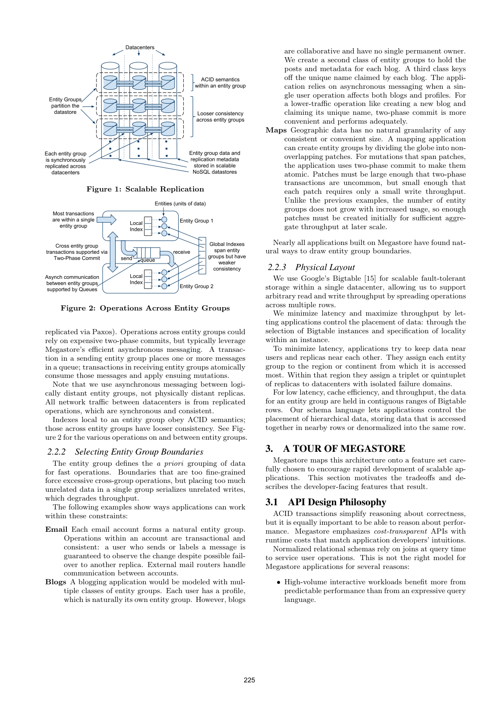
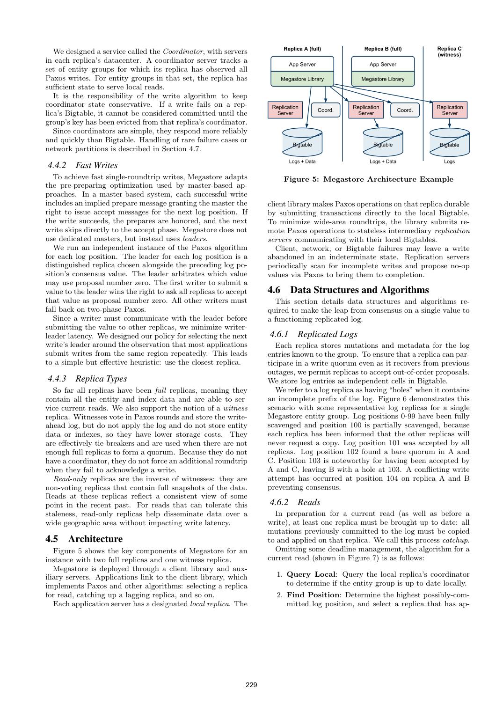

> 本组第 54 篇 · 数据库系统实践 · [全部论文]() · [上一篇]() · [下一篇]()

Megastore的扩展单位不是一个无限大的全局事务域，而是许多独立复制的entity group。每组在Bigtable之上维护Paxos日志，组内提供可串行化ACID；跨组默认使用异步事务队列，也支持代价更高的2PC。模式与主键显式控制局部性，局部索引原子维护，全局索引允许滞后。

核心难点是把多数派持久选择与任意副本的快速current read接起来：日志值在Paxos多数派接受后已被选定，但确认写入前，还必须让所有full replica接受该值或失效其Coordinator新鲜度声明。Coordinator既是读优化，又引入Chubby锁、epoch及可用性风险。所谓单WAN往返是健康快速路径，不是每次操作承诺；文中平均写延迟100-400ms和五个九均是历史生产应用统计，不是P99或无条件SLA。

本文保留论文陈述、读者推断与待验证方案的区别；实验数字只适用于原文条件。原文和翻译来自已有 AI 辅助精读报告，已做来源匹配与编辑复核，不等于人工逐项核验或独立实验复现。所有页码均为 PDF 物理页。

## 论文与阅读范围

Jason Baker等，Megastore: Providing Scalable, Highly Available Storage for Interactive Services，CIDR 2011，2011-01-09至12，本地12页，印刷223-234页；印刷页=物理页+222。以下仅分析此历史系统，不把其竞品评价当作当前产品说明。

[论文集中的原始 PDF](https://github.com/lonng/db-papers/blob/4ff1331069c7cf52ac97dd769e5f484c1c35c200/papers/rdbms/megastore%3A-providing-scalable%2C-highly-available-storage-for-interactive-services.pdf) · 本地来源：`rdbms/megastore_-providing-scalable,-highly-available-storage-for-interactive-services.pdf`，共 12 页。

本篇保留 36 组原文精读和 48 条证据。截图为原始 PDF 的局部页选，不是重新生成的图表；未将整份 PDF 复制到博客。

## 研究问题与适用边界

**目标组合与适用负载**
交互式服务希望既有用户可理解的read-modify-write事务，又能跨数据中心抗故障并扩展用户数。Megastore没有承诺把一个无限大的SQL数据库直接复制得又快又强；它把数据切成许多小entity group，以每组串行日志换取容易推理的组内事务。

**扩展的前提是应用能画边界**
邮箱账户天然是一组；博客、用户资料与唯一名称可能属于不同组；地图区域需要在跨区事务比例和单区写竞争间折中。边界过细增加跨组开销，过粗串行化无关写。容量可分片不等于热点写可无限并行。

**不要把历史动机写成当前竞品判决**
原文对MySQL、NoSQL和Oracle的评价属于2011范围，本报告未检查当前版本。更有价值的分析是原语取舍：组内ACID、跨组队列/2PC、显式访问路径以及局部/全局索引不同保证。

依据：论文陈述；PDF 物理页 1, 3, 4, 6, 9。证据：[MG-SRC-01](#evidence-mg-src-01), [MG-SRC-03](#evidence-mg-src-03), [MG-SRC-04](#evidence-mg-src-04), [MG-SRC-05](#evidence-mg-src-05), [MG-SRC-06](#evidence-mg-src-06), [MG-SRC-07](#evidence-mg-src-07), [MG-SRC-11](#evidence-mg-src-11), [MG-SRC-22](#evidence-mg-src-22)。

## 系统架构与物理布局

**两层与两种分区**
Bigtable承担单数据中心内的可扩展存储；Megastore以每组Paxos WAL提供跨地域复制和事务。客户端库执行复制、选读副本和catchup，本地直接访问Bigtable，远端经无状态replication server减少WAN往返。主键前缀和IN TABLE声明控制局部性，而不是隐式依赖通用查询优化器。

**三种副本**
full replica存实体、索引及日志并可服务current读；witness投票、持WAL但不apply实体；readonly持某个过去时间的一致快照、不投票。三者不能在法定人数或读语义上互换。

**Coordinator不是Paxos leader**
每地域Coordinator维护本地哪些组已追齐；每槽leader则由上一个日志值确定，仲裁零号proposal。前者加速读，后者加速写。说“无永久master”不意味着没有leader、租约或服务依赖。

**模式也是性能API**
局部索引原子更新，全局索引跨组可滞后；STORING降低回表，repeated/inline索引进行声明式冗余。大多数join由应用安排，系统只提供部分有序主键流合并。

依据：论文陈述；PDF 物理页 4, 5, 7, 9。证据：[MG-SRC-05](#evidence-mg-src-05), [MG-SRC-06](#evidence-mg-src-06), [MG-SRC-07](#evidence-mg-src-07), [MG-SRC-08](#evidence-mg-src-08), [MG-SRC-12](#evidence-mg-src-12), [MG-SRC-13](#evidence-mg-src-13), [MG-SRC-14](#evidence-mg-src-14), [MG-SRC-15](#evidence-mg-src-15), [MG-SRC-18](#evidence-mg-src-18)。

*原论文 PDF 物理页 3，版权归原作者或出版方。点击图片可查看原尺寸。页面文本中定位到：Figure 1: Scalable Replication；Figure 2: Operations Across Entity Groups。这是页面定位信息，不表示本次已复核图内所有数据。*

## 核心算法：Coordinator、Fast Reads 与 Write 流程

**读路径**
先并行查询Coordinator及本地可能已提交最高日志位。若新鲜度不能确认，则查询多数副本得到最大已见位置并选择响应好或更新的full replica。catchup获取缺失共识值；未知值通过Paxos提议no-op，结果可能仍是先前写。随后按顺序apply至选定位置，再以该时间戳查数据。不能把日志有洞的副本直接当成完整前缀。

**写路径及失败重试**
写事务始于current read，产生待写集合。对下个槽先向指定leader申请零号proposal；失败则以更高proposal做prepare，保留已发现的最高号提议值。accept达到多数后执行所有full副本的新鲜度失效屏障，再apply。若最后选择的值不是自己的，整个事务从读阶段重试，而非继续复用旧读取计算。

**两个时点**
多数选择在第3步，visibility在第4步后。某full replica未接受时必须失效其Coordinator，否则它还能错误提供local current read。第5页概述“commit之后可返回”必须结合第8页更精确的屏障理解，不能删掉后者。

**消息与跨组操作**
一个事务可原子写多个出队消息；接收组在自己的事务中消费并修改本组数据。这个流程不是跨所有接收者同时提交。需要跨组原子更新时可用2PC，但成本更高。

依据：论文陈述；PDF 物理页 2, 3, 5, 6, 7, 8, 9。证据：[MG-SRC-02](#evidence-mg-src-02), [MG-SRC-04](#evidence-mg-src-04), [MG-SRC-08](#evidence-mg-src-08), [MG-SRC-09](#evidence-mg-src-09), [MG-SRC-10](#evidence-mg-src-10), [MG-SRC-11](#evidence-mg-src-11), [MG-SRC-12](#evidence-mg-src-12), [MG-SRC-13](#evidence-mg-src-13), [MG-SRC-16](#evidence-mg-src-16), [MG-SRC-17](#evidence-mg-src-17), [MG-SRC-21](#evidence-mg-src-21)。

## 正确性保证与一致性边界

**Paxos只解决一部分问题**
每槽选值安全性需要法定人数与proposal规则；数据库一致读还要求顺序apply、读时间戳和Coordinator声明保守。full副本没有接受新值时，已确认写不应被其“最新”本地读遗漏，因此失效屏障是正确性条件。

**版本与提交仲裁**
读完整apply时间戳避免部分更新；竞争写者只有一个值胜出，败者必须中止重读。组内可串行化不应外推为global index扫描最新，或把所有readonly快照叫current。

**乱序、重启与分区**
高日志位置invalidate压过低位置validate；epoch防旧实例验证消息进入新状态。丢失Chubby锁多数后，Coordinator保守地将全部组过期。非对称分区可能仍续锁却无法响应提议者，原文明示需要手工禁用，不能声称全故障自动恢复。

**保证等级**
本文没有给出完整形式化系统证明。原文Paxos假设是延迟/乱序及停止故障，不覆盖拜占庭行为；多数可达等进展条件和Coordinator额外依赖不能省略。

依据：论文陈述；PDF 物理页 2, 5, 7, 8, 9。证据：[MG-SRC-02](#evidence-mg-src-02), [MG-SRC-08](#evidence-mg-src-08), [MG-SRC-09](#evidence-mg-src-09), [MG-SRC-10](#evidence-mg-src-10), [MG-SRC-12](#evidence-mg-src-12), [MG-SRC-13](#evidence-mg-src-13), [MG-SRC-16](#evidence-mg-src-16), [MG-SRC-17](#evidence-mg-src-17), [MG-SRC-18](#evidence-mg-src-18), [MG-SRC-19](#evidence-mg-src-19), [MG-SRC-20](#evidence-mg-src-20), [MG-SRC-21](#evidence-mg-src-21)。

## 生产环境实验与性能指标

**历史生产测量，而非可控横评**
系统当时已服务超过100应用，正文给出每日30亿写、200亿读和近PB主数据等规模。图9/10是生产应用分布，缺少可据此重跑的统一硬件、工作负载、观察窗口、重复及误差设计。它证明部署经验广泛，不隔离每项优化的因果贡献。

**图9可用性**
横轴是操作成功率档位，纵轴是应用比例，读/写分开。多数应用至少五个九，样本低端包括测试中或较容错的批处理。不能把它变为所有应用SLA，不能按柱子推断某应用连续无中断时长。

**图10延迟**
横轴对数毫秒，纵轴应用累计比例，比较的是各应用平均读/提交延迟。多数平均写100-400ms，平均读几十毫秒；不是所有请求在此区间，更不是P95/P99曲线。单WAN往返描述健康快速路径，争用、catchup、失效和故障会额外增加时间。

**测试经验**
作者的伪随机网络模拟可按种子复现事件顺序，每晚数千模拟小时发现错误，但明确无法穷举状态空间。本报告只运行局部状态/算术读者例子，没有原系统、Bigtable、Chubby或WAN基准。

依据：论文陈述；PDF 物理页 9, 10, 11。证据：[MG-SRC-19](#evidence-mg-src-19), [MG-SRC-20](#evidence-mg-src-20), [MG-SRC-22](#evidence-mg-src-22), [MG-SRC-23](#evidence-mg-src-23), [MG-SRC-24](#evidence-mg-src-24), [MG-SRC-25](#evidence-mg-src-25), [MG-SRC-26](#evidence-mg-src-26)。

*原论文 PDF 物理页 7，版权归原作者或出版方。点击图片可查看原尺寸。页面文本中定位到：Figure 5 shows the key components of Megastore for an；Figure 5: Megastore Architecture Example。这是页面定位信息，不表示本次已复核图内所有数据。*

## 工程权衡与设计局限

**全局吞吐与单组竞争**
大量独立日志支持横向扩展，同一组的写仍争相占下一个槽。每秒几次写是文中低冲突建议，不是Paxos理论上限。batch、session affinity、advisory lock可减少冲突，却会改变排队和调用组织。

**快读把义务放到写与故障路径**
Coordinator使健康读本地化，但写需保证所有full接受或失效。数据中心断开可能等待锁过期数十秒，非对称分区甚至需手工操作。没有免费获得“任意副本强读”。

**可预测API与开发负担**
显式扫描、索引和层级键让成本透明，也把join、模式变化和物理调优负担交给应用；global index放松最新性，换取跨组发现能力。

**容错不是备份或修复**
复制能传播错误，作者仍提供全量/增量备份。可用多数会掩盖持续故障，落后副本追赶又可拖累快副本。成功率、复制健康、积压和恢复目标应分别监测。

依据：读者推断；PDF 物理页 3, 4, 6, 7, 8, 9, 11。证据：[MG-SRC-03](#evidence-mg-src-03), [MG-SRC-05](#evidence-mg-src-05), [MG-SRC-07](#evidence-mg-src-07), [MG-SRC-11](#evidence-mg-src-11), [MG-SRC-12](#evidence-mg-src-12), [MG-SRC-17](#evidence-mg-src-17), [MG-SRC-19](#evidence-mg-src-19), [MG-SRC-20](#evidence-mg-src-20), [MG-SRC-22](#evidence-mg-src-22), [MG-SRC-26](#evidence-mg-src-26)。

## 与相关系统及现代引擎的比较视角

**组内复制与组间工作流**
Paxos同步复制同一个逻辑事务域；队列异步衔接不同域；2PC为跨域原子更新协调提交。三者解决的边界不同，不能互相以名字替代。

**传统master与每槽leader**
前者长期集中读写；Megastore每槽预定leader用于零号proposal，客户端仍可从任意副本发起。快速路径不等于彻底leaderless，故障或竞争会退回两阶段。

**current、snapshot、inconsistent**
这三种读按先前提交已apply、已知完整历史点、忽略日志分别定义。readonly副本不投票且允许陈旧，witness投票却无实体；副本数须按用途而非一个总数理解。

原文相关工作中对其他系统功能的结论未在当前版本核实；报告不补写现代Spanner或其他产品具有什么功能，也不做未经同语义测量的排名。

依据：读者推断；PDF 物理页 1, 2, 3, 5, 6, 7, 8。证据：[MG-SRC-01](#evidence-mg-src-01), [MG-SRC-02](#evidence-mg-src-02), [MG-SRC-04](#evidence-mg-src-04), [MG-SRC-09](#evidence-mg-src-09), [MG-SRC-11](#evidence-mg-src-11), [MG-SRC-13](#evidence-mg-src-13), [MG-SRC-14](#evidence-mg-src-14), [MG-SRC-15](#evidence-mg-src-15), [MG-SRC-16](#evidence-mg-src-16), [MG-SRC-17](#evidence-mg-src-17)。

## 复现路径与测试方法论

**实际完成的读者检查**
实读12页，视觉核对第3、4、5、7、8、9、10页全部图1-10与数据布局表。运行一个非Paxos的状态演示：A/B已接收v1，C保留v0且Coordinator有效；若此时提前确认，C本地读返回v0，说明为何协议需要屏障。失效后只得到“不可使用本地快速读”，不代表本例已实现正确catchup。

**未执行的协议复现计划**
1. 在隔离模拟器中实现逐槽proposal、已接受值和durable状态，验证prepare必须继承最高号已接受值，no-op不能覆盖已选值。
2. 加入Coordinator日志位置与epoch，枚举晚到validate、重启、失效和读取交错，检查已确认写不可被current read遗漏。
3. 独立切断Bigtable、Coordinator、Chubby续锁及提议者路径，分别记录安全性和等待进展；特别保留非对称分区情形。
4. 性能分解本地读、majority read、catchup、零号写、两阶段写与失效等待，报告请求级尾延迟，不把应用平均值图当P99。
5. 逐步改变实体组粒度、batch与热点比例，分开测单组竞争和全系统独立组扩展。

以上方案未运行原Megastore及依赖服务，不应称为生产系统复现。

依据：待验证的工程设想；PDF 物理页 3, 5, 7, 8, 9, 10。证据：[MG-SRC-03](#evidence-mg-src-03), [MG-SRC-09](#evidence-mg-src-09), [MG-SRC-10](#evidence-mg-src-10), [MG-SRC-12](#evidence-mg-src-12), [MG-SRC-13](#evidence-mg-src-13), [MG-SRC-16](#evidence-mg-src-16), [MG-SRC-17](#evidence-mg-src-17), [MG-SRC-18](#evidence-mg-src-18), [MG-SRC-19](#evidence-mg-src-19), [MG-SRC-20](#evidence-mg-src-20), [MG-SRC-21](#evidence-mg-src-21), [MG-SRC-22](#evidence-mg-src-22), [MG-SRC-24](#evidence-mg-src-24), [MG-SRC-25](#evidence-mg-src-25)。

## 总结与工程启示

Megastore展示了一个清晰中间点：组内小数据库以Paxos日志提供强事务，组间用较弱但可扩展的组合原语。它的工程创新不仅是“用了Paxos”，而是日志空洞恢复、每槽快速提议、读时间戳和Coordinator失效屏障共同完成数据库协议。

代价也很具体：单组写竞争、跨组操作代价、global index滞后、故障等待以及运维介入。阅读时抓住chosen、visible、ack和applied四个时点，比记住一个单WAN往返口号更重要。

本报告保留API来源及用量；本次来源复核没有执行原代码、形式证明或真实WAN实验。结构和引文校验只是来源质量检查，不是给整个系统或所有解释颁发正确性认证。

依据：读者推断；PDF 物理页 1, 3, 4, 5, 7, 8, 9, 10, 11。证据：[MG-SRC-01](#evidence-mg-src-01), [MG-SRC-03](#evidence-mg-src-03), [MG-SRC-07](#evidence-mg-src-07), [MG-SRC-10](#evidence-mg-src-10), [MG-SRC-12](#evidence-mg-src-12), [MG-SRC-13](#evidence-mg-src-13), [MG-SRC-16](#evidence-mg-src-16), [MG-SRC-17](#evidence-mg-src-17), [MG-SRC-20](#evidence-mg-src-20), [MG-SRC-21](#evidence-mg-src-21), [MG-SRC-22](#evidence-mg-src-22), [MG-SRC-24](#evidence-mg-src-24), [MG-SRC-26](#evidence-mg-src-26)。

## 原文精读：从句子回到机制

以下保留原文、忠实翻译、含义与边界；假设示例不作为论文实验结果。

### P001 · PDF 物理页 1

**原文**

<blockquote class="paper-source-quote"><pre><code>The ser-&#10;vice must be resilient to many kinds of faults ranging from&#10;the failure of individual disks, machines, or routers all the&#10;way up to large-scale outages affecting entire datacenters.&#10;These requirements are in conflict. Relational databases&#10;provide a rich set of features for easily building applications,&#10;but they are difficult to scale to hundreds of millions of&#10;users.&#10;NoSQL datastores such as Google’s Bigtable [15],&#10;Apache Hadoop’s HBase [1], or Facebook’s Cassandra [6]&#10;are highly scalable, but their limited API and loose consis-&#10;tency models complicate application development.</code></pre></blockquote>

**忠实翻译**

> 服务应能抵抗从磁盘、机器和路由器到整个数据中心的故障。这些要求有冲突：关系库特性丰富、便于开发，但作者认为难扩到数亿用户；所列NoSQL系统可扩展，却以有限API和宽松一致性增加开发复杂度。

**技术含义与边界**

> 这是2011论文动机的历史评价，不是当前数据库能力审计或对所有系统的定理。用户数不能直接替代事务量、访问形态和数据集规模；正文真正给出的折中是entity group内强事务、组间较弱组合。

**常见误读**

> 不要从人数就断言单机必然不能承载，也不要把所有NoSQL或所有关系库固定为一种一致性模型。

**读者构造的假设示例**

> 读者建模：先统计每账户内和跨账户操作比例，再决定是否能把账户作为组；五亿注册用户本身并不能说明当前同时请求多少。

### P002 · PDF 物理页 11

**原文**

<blockquote class="paper-source-quote"><pre><code>If slowness is interpreted&#10;as a fault, and tolerated, the fastest majority of machines&#10;will process requests at their own pace, reaching equilibrium&#10;only when slowed down by the load of the laggers struggling&#10;to catch up.&#10;We call this anomaly chain gang throttling,&#10;evoking the image of a group of escaping convicts making&#10;progress only as quickly as they can drag the stragglers.&#10;A benefit of Megastore’s write-ahead log has been the ease&#10;of integrating external systems.</code></pre></blockquote>

**忠实翻译**

> 若把慢当故障并容忍，快的多数可先按自己节奏推进，直到落后副本追赶所施加负载拖慢它们才达到平衡。作者称之为chain gang throttling。之后另起一句说WAL有利于集成外部系统。

**技术含义与边界**

> 现象是追赶工作反压前台，不是协议必须等待最慢副本的同义表述。原文未量化稳态必等于最慢节点速度，也未证明所有Paxos变体必出现。末句属于下一主题，不能据此把追赶问题说成WAL优势。

**常见误读**

> 多数派进展掩盖落后，并不消除落后副本消耗的CPU、网络和存储；但具体哪项资源先饱和要测量。

**读者构造的假设示例**

> 读者设定：追赶批量占用共享磁盘吞吐，使本来很快的日志读写排队。分别观测前台延迟、追赶字节和I/O队列，而非只记录活副本数量。

### P003 · PDF 物理页 6

**原文**

<blockquote class="paper-source-quote"><pre><code>There is a long history of message queues in full-featured&#10;RDBMSs. Our support is notable for its scale: declaring a&#10;queue automatically creates an inbox on each entity group,&#10;giving us millions of endpoints.&#10;3.3.2&#10;Two-Phase Commit&#10;Megastore supports two-phase commit for atomic updates&#10;across entity groups.</code></pre></blockquote>

**忠实翻译**

> RDBMS消息队列历史很长；这里的规模特点是声明队列时每个entity group自动有收件箱，形成数百万端点。随后3.3.2说明支持跨组原子更新的2PC。

**技术含义与边界**

> 端点是逻辑收件箱，不必是一台进程或物理分区。原文没有在此给“所有队列端点总和”的精确计数公式，不能擅自换口径。紧随引文下一段明确2PC延迟更高、竞争风险更大，并通常推荐队列。

**常见误读**

> 不能因短引在句末结束就说整篇未谈2PC代价；队列分事务处理也不等价跨组同时可见。

**读者构造的假设示例**

> 一百万用户组可各有收件箱。发送事务原子放入邀请，接收账户随后自己的事务消费；若操作要求两个组原子更新，应明确使用另一条2PC路径。

### P004 · PDF 物理页 3

**原文**

<blockquote class="paper-source-quote"><pre><code>2.2.2&#10;Selecting Entity Group Boundaries&#10;The entity group defines the a priori grouping of data&#10;for fast operations.&#10;Boundaries that are too fine-grained&#10;force excessive cross-group operations, but placing too much&#10;unrelated data in a single group serializes unrelated writes,&#10;which degrades throughput.&#10;The following examples show ways applications can work&#10;within these constraints:&#10;Email Each email account forms a natural entity group.</code></pre></blockquote>

**忠实翻译**

> entity group事先规定快速操作的数据边界。太细增加跨组操作，太粗把无关写串行化而降低吞吐。作者用每个邮件账户天然成为一组说明可行划分。

**技术含义与边界**

> 同一组共享串行日志，即便业务键不同也会竞争组的写序列。组边界选择要同时看事务局部性、热点写及跨组需要，不能只按实体名称或容量划分。

**常见误读**

> 按用户、订单或地图区域都不是普适正确答案；跨组队列与2PC仍可用，但语义与代价不同。

**读者构造的假设示例**

> 把所有人评论同一热门主题放一组会集中写竞争；拆分后若维护全局计数，又要明确异步聚合或跨组原子更新，不能把复杂性假装消失。

### P005 · PDF 物理页 2

**原文**

<blockquote class="paper-source-quote"><pre><code>Megastore has been widely deployed within Google for&#10;several years [20]. It handles more than three billion write&#10;and 20 billion read transactions daily and stores nearly a&#10;petabyte of primary data across many global datacenters.&#10;The key contributions of this paper are:&#10;1.</code></pre></blockquote>

**忠实翻译**

> 作者报告Megastore当时已在Google内部部署多年，每天处理超过30亿写和200亿读事务，在全球多个数据中心存近PB主数据。原引文末尾开始列贡献。

**技术含义与边界**

> 这是历史生产总量，不是单entity group、单机或单应用吞吐上限，也不是本报告独立重测。写事务数不能直接换算净新增字节，因为可能包含覆盖、删除、多实体和索引修改。

**常见误读**

> 不要把30亿乘假设1KB写成已证实每天新增3TB；复制及冗余开销也不等于主数据存量。

**读者构造的假设示例**

> 把规模表分为每天事务次数、主数据字节、复制副本字节和单组写速率四列，仅在来源明确时填数字，避免混合聚合口径。

### P006 · PDF 物理页 8

**原文**

<blockquote class="paper-source-quote"><pre><code>In a traditional database system, the commit point (when&#10;the change is durable) is the same as the visibility point&#10;(when reads can see a change and when a writer can be no-&#10;tified of success). In our write algorithm, the commit point is&#10;after step 3 when the write has won the Paxos round, but the&#10;visibility point is after step 4. Only after all full replicas have&#10;accepted or had their coordinators invalidated can the write&#10;be acknowledged and the changes applied.</code></pre></blockquote>

**忠实翻译**

> 作者先用传统数据库作对比，再明确本算法：第3步Paxos获胜后是持久commit点，第4步后才是可见点。只有所有full副本接受了值，或它们的Coordinator已被失效，才能确认写并apply变更。

**技术含义与边界**

> 第4步不是等待所有full副本apply；尚未接受者可通过失效本地“已追齐”声明让读者走恢复路径。持久选择、对外确认和各副本物理apply分开，主文的传统系统概括也不应外推为所有数据库永远两点重合。

**常见误读**

> 不能说第三副本必须已经应用日志，也不能无条件说任何断电都不丢数据；持久性仍依赖法定人数及底层故障模型。

**读者构造的假设示例**

> A/B已接受v1，C仍v0。确认前让C接受v1或失效其Coordinator；若选择后者，C下次current read不能走旧的local fast path，而需majority/catchup。

### P007 · PDF 物理页 7

**原文**

<blockquote class="paper-source-quote"><pre><code>Since a writer must communicate with the leader before&#10;submitting the value to other replicas, we minimize writer-&#10;leader latency. We designed our policy for selecting the next&#10;write’s leader around the observation that most applications&#10;submit writes from the same region repeatedly. This leads&#10;to a simple but effective heuristic: use the closest replica.</code></pre></blockquote>

**忠实翻译**

> 写者提交给其他副本前须联系leader，因此要降低写者到leader延迟。作者观察多数应用反复从同一区域写，于是用最近副本作为下一次写leader的启发式。

**技术含义与边界**

> 每槽leader由前一槽共识值指定，用于仲裁proposal zero。这只缩短先联系leader的那段路，accept仍需多数副本；并不是取消跨数据中心WAN通信。

**常见误读**

> 不是任意写者临时自选leader，也不是永久静态master；访问区域变动和竞争可能使快速路径失效并退回prepare。

**读者构造的假设示例**

> 东京发起者联系当地已指定leader较快，但若多数还包括其他地域，复制确认仍受对应WAN RTT约束。

### P008 · PDF 物理页 9

**原文**

<blockquote class="paper-source-quote"><pre><code>The increased latency im-&#10;posed by synchronous replication increases the likelihood of&#10;conflicts for a given per-entity-group commit rate.&#10;Limiting that rate to a few writes per second per entity&#10;group yields insignificant conflict rates. For apps whose en-&#10;tities are manipulated by a small number of users at a time,&#10;this limitation is generally not a concern.</code></pre></blockquote>

**忠实翻译**

> 同步复制增加延迟，使给定单组提交率下更易冲突；每组每秒少数几次写通常使冲突不显著。少数用户同时操作同一实体的应用一般可接受。

**技术含义与边界**

> 这是该实现和目标负载的低冲突建议，不是精确固定上限或普遍概率保证。加快一个热点组与增加独立组扩展总体吞吐是两种问题。

**常见误读**

> 不能把每组几次写讲成全系统几次，也不能保证2-3协作者或某个具体速率一定零冲突；事务时长、地域和batch都会影响窗口。

**读者构造的假设示例**

> 固定3次/秒而把WAN往返从20ms改为300ms，活跃竞争窗口明显变化。读者应测重试和排队，而非只套次数阈值。

### P009 · PDF 物理页 10

**原文**

<blockquote class="paper-source-quote"><pre><code>when the underlying Bigtable is&#10;severely overloaded.&#10;4.10&#10;Production Metrics&#10;Megastore has been deployed within Google for several&#10;years; more than 100 production applications use it as their&#10;storage service. In this section, we report some measure-&#10;ments of its scale, availability, and performance.&#10;Figure 9 shows the distribution of availability, measured&#10;on a per-application, per-operation basis.</code></pre></blockquote>

**忠实翻译**

> 引文先残留上一节“底层Bigtable严重过载时”的尾句，再进入生产测量：超过100应用使用Megastore，图9按每应用、每操作类别记录可用性分布。

**技术含义与边界**

> 视觉核对图9可知横轴是操作成功率档位，纵轴是应用比例，read/query与write分开；并不是同一应用内每一个请求各有一条“成功率分布”。大多数应用五个九也不等于所有应用统一SLA。

**常见误读**

> 不可由残句推导全部过载行为；完整上一节说可能禁用有害副本，但剔除副本又减少可用法定人数。观察窗口和加权细节本篇没有充分给出。

**读者构造的假设示例**

> 若某应用有1000万次读，先计算该应用读成功率并落入一档；图柱表示多少应用落在该档，而不是1000万条请求各自的成功率。

### P010 · PDF 物理页 5

**原文**

<blockquote class="paper-source-quote"><pre><code>For example, the PhotosByTime index row&#10;keys would be the tuple (user id, time, primary key) for each&#10;photo. Indexing repeated fields produces one index entry&#10;per repeated element.&#10;For example, the primary key for&#10;a photo with three tags would appear in the PhotosByTag&#10;index thrice.&#10;3.3&#10;Transactions and Concurrency Control&#10;Each Megastore entity group functions as a mini-database&#10;Row&#10;User.&#10;Photo.&#10;Photo.&#10;Photo.</code></pre></blockquote>

**忠实翻译**

> PhotosByTime行键由(user id,time,primary key)组成；重复字段展开为每元素一个索引条目，三标签照片的主键会在PhotosByTag出现三次。后面转入事务节，混入了图4表头Row、User和Photo的文本。

**技术含义与边界**

> 这是索引键及fan-out的说明。entity group是逻辑小数据库，不要求独立进程。按第4页模式，Photo完整主键是(user_id,photo_id)，不能在示例中只以photo_id当全局唯一主键。第5页表头的插入已视觉核对，不是连续正文语句。

**常见误读**

> local与global索引保证不同：PhotosByTime为local，PhotosByTag为global且可滞后；重复字段条目增多也不是零成本。第5页按元素展开的概述还应结合第5页前文unique tag措辞，不声称重复相同标签一定生成重复物理行。

**读者构造的假设示例**

> 用户U1照片P1有互异A/B/C三个标签，全局索引概念键为(A,(U1,P1))等三条；若只用P1，另一个用户同photo_id可能冲突。这是逻辑示意，不是已复原的字节编码。

### MG-READ-01 · PDF 物理页 1

**原文**

<blockquote class="paper-source-quote"><pre><code>we partition the data-&#10;store and replicate each partition separately, providing full&#10;ACID semantics within partitions, but only limited con-&#10;sistency guarantees across them.</code></pre></blockquote>

**忠实翻译**

> 系统把数据划分并独立复制，每分区内提供完整ACID，跨分区只有有限保证。

**技术含义与边界**

> 实体组既是事务语义边界，也是吞吐扩展边界。

**常见误读**

> 不能把组内可串行化扩写为任意跨组事务都廉价且全局强一致。

**读者构造的假设示例**

> 邮箱账户为一组，标签更新组内原子；跨账户操作需队列或明确2PC。

### MG-READ-02 · PDF 物理页 2

**原文**

<blockquote class="paper-source-quote"><pre><code>Each log append blocks on acknowledgments from a ma-&#10;jority of replicas, and replicas in the minority catch up as&#10;they are able</code></pre></blockquote>

**忠实翻译**

> 日志追加等待多数副本确认，少数派能跟上时再追赶。

**技术含义与边界**

> Paxos为故障下安全选择服务；进展仍需多数可达。

**常见误读**

> 多数派不等于所有副本都已apply，也不等于可以跳过后续失效屏障。

**读者构造的假设示例**

> A/B已接受而C落后时，C还不能无条件在本地返回current read。

### MG-READ-03 · PDF 物理页 3

**原文**

<blockquote class="paper-source-quote"><pre><code>Boundaries that are too fine-grained&#10;force excessive cross-group operations, but placing too much&#10;unrelated data in a single group serializes unrelated writes,&#10;which degrades throughput.</code></pre></blockquote>

**忠实翻译**

> 边界太细会迫使过多跨组操作，太粗会串行化不相关写并降低吞吐。

**技术含义与边界**

> 分区选择把应用关系、事务局部性和热点冲突绑在一起。

**常见误读**

> 不能只按数据容量平均分组而忽略写共享。

**读者构造的假设示例**

> 一张高写入地图区域过大造成竞争，过小又让跨区域编辑频繁2PC。

### MG-READ-04 · PDF 物理页 3

**原文**

<blockquote class="paper-source-quote"><pre><code>Note that we use asynchronous messaging between logi-&#10;cally distant entity groups, not physically distant replicas.&#10;All network traffic between datacenters is from replicated&#10;operations, which are synchronous and consistent.</code></pre></blockquote>

**忠实翻译**

> 异步消息发生在逻辑上不同实体组之间，而不是物理上远隔的副本之间；跨数据中心复制操作同步一致。

**技术含义与边界**

> 两条维度正交：组间工作流异步，组内跨地域日志同步。

**常见误读**

> 不要把队列异步解释成组内Paxos复制异步。

**读者构造的假设示例**

> 发送方事务先持久化邀请消息，接收方另一个事务消费；两组不同时原子变更。

### MG-READ-05 · PDF 物理页 4

**原文**

<blockquote class="paper-source-quote"><pre><code>Queries specify scans or&#10;lookups against particular tables and indexes.&#10;Joins, when required, are implemented in application code.&#10;We provide an implementation of the merge phase of the&#10;merge join algorithm, in which the user provides multiple&#10;queries that return primary keys for the same table in the&#10;same order; we then return the intersection of keys for all&#10;the provided queries.</code></pre></blockquote>

**忠实翻译**

> 查询指定表/索引扫描或查找；join通常由应用实现，系统提供同序主键流的归并交集。

**技术含义与边界**

> API把访问路径成本暴露给开发者，而不是提供通用SQL优化器。

**常见误读**

> 归并多个同表主键集合不是任意关系join引擎。

**读者构造的假设示例**

> 按时间和标签两个有序主键流求交，可筛照片；一对多外连接仍需应用协议。

### MG-READ-06 · PDF 物理页 4

**原文**

<blockquote class="paper-source-quote"><pre><code>A local index is treated as separate&#10;indexes for each entity group. It is used to find data within&#10;an entity group. In Figure 3, PhotosByTime is an example&#10;of a local index. The index entries are stored in the entity&#10;group and are updated atomically and consistently with the&#10;primary entity data.</code></pre></blockquote>

**忠实翻译**

> local index是每个实体组独立的一份索引，与实体主数据原子、一致地更新。

**技术含义与边界**

> 索引一致性直接依赖其事务所属实体组。

**常见误读**

> 不能把此保证套到跨组global index。

**读者构造的假设示例**

> 用户照片时间索引与该用户照片写同事务，而全局标签搜索可能暂时漏掉新照片。

### MG-READ-07 · PDF 物理页 4

**原文**

<blockquote class="paper-source-quote"><pre><code>Global index scans can read data owned&#10;by many entity groups but are not guaranteed to reflect all&#10;recent updates.</code></pre></blockquote>

**忠实翻译**

> 全局索引扫描跨多个实体组，不保证反映所有最近更新。

**技术含义与边界**

> 查询发现性与组内当前状态不具有同一新鲜度边界。

**常见误读**

> 不能以实体组current read强一致推导全局索引扫描强一致。

**读者构造的假设示例**

> 按标签找不到刚写入照片，并不自动说明组内事务丢失。

### MG-READ-08 · PDF 物理页 5

**原文**

<blockquote class="paper-source-quote"><pre><code>Readers use the timestamp of the last fully applied trans-&#10;action to avoid seeing partial updates. Readers and writers&#10;don’t block each other, and reads are isolated from writes&#10;for the duration of a transaction.</code></pre></blockquote>

**忠实翻译**

> 读者用最后完整apply事务的时间戳避免部分更新，读写互不阻塞且事务持续期间读与写隔离。

**技术含义与边界**

> MVCC读时间戳和顺序apply共同构成一致读取基础。

**常见误读**

> 只写上MVCC四个字还不能证明可串行化，写提交冲突仍须Paxos仲裁。

**读者构造的假设示例**

> 日志含两行变更，apply仅完成一行时读者仍读前一个完整时间戳。

### MG-READ-09 · PDF 物理页 5

**原文**

<blockquote class="paper-source-quote"><pre><code>Megastore provides current, snapshot, and inconsistent&#10;reads. Current and snapshot reads are always done within&#10;the scope of a single entity group. When starting a current&#10;read, the transaction system first ensures that all previously&#10;committed writes are applied; then the application reads at&#10;the timestamp of the latest committed transaction. For a&#10;snapshot read, the system picks up the timestamp of the last&#10;known fully applied transaction and reads from there, even&#10;if some committed transactions have not yet been applied.&#10;Megastore also provides inconsistent reads, which ignore the&#10;state of the log and read the latest values directly. This is&#10;useful for operations that have more aggressive latency re-&#10;quirements and can tolerate stale or partially applied data.</code></pre></blockquote>

**忠实翻译**

> current确保先前提交已apply再读最新提交时间；snapshot读最后已知完整apply时间；inconsistent忽略日志并可见陈旧或部分数据。

**技术含义与边界**

> 三种读模式的代价和可见性承诺不同，current/snapshot范围仅单组。

**常见误读**

> snapshot一词不自动等于提供通用Snapshot Isolation写事务，也不代表全局快照。

**读者构造的假设示例**

> 快照读返回旧但完整的照片集合；inconsistent可能只看到事务变更的一部分。

### MG-READ-10 · PDF 物理页 5

**原文**

<blockquote class="paper-source-quote"><pre><code>The protocol uses optimistic con-&#10;currency: though multiple writers might be attempting to&#10;write to the same log position, only one will win. The rest&#10;will notice the victorious write, abort, and retry their op-&#10;erations.</code></pre></blockquote>

**忠实翻译**

> 多个写者可争抢同一日志位置，但只有一个获胜，其余发现胜者后中止并重试。

**技术含义与边界**

> 事务级重新执行，而不是只在相同旧读结果上重发写入。

**常见误读**

> 不能把Paxos安全选择误写为消除应用写冲突。

**读者构造的假设示例**

> 两事务都读余额100并分别扣款，败者必须重读，而非把旧计算再次提交。

### MG-READ-11 · PDF 物理页 6

**原文**

<blockquote class="paper-source-quote"><pre><code>Megastore supports two-phase commit for atomic updates&#10;across entity groups.&#10;Since these transactions have much&#10;higher latency and increase the risk of contention, we gener-&#10;ally discourage applications from using the feature in favor&#10;of queues.</code></pre></blockquote>

**忠实翻译**

> 支持跨实体组原子更新的2PC，但延迟及竞争风险高，通常鼓励改用队列。

**技术含义与边界**

> 并不是完全禁止跨组事务，而是明确代价。

**常见误读**

> 队列将工作拆成多个原子事务，不等价于原操作全局同时可见。

**读者构造的假设示例**

> 创建博客并抢唯一名可用2PC；批量通知更适合异步消费。

### MG-READ-12 · PDF 物理页 7

**原文**

<blockquote class="paper-source-quote"><pre><code>If a write fails on a rep-&#10;lica’s Bigtable, it cannot be considered committed until the&#10;group’s key has been evicted from that replica’s coordinator.</code></pre></blockquote>

**忠实翻译**

> 若写在某副本Bigtable失败，则在该组键被该副本Coordinator移除前，不能认为写已提交。

**技术含义与边界**

> Coordinator对本地副本是否追齐的声明必须保守，失效属于写协议。

**常见误读**

> 不能把Coordinator当作无关正确性的普通缓存。

**读者构造的假设示例**

> 若A/B已接受而C仍声称最新，提前确认会让C读到旧值。

### MG-READ-13 · PDF 物理页 7

**原文**

<blockquote class="paper-source-quote"><pre><code>The leader for each log position is a&#10;distinguished replica chosen alongside the preceding log po-&#10;sition’s consensus value. The leader arbitrates which value&#10;may use proposal number zero. The first writer to submit a&#10;value to the leader wins the right to ask all replicas to accept&#10;that value as proposal number zero. All other writers must&#10;fall back on two-phase Paxos.</code></pre></blockquote>

**忠实翻译**

> 每个日志位置的leader由前一个位置的共识值选出，仲裁谁能使用proposal零；其他竞争写者退回两阶段Paxos。

**技术含义与边界**

> 没有永久heavyweight master，不等于完全没有leader或仲裁点。

**常见误读**

> proposal zero必须单值受控，不能让所有写者各自跳过prepare。

**读者构造的假设示例**

> 同槽两写者联系同一指定leader；只有一个拿到零号快速路径。

### MG-READ-14 · PDF 物理页 7

**原文**

<blockquote class="paper-source-quote"><pre><code>Witnesses vote in Paxos rounds and store the write-&#10;ahead log, but do not apply the log and do not store entity&#10;data or indexes, so they have lower storage costs.</code></pre></blockquote>

**忠实翻译**

> witness投票且存WAL，但不apply日志，也不存实体和索引，所以存储成本较低。

**技术含义与边界**

> witness不是完全无数据的空投票器；它持有恢复/共识需要的日志。

**常见误读**

> 不能从witness可投票推断它可提供current实体查询。

**读者构造的假设示例**

> 两full加一witness可形成多数，但只有full适合服务实体当前读。

### MG-READ-15 · PDF 物理页 7

**原文**

<blockquote class="paper-source-quote"><pre><code>Read-only replicas are the inverse of witnesses: they are&#10;non-voting replicas that contain full snapshots of the data.&#10;Reads at these replicas reflect a consistent view of some&#10;point in the recent past. For reads that can tolerate this&#10;staleness, read-only replicas help disseminate data over a&#10;wide geographic area without impacting write latency.</code></pre></blockquote>

**忠实翻译**

> 只读副本不投票，持有完整历史某点的一致快照，可传播数据且不增加写路径延迟。

**技术含义与边界**

> 其用途是容忍陈旧度的读取，与full和witness各不相同。

**常见误读**

> 不能把readonly加入Paxos法定票数，或称它最新current read。

**读者构造的假设示例**

> 跨洲分析读可选readonly，事务写确认不能依赖它的票。

### MG-READ-16 · PDF 物理页 8

**原文**

<blockquote class="paper-source-quote"><pre><code>For any log positions&#10;without a known-committed value available, in-&#10;voke Paxos to propose a no-op write. Paxos will&#10;drive a majority of replicas to converge on a single&#10;value—either the no-op or a previously proposed&#10;write.</code></pre></blockquote>

**忠实翻译**

> 对没有可取得已提交值的槽位，提议no-op，通过Paxos收敛到no-op或先前已提议的写。

**技术含义与边界**

> no-op是协议提议，不是覆盖一个可能已选值的命令。

**常见误读**

> 不能直接把未知槽清零或认定它不存在。

**读者构造的假设示例**

> 若旧值已被多数选定，恢复轮应保留旧值，而不是强写no-op。

### MG-READ-17 · PDF 物理页 8

**原文**

<blockquote class="paper-source-quote"><pre><code>the commit point is&#10;after step 3 when the write has won the Paxos round, but the&#10;visibility point is after step 4. Only after all full replicas have&#10;accepted or had their coordinators invalidated can the write&#10;be acknowledged and the changes applied.</code></pre></blockquote>

**忠实翻译**

> 多数派接受后的第3步是持久commit点，第4步失效屏障后才到visibility点；所有full接受或失效后才能确认与apply。

**技术含义与边界**

> chosen、visibility、ack、apply是不同协议时点。

**常见误读**

> 第5页生命周期概述不能用来绕过这里第4.6.3节的精确限制。

**读者构造的假设示例**

> 读者状态演示A/B=v1而C=v0且valid：若提前ack，C的local read就会漏掉已确认写。

### MG-READ-18 · PDF 物理页 9

**原文**

<blockquote class="paper-source-quote"><pre><code>To process requests, a coordinator must hold a majority&#10;of its locks. If it ever loses a majority of its locks from a crash&#10;or network partition, it will revert its state to a conservative&#10;default, considering all entity groups in its purview to be&#10;out-of-date. Subsequent reads at the replica must query the&#10;log position from a majority of replicas until the locks are&#10;regained and its coordinator entries are revalidated.</code></pre></blockquote>

**忠实翻译**

> Coordinator必须持有其Chubby锁的多数；失去多数则回退到所有组过期，读走多数日志检查直至恢复并重验。

**技术含义与边界**

> 故障检测和保守回退补足本地新鲜度声明的安全条件。

**常见误读**

> 这不是Paxos数据法定票本身，也不能省略锁失效时的状态重置。

**读者构造的假设示例**

> 失联Coordinator恢复后不能沿用崩溃前的valid集合。

### MG-READ-19 · PDF 物理页 9

**原文**

<blockquote class="paper-source-quote"><pre><code>This algorithm risks a brief (tens of seconds) write out-&#10;age when a datacenter containing live coordinators suddenly&#10;becomes unavailable—all writers must wait for the coor-&#10;dinator’s Chubby locks to expire before writes can com-&#10;plete (much like waiting for a master failover to trigger).</code></pre></blockquote>

**忠实翻译**

> 一个数据中心突然不可达时可能发生数十秒写中断，写者需等Coordinator锁过期。

**技术含义与边界**

> 快速本地读把某些故障延迟转移到写确认路径。

**常见误读**

> 不能宣称不存在故障等待或跨地域切换零中断。

**读者构造的假设示例**

> 将锁租约超时与Paxos多数可达分别记录，二者均可能影响写进展。

### MG-READ-20 · PDF 物理页 9

**原文**

<blockquote class="paper-source-quote"><pre><code>The coordinator liveness protocol is vulnerable to asym-&#10;metric network partitions. If a coordinator can maintain the&#10;leases on its Chubby locks, but has otherwise lost contact&#10;with proposers, then affected entity groups will experience a&#10;write outage. In this scenario an operator performs a man-&#10;ual step to disable the partially isolated coordinator. We&#10;have faced this condition only a handful of times.</code></pre></blockquote>

**忠实翻译**

> 若Coordinator能续Chubby锁却无法接触提议者，非对称分区会阻塞受影响组的写，需要操作员手动禁用它。

**技术含义与边界**

> 作者明确承认运维补救边界。

**常见误读**

> 不要把该系统包装成所有分区都自动无损无停顿恢复。

**读者构造的假设示例**

> 只切断proposer路径而保留Chubby路径，与整机断电会触发不同恢复流程。

### MG-READ-21 · PDF 物理页 9

**原文**

<blockquote class="paper-source-quote"><pre><code>Higher numbered in-&#10;validates always trump lower numbered validates.&#10;There&#10;are also races associated with a crash between an invalidate&#10;by a writer at position n and a validate at some position&#10;m &lt; n. We detect crashes using a unique epoch number&#10;for each incarnation of the coordinator: validates are only&#10;allowed to modify the coordinator state if the epoch remains&#10;unchanged since the most recent read of the coordinator.</code></pre></blockquote>

**忠实翻译**

> 更高日志位置的失效压过较低位置的验证；Coordinator每次重启有唯一epoch，验证只能在epoch未变时修改状态。

**技术含义与边界**

> 位置防止消息乱序，epoch防止旧实例消息污染新实例。

**常见误读**

> 只有日志序号而无实例身份不够处理重启竞态。

**读者构造的假设示例**

> 旧validate(n=10,epoch=1)迟到，不能将epoch2刚失效的条目重新置为最新。

### MG-READ-22 · PDF 物理页 9

**原文**

<blockquote class="paper-source-quote"><pre><code>Limiting that rate to a few writes per second per entity&#10;group yields insignificant conflict rates.</code></pre></blockquote>

**忠实翻译**

> 每实体组把写速率限制在每秒少数几次，可使冲突率不显著。

**技术含义与边界**

> 这是该实现典型低冲突建议，不是全系统吞吐上限或精确硬上限。

**常见误读**

> 不能写成Megastore整个集群只能几次写/秒。

**读者构造的假设示例**

> 用一百万独立账户扩展总体写量，与加速一个热点实体组不同。

### MG-READ-23 · PDF 物理页 10

**原文**

<blockquote class="paper-source-quote"><pre><code>Figure 9 shows the distribution of availability, measured&#10;on a per-application, per-operation basis. Most of our cus-&#10;tomers see extremely high levels of availability (at least five&#10;nines) despite a steady stream of machine failures, network&#10;hiccups, datacenter outages, and other faults. The bottom&#10;end of our sample includes some pre-production applications&#10;that are still being tested and batch processing applications&#10;with higher failure tolerances.</code></pre></blockquote>

**忠实翻译**

> 图9按每应用每操作统计可用性，多数客户至少五个九，低端包括测试中应用及容错较高的批处理。

**技术含义与边界**

> 总体样本不是一条统一服务SLA；读写分布不同，部分样本不是成熟生产应用。

**常见误读**

> 不能把“多数应用”变成所有事务五个九，论文未交代完整观察窗口和加权口径。

**读者构造的假设示例**

> 横轴成功率档位、纵轴应用比例；不能当作单应用随时间的可用性曲线。

### MG-READ-24 · PDF 物理页 10

**原文**

<blockquote class="paper-source-quote"><pre><code>Most users see average write latencies of 100–400 millisec-&#10;onds, depending on the distance between datacenters, the&#10;size of the data being written, and the number of full repli-&#10;cas. Figure 10 shows the distribution of average latency for&#10;read and commit operations.</code></pre></blockquote>

**忠实翻译**

> 多数用户平均写延迟100-400毫秒，受地域距离、数据大小及full副本数影响；图10展示平均延迟分布。

**技术含义与边界**

> 分布单位是应用的平均值，不是逐请求延迟分位数。

**常见误读**

> 不能把400ms说成P99、最大值或任意拓扑保证。

**读者构造的假设示例**

> 一个应用平均200ms仍可能存在秒级长尾；此图不能反推出P99。

### MG-READ-25 · PDF 物理页 10

**原文**

<blockquote class="paper-source-quote"><pre><code>While an exhaustive search of&#10;the scheduling state space is impossible, the pseudo-random&#10;simulation explores more than is practical by other means.&#10;Through running thousands of simulated hours of operation&#10;each night, the tests have found many surprising problems.</code></pre></blockquote>

**忠实翻译**

> 穷举调度空间不可能，伪随机模拟比其他手段更广，每晚运行数千模拟小时发现问题。

**技术含义与边界**

> 确定性种子支持复现，但随机探索不等于穷举或形式验证。

**常见误读**

> 不要把作者模拟框架说成本报告已运行，或认为覆盖所有故障。

**读者构造的假设示例**

> 保存触发旧validate竞态的事件序列作为回归，而不只保存一次通过结果。

### MG-READ-26 · PDF 物理页 11

**原文**

<blockquote class="paper-source-quote"><pre><code>“Fault tolerance is fault masking”. Too often,&#10;the resilience of our system coupled with insufficient vigi-&#10;lance in tracking the underlying faults leads to unexpected&#10;problems: small transient errors on top of persistent uncor-&#10;rected problems cause significantly larger problems.</code></pre></blockquote>

**忠实翻译**

> 容错也会掩盖故障；持续问题未被纠正时，叠加小瞬态错误会形成更大问题。

**技术含义与边界**

> 健康检查、修复和流量控制是算法之外的稳定性责任。

**常见误读**

> 多数派能进展不等于可以永久忽略落后副本。

**读者构造的假设示例**

> 记录落后副本追赶负荷，而不是只看前台成功率。

## 尚未解决的问题

1. Coordinator本地新鲜度断言与Paxos已选值之间的失效屏障，在重启及乱序validate下如何完整证明？
2. 原文未充分交代生产可用性观察窗口、加权与样本排除规则，精确统计应如何重建？
3. 对无法细分的热点实体组，batch、advisory lock和队列分解分别改变何种语义及尾延迟？
4. global index更新、重试与队列消费的详细失败协议未在本篇完整展开，应查哪些指定版本实现？
5. 非对称分区仍能续Chubby锁时，手工禁用流程如何避免错误重验，并测量写中断上界？
6. 可复现模拟器需覆盖哪些日志位置、epoch、锁失效与重启交错，随机种子测试之外还缺什么？

## 证据索引

证据编号沿用原报告，便于将上文判断追溯到原句。引文匹配只验证位置，不证明解读正确。

**C001N01 · PDF 物理页 1**

Megastore 要解决的核心问题是交互式在线服务对存储的多重冲突需求：高可扩展性、快速开发、低延迟、强一致性（更新立即可见且持久）和高可用性（容忍从磁盘到整个数据中心的故障）。传统 RDBMS 难以扩展到数亿用户，而 NoSQL 数据存储（如 Bigtable、HBase、Cassandra）虽然可扩展但 API 受限且一致性模型松散，增加了应用开发难度。

<blockquote class="paper-source-quote"><pre><code>Relational databases provide a rich set of features for easily building applications, but they are difficult to scale to hundreds of millions of users.</code></pre></blockquote>

**C001N03 · PDF 物理页 2**

论文报告了 Megastore 在 Google 的生产部署规模：每天处理超过 30 亿次写事务和 200 亿次读事务，在多个全球数据中心存储近 1 PB 的主数据。这是系统吞吐量和存储量的事实陈述，但未给出具体硬件配置、延迟分布或错误率等实验指标细节。

<blockquote class="paper-source-quote"><pre><code>It handles more than three billion write and 20 billion read transactions daily and stores nearly a petabyte of primary data</code></pre></blockquote>

**C001N04 · PDF 物理页 2**

作者评估并拒绝了三种常见的广域复制策略。异步主从复制可能在故障转移时丢失数据；同步主从复制需要外部系统及时检测故障；乐观复制无法在提交时确定全局变更顺序，因此不支持事务。作者明确假设放弃 read-modify-write 惯用法在当前快速应用开发中过于困难，因此排除了最终一致性方案。同时拒绝重量级 master 以避免故障转移导致用户可见的中断。

<blockquote class="paper-source-quote"><pre><code>Despite the operational advantages of eventually consistent systems, it is currently too difficult to give up the read-modify-write idiom in rapid application development.</code></pre></blockquote>

**C001N08 · PDF 物理页 3**

Entity group 边界的选取是性能关键假设。边界过细会导致过多的跨组操作；将过多无关数据放入同一组会使无关写入串行化，降低吞吐量。论文以 Email（每账户一个 entity group）、Blogs（profile、blog posts、unique name 分别建模为不同类 entity group）和 Maps（将地球划分为不重叠 patch）为例说明如何适配。对于 Maps，entity group 数量不随使用量增长，因此必须初始创建足够多的 patch 以保证后续规模的聚合吞吐量。

<blockquote class="paper-source-quote"><pre><code>Boundaries that are too fine-grained force excessive cross-group operations, but placing too much unrelated data in a single group serializes unrelated writes</code></pre></blockquote>

**C001N09 · PDF 物理页 3**

物理布局使用 Bigtable 作为单数据中心内的可扩展容错存储。应用通过选择 Bigtable 实例和指定实例内局部性来控制数据放置。每个 entity group 被分配到最常访问它的区域或大洲，并在该区域内分配三元组或五元组副本到具有隔离故障域的数据中心。为降低延迟和提高缓存效率，entity group 的数据保存在 Bigtable 行的连续范围内。Schema 语言允许控制层次化数据的放置。

<blockquote class="paper-source-quote"><pre><code>Within that region they assign a triplet or quintuplet of replicas to datacenters with isolated failure domains.</code></pre></blockquote>

**C002N02 · PDF 物理页 5**

Repeated Indexes 允许对重复属性和 protocol buffer 子字段建立索引，作为子表的高效替代方案。对于包含多个元素的重复字段，系统会为每个唯一元素创建一个独立的索引条目。例如，一张有三个标签的照片会在 PhotosByTag 索引中产生三个条目。这种数据结构不变量保证了可以通过任意一个重复值精确查找到对应的实体。

<blockquote class="paper-source-quote"><pre><code>Indexing repeated fields produces one index entry per repeated element. For example, the primary key for a photo with three tags would appear in the PhotosByTag index thrice.</code></pre></blockquote>

**C002N03 · PDF 物理页 5**

Inline Indexes 通过将源实体的数据反范式化到目标实体中来实现，源实体的索引条目在目标条目中表现为虚拟的重复列。其前提是目标表必须具有引用另一张表的外键，并且使用目标实体的第一个主键作为索引的第一个组件，物理上将数据存放在与目标相同的 Bigtable 中。结合 Repeated Indexes，它可以比维护多对多链接表更高效地实现多对多关系。

<blockquote class="paper-source-quote"><pre><code>Inline indexes provide a way to denormalize data from source entities into a related target entity: index entries from the source entities appear as a virtual repeated column in the target entry.</code></pre></blockquote>

**C002N04 · PDF 物理页 5**

Megastore 到 Bigtable 的映射规则是：Bigtable 列名由 Megastore 表名和属性名拼接而成，使得不同表的实体可以无冲突地映射到同一个 Bigtable 行中。每个实体组的事务元数据（包括事务日志）都存储在根实体的同一 Bigtable 行内。这一设计的关键不变量是：所有元数据集中在单行，从而可以通过单次 Bigtable 事务实现原子更新。每个索引条目则映射为独立的一行 Bigtable 记录。

<blockquote class="paper-source-quote"><pre><code>Storing all metadata in a single Bigtable row allows us to update it atomically through a single Bigtable transaction.</code></pre></blockquote>

**C002N05 · PDF 物理页 5**

Megastore 利用 Bigtable 支持同一行列对不同时间戳存储多个值的特性来实现多版本并发控制（MVCC）。事务应用变更时，值以其事务的时间戳写入。读取者使用最后一个完全应用的事务的时间戳来避免看到部分更新。该机制的正确性保证是读写互不阻塞，且在事务期间读取与写入隔离。

<blockquote class="paper-source-quote"><pre><code>We use this feature to implement multiversion concurrency control (MVCC): when mutations within a transaction are applied, the values are written at the timestamp of their transaction.</code></pre></blockquote>

**C002N08 · PDF 物理页 6**

Queues 提供了跨实体组的事务性消息传递机制，用于执行影响多个实体组的操作或延迟工作。声明队列会自动在每个实体组上创建收件箱，从而产生数百万个端点。发送和接收实体组不同时，投递是异步的。Two-Phase Commit 虽然支持跨实体组的原子更新，但由于高延迟和增加竞争风险，通常被劝阻使用，仅在强制唯一二级键等简化应用代码的场景下推荐。

<blockquote class="paper-source-quote"><pre><code>declaring a queue automatically creates an inbox on each entity group, giving us millions of endpoints.</code></pre></blockquote>

**C002N09 · PDF 物理页 7**

为避免标准 Paxos 的高延迟，Megastore 引入了 Coordinator 服务以实现 Fast Reads。Coordinator 部署在每个副本的数据中心，跟踪其所在副本已观察到所有 Paxos 写入的实体组集合。对于该集合中的实体组，副本具备足够的状态来提供本地 Current 读取，无需跨副本 RPC。写入算法负责保持 Coordinator 状态的保守性：如果某副本上的写入失败，在该实体组的键从该副本的 Coordinator 中被驱逐之前，不能认为其已提交。

<blockquote class="paper-source-quote"><pre><code>A coordinator server tracks a set of entity groups for which its replica has observed all Paxos writes. For entity groups in that set, the replica has sufficient state to serve local reads.</code></pre></blockquote>

**C002N13 · PDF 物理页 8**

Write 算法区分了 commit point 和 visibility point。步骤 1 尝试让 Leader 接受 proposal number zero 的值（Fast path），失败则进入步骤 2 的两阶段 Prepare。步骤 3 Accept 成功后即为 commit point（变更持久化）。但在步骤 4 Invalidate 完成（所有 full replicas 接受或其 Coordinator 被失效）之前，不能向客户端确认成功，这是 visibility point。如果在步骤 4 之前确认，可能会违反一致性保证，因为在跳过失效的副本上进行 current read 可能会读到旧数据。

<blockquote class="paper-source-quote"><pre><code>In our write algorithm, the commit point is after step 3 when the write has won the Paxos round, but the visibility point is after step 4.</code></pre></blockquote>

**C002N14 · PDF 物理页 7**

论文指出 Two-Phase Commit 具有更高的延迟并增加了竞争的风险，因此通常不鼓励应用程序使用该功能，而是推荐使用 Queues。此外，Leader 的选择启发式（选择最近的副本）依赖于“大多数应用程序反复从同一区域提交写入”的观察，如果应用的写入请求在地理上高度分散或频繁跨区域切换，该启发式可能导致频繁的 Leader 变更和退化为两阶段 Paxos，从而增加写入延迟。文中未提供针对这些反例场景的实验数据。

<blockquote class="paper-source-quote"><pre><code>We designed our policy for selecting the next write’s leader around the observation that most applications submit writes from the same region repeatedly.</code></pre></blockquote>

**C003N01 · PDF 物理页 9**

Coordinator 进程在每个数据中心运行，仅维护本地副本状态。它不依赖外部组件且无持久化存储，因此比 Bigtable 服务器更稳定。写算法要求每个 full replica 要么 accept，要么其 coordinator 被 invalidate，表面上单点故障会导致不可用，但实践中因 coordinator 简单而少见。

<blockquote class="paper-source-quote"><pre><code>Coordinator processes run in each datacenter and keep state only about their local replica.</code></pre></blockquote>

**C003N02 · PDF 物理页 9**

为应对网络分区，coordinator 使用带外协议判断其他 coordinator 是否存活可达。具体实现是借助 Chubby 锁服务：启动时在远程数据中心获取特定 Chubby 锁；处理请求时必须持有多数锁。若因崩溃或分区丢失多数锁，则将状态回退到保守默认值，认为其管辖的所有 entity group 均已过期。后续读操作必须向多数副本查询 log position，直到重新获得锁并重新验证 coordinator 条目。

<blockquote class="paper-source-quote"><pre><code>If it ever loses a majority of its locks from a crash or network partition, it will revert its state to a conservative default</code></pre></blockquote>

**C003N06 · PDF 物理页 9**

多数据中心的应用服务器可能同时向同一 entity group 和 log position 发起写入，除一个外其余都会失败并重试。同步复制增加的延迟提高了给定 per-entity-group commit rate 下的冲突概率。将该速率限制为每个 entity group 每秒几次写入时，冲突率可忽略不计。对于实体仅由少量用户同时操作的场景通常不是问题。客户通过更细粒度地分片 entity group 或将副本放在同区域来扩展写吞吐。

<blockquote class="paper-source-quote"><pre><code>Limiting that rate to a few writes per second per entity group yields insignificant conflict rates.</code></pre></blockquote>

**C003N07 · PDF 物理页 9**

对于必须经常超过每秒几次写入的 entity group，应用可使用 coordinator 提供的细粒度 advisory locks 来排序事务，使其背靠背执行，从而避免重试延迟以及检测到冲突时回退到两阶段 Paxos 的开销。此外，具有服务器亲和性的应用可将用户操作批量合并为更少的 Megastore 事务，批量处理队列消息是常见的批处理技术。

<blockquote class="paper-source-quote"><pre><code>Sequencing transactions back-to-back avoids the delays associated with retries and the reversion to two-phase Paxos</code></pre></blockquote>

**C003N08 · PDF 物理页 10**

当某个 full replica 不可靠或失去连接时，Megastore 有多种响应方式：将用户流量路由离开问题副本、禁用其 coordinator、或完全禁用该副本。首要措施是通过将流量重路由到其他副本附近的应用服务器来禁用受影响副本的 Megastore 客户端。仅重路由不够，因为不健康的 coordinator 可能仍持有 Chubby 锁，下一步是禁用该副本的 coordinator 以最小化对写延迟的影响。禁用 coordinator 后，只有写算法中初始的 accept leader 步骤依赖该副本，并设有严格超时，超时后回退到两阶段 Paxos 并为下次写入提名更健康的 leader。完全禁用副本很少使用，主要影响是减少可用于形成 quorum 的副本数。

<blockquote class="paper-source-quote"><pre><code>Only the initial “accept leader” step in the write algorithm depends on the replica, and we maintain a tight deadline</code></pre></blockquote>

**C003N09 · PDF 物理页 10**

生产指标显示 Megastore 已在 Google 内部部署多年，超过 100 个生产应用使用。图 9 展示按应用和操作统计的可用性分布，大多数客户的可用性至少达到五个 9（>99.999%），尽管持续存在机器故障、网络抖动和数据中心宕机。样本底部包括仍在测试的预生产应用和对故障容忍度更高的批处理应用。平均读延迟为数十毫秒级别，表明大多数读是本地的。大多数用户的平均写延迟为 100–400 毫秒，取决于数据中心距离、数据大小和 full replica 数量。图 10 展示了读写平均延迟的分布。

<blockquote class="paper-source-quote"><pre><code>more than 100 production applications use it as their storage service.</code></pre></blockquote>

**C003N10 · PDF 物理页 10**

最有效的 bug 发现工具是网络模拟器（pseudo-random test framework）。它能探索模拟节点或线程间通信的所有可能排序和延迟空间，并在相同 seed 下确定性复现行为。通过发现触发断言失败或错误结果的事件序列来暴露 bug，通常伴随足够的日志和 trace 信息用于诊断，随后加入单元测试套件。虽然穷举调度状态空间不可能，但每晚运行数千小时的模拟操作已发现许多意外问题。

<blockquote class="paper-source-quote"><pre><code>the pseudo-random test framework. It is capable of exploring the space of all possible orderings and delays</code></pre></blockquote>

**C003N11 · PDF 物理页 11**

工程经验指出容错往往掩盖了底层持久性问题（"Fault tolerance is fault masking"）。系统的弹性加上对底层故障跟踪不足，会导致小瞬态错误叠加在未修复的持久问题上引发更大故障。另一个问题是流控：容忍故障参与者的算法可能忽视慢节点。如果将缓慢解释为故障并加以容忍，最快的多数机器会按自己的节奏处理请求，只有在落后者追赶产生的负载拖慢它们时才达到均衡，作者称之为 chain gang throttling。

<blockquote class="paper-source-quote"><pre><code>We call this anomaly chain gang throttling, evoking the image of a group of escaping convicts making progress only as quickly</code></pre></blockquote>

**C003N12 · PDF 物理页 11**

Megastore 不在 Bigtable 之上强制实施特定的 block size、压缩、表分裂或 locality group 策略，而是将这些调优控制暴露给应用开发者，使其有能力（也承担负担）优化物理数据布局以获得复杂查询的良好性能。write-ahead log 的一个好处是便于集成外部系统：任何幂等操作都可以成为 apply log entry 的步骤。

<blockquote class="paper-source-quote"><pre><code>Megastore does not enforce specific policies on block sizes, compression, table splitting, locality group</code></pre></blockquote>

**MG-SRC-01 · PDF 物理页 1**

实体组既是事务语义边界，也是吞吐扩展边界。

<blockquote class="paper-source-quote"><pre><code>we partition the data-&#10;store and replicate each partition separately, providing full&#10;ACID semantics within partitions, but only limited con-&#10;sistency guarantees across them.</code></pre></blockquote>

**MG-SRC-02 · PDF 物理页 2**

Paxos为故障下安全选择服务；进展仍需多数可达。

<blockquote class="paper-source-quote"><pre><code>Each log append blocks on acknowledgments from a ma-&#10;jority of replicas, and replicas in the minority catch up as&#10;they are able</code></pre></blockquote>

**MG-SRC-03 · PDF 物理页 3**

分区选择把应用关系、事务局部性和热点冲突绑在一起。

<blockquote class="paper-source-quote"><pre><code>Boundaries that are too fine-grained&#10;force excessive cross-group operations, but placing too much&#10;unrelated data in a single group serializes unrelated writes,&#10;which degrades throughput.</code></pre></blockquote>

**MG-SRC-04 · PDF 物理页 3**

两条维度正交：组间工作流异步，组内跨地域日志同步。

<blockquote class="paper-source-quote"><pre><code>Note that we use asynchronous messaging between logi-&#10;cally distant entity groups, not physically distant replicas.&#10;All network traffic between datacenters is from replicated&#10;operations, which are synchronous and consistent.</code></pre></blockquote>

**MG-SRC-05 · PDF 物理页 4**

API把访问路径成本暴露给开发者，而不是提供通用SQL优化器。

<blockquote class="paper-source-quote"><pre><code>Queries specify scans or&#10;lookups against particular tables and indexes.&#10;Joins, when required, are implemented in application code.&#10;We provide an implementation of the merge phase of the&#10;merge join algorithm, in which the user provides multiple&#10;queries that return primary keys for the same table in the&#10;same order; we then return the intersection of keys for all&#10;the provided queries.</code></pre></blockquote>

**MG-SRC-06 · PDF 物理页 4**

索引一致性直接依赖其事务所属实体组。

<blockquote class="paper-source-quote"><pre><code>A local index is treated as separate&#10;indexes for each entity group. It is used to find data within&#10;an entity group. In Figure 3, PhotosByTime is an example&#10;of a local index. The index entries are stored in the entity&#10;group and are updated atomically and consistently with the&#10;primary entity data.</code></pre></blockquote>

**MG-SRC-07 · PDF 物理页 4**

查询发现性与组内当前状态不具有同一新鲜度边界。

<blockquote class="paper-source-quote"><pre><code>Global index scans can read data owned&#10;by many entity groups but are not guaranteed to reflect all&#10;recent updates.</code></pre></blockquote>

**MG-SRC-08 · PDF 物理页 5**

MVCC读时间戳和顺序apply共同构成一致读取基础。

<blockquote class="paper-source-quote"><pre><code>Readers use the timestamp of the last fully applied trans-&#10;action to avoid seeing partial updates. Readers and writers&#10;don’t block each other, and reads are isolated from writes&#10;for the duration of a transaction.</code></pre></blockquote>

**MG-SRC-09 · PDF 物理页 5**

三种读模式的代价和可见性承诺不同，current/snapshot范围仅单组。

<blockquote class="paper-source-quote"><pre><code>Megastore provides current, snapshot, and inconsistent&#10;reads. Current and snapshot reads are always done within&#10;the scope of a single entity group. When starting a current&#10;read, the transaction system first ensures that all previously&#10;committed writes are applied; then the application reads at&#10;the timestamp of the latest committed transaction. For a&#10;snapshot read, the system picks up the timestamp of the last&#10;known fully applied transaction and reads from there, even&#10;if some committed transactions have not yet been applied.&#10;Megastore also provides inconsistent reads, which ignore the&#10;state of the log and read the latest values directly. This is&#10;useful for operations that have more aggressive latency re-&#10;quirements and can tolerate stale or partially applied data.</code></pre></blockquote>

**MG-SRC-10 · PDF 物理页 5**

事务级重新执行，而不是只在相同旧读结果上重发写入。

<blockquote class="paper-source-quote"><pre><code>The protocol uses optimistic con-&#10;currency: though multiple writers might be attempting to&#10;write to the same log position, only one will win. The rest&#10;will notice the victorious write, abort, and retry their op-&#10;erations.</code></pre></blockquote>

**MG-SRC-11 · PDF 物理页 6**

并不是完全禁止跨组事务，而是明确代价。

<blockquote class="paper-source-quote"><pre><code>Megastore supports two-phase commit for atomic updates&#10;across entity groups.&#10;Since these transactions have much&#10;higher latency and increase the risk of contention, we gener-&#10;ally discourage applications from using the feature in favor&#10;of queues.</code></pre></blockquote>

**MG-SRC-12 · PDF 物理页 7**

Coordinator对本地副本是否追齐的声明必须保守，失效属于写协议。

<blockquote class="paper-source-quote"><pre><code>If a write fails on a rep-&#10;lica’s Bigtable, it cannot be considered committed until the&#10;group’s key has been evicted from that replica’s coordinator.</code></pre></blockquote>

**MG-SRC-13 · PDF 物理页 7**

没有永久heavyweight master，不等于完全没有leader或仲裁点。

<blockquote class="paper-source-quote"><pre><code>The leader for each log position is a&#10;distinguished replica chosen alongside the preceding log po-&#10;sition’s consensus value. The leader arbitrates which value&#10;may use proposal number zero. The first writer to submit a&#10;value to the leader wins the right to ask all replicas to accept&#10;that value as proposal number zero. All other writers must&#10;fall back on two-phase Paxos.</code></pre></blockquote>

**MG-SRC-14 · PDF 物理页 7**

witness不是完全无数据的空投票器；它持有恢复/共识需要的日志。

<blockquote class="paper-source-quote"><pre><code>Witnesses vote in Paxos rounds and store the write-&#10;ahead log, but do not apply the log and do not store entity&#10;data or indexes, so they have lower storage costs.</code></pre></blockquote>

**MG-SRC-15 · PDF 物理页 7**

其用途是容忍陈旧度的读取，与full和witness各不相同。

<blockquote class="paper-source-quote"><pre><code>Read-only replicas are the inverse of witnesses: they are&#10;non-voting replicas that contain full snapshots of the data.&#10;Reads at these replicas reflect a consistent view of some&#10;point in the recent past. For reads that can tolerate this&#10;staleness, read-only replicas help disseminate data over a&#10;wide geographic area without impacting write latency.</code></pre></blockquote>

**MG-SRC-16 · PDF 物理页 8**

no-op是协议提议，不是覆盖一个可能已选值的命令。

<blockquote class="paper-source-quote"><pre><code>For any log positions&#10;without a known-committed value available, in-&#10;voke Paxos to propose a no-op write. Paxos will&#10;drive a majority of replicas to converge on a single&#10;value—either the no-op or a previously proposed&#10;write.</code></pre></blockquote>

**MG-SRC-17 · PDF 物理页 8**

chosen、visibility、ack、apply是不同协议时点。

<blockquote class="paper-source-quote"><pre><code>the commit point is&#10;after step 3 when the write has won the Paxos round, but the&#10;visibility point is after step 4. Only after all full replicas have&#10;accepted or had their coordinators invalidated can the write&#10;be acknowledged and the changes applied.</code></pre></blockquote>

**MG-SRC-18 · PDF 物理页 9**

故障检测和保守回退补足本地新鲜度声明的安全条件。

<blockquote class="paper-source-quote"><pre><code>To process requests, a coordinator must hold a majority&#10;of its locks. If it ever loses a majority of its locks from a crash&#10;or network partition, it will revert its state to a conservative&#10;default, considering all entity groups in its purview to be&#10;out-of-date. Subsequent reads at the replica must query the&#10;log position from a majority of replicas until the locks are&#10;regained and its coordinator entries are revalidated.</code></pre></blockquote>

**MG-SRC-19 · PDF 物理页 9**

快速本地读把某些故障延迟转移到写确认路径。

<blockquote class="paper-source-quote"><pre><code>This algorithm risks a brief (tens of seconds) write out-&#10;age when a datacenter containing live coordinators suddenly&#10;becomes unavailable—all writers must wait for the coor-&#10;dinator’s Chubby locks to expire before writes can com-&#10;plete (much like waiting for a master failover to trigger).</code></pre></blockquote>

**MG-SRC-20 · PDF 物理页 9**

作者明确承认运维补救边界。

<blockquote class="paper-source-quote"><pre><code>The coordinator liveness protocol is vulnerable to asym-&#10;metric network partitions. If a coordinator can maintain the&#10;leases on its Chubby locks, but has otherwise lost contact&#10;with proposers, then affected entity groups will experience a&#10;write outage. In this scenario an operator performs a man-&#10;ual step to disable the partially isolated coordinator. We&#10;have faced this condition only a handful of times.</code></pre></blockquote>

**MG-SRC-21 · PDF 物理页 9**

位置防止消息乱序，epoch防止旧实例消息污染新实例。

<blockquote class="paper-source-quote"><pre><code>Higher numbered in-&#10;validates always trump lower numbered validates.&#10;There&#10;are also races associated with a crash between an invalidate&#10;by a writer at position n and a validate at some position&#10;m &lt; n. We detect crashes using a unique epoch number&#10;for each incarnation of the coordinator: validates are only&#10;allowed to modify the coordinator state if the epoch remains&#10;unchanged since the most recent read of the coordinator.</code></pre></blockquote>

**MG-SRC-22 · PDF 物理页 9**

这是该实现典型低冲突建议，不是全系统吞吐上限或精确硬上限。

<blockquote class="paper-source-quote"><pre><code>Limiting that rate to a few writes per second per entity&#10;group yields insignificant conflict rates.</code></pre></blockquote>

**MG-SRC-23 · PDF 物理页 10**

总体样本不是一条统一服务SLA；读写分布不同，部分样本不是成熟生产应用。

<blockquote class="paper-source-quote"><pre><code>Figure 9 shows the distribution of availability, measured&#10;on a per-application, per-operation basis. Most of our cus-&#10;tomers see extremely high levels of availability (at least five&#10;nines) despite a steady stream of machine failures, network&#10;hiccups, datacenter outages, and other faults. The bottom&#10;end of our sample includes some pre-production applications&#10;that are still being tested and batch processing applications&#10;with higher failure tolerances.</code></pre></blockquote>

**MG-SRC-24 · PDF 物理页 10**

分布单位是应用的平均值，不是逐请求延迟分位数。

<blockquote class="paper-source-quote"><pre><code>Most users see average write latencies of 100–400 millisec-&#10;onds, depending on the distance between datacenters, the&#10;size of the data being written, and the number of full repli-&#10;cas. Figure 10 shows the distribution of average latency for&#10;read and commit operations.</code></pre></blockquote>

**MG-SRC-25 · PDF 物理页 10**

确定性种子支持复现，但随机探索不等于穷举或形式验证。

<blockquote class="paper-source-quote"><pre><code>While an exhaustive search of&#10;the scheduling state space is impossible, the pseudo-random&#10;simulation explores more than is practical by other means.&#10;Through running thousands of simulated hours of operation&#10;each night, the tests have found many surprising problems.</code></pre></blockquote>

**MG-SRC-26 · PDF 物理页 11**

健康检查、修复和流量控制是算法之外的稳定性责任。

<blockquote class="paper-source-quote"><pre><code>“Fault tolerance is fault masking”. Too often,&#10;the resilience of our system coupled with insufficient vigi-&#10;lance in tracking the underlying faults leads to unexpected&#10;problems: small transient errors on top of persistent uncor-&#10;rected problems cause significantly larger problems.</code></pre></blockquote>

## 版本与使用边界

- 原 PDF SHA256：`d0c8cb663e5ff5fe83a2d67d28f84163e586477ebd9dd39e549cc7f4e5bd6d98`。
- 报告来源：`qwen3.8-max`；此处按已完成报告整理，没有重新请求模型。
- OCR 记录页：[]；低文本页：[]。
- 本次新增页面截图，未据此自动重写原报告的数值、公式或实验结论；原有“未进行图像识别”限制仍适用于分析生成过程。
- 截图与短引仅服务于论文评论，版权归原作者或出版方；正式发布前复查转载范围和授权。
- 本文保留未核实的书目信息及研究问题，不用现代产品行为替代历史论文的证据。

前序报告保留的书目与阅读过程记录

Jason Baker等，Megastore: Providing Scalable, Highly Available Storage for Interactive Services，CIDR 2011，2011-01-09至12，本地12页，印刷223-234页；印刷页=物理页+222。以下仅分析此历史系统，不把其竞品评价当作当前产品说明。

Codex当前会话实读本地PDF物理1-12页全部文本；视觉核对物理[3, 4, 5, 7, 8, 9, 10]页。新增引文逐字截取本地文本层并校验物理页；关键公式/表格另经原页图像核对。未查被引论文、原始软件源码或当前产品，无API调用；读者例子不是原软件复现或作者基准。API模型、usage及critique原样保留，当前Codex编辑用量未测量。这是AI来源复核稿，不是独立人工认证。

