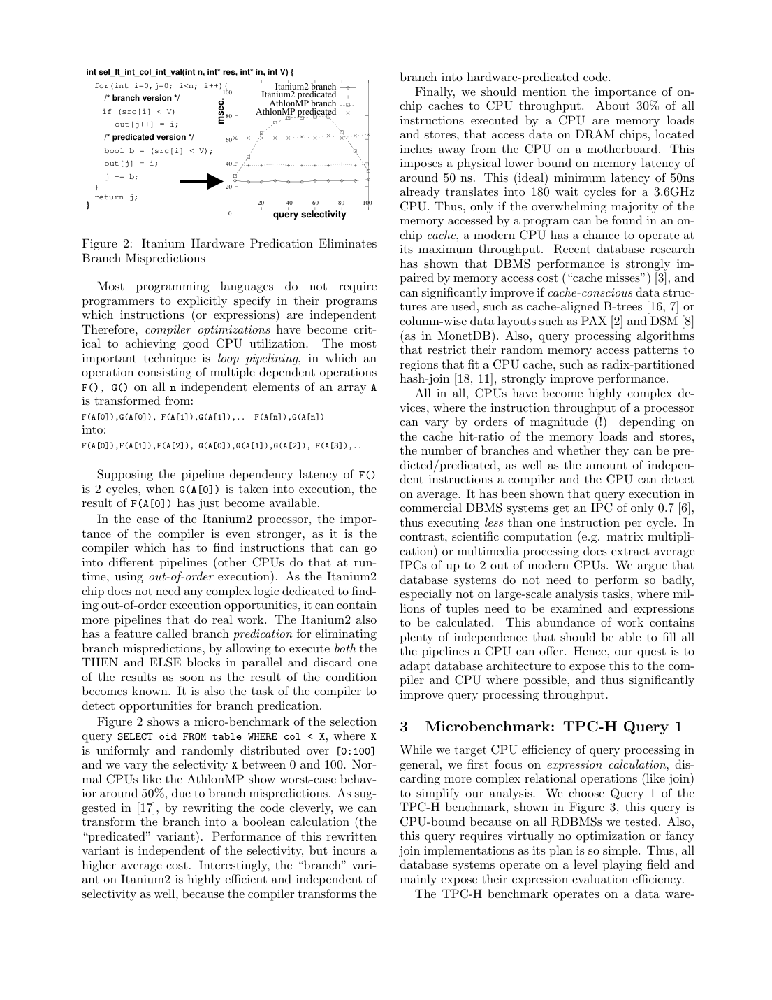
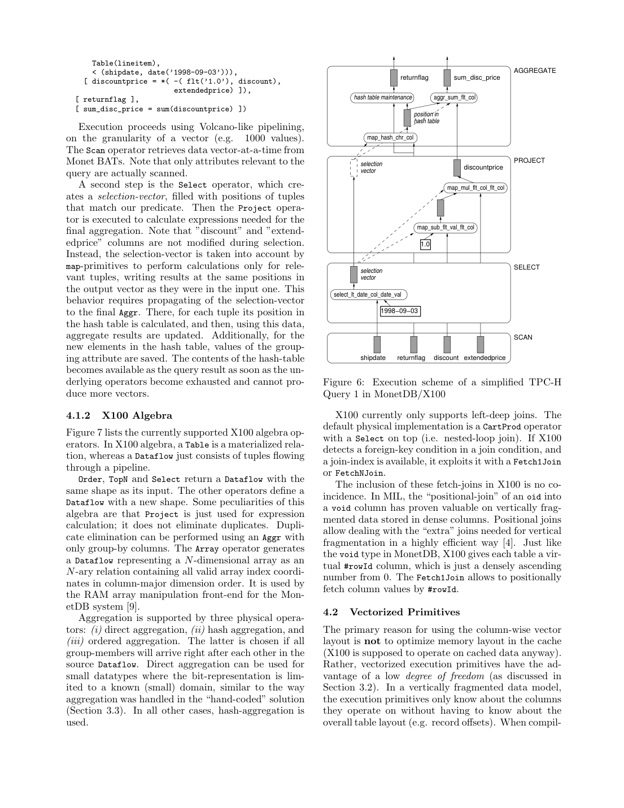

> 本组第 24 篇 · 查询执行引擎 · [全部论文]() · [上一篇]() · [下一篇]()

X100在tuple-at-a-time解释与column-at-a-time全列物化之间取中间路径：以缓存大小的列向量为批次，保留Volcano-like迭代流水线并将控制开销摊到多个值，向C编译器暴露类型、数组形状及跨元组独立计算。这里的向量化首先是批处理与loop pipelining，不等于所有原语都用SIMD，也不等于全数据集驻留CPU缓存。论文2005年的X100仍是原型：ColumnBM在开发、运行时JIT及SQL前端/直方图优化器仍在计划中，所有MonetDB实验均为内存BAT、无I/O，X100查询手工翻译。同Athlon SF1下Q1为MIL3.72s、X1000.50s；SF100的X100 Itanium Q1为30.25s，表1归一化值约0.30不能误当原始耗时。设计启发是向编译器暴露批内计算、控制中间物化并测量瓶颈，不是一个可外推到所有现代硬件和查询的统一倍数保证。

本文保留论文陈述、读者推断与待验证方案的区别；实验数字只适用于原文条件。原文和翻译来自已有 AI 辅助精读报告，已做来源匹配与编辑复核，不等于人工逐项核验或独立实验复现。所有页码均为 PDF 物理页。

## 论文与阅读范围

Peter Boncz, Marcin Zukowski, Niels Nes. MonetDB/X100: Hyper-Pipelining Query Execution. Proceedings of the 2005 CIDR Conference（物理第2页标题与页脚可核）。本地PDF共14页，其中物理第1页是ResearchGate附加封面，不是正式论文首页；其CITATIONS/READS是下载时的站点元数据，不作本文贡献证据或当前引用数。未核验外部出版页码等元数据。

[论文集中的原始 PDF](https://github.com/lonng/db-papers/blob/4ff1331069c7cf52ac97dd769e5f484c1c35c200/papers/execution-engine/monetdn-x100-hyper-pipelining-query-execution.pdf) · 本地来源：`execution-engine/monetdn-x100-hyper-pipelining-query-execution.pdf`，共 14 页。

本篇保留 15 组原文精读和 46 条证据。截图为原始 PDF 的局部页选，不是重新生成的图表；未将整份 PDF 复制到博客。

## 研究问题与适用边界

**问题不是“列存天然快”，而是工作如何暴露给CPU与编译器**
作者比较两类历史瓶颈：常见Volcano实现逐元组解释复杂表达式，调用、记录导航和拷贝成本很高；MonetDB/MIL以整列BAT原语减少解释，却为每个子表达式物化整列，CPU效率改善后又受DRAM带宽限制。X100试图保留两者优点，用小批列向量贯穿执行流水线。

论文第2节的“现代CPU”指当时的Itanium2、AthlonMP/Pentium4等背景，不应把其流水线深度、50ns和180周期描述当成本机2026硬件的普遍物理界。约30%是load/store指令比例，不是30%指令都miss到DRAM、也不是30%执行时间。缓存命中层级和并行访存影响实际代价。

分支方面，作者用随机选择微基准比较branch与predicated版本：中等选择率下随机真假更难预测。不能仅由“选择率50%”推断任意数据顺序都不可预测；有规律的数据可能不同。Figure2中Itanium2的编译器硬件predication与Athlon上的软件改写也不可混为同一种机制。

目标工作负载主要是分析型计算。低功耗、嵌入式电池寿命是未来设想，论文未给能耗实验；这不证明适合高并发OLTP或当前GPU。

依据：论文陈述；PDF 物理页 2, 3, 4, 5, 8, 10, 14。证据：[C001N02](#evidence-c001n02), [C001N04](#evidence-c001n04), [C001N08](#evidence-c001n08), [C004N03](#evidence-c004n03), [C004N06](#evidence-c004n06), [XREV01](#evidence-xrev01), [XREV10](#evidence-xrev10), [XREV11](#evidence-xrev11)。

## 系统架构与分层设计

**设计蓝图与已测实现分开看**
第4节按disk/RAM/cache/CPU分层描述X100：垂直布局与轻压缩减少带宽；显式数据移动连接RAM与cache；算子在小列向量上增量运行；类型化原语把独立数组计算暴露给C编译器。但同页明确ColumnBM仍在开发，所有实验仍使用MonetDB内存BAT，不能把磁盘缓冲、压缩I/O或更新路径当成已测性能。第7节仍计划移植SQL前端及直方图优化器。

**BAT、Dataflow与迭代器**
MIL的BAT是head/tail两列，一般表示[oid,value]；BAT[void,T]的密集递增OID可以虚拟省略，因此列以数组出现。reverse(A)返回交换head/tail的视图，源文说只换指针；没有证据证明它原地修改共享对象或引入并发竞态。X100用Table表示物化关系、Dataflow表示流水线中的元组，Project只计算表达式，不做DISTINCT；去重可用仅含group-by键的Aggr。

论文多次写Volcano-like，并在向量大小讨论中明确提到Algebra next()方法，所以可按批量pull迭代器语境理解；这不是从参考文献标题猜出来的，也不等价于已经核验完整源码调用图。

**原型的连接与存储范围**
第4.1.2节说当前只支持left-deep joins，默认CartProd+Select即nested loop；有外键条件和join index时使用Fetch1Join/FetchNJoin。不能因为列出了HashAggr就补造一般hash join或完备bushy join优化器。聚合则有direct/hash/ordered三类。

第4.3节描述不可变垂直基表配合PAX式delta：delete记rowId、insert写delta、update为两者组合，delta达到较小比例后重组。枚举编码以1/2字节值定位小映射表，查询加Fetch1Join解码。summary index存采样rowId的前缀running maximum与反向running minimum，默认是1000个索引条目，不是每1000行一个普通zone map；基表索引免逐条维护不代表delta可跳过，delta未索引且必须读取。

依据：论文陈述；PDF 物理页 6, 7, 8, 9, 10, 11, 12, 14。证据：[C002N04](#evidence-c002n04), [C002N08](#evidence-c002n08), [C003N01](#evidence-c003n01), [XREV01](#evidence-xrev01), [XREV02](#evidence-xrev02), [XREV03](#evidence-xrev03), [XREV06](#evidence-xrev06), [XREV12](#evidence-xrev12), [XREV13](#evidence-xrev13), [XREV18](#evidence-xrev18), [XREV19](#evidence-xrev19), [XREV20](#evidence-xrev20)。

*原论文 PDF 物理页 4，版权归原作者或出版方。点击图片可查看原尺寸。页面文本中定位到：Figure 2: Itanium Hardware Predication Eliminates；Figure 2 shows a micro-benchmark of the selection。这是页面定位信息，不表示本次已复核图内所有数据。*

## 核心算法与向量化原语机制

**1. 向量化流水线**
Scan按向量读取相关列；Select输出满足条件的位置数组；Project的map原语只计算这些位置，并把值写在原输入位置而非自动压实。选择向量要继续传到Aggr。原文第4.2节给出sel非空时i=sel[j]、res[i]=col1[i]+col2[i]的循环。

读者实际执行的小例子（qa/x100-reader-tests.py）：输入[5,1,7,2]，谓词<4得到位置[1,3]；对a=[10,20,30,40]、b=[1,2,3,4]求和，输出有效槽是[未定义,22,未定义,44]，沿[1,3]聚合得66。若中途改成紧凑[22,44]却仍传旧选择位置，坐标系就错了。这个测试验证位置协议，不是X100源码或性能复现。

**2. 原语生成与编译优化**
primitive pattern定义同类型操作，signature requests请求列/标量组合，构建脚本生成数百个类型化C原语；select模式返回位置而非完整布尔数组，aggr模式提供初始化、update、epilogue。compound primitive把表达式子树中间值尽量留在寄存器，减少load/store；当前是make期间宏展开，优化器驱动动态编译是未来工作，不是已实现JIT。

**3. loop pipelining不是全列再物化**
第2节的F/G例子把不同迭代的独立指令交错，隐藏依赖延迟；不是先把全部F结果物化再运行全部G。类型化数组、固定形状与restrict非别名契约利于编译器看见机会。它可帮助ILP，不能直接等同SIMD或多核并行；分组更新可能命中同一状态，不能把所有aggregation行宣称互相独立。

**4. 分支与选择位置是不同层面的设计**
选择位置数组本身不会自动消除生成这些位置时的条件分支。Figure2另比较branch和predicated实现；原图正确顺序是out[j]=i之后j+=b，文本层提取却把两行调换，不能照转写逐行编译。该图代码还是示意片段，复现需独立处理参数名、作用域等细节，再检查结果正确。

依据：论文陈述；PDF 物理页 4, 9, 10, 12。证据：[C001N06](#evidence-c001n06), [C002N12](#evidence-c002n12), [C003N03](#evidence-c003n03), [C003N05](#evidence-c003n05), [C003N13](#evidence-c003n13), [XREV04](#evidence-xrev04), [XREV05](#evidence-xrev05), [XREV06](#evidence-xrev06), [XREV11](#evidence-xrev11), [XREV19](#evidence-xrev19)。

## 正确性保证与边界条件

以下为读者基于原文的实现核对，不是论文已完成的形式验证。

首先维护列向量的共同坐标系、有效长度、选择位置及下游传播。sel是整数位置列表，不是布尔mask；sel为空可走连续循环，不意味着输出中未选位置都有可读值。Project也不是关系代数里默认去重的投影。多个选择、枚举fetch及聚合组合时，应比对结果多重集而不只测吞吐。

其次维护生成C原语的类型、别名与生命周期契约。restrict是编译优化依赖的承诺，不能把违反承诺当成仅“少一点性能”；但本文不提供任意别名、溢出、NULL或扩展ADT的完整正确性证明。共享分组状态还可能有跨元组依赖，静态代码生成不自动保证所有类型组合正确。

**原文代码图的两类问题必须区分**：Figure2原图先写out[j]再递增j，文本层顺序损坏，属于转写问题。Figure4印刷UDF却确实写sum_charge += extprice*(1-p_tax)，而Figure3 SQL和Figure9 X100代数用1+l_tax，这是本地源文的符号差异。读者以price100、discount0.1、tax0.2计算，SQL式为108、字面UDF式为72。它要求复现者查实际代码并验结果，不证明作者计时的代码一定有同样错误。原文Q1按定点十进制描述，而C示例使用浮点；精度、舍入与类型等价也须单独验证。

最后，不从MIL reverse的指针视图描述臆造共享对象原地突变或内存屏障需求。事务隔离、并发更新与恢复协议并非本文已验证范围；ColumnBM更新布局中的one-I/O说法也不是完整持久事务的日志/刷盘/重组成本上界，update仍由delete+insert组成。

依据：读者推断；PDF 物理页 5, 6, 7, 9, 10, 11。证据：[C003N13](#evidence-c003n13), [C003N05](#evidence-c003n05), [C002N04](#evidence-c002n04), [C003N12](#evidence-c003n12), [XREV05](#evidence-xrev05), [XREV06](#evidence-xrev06), [XREV14](#evidence-xrev14), [XREV22](#evidence-xrev22)。

## 实验设计与数据分析

**环境、计划与计时范围**
MIL的SQL前端按默认路径运行，X100的22条TPC-H查询是手工翻成其代数。AthlonMP1533MHz/1GB RAM/Linux2.4跑SF1；另有单CPU Itanium2 1.3GHz/3MB cache/12GB RAM/Linux2.4跑SF1及SF100。两者使用外键join indices，X100还采用orders/lineitem按日期聚簇、supplier/customer按region/country排序、date摘要索引和枚举压缩，不能把全部差距隔离归因于向量批大小。

所有MonetDB计时都是in-memory，无I/O；SF100的每个查询热集可放进12GB，不是完整100GB数据库都驻CPU cache或12GB RAM。比较的DB2 8.1 UDB来自官方power-test stream0：4个1.5GHz Itanium2/32GB RAM、112块SCSI，计时包含I/O且没有并发查询/更新。编译器版本/flags未给，但OS Linux2.4有给，不能说OS缺失。

**两个表的单位不能混用**
Table1是(sec×CPU数)/SF的Q1归一化比较，作者依据Q1近似线性规模/并行扩展作粗对照；不是所有查询都能如此缩放。Table4才是原始秒数。已视觉核对Q1列：MIL Athlon SF1=3.72；X100 Athlon SF1=.50、Itanium SF1=.31、Itanium SF100=30.25；DB2四CPU SF100=229。30.25×1/100=.3025，才是Table1约.30；DB2的229不能误标SF1。Q13同Athlon SF1是11.42/1.26，Q19是12.46/.05，收益并非统一倍数；它们也不是当前系统排名。

**剖析与经验基线**
Table2的MySQL4.1剖析在SGI MIPS R12000上做：memcpy exclusive为5.8%而不是3.1%，后者属下一行sum update。作者归纳真实算术/聚合<10%、哈希维护约28%、记录导航/拷贝等约62%，锁和buffer分配仅较小因素。38 instructions、IPC .8直接相除47.5cycles，正文约49是其概括值，别伪造额外精度或推成锁导致每次乘法慢。

手写UDF是实测经验参考，不是理论性能上限：Athlon .22s、Itanium .14s；相应X100 .50/.31s，按显示数约慢2.27/2.21倍，而不是严格“两倍以内”。Table5的X100乘法约2.2cycles/tuple和7.5GB/s缓存流量在Itanium上；不能把它与MIPS的49cycles当同CPU受控加速比。约6cycles的聚合来自该Q1的DIRECT路径，不是所有高基数hash aggregation。

**向量长度**
默认1024且用户可改。Q1在这两平台约1000附近较好，128–8K均好用，所有活跃向量合计每行略超40bytes，过大后逐级越过cache使性能退化。4M极端接近MIL但仍省其额外位置join。Table3的SF1总计3724ms和SF.001的2327微秒也不能混单位。以上没有证明本机或其他查询1024最优，更没有磁盘/高并发/能耗结果。

依据：论文陈述；PDF 物理页 4, 5, 6, 7, 8, 10, 11, 12, 13。证据：[C001N09](#evidence-c001n09), [C002N01](#evidence-c002n01), [C002N07](#evidence-c002n07), [C003N09](#evidence-c003n09), [C003N11](#evidence-c003n11), [C003N12](#evidence-c003n12), [XREV02](#evidence-xrev02), [XREV09](#evidence-xrev09), [XREV10](#evidence-xrev10), [XREV17](#evidence-xrev17), [XREV20](#evidence-xrev20), [XREV21](#evidence-xrev21), [XREV23](#evidence-xrev23), [XREV24](#evidence-xrev24), [XREV25](#evidence-xrev25)。

*原论文 PDF 物理页 9，版权归原作者或出版方。点击图片可查看原尺寸。页面文本中定位到：Figure 7 lists the currently supported X100 algebra op-；Figure 6: Execution scheme of a simplified TPC-H。这是页面定位信息，不表示本次已复核图内所有数据。*

## 工程权衡与设计取舍

**摊销与工作集**
向量太小则next()/解释成本分摊不足，太大则中间结果落到主存，重现全列物化的带宽问题。应计算同时活跃列的总宽度而非只看一个4KB数组；即使名义上能放进cache，也受竞争和其他状态影响。selection vector减少压实拷贝，却引入间接寻址，具体收益随选择率和后续算子变化。

**通用原语与compound融合**
静态生成覆盖类型/操作组合，compound减少缓存内load/store，但代码体积、寄存器压力和构建期覆盖仍有取舍。原文脚注说当时binary已经小于1MB，再省去某些列版本还可更小、以向量长1的慢路径处理；不是必须先删功能才能降到1MB以下，更不是今天版本的安装大小。

**cache不是无限带宽**
作者“CPU cache是bandwidth不重要的地方”强调相对RAM/I/O的差别；同文又指出简单原语会被load/store端口限制，并用compound改善指令混合，所以不能把cache带宽当无限。独立projection循环利于ILP，不代表hash访问和所有聚合没有依赖。

**布局、计划与功能范围**
不可变base+delta简化压缩与索引维护，但delta必扫、重组有成本，本文没有更新吞吐实测。left-deep/index fetch、手工代数计划与数据聚簇是原型结果的重要上下文。把未来磁盘管理、自动SQL/CBO、运行时编译都补成已完成功能，会掩盖论文实际留下的工程工作。

依据：论文陈述；PDF 物理页 8, 9, 10, 11, 12, 13。证据：[C002N12](#evidence-c002n12), [C003N03](#evidence-c003n03), [C003N11](#evidence-c003n11), [C003N12](#evidence-c003n12), [XREV01](#evidence-xrev01), [XREV04](#evidence-xrev04), [XREV05](#evidence-xrev05), [XREV07](#evidence-xrev07), [XREV08](#evidence-xrev08), [XREV11](#evidence-xrev11), [XREV13](#evidence-xrev13)。

## 相关工作与系统对比

MIL靠整列原语摊薄解释，代价是反复大范围物化；X100把物化范围约束在向量批内。Volcano-like按需迭代保留，但每次next处理批而非单行；本地第5.1.1节明确有next()方法，因此无需把pull语境列为完全未知。不能仅从Volcano参考文献推断它全部并行与扩展机制都在X100实现。

MySQL4.1剖析解释了当时某Q1的记录与表达式框架开销，不能推广到当前MySQL或所有行存。MIL/X100同Athlon对照较直接，但手工计划、聚簇与编码仍不同；官方DB2跨硬件、CPU数和I/O范围更不是纯执行模型消融。论文显示了重要设计潜力，不构成全部生产功能等价的官方TPC-H冠军结论。

相关工作在第6节有具体区别：DB2 block-oriented工作部分覆盖聚合/投影且保留NSM，buffer算子研究偏指令cache/B-tree访问，X100把类型化列批处理作为底层原语设计。没有核对这些被引论文全文，不能再扩展其未给结果。对StarRocks、DuckDB、Calcite的具体代码、SIMD/JIT及调度谱系应另查版本与源码，本报告不先断言谁继承了什么实现。

依据：论文陈述；PDF 物理页 2, 5, 6, 7, 8, 10, 11, 12, 14。证据：[C001N02](#evidence-c001n02), [C002N01](#evidence-c002n01), [C002N04](#evidence-c002n04), [C002N08](#evidence-c002n08), [C003N09](#evidence-c003n09), [C003N12](#evidence-c003n12), [C004N08](#evidence-c004n08), [C004N09](#evidence-c004n09), [XREV02](#evidence-xrev02), [XREV09](#evidence-xrev09), [XREV10](#evidence-xrev10), [XREV17](#evidence-xrev17), [XREV19](#evidence-xrev19)。

## 复现指南与实验建议

以下是待执行的性能复现方案；本次只运行了小规模语义/算术检查。

1. 先核对TPC-H Q1 SQL输出。Figure4的税项符号与SQL不同，浮点示例也不自动等价于定点十进制；固定舍入、NULL与溢出规则，比较结果后再计时。不要把排版片段直接当完整可编译C。
2. 在同一CPU、编译器与数据布局上分别实现逐行迭代、整列中间物化、批量向量与手写融合经验参考，统一数据类型、聚簇、join index及表达式优化。手写参考不是理论天花板；不要预设某基线必低IPC而把预期写成测量。
3. 明确batch有效长度、sel的位置坐标、输入输出非别名契约和生命周期。qa/x100-reader-tests.py已在本机WSL Python运行：sel=[1,3]、按原位置map得到[空,22,空,44]、有效和66；另示范Figure4税项108/72差异与30.25s归一化.3025。这不是执行作者X100代码或TPC-H性能复现。
4. 做向量长1/128/1024/8K/64K等扫描，同时变化活跃列数、类型宽度、选择率、分组基数、数据顺序与cache冷热，记录总工作集。对当前硬件重新测最优区间，不从2005两CPU推导本机cache阈值。
5. 记录CPU/NUMA/内存、OS、编译器flags与生成汇编、时间、IPC、指令数、cache misses、branch misses、内存流量和峰值空间。区分循环软件流水、SIMD、线程并行；原语融合若寄存器不够会spill，不能预设所有中间值永不落栈。
6. 最后才加入磁盘I/O、delta更新、压缩、并发查询与能耗等扩展实验。它们不能冒称复现了本文未测的ColumnBM/电池寿命。比较现代系统需明确版本、相同SQL/结果和计划，无源码核验不补类名与传承结论。

依据：待验证的工程设想；PDF 物理页 2, 3, 4, 5, 6, 7, 8, 9, 10, 11, 12, 13。证据：[C001N02](#evidence-c001n02), [C001N04](#evidence-c001n04), [C001N09](#evidence-c001n09), [C002N01](#evidence-c002n01), [C002N07](#evidence-c002n07), [C003N11](#evidence-c003n11), [C003N13](#evidence-c003n13), [XREV05](#evidence-xrev05), [XREV07](#evidence-xrev07), [XREV08](#evidence-xrev08), [XREV14](#evidence-xrev14), [XREV17](#evidence-xrev17), [XREV21](#evidence-xrev21), [XREV22](#evidence-xrev22)。

## 总结与内核工程启示

本文的核心价值是让执行组织方式暴露批内工作：用固定类型的列向量摊销解释、约束中间物化，并给编译器跨迭代调度和compound表达式融合的机会。它搭起了tuple-at-a-time与column-at-a-time之间的重要桥梁；这里的向量化首先是执行批次，不等于SIMD、JIT或多核调度。

设计必须连同版本边界阅读：实验是内存BAT、X100手工代数计划，ColumnBM与自动SQL/CBO/运行时编译仍有未来工作，prototype连接范围有限。1024默认与Q1最优区间、Table1归一化和Table4原始秒数、缓存原语带宽与DRAM带宽、实测手写参考与理论界都不能混淆。

本次原文/原图核对已补正实验口径、表格错位与代码转写问题，且把印刷税项差异保留为需查作者实现的来源疑点。工程迁移应先验结果和数值语义，再做同机受控剖析，不用历史数量级数字替代当前环境测量。

依据：论文陈述；PDF 物理页 7, 8, 10, 11, 12, 14。证据：[C002N07](#evidence-c002n07), [C003N03](#evidence-c003n03), [C003N09](#evidence-c003n09), [C003N12](#evidence-c003n12), [C003N13](#evidence-c003n13), [C004N06](#evidence-c004n06), [XREV01](#evidence-xrev01), [XREV02](#evidence-xrev02), [XREV03](#evidence-xrev03), [XREV04](#evidence-xrev04), [XREV07](#evidence-xrev07), [XREV09](#evidence-xrev09), [XREV17](#evidence-xrev17)。

## 原文精读：从句子回到机制

以下保留原文、忠实翻译、含义与边界；假设示例不作为论文实验结果。

### P001 · PDF 物理页 2

**原文**

<blockquote class="paper-source-quote"><pre><code>MonetDB/MIL&#10;uses a column-at-a-time execution model, and there-&#10;fore does not suffer from problems generated by tuple-&#10;at-a-time interpretation.&#10;However, its policy of full&#10;column materialization causes it to generate large data&#10;streams during query execution. On our decision sup-&#10;port workload, we found MonetDB/MIL to become&#10;heavily constrained by memory bandwidth, causing its&#10;CPU efficiency to drop sharply.</code></pre></blockquote>

**忠实翻译**

> MonetDB/MIL 使用逐列（column-at-a-time）执行模型，因此不会受到逐元组（tuple-at-a-time）解释所产生问题的影响。然而，其全列物化（full column materialization）策略导致它在查询执行期间生成大量数据流。在我们的决策支持工作负载上，我们发现 MonetDB/MIL 受到内存带宽的严重制约，导致其 CPU 效率急剧下降。

**技术含义与边界**

> 原文陈述了 MonetDB/MIL 的两个架构特征：采用逐列执行模型以避免逐元组解释开销，以及采用全列物化策略。作者在其特定的决策支持工作负载实验中观察到，全列物化会产生大数据流，使系统受限于内存带宽并降低 CPU 效率。适用边界限定于作者的决策支持工作负载，不保证所有工作负载下都会出现相同瓶颈。

**常见误读**

> 容易将“在决策支持工作负载上受内存带宽制约”泛化为 MonetDB/MIL 在所有场景下的全局性能缺陷。原文仅报告了特定工作负载下的观察结果，并未声称该问题在所有查询类型中必然发生。

**读者构造的假设示例**

> 读者构造：SUM((a+b)*c)最终只输出一个小聚合值，整列物化却可能先生成大加法列、再生成大乘法列。a/b/c是已有输入列，不是“SELECT a+b必须先额外物化a和b”；小批流水线尝试把这些短命中间值留在cache。

### P002 · PDF 物理页 14

**原文**

<blockquote class="paper-source-quote"><pre><code>Therefore, we propose to strike a balance between&#10;the Volcano and MonetDB execution models.&#10;This&#10;leads to pipelined operators that pass to each other&#10;small, cache-resident, vertical data fragments called&#10;vectors. Following this principle, we present the ar-&#10;chitecture of a brand new query engine for MonetDB&#10;called X100.</code></pre></blockquote>

**忠实翻译**

> 因此，我们提议在 Volcano 和 MonetDB 执行模型之间取得平衡。这产生了流水线化的算子（pipelined operators），它们彼此传递被称为向量（vectors）的小型、驻留缓存的垂直数据片段。遵循这一原则，我们提出了一个用于 MonetDB 的全新查询引擎的架构，称为 X100。

**技术含义与边界**

> X100用列式小批连接Volcano-like流水线和MIL原语。第12页还明确提到Algebra next()，有按批迭代的pull语境证据；不是推/拉完全未知。缓存驻留指当前活跃工作集，不是整份数据库。

**常见误读**

> 不应推断“小型、驻留缓存的向量”意味着 X100 完全消除了内存访问或不需要主存。原文仅说明算子间传递的数据片段被设计为适合缓存大小，并未排除从磁盘加载初始数据或将最终结果写回的需要。

**读者构造的假设示例**

> 读者构造：单个1024项int32向量约4KB，但查询可能同时保有多列、sel、聚合状态和其他工作集；是否在L1命中仍取决于容量与竞争，不能从4KB就保证完全没有主存流量。

### P003 · PDF 物理页 8

**原文**

<blockquote class="paper-source-quote"><pre><code>Like&#10;in MonetDB/MIL, we performed some common subex-&#10;pression elimination such that one minus and three&#10;AVG aggregates can be omitted.&#10;Table 1 shows that this UDF implementation (la-&#10;beled “hand-coded”) reduces query evaluation cost to&#10;a stunning 0.22 seconds. From the same table, you&#10;will notice that our new X100 query processor, that is&#10;the topic of the remainder of this paper, is able to get&#10;within a factor 2 of this hand-coded implementation.</code></pre></blockquote>

**忠实翻译**

> 就像在 MonetDB/MIL 中一样，我们执行了一些公共子表达式消除（common subexpression elimination），使得可以省略一个减法和三个 AVG 聚合。表 1 显示，这种 UDF 实现（标记为“hand-coded”）将查询评估成本降低到了惊人的 0.22 秒。从同一张表中你会注意到，本文剩余部分的主题——我们新的 X100 查询处理器——能够达到距离此手工编码实现两倍以内的性能。

**技术含义与边界**

> 上下文是TPC-H Q1手写UDF经验参考，不是未知查询或理论上限。正文称within a factor2，但表1同平台显示Athlon .50/.22≈2.27、Itanium .31/.14≈2.21；应视作近似概括，不能推出严格≤.44s。原始段落保留，数值差异单列说明。

**常见误读**

> 不要为了迎合“两倍以内”编造.40s，也不要把单一Q1的手写经验代码当所有硬件/查询的极限；本地代码图还有税项差异，真正等价复现须核结果。

**读者构造的假设示例**

> 直接用原表数字：Athlon的hand-coded=.22s、X100=.50s，读者相除约2.27。不是新增性能测量；它揭示原文粗略“两倍”与表值精度的边界。

### P004 · PDF 物理页 4

**原文**

<blockquote class="paper-source-quote"><pre><code>Finally, we should mention the importance of on-&#10;chip caches to CPU throughput.&#10;About 30% of all&#10;instructions executed by a CPU are memory loads&#10;and stores, that access data on DRAM chips, located&#10;inches away from the CPU on a motherboard. This&#10;imposes a physical lower bound on memory latency of&#10;around 50 ns. This (ideal) minimum latency of 50ns&#10;already translates into 180 wait cycles for a 3.6GHz&#10;CPU.</code></pre></blockquote>

**忠实翻译**

> 最后，我们应该提到片上缓存（on-chip caches）对 CPU 吞吐量的重要性。CPU 执行的所有指令中约有 30% 是内存加载和存储，它们访问位于主板上、距离 CPU 数英寸远的 DRAM 芯片上的数据。这对内存延迟施加了约 50 ns 的物理下限。这个（理想的）50ns 最小延迟对于 3.6GHz 的 CPU 来说已经转化为 180 个等待周期。

**技术含义与边界**

> 这是作者2005年硬件背景中的粗略论证，用load/store比例与约50ns说明cache的重要性。不能把30%指令等同30%时间、DRAM miss比例或当前所有内存技术的物理下限。

**常见误读**

> 不应将“约 30% 的指令是内存加载和存储”误解为数据库查询执行中恰好有 30% 的时间花在访存上。指令比例不等于时间比例，因为缓存命中时访存指令的延迟远低于 180 个周期。此外，50ns 被明确标注为“理想最小延迟”，实际可能更高。

**读者构造的假设示例**

> 读者构造：只有额外假定300次miss完全串行、不重叠、每次恰180周期时，延迟和才是54000周期。真实总时间还受重叠访存与其他执行影响，不能直接按指令数乘时延预测查询。

### P005 · PDF 物理页 10

**原文**

<blockquote class="paper-source-quote"><pre><code>In compound prim-&#10;itives, the results from one calculation are passed via a&#10;CPU register to the next calculation, with load/stores&#10;only occurring at the edges of the expression graph.&#10;Currently, the primitive generator is not much more&#10;than a macro expansion script in the make sequence&#10;of the X100 system. However, we intend to implement&#10;dynamic compilation of compound primitives as man-&#10;dated by an optimizer.</code></pre></blockquote>

**忠实翻译**

> 在复合原语（compound primitives）中，一次计算的结果通过 CPU 寄存器传递给下一次计算，加载/存储仅发生在表达式图的边缘。目前，原语生成器不过是 X100 系统 make 序列中的一个宏展开脚本。然而，我们打算按照优化器的要求实现复合原语的动态编译。

**技术含义与边界**

> 原文陈述了 X100 中复合原语的执行机制：中间结果保留在寄存器中，仅在表达式的输入和输出端进行内存读写，以减少访存。同时说明了工程现状：当前通过构建时的宏展开生成代码，未来计划实现由优化器驱动的动态编译。前半部分是机制描述，后半部分是开发计划。

**常见误读**

> 不能将“打算实现动态编译”解读为 X100 已经具备运行时 JIT 编译能力。原文明确表示当前仅是 make 过程中的宏展开脚本，动态编译是未来的意图。也不能认为寄存器传递适用于任意复杂的表达式，它受限于 CPU 可用寄存器数量。

**读者构造的假设示例**

> 读者构造：(a*b)+c的compound循环可让乘积在寄存器中传递，只在表达式边缘load/store；这是寄存器足够时的概念图，实际编译代码仍可能spill，需看汇编而非保证永不写内存。

### P006 · PDF 物理页 6

**原文**

<blockquote class="paper-source-quote"><pre><code>36M&#10;18 0.76 buf frame align&#10;57.6&#10;1.3 17M&#10;38 0.80 Item func mul::val&#10;59.0&#10;1.4&#10;25M&#10;25 0.62 pthread mutex unlock&#10;60.2&#10;1.2 206M&#10;2 0.75 hash get nth cell&#10;61.4&#10;1.2&#10;25M&#10;21 0.65 mutex test and set&#10;62.4&#10;1.0 102M&#10;4 0.62 rec get 1byte offs flag&#10;63.4&#10;1.0&#10;53M&#10;9 0.58 rec 1 get field start offs&#10;64.3&#10;0.9&#10;42M&#10;11 0.65 rec get nth field extern bit&#10;65.3&#10;1.0 11M&#10;38 0.80 Item func minus::val&#10;65.8&#10;0.5 5.9M&#10;38 0.80 Item func plus::val&#10;Table&#10;2:&#10;MySQL&#10;gprof&#10;trace&#10;of&#10;TPC-H&#10;Q1:&#10;+,-,*,SUM,AVG takes &lt;10%, low IPC of 0.7&#10;load/store instructions, thus a MIPS processor can do&#10;one *(double,double) per 3 cycles. This is in sharp&#10;contrast to the MySQL cost of #ins/Instruction-Per-&#10;Cycle (IPC) = 38/0.8 = 49 cycles!</code></pre></blockquote>

**忠实翻译**

> [表格数据片段]... Table 2: MySQL gprof trace of TPC-H Q1: +,-,*,SUM,AVG takes <10%, low IPC of 0.7 load/store instructions, thus a MIPS processor can do one *(double,double) per 3 cycles. This is in sharp contrast to the MySQL cost of #ins/Instruction-Per-Cycle (IPC) = 38/0.8 = 49 cycles!

**技术含义与边界**

> 原文使用SGI MIPS R12000上的MySQL4.1剖析解释wrapper开销。显示38/.8直算47.5cycles，正文称约49；不能假装这些四舍五入值精确一致。表2细节在第5–6页完整存在，并非本地来源缺失。

**常见误读**

> 不要把锁说成该Q1的主要成本，作者反而说锁/buffer分配较小，重点是哈希维护、记录访问与调用/解释。也不能把这个MIPS例子与Itanium的2.2cycles当同CPU、同操作受控加速比。

**读者构造的假设示例**

> 用表2显示值做读者算术：38 instructions / .8 IPC=47.5cycles，作者正文约49。它是该剖析例的估计，不能据此声称每次乘法都加锁或所有MySQL路径固定49cycles。

### P007 · PDF 物理页 3

**原文**

<blockquote class="paper-source-quote"><pre><code>Obviously, the longer the pipeline, the&#10;more instructions are flushed away and the higher the&#10;performance penalty. Translated to database systems,&#10;branches that are data-dependent, such as those found&#10;in a selection operator on data with a selectivity that&#10;is neither very high nor very low, are impossible to&#10;predict and can significantly slow down query execu-&#10;tion [17].&#10;In addition, super-scalar CPUs2 offer the possibility&#10;to take multiple instructions into execution in parallel&#10;if they are independent.</code></pre></blockquote>

**忠实翻译**

> 显然，流水线越长，被冲刷掉的指令就越多，性能惩罚也就越高。转化到数据库系统中，依赖于数据的分支（data-dependent branches），例如在选择算子中对选择率既不是非常高也不是非常低的数据进行操作时发现的那些分支，是不可能预测的，并且会显著减慢查询执行速度 [17]。此外，超标量 CPU（super-scalar CPUs）提供了并行执行多条独立指令的可能性。

**技术含义与边界**

> 作者讨论其年代的超标量流水线，并用随机选择展示branch miss代价。中等选择率只是可能难预测的条件，输入相关性和顺序也重要；单凭50%不能证明不可预测。

**常见误读**

> 区分均匀随机真假与可学习规律；还要区分软件predication、Itanium硬件predication和selection-vector表示。位置数组并不自动消除生成它时的分支。

**读者构造的假设示例**

> 读者构造：每行谓词结果独立且约半数为真时，基于过去结果很难预测下一次；若相同50%来自长段连续真再连续假，预测器表现可能不同。本文图2是特定随机微基准，不是所有50%谓词定理。

### P008 · PDF 物理页 9

**原文**

<blockquote class="paper-source-quote"><pre><code>The Fetch1Join allows to positionally&#10;fetch column values by #rowId.&#10;4.2&#10;Vectorized Primitives&#10;The primary reason for using the column-wise vector&#10;layout is not to optimize memory layout in the cache&#10;(X100 is supposed to operate on cached data anyway).&#10;Rather, vectorized execution primitives have the ad-&#10;vantage of a low degree of freedom (as discussed in&#10;Section 3.2).</code></pre></blockquote>

**忠实翻译**

> Fetch1Join 允许通过 #rowId 按位置获取列值。4.2 向量化原语（Vectorized Primitives）使用列式向量布局的主要原因不是为了优化缓存中的内存布局（无论如何，X100 本应操作缓存中的数据）。相反，向量化执行原语具有低自由度（low degree of freedom）的优势（如第 3.2 节所讨论）。

**技术含义与边界**

> 第3.2节在本地第6–7页可读：MIL原语固定参数形状/类型，复杂表达式分解为简单原语；X100数组原语也无需解释任意record offset。低自由度指编译器可见的专门化接口，不是“缺失上下文下猜无NULL检查”。目标是loop pipelining，SIMD并非定义。

**常见误读**

> 极易误读为“X100 不在乎缓存或内存布局”。原文说的是“主要原因不是优化缓存布局”，并补充“X100 本应操作缓存中的数据”，这意味着缓存驻留是前提假设，而非列式布局要解决的首要问题。不能将次要原因等同于没有原因。

**读者构造的假设示例**

> 读者构造：固定类型res[i]=a[i]+b[i]循环向编译器明确数组布局、循环次数与非别名契约，相比逐元组解释任意字段/表达式有更多静态信息；是否生成SIMD仍需实际编译检查。

### P009 · PDF 物理页 12

**原文**

<blockquote class="paper-source-quote"><pre><code>22&#10;29.47&#10;81&#10;8&#10;2.23&#10;0.06&#10;0.03&#10;2.78&#10;65&#10;9&#10;6.78&#10;0.44&#10;0.44&#10;71.24&#10;274&#10;10&#10;4.40&#10;0.22&#10;0.19&#10;30.73&#10;47&#10;11&#10;0.43&#10;0.03&#10;0.02&#10;1.66&#10;20&#10;12&#10;3.73&#10;0.09&#10;0.04&#10;3.68&#10;19&#10;13&#10;11.42&#10;1.26&#10;1.04&#10;148.22&#10;343&#10;14&#10;1.03&#10;0.02&#10;0.02&#10;2.64&#10;14&#10;15&#10;1.39&#10;0.09&#10;0.04&#10;14.36&#10;30&#10;16&#10;2.25&#10;0.21&#10;0.14&#10;15.77&#10;64&#10;17&#10;2.30&#10;0.02&#10;0.02&#10;1.75&#10;77&#10;18&#10;5.20&#10;0.15&#10;0.11&#10;10.37&#10;600&#10;19&#10;12.46&#10;0.05&#10;0.05&#10;4.47&#10;81&#10;20&#10;2.75&#10;0.08&#10;0.05&#10;2.45&#10;35&#10;21&#10;8.85&#10;0.29&#10;0.17&#10;17.61&#10;428&#10;22&#10;3.07&#10;0.07&#10;0.04&#10;2.30&#10;93&#10;AthlonMP&#10;Itanium2&#10;Table 4: TPC-H Performance (seconds)&#10;any case, and taking into account that CPU-wise the&#10;DB2 hardware is more than four times stronger, Mon-&#10;etDB/X100 performance looks very solid.</code></pre></blockquote>

**忠实翻译**

> 表4是原始秒数，列依次为MIL Athlon SF1、X100 Athlon SF1、X100 Itanium SF1/SF100、DB2四CPU SF100。其后作者结合DB2硬件更强评论X100表现；原始截取的矩阵需连同表头阅读。

**技术含义与边界**

> 本次已视觉核对完整表4：Q1 SF100 X100单Itanium30.25s、DB2四Itanium229s。源文同时给频率、内存、I/O与官方power-test范围，不能只按CPU数归因。原始摘录信息不足不代表本地完整表不存在。

**常见误读**

> 不能将“CPU 方面强四倍以上”简单等同于“时钟频率高四倍”或“核心数多四倍”，原文未定义“强”的具体度量指标（可能是 SPECint 综合得分等）。也不能脱离硬件差异直接比较两者的绝对秒数来评判软件优劣。

**读者构造的假设示例**

> 原表Q1 SF100的229/30.25约7.57，是跨系统墙钟时间比，不是纯向量化的受控加速比。Table1另把X10030.25按1CPU/SF100归一化成约.30，单位不同。

### P010 · PDF 物理页 14

**原文**

<blockquote class="paper-source-quote"><pre><code>SIGMOD, Austin, USA,&#10;1985.&#10;[9] R. Cornacchia, A. van Ballegooij, and A. P. de Vries.&#10;A case study on array query optimisation. In Proc.&#10;CVDB, 2004.&#10;[10] G. Graefe. Volcano - an extensible and parallel query&#10;evaluation system. IEEE Trans. Knowl. Data Eng.,&#10;6(1):120–135, 1994.&#10;[11] S. Manegold, P. A. Boncz, and M. L. Kersten. Op-&#10;timizing Main-Memory Join On Modern Hardware.&#10;IEEE Transactions on Knowledge and Data Eng.,&#10;14(4):709–730, 2002.</code></pre></blockquote>

**忠实翻译**

> SIGMOD, Austin, USA, 1985. [9] R. Cornacchia, A. van Ballegooij, and A. P. de Vries. A case study on array query optimisation. In Proc. CVDB, 2004. [10] G. Graefe. Volcano - an extensible and parallel query evaluation system. IEEE Trans. Knowl. Data Eng., 6(1):120–135, 1994. [11] S. Manegold, P. A. Boncz, and M. L. Kersten. Optimizing Main-Memory Join On Modern Hardware. IEEE Transactions on Knowledge and Data Eng., 14(4):709–730, 2002.

**技术含义与边界**

> 原文是论文的参考文献列表片段，列出了四篇文献的引用信息，包括会议论文和期刊文章，涉及 SIGMOD 1985、数组查询优化、Volcano 查询执行系统以及主存连接优化。这些仅为书目元数据。

**常见误读**

> 参考文献可核作者、题名、年份等书目信息，但不足以证明被引论文的具体算法、性能或X100实现了其全部特性。不要把“书目元数据可验证”说成“没有任何可验证事实”。

**读者构造的假设示例**

> 读者构造的假设示例：假设研究者想深入了解 X100 借鉴的 Volcano 迭代器模型，可以通过引用 [10] 找到 G. Graefe 1994 年发表在 IEEE TKDE 上的原始论文进行阅读，但这属于外部查阅行为，并非本段文字提供的信息。

### P011 · PDF 物理页 8

**原文**

<blockquote class="paper-source-quote"><pre><code>To maintain focus in this paper, we only sum-&#10;marily describe disk storage issues, also because the&#10;ColumnBM buffer manager is still under development.</code></pre></blockquote>

**忠实翻译**

> 本文只概要介绍磁盘存储；ColumnBM缓冲管理器仍在开发。

**技术含义与边界**

> 这是判断实验实现范围的关键句。第8页接着明确所有实验都运行在MonetDB的内存BAT上，磁盘伸缩是目标而非已给结果。

**常见误读**

> 不要把架构图中的ColumnBM模块画出来，就当成论文已经验证磁盘吞吐、压缩I/O和持久更新。

**读者构造的假设示例**

> 读者拟议实验：未来把相同计划的数据从冷盘读取，再分开测I/O和CPU；这些需要新运行，不是本文表4的既有数据。

### P012 · PDF 物理页 9

**原文**

<blockquote class="paper-source-quote"><pre><code>Instead, the selection-vector is taken into account by&#10;map-primitives to perform calculations only for rele-&#10;vant tuples, writing results at the same positions in&#10;the output vector as they were in the input one.</code></pre></blockquote>

**忠实翻译**

> map只计算选择向量指定的元组，并把结果写在与输入相同的位置。

**技术含义与边界**

> 这是跨算子坐标协议：选择不改动原列，Project输出也不自动压实，后续Aggr继续使用sel。

**常见误读**

> 不能在一个算子压实成连续数组，却不更新sel就交给下游；也不能读取未选槽的旧值。

**读者构造的假设示例**

> 读者已运行例子：sel=[1,3]，两列求和结果有效槽为[空,22,空,44]，沿sel求和66；不是作者系统性能复现。

### P013 · PDF 物理页 11

**原文**

<blockquote class="paper-source-quote"><pre><code>These summary indices con-&#10;tain a #rowId, the running maximum value of the col-&#10;umn until that point in the base table, and a reversely&#10;running minimum at a very coarse granularity (the de-&#10;fault size is 1000 entries, with #rowids taken with fixed&#10;intervals from the base table).</code></pre></blockquote>

**忠实翻译**

> 摘要索引存rowId、此前的running maximum与逆向running minimum；默认索引大小1000条，rowId在基表中按固定间隔抽取。

**技术含义与边界**

> 1000指索引条目数，不能直接译成每1000行一块的局部min/max；前缀/后缀摘要用于推导候选rowId范围。delta不在这些不可变base索引里，仍需访问。

**常见误读**

> 不要与默认1024的执行vector或现代zone-map具体实现混为一谈；原文没有给所有更新/重组/并发维护证明。

**读者构造的假设示例**

> 读者核查清单：若给一列固定1000采样点，扩大表行数会改变采样间隔；这不同于固定每1000行增加一个索引条目。

### P014 · PDF 物理页 12

**原文**

<blockquote class="paper-source-quote"><pre><code>X100 uses a default vector size of 1024, but&#10;users can override it.</code></pre></blockquote>

**忠实翻译**

> X100默认向量大小为1024，用户可以覆盖。

**技术含义与边界**

> 后文的约1000最优与128–8K较好仅针对Q1及两台CPU，需结合所有活跃向量总宽度。默认值不是自动调谐或通用最优证明。

**常见误读**

> 不能只用单列4KB就宣布所有工作集都在L1；也不能把2005的cache容量阈值套到本机。

**读者构造的假设示例**

> 读者建议：保持总行数不变，分别改变batch长度与每批同时活跃列宽，记录时间、cache misses及实际工作集；尚未运行此性能实验。

### P015 · PDF 物理页 12

**原文**

<blockquote class="paper-source-quote"><pre><code>MonetDB/MIL MonetDB/X100, 1CPU DB2, 4CPU&#10;Q&#10;SF=1 SF=1 SF=1&#10;SF=100&#10;SF=100&#10;1&#10;3.72&#10;0.50&#10;0.31&#10;30.25&#10;229</code></pre></blockquote>

**忠实翻译**

> 表4的表头与Q1行：MIL SF1为3.72；X100三个列依次.50、.31、30.25；DB2四CPU SF100为229，单位均秒。

**技术含义与边界**

> 表头的分组决定不同CPU与SF。X100 SF100是30.25秒，表1约.30是(sec×CPU)/SF归一化，不是相矛盾的两次原始耗时。

**常见误读**

> 不把DB2的229标SF1，不把跨硬件含I/O比较当严格同机算法消融，也不把按CPU数归一化推广为任意查询线性扩展。

**读者构造的假设示例**

> 读者已做算术：30.25×1/100=.3025，按表1精度约.30；这个换算不是新的基准测量。

## 尚未解决的问题

1. 在本机不同live-vector总宽度、选择率、分组基数和cache竞争下，默认1024与哪些批大小最接近最优？
2. compound静态原语的寄存器压力、代码体积与load/store节约如何量化；运行时特化另有多少编译成本？
3. selection位置保持与主动compaction在不同选择率/算子组合下如何取舍，怎样验证坐标和结果语义？
4. Figure4税项差异对应的作者实际计时代码是什么，定点/浮点结果是否按同一规范校验？
5. 把disk、delta更新、并发与能耗加入后，还能保留多少收益？这些并非本文现成测量。
6. 现代系统具体采用哪些原语生成、迭代、SIMD或调度机制，应另做版本化源码和计划核验。

## 证据索引

证据编号沿用原报告，便于将上文判断追溯到原句。引文匹配只验证位置，不证明解读正确。

**C001N02 · PDF 物理页 2**

MonetDB/MIL采用column-at-a-time执行模型，避免了逐元组解释的问题，但其全列物化策略在查询执行期间会产生大量数据流。在决策支持负载下，MonetDB/MIL受到内存带宽的严重限制，导致其CPU效率急剧下降。因此作者主张将MonetDB的列式执行与Volcano风格流水线提供的增量物化相结合。

<blockquote class="paper-source-quote"><pre><code>its policy of full column materialization causes it to generate large data streams during query execution</code></pre></blockquote>

**C001N04 · PDF 物理页 3**

2005年硬件背景讨论依赖与分支失误；随机独立真假时中等选择率难预测，不是任意50%选择率都必然不可预测。

<blockquote class="paper-source-quote"><pre><code>branches that are data-dependent, such as those found in a selection operator on data with a selectivity that is neither very high nor very low, are impossible to predict</code></pre></blockquote>

**C001N06 · PDF 物理页 4**

循环流水线（loop pipelining）是编译器实现良好CPU利用率的最重要技术。它将包含多个依赖操作的循环从按元素顺序执行（F(A[0]),G(A[0])...）转换为按操作批量执行（F(A[0]),F(A[1])...G(A[0])...），使得当执行后续依赖操作时，前置操作的结果刚好可用，从而掩盖流水线依赖延迟。

<blockquote class="paper-source-quote"><pre><code>The most important technique is loop pipelining, in which an operation consisting of multiple dependent operations F(), G() on all n independent elements of an array A is transformed</code></pre></blockquote>

**C001N08 · PDF 物理页 4**

作者以约30% load/store及50ns/3.6GHz约180周期说明cache重要性；指令比例不等于所有访存都到DRAM，也不是当前硬件普遍时延定理。

<blockquote class="paper-source-quote"><pre><code>About 30% of all instructions executed by a CPU are memory loads and stores, that access data on DRAM chips, located inches away from the CPU on a motherboard</code></pre></blockquote>

**C001N09 · PDF 物理页 4**

实验选用TPC-H Query 1作为CPU效率的微基准测试，因为该查询在所有测试的RDBMS上都是CPU-bound的，且计划非常简单，不需要复杂的优化或连接实现，所有数据库系统在同等条件下主要暴露其表达式求值效率。Q1扫描lineitem表（SF*6M元组），选择几乎所有元组（SF*5.9M），计算定点十进制表达式，并按两个单字符列分组产生仅4个唯一组合的聚合。

<blockquote class="paper-source-quote"><pre><code>We choose Query 1 of the TPC-H benchmark, shown in Figure 3, this query is CPU-bound because on all RDBMSs we tested</code></pre></blockquote>

**C002N01 · PDF 物理页 6**

MySQL4.1 Q1的SGI MIPS剖析：表2 memcpy为5.8% exclusive/77M calls，3.1%是下一行sum update。算术聚合<10%，低IPC是历史剖析观察，不是所有routine都固定0.7。

<blockquote class="paper-source-quote"><pre><code>Table 2: MySQL gprof trace of TPC-H Q1: +,-,*,SUM,AVG takes &lt;10%, low IPC of 0.7</code></pre></blockquote>

**C002N04 · PDF 物理页 6**

MonetDB/MIL使用垂直分片将表按列存储为Binary Association Table (BAT)，包含[oid,value]对。MIL代数没有自由度，算子参数数量和格式固定。例如join(BAT[tl,te] A, BAT[te,tr] B) : BAT[tl,tr]是A的tail列与B的head列的等值连接。若需在A的head列上连接，则使用reverse(A)算子交换列，这在MonetDB中是零代价操作，仅交换内部表示的指针。复杂表达式需拆分为多条语句，如extprice*(1-tax)需先计算tmp1再计算tmp2。

<blockquote class="paper-source-quote"><pre><code>storing tables column-wise, each column in a Binary Association Table (BAT) that contains [oid,value] combinations.</code></pre></blockquote>

**C002N07 · PDF 物理页 8**

手写Q1 UDF是经验性能参考：Athlon .22s、Itanium .14s；两个字节分组键用最多65536槽的direct索引并做CSE。不是理论上限，印刷税项与SQL的差异需查实际代码。

<blockquote class="paper-source-quote"><pre><code>reduces query evaluation cost to a stunning 0.22 seconds.</code></pre></blockquote>

**C002N08 · PDF 物理页 8**

第4节给disk/RAM/cache/CPU设计蓝图，但ColumnBM仍在开发，实验使用MonetDB内存BAT。投影原语暴露独立循环；compound生成是构建期机制，非已实现optimizer-driven JIT。

<blockquote class="paper-source-quote"><pre><code>Small (e.g. 1000 values) vertical chunks of cache-resident data items, called “vectors” are the unit of operation</code></pre></blockquote>

**C002N12 · PDF 物理页 9**

X100使用列式向量布局的主要原因并非优化缓存中的内存布局（因为X100假定其操作的数据已在缓存中），而是为了降低执行原语的自由度。在垂直分片数据模型中，执行原语只需知道其操作的列，而不需要了解整体表布局（如记录偏移量），这使得原语更容易被编译器优化为高效的循环流水线代码。

<blockquote class="paper-source-quote"><pre><code>The primary reason for using the column-wise vector layout is not to optimize memory layout in the cache</code></pre></blockquote>

**C003N01 · PDF 物理页 10**

X100 查询代数定义了 Scan、Select、Join、CartProd、Fetch1Join、FetchNJoin、Project、Aggr、OrdAggr、DirectAggr、HashAggr、TopN、Order 等操作符，输入输出均为 Dataflow 或 Table。该代数是后续向量化执行的基础接口。

<blockquote class="paper-source-quote"><pre><code>Figure 7: X100 Query Algebra</code></pre></blockquote>

**C003N03 · PDF 物理页 10**

X100 包含数百个向量化原语，均非手写维护，而是从原语模式（primitive pattern）自动生成。例如加法模式 any::1 +(any::1 x,any::1 y) plus = x + y 表示同类型两值相加由 C 语言中缀 + 实现。随后通过 map signature requests 文件请求生成单值与列的各种组合签名。这保证了 ADT 的一等公民待遇，区别于仅支持标量 UDF 的系统。

<blockquote class="paper-source-quote"><pre><code>X100 contains hundreds of vectorized primitives. These are not written (and maintained) by hand, but are generated from primitive patterns.</code></pre></blockquote>

**C003N05 · PDF 物理页 10**

select 类原语是 map 原语的变体，仅用于返回布尔值的代码模式。它不产生完整的布尔结果向量，而是填充一个包含被选中位置的整数数组，并返回选中元组总数。aggr 类原语则需指定初始化、更新和收尾三个模式来生成聚合例程。

<blockquote class="paper-source-quote"><pre><code>A slight variation on the map primitives are the select * primitives (see also Figure 2). These only exist for code patterns that return a boolean.</code></pre></blockquote>

**C003N09 · PDF 物理页 12**

Table4是原始秒：同Athlon SF1 Q1 MIL3.72/X100.50，Q13 11.42/1.26；X100 Itanium SF1 Q1 .31、SF100 Q1 30.25；DB2四CPU Q1 229是SF100，不是SF1。布局、计划、硬件与I/O范围有差别。

<blockquote class="paper-source-quote"><pre><code>Table 4: TPC-H Performance (seconds)</code></pre></blockquote>

**C003N11 · PDF 物理页 12**

向量大小影响实验（Figure 10）在 Itanium2 和 AthlonMP 上执行 TPC-H Q1。默认向量大小 1024。vector size=1 时解释开销严重；128 至 8K 范围内表现良好，最优约 1000。Q1 所有向量总宽度略超 40 bytes。AthlonMP 的 L1+L2 合计 320KB，超过 8K 后缓存不足导致退化。Itanium2（16KB L1, 256KB L2, 3MB L3）退化开始得更早，直到数据超出 L3（64K x 40 bytes）后持续下降。4M 大小时行为类似 MIL 但仍更优。

<blockquote class="paper-source-quote"><pre><code>The total width of all vectors used in Query 1 is just over 40 bytes. Thus, when we start using vectors larger than 8K, the cache memory requirements start to exceed the 320KB combined L1 and L2 cache of the AthlonMP</code></pre></blockquote>

**C003N12 · PDF 物理页 10**

当前primitive generator是make宏展开脚本，动态编译属未来工作。脚注说当时binary已小于1MB，可再省列版原语并用向量长1慢路径；不是只有删掉列版才首次小于1MB。

<blockquote class="paper-source-quote"><pre><code>Currently, the primitive generator is not much more than a macro expansion script in the make sequence of the X100 system.</code></pre></blockquote>

**C003N13 · PDF 物理页 10**

C 编译器能看到 X100 向量化原语操作的是 restricted（独立）且固定形状的数组，从而应用激进的循环流水线化（loop pipelining）。这一前提依赖 __restrict__ 指针语义和编译器优化能力。如果数组存在别名或形状不固定，该优化可能失效。

<blockquote class="paper-source-quote"><pre><code>the C compiler sees that the X100 vectorized primitives operate on restricted (independent) arrays of fixed shape. This allows it to apply aggressive loop pipelining</code></pre></blockquote>

**C004N03 · PDF 物理页 14**

为解决上述两类问题，原文提出在算子间传递小型的、可驻留缓存的垂直数据片段（称为vectors），从而实现流水线化算子（pipelined operators）。基于此原则构建了MonetDB的新查询引擎X100，使用向量化原语（vectorized primitives）高效完成大部分查询处理工作。这是一种执行模型层面的机制设计，而非单纯的排序启发式或剪枝策略。

<blockquote class="paper-source-quote"><pre><code>pipelined operators that pass to each other small, cache-resident, vertical data fragments called vectors.</code></pre></blockquote>

**C004N06 · PDF 物理页 14**

关于将X100用于低功耗（嵌入式、移动）环境的设想，原文的前提假设是：X100具有小内存占用（small footprint），且其'用尽可能少的CPU周期完成尽可能多工作'的特性可以转化为此类环境中电池寿命的改善。这是一个尚未验证的推断性主张，文中未提供能耗实验数据支撑。

<blockquote class="paper-source-quote"><pre><code>considering the use of X100 as an energy-efficient query processing system for low-power (embedded,mobile) environments, because it has a small footprint</code></pre></blockquote>

**C004N08 · PDF 物理页 14**

参考文献[10]引用了G. Graefe于1994年发表在IEEE Trans. Knowl. Data Eng.上的Volcano系统论文，这是本文讨论tuple-at-a-time执行模型的基础文献。参考文献[8]引用了Copeland和Khoshafian于1985年提出的Decomposition Storage Model（DSM），与列式存储相关。这些引用为正文中的模型对比提供了文献依据。

<blockquote class="paper-source-quote"><pre><code>G. Graefe. Volcano - an extensible and parallel query evaluation system. IEEE Trans. Knowl. Data Eng., 6(1):120–135, 1994.</code></pre></blockquote>

**C004N09 · PDF 物理页 14**

参考文献[22]引用了Zhou和Ross于2004年SIGMOD发表的关于缓冲数据库操作以增强指令缓存性能的论文，参考文献[11]引用了Manegold等人2002年关于在现代硬件上优化主存连接的IEEE TKDE论文。这些文献与本文关注的CPU效率和缓存友好执行主题直接相关。

<blockquote class="paper-source-quote"><pre><code>J. Zhou and K. A. Ross. Buffering database operations for enhanced instruction cache performance. In Proc. SIGMOD, Paris, France, 2004.</code></pre></blockquote>

**XREV01 · PDF 物理页 8**

ColumnBM is still under development. Experiments use MonetDB in-memory BAT storage; all MonetDB timings exclude IO. Scaling disk IO and SQL frontend/optimizer remain future work, not measured production-complete features.

<blockquote class="paper-source-quote"><pre><code>To maintain focus in this paper, we only sum-&#10;marily describe disk storage issues, also because the&#10;ColumnBM buffer manager is still under development.</code></pre></blockquote>

**XREV02 · PDF 物理页 11**

ColumnBM is still under development. Experiments use MonetDB in-memory BAT storage; all MonetDB timings exclude IO. Scaling disk IO and SQL frontend/optimizer remain future work, not measured production-complete features.

<blockquote class="paper-source-quote"><pre><code>We should clarify that all MonetDB TPC-H num-&#10;bers are in-memory results; no I/O occurs.</code></pre></blockquote>

**XREV03 · PDF 物理页 14**

ColumnBM is still under development. Experiments use MonetDB in-memory BAT storage; all MonetDB timings exclude IO. Scaling disk IO and SQL frontend/optimizer remain future work, not measured production-complete features.

<blockquote class="paper-source-quote"><pre><code>We also plan to port the MonetDB/MIL SQL-&#10;frontend to it, and fit it with a histogram-based query&#10;optimizer.</code></pre></blockquote>

**XREV04 · PDF 物理页 10**

Vector primitive generation and compound-expression generation are static build/macro mechanisms in this paper, not an already implemented optimizer-driven JIT. Vectorized batching exposes ILP/loop pipelining; SIMD is not the definition or a requirement of every primitive.

<blockquote class="paper-source-quote"><pre><code>Currently, the primitive generator is not much more&#10;than a macro expansion script in the make sequence&#10;of the X100 system.</code></pre></blockquote>

**XREV05 · PDF 物理页 9**

Selection vectors retain input positions; map primitives write selected values at original positions and must propagate selection to downstream aggregation. Do not silently describe compaction or a boolean mask. Project computes expressions, not DISTINCT.

<blockquote class="paper-source-quote"><pre><code>Instead, the selection-vector is taken into account by&#10;map-primitives to perform calculations only for rele-&#10;vant tuples, writing results at the same positions in&#10;the output vector as they were in the input one.</code></pre></blockquote>

**XREV06 · PDF 物理页 9**

Selection vectors retain input positions; map primitives write selected values at original positions and must propagate selection to downstream aggregation. Do not silently describe compaction or a boolean mask. Project computes expressions, not DISTINCT.

<blockquote class="paper-source-quote"><pre><code>Some peculiarities of this&#10;algebra are that Project is just used for expression&#10;calculation; it does not eliminate duplicates.</code></pre></blockquote>

**XREV07 · PDF 物理页 12**

Default vector length is1024, not a universal optimum1000 or every operator's automatic adaptive setting. Around1000 and plateau128–8K are Q1/platform-specific. Width of all live Q1 vectors is just over40bytes per row. At4M values X100 resembles MIL but still avoids extra MIL positional joins.

<blockquote class="paper-source-quote"><pre><code>X100 uses a default vector size of 1024, but&#10;users can override it.</code></pre></blockquote>

**XREV08 · PDF 物理页 12**

Default vector length is1024, not a universal optimum1000 or every operator's automatic adaptive setting. Around1000 and plateau128–8K are Q1/platform-specific. Width of all live Q1 vectors is just over40bytes per row. At4M values X100 resembles MIL but still avoids extra MIL positional joins.

<blockquote class="paper-source-quote"><pre><code>For this&#10;query and these platforms, the optimal vector size&#10;seems to be 1000, but all values between 128 and 8K&#10;actually work well.</code></pre></blockquote>

**XREV09 · PDF 物理页 11**

X100 TPC-H queries were hand translated, SQL frontend/optimizer were not a controlled common frontend. Both engines use FK join indices, X100 also clusters orders/lineitem by dates, customers/suppliers by region/country, uses summary indices and enumeration compression. Thus not every gain can be isolated to vectorization alone.

<blockquote class="paper-source-quote"><pre><code>We also hand-translated all TPC-&#10;H queries to X100 algebra, and ran them on Mon-&#10;etDB/X100.</code></pre></blockquote>

**XREV10 · PDF 物理页 5**

MySQL38instructions/0.8IPC≈49cycles addition profiling is on SGI MIPSR12000, whereas X1002.2cycles multiplication is on Itanium2. Do not claim a controlled49-to2.2 sameCPU speedup; addition and multiplication also differ. MIL500MB/s is RAM traffic, X100>7.5GB/s refers cache-resident primitive traffic; cache bandwidth/load-store ports are not infinite.

<blockquote class="paper-source-quote"><pre><code>This performance&#10;trace was made on an SGI machine with MIPS R12000&#10;CPU</code></pre></blockquote>

**XREV11 · PDF 物理页 10**

MySQL38instructions/0.8IPC≈49cycles addition profiling is on SGI MIPSR12000, whereas X1002.2cycles multiplication is on Itanium2. Do not claim a controlled49-to2.2 sameCPU speedup; addition and multiplication also differ. MIL500MB/s is RAM traffic, X100>7.5GB/s refers cache-resident primitive traffic; cache bandwidth/load-store ports are not infinite.

<blockquote class="paper-source-quote"><pre><code>Modern CPUs can typically only perform 1 or&#10;2 load/store operations per cycle.</code></pre></blockquote>

**XREV12 · PDF 物理页 9**

Prototype only supports left-deep joins; default is CartProd+Select nested loop; available FK join indices enable Fetch1Join/FetchNJoin. Do not invent a general hash join or a complete bushy join optimizer in this version.

<blockquote class="paper-source-quote"><pre><code>X100 currently only supports left-deep joins. The&#10;default physical implementation is a CartProd operator&#10;with a Select on top (i.e. nested-loop join).</code></pre></blockquote>

**XREV13 · PDF 物理页 11**

Summary indices have1000entries by default, sampled at fixed rowid intervals. They store prefix running maximum and reverse running minimum, not necessarily per1000-row chunk min/max. Immutable base indices need no update maintenance, but unindexed delta columns must always be accessed.

<blockquote class="paper-source-quote"><pre><code>The delta columns,&#10;which are supposed to be small and in-memory, are&#10;not indexed and must always be accessed.</code></pre></blockquote>

**XREV14 · PDF 物理页 7**

Figure2 original image writes out[j]=i before j+=b; text-layer extraction reverses order. Preserve raw quote but transcribe algorithm from image. Figure4 printedsum_charge uses(1-p_tax[i]) whereas SQLFigure3 and X100Figure9 use(1+l_tax); report this source discrepancy, not a silent correction or proof all measured author code was wrong. Fragments are illustrative, not directly compilable full functions.

<blockquote class="paper-source-quote"><pre><code>entry-&gt;sum_charge += extprice*(1-p_tax[i]);</code></pre></blockquote>

**XREV15 · PDF 物理页 2**

正式标题页给出三位作者，不以ResearchGate封面的部分作者列表代替。

<blockquote class="paper-source-quote"><pre><code>Peter Boncz, Marcin Zukowski, Niels Nes</code></pre></blockquote>

**XREV16 · PDF 物理页 2**

正式论文首页页脚给出2005 CIDR，出版年份并非只能从ResearchGate猜测。

<blockquote class="paper-source-quote"><pre><code>Proceedings of the 2005 CIDR Conference</code></pre></blockquote>

**XREV17 · PDF 物理页 12**

表4第一行Q1：MIL Athlon SF1=3.72s；X100 Athlon SF1=.50s、Itanium SF1=.31s、Itanium SF100=30.25s；DB2四CPU SF100=229s。

<blockquote class="paper-source-quote"><pre><code>MonetDB/MIL MonetDB/X100, 1CPU DB2, 4CPU&#10;Q&#10;SF=1 SF=1 SF=1&#10;SF=100&#10;SF=100&#10;1&#10;3.72&#10;0.50&#10;0.31&#10;30.25&#10;229</code></pre></blockquote>

**XREV18 · PDF 物理页 11**

摘要索引默认1000个采样条目，存#rowId、前缀running max及反向running min，不等于每1000行一个普通局部min/max。

<blockquote class="paper-source-quote"><pre><code>These summary indices con-&#10;tain a #rowId, the running maximum value of the col-&#10;umn until that point in the base table, and a reversely&#10;running minimum at a very coarse granularity (the de-&#10;fault size is 1000 entries, with #rowids taken with fixed&#10;intervals from the base table).</code></pre></blockquote>

**XREV19 · PDF 物理页 12**

本文明确提及X100 Algebra的next()方法；Volcano-like和批量迭代器语境有直接证据，不是完全未知push/pull。

<blockquote class="paper-source-quote"><pre><code>Also, in that case, the impact of interpre-&#10;tation overhead in the X100 Algebra next() methods&#10;will grow.</code></pre></blockquote>

**XREV20 · PDF 物理页 8**

实验仍以MonetDB的内存BAT为存储，不能把ColumnBM磁盘设计当已测路径。

<blockquote class="paper-source-quote"><pre><code>In all our experiments, X100 uses MonetDB as its stor-&#10;age manager (as shown in Figure 5), where it operates&#10;on in-memory BATs.</code></pre></blockquote>

**XREV21 · PDF 物理页 11**

AthlonMP1533MHz、1GB RAM、Linux2.4、SF1；不能说原文未给OS版本。

<blockquote class="paper-source-quote"><pre><code>We ran the SQL benchmark queries on an out-of-&#10;the-box MonetDB/MIL system with its SQL-frontend&#10;on our AthlonMP platform (1533MHz, 1GB RAM,&#10;Linux2.4) at SF=1.</code></pre></blockquote>

**XREV22 · PDF 物理页 5**

Q1按定点十进制表达式描述；复现浮点C示例前应核验结果类型和精度。

<blockquote class="paper-source-quote"><pre><code>computes a number of fixed-point&#10;decimal expressions</code></pre></blockquote>

**XREV23 · PDF 物理页 13**

表5的聚合算子是DIRECT而非一般hash aggregation；不能把约6cycles推广到所有高基数分组。

<blockquote class="paper-source-quote"><pre><code>5.9M&#10;236443&#10;Aggr(DIRECT)</code></pre></blockquote>

**XREV24 · PDF 物理页 6**

表2 memcpy的exclusive占比是5.8%，3.1%属于下一行Item_sum_sum::update_field。

<blockquote class="paper-source-quote"><pre><code>26.2&#10;5.8&#10;77M&#10;37 0.85 memcpy</code></pre></blockquote>

**XREV25 · PDF 物理页 6**

表1按SF和CPU数归一化，建立在Q1近似线性扩展的比较假设上，不是原始秒数。

<blockquote class="paper-source-quote"><pre><code>Thus, we can&#10;compare throughput for different systems, by normal-&#10;izing all times towards SF=1 and a single CPU.</code></pre></blockquote>

## 版本与使用边界

- 原 PDF SHA256：`a7f90e86394d25f92e0b8a89e4d9ae1c4f78651f0b5a1dce75f0a0a6d6234554`。
- 报告来源：`qwen3.8-max`；此处按已完成报告整理，没有重新请求模型。
- OCR 记录页：[]；低文本页：[]。
- 本次新增页面截图，未据此自动重写原报告的数值、公式或实验结论；原有“未进行图像识别”限制仍适用于分析生成过程。
- 截图与短引仅服务于论文评论，版权归原作者或出版方；正式发布前复查转载范围和授权。
- 本文保留未核实的书目信息及研究问题，不用现代产品行为替代历史论文的证据。
