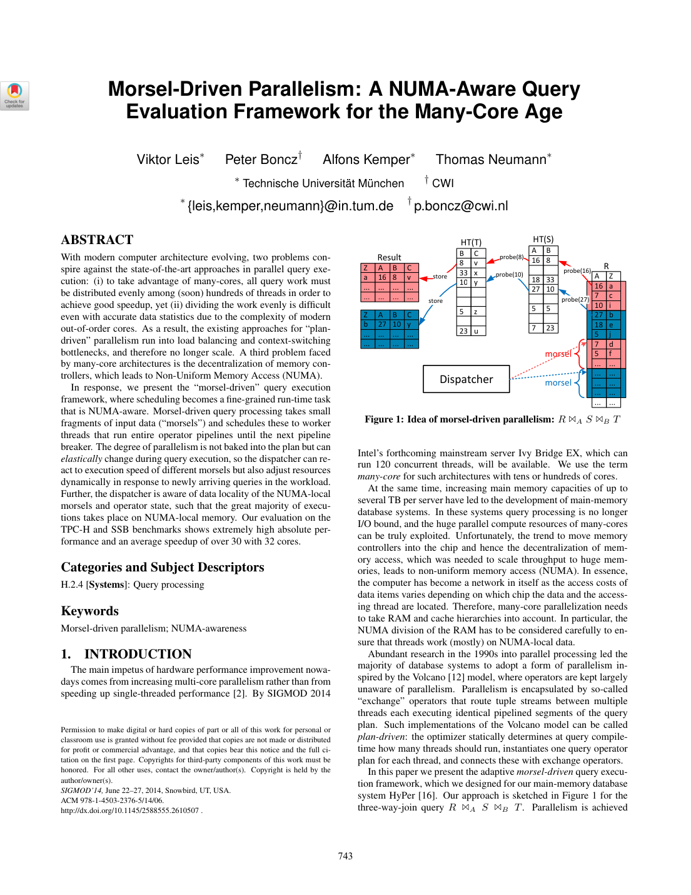
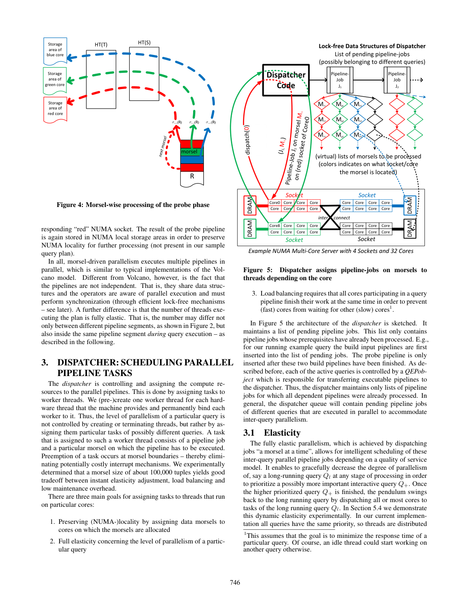

> 本组第 25 篇 · 查询执行引擎 · [全部论文]() · [上一篇]() · [下一篇]()

本文将任务定义为“ready pipeline job + 输入morsel”，由固定、绑核的worker执行整段编译pipeline至下一breaker；资源重分配发生在morsel边界，不是任意指令处抢占。NUMA-local输入/输出优先与跨socket窃取共同平衡局部性和尾部负载；共享join hash table仍需CAS同步，且只在全部build完成后probe。约100,000 tuples是经验折中，不是cache约束或通用最优值。实验为列存ad hoc TPC-H SF100、SSB SF50，两台四路机器均为32物理核/64 SMT硬件线程；Nehalem TPC-H汇总扩展性28.1倍，SSB部分查询超过40倍，不能归结为所有查询线性或仅scheduler的贡献。当前同优先级均分worker，QoS策略仍属未来工作。

本文保留论文陈述、读者推断与待验证方案的区别；实验数字只适用于原文条件。原文和翻译来自已有 AI 辅助精读报告，已做来源匹配与编辑复核，不等于人工逐项核验或独立实验复现。所有页码均为 PDF 物理页。

## 论文与阅读范围

Viktor Leis, Peter Boncz, Alfons Kemper, Thomas Neumann. Morsel-Driven Parallelism: A NUMA-Aware Query Evaluation Framework for the Many-Core Age. SIGMOD 2014, pp. 743-754. DOI: 10.1145/2588555.2610507.

[论文集中的原始 PDF](https://github.com/lonng/db-papers/blob/4ff1331069c7cf52ac97dd769e5f484c1c35c200/papers/execution-engine/morsel-driven-parallelism-a-numa-aware-query-evaluation-framework-for-the-many-core-age.pdf) · 本地来源：`execution-engine/morsel-driven-parallelism-a-numa-aware-query-evaluation-framework-for-the-many-core-age.pdf`，共 12 页。

本篇保留 10 组原文精读和 73 条证据。截图为原始 PDF 的局部页选，不是重新生成的图表；未将整份 PDF 复制到博客。

## 研究问题与适用边界

论文针对many-core分析查询中静态工作划分的负载不均、线程上下文切换开销及NUMA访问差异提出执行框架。按tuple数均分并不等于按CPU时间均分，输入统计不能预测所有乱序执行、缓存和中间结果代价。这里批评的是作者讨论的plan-driven并行实现，不是证明任何使用Volcano接口或静态计划的系统都无法扩展。[C001N01]

目标环境为内存数据库的ad hoc决策支持查询。实验在HyPer中使用列格式，除声明主键外不启用额外索引，主要检验scan、join（含outer/semi/anti）和aggregation；结果不能直接用作行存、索引点查或物化视图场景的性能结论。[C003N02]

核心要求不止是更换调度器：每个物理算子的所有执行阶段都要支持morsel-wise并行，包括hash build与probe，否则串行部分仍受Amdahl限制。[exactsource-M21] 结果是学术性、未审计实验，考虑QoS的优先级策略设计/评估留待未来；已有同优先级均分worker的策略，不能说尚无调度策略。[C004N10][exactsource-M19][exactsource-M27]

依据：论文陈述；PDF 物理页 1, 2, 5, 8, 12。证据：[C001N01](#evidence-c001n01), [C003N02](#evidence-c003n02), [exactsource-M21](#evidence-exactsource-m21), [C004N10](#evidence-c004n10), [exactsource-M19](#evidence-exactsource-m19), [exactsource-M27](#evidence-exactsource-m27)。

## 系统架构与核心组件

1. 任务与执行单元。task由一个pipeline job及一个输入morsel组成，不是operator、tuple或整查询。HyPer把pipeline segment中的算子编成同一代码片段，worker对morsel执行该片段至下一breaker，并非每次领取morsel都重新JIT。固定worker与硬件线程永久绑定，通过任务归属改变查询并行度，而非频繁创建/销毁线程。[exactsource-M47][C001N02][exactsource-M01][exactsource-M06]

2. 就绪依赖。QEPobject负责数据依赖，dispatcher只接收前置pipeline完成的job。示例先构建HT(T)、HT(S)，两者完成后才提交扫描R并连续probe两表的pipeline。当前实现不同时运行同查询的独立T/S pipelines，而是先T后S；这不取消单pipeline内部的多核并行，也不禁止跨查询并行。[exactsource-M04][exactsource-M05][exactsource-M16]

3. 被动调度器。dispatcher不是独占核的中央线程，而是lock-free数据结构，代码由请求任务的worker执行；QEPobject也是被动状态机。图中的morsel链表只是示意，实现保存各core/socket的storage boundaries，按需切出range。各线程初始拥有cache-line-aligned本地range，耗尽后才窃取，不能描述为每次领取都争抢同一中心锁。[exactsource-M46][exactsource-M08][exactsource-M41][C002N02]

4. 数据布局。每thread/core的输出区本地分配并私有写入；pipeline完成后对结果逻辑重新分片，避免沿用过滤后失衡的旧morsel边界。本地输入耗尽可跨socket stealing，输出仍在执行worker本地。算子共享状态不全部本地，尤其全局join bucket array不能与私有tuple buffer混淆。[exactsource-M38][exactsource-M09][exactsource-M10][exactsource-M15]

依据：论文陈述；PDF 物理页 1, 2, 3, 4, 5, 7。证据：[C001N02](#evidence-c001n02), [exactsource-M01](#evidence-exactsource-m01), [exactsource-M06](#evidence-exactsource-m06), [exactsource-M04](#evidence-exactsource-m04), [exactsource-M05](#evidence-exactsource-m05), [exactsource-M16](#evidence-exactsource-m16), [exactsource-M08](#evidence-exactsource-m08), [exactsource-M41](#evidence-exactsource-m41), [C002N02](#evidence-c002n02), [exactsource-M38](#evidence-exactsource-m38), [exactsource-M09](#evidence-exactsource-m09), [exactsource-M10](#evidence-exactsource-m10), [exactsource-M15](#evidence-exactsource-m15), [exactsource-M46](#evidence-exactsource-m46), [exactsource-M47](#evidence-exactsource-m47)。

*原论文 PDF 物理页 1，版权归原作者或出版方。点击图片可查看原尺寸。页面文本中定位到：Figure 1: Idea of morsel-driven parallelism: R 1A S 1B T。这是页面定位信息，不表示本次已复核图内所有数据。*

## 算法机制与执行步骤

1. 粒度与调度。完成当前morsel后worker才请求下一任务并可能换查询。约100,000 tuples是经验折中；第5页select min(a) from R在Nehalem EX用64线程，建议取调度开销已可忽略的最小值，在该实验为大于10,000。不要求morsel整体fit into cache，因为它不是operator间传递的vector；仍需兼顾调度摊销、均衡和响应，不能推为任意大小都无性能代价。[exactsource-M02][C001N04][C002N05][C002N06]

2. 两阶段join build。先scan/filter并把存活build tuples物化到thread-local、NUMA-local存储；全部完成后知道确切基数，再分配全局bucket array。第二阶段扫描这些存储区，以CAS插入tuple指针。Perfect sizing是按实测基数定容量，不是perfect hashing、无collision或无空槽。Tuple中另留next pointer处理collision。[C001N07][exactsource-M11][exactsource-M36]

3. Tagged chained table。bucket array只存指针，图7为48-bit pointer和16-bit tag。新tuple的next指向去tag的旧head，合并旧/新tag后以一个CAS更新head和tag，失败重试。tag只帮助排除不可能匹配的bucket；通过后仍需遍历链并比较真实key。低成本同步的前提是insert-only且所有插入完成后才lookup，不能任意交错build/probe或外推到并发删除/resize。[C002N10][exactsource-M36][exactsource-M12][exactsource-M13]

4. Probe流水线。两张小表建好后，大R输入按morsel连续probe HT(S)、HT(T)，结果本地写入。避免的是probe侧额外radix partitioning物化，不是build侧无物化。Single-table join是全查询pipeline取舍；作者承认radix join在某些单算子场景更快。97.4%/99.5%分别为TPC-H/SSB连接tuples中来自probe侧的份额，不是命中率或加速比。[exactsource-M05][C004N03][exactsource-M40]

5. NUMA与窃取。优先本socket morsel，本地耗尽时可窃取远程，非全连接拓扑优先近邻。共享hash array用2MB页、mmap first-touch随构建线程分布；多节点构建时伪随机交错，只有单节点线程构建时可留在该节点，不是每表始终显式round-robin到所有节点。join-key co-location是性能提示，stealing/imbalance仍可能带来跨节点匹配。[exactsource-M09][exactsource-M10][exactsource-M37][exactsource-M39]

6. 聚合与排序。聚合先以固定大小thread-local表预聚合，满时flush到overflow partitions；输入分区完成后逐partition聚合，一个分区完成即推下游，再处理下个分区。分区数多于worker，不能套用join的单一共享表方案。排序先local sort（top-k用局部heap），合成global separators并计算各run边界及输出offset后，互不重叠的merge阶段才无需同步，不是全sort或引擎无同步。[C002N12][exactsource-M17][C003N01]

依据：论文陈述；PDF 物理页 3, 4, 5, 6, 7, 8, 11。证据：[exactsource-M02](#evidence-exactsource-m02), [C001N04](#evidence-c001n04), [C002N05](#evidence-c002n05), [C002N06](#evidence-c002n06), [C001N07](#evidence-c001n07), [exactsource-M11](#evidence-exactsource-m11), [exactsource-M36](#evidence-exactsource-m36), [C002N10](#evidence-c002n10), [exactsource-M12](#evidence-exactsource-m12), [exactsource-M13](#evidence-exactsource-m13), [exactsource-M05](#evidence-exactsource-m05), [C004N03](#evidence-c004n03), [exactsource-M40](#evidence-exactsource-m40), [exactsource-M09](#evidence-exactsource-m09), [exactsource-M10](#evidence-exactsource-m10), [exactsource-M37](#evidence-exactsource-m37), [exactsource-M39](#evidence-exactsource-m39), [C002N12](#evidence-c002n12), [exactsource-M17](#evidence-exactsource-m17), [C003N01](#evidence-c003n01), [exactsource-M47](#evidence-exactsource-m47)。

## 正确性论证与边界条件

本节区分原文机制与读者推导的实现义务，论文未给完整并发实现、内存序协议或形式证明。

1. 调度不变量（读者推导）。每个morsel应恰好领取/完成一次，ready job满足前置依赖，输出和共享状态生命周期覆盖消费者。原文由QEPobject负责依赖，并明确全部build插入完成后才probe。[exactsource-M04][exactsource-M05][exactsource-M12] 第5页“找不到新morsel”触发完成观察是高层叙述，不能直接实现为“队列空即pipeline完成”：最后一批morsels可能仍在运行。复现需补足in-flight记账及发布/可见性协议；不臆造作者使用何种原子计数或barrier API。[exactsource-M41]

2. 同步没有被消灭。原文明确算子共享数据并须同步。私有buffer写入无须同步，不等于global hash、dispatcher队列和pipeline完成协调无须同步。CAS会竞争重试，lock-free不等于wait-free、零争用或固定完成时限。JIT减少解释开销，不自动保证并行内存安全。[exactsource-M07][exactsource-M13][exactsource-M22][exactsource-M06]

3. Photo-finish不是barrier。作者描述完成时间差在一个morsel处理时长内，强调缩短尾部不均衡；没有说所有线程同时结束或共同等待慢morsel，不能推出同步正确性。读者推断：单个不可再分的高成本morsel仍可主导尾部，OS暂停/共享争用也可能增加耗时；一个morsel时长不是硬件无关常数。变更并行度仍须在morsel边界并保持依赖，不是任意变更都正确。[C002N03][exactsource-M02]

4. Merge边界。正确实现需让输出区间无重叠且完整覆盖输入，重复separator key要有一致tie/boundary处理。可提出重复键测试，不能因论文省略细节就断言其会越界/丢数据；正确的interpolation search也不会仅因分布不均产生错误索引。[C003N01] 不做同查询bushy并发是策略限制，每条pipeline仍可用多worker，不能称整个查询退化为单线程。[C002N04]

依据：读者推断；PDF 物理页 2, 4, 5, 6, 8。证据：[exactsource-M04](#evidence-exactsource-m04), [exactsource-M05](#evidence-exactsource-m05), [exactsource-M12](#evidence-exactsource-m12), [exactsource-M41](#evidence-exactsource-m41), [exactsource-M07](#evidence-exactsource-m07), [exactsource-M13](#evidence-exactsource-m13), [exactsource-M22](#evidence-exactsource-m22), [exactsource-M06](#evidence-exactsource-m06), [C002N03](#evidence-c002n03), [exactsource-M02](#evidence-exactsource-m02), [C003N01](#evidence-c003n01), [C002N04](#evidence-c002n04)。

## 实验评估与数据分析

1. 平台与条件。两台Linux机器均为4 sockets、每socket 8核，共32物理核/64 SMT硬件线程；默认Nehalem EX（Xeon X7560 2.3GHz），另标Sandy Bridge EP（Xeon E5-4650L 2.6-3.1GHz）。Nehalem全连接，Sandy Bridge仅连两个邻居，部分访问需两跳。论文并非未给拓扑。TPC-H SF100、SSB SF50，均列存，除主键声明外不加索引。主要ad hoc对比不手工调优物理存储，计划用hash joins，但并未要求复现另加“强制所有join”hint。输入按主键首属性hash成64存储分区，不是64 NUMA节点，时间含中间分配/释放。[exactsource-M45][exactsource-M29][C003N02][C003N05][exactsource-M31][exactsource-M35][C003N04]

2. 汇总与基线。Nehalem比较表：HyPer几何均值0.45s、总和15.3s、扩展性28.1倍；Vectorwise 2.5为2.84s、93.4s、9.3倍；full-disclosure设置为1.19s、41.2s、8.4倍。28.1不是HyPer相对Vectorwise的速度比。图11两系统曲线共同以HyPer单线程为分母；33-64线程是SMT，不是新增物理核。不能仅引用摘要“32核平均超过30倍”而抹去正文不同汇总和逐查询数字。[exactsource-M30][exactsource-M25][exactsource-M23]

3. 逐查询与locality。表1 HyPer Q1为0.28s、32.4倍，read 82.6GB/s、write 0.2GB/s、remote 1%、QPI 40%；Q12扩展性42.0倍、Q16为17.3倍、Q22 remote达75%。表2 Sandy Bridge Q22为0.47s、8.4倍。表3 SSB Q2.2为0.15s、45.1倍，Q3.1为0.29s、30.7倍；超过40的结果来自可用64硬件线程的32核机器，不是所有查询纯物理核线性扩展。rd/wr/remote汇总所有socket，QPI为最繁忙link，本地访问也有coherence流量。原文小出入：Vectorwise Q1 remote表1为74%、正文约写75%，这里保留表值，不悄悄统一。[exactsource-M31][exactsource-M34][exactsource-M35][exactsource-M42][exactsource-M43]

4. NUMA对照。NUMA-aware相对OS default：Nehalem几何均值/最大为1.57/4.95倍，Sandy Bridge为2.40/5.81倍；相对interleaved分别为1.07/1.24倍和1.58/5.01倍。微基准local/mix带宽为93/60GB/s和121/41GB/s，延迟161/186ns和101/257ns；mix为25%本地+75%远程，Sandy Bridge含25%两跳。这些说明拓扑相关收益，不是某查询加速比。[exactsource-M32][exactsource-M33][C003N11]

5. 粒度、弹性与消融。图6在Nehalem用64线程运行select min(a) from R，约100,000 tuples为常用折中而非理论最优。图12把总共64硬件线程均分给1至64查询流，每流执行TPC-H随机排列；图13另只用4 workers画Q13/Q14轨迹，worker 2、3完成morsel才换查询。按默认平台约定，这些未另注明的实验用Nehalem，不是缺失平台，也不是64-worker trace。[C002N05][C001N04][C003N12][exactsource-M29]

静态模拟设morsel为n/t；均匀单查询TPC-H本身无显著下降，另有单线程进程占用一核时所述performance drop为静态36.8%、动态4.7%，不是普适延迟增长比。图11 non-adaptive在关闭NUMA后又关adaptive处理及hash tagging等，是累积消融，差值不能全归因于调度器。上述实验未完成QoS政策评估，也不是审计性能纪录。[exactsource-M28][exactsource-M24][exactsource-M19][exactsource-M27]

依据：论文陈述；PDF 物理页 4, 5, 8, 9, 10, 12。证据：[exactsource-M29](#evidence-exactsource-m29), [C003N02](#evidence-c003n02), [C003N05](#evidence-c003n05), [C003N04](#evidence-c003n04), [exactsource-M30](#evidence-exactsource-m30), [exactsource-M25](#evidence-exactsource-m25), [exactsource-M23](#evidence-exactsource-m23), [exactsource-M31](#evidence-exactsource-m31), [exactsource-M34](#evidence-exactsource-m34), [exactsource-M35](#evidence-exactsource-m35), [exactsource-M42](#evidence-exactsource-m42), [exactsource-M43](#evidence-exactsource-m43), [exactsource-M32](#evidence-exactsource-m32), [exactsource-M33](#evidence-exactsource-m33), [C003N11](#evidence-c003n11), [C002N05](#evidence-c002n05), [C001N04](#evidence-c001n04), [C003N12](#evidence-c003n12), [exactsource-M28](#evidence-exactsource-m28), [exactsource-M24](#evidence-exactsource-m24), [exactsource-M19](#evidence-exactsource-m19), [exactsource-M27](#evidence-exactsource-m27), [exactsource-M45](#evidence-exactsource-m45)。

*原论文 PDF 物理页 4，版权归原作者或出版方。点击图片可查看原尺寸。页面文本中定位到：Figure 4: Morsel-wise processing of the probe phase；Figure 5:。这是页面定位信息，不表示本次已复核图内所有数据。*

## 设计权衡与局限性

原文取舍与读者推断分别标明，不把推测成本写成作者实测结论。

粒度：原文用小morsel改善均衡/弹性，较大morsel摊销领取/窃取成本，并指出lock-free共享结构最终也可能成为瓶颈。“morsel不必fit cache”不表示放弃缓存优化，编译pipeline、本地buffers和range cache-line alignment仍利用局部性。增加粒度减少调度访问，却可能减少可分配任务并延迟重分配。[C001N04][C002N06][exactsource-M22][exactsource-M06]

NUMA：原文以远程stealing换取不空闲，输出仍本地；co-location不是硬保证。读者推断需同时看远程带宽、争用和idle time，不能只按remote比例评价性能，也不能把所有远程访问都归于stealing。[exactsource-M09][exactsource-M10][exactsource-M39][exactsource-M31]

Join：single-table join保持大probe输入流水线，radix join在一些场景有更高locality。两阶段build付出tuple物化和再扫描，换取准确容量和避免并行增长。读者推断pointer chasing、tuple buffers、next字段和空bucket均有空间/访问成本，指针数组大小不是总内存。原文未证明chaining在所有负载优于open addressing或radix。[exactsource-M11][exactsource-M36][exactsource-M40][C002N10]

算子与bushy：当前避免同查询独立pipelines并发以减少cache干扰，不必然用不满核，单pipeline仍可占多核。读者推断在单pipeline任务不足且有独立分支时跨pipeline并发可能有益，需实测，不能宣称必然受最长串行pipeline限制。聚合分区用本地表，排序的无同步仅指布局已确定后的merge。[C002N04][C002N12][C003N01]

政策：固定worker上的任务分配与按core利用率改线程数是论文的对照，不能由此给其他方法统一贴“被动”标签。QoS政策需另外设计/评估，morsel边界本身没有deadline保证。[C004N06][exactsource-M19]

依据：读者推断；PDF 物理页 2, 4, 5, 6, 7, 8, 9, 11。证据：[C001N04](#evidence-c001n04), [C002N06](#evidence-c002n06), [exactsource-M22](#evidence-exactsource-m22), [exactsource-M06](#evidence-exactsource-m06), [exactsource-M09](#evidence-exactsource-m09), [exactsource-M10](#evidence-exactsource-m10), [exactsource-M39](#evidence-exactsource-m39), [exactsource-M31](#evidence-exactsource-m31), [exactsource-M11](#evidence-exactsource-m11), [exactsource-M36](#evidence-exactsource-m36), [exactsource-M40](#evidence-exactsource-m40), [C002N10](#evidence-c002n10), [C002N04](#evidence-c002n04), [C002N12](#evidence-c002n12), [C003N01](#evidence-c003n01), [C004N06](#evidence-c004n06), [exactsource-M19](#evidence-exactsource-m19)。

## 相关工作与系统对比

Volcano的tuple-at-a-time next()解释器与exchange封装并行是两层含义。HyPer用编译pipeline减少解释开销，同时用morsel-driven运行时调度替代作者讨论的静态plan-driven划分。不能说只要使用exchange/iterator就无法动态调度。vector/batch/stride是算子数据传递粒度，morsel是输入任务粒度，不应直接等同。[C003N08][C004N11][exactsource-M06][exactsource-M03]

主要实测对手为Vectorwise 2.5。作者把固定划分及NUMA-awareness不足与不均衡联系起来，这是当时实现/配置的观察，不证明后续版本或所有Volcano系统都如此。论文额外给full-disclosure设置对照，并非完全未考虑调优。几何均值耗时、相对单线程扩展性及官方TPC结果前提不同，应保留区别。[C003N04][C003N05][exactsource-M30][exactsource-M44]

单算子微基准不等于全查询性能。radix join、NUMA-aware join和聚合研究揭示局部性能，本文强调跨算子数据传递及大probe输入连续通过小表hash tables的好处，并未证明single-table join普遍最快。[C004N11][exactsource-M40]

现代系统的类比是待研究问题。这里未进行外部版本或源码验证，不据本文断言StarRocks、DuckDB等采用等价调度；若以Calcite为对照，应先区分规划层与执行后端职责。

依据：论文陈述；PDF 物理页 2, 5, 6, 8, 11。证据：[C003N08](#evidence-c003n08), [C004N11](#evidence-c004n11), [exactsource-M06](#evidence-exactsource-m06), [exactsource-M03](#evidence-exactsource-m03), [C003N04](#evidence-c003n04), [C003N05](#evidence-c003n05), [exactsource-M30](#evidence-exactsource-m30), [exactsource-M44](#evidence-exactsource-m44), [exactsource-M40](#evidence-exactsource-m40)。

## 复现指南与缺失信息

以下为读者建议，不是已执行复现或作者附带脚本。

1. 最小正确原型：固定绑核workers，被动ready-job dispatcher、按需range切分、领取/完成记账及依赖状态机。必须检查在途morsels，完整完成后才发布下游；以约100,000 tuples起步扫描粒度，在morsel边界重分配/取消，不简单杀线程。[exactsource-M01][exactsource-M02][exactsource-M04][exactsource-M41][C001N04]

2. Join：本地物化/计数后CAS构建tagged chained table，全部插入完成后probe；测试collision、CAS重试、空build、多重匹配、outer/semi/anti和取消后生命周期。图7已给16-bit tag/48-bit pointer，不能列为缺失；具体hash函数和完整实现仍需补齐。若指针表示不同，应重设tag编码，不能无条件移植48-bit假设。[exactsource-M11][exactsource-M12][exactsource-M36]

3. 正确性验收：与串行参考结果比较，测试单morsel极高代价、重复键、stealing、多查询到达及反复调整worker；结果多重集不应随调度改变。聚合测heavy hitters/高基数/overflow，merge测重复boundary/空run。区分算子结果、pipeline完成和MVCC隔离，本文未证明任意组合实现都正确。[C002N12][C003N01]

4. 性能控制：重现NUMA对照需多节点且可控制线程/内存放置的硬件；单socket可检验局部机制但不能重现跨socket结论。记录socket/core/SMT、页大小、first-touch、分区键、allocator及频率；复用TPC-H SF100和SSB SF50、列存、主键声明且无额外索引，保留实际join计划，不擅加“强制hash join”规则。计入分配/释放，比较OS-default、interleaved与NUMA-aware。[exactsource-M29][exactsource-M37][C003N02][C003N05][exactsource-M31][exactsource-M35][exactsource-M32]

5. 报告逐查询延迟、单线程基线、物理核/SMT曲线、吞吐、remote/QPI、CAS重试及idle time。独立和组合关闭NUMA、tagging及动态分配，避免累积消融的单因果归因；重做n/t及外部单核干扰。性能阈值按平台预先定义，不以30/40倍作为正确性门槛。[exactsource-M24][exactsource-M25][exactsource-M28][exactsource-M42]

缺口是完整队列、完成/可见性协议、重复separator处理及QoS政策，不是硬件拓扑、tag位宽或逐查询耗时。论文未给dispatcher竞争下的理论复杂度或所有实现形式证明；自行补足需独立测试，不能冒充原作者源码。[exactsource-M29][exactsource-M36][exactsource-M19]

依据：待验证的工程设想；PDF 物理页 2, 4, 5, 6, 7, 8, 9, 10。证据：[exactsource-M01](#evidence-exactsource-m01), [exactsource-M02](#evidence-exactsource-m02), [exactsource-M04](#evidence-exactsource-m04), [exactsource-M41](#evidence-exactsource-m41), [C001N04](#evidence-c001n04), [exactsource-M11](#evidence-exactsource-m11), [exactsource-M12](#evidence-exactsource-m12), [exactsource-M36](#evidence-exactsource-m36), [C002N12](#evidence-c002n12), [C003N01](#evidence-c003n01), [exactsource-M29](#evidence-exactsource-m29), [exactsource-M37](#evidence-exactsource-m37), [C003N02](#evidence-c003n02), [C003N05](#evidence-c003n05), [exactsource-M31](#evidence-exactsource-m31), [exactsource-M35](#evidence-exactsource-m35), [exactsource-M32](#evidence-exactsource-m32), [exactsource-M24](#evidence-exactsource-m24), [exactsource-M25](#evidence-exactsource-m25), [exactsource-M28](#evidence-exactsource-m28), [exactsource-M42](#evidence-exactsource-m42), [exactsource-M19](#evidence-exactsource-m19), [exactsource-M45](#evidence-exactsource-m45)。

## 总结与工程启示

可迁移启示是将细粒度调度、全阶段可并行算子和数据放置共同设计，不是一个scheduler解决所有扩展问题。morsel是pipeline输入任务，JIT融合pipeline内算子，两者正交；资源重分配在边界发生并保留ready依赖。[exactsource-M01][exactsource-M02][exactsource-M06][exactsource-M21]

Join以本地build物化、精确定容、共享tagged table和CAS换取大probe输入的流水线优势。低成本同步不是无同步，NUMA-aware不是零远程访问，动态并行度不是任意共享状态变更都正确。聚合与排序各有阶段，不能套用join机制。[exactsource-M11][exactsource-M12][exactsource-M07][exactsource-M39][C002N12][C003N01]

实验支持特定32核/64线程、内存列存TPC-H/SSB上的高性能及弹性。Nehalem TPC-H汇总28.1倍、Sandy Bridge Q22 8.4倍和SSB Q2.2 45.1倍并存，应保留汇总方式、SMT、拓扑和查询特征。足够任务、各阶段并行、带宽和低争用都是前提，不是无条件线性扩展定理。[exactsource-M29][exactsource-M30][exactsource-M34][exactsource-M35][exactsource-M22]

当前避免同查询bushy并发、同优先级均分worker，QoS政策是未来工作。工程上应先验证调度/结果不变量，再测locality与均衡取舍。上述是source-based AI review的读者归纳，不是独立人工核查或已完成复现。[exactsource-M16][exactsource-M19][exactsource-M27]

依据：读者推断；PDF 物理页 2, 4, 5, 6, 7, 8, 10, 12。证据：[exactsource-M01](#evidence-exactsource-m01), [exactsource-M02](#evidence-exactsource-m02), [exactsource-M06](#evidence-exactsource-m06), [exactsource-M21](#evidence-exactsource-m21), [exactsource-M11](#evidence-exactsource-m11), [exactsource-M12](#evidence-exactsource-m12), [exactsource-M07](#evidence-exactsource-m07), [exactsource-M39](#evidence-exactsource-m39), [C002N12](#evidence-c002n12), [C003N01](#evidence-c003n01), [exactsource-M29](#evidence-exactsource-m29), [exactsource-M30](#evidence-exactsource-m30), [exactsource-M34](#evidence-exactsource-m34), [exactsource-M35](#evidence-exactsource-m35), [exactsource-M22](#evidence-exactsource-m22), [exactsource-M16](#evidence-exactsource-m16), [exactsource-M19](#evidence-exactsource-m19), [exactsource-M27](#evidence-exactsource-m27)。

## 原文精读：从句子回到机制

以下保留原文、忠实翻译、含义与边界；假设示例不作为论文实验结果。

### P001 · PDF 物理页 1

**原文**

<blockquote class="paper-source-quote"><pre><code>echnische Universität München&#10;† CWI&#10;∗{leis,kemper,neumann}@in.tum.de&#10;† p.boncz@cwi.nl&#10;ABSTRACT&#10;With modern computer architecture evolving, two problems con-&#10;spire against the state-of-the-art approaches in parallel query exe-&#10;cution: (i) to take advantage of many-cores, all query work must&#10;be distributed evenly among (soon) hundreds of threads in order to&#10;achieve good speedup, yet (ii) dividing the work evenly is difficult&#10;even with accurate data statistics due to the complexity of modern&#10;out-of-order cores. As a result, the existing approaches for “plan-&#10;driven” parallelism run into load balancing and context-switching&#10;bottlenecks, and therefore no longer scale.</code></pre></blockquote>

**忠实翻译**

> 慕尼黑工业大学 † CWI ∗{leis,kemper,neumann}@in.tum.de † p.boncz@cwi.nl 摘要 随着现代计算机体系结构的演进，两个问题共同阻碍了并行查询执行中最先进的方法：(i) 为了利用多核，所有查询工作必须在（即将到来的）数百个线程之间均匀分配以实现良好的加速比，然而 (ii) 由于现代乱序核心的复杂性，即使拥有准确的数据统计信息，均匀划分工作也很困难。因此，现有的“计划驱动”并行方法遇到了负载均衡和上下文切换瓶颈，因而不再具备可扩展性。

**技术含义与边界**

> 原文陈述了现代多核架构下并行查询执行面临的两个核心矛盾：一是需要大量线程来利用硬件，二是乱序执行核心的复杂性使得基于统计信息的静态工作划分难以实现真正的负载均衡。作者据此推断传统的 plan-driven 并行策略会因负载不均和上下文切换开销而失去扩展能力。适用边界为具有大量核心的现代乱序处理器环境。

**常见误读**

> 容易误读为所有基于计划的并行方法在任何硬件上都已失效。原文的限定条件是“现代乱序核心”以及“即将到来的数百个线程”，并未声称在核心数较少或顺序执行的架构上也会遇到同样的扩展瓶颈。不能将局部硬件趋势泛化为全局保证。

**读者构造的假设示例**

> 读者构造的假设示例：假设一个查询需要将 1000 万行数据分给 128 个线程处理，由于乱序核心的指令执行时间不可预测，即使按行数平均分配，某些线程也可能因为缓存未命中而耗时更长，导致其他线程空闲等待，这就是原文所述的负载均衡瓶颈。

### P002 · PDF 物理页 11

**原文**

<blockquote class="paper-source-quote"><pre><code>a speedup of over 40 for most queries. The scalability is higher&#10;than on TPC-H, because TPC-H is a much more complex and chal-&#10;lenging workload. TPC-H contains a very diverse set of queries:&#10;queries that only scan a single table, queries with complex joins,&#10;queries with simple and with complex aggregations, etc.</code></pre></blockquote>

**忠实翻译**

> 对于大多数查询实现了超过 40 倍的加速比。其可扩展性高于在 TPC-H 上的表现，因为 TPC-H 是一个复杂得多且更具挑战性的工作负载。TPC-H 包含一组非常多样化的查询：仅扫描单表的查询、带有复杂连接的查询、带有简单和复杂聚合的查询等。

**技术含义与边界**

> 接续第10页SSB讨论，此处是作者对SSB SF50多数查询超过40倍的描述，不是未指明的过滤微基准。表3结合32物理核/64硬件线程条件理解；TPC-H查询更复杂多样，SSB大事实表流水经过小维表，工作负载特征影响扩展性。此解释使用已读上下文，不是引文片段本身给出的全部条件。

**常见误读**

> 不能把超过40倍当作所有查询、纯32线程或任何硬件上的保证，也不能据此断言所有简单过滤查询都有同样结果。

**读者构造的假设示例**

> 读者构造的假设示例：一条大事实表扫描同时probe两张已建好的小维表hash tables，可能比带大规模高基数聚合的另一查询更易扩展。这只解释工作负载差异，不虚构已测加速比。

### P003 · PDF 物理页 6

**原文**

<blockquote class="paper-source-quote"><pre><code>Besides join,&#10;tagging is also very beneficial during aggregation when most keys&#10;are unique.&#10;The hash table array only stores pointers, and not the tuples&#10;themselves, i.e., we do not use open addressing. There are a num-&#10;ber of reasons for this: Since the tuples are usually much larger than&#10;pointers, the hash table can be sized quite generously to at least&#10;twice the size of the input.</code></pre></blockquote>

**忠实翻译**

> 除了连接之外，当大多数键唯一时，标记（tagging）在聚合过程中也非常有益。哈希表数组仅存储指针，而不存储元组本身，即我们不使用开放寻址（open addressing）。这有几个原因：由于元组通常比指针大得多，哈希表的大小可以设置得相当宽裕，至少为输入大小的两倍。

**技术含义与边界**

> 原文讨论tagging及指针bucket的空间取舍：bucket array只保存指针，tuples另外存储，宽裕容量可减少collision。这里不是说所有哈希聚合都采用同一个全局join表，亦不是仅凭“存指针”就能定义所有open-addressing实现。

**常见误读**

> 只计算bucket array会漏掉tuple buffers、next字段和其他开销；tag通过不等于真实key匹配。本文不用open addressing，不等于证明所有开放寻址方案都必须在槽内存完整tuple。

**读者构造的假设示例**

> 读者构造的假设示例：100万个100字节tuples已占约100MB，若另配200万个8字节pointer slots，bucket array约16MB，总计至少116MB，尚未计next、对齐等。若另假设开放寻址槽内直接存100字节tuple且同样200万槽，则槽阵列约200MB；两者只是特定布局比较，不能把16MB说成总内存。

### P004 · PDF 物理页 8

**原文**

<blockquote class="paper-source-quote"><pre><code>In this evaluation we focus on ad hoc de-&#10;cision support queries, and, except for declaring primary keys, do&#10;not enable any additional index structures. Therefore, our results&#10;mainly measure the performance and scalability of the table scan,&#10;aggregation, and join (including outer, semi, anti join) operators.&#10;HyPer supports both row and column-wise storage; we used the&#10;column format in all experiments.</code></pre></blockquote>

**忠实翻译**

> 本次评估聚焦于即席决策支持查询，除声明主键外，不启用任何额外索引结构。因此结果主要衡量表扫描、聚合和连接（含外连接、半连接、反连接）算子的性能与扩展性。HyPer支持行式和列式存储；所有实验都使用列格式。

**技术含义与边界**

> 作者限定了评估范围：不以辅助索引或精调物理存储加速查询，使用列式数据评估基础分析算子。这不是单独测量一个孤立算子，也不等于所有耗时都是CPU计算而完全不受内存带宽约束。

**常见误读**

> 这些结果不能直接作为行存或丰富索引点查场景的性能结论；但“没有评估”也不证明morsel框架在这些场景不适用。

**读者构造的假设示例**

> 读者构造的假设示例：假设要测试一个包含 1 亿行的销售表上的 SUM 聚合查询，根据原文设定，系统不会使用任何位图索引或 B+ 树索引来加速，而是直接进行全列扫描和聚合计算，以此纯粹评估扫描和聚合算子的吞吐量。

### P005 · PDF 物理页 5

**原文**

<blockquote class="paper-source-quote"><pre><code>The number of indepen-&#10;dent pipelines is usually much smaller than the number of cores,&#10;and the amount of work in each pipeline generally differs. Fur-&#10;thermore, bushy parallelism can decrease performance by reducing&#10;cache locality. Therefore, we currently avoid to execute multiple&#10;pipelines from one query in parallel; in our example, we first exe-&#10;cute pipeline T, and only after T is finished, the job for pipeline S&#10;is added to the list of pipeline jobs.</code></pre></blockquote>

**忠实翻译**

> 独立流水线数量通常远小于核心数，每条流水线的工作量一般也不同。此外，bushy并行可能因降低缓存局部性而降低性能。因此当前避免并行执行同一查询的多条流水线；示例先执行T，只有T完成后才把S的job加入列表。

**技术含义与边界**

> 原文是当前实现的pipeline间调度取舍，不是说bushy并发必然使缓存变差。示例T和S都是独立hash-build pipelines，probe R还要等两者完成；单pipeline内部仍可由多worker并行。

**常见误读**

> 容易误解为系统完全不支持并行执行。原文限制的是“一个查询中的多条流水线”不并行，但单条流水线内部（如 morsel 级别）是可以并行的。此外，“目前避免”表明这是一种工程权衡，并非理论上的绝对不可能。

**读者构造的假设示例**

> 读者构造的假设示例：查询有独立的HT(T)、HT(S)两个build jobs和依赖它们的R probe job。策略可先以多个worker完成T，再完成S，最后probe；若改成T/S同时build则属于bushy策略变化，而不是把存在依赖的build/probe任意交叠。

### P006 · PDF 物理页 3

**原文**

<blockquote class="paper-source-quote"><pre><code>After all base table morsels have been scanned and filtered, in the&#10;second phase these storage areas are scanned – again by threads lo-&#10;cated on the corresponding cores – and pointers are inserted into&#10;the hash table. Segmenting the logical hash table building pipeline&#10;into two phases enables perfect sizing of the global hash table be-&#10;cause after the first phase is complete, the exact number of “surviv-&#10;ing” objects is known.</code></pre></blockquote>

**忠实翻译**

> 所有基表morsels扫描并过滤完成后，第二阶段由相应核心上的线程再次扫描这些存储区，将指针插入哈希表。把逻辑hash-build流水线分为两个阶段可精确定容全局表，因为第一阶段结束后已知道存活对象的确切数量。

**技术含义与边界**

> 第一阶段物化build tuples到私有本地buffer并得到确切数量；第二阶段扫描buffer，用CAS把指针插入共享表。精确定容避免依赖估计和并行增长，不是perfect hashing或保证没有collision。

**常见误读**

> 两个阶段需要完成依赖和可见性协调，但不能据此声称原文规定了某个具体barrier API。私有buffer写入无同步不等于共享表插入无同步；probe还必须等待全部插入完成。

**读者构造的假设示例**

> 读者构造的假设示例：1000万个输入tuples经筛选剩200万个，而非1000万个morsel。先物化这200万个tuples，再按实际基数及目标负载因子分配bucket array并CAS插入；capacity不是必须恰好200万槽，也不消除collision。

### P007 · PDF 物理页 10

**原文**

<blockquote class="paper-source-quote"><pre><code>The rea-&#10;son is that these two systems are quite different in their NUMA&#10;behavior, as can be seen from a micro benchmark that compares&#10;NUMA-local accesses with a random mix of 25% local and 75%&#10;remote (including 25% two-hop accesses on Sandy Bridge EP) ac-&#10;cesses:&#10;bandwidth [GB/s]&#10;latency [ns]&#10;local&#10;mix&#10;local&#10;mix&#10;Nehalem EX&#10;93&#10;60&#10;161&#10;186&#10;Sandy Bridge EP&#10;121&#10;41&#10;101&#10;257&#10;On Sandy Bridge EP only a small fraction of the theoretical&#10;memory bandwidth can be reached unless most accesses are local,&#10;and the latency it 2.5× higher than for local accesses. On Nehalem&#10;EX, in contrast, these effects are much smaller, which explains why&#10;the positive effect of NUMA-awareness is smaller on this system.</code></pre></blockquote>

**忠实翻译**

> 这两个系统的NUMA行为差异很大。微基准对比本地访问与25%本地、75%远程的随机混合访问，Sandy Bridge EP混合中包括25%两跳访问。Nehalem EX本地/混合带宽为93/60GB/s，延迟161/186ns；Sandy Bridge EP为121/41GB/s、101/257ns。后者若多数访问非本地，只能获得理论带宽的一小部分，混合延迟约为本地的2.5倍；Nehalem的影响较小，故其NUMA-awareness收益也较小。

**技术含义与边界**

> 原文通过微基准测试数据对比了 Nehalem EX 和 Sandy Bridge EP 两种架构的 NUMA 特性。Sandy Bridge EP 在混合访问下带宽急剧下降（121降至41），延迟飙升（101升至257），说明其对远程访问极度敏感；而 Nehalem EX 的下降幅度较缓。作者据此推断，NUMA 感知优化在 Sandy Bridge EP 上的收益会显著大于在 Nehalem EX 上的收益。

**常见误读**

> 容易将微基准测试的带宽和延迟数字直接等同于实际数据库查询的性能提升比例。原文仅用微基准解释“为什么 NUMA 感知的正面影响较小”，并未断言查询性能会按相同比例变化。此外，数据仅限于这两种特定的旧架构，不能泛化到所有 NUMA 系统。

**读者构造的假设示例**

> 读者构造的假设示例：在另一个平台分别测相同访问模式的local与mix，记录带宽和延迟，再独立测查询耗时。不能将论文的41GB/s或257ns直接赋给这个平台，也不能从75%远程这一比例直接推得查询耗时变成3倍。

### P008 · PDF 物理页 12

**原文**

<blockquote class="paper-source-quote"><pre><code>Besides scalability, the fully elastic morsel-driven parallelism&#10;allows for intelligent priority-based scheduling of dynamic query&#10;workloads. The design and evaluation of such a scheduler, which&#10;takes quality-of-service constraints into account, was beyond the&#10;scope of this paper and will be addressed in forthcoming work.&#10;Our system performs well on a number of very different hard-&#10;ware platforms despite having no hardware-specific parameters (we&#10;tested with single-socket systems and NUMA systems with differ-&#10;ent topologies).</code></pre></blockquote>

**忠实翻译**

> 除了可扩展性之外，完全弹性的 morsel 驱动并行性还允许对动态查询工作负载进行基于优先级的智能调度。考虑到服务质量约束的这种调度器的设计和评估超出了本文的范围，将在未来的工作中解决。尽管没有特定于硬件的参数，我们的系统在许多非常不同的硬件平台上表现良好（我们测试了单插槽系统和具有不同拓扑的 NUMA 系统）。

**技术含义与边界**

> 作者认为边界式资源重分配可支持将来的QoS/优先级政策，但该政策设计与评估不在本文范围；同时陈述不同socket/NUMA拓扑上的经验表现。这不是异构CPU/GPU或大小核实验，也不是在任意硬件上无需粒度测量的保证；第3.3节另说明morsel大小可实测选择。

**常见误读**

> 不能把图13弹性演示说成已实现QoS/SLA调度器。“无硬件特定参数”应结合作者上下文，不表示线程绑定、拓扑、morsel粒度都不重要。跨平台实验不等于无限扩展保证。

**读者构造的假设示例**

> 读者构造的假设示例：将来可在长报表和短交互查询之间按政策重新分配worker，但正在执行的morsel先完成，之后worker再领另一查询任务。这不是暂停morsel内部指令，也未给出deadline保证。

### P009 · PDF 物理页 4

**原文**

<blockquote class="paper-source-quote"><pre><code>Preemption of a task occurs at morsel boundaries – thereby elimi-&#10;nating potentially costly interrupt mechanisms. We experimentally&#10;determined that a morsel size of about 100,000 tuples yields good&#10;tradeoff between instant elasticity adjustment, load balancing and&#10;low maintenance overhead.&#10;There are three main goals for assigning tasks to threads that run&#10;on particular cores:&#10;1. Preserving (NUMA-)locality by assigning data morsels to&#10;cores on which the morsels are allocated&#10;2.</code></pre></blockquote>

**忠实翻译**

> 任务抢占发生在morsel边界，从而避免潜在昂贵的中断机制。作者实测约100,000个tuples的粒度在快速弹性调整、负载均衡和低维护开销之间有良好折中。任务分配目标包括通过将morsel交给其数据所在socket上的核心来保持NUMA局部性；所引片段在第2项开头截断。

**技术含义与边界**

> 原文给出边界式任务切换和约10万tuples的经验折中，不是“经验最优值”。局部性是主要目标而非绝对限制；完整上下文还允许远程stealing，且morsel不是cache-resident vector。

**常见误读**

> 不能把100,000当作通用最优值，也不能声称该数字必须由cache容量决定。正文微基准指出最优设置依赖硬件并可实测，取值要兼顾调度摊销与响应。

**读者构造的假设示例**

> 读者构造的假设示例：worker处理当前morsel时新查询到来；它完成morsel后重新请求任务，调度器此时可分配新查询。worker线程始终存在且绑核，不必进行OS线程切换或保存一半pipeline的寄存器状态；OS本身仍可能调度/中断线程。

### P010 · PDF 物理页 7

**原文**

<blockquote class="paper-source-quote"><pre><code>Note that the aggregation operator is fundamentally different&#10;from join in that the results are only produced after all the input&#10;has been read. Since pipelining is not possible anyway, we use&#10;partitioning – not a single hash table as in our join operator.&#10;4.5&#10;Sorting&#10;In main memory, hash-based algorithms are usually faster than&#10;sorting [4].</code></pre></blockquote>

**忠实翻译**

> 请注意，聚合算子与连接有着根本的不同，因为结果只有在读取了所有输入之后才会产生。由于无论如何都无法进行流水线处理，我们使用分区——而不是像我们的连接算子那样使用单个哈希表。4.5 排序 在主内存中，基于哈希的算法通常比排序更快 [4]。

**技术含义与边界**

> 这里针对本文无序输入hash aggregation的阻塞阶段：完成输入后才能给出最终聚合结果，因此采用预聚合/分区，再逐partition聚合并向下游推送，而不是join式全局共享表。分区内部明确用thread-local hash table。不能泛化为所有有序/流式/增量聚合都无法流水线。哈希通常快于排序是作者针对主存算法的概括，不是所有场景定理。

**常见误读**

> 不使用单个join式共享表，不是完全不用hash table；完成一个partition即可推下游，不必等第二阶段所有partition都结束。分区法并不自动保证任意skew下内存有界。

**读者构造的假设示例**

> 读者构造的假设示例：无序GROUP BY先在小私有hash table吸收heavy hitters，满时写分区；所有输入分区完后，workers分别聚合分区，一个分区完成就推下游。所需内存仍取决于基数、分布与实现，不是因为分区就必然更少。

## 尚未解决的问题

1. 目标平台上固定tuple数量的morsel能否覆盖不同算子代价？最慢不可再分morsel如何影响尾部延迟？
2. 队列耗尽与in-flight完成之间的协议、取消清理及发布可见性如何实现并验证？原文未给完整源码/内存序。
3. 重复separator key如何定义不重叠输出区间？应对比多重集参考结果，而非预设作者实现错误。
4. 何时单pipeline任务不足而独立分支尚多，值得引入受控bushy并发？
5. 共享表first-touch、co-location与远程stealing在目标拓扑的净收益如何？
6. 未来QoS政策如何在morsel边界分配worker并与快照/内存回收协作？图13不是已实现的QoS协议。

## 证据索引

证据编号沿用原报告，便于将上文判断追溯到原句。引文匹配只验证位置，不证明解读正确。

**C001N01 · PDF 物理页 1**

论文指出 plan-driven（Volcano 模型）并行在 many-core 架构下面临两个核心问题：一是需要将工作均匀分配给上百个线程以获得加速比；二是由于现代乱序执行核心的复杂性，即使有准确统计信息也难以均匀划分工作。这导致负载不均衡和上下文切换瓶颈。第三个问题是内存控制器去中心化带来的 NUMA 效应。

<blockquote class="paper-source-quote"><pre><code>dividing the work evenly is difficult even with accurate data statistics due to the complexity of modern out-of-order cores</code></pre></blockquote>

**C001N02 · PDF 物理页 1**

Morsel-driven 框架将输入数据划分为小片段（morsels），将其调度给 worker 线程，每个线程运行整个 operator pipeline 直到遇到下一个 pipeline breaker。并行度不硬编码在执行计划中，而是在运行时弹性变化。Dispatcher 可以根据不同 morsel 的执行速度做出反应，也能响应新到达查询动态调整资源。

<blockquote class="paper-source-quote"><pre><code>takes small fragments of input data (“morsels”) and schedules these to worker threads that run entire operator pipelines until the next pipeline breaker</code></pre></blockquote>

**C001N04 · PDF 物理页 4**

实验确定 morsel 大小约为 100,000 个 tuples 时，能在即时弹性调整、负载均衡和低维护开销之间取得良好折中。这是一个经验启发式参数，而非理论推导的最优值。

<blockquote class="paper-source-quote"><pre><code>a morsel size of about 100,000 tuples yields good tradeoff between instant elasticity adjustment, load balancing and low maintenance overhead</code></pre></blockquote>

**C001N07 · PDF 物理页 3**

逻辑上的 hash table build pipeline 被物理拆分为两个阶段：第一阶段过滤输入并将存活元组插入 NUMA-local 存储区；第二阶段扫描这些存储区并将指针插入全局哈希表。这种拆分使得在第一阶段完成后能知道确切的存活对象数量，从而实现全局哈希表的完美定容（perfect sizing）。

<blockquote class="paper-source-quote"><pre><code>Segmenting the logical hash table building pipeline into two phases enables perfect sizing of the global hash table</code></pre></blockquote>

**C001N09 · PDF 物理页 4**

Dispatcher 维护一个 pending pipeline jobs 列表，仅包含前置条件已满足的 pipeline job。该队列通常包含不同查询的 pending jobs 以支持 inter-query 并行。Dispatcher 的三个主要目标是：保持 NUMA 局部性、完全的并行度弹性、以及负载均衡（防止快核心等待慢核心）。

<blockquote class="paper-source-quote"><pre><code>Load balancing requires that all cores participating in a query pipeline finish their work at the same time in order to prevent (fast) cores from waiting for other (slow) cores</code></pre></blockquote>

**C001N10 · PDF 物理页 1**

摘要报告TPC-H和SSB在32核硬件上平均超过30倍。不能仅据摘要断言所有查询或纯32线程均达到该值；正文提供32物理核/64硬件线程、逐查询指标和28.1倍TPC-H汇总。

<blockquote class="paper-source-quote"><pre><code>Our evaluation on the TPC-H and SSB benchmarks shows extremely high absolute per- formance and an average speedup of over 30 with 32 cores</code></pre></blockquote>

**C001N12 · PDF 物理页 4**

morsel边界可重分配固定worker，为未来优先级策略提供基础；当前实现所有查询同优先级并均分线程，不是已实现QoS抢占。

<blockquote class="paper-source-quote"><pre><code>gracefully decrease the degree of parallelism of, say a long-running query Ql at any stage of processing in order to prioritize a possibly more important interactive query Q+</code></pre></blockquote>

**C002N02 · PDF 物理页 5**

图示morsel链表在实现中用每core/socket的存储区边界表示，收到请求时按需切割。避免逐个预建链表节点是实现含义，原文未单独测量节省。

<blockquote class="paper-source-quote"><pre><code>we maintain storage area boundaries for each core/socket and segment these large storage areas into morsels on demand</code></pre></blockquote>

**C002N03 · PDF 物理页 5**

作者将同pipeline线程的尾部完成时间差描述为一个morsel处理时长内的photo-finish；这是负载均衡表述，不是同时结束或同步barrier保证。本地耗尽后可跨socket窃取。

<blockquote class="paper-source-quote"><pre><code>All threads working on the same pipeline job run to completion in a “photo finish”: they are guaranteed to reach the finish line within the time period it takes to process a single morsel.</code></pre></blockquote>

**C002N04 · PDF 物理页 5**

尽管支持 bushy parallelism（如并行构建多个 hash table），但当前实现选择避免在同一查询中并行执行多个 pipeline。原因是独立 pipeline 数量通常远小于核心数、各 pipeline 工作量差异大，且 bushy parallelism 会降低 cache locality。

<blockquote class="paper-source-quote"><pre><code>bushy parallelism can decrease performance by reducing cache locality. Therefore, we currently avoid to execute multiple pipelines from one query in parallel</code></pre></blockquote>

**C002N05 · PDF 物理页 5**

实验评估了 morsel size 对简单查询 select min(a) from R 的影响，使用 64 线程在 Nehalem EX 系统上运行。结果表明 morsel size 应设为调度开销可忽略的最小值，在该硬件下需大于 10,000。该查询特意设计得非常简单以最大化 stress work-stealing 数据结构。

<blockquote class="paper-source-quote"><pre><code>we measured the performance for the query select min(a) from R using 64 threads on a Nehalem EX system</code></pre></blockquote>

**C002N06 · PDF 物理页 5**

morsel是调度/抢占粒度，不是operator间传递的cache-sized vector，不要求整个morsel装入cache。大小仍需在摊销与响应/均衡之间折中，不能推为缓存或任意大小均无性能代价。

<blockquote class="paper-source-quote"><pre><code>there is no performance penalty if a morsel does not fit into cache. Morsels are used to break a large task into small, constant-sized work units</code></pre></blockquote>

**C002N10 · PDF 物理页 6**

join的bucket array存指针，tuples位于另外的存储区，采用chaining而非open addressing。第6-7页讨论宽裕容量、变长tuple和tag过滤；指针数组大小不等于包含tuples的总内存。

<blockquote class="paper-source-quote"><pre><code>The hash table array only stores pointers, and not the tuples themselves, i.e., we do not use open addressing.</code></pre></blockquote>

**C002N12 · PDF 物理页 7**

并行聚合采用两阶段算法以避免依赖优化器估计。第一阶段：thread-local 固定大小的 hash table 进行预聚合，满时 flush 到 overflow partitions。第二阶段：partition 在线程间交换，每个线程扫描 partition 并聚合到 thread-local hash table，完成后立即将结果推入下游算子以保持 cache 局部性。由于聚合必须读完所有输入才能出结果，因此采用 partitioning 而非单个 hash table。

<blockquote class="paper-source-quote"><pre><code>Since pipelining is not possible anyway, we use partitioning – not a single hash table as in our join operator.</code></pre></blockquote>

**C003N01 · PDF 物理页 8**

求得global separators在各sorted run中的位置并算好不重叠输出区间后，merge阶段可无同步写入，不代表分界计算、local sort和全引擎无同步。

<blockquote class="paper-source-quote"><pre><code>Using these indexes, the exact layout of the output array can be computed. Finally, the runs can be merged into the output array without any synchronization.</code></pre></blockquote>

**C003N02 · PDF 物理页 8**

实验为列存ad hoc决策支持查询，除主键声明外不启用额外索引。未验证行存/索引点查/物化视图场景收益，不是证明框架在这些场景不适用。

<blockquote class="paper-source-quote"><pre><code>except for declaring primary keys, do not enable any additional index structures. Therefore, our results mainly measure the performance and scalability</code></pre></blockquote>

**C003N04 · PDF 物理页 8**

基线对比中，PostgreSQL比HyPer平均慢30倍，某商业列存慢10倍，因此后续实验集中于Vectorwise 2.5。在Nehalem EX上，HyPer几何均值0.45s、总和15.3s、扩展性28.1×；Vectorwise默认设置几何均值2.84s、扩展性9.3×；Vectorwise TPC-H full-disclosure设置几何均值1.19s、扩展性8.4×。

<blockquote class="paper-source-quote"><pre><code>PostgreSQL was slower by a factor of 30 on average, the commercial column store by a factor of 10. We therefore concentrate on Vectorwise</code></pre></blockquote>

**C003N05 · PDF 物理页 8**

主要ad hoc对比不手工调优物理存储，计划相近并采用hash joins；官方Vectorwise设置含clustered indexes及merge-join机会，论文另列full-disclosure结果。未规定复现必须以强制hint禁用其他join。

<blockquote class="paper-source-quote"><pre><code>The Vectorwise results from the TPC web site include this additional tuning, mainly clustered indexes, which allows to execute some</code></pre></blockquote>

**C003N08 · PDF 物理页 8**

Vectorwise使用Volcano模型并行化查询：在规划时将并行性固化到计划中，实例化多份查询计划并通过exchange算子连接。固定工作划分加上缺乏NUMA感知（至版本3），导致线程间显著性能差异。这是架构层面的局限，不同于本文的morsel驱动动态调度。

<blockquote class="paper-source-quote"><pre><code>bakes the parallelism into the plan at planning time by instantiating a set of query plans on separate plans and connecting then using</code></pre></blockquote>

**C003N11 · PDF 物理页 10**

微基准测试量化NUMA行为差异：Nehalem EX本地带宽93 GB/s、混合(25%本地+75%远程)60 GB/s、延迟161ns→186ns；Sandy Bridge EP本地121 GB/s、混合仅41 GB/s、延迟101ns→257ns。Sandy Bridge混合访问带宽降至本地的约1/3，延迟增2.5倍，解释了为何该系统更需要NUMA感知。

<blockquote class="paper-source-quote"><pre><code>On Sandy Bridge EP only a small fraction of the theoretical memory bandwidth can be reached unless most accesses are local</code></pre></blockquote>

**C003N12 · PDF 物理页 10**

图12总共64硬件线程均分给TPC-H查询流；图13另用4个worker展示Q13/Q14在morsel边界重分配，不是64-worker轨迹或完成QoS调度。

<blockquote class="paper-source-quote"><pre><code>once the current morsels of worker thread 2 and 3 are finished, these threads switch to query 14 until it is finished</code></pre></blockquote>

**C004N01 · PDF 物理页 11**

在SSB基准上，大多数查询获得超过40倍的加速比。作者指出SSB的可扩展性高于TPC-H，因为TPC-H包含极其多样的查询类型（单表扫描、复杂join、简单与复杂聚合），要求所有算子都能高效处理不同输入分布；而SSB查询均为大事实表与多个小维度表的join，有利于发挥流水线hash join的优势。大部分数据来自可NUMA-local读取的大事实表，维度表hash table远小于事实表，聚合代价相对较低。

<blockquote class="paper-source-quote"><pre><code>a speedup of over 40 for most queries. The scalability is higher than on TPC-H, because TPC-H is a much more complex and chal-</code></pre></blockquote>

**C004N03 · PDF 物理页 11**

single-table join使较大probe输入可流水经过多张维表hash tables，避免probe侧额外分区物化；build侧仍需本地物化。预分区帮助大join co-location，但只是性能提示。

<blockquote class="paper-source-quote"><pre><code>we have concentrated on (non-materializing) pipelined hash joins, since in practice, often one of the join sides is much larger than the others.</code></pre></blockquote>

**C004N06 · PDF 物理页 11**

dispatcher通过任务分配显式控制查询并行度，论文对比按core利用率改变线程数的方法；没有证明其他方法都只是被动响应。

<blockquote class="paper-source-quote"><pre><code>This way the dispatcher controls parallelism explicitly as opposed to the recently proposed approach by Psaroudakis et al. [30] where</code></pre></blockquote>

**C004N10 · PDF 物理页 12**

考虑QoS的优先级调度器的设计与评估是未来工作；已有同优先级均分线程策略，不能写成尚无任何上层调度策略。

<blockquote class="paper-source-quote"><pre><code>The design and evaluation of such a scheduler, which takes quality-of-service constraints into account, was beyond the scope of this paper</code></pre></blockquote>

**C004N11 · PDF 物理页 11**

相关工作梳理了三条线索：(1)孤立的多核算子研究，包括radix hash join的起源[24]、并行化[18]、与全局hash table join的比较[7]、hash与sort-based join的全面调查[5,4]、并行聚合[33,27]、NUMA-aware窗口stream join[32]、NUMA-aware sort merge join[1]及其改进[23]、低同步开销NUMA-aware hash join[20]。(2)完整系统描述，如IBM BLU[31]、Microsoft Apollo[22]、Oracle自适应并行[6]。(3)Volcano并行框架[12,13]。

<blockquote class="paper-source-quote"><pre><code>This paper is related to three distinct lines of work: papers that focus on multi-core join or aggregation processing in isolation, full systems descriptions, and parallel execution frameworks</code></pre></blockquote>

**exactsource-M01 · PDF 物理页 4**

Task=(pipeline job,morsel).

<blockquote class="paper-source-quote"><pre><code>A task&#10;that is assigned to such a worker thread consists of a pipeline job&#10;and a particular morsel on which the pipeline has to be executed.</code></pre></blockquote>

**exactsource-M02 · PDF 物理页 4**

Boundary-only cooperative preemption.

<blockquote class="paper-source-quote"><pre><code>Preemption of a task occurs at morsel boundaries</code></pre></blockquote>

**exactsource-M03 · PDF 物理页 5**

Scheduling unit distinct from cache-sized vectors.

<blockquote class="paper-source-quote"><pre><code>Morsels are&#10;used to break a large task into small, constant-sized work units to&#10;facilitate work-stealing and preemption.</code></pre></blockquote>

**exactsource-M04 · PDF 物理页 2**

Dependency ownership.

<blockquote class="paper-source-quote"><pre><code>It is the QEPobject’s responsibility to&#10;observe data dependencies.</code></pre></blockquote>

**exactsource-M05 · PDF 物理页 4**

Build completion before probe submission.

<blockquote class="paper-source-quote"><pre><code>The probe pipeline is only&#10;inserted after these two build pipelines have been finished.</code></pre></blockquote>

**exactsource-M06 · PDF 物理页 2**

Pipeline compilation, not per-morsel code regeneration.

<blockquote class="paper-source-quote"><pre><code>Each pipeline segment, including all oper-&#10;ators, is compiled into one code fragment.</code></pre></blockquote>

**exactsource-M07 · PDF 物理页 4**

Parallelism-aware operators and synchronization.

<blockquote class="paper-source-quote"><pre><code>they share data struc-&#10;tures and the operators are aware of parallel execution and must&#10;perform synchronization</code></pre></blockquote>

**exactsource-M08 · PDF 物理页 5**

No dedicated dispatcher thread; not synchronization-free.

<blockquote class="paper-source-quote"><pre><code>the dispatcher is implemented as a lock-free data&#10;structure only.</code></pre></blockquote>

**exactsource-M09 · PDF 物理页 5**

Cross-socket stealing after local exhaustion.

<blockquote class="paper-source-quote"><pre><code>If, for some reason, a core finishes&#10;processing all morsels on its particular socket, the dispatcher will&#10;“steal work” from another core, i.e., it will assign morsels on a dif-&#10;ferent socket.</code></pre></blockquote>

**exactsource-M10 · PDF 物理页 5**

Local output even when input is stolen.

<blockquote class="paper-source-quote"><pre><code>And the writing into temporary storage will be&#10;done into NUMA local storage areas anyway</code></pre></blockquote>

**exactsource-M11 · PDF 物理页 6**

Build-side materialization is not eliminated.

<blockquote class="paper-source-quote"><pre><code>In the first&#10;phase, the build input tuples are materialized into a thread-local&#10;storage area</code></pre></blockquote>

**exactsource-M12 · PDF 物理页 6**

Insert-only and phase separation are correctness premises.

<blockquote class="paper-source-quote"><pre><code>For low-cost synchronization we exploit the fact that in a join the&#10;hash table is insert-only and lookups occur only after all inserts are&#10;completed.</code></pre></blockquote>

**exactsource-M13 · PDF 物理页 6**

Atomic insertion can retry; lock-free does not mean no contention.

<blockquote class="paper-source-quote"><pre><code>If the CAS failed (because another&#10;insert occurred simultaneously), the process is repeated.</code></pre></blockquote>

**exactsource-M14 · PDF 物理页 7**

Soft co-location, not correctness partition.

<blockquote class="paper-source-quote"><pre><code>Note&#10;that this is more a performance hint than a hard partitioning</code></pre></blockquote>

**exactsource-M15 · PDF 物理页 7**

First-touch hash-array distribution is not unconditional explicit round-robin.

<blockquote class="paper-source-quote"><pre><code>If many threads build the hash table, it will be pseudo-&#10;randomly interleaved over all nodes.</code></pre></blockquote>

**exactsource-M16 · PDF 物理页 5**

No current single-query bushy execution.

<blockquote class="paper-source-quote"><pre><code>Therefore, we currently avoid to execute multiple&#10;pipelines from one query in parallel</code></pre></blockquote>

**exactsource-M17 · PDF 物理页 7**

Aggregation differs from join.

<blockquote class="paper-source-quote"><pre><code>Since pipelining is not possible anyway, we use&#10;partitioning – not a single hash table as in our join operator.</code></pre></blockquote>

**exactsource-M18 · PDF 物理页 8**

Independent merge output layout is prepared before synchronization-free merge.

<blockquote class="paper-source-quote"><pre><code>Using these indexes, the exact layout of the&#10;output array can be computed.</code></pre></blockquote>

**exactsource-M19 · PDF 物理页 5**

Priority policy not evaluated implementation.

<blockquote class="paper-source-quote"><pre><code>A priority-based scheduling com-&#10;ponent is under development but beyond the scope of this paper.</code></pre></blockquote>

**exactsource-M20 · PDF 物理页 10**

Figure 13 switches at boundaries.

<blockquote class="paper-source-quote"><pre><code>once the&#10;current morsels of worker thread 2 and 3 are finished, these threads&#10;switch to query 14 until it is finished</code></pre></blockquote>

**exactsource-M21 · PDF 物理页 2**

All stages must parallelize, Amdahl premise.

<blockquote class="paper-source-quote"><pre><code>all physical query opera-&#10;tors must be able to execute morsel-wise in parallel in all their ex-&#10;ecution stages (e.g., both hash-build and probe)</code></pre></blockquote>

**exactsource-M22 · PDF 物理页 5**

Explicit scalability limit.

<blockquote class="paper-source-quote"><pre><code>On many-core systems, any shared data structure, even if lock-&#10;free, can eventually become a bottleneck.</code></pre></blockquote>

**exactsource-M23 · PDF 物理页 8**

32 physical cores versus 64 SMT threads.

<blockquote class="paper-source-quote"><pre><code>both systems have 32 cores, 64 hard-&#10;ware threads</code></pre></blockquote>

**exactsource-M24 · PDF 物理页 8**

Cumulative ablation, not isolated scheduler treatment.

<blockquote class="paper-source-quote"><pre><code>if we additionally&#10;disable adaptive morsel-wise processing and the performance en-&#10;hancements introduced in this paper like hash tagging</code></pre></blockquote>

**exactsource-M25 · PDF 物理页 8**

Figure 11 denominator.

<blockquote class="paper-source-quote"><pre><code>both DBMSs are normalized by the single-&#10;threaded execution time of HyPer.</code></pre></blockquote>

**exactsource-M26 · PDF 物理页 9**

QPI metric is not remote percentage.

<blockquote class="paper-source-quote"><pre><code>The “QPI” column shows&#10;the utilization of the most-utilized QPI link</code></pre></blockquote>

**exactsource-M27 · PDF 物理页 12**

Not an audited benchmark record or universal proof.

<blockquote class="paper-source-quote"><pre><code>these are academic and&#10;non-audited results</code></pre></blockquote>

**exactsource-M28 · PDF 物理页 10**

Specific external single-thread interference experiment, not all-workload penalty.

<blockquote class="paper-source-quote"><pre><code>query perfor-&#10;mance dropped by 36.8% with static approach, but only 4.7% with&#10;dynamic morsel assignment.</code></pre></blockquote>

**exactsource-M29 · PDF 物理页 8**

两台Linux四路机器均为32物理核/64硬件线程；默认Nehalem EX，Sandy Bridge EP另有标注；后者有两跳访问。

<blockquote class="paper-source-quote"><pre><code>We used two different hardware platforms – both running Linux.&#10;Unless indicated otherwise we use a 4-socket Nehalem EX (Intel&#10;Xeon X7560 at 2.3GHz). Additionally, some experiments are per-&#10;formed on a 4-socket Sandy Bridge EP (Intel Xeon E5-4650L at&#10;2.6GHz-3.1GHz). Such systems are particularly suitable for main-&#10;memory database systems, as they support terabytes of RAM at&#10;reasonable cost. Although both systems have 32 cores, 64 hard-&#10;ware threads, and almost the same amount of cache, their NUMA&#10;topology is quite different. As Figure 10 shows, each of the Sandy&#10;Bridge CPUs has twice the theoretical per-node memory bandwidth&#10;but is only connected to two other sockets. Consequently, some&#10;memory accesses (e.g., from socket 0 to socket 2) require two hops&#10;instead of one; this increases latency and reduces memory band-&#10;width because of cross traffic [23].&#10;Note that the upcoming 4-&#10;socket Ivy Bridge platform will come in two versions, Ivy Bridge&#10;EX which is fully connected like Nehalem EX, and Ivy Bridge EP&#10;with only a single interconnect per node like Sandy Bridge EP.</code></pre></blockquote>

**exactsource-M30 · PDF 物理页 8**

Nehalem EX比较表列出各系统几何均值耗时、总耗时及扩展性，不是系统间加速比。

<blockquote class="paper-source-quote"><pre><code>system&#10;geo. mean&#10;sum&#10;scal.&#10;HyPer&#10;0.45s&#10;15.3s&#10;28.1×&#10;Vectorwise&#10;2.84s&#10;93.4s&#10;9.3×&#10;Vectorwise, full-disclosure settings&#10;1.19s&#10;41.2s&#10;8.4×</code></pre></blockquote>

**exactsource-M31 · PDF 物理页 9**

表1逐查询指标：HyPer Q1 remote 1%、Q22 75%；Vectorwise Q1 remote 74%。

<blockquote class="paper-source-quote"><pre><code>HyPer&#10;[%]&#10;Vectorwise&#10;[%]&#10;TPC-H time scal.&#10;rd.&#10;wr. remote&#10;time scal.&#10;rd.&#10;wr. remote&#10;#&#10;[s]&#10;[×]&#10;[GB/s]&#10;QPI&#10;[s]&#10;[×]&#10;[GB/s]&#10;QPI&#10;1&#10;0.28 32.4 82.6&#10;0.2&#10;1&#10;40&#10;1.13 30.2 12.5&#10;0.5 74&#10;7&#10;2&#10;0.08 22.3 25.1&#10;0.5 15&#10;17&#10;0.63&#10;4.6&#10;8.7&#10;3.6 55&#10;6&#10;3&#10;0.66 24.7 48.1&#10;4.4 25&#10;34&#10;3.83&#10;7.3 13.5&#10;4.6 76&#10;9&#10;4&#10;0.38 21.6 45.8&#10;2.5 15&#10;32&#10;2.73&#10;9.1 17.5&#10;6.5 68 11&#10;5&#10;0.97 21.3 36.8&#10;5.0 29&#10;30&#10;4.52&#10;7.0 27.8 13.1 80 24&#10;6&#10;0.17 27.5 80.0&#10;0.1&#10;4&#10;43&#10;0.48 17.8 21.5&#10;0.5 75 10&#10;7&#10;0.53 32.4 43.2&#10;4.2 39&#10;38&#10;3.75&#10;8.1 19.5&#10;7.9 70 14&#10;8&#10;0.35 31.2 34.9&#10;2.4 15&#10;24&#10;4.46&#10;7.7 10.9&#10;6.7 39&#10;7&#10;9&#10;2.14 32.0 34.3&#10;5.5 48&#10;32 11.42&#10;7.9 18.4&#10;7.7 63 10&#10;10&#10;0.60 20.0 26.7&#10;5.2 37&#10;24&#10;6.46&#10;5.7 12.1&#10;5.7 55 10&#10;11&#10;0.09 37.1 21.8&#10;2.5 25&#10;16&#10;0.67&#10;3.9&#10;6.0&#10;2.1 57&#10;3&#10;12&#10;0.22 42.0 64.5&#10;1.7&#10;5&#10;34&#10;6.65&#10;6.9 12.3&#10;4.7 61&#10;9&#10;13&#10;1.95 40.0 21.8 10.3 54&#10;25&#10;6.23 11.4 46.6 13.3 74 37&#10;14&#10;0.19 24.8 43.0&#10;6.6 29&#10;34&#10;2.42&#10;7.3 13.7&#10;4.7 60&#10;8&#10;15&#10;0.44 19.8 23.5&#10;3.5 34&#10;21&#10;1.63&#10;7.2 16.8&#10;6.0 62 10&#10;16&#10;0.78 17.3 14.3&#10;2.7 62&#10;16&#10;1.64&#10;8.8 24.9&#10;8.4 53 12&#10;17&#10;0.44 30.5 19.1&#10;0.5 13&#10;13&#10;0.84 15.0 16.2&#10;2.9 69&#10;7&#10;18&#10;2.78 24.0 24.5 12.5 40&#10;25 14.94&#10;6.5 26.3&#10;8.7 66 13&#10;19&#10;0.88 29.5 42.5&#10;3.9 17&#10;27&#10;2.87&#10;8.8&#10;7.4&#10;1.4 79&#10;5&#10;20&#10;0.18 33.4 45.1&#10;0.9&#10;5&#10;23&#10;1.94&#10;9.2 12.6&#10;1.2 74&#10;6&#10;21&#10;0.91 28.0 40.7&#10;4.1 16&#10;29 12.00&#10;9.1 18.2&#10;6.1 67&#10;9&#10;22&#10;0.30 25.7 35.5&#10;1.3 75&#10;38&#10;3.14&#10;4.3&#10;7.0&#10;2.4 66&#10;4&#10;Table 1: TPC-H (scale factor 100) statistics on Nehalem EX</code></pre></blockquote>

**exactsource-M32 · PDF 物理页 10**

NUMA-aware相对OS default及interleaved的几何均值/最大速度比。

<blockquote class="paper-source-quote"><pre><code>Nehalem EX&#10;Sandy Bridge EP&#10;geo. mean&#10;max&#10;geo. mean&#10;max&#10;OS default&#10;1.57×&#10;4.95×&#10;2.40×&#10;5.81×&#10;interleaved&#10;1.07×&#10;1.24×&#10;1.58×&#10;5.01×</code></pre></blockquote>

**exactsource-M33 · PDF 物理页 10**

NUMA微基准local/mix带宽和延迟表格，不是查询加速比。

<blockquote class="paper-source-quote"><pre><code>bandwidth [GB/s]&#10;latency [ns]&#10;local&#10;mix&#10;local&#10;mix&#10;Nehalem EX&#10;93&#10;60&#10;161&#10;186&#10;Sandy Bridge EP&#10;121&#10;41&#10;101&#10;257</code></pre></blockquote>

**exactsource-M34 · PDF 物理页 10**

Sandy Bridge EP TPC-H SF100的22个查询耗时与扩展性，Q22仅8.4倍。

<blockquote class="paper-source-quote"><pre><code>1&#10;2&#10;3&#10;4&#10;5&#10;6&#10;7&#10;8&#10;9&#10;10&#10;11&#10;12&#10;13&#10;14&#10;15&#10;16&#10;17&#10;18&#10;19&#10;20&#10;21&#10;22&#10;time [s]&#10;0.21 0.10 0.63 0.30 0.84 0.14 0.56 0.29 2.44 0.61 0.10 0.33 2.32 0.33 0.33 0.81 0.40 1.66 0.68 0.18 0.74 0.47&#10;scal. [×] 39.4 17.8 18.6 26.9 28.0 42.8 25.3 33.3 21.5 21.0 27.4 41.8 16.5 15.6 20.5 11.0 34.0 29.1 29.6 33.7 26.4&#10;8.4&#10;Table 2: TPC-H (scale factor 100) performance on Sandy Bridge EP</code></pre></blockquote>

**exactsource-M35 · PDF 物理页 10**

SSB SF50各查询指标，Q2.2 45.1倍、Q3.1 30.7倍。

<blockquote class="paper-source-quote"><pre><code>SSB&#10;time&#10;scal.&#10;read&#10;write remote&#10;QPI&#10;#&#10;[s]&#10;[×]&#10;[GB/s]&#10;[GB/s]&#10;[%]&#10;[%]&#10;1.1&#10;0.10&#10;33.0&#10;35.8&#10;0.4&#10;18&#10;29&#10;1.2&#10;0.04&#10;41.7&#10;85.6&#10;0.1&#10;1&#10;44&#10;1.3&#10;0.04&#10;42.6&#10;85.6&#10;0.1&#10;1&#10;44&#10;2.1&#10;0.11&#10;44.2&#10;25.6&#10;0.7&#10;13&#10;17&#10;2.2&#10;0.15&#10;45.1&#10;37.2&#10;0.1&#10;2&#10;19&#10;2.3&#10;0.06&#10;36.3&#10;43.8&#10;0.1&#10;3&#10;25&#10;3.1&#10;0.29&#10;30.7&#10;24.8&#10;1.0&#10;37&#10;21&#10;3.2&#10;0.09&#10;38.3&#10;37.3&#10;0.4&#10;7&#10;22&#10;3.3&#10;0.06&#10;40.7&#10;51.0&#10;0.1&#10;2&#10;27&#10;3.4&#10;0.06&#10;40.5&#10;51.9&#10;0.1&#10;2&#10;28&#10;4.1&#10;0.26&#10;36.5&#10;43.4&#10;0.3&#10;34&#10;34&#10;4.2&#10;0.23&#10;35.1&#10;43.3&#10;0.3&#10;28&#10;33&#10;4.3&#10;0.12&#10;44.2&#10;39.1&#10;0.3&#10;5&#10;22&#10;Table 3: Star Schema Benchmark (scale 50) on Nehalem EX</code></pre></blockquote>

**exactsource-M36 · PDF 物理页 6**

图7给出16-bit tag、48-bit pointer及CAS重试伪代码。

<blockquote class="paper-source-quote"><pre><code>hashTable&#10;16 bit tag for early filtering&#10;48 bit pointer&#10;1&#10;insert(entry) {&#10;2&#10;// determine slot in hash table&#10;3&#10;slot = entry-&gt;hash &gt;&gt; hashTableShift&#10;4&#10;do {&#10;5&#10;old = hashTable[slot]&#10;6&#10;// set next to old entry without tag&#10;7&#10;entry-&gt;next = removeTag(old)&#10;8&#10;// add old and new tag&#10;9&#10;new = entry | (old&amp;tagMask) | tag(entry-&gt;hash)&#10;10&#10;// try to set new value, repeat on failure&#10;11&#10;} while (!CAS(hashTable[slot], old, new))&#10;12&#10;}</code></pre></blockquote>

**exactsource-M37 · PDF 物理页 7**

2MB页用于hash array和tuple buffers，mmap first-touch产生自适应NUMA分布。

<blockquote class="paper-source-quote"><pre><code>We use large virtual memory pages (2MB) both for the hash ta-&#10;ble and the tuple storage areas. This has several positive effects:&#10;The number of TLB misses is reduced, the page table is guaranteed&#10;to fit into L1 cache, and scalability problems from too many kernel&#10;page faults during the build phase are avoided. We allocate the hash&#10;table using the Unix mmap system call, if available. Modern oper-&#10;ating systems do not eagerly allocate the memory immediately, but&#10;only when a particular page is first written to. This has two posi-&#10;tive effects. First, there is no need to manually initialize the hash&#10;table to zero in an additional phase. Second, the table is adaptively&#10;distributed over the NUMA nodes, because the pages will be lo-&#10;cated on the same NUMA node as the thread that has first written&#10;to that page. If many threads build the hash table, it will be pseudo-&#10;randomly interleaved over all nodes. In case only threads from&#10;a single NUMA node construct the hash table, it will be located&#10;on that node – which is exactly as desired. Thus, relying on the&#10;operating system automatically takes into consideration that often&#10;multiple independent queries are being executed concurrently.</code></pre></blockquote>

**exactsource-M38 · PDF 物理页 3**

pipeline完成后重新逻辑分片中间结果，每thread/core的本地输出区避免写入同步。

<blockquote class="paper-source-quote"><pre><code>morsels; this way the succeeding pipelines start with new homoge-&#10;neously sized morsels instead of retaining morsel boundaries across&#10;pipelines which could easily result in skewed morsel sizes. The&#10;number of parallel threads working on any pipeline at any time is&#10;bounded by the number of hardware threads of the processor. In&#10;order to write NUMA-locally and to avoid synchronization while&#10;writing intermediate results the QEPobject allocates a storage area&#10;for each such thread/core for each executable pipeline.</code></pre></blockquote>

**exactsource-M39 · PDF 物理页 7**

join-key hash co-location是软性能提示，非正确性所需的硬分区。

<blockquote class="paper-source-quote"><pre><code>Note&#10;that this is more a performance hint than a hard partitioning: Work&#10;stealing or data imbalance can still lead to joins between tuples&#10;from different sockets, but most join pairs will come from the same&#10;socket. The result is that there is less cross-socket communication,&#10;because the relations are co-located for this frequent join. This also&#10;affects the hash table array, because the same hash function used&#10;for determining the hash partition is also used for the highest bits&#10;of the hash buckets in a hash join. Except for the choice of the&#10;partitioning key, this scheme is completely transparent, and each&#10;partition contains approximately the same number of tuples due&#10;to the use of hash-based fragmentation. It should be stressed that&#10;this co-location scheme is beneficial but not decisive for the high&#10;performance of morsel-driven execution, as NUMA-locality is, in&#10;either case, guaranteed for table scans, and after the first pipeline&#10;that materializes results NUMA locally.</code></pre></blockquote>

**exactsource-M40 · PDF 物理页 6**

single-table join与radix join的取舍及TPC-H 97.4%/SSB 99.5% probe输入份额。

<blockquote class="paper-source-quote"><pre><code>Using a number of single-operation benchmarks, Balkesen et al.&#10;showed that a highly-optimized radix join can achieve higher per-&#10;formance than a single-table join [5]. However, in comparison with&#10;radix join our single-table hash join&#10;• is fully pipelined for the larger input relation, thus uses less&#10;space as the probe input can be processed in place,&#10;• is a “good team player” meaning that multiple small (dimen-&#10;sion) tables can be joined as a team by a probe pipeline of&#10;the large (fact) table through all these dimension hash tables,&#10;• is very efficient if the two input cardinalities differ strongly,&#10;as is very often the case in practice,&#10;• can benefit from skewed key distributions3 [7],&#10;• is insensitive to tuple size, and&#10;• has no hardware-specific parameters.&#10;Because of these practical advantages, a single-table hash join is&#10;often preferable to radix join in complex query processing. For ex-&#10;ample, in the TPC-H benchmark, 97.4% of all joined tuples arrive&#10;at the probe side, and therefore the hash table often fits into cache.&#10;This effect is even more pronounced with the Star Schema Bench-&#10;mark where 99.5% of the joined tuples arrive at the probe side.&#10;Therefore, we concentrated on a single-table hash join which has&#10;the advantage of having no hardware-specific parameters and not&#10;relying on query optimizer estimates while providing very good (if&#10;the table fits into cache) or at least decent (if the table is larger than&#10;cache) performance. We left the radix join implementation, which&#10;is beneficial in some scenarios due to higher locality, for future en-&#10;hancement of our query engine.</code></pre></blockquote>

**exactsource-M41 · PDF 物理页 5**

QEPobject被动状态机的高层完成触发描述，非完整的在途任务/内存序协议。

<blockquote class="paper-source-quote"><pre><code>The code is invoked by the dispatcher&#10;whenever a pipeline job is fully executed as observed by not being&#10;able to find a new morsel upon a work request. Again, this state&#10;machine is executed on the otherwise unused core of the worker&#10;thread that originally requested a new task from the dispatcher.</code></pre></blockquote>

**exactsource-M42 · PDF 物理页 9**

PCM指标：rd/wr/remote汇总所有socket，QPI为最繁忙link。

<blockquote class="paper-source-quote"><pre><code>These statistics were obtained using the Open Source tool&#10;“Intel&#10;Performance&#10;Counter&#10;Monitor”&#10;(www.intel.com/&#10;software/pcm). The “rd.” (read), “wr.” (write), and “remote”&#10;values are aggregated over all sockets. The “QPI” column shows&#10;the utilization of the most-utilized QPI link (though with NUMA-&#10;awareness the utilization of the links is very similar). Unfortu-&#10;nately, these statistics are not exposed on Sandy Bridge EP.</code></pre></blockquote>

**exactsource-M43 · PDF 物理页 9**

QPI亦承载cache coherence，Q1 99%本地仍有40% QPI利用率。

<blockquote class="paper-source-quote"><pre><code>5The QPI links are used both for sending the actual data, as well&#10;as for broadcasting cache coherency requests, which is unavoid-&#10;able and happens even for local accesses. Query 1, for example,&#10;reads 82.6GB/s, 99% of it locally, but still uses 40% of the QPI&#10;link bandwidth.</code></pre></blockquote>

**exactsource-M44 · PDF 物理页 8**

作者另给full-disclosure设置结果，调优与未调优Vectorwise平均扩展性均低于10倍。

<blockquote class="paper-source-quote"><pre><code>This tuning also does not improve&#10;the scalability of query execution; on average the speedup is below&#10;10× both with and without tuning. For completeness, we also pro-&#10;vide results for Vectorwise on Nehalem EX with the settings from&#10;the TPC-H full disclosure report:</code></pre></blockquote>

**exactsource-M45 · PDF 物理页 8**

按主键首属性分成64个存储分区，包含中间结果/hash表分配释放时间。

<blockquote class="paper-source-quote"><pre><code>Our system transparently distributes the input relations&#10;over all available NUMA sockets by partitioning each relation us-&#10;ing the first attribute of the primary key into 64 partitions. The&#10;execution times include memory allocation and deallocation (from&#10;the operating system) for intermediate results, hash tables, etc.</code></pre></blockquote>

**exactsource-M46 · PDF 物理页 5**

每线程初始拥有cache-line-aligned local range，耗尽才steal。

<blockquote class="paper-source-quote"><pre><code>First, in our imple-&#10;mentation the total work is initially split between all threads, such&#10;that each thread temporarily owns a local range. Because we cache&#10;line align each range, conflicts at the cache line level are unlikely.&#10;Only when this local range is exhausted, a thread tries to steal work&#10;from another range.</code></pre></blockquote>

**exactsource-M47 · PDF 物理页 4**

固定worker绑定每硬件线程，task为pipeline+morsel，边界调度及约100,000tuples折中。

<blockquote class="paper-source-quote"><pre><code>We (pre-)create one worker thread for each hard-&#10;ware thread that the machine provides and permanently bind each&#10;worker to it. Thus, the level of parallelism of a particular query is&#10;not controlled by creating or terminating threads, but rather by as-&#10;signing them particular tasks of possibly different queries. A task&#10;that is assigned to such a worker thread consists of a pipeline job&#10;and a particular morsel on which the pipeline has to be executed.&#10;Preemption of a task occurs at morsel boundaries – thereby elimi-&#10;nating potentially costly interrupt mechanisms. We experimentally&#10;determined that a morsel size of about 100,000 tuples yields good&#10;tradeoff between instant elasticity adjustment, load balancing and&#10;low maintenance overhead.</code></pre></blockquote>

## 版本与使用边界

- 原 PDF SHA256：`e3867df0883833b8fd5f1a02f9c95e7ada22fb33a2f053c4754d4c909f820a59`。
- 报告来源：`qwen3.8-max`；此处按已完成报告整理，没有重新请求模型。
- OCR 记录页：[]；低文本页：[]。
- 本次新增页面截图，未据此自动重写原报告的数值、公式或实验结论；原有“未进行图像识别”限制仍适用于分析生成过程。
- 截图与短引仅服务于论文评论，版权归原作者或出版方；正式发布前复查转载范围和授权。
- 本文保留未核实的书目信息及研究问题，不用现代产品行为替代历史论文的证据。

前序报告保留的书目与阅读过程记录

Viktor Leis, Peter Boncz, Alfons Kemper, Thomas Neumann. Morsel-Driven Parallelism: A NUMA-Aware Query Evaluation Framework for the Many-Core Age. SIGMOD 2014, pp. 743-754. DOI: 10.1145/2588555.2610507. 使用SHA匹配的12页全文；Codex另核对物理页3、5、6、7、8、9、10的渲染图表，详见editorial_review。

