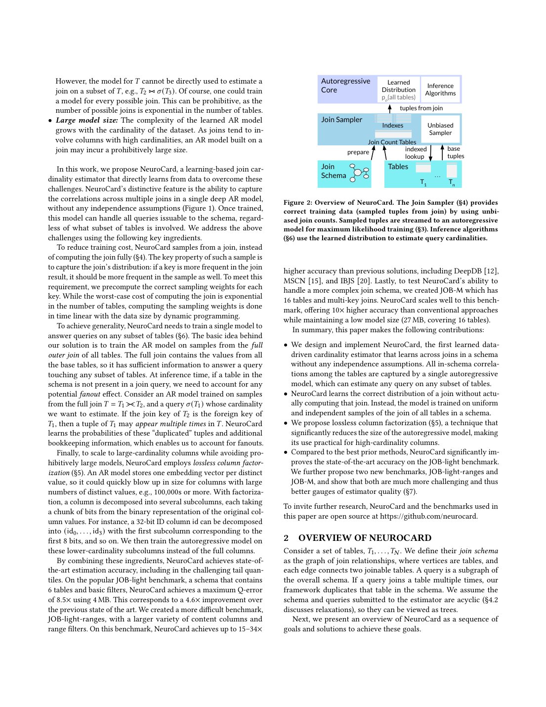
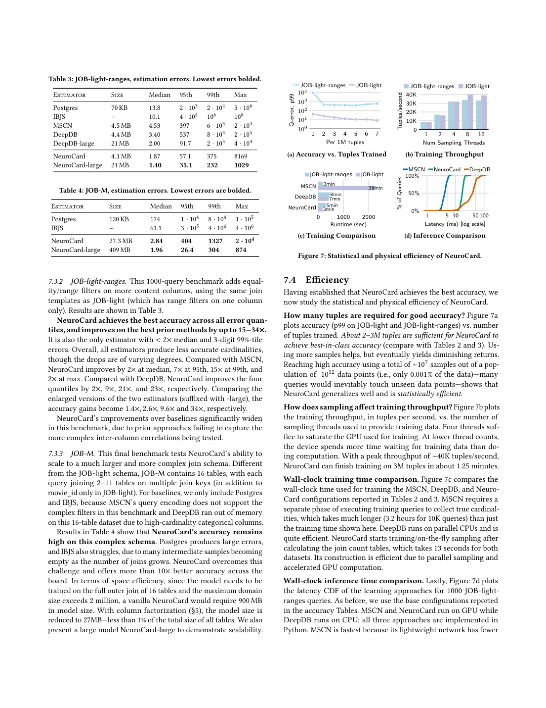

> 本组第 51 篇 · 统计与基数估计 · [全部论文]() · [上一篇]() · [下一篇]()

NeuroCard在给定无环join schema的全外联接分布上训练单个自回归模型：先用Exact Weight式动态规划算join counts，生成有放回uniform iid训练元组，避免物化巨大结果。推理用indicator排除补齐行，并在每条progressive sample内除遗漏表fanout乘积，不能只忽略未查询列。高域ID可逆拆位后自回归学习，不等于有限模型无误差。JOB-light70查询最大Q-error8.51、参数3.8MB；JOB-light-ranges基础最大8169，JOB-M基础约2万，large874且409MB，不能跨基准宣传统一个位数尾误差。几MB参数不含基表、索引、计数表和训练内存；未在本机运行原系统或检查当前代码。

本文保留论文陈述、读者推断与待验证方案的区别；实验数字只适用于原文条件。原文和翻译来自已有 AI 辅助精读报告，已做来源匹配与编辑复核，不等于人工逐项核验或独立实验复现。所有页码均为 PDF 物理页。

## 论文与阅读范围

Zongheng Yang, Amog Kamsetty, Sifei Luan, Eric Liang, Yan Duan, Xi Chen, Ion Stoica. NeuroCard: One Cardinality Estimator for All Tables. Local reference block: PVLDB 14(1):61–73, 2021; DOI 10.14778/3421424.3421432. arXiv v2 dated 2 November 2020; 13 physical pages. Distinguish version date from reference-block year; external publisher record not checked.

[论文集中的原始 PDF](https://github.com/lonng/db-papers/blob/4ff1331069c7cf52ac97dd769e5f484c1c35c200/papers/probabilistic-counting/neurocard%3A-one-cardinality-estimator-for-all-tables.pdf) · 本地来源：`probabilistic-counting/neurocard_-one-cardinality-estimator-for-all-tables.pdf`，共 13 页。

本篇保留 32 组原文精读和 52 条证据。截图为原始 PDF 的局部页选，不是重新生成的图表；未将整份 PDF 复制到博客。

## 研究问题与适用边界

**单表模型为何不能直接拼**
每表独立训练再组合会丢跨表相关性，每个可能join graph各建模型又组合爆炸；只对全内联接训练会丢不匹配行，无法估某些基表子图。即便全外联接保存信息，基表元组被其他表fanout复制，直接边缘化未查询列仍数错。

目标是在给定schema内单模型回答子图查询。schema和查询假设无环，支持多路、多键等值联接；自联接须在schema复制表。schema之外的联接可回退单表估计加传统启发式，但精度不再有同样建模优势。“all”不等于任意SQL、循环图、跨列UDF或所有外联接形式已实现。

无列/表独立性假设仅指概率分解，不等于训练样本、有限网络、虚拟列预测与积分没有误差。

依据：论文陈述；PDF 物理页 2, 3, 5。证据：[NEUROCARDREV01](#evidence-neurocardrev01), [NEUROCARDREV02](#evidence-neurocardrev02), [NEUROCARDREV03](#evidence-neurocardrev03), [NEUROCARDREV04](#evidence-neurocardrev04)。

## 系统架构与组件设计

**采样器、神经核心、校正器**
Join Sampler准备键索引和join count tables，在树上动态规划后按权重自顶向下采样，再索引取内容列。uniform针对全外联接多重集行实例，重复行按频数贡献概率；有放回采样提供iid批次。2*10^12或10^13联接行是隐含分布，不物理全量存储。

神经核心沿Naru用字典ID、列嵌入、masked ResMADE残差层、共享embedding输出和MLE，启用MASK wildcard-skipping；也比较Transformer。大域ID按N位拆子列，仍自回归建模子列关联。它是表分布密度估计，不是聊天LLM或语言API。

推理层结合Naru重要性采样与Hilprecht/DeepDB等的全外联接虚拟列思路。indicator记某表真实参与与否，fanout记键在相应基表列的频数；两者也由模型学习，排在内容列后、indicator先fanout。它们不是每次推理从真实表获得的精确oracle。

部署还需基表、字典、索引、计数表、采样线程与训练框架。表中MB主要是参数量，不是完整内存或峰值显存。

依据：论文陈述；PDF 物理页 3, 5, 6, 7, 8, 10。证据：[NEUROCARDREV03](#evidence-neurocardrev03), [NEUROCARDREV04](#evidence-neurocardrev04), [NEUROCARDREV05](#evidence-neurocardrev05), [NEUROCARDREV06](#evidence-neurocardrev06), [NEUROCARDREV07](#evidence-neurocardrev07), [NEUROCARDREV08](#evidence-neurocardrev08), [NEUROCARDREV12](#evidence-neurocardrev12), [NEUROCARDREV15](#evidence-neurocardrev15), [NEUROCARDREV19](#evidence-neurocardrev19)。

*原论文 PDF 物理页 2，版权归原作者或出版方。点击图片可查看原尺寸。页面文本中定位到：Figure 2: Overview of NeuroCard. The Join Sampler (§4) provides。这是页面定位信息，不表示本次已复核图内所有数据。*

## 核心算法与推理步骤

**正确训练分布**
式7对子分支先求匹配后代权重和，再跨分支相乘；叶权重1，根权重和给|J|。从根按权重抽，再沿匹配列表按后代权重抽，补内容列时保持行频数。图4 A.x=2权重3而不是一跳匹配数2，因为两个B分支分别有1和2个完整结果。

全外联接需虚拟空元组处理无匹配、排除all-NULL；不能照内联接空和为0丢掉C.d等无伙伴行。O(sum|Ti|)是给定树形匹配结构下DP成本，不是任意循环join或从零建索引的通用成本。

**列拆位**
编码ID每N位一组，可还原。col<1000000拆10位，先取hi<=976；hi=976时lo<576，否则低位通配。不是独立筛hi<=976且lo<576。实际读者穷举999000至1000999验证条件等价，未运行原网络。

**子图校正**
查询中各表加indicator=1排补齐行；遗漏表按到查询子树的唯一路径确定fanout键，逐路径除局部频数乘积。图4五行中A.x=2直接数3，三表内联加indicator得2；只查A需贡献1/(2*1)、1/(2*2)、1/(2*2)之和1。实际精确算例已运行。若用3除平均乘积(2,4,4)则0.9，说明E[1Q/F]不等于E[1Q]/E[F]。

依据：论文陈述；PDF 物理页 5, 7, 8。证据：[NEUROCARDREV05](#evidence-neurocardrev05), [NEUROCARDREV06](#evidence-neurocardrev06), [NEUROCARDREV07](#evidence-neurocardrev07), [NEUROCARDREV10](#evidence-neurocardrev10), [NEUROCARDREV11](#evidence-neurocardrev11), [NEUROCARDREV12](#evidence-neurocardrev12), [NEUROCARDREV13](#evidence-neurocardrev13), [NEUROCARDREV14](#evidence-neurocardrev14)。

## 正确性论证与理论边界

**概率空间必须匹配**
基表、全外联接、查询子图分布不同。|J|是计数表求的全外联接多重集行数，不是训练样本数量或某基表行数。indicator处理外联接补齐，fanout处理遗漏分支复制；fanout是局部键频数，不是递归join count。

无偏聚合估计器不等于uniform iid训练数据。IBJS或WanderJoin经权重可估COUNT，不代表其原始元组可直接MLE；否则模型学的是有偏样本分布。索引与计数也必须属于对应快照；并行读不变计数可独立采样，不代表并发更新天然安全。

“lossless”指字典拆位可逆、完整条件链无独立性损失；有限模型仍会学错或给不可能组合质量。拆位范围掩码需随前缀更新；补空、边界及零匹配fanout中性值须与图4规则一致，不能除零。

式9的路径定向依赖树及适当连通子图；环图不能任意选边还称唯一。本文未在本地资料中给全部SQL NULL三值逻辑、复杂外联接顺序与动态schema的端到端语义证明，本报告不补齐未知细节。

依据：读者推断；PDF 物理页 2, 3, 5, 6, 7, 8。证据：[NEUROCARDREV01](#evidence-neurocardrev01), [NEUROCARDREV02](#evidence-neurocardrev02), [NEUROCARDREV03](#evidence-neurocardrev03), [NEUROCARDREV04](#evidence-neurocardrev04), [NEUROCARDREV05](#evidence-neurocardrev05), [NEUROCARDREV06](#evidence-neurocardrev06), [NEUROCARDREV07](#evidence-neurocardrev07), [NEUROCARDREV08](#evidence-neurocardrev08), [NEUROCARDREV09](#evidence-neurocardrev09), [NEUROCARDREV10](#evidence-neurocardrev10), [NEUROCARDREV11](#evidence-neurocardrev11), [NEUROCARDREV12](#evidence-neurocardrev12), [NEUROCARDREV13](#evidence-neurocardrev13), [NEUROCARDREV14](#evidence-neurocardrev14)。

## 实验评估与工作负载分析

**基准不是全部SQL**
JOB-light70查询、6表，每查询2–5表；ranges1000查询、18个join graph、3–6过滤，从inner join样本取字面值保证非空；JOB-M基于原113 JOB改写，16表、每查询2–11表、每表至多一次且去OR。不能称未改动完整JOB或任意OOD验证。

表2基础3.8MB的median1.57、p955.91、p998.48、max8.51。DeepDB-large32MB的median1.19、p954.66更好，max39.5较差，优势突出在尾部而不是全部指标。表2Postgres p99=3*10^3而max=10^3，原图同样顺序冲突，保留疑点不静默修数。

表3 ranges基础4.1MB为median1.87、p9557.1、p99375、max8169；large21MB最大1029。表4 JOB-M基础27.3MB最大约2万，large409MB最大874。复杂基准不是个位数尾误差，large也不总是几MB。JOB-M只纳Postgres/IBJS，其他基线受编码或内存限制，并非所有方法的同预算全面对照。

**效率、消融与更新**
V100+32vCPU；6表join counts约13秒、16表约4分钟。ranges基础推理中位约17ms、最小约12ms，不是本机实测或纯GPU算力比较。biased sampler令p50从1.9到33；单表AR独立组合p50约40、p95约9万。拆位10/12/14位p95为173/168/57.1，编码可逆不保证实际精度不变。

图8五个日期分区、10次误差平均；fast update70K样本约3秒，retrain7M约3分钟，文字延迟针对额外梯度步骤，不自动包含增量索引、join counts、字典与服务切换。

依据：论文陈述；PDF 物理页 6, 8, 9, 10, 11。证据：[NEUROCARDREV09](#evidence-neurocardrev09), [NEUROCARDREV16](#evidence-neurocardrev16), [NEUROCARDREV17](#evidence-neurocardrev17), [NEUROCARDREV18](#evidence-neurocardrev18), [NEUROCARDREV19](#evidence-neurocardrev19), [NEUROCARDREV20](#evidence-neurocardrev20), [NEUROCARDREV21](#evidence-neurocardrev21), [NEUROCARDREV22](#evidence-neurocardrev22)。

*原论文 PDF 物理页 10，版权归原作者或出版方。点击图片可查看原尺寸。页面文本中定位到：Table 3: JOB-light-ranges, estimation errors. Lowest errors bolded.；Table 4: JOB-M, estimation errors. Lowest errors are bolded.；Figure 7: Statistical and physical efficiency of NeuroCard.。这是页面定位信息，不表示本次已复核图内所有数据。*

## 工程权衡与设计取舍

单模型避免按子图指数建模，却把全部内容、虚拟列和跨表关联交给一个近似网络。更大schema、高域和更多子列增加学习与积分难度；更大模型也未消除复杂基准尾误差。

采样避免结果物化，不省基表索引和计数状态；数据追加后还要维护这些状态。小N省embedding但增加维数与统计难度。树形约束使路径唯一，支持循环图需额外算法，不能只删“无环”。

优化器落地需测调用预算、缓存/批处理、回退与真实计划收益；更低Q-error不等于同比例SQL加速。

依据：读者推断；PDF 物理页 2, 5, 6, 9, 10, 11。证据：[NEUROCARDREV01](#evidence-neurocardrev01), [NEUROCARDREV05](#evidence-neurocardrev05), [NEUROCARDREV08](#evidence-neurocardrev08), [NEUROCARDREV09](#evidence-neurocardrev09), [NEUROCARDREV18](#evidence-neurocardrev18), [NEUROCARDREV19](#evidence-neurocardrev19), [NEUROCARDREV20](#evidence-neurocardrev20), [NEUROCARDREV21](#evidence-neurocardrev21), [NEUROCARDREV22](#evidence-neurocardrev22)。

## 与现有技术的对比分析

Naru给单关系AR与progressive sampling；NeuroCard增加正确全联接采样、子图概率校正和高域列分解。单把联接行喂Naru再忽略未查询列不是完整NeuroCard。

DeepDB也用full outer join与虚拟列查询思想，本文明确继承相关算法；不能把indicator/fanout全部说成新发明。NeuroCard用单schema AR、uniform iid数据，与多个子集SPN及其组合假设形成区别。该比较限于论文版本，本次未检查当前实现。

与MSCN相比不需查询标签，仍需正确数据训练；与纯join sample相比可从条件模型提议探索稀有区域，但模型虚拟路径不是新真实观测。任何data-driven模型仍受数据漂移影响。

依据：读者推断；PDF 物理页 2, 3, 5, 7, 9, 10。证据：[NEUROCARDREV01](#evidence-neurocardrev01), [NEUROCARDREV02](#evidence-neurocardrev02), [NEUROCARDREV03](#evidence-neurocardrev03), [NEUROCARDREV04](#evidence-neurocardrev04), [NEUROCARDREV11](#evidence-neurocardrev11), [NEUROCARDREV13](#evidence-neurocardrev13), [NEUROCARDREV17](#evidence-neurocardrev17), [NEUROCARDREV19](#evidence-neurocardrev19)。

## 复现指南与待验证问题

**只有读者精确算例已实际执行**
先重建图4五行，核对根权重和5、Q1=2、Q2=1及平均fanout相除错误0.9。qa/neurocard-reader-tests.json记录这些精确行枚举和拆位边界测试，不是学习准确度、uniform iid或性能验证。

后续建议穷举带重复、无匹配、复合键、多分支和不同根的小树schema，核查采样频率、|J|及每个连通子图查询；分别注入有偏采样、错误indicator、fanout和掩码，确保测试能抓语义错。固定数据快照核对索引、计数、字典和模型版本。

训练记录seed、样本、位数、embedding、网络、线程、设备和精度；保存逐查询actual/estimate、零行规则、分位数和最大失败；构建分项计时，报告参数、索引、计数、框架峰值内存。再接优化器测总规划与实际执行。本机5070Ti兼容当前依赖需独立实测，未下载或运行原系统。

依据：待验证的工程设想；PDF 物理页 2, 5, 7, 8, 10, 11。证据：[NEUROCARDREV01](#evidence-neurocardrev01), [NEUROCARDREV04](#evidence-neurocardrev04), [NEUROCARDREV05](#evidence-neurocardrev05), [NEUROCARDREV06](#evidence-neurocardrev06), [NEUROCARDREV07](#evidence-neurocardrev07), [NEUROCARDREV10](#evidence-neurocardrev10), [NEUROCARDREV11](#evidence-neurocardrev11), [NEUROCARDREV12](#evidence-neurocardrev12), [NEUROCARDREV13](#evidence-neurocardrev13), [NEUROCARDREV14](#evidence-neurocardrev14), [NEUROCARDREV18](#evidence-neurocardrev18), [NEUROCARDREV19](#evidence-neurocardrev19), [NEUROCARDREV20](#evidence-neurocardrev20)。

## 总结与工程启示

关键不是“网络足够强就能猜join”，而是先保证全外联接训练分布正确、编码与过滤可逆、子图概率校正明确，再用近似模型压缩积分。有偏训练或复制计数未解决时，增容量不能自动修复概率空间。

严谨使用应区分无独立性分解与有限模型误差、几MB参数与系统成本、快速梯度与端到端刷新，以及JOB-light与复杂基准结果。

依据：读者推断；PDF 物理页 2, 3, 5, 6, 7, 10, 11。证据：[NEUROCARDREV01](#evidence-neurocardrev01), [NEUROCARDREV03](#evidence-neurocardrev03), [NEUROCARDREV04](#evidence-neurocardrev04), [NEUROCARDREV08](#evidence-neurocardrev08), [NEUROCARDREV13](#evidence-neurocardrev13), [NEUROCARDREV18](#evidence-neurocardrev18), [NEUROCARDREV19](#evidence-neurocardrev19), [NEUROCARDREV20](#evidence-neurocardrev20)。

## 原文精读：从句子回到机制

以下保留原文、忠实翻译、含义与边界；假设示例不作为论文实验结果。

### P001 · PDF 物理页 1

**原文**

<blockquote class="paper-source-quote"><pre><code>Despite decades of research, existing&#10;cardinality estimators are inaccurate for complex queries, due to&#10;making lossy modeling assumptions and not capturing inter-table&#10;correlations. In this work, we show that it is possible to learn the cor-&#10;relations across all tables in a database without any independence&#10;assumptions.</code></pre></blockquote>

**忠实翻译**

> 尽管经过数十年的研究，现有的基数估计器对于复杂查询仍然不准确，原因是做出了有损的建模假设并且未能捕获表间相关性。在本工作中，我们展示了在不做任何独立性假设的情况下，学习数据库中所有表之间的相关性是可能的。

**技术含义与边界**

> 这是摘要中的动机和贡献声明，整篇另给join sampling、列分解与子图校正算法。本报告已经阅读全文，不能把片段未展示细节写成全文没有具体算法。无独立性仅指概率分解，适用范围仍是给定的无环join schema及相应查询，有限训练模型没有零误差保证。

**常见误读**

> 不把无独立性误解为无任何前提、任意SQL都精确，或有限网络已经完美学会所有相关性。schema之外启发式回退明确可能更差。

**读者构造的假设示例**

> 读者构造的假设示例：假设数据库包含订单表和客户表，传统方法假设两表独立导致多表连接基数估计偏差；本工作声称无需该假设即可学习两表关联。此例仅为帮助理解，非作者实验。

### P002 · PDF 物理页 13

**原文**

<blockquote class="paper-source-quote"><pre><code>[49] Barzan Mozafari Yongjoo Park, Shucheng Zhong. 2020. QuickSel: Quick Selectiv-&#10;ity Learning with Mixture Models. SIGMOD (2020).&#10;[50] Zhuoyue Zhao, Robert Christensen, Feifei Li, Xiao Hu, and Ke Yi. 2018. Random&#10;sampling over joins revisited. In Proceedings of the 2018 International Conference&#10;on Management of Data. 1525–1539.</code></pre></blockquote>

**忠实翻译**

> [49] Barzan Mozafari Yongjoo Park, Shucheng Zhong. 2020. QuickSel: Quick Selectivity Learning with Mixture Models. SIGMOD (2020).
> [50] Zhuoyue Zhao, Robert Christensen, Feifei Li, Xiao Hu, and Ke Yi. 2018. Random sampling over joins revisited. In Proceedings of the 2018 International Conference on Management of Data. 1525–1539.

**技术含义与边界**

> 这段本身是书目，不足以单独证明采用方式；但已读5页正文明确说NeuroCard实现Zhao等[50]的Exact Weight并适配full outer join。QuickSel在相关工作作为混合模型估计器讨论。未独立阅读这两篇外部原文，不把书目或正文引用当作已复现其证明。

**常见误读**

> 不可从引文标题推断本论文采用了这些方法或复现了其结果。参考文献的存在不代表本论文认同、依赖或扩展了这些工作的全部结论。

**读者构造的假设示例**

> 读者构造的假设示例：可根据[50]继续追查Exact Weight的完整证明；本报告只核对NeuroCard自身对采用和适配方式的描述，不能声称已验证原采样论文。

### P003 · PDF 物理页 7

**原文**

<blockquote class="paper-source-quote"><pre><code>The inference procedure would draw&#10;a subcol1 value in this range, based on which the low-bits filter is&#10;relaxed appropriately. If the drawn subcol1 is 976, then the filter on&#10;subcol2 is set to “&lt; 576”; otherwise, the high-bits already satisfy&#10;the original filter so a wildcard is placed on the low-bits subcolumn.</code></pre></blockquote>

**忠实翻译**

> 推理过程会在此范围内抽取一个 subcol1 值，并据此适当地放宽 low-bits 过滤器。如果抽到的 subcol1 是 976，那么 subcol2 上的过滤器被设置为“< 576”；否则，high-bits 已经满足原始过滤器，因此在 low-bits 子列上放置通配符。

**技术含义与边界**

> 此处完整上下文是col<1000000按每10位分块：先限定hi<=976，若hi=976则lo<576，否则低位通配。下一个子列有效区域依赖已抽前缀，不是两个相互独立固定过滤器。字典ID分块编码可逆，有限模型拟合仍可能出错。

**常见误读**

> 容易误认为 subcol1=976 和 subcol2<576 是通用规则。实际上这只是作者在说明机制时给出的一个具体数值路径示例，依赖于特定的列拆分方式和数据范围。不能将其泛化为所有列或所有查询的固定行为。

**读者构造的假设示例**

> 读者构造的假设示例：x=hi*1024+lo，hi=975、lo=900仍满足x<1000000，不能被错误的固定lo<576掩码剔除。读者脚本已在999000至1000999范围穷举验证，不是原网络实验。

### P004 · PDF 物理页 4

**原文**

<blockquote class="paper-source-quote"><pre><code>NeuroCard supports acyclic join schemas and&#10;queries containing multi-way, multi-key equi-joins (§4.2 discusses&#10;how to relax the acyclic requirement). The schema should capture&#10;the most common joins. For joins not captured in the schema,&#10;their cardinalities can be estimated by first obtaining single-table&#10;estimates using NeuroCard, then combining the estimates using&#10;classical heuristics [21]. This allows uncommon cases to be handled&#10;under the same framework, albeit at the cost of lower accuracy.&#10;Supported filters.</code></pre></blockquote>

**忠实翻译**

> NeuroCard 支持无环连接模式和包含多路、多键等值连接的查询（§4.2 讨论了如何放宽无环要求）。模式应捕获最常见的连接。对于模式中未捕获的连接，其基数可以先通过 NeuroCard 获得单表估计，然后使用经典启发式方法 [21] 组合这些估计来估算。这使得不常见的情况可以在同一框架下处理，尽管代价是较低的准确性。支持的过滤器。

**技术含义与边界**

> 作者明确了 NeuroCard 的适用边界：原生支持无环（acyclic）连接模式和多路多键等值连接。对于超出预定义模式的罕见连接，采用降级策略——先用 NeuroCard 做单表估计，再用经典启发式合并，但明确指出这会导致准确性下降。§4.2 被引用为放宽无环限制的讨论位置。

**常见误读**

> 容易误认为 NeuroCard 对所有连接拓扑都能保持高精度。原文明确指出，对于未在模式中捕获的连接，采用的是单表估计加启发式组合的降级方案，且‘代价是较低的准确性’。不应将核心模型的能力泛化到降级路径上。

**读者构造的假设示例**

> 读者构造的假设示例：已学schema为A—B—C，A和C都在模型内，但某查询用未建模的A-C新键关系。可先从模型取得A、C单表估计再启发式合并；这不享有schema内正确fanout校正的同样优势。若D根本不在训练schema，不能声称同一个模型能估D。

### P005 · PDF 物理页 10

**原文**

<blockquote class="paper-source-quote"><pre><code>Comparing the&#10;enlarged versions of the two estimators (suffixed with -large), the&#10;accuracy gains become 1.4×, 2.6×, 9.6× and 34×, respectively.&#10;NeuroCard’s improvements over baselines significantly widen&#10;in this benchmark, due to prior approaches failing to capture the&#10;more complex inter-column correlations being tested.&#10;7.3.3&#10;JOB-M. This final benchmark tests NeuroCard’s ability to&#10;scale to a much larger and more complex join schema.</code></pre></blockquote>

**忠实翻译**

> 比较两个估计器的放大版本（后缀为 -large），精度提升分别变为 1.4×、2.6×、9.6× 和 34×。NeuroCard 相对于基线的改进在此基准测试中显著扩大，因为先前的方法未能捕获正在测试的更复杂的列间相关性。
> 7.3.3
> JOB-M。这个最后的基准测试检验了 NeuroCard 扩展到更大、更复杂连接模式的能力。

**技术含义与边界**

> 这几个倍数具体对应JOB-light-ranges上NeuroCard-large相对DeepDB-large的median、p95、p99、max Q-error比值，不是运行时加速或所有查询的统一提升。后一段才切换到JOB-M，不能把前一基准34倍混进JOB-M，也不能理解为增大网络必然使每个相对收益都更大。

**常见误读**

> 需要同时说明基准、比较对象large配置和误差分位数；34倍是最大Q-error指标的对照，不是每条查询提高34倍或SQL执行快34倍。基础/large模型及不同基准不能混成一组数。

**读者构造的假设示例**

> 读者构造的假设示例：若两个模型在固定查询集的最大Q-error分别3400与100，该统计指标比34；最大误差可能发生在不同查询，并不意味着所有查询的误差都除以34。

### P006 · PDF 物理页 2

**原文**

<blockquote class="paper-source-quote"><pre><code>A query is a subgraph of&#10;the overall schema. If a query joins a table multiple times, our&#10;framework duplicates that table in the schema. We assume the&#10;schema and queries submitted to the estimator are acyclic (§4.2&#10;discusses relaxations), so they can be viewed as trees.&#10;Next, we present an overview of NeuroCard as a sequence of&#10;goals and solutions to achieve these goals.</code></pre></blockquote>

**忠实翻译**

> 查询是整体模式的一个子图。如果一个查询多次连接同一个表，我们的框架会在模式中复制该表。我们假设提交给估计器的模式和查询是无环的（§4.2 讨论了放宽条件），因此它们可以被视为树。
> 接下来，我们将 NeuroCard 概述为实现这些目标的一系列目标和解决方案。

**技术含义与边界**

> 作者定义了查询与模式的关系：查询是模式的子图。对于自连接（同一表出现多次），通过在模式中复制该表来处理。核心前提是模式和查询必须是无环的（acyclic），从而可以视为树结构。后续内容将以‘目标-解决方案’的形式展开。

**常见误读**

> 树形schema与查询是前提，4.2只讨论可借鉴的扩展，不是任意带环查询已全面实现。复制表是为不同自联接角色在schema建模，不必解释为无条件把实际表数据物理复制若干份；更不保证任何循环查询只换别名就变为同一问题。

**读者构造的假设示例**

> 读者构造的假设示例：假设模式包含表 A、B、C，查询需要 A 连接 B 再连接 A（自连接）。框架会将模式中的 A 复制为 A1 和 A2，使查询图变为 A1-B-A2 的无环树。此例用于说明‘复制表’机制，非作者给出的具体案例。

### P007 · PDF 物理页 3

**原文**

<blockquote class="paper-source-quote"><pre><code>Solution: We build a single cardinality estimator that learns&#10;the distribution of the full outer join of all tables in the schema&#10;(henceforth, full join). For example, for a three-table schema, we&#10;learn 𝑝(𝑇1 ⊲⊳𝑇2 ⊲⊳𝑇3). Note that using the inner join instead of the&#10;full join would not work. Indeed, the inner join 𝑇1 ⊲⊳𝑇2 ⊲⊳𝑇3 is the&#10;intersection of the three tables. If a query uses only 𝑇1 or 𝑇1 ⊲⊳𝑇3,&#10;their tuples may not be fully contained in this intersection, and&#10;thus the estimator would have insufficient information to answer&#10;these queries.</code></pre></blockquote>

**忠实翻译**

> 解决方案：我们构建一个单一的基数估计器，学习模式中所有表的全外连接（full outer join，以下简称 full join）的分布。例如，对于三表模式，我们学习 𝑝(𝑇1 ⊲⊳𝑇2 ⊲⊳𝑇3)。注意，使用内连接（inner join）代替全连接是行不通的。事实上，内连接 𝑇1 ⊲⊳𝑇2 ⊲⊳𝑇3 是三张表的交集。如果一个查询仅使用 𝑇1 或 𝑇1 ⊲⊳𝑇3，它们的元组可能不会完全包含在这个交集中，因此估计器将没有足够的信息来回答这些查询。

**技术含义与边界**

> 单模型的学习目标是给定schema全外联接的多重集分布，保留无匹配基表行。原文把内联接称intersection应读作只保留满足所有联接匹配的区域，不是对异构表做同模式集合交。保留信息也不等于直接忽略未查询列就能得基表行数，还需indicator/fanout校正。

**常见误读**

> 容易误认为全外连接在实际物理执行中被物化。原文说的是学习其‘分布’，即统计建模层面的联合分布，而非要求在存储层真正计算并保存全外连接的结果表。此外，‘行不通’是针对内连接作为学习目标的理论缺陷，不代表内连接查询本身不能被估计。

**读者构造的假设示例**

> 读者构造的假设示例：假设有客户表 T1 和订单表 T2，某些客户没有订单。若学习内连接分布，无订单客户的元组会被丢弃；当查询仅统计 T1 的客户数时，模型无法从内连接分布中恢复这些信息。学习全外连接分布则保留了这些客户记录。此例用于说明为何选择全外连接，非原文实验。

### P008 · PDF 物理页 5

**原文**

<blockquote class="paper-source-quote"><pre><code>4&#10;SAMPLING FROM JOINS&#10;A key challenge in NeuroCard is computing an unbiased sam-&#10;ple of the full join (§2.1) to ensure that the learned distribution&#10;faithfully approximates the full join distribution. Namely, every&#10;tuple in the full join 𝐽(a multiset) must be sampled equally likely&#10;with probability 1/|𝐽|. The samples should also be i.i.d., as required&#10;by Equation 2. NeuroCard meets these requirements by using a&#10;sampler that produces simple random samples with replacement.</code></pre></blockquote>

**忠实翻译**

> 4
> 从连接中采样
> NeuroCard 中的一个关键挑战是计算全连接（§2.1）的无偏样本，以确保学习到的分布忠实地近似全连接分布。也就是说，全连接 𝐽（一个多重集）中的每个元组必须以 1/|𝐽| 的概率被等可能地采样。样本还应该是独立同分布（i.i.d.）的，如公式 2 所要求的。NeuroCard 通过使用产生有放回简单随机样本的采样器来满足这些要求。

**技术含义与边界**

> 全外联接多重集每个行实例应等概率1/|J|，以有放回采样形成iid输入。它保证训练数据的目标分布正确，不保证有限模型训练后精确或任意条件查询误差小。无偏COUNT估计器也不自动提供uniform训练样本；加权聚合与未加权MLE要区分。

**常见误读**

> 容易将‘无偏采样’等同于‘高效采样’。原文仅声明了统计学要求（无偏、i.i.d.、等概率）和采用的方法（有放回简单随机采样），但未在此段落中讨论该采样器在大规模连接上的计算复杂度或工程实现细节。不应推断该采样过程在任意规模下都是低开销的。

**读者构造的假设示例**

> 读者构造的假设示例：100万行实例即使部分键值完全相同，仍各有1/1000000抽取机会；重复键值的总概率按实例数累加，而不是对不同键均匀。

### P009 · PDF 物理页 9

**原文**

<blockquote class="paper-source-quote"><pre><code>Figure 6 plots the distributions of&#10;selectivities of these workloads, where we calculate each query’s&#10;selectivity as cardactual/cardinner (denominator is the row count of&#10;the query join graph—an inner join—without filters). The selectivity&#10;spectrums of our two benchmarks (JOB-light-ranges and JOB-M)&#10;are much wider than JOB-light due to higher filter variety. The&#10;median selectivity is more than 100× lower, while at the low tail&#10;the minimum selectivities are 1000× lower.</code></pre></blockquote>

**忠实翻译**

> 图 6 绘制了这些工作负载的选择率分布，其中我们将每个查询的选择率计算为 cardactual/cardinner（分母是查询连接图——内连接——在没有过滤器时的行数）。我们两个基准测试（JOB-light-ranges 和 JOB-M）的选择率谱比 JOB-light 宽得多，因为过滤器种类更多。中位数选择率低了 100 倍以上，而在低尾部，最小选择率低了 1000 倍。

**技术含义与边界**

> 作者定义了选择率的计算公式：实际基数除以无过滤条件下内连接的行数。通过对比三个基准测试，指出 JOB-light-ranges 和 JOB-M 由于包含更多样化的过滤条件，其选择率分布范围更广，中位数和最小值都远低于 JOB-light。这说明后两个基准的查询更具挑战性（过滤更严格）。

**常见误读**

> 分母是查询子图无过滤的inner join行数，不是训练全外联接|J|或任一基表行数。低100倍指选择率比例，不直接比较绝对基数。本次已目视8页Figure6，横轴为log selectivity；只称核对图形语境，不声称数字化全部曲线或复现查询集。

**读者构造的假设示例**

> 读者构造的假设示例：假设某查询在无过滤时内连接结果为 100 万行，加上过滤条件后实际返回 100 行，则选择率为 0.0001。若 JOB-light 的中位数选择率为 0.01，而 JOB-M 的中位数选择率为 0.0001，则后者低了 100 倍。此例用于解释选择率计算和倍数关系，非原文数据。

### P010 · PDF 物理页 12

**原文**

<blockquote class="paper-source-quote"><pre><code>DeepDB [12] is a recent cardi-&#10;nality estimator that uses SPNs. NeuroCard is similar to DeepDB&#10;in the following aspects. (S1) Both works use the formulation of&#10;learning the full outer join of multiple tables. (S2) Our “schema&#10;subsetting” capability builds on their querying algorithms.&#10;NeuroCard differs from DeepDB in the following. (D1) Modern&#10;density model: NeuroCard’s choice of a deep autoregressive model&#10;is a universal function approximator hence fundamentally more&#10;expressive.</code></pre></blockquote>

**忠实翻译**

> DeepDB [12] 是最近一种使用 SPN 的基数估计器。NeuroCard 与 DeepDB 在以下方面相似。（S1）两项工作都使用了学习多表全外连接的表述。（S2）我们的“模式子集化”能力建立在他们的查询算法之上。
> NeuroCard 与 DeepDB 的不同之处如下。（D1）现代密度模型：NeuroCard 选择深度自回归模型作为通用函数逼近器，因此在根本上更具表达能力。

**技术含义与边界**

> 论文明确继承DeepDB的full outer join表述和schema subsetting查询算法，再比较单一深AR与多个SPN/子集假设等设计。表达性理由是作者理论层面论述，实际精度仍需看相同预算与工作负载；不是把全部虚拟列校正归为NeuroCard原创。

**常见误读**

> 容易将‘根本上更具表达能力’等同于‘在所有实验中精度更高’。表达能力（expressiveness）是模型的理论属性，指能表示的函数类更广，但实际精度还取决于训练数据、优化过程、超参数等因素。原文此处仅陈述了模型架构层面的理论差异，不应直接推断为端到端性能的全面超越。

**读者构造的假设示例**

> 读者构造的假设示例：两个有限密度模型在某复杂相关区域的拟合能力不同，但训练容量、样本和优化限制可能改变实际胜负。不能随意给SPN规定未经本报告证明的“只能表示某类多项式分布”，也不能由通用逼近性质直接推出任何数据集都更准。

### NEUROCARDP001 · PDF 物理页 2

**原文**

<blockquote class="paper-source-quote"><pre><code>We assume the&#10;schema and queries submitted to the estimator are acyclic (§4.2&#10;discusses relaxations), so they can be viewed as trees.</code></pre></blockquote>

**忠实翻译**

> 我们假设模式与提交给估计器的查询都是无环的，因此可以看作树；4.2节讨论放宽条件。

**技术含义与边界**

> “one for all tables”是在给定join schema范围内，而非任意SQL或未知联接关系。自联接需在schema复制表，环路扩展在本文不是已测通用能力。

**常见误读**

> 不把无独立性概率分解称作无任何假设；树形模式、联接类型、采样正确性等仍是重要前提。

**读者构造的假设示例**

> 读者构造的假设示例：已学A—B—C树上的子树查询可校正；新加入A—C边成环后，应另设计采样或回退，不能原样套树形证明。

### NEUROCARDP002 · PDF 物理页 3

**原文**

<blockquote class="paper-source-quote"><pre><code>Note that using the inner join instead of the&#10;full join would not work. Indeed, the inner join 𝑇1 ⊲⊳𝑇2 ⊲⊳𝑇3 is the&#10;intersection of the three tables. If a query uses only 𝑇1 or 𝑇1 ⊲⊳𝑇3,&#10;their tuples may not be fully contained in this intersection, and&#10;thus the estimator would have insufficient information to answer&#10;these queries.</code></pre></blockquote>

**忠实翻译**

> 用内联接替代全外联接行不通：内联接仅保留三表交集中可匹配部分，若查询只用T1或T1联T3，部分元组不在交集中，模型信息不足。

**技术含义与边界**

> 全外联接作为共同概率空间保留不匹配元组；使用虚拟NULL与indicator区分参与表，不是将所有表物理存成巨大宽表。

**常见误读**

> 不把full join误写成内联接或笛卡尔积；也不认为缺失表数据可以从训练中从未见过的内联接分布凭空恢复。

**读者构造的假设示例**

> 读者构造的假设示例：客户没有订单但需要估客户全表时，训练只看客户内联订单会漏客户；外联接中的补空元组使其仍可表示。

### NEUROCARDP003 · PDF 物理页 3

**原文**

<blockquote class="paper-source-quote"><pre><code>Specifically, we ensure that any tuple in the full&#10;join 𝐽(a multiset) is sampled with same probability, 1/|𝐽|. To achieve&#10;this, we leverage a state-of-the-art join sampling algorithm [50]&#10;(§4). We first precompute join count tables that map each table’s join&#10;keys to their correct sampling weights with respect to the full join.&#10;Then, we sample the keys using these counts as weights.</code></pre></blockquote>

**忠实翻译**

> 具体要让全联接J这个多重集中的每个元组以相同概率1/|J|被抽到；为此先计算按联接键映射到正确采样权重的计数表，再按权重采样。

**技术含义与边界**

> 均匀是对联接结果的行实例而非不同键。多重集重复行按频数贡献概率，否则学习分布会偏。

**常见误读**

> 不能把每张基表独立均匀抽样后联接、或让每个不同联接键机会相同当成全联接行均匀。

**读者构造的假设示例**

> 读者构造的假设示例：某键在联接结果出现100次，另一个1次，训练样本前者概率应约100倍，而非各50%。

### NEUROCARDP004 · PDF 物理页 5

**原文**

<blockquote class="paper-source-quote"><pre><code>The samples should also be i.i.d., as required&#10;by Equation 2. NeuroCard meets these requirements by using a&#10;sampler that produces simple random samples with replacement.</code></pre></blockquote>

**忠实翻译**

> 样本还应独立同分布以满足公式2；NeuroCard通过有放回的简单随机采样满足这些要求。

**技术含义与边界**

> 有放回不是偶发重复bug，而是采样协议的一部分。计数估计无偏与输出均匀iid训练元组是不同要求。

**常见误读**

> 不要把WanderJoin或IBJS可构成无偏聚合估计器理解成其输出元组可直接无权训练同一密度模型；需校正训练分布。

**读者构造的假设示例**

> 读者构造的假设示例：一个稀有键被随机游走过多抽到，即使最终COUNT用重要性权重无偏，直接MLE仍会学成过高概率。

### NEUROCARDP005 · PDF 物理页 5

**原文**

<blockquote class="paper-source-quote"><pre><code>For a leaf&#10;table with no descendants, 𝑤𝑖(·) is defined as 1. At the root table𝑇1,&#10;𝑤1(𝑡) represents the count of all 𝑡∈𝑇1 in the entire full outer join.&#10;The join counts of each table are computed by aggregating over&#10;the join counts of all of its child tables, and can thus be computed&#10;recursively in a bottom-up fashion. Using dynamic programming,&#10;the time complexity is linear in the number of tuples in all tables,&#10;𝑂(|𝑇1| + · · · + |𝑇𝑁|).&#10;Sampling.</code></pre></blockquote>

**忠实翻译**

> 叶表元组的计数定义为1；根表计数表示其元组在整个全外联接中的出现次数。每张表的计数由所有子表递归聚合，动态规划使成本随数据库元组总数线性增长。

**技术含义与边界**

> 式7对子分支求匹配计数和，再跨子分支相乘；叶子权重为1，随后自顶向下按权重抽取。线性是既定树形联接、索引及键表示等抽象条件下，不是无预处理任意联接线性。

**常见误读**

> 不能只按一跳原始频数抽样而忽略后代fanout；也不要把join count和后续schema subsetting的局部fanout混为一个统计量。

**读者构造的假设示例**

> 读者构造的假设示例：图4中A.x=2的权重3，因为它联B的两条路径分别继续产生1和2行；不是仅因B有两条匹配就权重2。

### NEUROCARDP006 · PDF 物理页 5

**原文**

<blockquote class="paper-source-quote"><pre><code>We add a virtual ∅tuple (which denotes NULL) to each&#10;table 𝑇𝑖, and make it join with all normal 𝑡∈𝑇𝑗that have no&#10;matches in 𝑇𝑖, where 𝑇𝑗∈Children(𝑇𝑖). Similarly, any normal&#10;𝑡∈Parent(𝑇𝑖) that has no match in𝑇𝑖joins with𝑇𝑖’s ∅. All-NULL is&#10;invalid.</code></pre></blockquote>

**忠实翻译**

> 每张表加入表示NULL的虚拟空元组，使之连接子表中在本表无匹配的正常元组；父表无本表匹配的正常元组也连接本表空元组。全部为NULL的组合无效。

**技术含义与边界**

> 空元组补齐是外联接扩展的一部分。式7若照抄内联接求和遇空匹配变零，会丢掉不匹配行；必须同时实现NULL匹配规则和all-NULL排除。

**常见误读**

> 不把虚拟NULL当普通实际键并允许其任意互联，也不把SQL列值NULL、补齐缺表与indicator=0完全混同。

**读者构造的假设示例**

> 读者构造的假设示例：C.d没有B匹配时，最终仍需有(A空,B空,C.d)一行，而(A空,B空,C空)不应成为训练数据。

### NEUROCARDP007 · PDF 物理页 5

**原文**

<blockquote class="paper-source-quote"><pre><code>Computing the size of the full join (normalizing constant).&#10;Recall from §3.2 that the row count |𝐽| (the normalizing constant in&#10;probabilistic terms) is required to convert selectivities into cardinali-&#10;ties. With join counts it can be computed exactly: |𝐽| = Í&#10;𝑡∈𝑇1 𝑤1(𝑡).&#10;Parallel sampling.</code></pre></blockquote>

**忠实翻译**

> 把概率转换为基数需要全联接行数|J|；通过根表计数求和可精确得到这个归一化常数。

**技术含义与边界**

> 模型给的是相对全外联接的概率，不是相对查询子图的选择率；基数要乘同一概率空间的精确大小，再作indicator/fanout校正。

**常见误读**

> 不要只乘某个基表行数，或将|J|当训练样本数量；若计数与训练数据不同快照也会错配。

**读者构造的假设示例**

> 读者构造的假设示例：图4全外联接5行、训练抽100万次，不意味着归一化常数100万；Q1概率2/5乘5才得2。

### NEUROCARDP008 · PDF 物理页 6

**原文**

<blockquote class="paper-source-quote"><pre><code>we convert an original-space value into its binary representation,&#10;then slice off every 𝑁bits, the factorization bits hyperparameter.&#10;Each sliced off portion becomes a subcolumn, now in base-10 inte-&#10;ger representation. These subcolumns are now treated as regular&#10;columns to learn over by the autoregressive model. Crucially, a&#10;much smaller embedding matrix is now needed for each subcolumn&#10;containing at most 2𝑁· ℎfloats.</code></pre></blockquote>

**忠实翻译**

> 训练时把原始空间的值转成二进制，每N位切成一段，转成十进制整数子列；子列作为普通列进入自回归模型，每个子列只需要更小的嵌入矩阵。

**技术含义与边界**

> 输入先经字典编码；bit split对ID可逆，不是分箱丢信息。AR条件关系保存子列关联，但有限模型拟合仍可能损失精度。

**常见误读**

> 不把“lossless”当整个训练过程概率无损，也不把子列当独立字段相乘；低位与高位常有强相关。

**读者构造的假设示例**

> 读者构造的假设示例：ID1025拆10位得(1,1)，可还原1*1024+1；若对子列独立建边缘，可能给从未存在的组合分配大量质量。

### NEUROCARDP009 · PDF 物理页 6

**原文**

<blockquote class="paper-source-quote"><pre><code>In practice, we observed that lower factorization bits, i.e.,&#10;slicing into more subcolumns, generally underperform higher ones&#10;that use more space, but not by a significant margin (§7.5). We thus&#10;set the factorization bits 𝑁based on a space usage budget.</code></pre></blockquote>

**忠实翻译**

> 实际观察到较少分解位数会产生更多子列，一般不及使用更大空间的较多位数配置；作者依据空间预算设置N。

**技术含义与边界**

> 空间下降与统计效率、推理维数存在交换。图5的单列嵌入节约不等于整模型、训练内存或端到端延迟等比例下降。

**常见误读**

> 不宣称分解500倍省空间同时精度与速度完全不变；表5 10位p95=173而14位57.1。

**读者构造的假设示例**

> 读者构造的假设示例：预算紧时先用更小N，但应看尾误差与更多采样forward开销，不能只看参数文件大小。

### NEUROCARDP010 · PDF 物理页 7

**原文**

<blockquote class="paper-source-quote"><pre><code>consider the filter&#10;col &lt; 1,000,000. The filter for the high-bits subcol1 is relaxed to&#10;≤976 (note the less-equal). The inference procedure would draw&#10;a subcol1 value in this range, based on which the low-bits filter is&#10;relaxed appropriately. If the drawn subcol1 is 976, then the filter on&#10;subcol2 is set to “&lt; 576”; otherwise, the high-bits already satisfy&#10;the original filter so a wildcard is placed on the low-bits subcolumn.</code></pre></blockquote>

**忠实翻译**

> 以col<1000000为例，高位子列先放宽为<=976；若抽到976，低位条件为<576，否则高位已满足原条件，低位可通配。

**技术含义与边界**

> 拆位后的有效区域依赖已抽到的前缀，是条件更新掩码而不是两列固定独立区间。顺序、严格/非严格不等式都需准确。

**常见误读**

> 不能简单写hi<=976且lo<576，这会误拒hi<976且lo>=576的合法值；也不能把<改<=而误纳边界值1000000。

**读者构造的假设示例**

> 读者构造的假设示例：实际读者穷举999000至1000999，验证x<1000000等价于hi<976或(hi==976且lo<576)，没有训练或运行原实现。

### NEUROCARDP011 · PDF 物理页 7

**原文**

<blockquote class="paper-source-quote"><pre><code>A binary&#10;column 1𝑇is added for each table 𝑇, with value 1 if a tuple (in the&#10;full join) has a non-trivial join partner with table𝑇, and 0 otherwise.</code></pre></blockquote>

**忠实翻译**

> 每张表增加二值indicator列，若全联接元组在该表有非平凡联接伙伴则为1，否则为0。

**技术含义与边界**

> 内联接查询对其包含的每张表加indicator=1，以去掉全外联接补齐行。图4 A.x=2在全外联接有3行，但三表内联查询只留2。

**常见误读**

> 不把WHERE内容谓词自动视为已保证所有表存在；没有被筛选的表也可能是虚拟补齐部分。

**读者构造的假设示例**

> 读者构造的假设示例：实际读者精确枚举图4五行，先筛A.x=2得3，再加1A=1B=1C=1得2。

### NEUROCARDP012 · PDF 物理页 7

**原文**

<blockquote class="paper-source-quote"><pre><code>For example, 2 appears twice in 𝐵.𝑥, so&#10;its fanout is F𝐵.𝑥(2) = 2; see Figures 4a and 4c.</code></pre></blockquote>

**忠实翻译**

> 例如2在B.x出现两次，因此其fanout FB.x(2)=2；见图4a和4c。

**技术含义与边界**

> fanout是某键在相应基表列自身的出现次数，不是该行对所有后代完整联接的join count。无匹配外联接路径按图中中性值处理，不能让分母为零。

**常见误读**

> 不把FB.x=2替换成A.x=2的根join count3；它们对应不同校正。也不能把同值两行合并而丢掉multiset语义。

**读者构造的假设示例**

> 读者构造的假设示例：A2有B(2,b)、B(2,c)两个分支，第二分支再有两个C，完整复制3次但局部FB.x仍为2。

### NEUROCARDP013 · PDF 物理页 7

**原文**

<blockquote class="paper-source-quote"><pre><code>we modify progressive&#10;sampling to draw a concrete value for each relevant F𝑅.key per&#10;progressive sample, compute the product of these fanouts, and&#10;divide the progressive sample’s estimated likelihood by this product.</code></pre></blockquote>

**忠实翻译**

> 由于fanout列也由模型学习，逐步采样为每条路径抽取相关fanout值，求乘积，并用该乘积除该路径的估计似然。

**技术含义与边界**

> 式9是期望内部的逐行逆fanout加权，不是用总体命中率除平均fanout。fanout与内容相关性必须随路径保留。

**常见误读**

> 不要把E[1Q/F]替换成E[1Q]/E[F]；后者通常偏。虚拟列本身拟合错误也会进入最终误差。

**读者构造的假设示例**

> 读者构造的假设示例：图4查询A.x=2时贡献1/(2*1)、1/(2*2)、1/(2*2)相加=1；若用3除平均(2,4,4)则为0.9。读者已作精确算术测试。

### NEUROCARDP014 · PDF 物理页 8

**原文**

<blockquote class="paper-source-quote"><pre><code>There exists a unique path&#10;from each omitted 𝑇𝑂∈𝑂to 𝑇, because the join schema graph is a&#10;tree (acyclic, connected). The join key attached to the edge incident&#10;to 𝑇𝑂on this path is the unique join key for table 𝑇𝑂to downscale.&#10;Hence, the fanout downscaling factor in Equation 9 is well-defined.</code></pre></blockquote>

**忠实翻译**

> 因模式图为无环连通树，每个省略表到选定查询表都有唯一通路；该通路上邻接省略表的键就是需下调的唯一键，因此fanout因子定义明确。

**技术含义与边界**

> 沿省略分支向查询子树确定方向，而非把一个多键表的全部键都乘进去。该路径论证依赖树及适当连通查询子图。

**常见误读**

> 不把多键支持理解成任意环状路径同样唯一；schema之外的join没有这套不依赖假设的校正。

**读者构造的假设示例**

> 读者构造的假设示例：仅查A时省略B使用B.x；省略C使用C.y，不再把B.y额外乘一次，否则过度缩放。

### NEUROCARDP015 · PDF 物理页 8

**原文**

<blockquote class="paper-source-quote"><pre><code>we place them after all the content columns, with&#10;indicators before fanouts. The intuition here is to ensure that (1)&#10;the conditional distributions involving content columns do not get&#10;confused by the presence of virtual columns, and (2) when sam-&#10;pling fanouts, placing them at the end allows for prediction using a&#10;maximum amount of prior information.</code></pre></blockquote>

**忠实翻译**

> 虚拟列放在所有内容列之后，indicator在fanout之前；直觉是避免内容列条件分布受虚拟列干扰，并让抽取fanout利用尽可能多的前置上下文。

**技术含义与边界**

> 这是作者初步基准下的经验排序，不是证明任意数据最优。列顺序还影响采样误差与有限模型拟合。

**常见误读**

> 不能把“任意内容列顺序”理解成顺序不影响尾部；多序训练收益不明显也只是该实验观察。

**读者构造的假设示例**

> 读者构造的假设示例：若特定虚拟列特别有信息，可做额外顺序消融，但不应声称论文已证这种重排一定更好。

### NEUROCARDP016 · PDF 物理页 8

**原文**

<blockquote class="paper-source-quote"><pre><code>Overall, this generator (1) follows the data distribution and guar-&#10;antees non-empty results, and (2) includes more filters, in variety&#10;and in quantity, than JOB-light.</code></pre></blockquote>

**忠实翻译**

> JOB-light-ranges生成器跟随数据分布且保证非空结果，并比JOB-light包含更多种类和更多数量的过滤条件。

**技术含义与边界**

> 它从inner join样本选字面值，1000查询覆盖18个已知join graph，每条3–6过滤；JOB-M也改写了原113 JOB，去重别名并移除OR。基准能力边界不能省略。

**常见误读**

> 不把这两套测试当全部SQL或任意OOD查询；没有查询标签训练不意味着完全没有基准分布选择。

**读者构造的假设示例**

> 读者构造的假设示例：若生产工作负载大量返回空集或含跨表OR，应单独建立测试，不能直接套非空生成查询的分位数。

### NEUROCARDP017 · PDF 物理页 9

**原文**

<blockquote class="paper-source-quote"><pre><code>NeuroCard&#10;is up to 4–8× better at tail (99th, max), and DeepDB is slightly&#10;better at lower quantiles.</code></pre></blockquote>

**忠实翻译**

> NeuroCard在99分位和最大误差等尾部比DeepDB好4–8倍，而DeepDB在更低分位略好。

**技术含义与边界**

> 表2 JOB-light仅70查询：NeuroCard median1.57、p955.91、max8.51；DeepDB-large median1.19、p954.66、max39.5。因此不是全部指标都赢。模型3.8MB是参数，不是完整系统内存。

**常见误读**

> 不把8.51当任何数据查询的确定上界，也不省略对手低分位优势。表2Postgres的p99=3*10^3而max=10^3存在源表顺序矛盾，原图也如此，不能自行修成精确值。

**读者构造的假设示例**

> 读者构造的假设示例：若应用偏重普通查询规划延迟与稳定中位，应同时比较多指标；尾误差好不自动等于全部计划都更快。

### NEUROCARDP018 · PDF 物理页 10

**原文**

<blockquote class="paper-source-quote"><pre><code>Table 3: JOB-light-ranges, estimation errors. Lowest errors bolded.&#10;Estimator&#10;Size&#10;Median&#10;95th&#10;99th&#10;Max&#10;Postgres&#10;70 KB&#10;13.8&#10;2 · 103&#10;2 · 104&#10;5 · 106&#10;IBJS&#10;–&#10;10.1&#10;4 · 104&#10;106&#10;108&#10;MSCN&#10;4.5 MB&#10;4.53&#10;397&#10;6 · 103&#10;2 · 104&#10;DeepDB&#10;4.4 MB&#10;3.40&#10;537&#10;8 · 103&#10;2 · 105&#10;DeepDB-large&#10;21 MB&#10;2.00&#10;91.7&#10;2 · 103&#10;4 · 104&#10;NeuroCard&#10;4.1 MB&#10;1.87&#10;57.1&#10;375&#10;8169&#10;NeuroCard-large&#10;21 MB&#10;1.40&#10;35.1&#10;232&#10;1029&#10;Table 4:</code></pre></blockquote>

**忠实翻译**

> 表3给出JOB-light-ranges的误差：基础NeuroCard 4.1MB，中位1.87、95分位57.1、99分位375、最大8169；large21MB对应1.40、35.1、232、1029。

**技术含义与边界**

> 本段翻译采用已目视核对的表3行列，避免抽取列错配。表4 JOB-M基础27.3MB最大约2万，large409MB最大874；不能跨工作负载复用8.5的宣传数字。

**常见误读**

> 不把所有多表场景称作个位数尾误差；large在JOB-M也不再是“仅几MB”。

**读者构造的假设示例**

> 读者构造的假设示例：严格尾部SLA下，基础27MB模型仍可能不满足；需要识别失败查询、回退与实际计划验证，不只增参数。

### NEUROCARDP019 · PDF 物理页 10

**原文**

<blockquote class="paper-source-quote"><pre><code>MSCN requires a&#10;separate phase of executing training queries to collect true cardinal-&#10;ities, which takes much longer (3.2 hours for 10K queries) than just&#10;the training time shown here.</code></pre></blockquote>

**忠实翻译**

> MSCN还有执行训练查询以取得真实基数的独立阶段：10000条查询耗时3.2小时，比图中展示的纯训练时间长得多。

**技术含义与边界**

> 对比需说明计时边界；NeuroCard也需要索引、join counts、采样与训练。13秒或4分钟join count准备，与神经训练、模型文件大小并非一个指标。

**常见误读**

> 不把“数分钟训练”说成从零加载数据、建全部索引到上线的端到端耗时；GPU/CPU与Python实现差异也需披露。

**读者构造的假设示例**

> 读者构造的假设示例：当前机器即使显存足够存模型，也可能因基表索引、计数表或训练框架内存而受限；必须先测实际峰值。

### NEUROCARDP020 · PDF 物理页 11

**原文**

<blockquote class="paper-source-quote"><pre><code>We also show the&#10;latency required to perform additional gradient steps.</code></pre></blockquote>

**忠实翻译**

> 作者还展示进行额外梯度步骤所需的延迟。

**技术含义与边界**

> 7.6节fast update仅用原样本数的1%即70K更新，图8约3秒；retrain7M约3分钟。这是JOB-light五分区实验，文字明确延迟针对额外梯度步骤，不能自动含所有增量索引和join count维护。

**常见误读**

> 不把此3秒当任意增删改、schema变更后的端到端刷新SLA；stale在图8已明显退化。

**读者构造的假设示例**

> 读者构造的假设示例：数据追加后除梯度外，还要确保字典域、索引、计数、归一化常数与模型快照对应；本文报告没有在本机验证这一运维链。

### NEUROCARDP021 · PDF 物理页 10

**原文**

<blockquote class="paper-source-quote"><pre><code>Table 4: JOB-M, estimation errors. Lowest errors are bolded.&#10;Estimator&#10;Size&#10;Median&#10;95th&#10;99th&#10;Max&#10;Postgres&#10;120 KB&#10;174&#10;1 · 104&#10;8 · 104&#10;1 · 105&#10;IBJS&#10;–&#10;61.1&#10;3 · 105&#10;4 · 106&#10;4 · 106&#10;NeuroCard&#10;27.3 MB&#10;2.84&#10;404&#10;1327&#10;2 · 104&#10;NeuroCard-large&#10;409 MB&#10;1.96&#10;26.4&#10;304&#10;874&#10;7.3.2</code></pre></blockquote>

**忠实翻译**

> 表4 JOB-M：Postgres120KB，中位174、95分位约1万、99分位约8万、最大约10万；IBJS中位61.1、95分位约30万、99分位与最大约400万；NeuroCard27.3MB，中位2.84、404、1327、最大约2万；large409MB，对应1.96、26.4、304、874。

**技术含义与边界**

> 必须将表4与JOB-light表2分开。409MB large不是几MB，基础模型最坏两万也不是个位数误差。

**常见误读**

> 不把摘要8.5最大误差跨工作负载复用，也不将模型参数与索引、计数表大小混同。

**读者构造的假设示例**

> 读者构造的假设示例：为复杂schema评估预算时，至少分别列27.3MB与409MB方案，并检查最坏查询而非只中位。

### NEUROCARDP022 · PDF 物理页 9

**原文**

<blockquote class="paper-source-quote"><pre><code>For timing experiments, we report latency/throughput using an&#10;AWS EC2 VM with a NVIDIA V100 GPU and 32 vCPUs.</code></pre></blockquote>

**忠实翻译**

> 计时实验使用带NVIDIA V100 GPU和32个vCPU的AWS EC2虚拟机报告延迟与吞吐。

**技术含义与边界**

> 设备与CPU资源是复现实验条件。不同估计器实际执行于GPU或CPU，论文各比较还需按相应说明界定。

**常见误读**

> 不声称本机5070Ti已达到同样时延，更不把这套虚拟机硬件等同任意16GB显存机器。

**读者构造的假设示例**

> 读者构造的假设示例：当前机器的CPU、索引内存与采样线程也可能成瓶颈；参数文件能装下不是全链路可运行证明。

## 尚未解决的问题

1. 环状schema、复杂外联接和SQL NULL语义实现未核验。
2. 并发数据更新的索引/计数/字典/模型快照一致性未检查。
3. 本地表2分位数顺序冲突及参考块年份尚需外部版本核对，未擅改。
4. 本机峰值内存、延迟和端到端优化收益未测量。

## 证据索引

证据编号沿用原报告，便于将上文判断追溯到原句。引文匹配只验证位置，不证明解读正确。

**C001N01 · PDF 物理页 1**

现有基数估计器在复杂查询（如多表连接）上不准确，根本原因在于采用了有损的建模假设（如独立性假设），且未能捕获跨表相关性。这是NeuroCard试图解决的核心问题。

<blockquote class="paper-source-quote"><pre><code>existing cardinality estimators are inaccurate for complex queries, due to making lossy modeling assumptions and not capturing inter-table correlations.</code></pre></blockquote>

**C001N05 · PDF 物理页 2**

为降低训练代价，NeuroCard不对连接进行完全计算，而是从连接中采样。关键属性是样本必须捕获连接的分布：键在连接结果中越频繁，在样本中也应越频繁。通过动态规划预计算每个键的正确采样权重，计算时间对数据规模呈线性，而非指数的连接计算代价。

<blockquote class="paper-source-quote"><pre><code>computing the sampling weights is done in time linear with the data size by dynamic programming.</code></pre></blockquote>

**C001N06 · PDF 物理页 3**

单一AR模型学习全外连接分布，为不同表子集保留参与或未参与连接的记录；内连接会丢失无匹配记录，这不是字面集合交集的普适等价。回答子集查询仍需indicator与fanout校正，以及本文schema假设，不能直接读取全外连接选择率。

<blockquote class="paper-source-quote"><pre><code>Note that using the inner join instead of the full join would not work. Indeed, the inner join 𝑇1 ⊲⊳𝑇2 ⊲⊳𝑇3 is the intersection of the three tables.</code></pre></blockquote>

**C001N07 · PDF 物理页 3**

Schema subsetting（处理表子集查询）：由于模型是在全连接的概率空间上学习的，当查询不包含某张表时，必须考虑缺失表引入的fanout效应。NeuroCard通过学习“重复”元组的概率及额外记账信息，在推理时将估计值按缺失表引入的fanout进行降缩放(downscale)。

<blockquote class="paper-source-quote"><pre><code>If a query does not include a table, we downscale the estimate by the fanout introduced by that table.</code></pre></blockquote>

**C001N09 · PDF 物理页 2**

JOB-light结果中的4MB为模型参数规模，最大Q-error8.5，不能当作全部运行内存或复杂基准的统一误差上限。JOB-light-ranges/ JOB-M的结果需按各自分位与配置分开。13秒(JOB-light)、约4分钟(JOB-M)指join-count准备而不是全部模型构建时间；训练、采样、索引和字典成本另计。

<blockquote class="paper-source-quote"><pre><code>On the popular JOB-light benchmark, a schema that contains 6 tables and basic filters, NeuroCard achieves a maximum Q-error of 8.5× using 4 MB.</code></pre></blockquote>

**C001N10 · PDF 物理页 2**

NeuroCard假设schema和提交给估计器的查询是无环的(acyclic)，从而可以将其视为树结构。论文在第4.2节讨论了如何放宽这一限制。此外，假设基表在每个连接键上都建有索引，这影响效率但不影响正确性。

<blockquote class="paper-source-quote"><pre><code>We assume the schema and queries submitted to the estimator are acyclic (§4.2 discusses relaxations), so they can be viewed as trees.</code></pre></blockquote>

**C001N12 · PDF 物理页 4**

对于未被schema捕获的不常见连接，NeuroCard无法直接用单一模型估计，而是退化为先用NeuroCard获取单表估计，再用经典启发式方法组合这些估计。这允许在同一框架下处理不常见情况，但代价是准确率降低。这表明该方法的有效性边界在于schema定义的连接图。

<blockquote class="paper-source-quote"><pre><code>For joins not captured in the schema, their cardinalities can be estimated by first obtaining single-table estimates using NeuroCard, then combining the estimates using classical heuristics</code></pre></blockquote>

**C002N01 · PDF 物理页 5**

NeuroCard 采用 ResMADE 作为自回归架构。输入元组被字典编码为离散 ID，经逐列嵌入矩阵拼接后送入残差块（每个含两个掩码线性层以保证自回归性质）。输出层通过与嵌入矩阵点积产生 logits，随后计算交叉熵损失并反向传播。同时启用 Naru 的 wildcard skipping 优化，随机掩码输入以训练特殊的 marginalization tokens，用于推断时跳过通配符采样。

<blockquote class="paper-source-quote"><pre><code>NeuroCard uses a standard AR architecture, ResMADE [4], which is also employed by Naru; see Figure 3.</code></pre></blockquote>

**C002N02 · PDF 物理页 5**

为保证学习到的分布忠实近似全连接分布，必须从全连接（多重集 J）中获取无偏样本：J 中每个元组必须以 1/|J| 的概率被等概率采样，且样本需满足独立同分布（i.i.d.），以满足公式 2 的要求。NeuroCard 使用带放回的简单随机采样器来满足这些要求。

<blockquote class="paper-source-quote"><pre><code>every tuple in the full join 𝐽(a multiset) must be sampled equally likely with probability 1/|𝐽|.</code></pre></blockquote>

**C002N04 · PDF 物理页 5**

树形连接的Eq.7先对每个子表Tj中与t匹配的元组求其下游权重之和，再将这些子表的和相乘：wi(t)=∏j[Σt′匹配t wj(t′)]，叶权重为1。不能把所有子表贡献直接相加。NULL虚拟元组扩展按全外连接规则处理，在索引/树形等假设下以动态规划计算权重；这不等于任意循环连接也有同样代价。

<blockquote class="paper-source-quote"><pre><code>Using dynamic programming, the time complexity is linear in the number of tuples in all tables, 𝑂(|𝑇1| + · · · + |𝑇𝑁|).</code></pre></blockquote>

**C002N06 · PDF 物理页 5**

为支持全外连接，算法为每个表 Ti 添加一个虚拟 ∅ 元组（表示 NULL），使其与所有在 Ti 中无匹配的正常元组连接；同样，父表中在 Ti 无匹配的正常元组也与 Ti 的 ∅ 连接。全 NULL 被视为无效。加入虚拟元组后，权重的传播计算方式不变。

<blockquote class="paper-source-quote"><pre><code>We add a virtual ∅tuple (which denotes NULL) to each table 𝑇𝑖, and make it join with all normal 𝑡∈𝑇𝑗</code></pre></blockquote>

**C002N07 · PDF 物理页 5**

完整样本元组的构建：在抽中一组连接键后，通过在基表索引中查找对应的连接键来收集各表的内容列。若存在多个匹配行，则均匀随机选取一行。将所有表的内容列拼接即构成来自全连接的一个完整采样元组。全连接的大小（归一化常数 |J|）可通过根表的 join counts 精确计算：|J| = Σ_{t∈T1} w1(t)。

<blockquote class="paper-source-quote"><pre><code>On multiple matches, we pick a row uniformly at random. Their concatenation represents a sampled tuple from the full join.</code></pre></blockquote>

**C002N09 · PDF 物理页 6**

列因子化把值编码分成至多2^N大小的子域，示例中单列嵌入由约128MB降至250KB，500倍量级针对该嵌入例子而非所有模型或峰值内存。无损指编码可逆，不能推得有限AR模型拟合完全无损。更小位片增加子列与条件建模难度，属于空间/推断/质量折衷。

<blockquote class="paper-source-quote"><pre><code>we convert an original-space value into its binary representation, then slice off every 𝑁bits, the factorization bits hyperparameter.</code></pre></blockquote>

**C002N11 · PDF 物理页 7**

推断时对子列的过滤：对原始列的过滤条件需翻译为对子列的等价过滤。例如 col < 1,000,000，高位子列 subcol1 的过滤放宽为 ≤976。推断过程在此范围内抽取 subcol1 值，若抽中 976，则低位子列 subcol2 的过滤设为 < 576；否则高位已满足原条件，低位放置通配符。此逻辑类似于位图索引上的范围谓词处理。

<blockquote class="paper-source-quote"><pre><code>If the drawn subcol1 is 976, then the filter on subcol2 is set to “&lt; 576”; otherwise, the high-bits already satisfy</code></pre></blockquote>

**C002N12 · PDF 物理页 7**

Schema subsetting 问题：查询可能仅触及全连接的子集（如内连接），而模型返回的选择率基于全外连接概率空间，需进行降比。对于未省略表的情况，Hilprecht 等人提出为每个表添加二元指示列 1_T（全连接中元组有非平凡连接伙伴则为 1，否则为 0）。训练时采样器动态追加这些列；推断时为出现在内连接查询图中的表添加 1_T = 1 的等式约束，结合常规过滤条件进行渐进采样。

<blockquote class="paper-source-quote"><pre><code>A binary column 1𝑇is added for each table 𝑇, with value 1 if a tuple (in the full join) has a non-trivial join partner</code></pre></blockquote>

**C002N13 · PDF 物理页 7**

schema subsetting需把遗漏分支的逆fanout放在每条采样路径的权重内，再取期望；通常E[p/F]不等于E[p]/E[F]。虚拟fanout绑定连接键，放宽PK–FK限制以支持本文范围内更一般的等值连接，但仍保留schema结构、正确路径与辅助列等假设。

<blockquote class="paper-source-quote"><pre><code>Our treatment binds a fanout to each join key, regardless of PK/FK, and is defined as the frequency each value appears</code></pre></blockquote>

**C003N02 · PDF 物理页 8**

在自回归因子分解中，虚拟列（indicators 和 fanouts）被放置在所有内容列之后，且 indicators 在 fanouts 之前。其设计直觉是：(1) 避免虚拟列干扰内容列的条件分布；(2) 将 fanouts 放在最后可以利用最大量的先验信息进行预测。早期基准测试表明该排序优于将虚拟列前置的方案。作者也尝试了 multi-order training，但未观察到明显性能提升，因此选择简单处理并留作未来工作。这是一种启发式排序选择，非理论最优证明。

<blockquote class="paper-source-quote"><pre><code>we place them after all the content columns, with indicators before fanouts. The intuition here is to ensure that</code></pre></blockquote>

**C003N04 · PDF 物理页 9**

图6展示了查询选择性（card_actual / card_inner）的分布。JOB-light-ranges 和 JOB-M 的选择性谱比 JOB-light 宽得多，因为过滤器种类更多。其中位数选择性低100倍以上，低尾部的最小选择性低1000倍。这表明新基准对基数估计器提出了更严苛的挑战，特别是在极低选择性的长尾查询上。

<blockquote class="paper-source-quote"><pre><code>The selectivity spectrums of our two benchmarks (JOB-light-ranges and JOB-M) are much wider than JOB-light due to higher filter variety.</code></pre></blockquote>

**C003N06 · PDF 物理页 9**

作者观察JOB-light部分较低Q-error分位NeuroCard略逊DeepDB，并把mode-covering作为可能原因。误差较低的分位不是严格按真实密度排序，作者也没有通过受控实验单独证明平滑效应就是因果机制，不能泛化成所有神经与非神经方法的比较。

<blockquote class="paper-source-quote"><pre><code>NeuroCard slightly trails at the lower quantiles (“easy” queries with high true density) likely due to the mode-covering behavior of KL-divergence minimization</code></pre></blockquote>

**C003N07 · PDF 物理页 10**

JOB-light-ranges表3按p50/p95/p99/Max，普通配置相对DeepDB约改善2、9、21、23倍；large配置相对DeepDB-large约1.4、2.6、9.6、34倍。只有最大误差的相对比值扩大至34，前三个比值反而小于普通配置，不能说所有提升幅度进一步扩大。数值是对应基准/分位Q-error比，不是每条查询的保证。

<blockquote class="paper-source-quote"><pre><code>NeuroCard’s improvements over baselines significantly widen in this benchmark, due to prior approaches failing to capture the more complex inter-column correlations</code></pre></blockquote>

**C003N08 · PDF 物理页 10**

在 JOB-M 基准上（表4），MSCN 的查询编码不支持复杂过滤器，DeepDB 因高基数分类列导致内存溢出（OOM），因此基线仅剩 Postgres 和 IBJS。IBJS 随着连接数增加，大量中间样本变为空集，导致 Max 误差达 4·10^6×。NeuroCard (27.3 MB) 的 p50 为 2.84×，Max 为 2·10^4×。通过列因子化（column factorization），模型大小从原生的 900 MB 降至 27 MB，不到所有表总大小的1%。

<blockquote class="paper-source-quote"><pre><code>DeepDB ran out of memory on this 16-table dataset due to high-cardinality categorical columns.</code></pre></blockquote>

**C003N12 · PDF 物理页 11**

图8的5个年份追加分区、JOB-light查询实验中，fast update使用约70K样本执行额外梯度步骤，约3秒，retrain约7M样本/3分钟；结果按重复实验报告。该3秒不是包含join-count、索引、字典、采样和发布在内的端到端更新SLA，也不证明删除、循环连接或任意漂移的同样效果。

<blockquote class="paper-source-quote"><pre><code>fast update, incrementally updated after each new ingest on 1% of original samples (70K)</code></pre></blockquote>

**C004N03 · PDF 物理页 12**

DeepDB与NeuroCard共享两个前提：(S1) 均使用学习多表full outer join的公式化方法；(S2) NeuroCard的schema subsetting能力建立在DeepDB的查询算法之上。这是两者在架构层面的共性基础。

<blockquote class="paper-source-quote"><pre><code>Both works use the formulation of learning the full outer join of multiple tables. (S2) Our “schema subsetting” capability builds on their querying algorithms.</code></pre></blockquote>

**C004N04 · PDF 物理页 12**

作者将深度AR不显式施加列间独立性作为相对本文SPN基线的表达优势。一般函数逼近能力不等于有限参数/有限训练模型能准确表示所有分布，也不能仅据该比较给出所有SPN与所有AR实现的严格表达能力排序。

<blockquote class="paper-source-quote"><pre><code>NeuroCard’s choice of a deep autoregressive model is a universal function approximator hence fundamentally more expressive. Unlike SPNs, no independence assumption is made in the modeling.</code></pre></blockquote>

**C004N05 · PDF 物理页 12**

NeuroCard与DeepDB的差异(D2)在于相关性学习范围：NeuroCard主张学习整个schema所有表的full outer join以捕获尽可能多的跨表相关性；而DeepDB受限于表达能力，仅对通过相关性测试选出的表子集（约1至3个表）分别学习多个SPN，并在表子集之间假设条件独立。

<blockquote class="paper-source-quote"><pre><code>DeepDB, due to limited expressiveness, learns multiple SPNs, each on a table subset (∼1–3 tables) chosen by correlation tests. Conditional independence is assumed across table subsets.</code></pre></blockquote>

**C004N07 · PDF 物理页 12**

“最多34倍”在完整本地实验中可定位到JOB-light-ranges表3中NeuroCard-large相对DeepDB-large的最大Q-error比值；其他分位比值不同。它不是不注明数据集的统一准确率提升，也不是端到端查询时延倍数。

<blockquote class="paper-source-quote"><pre><code>Due to these differences, NeuroCard outperforms DeepDB by up to 34× in accuracy (§7).</code></pre></blockquote>

**C004N08 · PDF 物理页 12**

固定列序AR通过链式法则学习前缀条件分布p(xi|x<i)，无需显式列独立性假设；不直接提供任意属性子集条件分布的常数时间oracle。范围/通配符/连接子集仍依赖渐进采样、掩码和辅助列处理，有限网络保留拟合误差。

<blockquote class="paper-source-quote"><pre><code>Distinctively, AR models provide access to all conditional distributions among input attributes. Naru [48] is a single-table cardinality estimator that uses a deep AR model.</code></pre></blockquote>

**C004N10 · PDF 物理页 12**

在Join采样方面，NeuroCard采用Zhao等人的线性时间Exact Weight算法来获取代表join的训练元组，该算法提供均匀且独立的样本。相比之下，IBJS和Wander Join虽能为计数和聚合提供无偏估计器，但不提供join的均匀样本，因此不适合用于收集训练数据。此处区分了无偏估计与均匀采样的不同适用边界。

<blockquote class="paper-source-quote"><pre><code>While IBJS [20] and Wander Join [22] provide unbiased estimators for counts and aggregates, they do not provide uniform samples of a join and thus are unsuitable for collecting training data.</code></pre></blockquote>

**C004N11 · PDF 物理页 12**

NeuroCard主张单模型捕获schema内跨表相关性，不显式施加表间/列间独立性；仍有无环结构、连接键索引、采样与有限模型等前提。“首次”与4–34倍是作者历史定位和具体实验总结，本次未做完整历史优先权调查，也不能称完全无假设概率建模。

<blockquote class="paper-source-quote"><pre><code>To our knowledge, NeuroCard is the first cardinality estimator to achieve assumption-free probabilistic modeling of more than a dozen tables. NeuroCard achieves state-of-the-art accuracy for join cardinality estimation (4–34× better than prior methods)</code></pre></blockquote>

**C004N12 · PDF 物理页 13**

参考文献列表涵盖了基数估计与数据库学习的演进脉络：从System R的一维直方图[34]、多维直方图[10,25,30,31]、概率图模型[3,8,40]、SPN[29]到深度自回归模型[4,6,32,43]及Naru[48]；同时包含Join采样[20,22,50]、有监督学习[15,37,38]及其他学习型数据库组件[17,23,39,47]。这些引用支撑了Related Work中的技术分类与对比论述。

<blockquote class="paper-source-quote"><pre><code>[50] Zhuoyue Zhao, Robert Christensen, Feifei Li, Xiao Hu, and Ke Yi. 2018. Random sampling over joins revisited. In Proceedings of the 2018 International Conference on Management of Data. 1525–1539.</code></pre></blockquote>

**NEUROCARDREV01 · PDF 物理页 2**

“one for all tables”是在给定join schema范围内，而非任意SQL或未知联接关系。自联接需在schema复制表，环路扩展在本文不是已测通用能力。

<blockquote class="paper-source-quote"><pre><code>We assume the&#10;schema and queries submitted to the estimator are acyclic (§4.2&#10;discusses relaxations), so they can be viewed as trees.</code></pre></blockquote>

**NEUROCARDREV02 · PDF 物理页 3**

全外联接作为共同概率空间保留不匹配元组；使用虚拟NULL与indicator区分参与表，不是将所有表物理存成巨大宽表。

<blockquote class="paper-source-quote"><pre><code>Note that using the inner join instead of the&#10;full join would not work. Indeed, the inner join 𝑇1 ⊲⊳𝑇2 ⊲⊳𝑇3 is the&#10;intersection of the three tables. If a query uses only 𝑇1 or 𝑇1 ⊲⊳𝑇3,&#10;their tuples may not be fully contained in this intersection, and&#10;thus the estimator would have insufficient information to answer&#10;these queries.</code></pre></blockquote>

**NEUROCARDREV03 · PDF 物理页 3**

均匀是对联接结果的行实例而非不同键。多重集重复行按频数贡献概率，否则学习分布会偏。

<blockquote class="paper-source-quote"><pre><code>Specifically, we ensure that any tuple in the full&#10;join 𝐽(a multiset) is sampled with same probability, 1/|𝐽|. To achieve&#10;this, we leverage a state-of-the-art join sampling algorithm [50]&#10;(§4). We first precompute join count tables that map each table’s join&#10;keys to their correct sampling weights with respect to the full join.&#10;Then, we sample the keys using these counts as weights.</code></pre></blockquote>

**NEUROCARDREV04 · PDF 物理页 5**

有放回不是偶发重复bug，而是采样协议的一部分。计数估计无偏与输出均匀iid训练元组是不同要求。

<blockquote class="paper-source-quote"><pre><code>The samples should also be i.i.d., as required&#10;by Equation 2. NeuroCard meets these requirements by using a&#10;sampler that produces simple random samples with replacement.</code></pre></blockquote>

**NEUROCARDREV05 · PDF 物理页 5**

式7对子分支求匹配计数和，再跨子分支相乘；叶子权重为1，随后自顶向下按权重抽取。线性是既定树形联接、索引及键表示等抽象条件下，不是无预处理任意联接线性。

<blockquote class="paper-source-quote"><pre><code>For a leaf&#10;table with no descendants, 𝑤𝑖(·) is defined as 1. At the root table𝑇1,&#10;𝑤1(𝑡) represents the count of all 𝑡∈𝑇1 in the entire full outer join.&#10;The join counts of each table are computed by aggregating over&#10;the join counts of all of its child tables, and can thus be computed&#10;recursively in a bottom-up fashion. Using dynamic programming,&#10;the time complexity is linear in the number of tuples in all tables,&#10;𝑂(|𝑇1| + · · · + |𝑇𝑁|).&#10;Sampling.</code></pre></blockquote>

**NEUROCARDREV06 · PDF 物理页 5**

空元组补齐是外联接扩展的一部分。式7若照抄内联接求和遇空匹配变零，会丢掉不匹配行；必须同时实现NULL匹配规则和all-NULL排除。

<blockquote class="paper-source-quote"><pre><code>We add a virtual ∅tuple (which denotes NULL) to each&#10;table 𝑇𝑖, and make it join with all normal 𝑡∈𝑇𝑗that have no&#10;matches in 𝑇𝑖, where 𝑇𝑗∈Children(𝑇𝑖). Similarly, any normal&#10;𝑡∈Parent(𝑇𝑖) that has no match in𝑇𝑖joins with𝑇𝑖’s ∅. All-NULL is&#10;invalid.</code></pre></blockquote>

**NEUROCARDREV07 · PDF 物理页 5**

模型给的是相对全外联接的概率，不是相对查询子图的选择率；基数要乘同一概率空间的精确大小，再作indicator/fanout校正。

<blockquote class="paper-source-quote"><pre><code>Computing the size of the full join (normalizing constant).&#10;Recall from §3.2 that the row count |𝐽| (the normalizing constant in&#10;probabilistic terms) is required to convert selectivities into cardinali-&#10;ties. With join counts it can be computed exactly: |𝐽| = Í&#10;𝑡∈𝑇1 𝑤1(𝑡).&#10;Parallel sampling.</code></pre></blockquote>

**NEUROCARDREV08 · PDF 物理页 6**

输入先经字典编码；bit split对ID可逆，不是分箱丢信息。AR条件关系保存子列关联，但有限模型拟合仍可能损失精度。

<blockquote class="paper-source-quote"><pre><code>we convert an original-space value into its binary representation,&#10;then slice off every 𝑁bits, the factorization bits hyperparameter.&#10;Each sliced off portion becomes a subcolumn, now in base-10 inte-&#10;ger representation. These subcolumns are now treated as regular&#10;columns to learn over by the autoregressive model. Crucially, a&#10;much smaller embedding matrix is now needed for each subcolumn&#10;containing at most 2𝑁· ℎfloats.</code></pre></blockquote>

**NEUROCARDREV09 · PDF 物理页 6**

空间下降与统计效率、推理维数存在交换。图5的单列嵌入节约不等于整模型、训练内存或端到端延迟等比例下降。

<blockquote class="paper-source-quote"><pre><code>In practice, we observed that lower factorization bits, i.e.,&#10;slicing into more subcolumns, generally underperform higher ones&#10;that use more space, but not by a significant margin (§7.5). We thus&#10;set the factorization bits 𝑁based on a space usage budget.</code></pre></blockquote>

**NEUROCARDREV10 · PDF 物理页 7**

拆位后的有效区域依赖已抽到的前缀，是条件更新掩码而不是两列固定独立区间。顺序、严格/非严格不等式都需准确。

<blockquote class="paper-source-quote"><pre><code>consider the filter&#10;col &lt; 1,000,000. The filter for the high-bits subcol1 is relaxed to&#10;≤976 (note the less-equal). The inference procedure would draw&#10;a subcol1 value in this range, based on which the low-bits filter is&#10;relaxed appropriately. If the drawn subcol1 is 976, then the filter on&#10;subcol2 is set to “&lt; 576”; otherwise, the high-bits already satisfy&#10;the original filter so a wildcard is placed on the low-bits subcolumn.</code></pre></blockquote>

**NEUROCARDREV11 · PDF 物理页 7**

内联接查询对其包含的每张表加indicator=1，以去掉全外联接补齐行。图4 A.x=2在全外联接有3行，但三表内联查询只留2。

<blockquote class="paper-source-quote"><pre><code>A binary&#10;column 1𝑇is added for each table 𝑇, with value 1 if a tuple (in the&#10;full join) has a non-trivial join partner with table𝑇, and 0 otherwise.</code></pre></blockquote>

**NEUROCARDREV12 · PDF 物理页 7**

fanout是某键在相应基表列自身的出现次数，不是该行对所有后代完整联接的join count。无匹配外联接路径按图中中性值处理，不能让分母为零。

<blockquote class="paper-source-quote"><pre><code>For example, 2 appears twice in 𝐵.𝑥, so&#10;its fanout is F𝐵.𝑥(2) = 2; see Figures 4a and 4c.</code></pre></blockquote>

**NEUROCARDREV13 · PDF 物理页 7**

式9是期望内部的逐行逆fanout加权，不是用总体命中率除平均fanout。fanout与内容相关性必须随路径保留。

<blockquote class="paper-source-quote"><pre><code>we modify progressive&#10;sampling to draw a concrete value for each relevant F𝑅.key per&#10;progressive sample, compute the product of these fanouts, and&#10;divide the progressive sample’s estimated likelihood by this product.</code></pre></blockquote>

**NEUROCARDREV14 · PDF 物理页 8**

沿省略分支向查询子树确定方向，而非把一个多键表的全部键都乘进去。该路径论证依赖树及适当连通查询子图。

<blockquote class="paper-source-quote"><pre><code>There exists a unique path&#10;from each omitted 𝑇𝑂∈𝑂to 𝑇, because the join schema graph is a&#10;tree (acyclic, connected). The join key attached to the edge incident&#10;to 𝑇𝑂on this path is the unique join key for table 𝑇𝑂to downscale.&#10;Hence, the fanout downscaling factor in Equation 9 is well-defined.</code></pre></blockquote>

**NEUROCARDREV15 · PDF 物理页 8**

这是作者初步基准下的经验排序，不是证明任意数据最优。列顺序还影响采样误差与有限模型拟合。

<blockquote class="paper-source-quote"><pre><code>we place them after all the content columns, with&#10;indicators before fanouts. The intuition here is to ensure that (1)&#10;the conditional distributions involving content columns do not get&#10;confused by the presence of virtual columns, and (2) when sam-&#10;pling fanouts, placing them at the end allows for prediction using a&#10;maximum amount of prior information.</code></pre></blockquote>

**NEUROCARDREV16 · PDF 物理页 8**

它从inner join样本选字面值，1000查询覆盖18个已知join graph，每条3–6过滤；JOB-M也改写了原113 JOB，去重别名并移除OR。基准能力边界不能省略。

<blockquote class="paper-source-quote"><pre><code>Overall, this generator (1) follows the data distribution and guar-&#10;antees non-empty results, and (2) includes more filters, in variety&#10;and in quantity, than JOB-light.</code></pre></blockquote>

**NEUROCARDREV17 · PDF 物理页 9**

表2 JOB-light仅70查询：NeuroCard median1.57、p955.91、max8.51；DeepDB-large median1.19、p954.66、max39.5。因此不是全部指标都赢。模型3.8MB是参数，不是完整系统内存。

<blockquote class="paper-source-quote"><pre><code>NeuroCard&#10;is up to 4–8× better at tail (99th, max), and DeepDB is slightly&#10;better at lower quantiles.</code></pre></blockquote>

**NEUROCARDREV18 · PDF 物理页 10**

本段翻译采用已目视核对的表3行列，避免抽取列错配。表4 JOB-M基础27.3MB最大约2万，large409MB最大874；不能跨工作负载复用8.5的宣传数字。

<blockquote class="paper-source-quote"><pre><code>Table 3: JOB-light-ranges, estimation errors. Lowest errors bolded.&#10;Estimator&#10;Size&#10;Median&#10;95th&#10;99th&#10;Max&#10;Postgres&#10;70 KB&#10;13.8&#10;2 · 103&#10;2 · 104&#10;5 · 106&#10;IBJS&#10;–&#10;10.1&#10;4 · 104&#10;106&#10;108&#10;MSCN&#10;4.5 MB&#10;4.53&#10;397&#10;6 · 103&#10;2 · 104&#10;DeepDB&#10;4.4 MB&#10;3.40&#10;537&#10;8 · 103&#10;2 · 105&#10;DeepDB-large&#10;21 MB&#10;2.00&#10;91.7&#10;2 · 103&#10;4 · 104&#10;NeuroCard&#10;4.1 MB&#10;1.87&#10;57.1&#10;375&#10;8169&#10;NeuroCard-large&#10;21 MB&#10;1.40&#10;35.1&#10;232&#10;1029&#10;Table 4:</code></pre></blockquote>

**NEUROCARDREV19 · PDF 物理页 10**

对比需说明计时边界；NeuroCard也需要索引、join counts、采样与训练。13秒或4分钟join count准备，与神经训练、模型文件大小并非一个指标。

<blockquote class="paper-source-quote"><pre><code>MSCN requires a&#10;separate phase of executing training queries to collect true cardinal-&#10;ities, which takes much longer (3.2 hours for 10K queries) than just&#10;the training time shown here.</code></pre></blockquote>

**NEUROCARDREV20 · PDF 物理页 11**

7.6节fast update仅用原样本数的1%即70K更新，图8约3秒；retrain7M约3分钟。这是JOB-light五分区实验，文字明确延迟针对额外梯度步骤，不能自动含所有增量索引和join count维护。

<blockquote class="paper-source-quote"><pre><code>We also show the&#10;latency required to perform additional gradient steps.</code></pre></blockquote>

**NEUROCARDREV21 · PDF 物理页 10**

必须将表4与JOB-light表2分开。409MB large不是几MB，基础模型最坏两万也不是个位数误差。

<blockquote class="paper-source-quote"><pre><code>Table 4: JOB-M, estimation errors. Lowest errors are bolded.&#10;Estimator&#10;Size&#10;Median&#10;95th&#10;99th&#10;Max&#10;Postgres&#10;120 KB&#10;174&#10;1 · 104&#10;8 · 104&#10;1 · 105&#10;IBJS&#10;–&#10;61.1&#10;3 · 105&#10;4 · 106&#10;4 · 106&#10;NeuroCard&#10;27.3 MB&#10;2.84&#10;404&#10;1327&#10;2 · 104&#10;NeuroCard-large&#10;409 MB&#10;1.96&#10;26.4&#10;304&#10;874&#10;7.3.2</code></pre></blockquote>

**NEUROCARDREV22 · PDF 物理页 9**

设备与CPU资源是复现实验条件。不同估计器实际执行于GPU或CPU，论文各比较还需按相应说明界定。

<blockquote class="paper-source-quote"><pre><code>For timing experiments, we report latency/throughput using an&#10;AWS EC2 VM with a NVIDIA V100 GPU and 32 vCPUs.</code></pre></blockquote>

## 版本与使用边界

- 原 PDF SHA256：`9411e03b3e4bbb1ec5da82d994e2ad1e432c681bfea1792da3d452b2064a697c`。
- 报告来源：`qwen3.8-max`；此处按已完成报告整理，没有重新请求模型。
- OCR 记录页：[]；低文本页：[]。
- 本次新增页面截图，未据此自动重写原报告的数值、公式或实验结论；原有“未进行图像识别”限制仍适用于分析生成过程。
- 截图与短引仅服务于论文评论，版权归原作者或出版方；正式发布前复查转载范围和授权。
- 本文保留未核实的书目信息及研究问题，不用现代产品行为替代历史论文的证据。

前序报告保留的书目与阅读过程记录

Zongheng Yang, Amog Kamsetty, Sifei Luan, Eric Liang, Yan Duan, Xi Chen, Ion Stoica. NeuroCard: One Cardinality Estimator for All Tables. Local reference block: PVLDB 14(1):61–73, 2021; DOI 10.14778/3421424.3421432. arXiv v2 dated 2 November 2020; 13 physical pages. Distinguish version date from reference-block year; external publisher record not checked.

Codex实际逐页阅读全部13页提取文本，另目视核对PDF物理页[5, 6, 7, 8, 9, 10, 11]。未逐项核对所有图表细节，未运行原系统、原始数据性能复现、硬件测量或当前软件兼容测试；读者小算例与作者实验明确区分。

