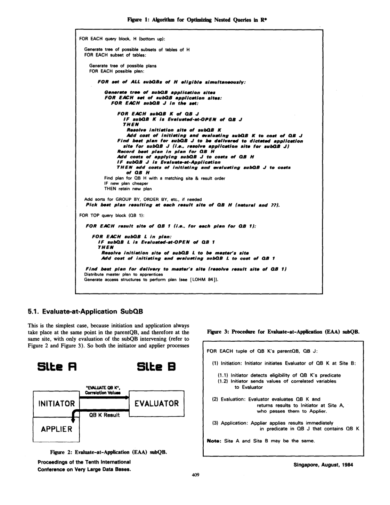
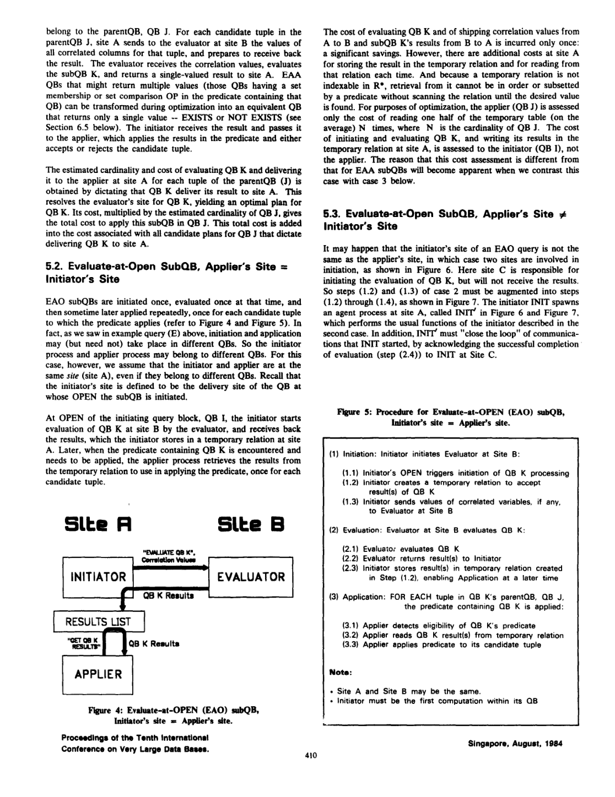

> 本组第 16 篇 · 嵌套查询与去相关 · [全部论文]() · [上一篇]() · [下一篇]()

R* 的贡献是直接优化分布式嵌套查询的执行时机、站点与协议，而不是把所有子查询展平为连接。本文分类为 Evaluate-at-Open (EAO) 与 Evaluate-at-Application (EAA)，不是 Type A/N/J/JA。EAO 可以相关到更高祖先，其“一次求值”限定于指定发起 QB 的每次 OPEN；后代相关性会传递给包含它的 QB。优化器自底向上保留自然结果站点及 ?? 候选，在父块确定应用/交付站点，并对 EAO 延后至发起块确定同址/异址协议及成本。代价包含 CPU、I/O、消息数和消息长度。6.5 的相关集合子查询转单值是明确实现的转换；其余策略各有语义、统计或实现限制，不能统一称为已实现的重写算法。论文给出的 10/48/64 是例 G 的计划数量，最多五个嵌套 QB 是正确性测试覆盖；未报告性能基准或加速比。本文没有相关聚合空组修复算法，也不证明任意 SQL 重写或任意数据分布下的全局最优性。

本文保留论文陈述、读者推断与待验证方案的区别；实验数字只适用于原文条件。原文和翻译来自已有 AI 辅助精读报告，已做来源匹配与编辑复核，不等于人工逐项核验或独立实验复现。所有页码均为 PDF 物理页。

## 论文与阅读范围

Guy M. Lohman, Dean Daniels, Laura M. Haas, Ruth Kistler, Patricia G. Selinger. Optimization of Nested Queries in a Distributed Relational Database. Proceedings of the Tenth International Conference on Very Large Data Bases (VLDB 1984), Singapore, August 1984, pp. 403-415. 作者、会议日期和印刷页码已对照本地 PDF 扫描页核验；PDF 物理页为 1-13。本文审核仅使用这一篇本地来源，不代表人工审查或外部文献核查。

[论文集中的原始 PDF](https://github.com/lonng/db-papers/blob/4ff1331069c7cf52ac97dd769e5f484c1c35c200/papers/nested-query/optimization-of-nested-queries-in-a-distributed-relational-database.pdf) · 本地来源：`nested-query/optimization-of-nested-queries-in-a-distributed-relational-database.pdf`，共 13 页。

本篇保留 10 组原文精读和 29 条证据。截图为原始 PDF 的局部页选，不是重新生成的图表；未将整份 PDF 复制到博客。

## 研究问题与适用边界

【论文事实】本文研究 SQL 谓词中引用子查询块结果的嵌套查询。每个 SELECT...FROM...WHERE... 为一个 QB，QB 的包含关系构成树。引言的 A/B 说明部分嵌套形式可表示为连接，但作者同时指出并非所有转换保持语义，且转换未必最优：保留嵌套结构可少做求值，也便于表达并兼容 System R SQL。

分布式难点是：子块成本与基数需要自底向上传给父块，而子块交付站点又必须等父块确定谓词应用站点。R* 通过保留多个结果站点候选而延迟这一决定。本文主线是这类计划与协议的协调，不是通用去关联或聚合重写。

【分类边界】本文明确使用 EAO/EAA，而未建立 Type A/N/J/JA 分类。引用 Kim 1982 不能把另一篇论文的分类或算法移入本文。EAO/EAA 还不是简单的“无相关/有相关”二分：直接父块与更高祖先的依赖必须区分，且必须检查后代 QB。

【读者解释】可把本文问题理解为同时管理求值生命周期与数据移动位置；此解释不是作者对现代引擎的比较结论。本次未查阅任何现代系统源码，不据此断言其执行架构。

依据：论文陈述；PDF 物理页 1, 3。证据：[SR01](#evidence-sr01), [SR09](#evidence-sr09), [SR02](#evidence-sr02)。

## 系统架构与执行模型

【论文事实：执行时机】子 QB 若相关到直接父块，便须在父块每个候选元组应用谓词时求值，称 EAA。若子块及其后代都不相关到直接父块，则可在父块或某祖先块 OPEN 时求值，称 EAO。例 E 中 QB3 使用 QB1 的 E.EMP# 而不使用 QB2 的列，因此对 QB2 为 EAO：每个新 QB1 元组引起 QB2 OPEN 时求值一次，而不是整条查询只执行一次；QB2 继承 QB3 对 QB1 的相关性，因此为 EAA。

执行分为 initiation（确认谓词可求值并传递相关值；EAO 还创建磁盘临时关系）、evaluation（执行子块，可能再执行其后代）和 application（用结果测试父块候选元组）。EAA 发起者与应用者位于同一父块、同一站点；EAO 两者可属不同块、不同站点。Evaluator 是子块的主进程，可统辖多进程，不应理解为子块只能在单节点内部执行。

【规划架构】Master 是查询提交站点，制定跨站点全局决策并分发计划与原查询。Apprentice 重解析并遵从全局约束，但本地访问路径、局部连接等仍有自治；其对子查询的有限权限是安排被指定同址应用的多个谓词的顺序，且相关列必须就绪。这不是无中心全局优化。

【站点候选与前提】两表跨站点连接考虑内表站点 J1、外表站点 J2 及待定站点 J3=??。自然结果站点包含本 QB 与后代 QB 的表站点，不仅是本块 FROM 站点。应用站点为 A1 表 T 的站点、A2 父块部分/最终计算站点、A3 子块自然结果站点及 ??。A1 要求当前父块所需列只来自 T，其他相关列来自祖先且可用；子查询的表在远端并不使 A1 无效。A2/A3 在连接 C 与 T 后、最终排序/分组前应用。重复的站点选项无需重算；A1/A2 等价须满足文中的同址及列依赖条件，不是所有连接位置都可交换的定理。

依据：论文陈述；PDF 物理页 3, 4, 5, 6。证据：[SR02](#evidence-sr02), [SR03](#evidence-sr03), [SR04](#evidence-sr04), [C002N01](#evidence-c002n01), [C002N03](#evidence-c002n03), [C002N04](#evidence-c002n04)。

*原论文 PDF 物理页 7，版权归原作者或出版方。点击图片可查看原尺寸。页面文本中定位到：Figure 1: Algorithm for Optimizhg；Figure 2 and Figure 3). So both the initiator and applier processes；Figure 3: Procedure for Evaluate-at-Application。这是页面定位信息，不表示本次已复核图内所有数据。*

## 优化算法与重写规则

【主算法，不是通用重写器】按图 1 自底向上处理 QB H：枚举表子集和可行计划，对同时 eligible 的子 QB 集合生成应用站点组合。对每个子块 J，在其候选交付位置确定相关 EAO 后代的发起位置与成本，再选 J 交付到指定应用站点的最佳方案；将应用成本计入 H，若 J 为 EAA 再按重复求值计入发起/求值成本。按相同结果、顺序和站点比较保留较便宜的计划；补必要排序，保留各自然站点与 ?? 的最佳候选。顶块最终交付到 master，并解析在它 OPEN 时发起的 EAO 成本。

给定子块交付站点 X，4.1.2 比较三项：P1 在自然站点 X 出结果（仅 X 为自然站点时适用）；P2 把 ?? 绑定 X；P3 将最佳自然站点 Y 的结果运输到 X。EAO 的计划还不能仅凭 immediate parent 固化：5.3 明确要求等 initiating QB I 的交付站点确定，才区分 initiator/applier 同址与异址。

【三种协议及成本归属】EAA：A 发相关值给 B，B 求值后返回单值给 A；父块按估计基数乘单次求值并交付的代价，不应在已包含交付的成本上再重复计网络费用。EAO 同址：每次发起块 OPEN 求值并在应用站点暂存，随后逐父块候选元组读取。EAO 异址：C 的 INIT 在 A 派生 INIT'，相关值 C→A→B，结果 B→A 写临时关系，再 A→C ACK；结果不必经 C 中转。两种 EAO 都把发起、求值、运输和临时表写成本计入发起块，读取/应用计入应用块；异址多计代理及确认通信。

【第 6 节的实现状态】6.1 会在运行时利用检测到的重复相关值，但不主动以排序/索引顺序规划该收益，原因是联合列重复度难估。6.2 讨论在特定条件下将相关 QB 变为 join，扩大连接方法及运输方向选择；不是一套已经证明、全面实现的去关联规则集。6.3 把相关谓词外移到多列嵌套谓词，将例 H 的 EAA 变成 EAO；可能扩大运输结果，且操作符不匹配和 SQL/实现改动使其被搁置。6.4 运送投影且尽可能过滤的父块子集，减少会话却不减少子块求值次数，超缓冲时另付暂存/重读；文中未明确宣布已实现。6.5 明确实现了相关 EAA 集合子块到单个 FOUND/NOT FOUND 的内部转换。例 I1 将 IN 改成带 E.DEPT IS NOT NULL 的 EXISTS，并在子块中加入 E.DEPT=D.DEPT#；找到首个匹配即可停止。

【读者构造的假设示例，非论文实验】EMP 在 S1，DEPT 在 S2，查询 E.DEPT_ID IN (SELECT D.ID FROM DEPT D WHERE D.LOC='NY') 无相关依赖，故为 EAO。选择在 S1 应用时，可每次顶层 OPEN 求值/运输 DEPT 结果一次、在 S1 暂存，然后对 N 个 EMP 候选行读取该结果。A1=S1 可行，因为父块引用只来自 EMP，不因 DEPT 在 S2 而失效。此例不套用 6.5 的 EAA 转换。另一个不同的假设场景是在原子块中加 D.MGR=E.ID，此时已是 EAA；若应用 6.5 的相关 IN→EXISTS 转换，仍需相关求值，不能宣称回到原无相关 EAO 生命周期。人为加入 E.DEPT_ID=D.ID 本身会引入父块相关，绝不能把这一形式继续按无相关 EAO 解释。

依据：论文陈述；PDF 物理页 3, 5, 7, 8, 9, 10, 11。证据：[C002N07](#evidence-c002n07), [SR05](#evidence-sr05), [SR03](#evidence-sr03), [C002N08](#evidence-c002n08), [SR06](#evidence-sr06), [SR07](#evidence-sr07), [C002N11](#evidence-c002n11), [SR08](#evidence-sr08), [C003N01](#evidence-c003n01), [C003N02](#evidence-c003n02), [C003N03](#evidence-c003n03), [C003N04](#evidence-c003n04), [C003N05](#evidence-c003n05)。

## 正确性保证与语义边界

【标量与集合语义须分开】6.2 对例 H/H1 的警告是：标量 '=' 子查询要求返回单个值，而普通连接没有这项要求。因此不能把标量子查询返回多行描述为“仍只产生一个合格元组”；原查询的单值约束必须保留，不能被普通 join 的重复输出替代。另一个独立反例是例 C 的 IN：即便内部有多个相同匹配值，外部候选行只通过一次；普通 join 会按匹配次数复制输出。该反例反对无条件展平，不等于任何 IN 在唯一性条件、去重或半连接支持下都绝不可能改写。

【NULL 与空组边界】6.5 例 I1 明写 E.DEPT IS NOT NULL，原嵌套比较被移入 EXISTS。本文没有证明任意 NOT IN、ALL 在含 NULL/空集情况下可无条件变成 NOT EXISTS，也不应把相关集合子块的单值化套到所有 EAO 上。例 E 的 AVG 用来说明祖先相关和 OPEN 时机；没有给出 Type JA 聚合分类、COUNT 空输入补零、外连接补组或相关聚合去关联证明。空输入聚合、NULL 与三值逻辑是复现者需要另外验证的边界，不是本文已解决的成果。

【成本可靠性不是结果正确性】6.1 不主动规划重复值顺序，是因为收益估计不可靠，并非利用重复值会导致错误结果。运行时仍会利用检测到的重复相关值；这里复用的是求值/谓词结果，不是删除外层重复行。相同结果、顺序、站点下的较便宜计划保留规则也不能推出所有 SQL 重写、所有数据布局或真实运行时间的全局最优性。

【证据强度】本文给出机制说明、例子和实现正确性测试，没有通用重写完备性证明。图 7 的 C=B 同址注释与前一节 initiator=applier 条件表面不一致；本报告按 5.2/5.3 正文角色说明协议，保留原引文，不静默把该注释当成新的等价规则。

依据：论文陈述；PDF 物理页 3, 9, 10, 11。证据：[C003N02](#evidence-c003n02), [C003N05](#evidence-c003n05), [SR02](#evidence-sr02), [SR08](#evidence-sr08), [C003N01](#evidence-c003n01), [C003N08](#evidence-c003n08), [SR07](#evidence-sr07), [C003N09](#evidence-c003n09)。

## 实验设计与证据缺失

【论文实际报告】第 8 节说分布式嵌套查询已在 R* 实现，测试了涉及最多五个嵌套 query blocks 的复杂查询。测试程序通过 SYNONYMS 自动改变表的站点位置，并将实际结果与预期结果表比对。“五个 QB”是所述测试范围，不应升级为确证的五层祖先深度、系统支持上限或现代 SQL 全语义证明。

【计划数量，而非加速比】例 G 的父块连接两张表，另有一张子块表，合计三张表。固定一个连接顺序、连接方法和每表访问方法时，站点/应用方案生成 10 个计划。加入文中列出的 merge-scan、内表运输策略及反向内外表组合后，评估 48 个完整计划；这是无子查询时计划数量的 3 倍、所有表同址时的 10 倍，不是时间或吞吐量的倍率。把单表局部计划也计入，共考虑 64 个部分或完整计划。

【复杂度限定】第 7 节说，在每张表位于不同站点且通过嵌套谓词关联的条件下，候选计划数“可能”随表数指数增长。例 G 是规模说明，不是严格渐近复杂度证明，更不能推出所有查询必然指数增长。

【未报告】本文没有给出性能基准的运行时间、吞吐量、网络字节数曲线、统计误差或硬件/软件参数，没有完成与 System R、Kim 方法等的端到端性能对照。作者对枚举成本在交互使用中不明显的描述是定性观察，不是测量数据。第 8 节明确把性能验证、成本校准、异常计划分析和敏感性研究留待未来，因此不能给出重写的百分比收益，也不能断言代价公式已实测准确。

依据：论文陈述；PDF 物理页 11。证据：[C003N07](#evidence-c003n07), [C003N09](#evidence-c003n09), [SR10](#evidence-sr10)。

*原论文 PDF 物理页 8，版权归原作者或出版方。点击图片可查看原尺寸。页面文本中定位到：Figure 4: Evaluate-at-OPEN；Figure 5: Procehre。这是页面定位信息，不表示本次已复核图内所有数据。*

## 工程权衡与设计取舍

【论文事实与限定】R* 成本同时考虑 CPU 指令、I/O 页访问、消息数量和消息长度；减少消息会话与减少传输字节不是同一目标，必须连同本地处理成本比较。EAO 每次指定 OPEN 求值一次，可能节省 EAA 的反复远程往返；但其临时关系不可建索引，需要写入并重复扫描。平均读半表 N 次是优化器在 5.2 使用的估计，不是任意命中率、任意谓词下的保证，也没有性能实验支持“必然严重退化”。

EAO 同址/异址候选必须等发起 QB 的交付站点确定，故延迟计划固化增加簿记。INIT' 使异址发起成为可能，但多付控制消息。6.3 用更大的非相关结果换少次执行/会话，可能反而多运数据；6.4 则运父块子集，仍需逐行求值且可能溢出缓冲。这些都不是单向收益。

为每个自然站点及 ?? 保留计划增加存储与代码复杂度；A3 把子块站点向祖先传播，可能扩大计划空间。实现重构为只存储能改进相同结果/顺序/站点的计划或提供新属性的计划，缓解原先连被支配计划也分配且不回收的空间问题。本文没有内存峰值/优化耗时测量，不能把“有所缓解”写成已保证内存可控。

作者关于实际表数受限、用户难以表达极深嵌套的判断是实践预期，不是理论资源上限。运行时利用重复相关值与主动规划排序是两回事；后者因统计不足未纳入。对现代负载是否仍足够，需要额外实验，本文不作结论。

依据：论文陈述；PDF 物理页 2, 8, 9, 10, 11。证据：[C001N06](#evidence-c001n06), [SR06](#evidence-sr06), [SR07](#evidence-sr07), [C002N11](#evidence-c002n11), [C003N03](#evidence-c003n03), [C003N04](#evidence-c003n04), [C003N08](#evidence-c003n08), [C003N10](#evidence-c003n10), [SR08](#evidence-sr08)。

## 与相关工作的对比分析

【只比较本篇明确描述的内容】相对 System R，R* 保留逐 QB 自底向上规划，但加入跨站点消息数/长度、自然结果站点与 ??、应用/发起站点选择及分布式协议。本文对集中式处理的引用不能替代对 System R 其他论文的独立精读。

本文将 Kim 1982 描述为希望把嵌套查询改成单 QB 连接以复用单站点连接优化；R* 则强调不必、也不能无条件展平。6.2 给出标量单值约束与 IN 重复输出的具体障碍，6.3/6.4 比较减少会话的不同运输方向。不能由这一篇断言 Kim 的全部算法均错误或不支持某类聚合；本文未详细审计其完整规则。

【现代对照仅是研究问题】可进一步检查现代优化器如何表示依赖参数、半连接、标量基数约束、NULL/空组和物理分布属性，是否保留不可安全解除嵌套的执行形式。这里没有读取 StarRocks、Calcite、DuckDB 或其他现代系统源码，因而不宣称其使用相同协议，不把 DuckDB 当作本文所述跨节点系统的现成基线，也不推断机器学习成本模型、AQE 是所有现代系统的默认方案。所谓思想相似不能证明历史传承或实现一致。

依据：论文陈述；PDF 物理页 1, 2, 10。证据：[SR01](#evidence-sr01), [SR09](#evidence-sr09), [C001N06](#evidence-c001n06), [C003N02](#evidence-c003n02), [C003N03](#evidence-c003n03), [C003N04](#evidence-c003n04)。

## 复现可行性与工程挑战

【以下全部是读者建议，尚未实施】先实现一个有限 SQL 子集解释器与 QB 树，按直接父块和更高祖先依赖、后代相关继承分类。保留三任务及发起块标识，为 EAO 按每次发起 OPEN 重置物化结果；不能只用“是否存在任何外部列”判定 EAA。

规划状态至少记录表子集、结果顺序、结果站点（自然站点及 ??）与代价。实现 P1/P2/P3 比较、A1/A2/A3 可行性与冗余消除，并分开 EAO 同址/异址簿记。参数化 CPU、I/O、消息数/长度权重，另记临时关系写读成本；计数时避免把已含交付的 EAA 成本再次加网络费用。

先复现保留嵌套结构的 EAO/EAA 三协议，再对已相关的集合 EAA 实现 6.5 的 IN→EXISTS 示例。6.2-6.4 作为额外实验分支，不冒充原实现；先检查单值约束、重复行、NULL、空集与相关层级。若实现相关聚合解除嵌套，还要单独定义空输入 COUNT/SUM/AVG 的预期结果与分组补全语义，这属于新增研究，不能称作复现本文算法。

验收测试应同时验证结果多重集及应报的标量多行错误；改变表站点并与独立参考结果比较，覆盖 QB3 相关 QB1 但对 QB2 为 EAO 的情形。记录 OPEN 次数、子块求值次数、控制消息、字节数、物化写读、候选/保留计划数量与峰值内存。例 G 的 10/48/64 只能在复刻相同候选空间后比较，不能要求不同实现碰巧相同。

性能实验应分别改变外层基数、子结果大小、联合列重复度、网络固定延迟/每字节成本，观察策略交叉点，不预设某一方向总赢。资源预算或搜索阈值是现代实现的保护措施，应记录其可能失去最优计划的代价。原文未说明可公开获得的代码或完整测试集，本次也未验证其可得性；不能断言原代码复现“不可能”。

依据：读者推断；PDF 物理页 3, 5, 8, 9, 10, 11。证据：[SR02](#evidence-sr02), [SR03](#evidence-sr03), [SR05](#evidence-sr05), [SR06](#evidence-sr06), [SR07](#evidence-sr07), [C003N02](#evidence-c003n02), [C003N05](#evidence-c003n05), [C003N07](#evidence-c003n07), [C003N09](#evidence-c003n09)。

## 总结与遗留问题

【论文结论】R* 以 EAO/EAA 分类、三任务协议和多结果站点候选协调嵌套查询的分布式规划。子块交付到谓词应用站点；EAO 进一步等发起块确定同址或异址协议。?? 是待绑定的计划位置，不是错误站点。候选比较与保留依赖相同结果、顺序和站点，不证明任意 SQL/任意布局上的全局最优。

已报告的验证是最多五个嵌套 QB 的正确性测试，和例 G 的 10/48/64 计划数量说明；未报告性能基准。临时关系不可建索引、候选站点传播、统计不足和重写语义限制都是真实边界，但不能据此捏造实测退化幅度或生产资源耗尽结论。

【作者未来计划】评估/验证 R* 优化器扩展性能；让成本公式更符合实际；隔离并改进劣质计划或异常性能情形；通过敏感性分析确定增加或简化哪些模型细节；争取提炼不丢失真正最优计划的剪枝启发式。这是未来目标，非已经完成的完备性、性能或安全剪枝证明。

【本次审核边界】已分段读完匹配 SHA 的 13 页提取全文，并逐页查看本地渲染。Type A/N/J/JA、相关聚合空组修复和现代系统实现不属于本文已证明内容。模型反向审查保留为原历史记录，其中关于“向 EXISTS 加父块相关后仍是 EAO”的建议不予采纳。本次是 Codex 原文语义审核，不冒充人工审查、外部事实核查或实验复现。

依据：论文陈述；PDF 物理页 1, 3, 5, 8, 9, 11。证据：[SR01](#evidence-sr01), [SR02](#evidence-sr02), [SR05](#evidence-sr05), [SR06](#evidence-sr06), [SR07](#evidence-sr07), [C003N07](#evidence-c003n07), [C003N09](#evidence-c003n09), [SR10](#evidence-sr10)。

## 原文精读：从句子回到机制

以下保留原文、忠实翻译、含义与边界；假设示例不作为论文实验结果。

### P001 · PDF 物理页 2

**原文**

<blockquote class="paper-source-quote"><pre><code>Intermediate alternatives that &#10;produce identical rest&amp; (i.e., the same set of tuples at the same &#10;siteinthesameorder)ancom~,andonly~onewithminimal &#10;coat is retained ILOHM &#10;84). In R*, costs have been extended to &#10;include a linear combination of the number of inter-site messages &#10;and the length of inter-site messages, as well as the System R cost &#10;components of CPU (number of instrWWns executed) and I/O &#10;(pagcsacxased)[DANI82,ulHM &#10;841.</code></pre></blockquote>

**忠实翻译**

> 产生相同结果（即在同一站点、相同顺序下的相同元组集合）的中间候选会被比较，只保留代价最小者。R* 在 System R 的 CPU（执行指令数）和 I/O（页面访问数）成本之外，加入站点间消息数与消息长度的线性组合。

**技术含义与边界**

> 已对照物理页 2 扫描图：损坏转写 ancom~ 对应 are compared，不是 ancillary/composite。保留规则要求结果、站点、顺序同时匹配；总成本仍包含 CPU、I/O 与通信，不能单按消息大小判断。

**常见误读**

> 这不是把所有相同元组集合的计划都删掉，也不证明所有 SQL 的搜索完备性。原 quote 保留损坏字符，译文依据扫描图澄清，不把转写噪声当术语。

**读者构造的假设示例**

> 读者构造的假设示例：A/B 在 S1 输出相同顺序的相同结果，CPU 和 I/O 成本相同，消息数/长度权重非负；A 的通信分量更低且至少一项有正权重，才可据此判断 A 总成本更低。若 A CPU 更高，就必须比较完整成本。

### P002 · PDF 物理页 11

**原文**

<blockquote class="paper-source-quote"><pre><code>Application Site Options” above), the number of &#10;alternative application sites are compounded as the optimizer works &#10;its way up to the top QB. So the number of candidate plans may &#10;grow exponentially with the number of tables, if each table is at &#10;a different site ati all tables are joined via a nested predicate. This &#10;problem was graphically illustrated by the simple example in Section &#10;“4.2.1.</code></pre></blockquote>

**忠实翻译**

> 上述“应用站点选项”），随着优化器自底向上处理至顶层 QB，备选应用站点的数量会复合增长。因此，如果每个表位于不同站点且所有表通过嵌套谓词连接，候选计划的数量可能随表的数量呈指数级增长。这个问题在第 4.2.1 节的简单示例中被直观地说明了。

**技术含义与边界**

> 原文指出在 R* 优化器自底向上遍历查询块（QB）时，由于每个子查询的应用站点选项会产生组合爆炸，当涉及多站点分布且通过嵌套谓词关联时，候选计划空间可能随表数量呈指数增长。这是对分布式嵌套查询优化复杂度的陈述。适用边界限定于“每个表在不同站点”且“通过嵌套谓词连接”的特定场景。

**常见误读**

> 容易将“可能呈指数级增长”误解为在所有查询场景下必然发生。原文明确给出了前提条件（each table is at a different site and all tables are joined via a nested predicate），不满足这些条件时不能直接套用该结论。此外，不应把第 4.2.1 节示例的局部现象泛化为全局保证。

**读者构造的假设示例**

> 读者构造的假设示例：T1/T2/T3 分居 S1/S2/S3 并逐层通过嵌套谓词关联。向上规划会同时遇到多个子块结果/应用站点候选，需要比较更多组合；这里不从三张表推导 3!、精确递推式或普遍指数下界。

### P003 · PDF 物理页 6

**原文**

<blockquote class="paper-source-quote"><pre><code>with the following qualifications: &#10;l &#10;Option (Al) is viable only if the nested predicate containing &#10;subQB K references only columns of table T (or none at all) and &#10;columns of tables in QBs that are ancestors of QB J. Table T &#10;could be any table (inner or outer) in a join.</code></pre></blockquote>

**忠实翻译**

> 附带以下限定条件：选项 (A1) 仅在包含子 QB K 的嵌套谓词仅引用表 T 的列（或完全不引用）以及作为 QB J 祖先的 QB 中表的列时才可行。表 T 可以是连接中的任意表（内表或外表）。

**技术含义与边界**

> A1 是在表 T 的站点应用嵌套谓词，而非强制把子查询所有计算都放到 T 的站点。当前父块 J 所需列只能来自 T，祖先相关列也必须已可用。子块结果可从别处交付；T 可以是连接中的内表或外表。

**常见误读**

> 仅有一个引用 T 的列还不够；如果同一父块还需要 U 的列而尚未合并，就不能只在 T 上应用。不要把子块自身局部表列与外层所需列混为一谈，也不要把顶层 QB 说成还有祖先。

**读者构造的假设示例**

> 读者构造的假设示例：QB1 为根，QB2 为其子块 J，QB3 为 J 的子块 K。J 的嵌套谓词为 T.x IN (SELECT K.x FROM K WHERE K.y=QB1.y)。当前 J 所需列只有 T.x，QB1.y 已可用，因而可在 T 站点应用；若额外依赖 J 内未合并的 U.z，则该 A1 位置不可用。

### P004 · PDF 物理页 8

**原文**

<blockquote class="paper-source-quote"><pre><code>This &#10;resolves the evaluator’s site for QB K, yielding an optimal plan for &#10;QB K. Its cost, multiplied by the estimated cardinality of QB J, gives &#10;the total cost to apply this subQB in QB J. This total cost is ad&amp;d &#10;into the cost associated with all candidate plans for QB J that dictate &#10;delivering QB K to site A. &#10;5.2.</code></pre></blockquote>

**忠实翻译**

> 这确定了 QB K 的求值站点，从而产生 QB K 的最优计划。其代价乘以 QB J 的估计基数，得到在 QB J 中应用此子 QB 的总代价。该总代价被加到所有指示将 QB K 传递至站点 A 的 QB J 候选计划的代价中。5.2.

**技术含义与边界**

> 该段属于 5.1 的 EAA。它以每个父块候选元组对应一次子块求值并交付的成本，乘父块估计基数进行计费；不是仅按最终通过该谓词的输出行数计费。A 是候选计划指定的应用/交付站点，而不是固定地点。

**常见误读**

> 不能把 EAA 的逐行乘法套到 EAO 的每次 OPEN 求值成本；也不能在单次成本已含交付时再次加相同的网络成本。这是估计公式，不是实测数字。

**读者构造的假设示例**

> 读者构造的假设示例：在 A 应用的 EAA，单次求值并交付成本 10，预计需测试的父块候选有 1000 行，则该重复部分估计为 10000。这里的 10 已含所建模的交付，不能再重复计同一运输。

### P005 · PDF 物理页 5

**原文**

<blockquote class="paper-source-quote"><pre><code>For any given set of tables already joined as composite C and any &#10;given table T in the parentQB, J, the procedure considers three &#10;(possibly redundant) classes of application sites for a subQB K whose &#10;predicate becomes eligible for application only when table T is joined &#10;to the set: &#10;(Al) &#10;(A21 &#10;(A3) &#10;Site of table T &#10;Site of any partial or final computation for QB J (e.g., &#10;a join between outer composite C and inner table T, or &#10;delivery of QB J’s final result, or application of another &#10;subQB to QB J).</code></pre></blockquote>

**忠实翻译**

> 对于任何已作为复合体 C 连接的给定表集合以及父 QB J 中的任何给定表 T，该过程考虑三类（可能冗余的）子 QB K 的应用站点，其中子 QB K 的谓词仅在表 T 连接到该集合时才变得符合应用条件：(A1) 表 T 的站点；(A2) QB J 的任何部分或最终计算的站点（例如，外部复合体 C 与内部表 T 之间的连接，或 QB J 最终结果的传递，或对 QB J 应用另一个子 QB）。

**技术含义与边界**

> 该摘录只列出了 A1/A2 的内容，列表 A3 在后续原页中，是子块可能结果站点（自然站点及 ??）。应用站点是消费子结果测试父块候选的地点，不等于所有子块计算的物理地点。完整 A1 可行性还要看物理页 6 的列依赖限定。

**常见误读**

> 不同逻辑候选可落在同一物理站点；摘录截断不等于作者没有 A3。也不能把谓词 eligible 解成一律必须先形成连接结果：满足 A1 条件时可在表 T 上提前应用。

**读者构造的假设示例**

> 读者构造的假设示例：T 在 S2、父块连接在 S1。若嵌套谓词只需 T 的父块列，则可比较在 S2 提前应用与在 S1 连接位置应用；若还需 C 的列，就要等这些值就绪。是否冗余取决于站点和列依赖条件。

### P006 · PDF 物理页 7

**原文**

<blockquote class="paper-source-quote"><pre><code>Figure 1: Algorithm for Optimizhg &#10;Nested Queries h R* &#10;FOR EACH query block, H (bottom up): &#10;Generate tree of possible &#10;subsets &#10;of tables &#10;of H &#10;FOR EACH subset of tables: &#10;Generate tree of possible plans &#10;FOR EACH possible plan: &#10;FOR &#10;wt &#10;of &#10;ALL &#10;subQBs &#10;of &#10;H &#10;oligiblo &#10;simultanwusly: &#10;Oewrato &#10;trw &#10;of &#10;subQB &#10;application &#10;sites &#10;FOR &#10;EACH &#10;sot &#10;of &#10;wbQB &#10;appiiwtion &#10;sitar: &#10;FOR &#10;EACH &#10;subQB &#10;J &#10;in &#10;tha &#10;wt: &#10;FOR &#10;EACH &#10;subQ6 &#10;K &#10;of &#10;QB &#10;J &#10;IF &#10;subQB &#10;K &#10;is &#10;Evaluated-U-OPEN &#10;of &#10;QB &#10;J &#10;THEN &#10;Rewive &#10;initiation &#10;sita &#10;of &#10;subQB &#10;K &#10;Add &#10;cost &#10;of &#10;initiating &#10;wd &#10;avaluating &#10;subQB &#10;K to wst &#10;of &#10;QB &#10;J &#10;Find &#10;best &#10;pirn &#10;for &#10;subQB &#10;J &#10;to &#10;bo &#10;dollverod &#10;to &#10;dictated &#10;appliwtion &#10;site &#10;for &#10;subQB &#10;J &#10;(ia..</code></pre></blockquote>

**忠实翻译**

> 图 1：R* 嵌套查询优化算法。对每个 QB H 自底向上：生成表子集树；对每个子集生成可能计划树；对每个计划和 H 的同时 eligible 的子块集合，生成应用站点树。对每组应用站点、每个子块 J、J 的每个子块 K：如果 K 在 J OPEN 时求值，则确定 K 的发起站点，将发起及求值 K 的成本计入 J；寻找将 J 交付到指定应用站点的最佳计划。此处摘录在括注中截断。

**技术含义与边界**

> 已对照物理页 7 图 1：Rewive 是 Resolve 的转写损坏，含义为确定/解析发起站点，不是移除、解绑定或删除站点。完整图继续记录 J 的最佳计划并计应用成本，若 J 为 EAA 再计重复发起/求值成本；最终按站点/顺序保留候选并把顶块交付 master。

**常见误读**

> 摘录不完整不代表原图不完整；不能根据错误转写推导“移除发起站点”。EAO 成本须归到指定发起块，不能任意乘父块输出基数，也不能把每个 EAO 的发起块都当成其直接父块。

**读者构造的假设示例**

> 读者构造的假设示例：QB1 是顶块，QB2 是其 EAA 子块，QB3 是在 QB2 OPEN 求值的 EAO 子块。先规划 QB3，再规划 QB2；当候选计划确定 QB2 的交付位置时，解析 QB3 的发起位置及成本。QB1 的候选元组导致 QB2 再次 OPEN 时，QB3 也会再次求值。

### P007 · PDF 物理页 9

**原文**

<blockquote class="paper-source-quote"><pre><code>LIST &#10;1 &#10;PB K Resulta &#10;Figure 6: Evaluate-at-OPEN &#10;(EAO) &#10;subQB, &#10;Initiator’s &#10;site # Applier’s &#10;site. &#10;One difficulty &#10;with EAO QBs is that the optimizer does not know &#10;whether case 2 or case 3 will happen until a delivery site is known &#10;for QB I, the initiating QB. Hence the plan for an EAO QB cannot &#10;be finalized until that QB’s initiating QB -- not applying QB -- is &#10;optimized.</code></pre></blockquote>

**忠实翻译**

> 图 6：EAO 子块，发起者站点不等于应用者站点。EAO 的困难在于，直到知道发起块 QB I 的交付站点，优化器才知道会出现情况 2 还是情况 3。因此，EAO 的计划必须等其发起块而非应用块优化后才能最终确定。摘录开头 LIST/PB K Resulta 是图中文字的转写残片。

**技术含义与边界**

> 结合完整 5.2/5.3 和图 4/6，case 2 是 initiator 与 applier 同址，case 3 是两者异址；不以 evaluator 是否远程来区分。异址场景需要 INIT' 及完成 ACK，所以要等发起块站点确定。原图可确认 # 对应不等号。

**常见误读**

> 不能把 case 2/3 解释成本地求值/远程求值，两种情形中 evaluator 都可以位于另一个站点。完整页有定义，不能把局部摘录缺上下文写成论文未定义。

**读者构造的假设示例**

> 读者构造的假设示例：applier 固定在 A，evaluator 固定在 B。发起块交付到 A 时采用同址发起/应用协议；交付到不同的 C 时由 A 的 INIT' 暂存 B 返回结果并向 C ACK。即使 B 始终远程，两者也是不同协议。

### P008 · PDF 物理页 10

**原文**

<blockquote class="paper-source-quote"><pre><code>against the higher costs of either sorting the composite or using an &#10;index scan (if one existed on the predicate and correlation columns) &#10;to achieve that order. The problem is that, given the statistics &#10;currently maintained for each table, it is very difficult to estimate &#10;reliably the number of tuples having duplicate values of just the &#10;predicate and correlation columns, and thus the potential savings. &#10;For this reason, the R* optimizer does not consider this option.</code></pre></blockquote>

**忠实翻译**

> 相对于对复合体进行排序或使用索引扫描（如果在谓词和相关列上存在索引）以实现该顺序所带来的更高代价。问题在于，鉴于目前为每个表维护的统计信息，很难可靠地估计仅在谓词和相关列上具有重复值的元组数量，从而难以估计潜在的节省量。因此，R* 优化器不考虑此选项。

**技术含义与边界**

> 第 9-10 页 6.1 讨论为重复相关值与谓词列值安排外层顺序，以减少重复求值和远程会话；第 9 页同时明确运行时已利用检测到的重复相关值。未采用的是主动规划排序/索引顺序，而非禁用运行时复用，也非删除外层重复行。

**常见误读**

> 容易误认为 R* 优化器绝对不支持排序或索引扫描。原文否定的是“为了利用谓词和相关列重复值而进行的特定优化选项”，而非排序或索引扫描本身。此外，不应将“目前维护的统计信息（statistics currently maintained）”泛化为所有数据库系统的永久限制，这只是 R* 在当时技术条件下的决策依据。

**读者构造的假设示例**

> 读者构造的假设示例：外层连续两行的相关列和左侧嵌套谓词列值都相同，可以复用相同求值/谓词结果，但仍保留外层两行应有的输出次数。若为了增加相邻重复而先排序，还需估计联合重复度与排序成本；本文没有提供可靠估计方法。

### P009 · PDF 物理页 11

**原文**

<blockquote class="paper-source-quote"><pre><code>Nested queries for distributed databases have been implemented in &#10;R*, and have been tested for correct execution of complex queries &#10;involving up to five nested query blocks. To do this, we developed &#10;a test program that automatically varies the location of tables using &#10;SYNONYMS and tests the results of the queries against a table of &#10;expected results.</code></pre></blockquote>

**忠实翻译**

> 分布式数据库的嵌套查询已在 R* 中实现，并已测试最多包含五个嵌套查询块的复杂查询的正确执行。为此，我们开发了一个测试程序，该程序使用 SYNONYMS 自动改变表的位置，并将查询结果与预期结果表进行比对测试。

**技术含义与边界**

> 原文报告实现及正确性测试：涉及最多五个嵌套 QB，利用 SYNONYMS 自动改变表位置并与预期结果表比对。这不是查询响应时间、通信字节或吞吐量的性能测试；也未从该句确证五个 QB 必定形成五层祖先链。

**常见误读**

> 最多五个 QB 是测试覆盖，不是系统硬上限、任意现代 SQL 语义证明或五层祖先深度的精确定义。SYNONYMS 用于测试改变表位置的路由，不等于生产数据迁移机制。

**读者构造的假设示例**

> 读者构造的假设示例：假设有一个三层嵌套查询 Q。测试程序首先将所有涉及的表通过 SYNONYMS 指向站点 A，执行 Q 并记录结果；然后修改 SYNONYMS 将部分表指向站点 B，再次执行 Q。测试程序会自动比对两次执行的结果是否与预期结果表一致，从而验证优化器和执行引擎在表位置变化时仍能产生正确结果。

### P010 · PDF 物理页 5

**原文**

<blockquote class="paper-source-quote"><pre><code>4.1.1. &#10;Result Sites &#10;TO join two tables at different sites, R* generates candidate plans &#10;to perform the join at three different sites [DANI 82, LOHM 841: &#10;(Jl) &#10;the inner &#10;table's &#10;site, &#10;(52) &#10;the outer &#10;table's &#10;site, &#10;and &#10;(53) &#10;an unknown site &#10;(or, &#10;more accurately, &#10;a "to-be-determined-later" &#10;site, &#10;designated &#10;here as II??".</code></pre></blockquote>

**忠实翻译**

> 4.1.1 结果站点。为了连接不同站点的两张表，R* 生成候选计划在下列站点执行连接：J1 内表站点，J2 外表站点，J3 未知站点，更准确地说是“稍后确定”的站点，本文记为 ??。

**技术含义与边界**

> 已对照物理页 5 扫描图：?? 是明确的待定站点记号，不是未知变量名或系统错误。保留该候选允许后来根据 master 交付或后续连接的需要绑定实际站点；不能由此推导负载均衡算法。

**常见误读**

> 容易将 (J3) 的“未知站点”误解为系统错误或随机选择。原文明确解释其为“to-be-determined-later”（稍后确定），这是一种有意的优化策略，用于推迟决策直到拥有更多上下文信息。不应将这三种选项视为互斥的最终结果，它们是候选计划空间的组成部分。

**读者构造的假设示例**

> 读者构造的假设示例：外表在 S1、内表在 S2、查询提交在 S3。可比较把外表运到 S2、把内表运到 S1、或保留 ?? 后在交付到 S3 的上下文中绑定为 S3。这里不假设原文有实时节点负载模型。

## 尚未解决的问题

1. 在精确保持标量单值约束、IN 重复行、NULL 与空输入语义的前提下，哪些额外去关联规则可以安全扩展本文候选空间？
2. 如何估计嵌套谓词列与相关列的联合重复度，以决定为结果复用主动排序是否值得？
3. EAO 每次 OPEN 的求值/物化与 EAA 逐行远程求值，在外层基数、子结果大小、消息固定开销变化时有哪些策略交叉点？
4. 相关聚合空组补全应增加哪些语义表示与测试？这是本文之外的新研究，不预设本文已有算法。
5. 如何控制站点/顺序候选传播造成的规划资源开销，并明确任何启发式裁剪失去最优计划的边界？
6. 后续 R* 或其他系统是否完成了本文计划的性能校准、敏感性分析和安全剪枝？需要另读后续原始资料，不能由本篇推定。

## 证据索引

证据编号沿用原报告，便于将上文判断追溯到原句。引文匹配只验证位置，不证明解读正确。

**C001N06 · PDF 物理页 2**

R*代价模型扩展了System R的CPU（指令数）和I/O（页面访问数），增加了站点间消息数量和消息长度的线性组合。将站点协议代价和通信代价纳入优化是基于对典型查询实际资源消耗的分析，这使R*区别于大多数其他分布式数据库优化器。

<blockquote class="paper-source-quote"><pre><code>costs have been extended to include a linear combination of the number of inter-site messages and the length of inter-site messages</code></pre></blockquote>

**C002N01 · PDF 物理页 5**

跨站点两表连接生成 J1 内表站点、J2 外表站点及 J3 待定站点 ?? 候选；自然结果站点包括本块和后代 QB 的表站点。该设计在文中选定的候选空间保留位置选择，不证明所有 SQL 重写/数据分布上的全局最优。

<blockquote class="paper-source-quote"><pre><code>TO join two tables at different sites, R* generates candidate plans to perform the join at three different sites</code></pre></blockquote>

**C002N03 · PDF 物理页 5**

子查询谓词的应用站点决定了其交付站点。谓词只有在包含其所引用列的最后一张表作为内表被连接到复合元组时才变为 eligible。对于给定的已连接复合表 C 和待连接表 T，父 QB 考虑三类应用站点：(A1) 表 T 的站点；(A2) 父 QB J 的任何部分或最终计算站点；(A3) 子 QB K 的可能结果站点（自然站点加 ??）。这是解决分布式嵌套查询中“在哪里执行过滤”的核心问题。

<blockquote class="paper-source-quote"><pre><code>the procedure considers three (possibly redundant) classes of application sites for a subQB K</code></pre></blockquote>

**C002N04 · PDF 物理页 6**

A1 要求当前父 QB 中所需列仅来自 T（或不引用），其他相关列来自祖先且可用；T 可为内表或外表。只有文中同址、列依赖条件满足时，A1 与 A2 才会重复，不能仅凭引用内表就推广等价。

<blockquote class="paper-source-quote"><pre><code>Option (Al) is viable only if the nested predicate containing subQB K references only columns of table T</code></pre></blockquote>

**C002N05 · PDF 物理页 6**

当两个子 QB 具有相同的父 QB 且引用祖先 QB 中相同表的列时，它们同时变为 eligible。此时应用顺序通常不重要，除非其中一个子 QB 显著更具限制性，且选择了将复合元组发送到两者不同结果站点的方案。在这种情况下，先应用更具限制性的谓词以减少两个子 QB 结果站点之间的数据传输量。这是一种基于选择性估计的排序启发式。

<blockquote class="paper-source-quote"><pre><code>the more restrictive predicate is applied fit to reduce the volume of data shipped between the two subQB result sites</code></pre></blockquote>

**C002N07 · PDF 物理页 7**

图 1 自底向上枚举表子集、可行计划及同时 eligible 的子块应用站点组合；Resolve initiation site 意为确定发起站点，不是移除。EAO 成本计入发起 QB，EAA 逐候选元组求值；顶块最终交付 master。结合匹配结果、顺序、站点的候选保留，不是无条件穷举所有 SQL。

<blockquote class="paper-source-quote"><pre><code>FOR EACH query block, H (bottom up): Generate tree of possible subsets of tables of H</code></pre></blockquote>

**C002N08 · PDF 物理页 8**

5.1 的 EAA 按父块候选元组重复发起/求值/应用，估计成本为子块求值并交付到 A 的最优计划成本乘父块估计基数；这是代价模型说明，不是实验测量。不能套用到每次 OPEN 只求值一次的 EAO。

<blockquote class="paper-source-quote"><pre><code>Its cost, multiplied by the estimated cardinality of QB J, gives the total cost to apply this subQB in QB J</code></pre></blockquote>

**C002N09 · PDF 物理页 8**

R* 的 EAO 临时关系不可建索引，需要写入及重复扫描；优化器按应用 N 次、平均每次读半表计费。该平均是其估计，非任意数据分布下的保证，也无实测退化幅度。

<blockquote class="paper-source-quote"><pre><code>because a temporary relation is not indexable in R*, retrieval from it cannot be in order or subsetted</code></pre></blockquote>

**C002N11 · PDF 物理页 9**

EAO 子 QB 的一个困难在于，优化器在为发起 QB I 确定交付站点之前，无法知道会发生同站（case 2）还是异站（case 3）情况。因此 EAO QB 的计划不能提前固化。优化器内部必须同时保留 case 2 和 case 3 的不同计划及其代价，直到优化 QB I 时再尝试两种替代方案并选择代价最小者。这增加了优化器的内存和时间开销。

<blockquote class="paper-source-quote"><pre><code>the optimizer does not know whether case 2 or case 3 will happen until a delivery site is known for QB I</code></pre></blockquote>

**C003N01 · PDF 物理页 10**

6.1 不主动规划为复用重复相关值而排序/索引扫描，因为难以可靠估计相关列与谓词列的联合重复度。目的不是删除外层重复行；运行时仍会利用检测到的重复相关值（前页说明）。

<blockquote class="paper-source-quote"><pre><code>given the statistics currently maintained for each table, it is very difficult to estimate reliably the number of tuples having duplicate values</code></pre></blockquote>

**C003N02 · PDF 物理页 10**

6.2 讨论特定相关子查询变 join 的机会和两类独立障碍：标量 '=' 子块要求单值，不能由普通连接替代其基数约束；IN 子块即使有重复匹配，也只接受一次外部候选行，而普通 join 会复制行。不是标量多行只产一行，也不是任何 IN 都绝不能安全改写。

<blockquote class="paper-source-quote"><pre><code>(Hl) is semantically not equivalent to (H) when the values of the SELECT-column of the subQB (D.DEPT) are not unique.</code></pre></blockquote>

**C003N03 · PDF 物理页 10**

6.3 讨论将相关谓词外移至多列嵌套谓词，把例 H 的 EAA 变为 EAO，从每外行求值改为每次指定 OPEN 一次。非相关结果可能放大、运输更多；操作符条件及 SQL/实现改造使此转换被搁置。

<blockquote class="paper-source-quote"><pre><code>Since QB 2 is now EAO, it need be evaluated only once, instead of once per tuple of EMPLOYEES@SF.</code></pre></blockquote>

**C003N04 · PDF 物理页 10**

6.4 讨论一次运送投影/过滤的父块子集以减少会话数；不减少子块逐行求值，超缓冲会增加暂存/重读。若先安全变成 join，两个运输方向可纳入连接选择；本节未明确宣布该策略已实现。

<blockquote class="paper-source-quote"><pre><code>does not reduce the number of times the subQB is evaluated and has the added cost of storing and m-reading the subset</code></pre></blockquote>

**C003N05 · PDF 物理页 10**

6.5 明确实现了可能返回集合的相关 EAA 子块内部单值化，例 I→I1 用 E.DEPT IS NOT NULL 与 EXISTS，并把相等条件移入子块，返回 FOUND/NOT FOUND，找到首个匹配可停止。不能推广为所有 EAO、NOT IN 或 ALL 在 NULL/空集下的无条件重写；收益未给出测量幅度。

<blockquote class="paper-source-quote"><pre><code>transforms the internal (parse-tree) representation of an EAA SubQB that may return a set of values into that of an equivalent subQB that returns exactly one value</code></pre></blockquote>

**C003N07 · PDF 物理页 11**

在每表不同站点且以嵌套谓词相连时，候选计划数可能随表数指数增长。例 G 的父块两表加一个子块表（共三表），固定连接顺序/方法/访问路径时有 10 个计划，扩展列举的方法后 48 个完整计划，分别为无子查询场景的 3 倍、全同址场景的 10 倍，含单表局部计划共 64 个；均非性能加速比。

<blockquote class="paper-source-quote"><pre><code>the number of candidate plans may grow exponentially with the number of tables, if each table is at a different site</code></pre></blockquote>

**C003N08 · PDF 物理页 11**

为缓解计划存储空间爆炸问题，R*重构了优化器的存储策略：仅当新计划在相同站点以相同顺序产生相同结果且优于现有计划，或提供新的结果/顺序/站点时才存储。此前所有计划都会分配空间且即使被支配也不回收。每个计划由多个'miniplan'组成，分别对应表操作、跨站点传输或子查询应用。

<blockquote class="paper-source-quote"><pre><code>store a plan only if it improves upon an existing plan to produce the same result (same tuples) in the same order at the same site</code></pre></blockquote>

**C003N09 · PDF 物理页 11**

第 8 节报告通过 SYNONYMS 改变表位置并对比预期结果的正确性测试，涉及最多五个嵌套 QB；未明确证明五层祖先深度，也不是系统上限。性能评估和成本验证是未来工作，未给各策略加速比或通信节省量。

<blockquote class="paper-source-quote"><pre><code>tested for correct execution of complex queries involving up to five nested query blocks. To do this, we developed a test program</code></pre></blockquote>

**C003N10 · PDF 物理页 11**

作者预期实际表数限制与用户难以构造极深嵌套可使资源需求不至过重；这是实践判断，非已证明的空间/时间保证、硬编码深度上限或理论完备性。

<blockquote class="paper-source-quote"><pre><code>practical limits on the number of tables, and the inability of users to formulate queries that are nested sufficiently deep</code></pre></blockquote>

**C003N11 · PDF 物理页 11**

第 8 节计划未来验证性能、校准成本、分析异常与敏感性并争取进一步剪枝；不能由这些未来目标反推当前计划枚举完备、成本已准确，或所有异常情形已定位。

<blockquote class="paper-source-quote"><pre><code>we intend to evaluate and validate the performance of the R* extensions to the System R optimizer</code></pre></blockquote>

**SR01 · PDF 物理页 1**

本文研究 R* 的分布式嵌套查询，按 EAO/EAA 区分执行时机，优化 initiation/evaluation/application 的站点、协议及代价。

<blockquote class="paper-source-quote"><pre><code>This paper describes how nested queries in the SQL language are &#10;processed by R*, an experimental adaptation to the distributed &#10;environment of the well-known centralized relational DBMS, System &#10;R. Nested queries are queries in which a predicate references the &#10;result of another query block (SELECT...FROM...WHERE...), &#10;called a subquery block (subQB). SubQBs may themselves contain &#10;one or more subQBs. Depending upon whether a subQB references &#10;values in other query blocks, it is processed differently, as either &#10;an Evaluate-at-Open or Evaluate-at-Application subQB type. Three &#10;tasks comprise execution of each query block: initiation, evaluation, &#10;and application. When the query’s tables are distributed among &#10;multiple sites, optimization of nested queries requires determining &#10;for each subQB: the site to perform each task, the protocols control- &#10;ling interactions between those tasks, and the costs of each option, &#10;so that a minimal-cost plan can be chosen. R* optimizes each query &#10;block independently, “bottom up”, using only the cost, cardinal&amp;y, &#10;and result site of the subQB in the optimization of its containing &#10;query block.</code></pre></blockquote>

**SR02 · PDF 物理页 3**

EAO 的判定须考虑子块及其后代对直接父块的相关性；例 E 的 QB3 对 QB1 相关，却是 QB2 OPEN 时求值的 EAO，QB2 则继承相关性而为 EAA。

<blockquote class="paper-source-quote"><pre><code>If, on the other hand, a subQB and all of its descendant QBs are &#10;not correlated to any tables in the FROM-list of its parentQB, then &#10;it is called an evahute-at-OPEN &#10;(EAO) subQB, because absence &#10;of references to values from its parentQB’s tables permit it to be &#10;evaluated at the time of OPEN (when it begins processing) of its &#10;parentQB or one of its ancestor QBs. For example, suppose the &#10;correlating predicate (DMANAGER &#10;= E.EMP#) in query (C) &#10;above were removed: &#10;SELECT E.NAME &#10;QB 1 &#10;FROM &#10;EMPLOYEES E &#10;WHERE E.DEPT IN &#10;(D) &#10;(SELECT D.DEPT# &#10;QB 2 &#10;FROM &#10;DEPARTMENTS 0 &#10;WHERE D.LOCATION = 'DENVER'); &#10;QB 2 (on DEPARTMENTS) can be evaluated once upon OPEN &#10;of QB 1 (on EMPLOYEES), and the resulting set of department &#10;numbers (DEPT#) can be stored temporarily for use in evaluating &#10;the nested predicate of QB 1 for each EMPLOYEE. &#10;If a QB, J. is correlated to an ancestor QB other than its hnmedlate &#10;parentQB, i.e. is separated from the QB to which it is correlated &#10;by one or more intermediate QBs, then QB J may be evaluated- &#10;at-OPEN of the “highest” (in terms of ancestry) of the intermediate &#10;QBs. &#10;For example: &#10;SELECT E.NAME &#10;QB 1 &#10;FROM &#10;EMPLOYEES E &#10;WHERE E.SAL &gt; &#10;(SELECT AVG(F.SAL) &#10;QB 2 &#10;FROM &#10;EMPLOYEES F &#10;(E) &#10;WHERE F.DEPT IN &#10;';;b:CT &#10;D.DEPT# &#10;QB 3 &#10;DEPARTMENTS D &#10;WHERE D.LDCATION = 'DENVER' &#10;AND &#10;D.MANAGER = E.EMP# &#10;1 1; &#10;Here evaluation of the last QB (QB 3) requires a specific value for &#10;E.EMP# (from the EMPLOYEES table of QB 1). Since QB 3 &#10;contains no references to any tables in QB 2, it is evaluated once &#10;for each new QB 1 candidate tuple from EMPLOYEES, but not &#10;for every QB 2 candidate tuple from EMPLOYEES. So QB 3 is &#10;correlated to QB 1 by column E.EMP#, but is an EAO QB because &#10;it is evaluated at OPEN time of processing QB 2. &#10;A QB, J, acquires the correlations of all of its subQBs, even if they &#10;are evaluated at QB J’s OPEN, because those correlations change &#10;the value of some of QB J’s predicates (those containing the correlat- &#10;ed subQBs). If any of QB J’s subQBs are correlated to QB J’s &#10;parentQB, then QB J must be EAA. For example, in query (E) &#10;above, QB 2 is correlated to QB 1 because its child (QB 3). which &#10;is EAO of QB 2, must be re-evaluated for each new value of E.EMP#, &#10;and that may alter the right-hand-side of the “F.DEPT IN...” predi- &#10;cate. Hence QB 2 must be EAA. If we were to remove the correlating &#10;Proceedings of the Tenth International &#10;Conference on Very Large Data Bases. &#10;predicate, “DMANAGER &#10;P E.EMP#“, in QB 3, then both QB 2 &#10;and QB 3 would be EAO. &#10;For more examples and a detailed discussion of how subQBs are &#10;processed in a centralized database, see [SELI 791.</code></pre></blockquote>

**SR03 · PDF 物理页 3**

三任务分别为发起、求值、应用。EAO 的发起/求值是每次指定 QB OPEN 时一次，应用逐候选元组进行；EAA 三步逐候选元组重复。

<blockquote class="paper-source-quote"><pre><code>Processing any subQB requires three successive tasks: &#10;1. lnltiatlon: detects that a predicate is eligible to be evaluated; &#10;provides from ancestor QBs any values for correlated columns &#10;that are needed for that evaluation; and, for EAO QBs only, &#10;causes a temporary relation to be created on disk in which to &#10;store the set of results returned by the evaluation step. &#10;2. Evahutiow uses the values provided by initiation to evaluate the &#10;subQB, and returns the results to the application step. Note that &#10;this may involve processing one or more subQB sequences. &#10;3. Applkation (Parent): uses the results to apply the predicate to &#10;candidate tuples in the parentQB. &#10;For EAO subQBs, initiation and evaluation are performed once (at &#10;OPEN of the QB at whose OPEN it can be evaluated, i.e., the &#10;parentQB or an ancestor QB), and application is repeated once per &#10;candidate tuple of the parentQB by simply reading the results from &#10;the temporary relation. For EAA QBs, initiation and application are &#10;always performed within the parentQB, and all three steps are &#10;repeated for each candidate tuple of the parentQB.</code></pre></blockquote>

**SR04 · PDF 物理页 4**

Master 决定跨站点的全局计划，apprentice 在全局约束内规划本地操作，对同址子谓词顺序保留有限自治。

<blockquote class="paper-source-quote"><pre><code>3.2. Master &#10;vs. Apprentice &#10;Planning &#10;When a query references objects such as tables or views at multiple &#10;sites, compilation (and optimization) involves multiple sites. In R+, &#10;the site to which the query is submitted and any site having a table &#10;or view involved in a query must participate in the planning process &#10;for that query as the master or an apprentice. &#10;The site to which the query was or@inally presented, the master site, &#10;is responsible for developing a global plan containing all in&amp;r-sift? &#10;decisions, including the site at which all operations (especiahy, joins) &#10;are to be performed, the method of join, the order in which the &#10;tables/composites are joined, and the required order of the result &#10;[DANI 82, LOHM 841. For nested queties, the master site also &#10;decides the site at which subQBs are to be applied (which dictates &#10;the site to which its results should be delivered) and initiated, as &#10;will be described in detail in Section “4. Site Selections for Nested &#10;QBs” below. &#10;All other sites participating in the compilation of a query compile &#10;it as an appren&amp; she. Compilation by each apprentice site is &#10;iuitiated by receiving from the master site a copy of the global plan &#10;and the original query, which it re-parses Each apprentice must (1) &#10;fiid the portions of the global plan that are relevant to it, and (2) &#10;Procoedlnga of the Tenth Intomatlonal &#10;Contmnca &#10;on Vwy Lwga Data Baaem. &#10;develop a local plan for itself within the constmlnts imposed upon &#10;it by the global plan. It does this by traversing the global plan and &#10;re-creating its own version of the global plan, using the global plan &#10;for direction on hater-site matters and for making some shortcuts &#10;[DANI 82, LOHM 841. For example, the apprentice uses the global &#10;plan to decide at which sites to apply subQBs, and thus the site at &#10;which each subQB is to deliver its result. So, unlike the master &#10;planner, the apprentice can choose the optimal plan for a QB to &#10;result at the dictated site only, and need not “keep its options open”. &#10;This significantly streamlines apprentice planning. &#10;An apprentice site is granted latitude in planning decisions affecting &#10;only its tables (e.g., alternative access paths, jom methods, and &#10;permutations of ifs tables to join). The only decision involving nested &#10;queries over which the apprentice retains j&amp;dlction &#10;is de&amp;ding the &#10;order in which to apply multiple subQBs that the master dictates &#10;should be applied at that site, subject to the mquimment that all &#10;correlated columns have values when their predicates are applied. &#10;Therefore, because the interesthrg de&amp;ions for QBs is at which site &#10;they are applied and initiated, we will be concerned only with master &#10;planning for the remainder of this paper.</code></pre></blockquote>

**SR05 · PDF 物理页 5**

给定交付站点 X，比较 P1 在自然站点 X 直接出结果、P2 将 ?? 绑定 X、P3 从最佳自然站点 Y 运送至 X。

<blockquote class="paper-source-quote"><pre><code>Once the delivery site X of a subQB is chosen by the parentQB &#10;(as described earlier), we say that its evaluation site is resolved (to &#10;be X). From the set of all plans for the subQB, each of which result &#10;at one of the subQB’s result sites as described above, R* picks the &#10;cheapest of the following three candidates for the best plan to deliver &#10;the subQB’s result to X: &#10;(Pl) &#10;(P2) &#10;(P3) &#10;The best plan &#10;to result &#10;at site &#10;X. &#10;(This &#10;option &#10;is viable &#10;only &#10;if &#10;site &#10;X is a natural &#10;result &#10;site &#10;of the subQI3.j &#10;The best plan &#10;that &#10;results &#10;at ??, &#10;where ?? is replaced &#10;by X. &#10;The best overall &#10;plan &#10;for &#10;the subQB, &#10;independent &#10;of result &#10;site, &#10;shipped &#10;from its &#10;natural &#10;result &#10;site, &#10;Y, &#10;to the dictated &#10;delivery &#10;site, &#10;X. &#10;Proceedings &#10;of the Tenth &#10;International &#10;Conference &#10;on Very Large Data Bases.</code></pre></blockquote>

**SR06 · PDF 物理页 8**

EAO 的求值、相关值及结果运输、临时关系写入成本计给发起 QB；应用 QB 承担 N 次平均半表扫描这一估计成本，不是普遍性能定理。

<blockquote class="paper-source-quote"><pre><code>The cost of evaluating QB K and of shipping correlation values from &#10;A to B and subQB K’s results from B to A is incurred only once: &#10;a significant savings. However, there are additional costs at site A &#10;for storing the result in the temporary relation and for reading from &#10;that relation each time. And because a temporary relation is not &#10;indexable in R*, retrieval from it cannot be in order or subsetted &#10;by a predicate without scanning the relation until the desired value &#10;is found. For purposes of optimization, the applier (QB J) is assessed &#10;only the cost of reading one half of the temporary table (on the &#10;average) N times, where N is the cardinality of QB J. The cost &#10;of initiating and evaluating QB K, and writing its results in the &#10;temporary relation at site A, is assessed to the initiator (QB I), not &#10;the applier. The reason that this cost assessment is different from &#10;that for EAA subQBs will become apparent when we contrast this &#10;case with case 3 below.</code></pre></blockquote>

**SR07 · PDF 物理页 9**

异址 EAO 由 C 的 INIT 在应用站点 A 派生 INIT'；相关值经 A 发往 B，结果 B→A 暂存，由 A→C 确认完成。

<blockquote class="paper-source-quote"><pre><code>(1) Initiation: &#10;Initiator &#10;at Site C (INIT) &#10;initiates &#10;QB K at Site B: &#10;(1 .I) INIT’s &#10;OPEN triggers &#10;initiation &#10;of QB K &#10;(1.2) INIT sends values &#10;of correlated &#10;variables, &#10;if any, &#10;to an agent &#10;process, &#10;INIT’, &#10;that it spawns &#10;at Site A &#10;(1.3) INIT’ creates &#10;temporary &#10;relation &#10;to accept &#10;result(s) &#10;of QB K &#10;(1.4) INIT’ forwards &#10;values &#10;of correlated &#10;variables, &#10;if any, to Evaluator &#10;at Site B &#10;(2) Evaluation: &#10;Evaluator &#10;at Site B evaluates &#10;QB K: &#10;(2.1) Evaluator &#10;evaluates &#10;QB K &#10;(2.2) Evaluator &#10;returns &#10;result(s) &#10;to INIT’ &#10;at Site A &#10;(2.3) INIT’ &#10;stores &#10;result(s) &#10;in temporary &#10;relation &#10;that was created &#10;in Step (1.3) &#10;(2.4) INIT’ acknowledges &#10;proper &#10;completion &#10;to INIT &#10;at Site C, enabling &#10;Application &#10;at a later time &#10;(3) Application: &#10;FOR EACH tuple &#10;in QB J, &#10;predicate &#10;containing &#10;QB K is applied: &#10;(3.1) Applier &#10;detects &#10;eligibility &#10;of QB K’s predicate &#10;(3.2) Applier &#10;reads QB K result(s) &#10;from &#10;temporary &#10;relation &#10;(3.3) Applier &#10;applies &#10;predicate &#10;to its candidate &#10;tuple</code></pre></blockquote>

**SR08 · PDF 物理页 9**

运行时会利用检测到的重复相关值避免重复求值，但不为此主动规划排序；第 10 页继续说明统计不足以可靠估计收益。

<blockquote class="paper-source-quote"><pre><code>As suggested in Section “3.1. Dependencies Between Query Blocks”, &#10;when the values for both the column in the nested predicate (E.DEPT &#10;in example (H)) and the correlation values of QB 1 (E.EMP#) &#10;are &#10;repeated in the next tuple, the evaluation of QB 2 will have the same &#10;result. Therefore, redundant evaluations as well as the communica- &#10;tions to and from the initiator could be saved if the parentQB were &#10;ordered on those columns, so that duplicate values of those columns &#10;could be detected and redundant evaluation avoided. &#10;While R* in &#10;fact does exploit duplicate correlation values when it detects them, &#10;it does not plan it that way.</code></pre></blockquote>

**SR09 · PDF 物理页 1**

作者保留嵌套结构的理由包括语义限制、转换未必最优、用户可理解性和 System R SQL 兼容。

<blockquote class="paper-source-quote"><pre><code>not all nested.queries may be so transformed without changing the &#10;semantics that are implicit in the nested query structure, and it may &#10;not be optimal to do so. (e.g., evaluate-at-open QBs need be evaluat- &#10;ed less often, as discussed in Section “2.2. Types of Nested Queries“ &#10;below). In addition, the nested form is often easier for the user to &#10;formulate and to understand. FinalIy. we wished to maintain compati- &#10;bility in R* with as much of System R’s SQL as possible. It was &#10;for these reasons that we implemented nested queries in R*.</code></pre></blockquote>

**SR10 · PDF 物理页 11**

性能验证、成本公式校准、异常计划分析、敏感性分析和进一步安全剪枝是作者未来计划，非已经完成的结果。

<blockquote class="paper-source-quote"><pre><code>In the near future we intend to evaluate and validate the performance &#10;of the R* extensions to the System R optimizer, much as was done &#10;for System R by [ASTR 801, and in more detail than was done for &#10;Distributed INGRES [STON 821. We also hope to improve the cost &#10;formulas to better conform to reality, and to isolate and improve &#10;situations for which bad plans are chosen or performance is anoma- &#10;lous. Sensitivity analyses will aid us in deciding where to concentrate &#10;improved detail in our modeling, and where the model can be &#10;simplified. Perhaps some heuristics or “rules of thumb” can be &#10;gleaned from this empirical analysis, which should help us to prune &#10;our enumeration tree of alternative plans further, without risking the &#10;omission of a truly optimal plan.</code></pre></blockquote>

## 版本与使用边界

- 原 PDF SHA256：`9f051092a11b18d90b3057a571ba45864c95ce595c23a88ffa4ea6fe6830c92d`。
- 报告来源：`qwen3.8-max`；此处按已完成报告整理，没有重新请求模型。
- OCR 记录页：[]；低文本页：[]。
- 本次新增页面截图，未据此自动重写原报告的数值、公式或实验结论；原有“未进行图像识别”限制仍适用于分析生成过程。
- 截图与短引仅服务于论文评论，版权归原作者或出版方；正式发布前复查转载范围和授权。
- 本文保留未核实的书目信息及研究问题，不用现代产品行为替代历史论文的证据。
