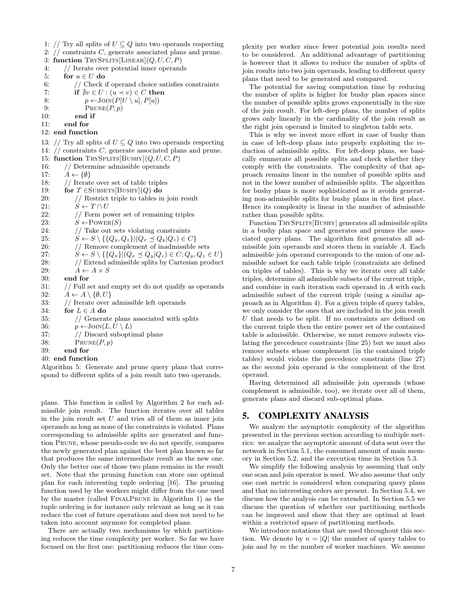
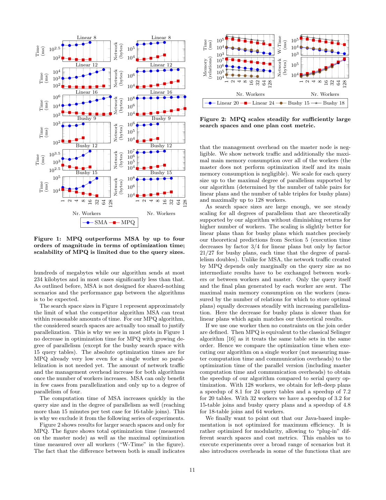

> 本组第 2 篇 · 优化器框架 · [全部论文]() · [上一篇]() · [下一篇]()

本文提出一种面向 shared-nothing 集群的大规模并行查询优化算法（MPQ）。核心思想是在优化开始前将计划空间划分为大小相等的分区，分配给各 worker 独立执行动态规划搜索，期间无需任何同步或数据交换；结束后 master 收集各分区最优计划并选出全局最优。理论分析表明网络通信量与 master 串行步骤复杂度关于 worker 数和查询大小均呈线性增长，单 worker 时间与空间复杂度随 worker 数均匀下降。在 100 节点 Spark 集群（256 executors）上的实验显示，对于单节点需耗时数分钟的大查询，单目标 24 表 left-deep/128 workers 的串行基线加速比为 8.1；多目标 20 表 left-deep/256 workers 为 9.4，后者采用执行时间与 buffer space 两个目标及 alpha=10 的近似剪枝。适用边界：可有效使用的 worker 数为 2 的幂（资源数任意时可选其子集）；在不相交约束方案下，最大 worker 数为 left-deep 的 2^floor(|Q|/2) 或 bushy 的 2^floor(|Q|/3)；伪代码仅覆盖 SPJ 查询且忽略 interesting orders；复杂度分析基于单一算子与单一代价度量的简化假设。该方案适用于优化阶段本身成为瓶颈的场景（如多表 join、多目标优化），但不适用于小查询或优化时间远低于执行时间的常规 OLTP 负载。

本文保留论文陈述、读者推断与待验证方案的区别；实验数字只适用于原文条件。原文和翻译来自已有 AI 辅助精读报告，已做来源匹配与编辑复核，不等于人工逐项核验或独立实验复现。所有页码均为 PDF 物理页。

## 论文与阅读范围

作者：Immanuel Trummer, Christoph Koch；年份：2015（arXiv:1511.01768v1，5 Nov 2015）；出处：EPFL，受 ERC Grant 279804 及 European Google PhD fellowship 资助。缺口：当前来源为上述 arXiv 版本，未核实最终发表的会议/期刊名称、卷号或页码；本次原文复核已读物理页 12 的完整参考文献列表；最终会议/期刊发表信息仍未作外部核实。

[论文集中的原始 PDF](https://github.com/lonng/db-papers/blob/4ff1331069c7cf52ac97dd769e5f484c1c35c200/papers/optimizer-framework/parallelizing-query-optimization-on-shared-nothing-architectures.pdf) · 本地来源：`optimizer-framework/parallelizing-query-optimization-on-shared-nothing-architectures.pdf`，共 12 页。

本篇保留 10 组原文精读和 45 条证据。截图为原始 PDF 的局部页选，不是重新生成的图表；未将整份 PDF 复制到博客。

## 研究问题与适用边界

本文解决的核心问题是：随着 Moore's law 放缓，系统性能提升越来越依赖于核数、CPU 数和集群节点数的增加，而传统查询优化算法的运行时间随 join 数量呈指数增长，若不加以并行化，优化阶段将逐渐成为整个查询评估流程的瓶颈。论文指出，先前的并行查询优化研究主要集中在如何并行化查询计划的执行阶段，但这并不充分；必须同时并行化查询计划的生成阶段。

具体而言，查询优化是一个 NP-hard 问题，即使寻找有保证的近优计划也是 NP-hard 的。新的应用场景（如 SPARQL 查询处理）推动了包含大量 join 的查询需求；灵活的云资源供给模型和新型处理算子（如近似查询处理中的采样率）引入了新的调优参数，使得计划搜索空间急剧膨胀。此外，除了执行时间外，云场景下的货币费用、近似查询处理中的结果精度等多代价度量进一步增加了优化难度。

适用边界方面，论文明确区分了“并行化生成查询计划的算法”与“生成用于并行执行的计划的串行算法”，本文属于前者。该方法与所有基于动态规划的查询优化领域相关，包括多目标查询优化、参数化查询优化和多目标参数化查询优化。然而，当前描述的伪代码仅考虑 SPJ（Select-Project-Join）查询，忽略了 interesting tuple orders 的影响，并假设每个表只有一个 scan plan 以简化描述。作者声称可通过标准方法扩展到聚合或嵌套查询，且支持 interesting orderings 是直接的，但未给出具体实现或实验证据。因此，读者在将其应用于复杂查询时需自行验证这些扩展的正确性与性能影响。

依据：论文陈述；PDF 物理页 2, 3, 4。证据：[C001N07](#evidence-c001n07), [C001N11](#evidence-c001n11), [C002N01](#evidence-c002n01), [C002N02](#evidence-c002n02)。

> 来源限定：证据页码按已核验的引用ID列出；模型建议对照页另存，未逐项证明其语义支持关系。

> 建议另行对照的 PDF 物理页：[1, 2, 3]。

## 系统架构与任务分解策略

本文采用 master-worker 架构，但其任务分解策略与 prior work 截然不同。先前面向 shared-memory 架构的并行查询优化算法（如 Han 等人的工作）通常由中心 master 分发细粒度任务，worker 线程共享数据结构（特别是存储最优部分计划的 memotable）。在 shared-nothing 架构中，这种设计会导致巨大的通信开销，因为 memotable 的大小随查询规模指数增长；同时，细粒度任务分配会使 master 成为瓶颈。先前算法最多在 8 个 core 上评估过。

为了避免上述问题，本文实现了尽可能粗粒度的问题分解：master 将查询和一个 partition ID（1 到 worker 数之间的整数）发送给每个 worker，每个 worker 每查询只接收一个任务。Worker 将 partition ID 翻译为一组 join order 约束，仅搜索满足约束的计划子空间。在整个优化阶段，worker 之间以及 worker 与 master 之间无任何通信或同步。优化结束后，每个 worker 将其分区内的最优计划返回给 master，master 比较这些计划（数量与 worker 数线性相关）以确定全局最优计划。

这种架构设计的关键优势在于：所有计划空间分区大小相等，保证了无偏斜（skew-free）的并行化；master 端所有串行处理步骤的时间复杂度关于 worker 数量和查询大小均为线性；网络传输数据量同样线性增长。对于固定查询，每个 worker 的运行时间和主存消耗随 worker 数量单调递减。计划空间可划分的最大分区数随查询大小增长，原则上无上限。但需注意，可有效利用的最大 worker 数受查询大小限制，这是一个明确的扩展性局限。

依据：论文陈述；PDF 物理页 1, 2, 3。证据：[C001N02](#evidence-c001n02), [C001N07](#evidence-c001n07), [C001N09](#evidence-c001n09), [C002N10](#evidence-c002n10)。

*原论文 PDF 物理页 7，版权归原作者或出版方。点击图片可查看原尺寸。页面文本中定位到：table is admissible. Otherwise, we must remove subsets vio-。这是页面定位信息，不表示本次已复核图内所有数据。*

## 核心算法机制与示例

算法分为 left-deep 计划空间和 bushy 计划空间两种变体，高层逻辑相同，仅在约束定义和拆分枚举上存在差异。有效使用的 worker 数 m 为 2 的幂，以便用 log2(m) 位编码约束方向；资源数任意时可选取数量为 2 的幂的 worker 子集。left-deep 表数为 2 的倍数、bushy 表数为 3 的倍数仅是伪代码的简化假设，不是算法适用性的硬条件；一般表数可使用完整的不相交表对/三元组并让剩余表不受约束。原文物理页 8 明确给出上限 m <= 2^floor(n/2)（linear）和 m <= 2^floor(n/3)（bushy），其中 n=|Q|。

Master 节点执行两阶段：第一阶段通过 parfor 并行调用 Worker(Q, partID, m)，每个 worker 返回其分区内的最优计划存入 bestInPart 数组；第二阶段遍历所有返回计划，用 FinalPrune 函数逐一比较，保留全局最优。FinalPrune 是标准剪枝函数，用更优计划替换当前 bestPlan。

Worker 函数分三步执行：(1) 调用 PartConstraints 将分区 ID 解码为 join 顺序约束集；(2) 调用 AdmJoinResults 将约束转化为可容许的中间结果表集合；(3) 用动态规划自底向上构建最优计划。DP 初始化 P[q]=Scan(q)，然后按基数 k 从 2 到 |Q| 递增迭代，对每个可容许 join 结果 q 调用 TrySplits 尝试所有合法拆分。

PartConstraints 函数迭代 i 从 0 到 log2(m)-1，每次提取 partID 的第 i 位作为 precOrd，调用对应版本的 Constraint 函数生成一条约束。Left-deep 版本处理第 i 个表对 (Q_{2i}, Q_{2i+1})，形式为 Qx ≺ Qy，表示在 join 序列中 Qx 必须在 Qy 之前；bushy 版本处理第 i 个表三元组 (Q_{3i}, Q_{3i+1}, Q_{3i+2})，形式为 Qx ⪯ Qy|Qz，语义为沿表 Qz 到根的路径上，Qx 不晚于 Qy 出现。所有 worker 必须使用相同的表编号方案以保证分区覆盖完整性。

AdmJoinResults 函数将约束集转化为可容许的中间结果表子集。它从 R={∅} 开始，遍历 Subsets(Q) 返回的连续表对或表三元组，对每个子集 S 计算 ConstrainedPowerSet(S,C)，然后通过笛卡尔积 R × ConstrainedPowerSet(S,C) 扩展 R。ConstrainedPowerSet 从 S 的幂集中移除违反约束的子集：left-deep 下若 Qx≺Qy 则移除 {Qy}；bushy 下若 Qx⪯Qy|Qz 则移除 {Qy,Qz}。生成的可容许表集不包含所有单元素集合，但单元素集合在 Algorithm 2 中被单独初始化处理，因此不影响正确性。

原文 Example 2（PDF 物理页 6）演示了 left-deep 场景下 AdmJoinResults 的执行过程：设查询表集 Q={Q1,Q2,Q3,Q4}，某 worker 收到的约束 C={Q1≺Q2, Q4≺Q3}。第一次迭代处理表对 {Q1,Q2}，约束 Q1≺Q2 排除了包含 Q2 但不包含 Q1 的子集（即 {Q2}），ConstrainedPowerSet 返回 {{}, {Q1}, {Q1,Q2}}，R 更新为该集合。第二次迭代处理表对 {Q3,Q4}，约束 Q4≺Q3 排除了 {Q3}，返回 {{}, {Q4}, {Q3,Q4}}。两次结果的笛卡尔积使 R 包含 3×3=9 个元素。相比之下，无约束时 4 个表的幂集大小为 16，约束有效缩减了中间结果空间。此例展示了约束如何通过排除特定子集来缩小 DP 搜索范围。

Prune 函数用于比较新生成的 plan 与当前已知产生相同 intermediate result 的最优 plan，仅保留较优者。文中指出 Prune 可以为每个 interesting tuple ordering 存储一个最优 plan。Worker 使用的 Prune 可能与 Master 使用的 FinalPrune 不同，因为 tuple ordering 仅在能降低未来操作代价时才有意义，对于已完成的 plan 无需考虑。

依据：论文陈述；PDF 物理页 2, 4, 5, 6, 7, 8。证据：[C001N03](#evidence-c001n03), [C001N04](#evidence-c001n04), [C002N03](#evidence-c002n03), [C002N04](#evidence-c002n04), [C002N05](#evidence-c002n05), [C002N06](#evidence-c002n06), [C002N07](#evidence-c002n07), [C002N08](#evidence-c002n08), [C002N09](#evidence-c002n09), [C002N11](#evidence-c002n11), [C002N12](#evidence-c002n12), [C003N03](#evidence-c003n03), [CODEX-SR-02](#evidence-codex-sr-02), [CODEX-SR-03](#evidence-codex-sr-03)。

## 正确性论证与前提假设

算法正确性的关键是：各约束子空间的并集覆盖完整计划空间；每个 worker 在自己的子空间内通过合法拆分及适当剪枝得到最优计划；master 比较所有返回计划得到全局最优。分区互不重叠并不是必要条件。Bushy 约束 x ⪯ y|z 是“不晚于”：【读者推演】对树 Join(Join(x,y),z)，沿 z 到根时 x、y 同时出现，故 x ⪯ y|z 与 y ⪯ x|z 均成立，该完整计划可以被两个 worker 搜索。中间结果表集也会被多个 worker 重复处理。多目标实验则使用带近似保证的剪枝，不应把单目标精确最优结论直接等同于精确 Pareto 前沿枚举。

关于分区覆盖，PartConstraints 函数通过迭代 log2(m) 次，每次根据 partition ID 的特定位选择互补约束之一（例如 left-deep 下 Qx≺Qy 或 Qy≺Qx），确保所有可能的约束组合恰好对应所有 partition ID。由于所有 worker 使用相同的表编号方案，且每个 partition ID 唯一确定一组约束，所有分区的并集覆盖了完整的计划空间。

关于缩减因子的最优性，须区分引言的概括与第 5.5 节的具体定理。时间复杂度中每条约束的因子是 linear 的 3/4 与 bushy 的 21/27；中间结果数量及内存的对应因子是 3/4 与 7/8。第 5.5 节明确限定方法族：按两/三个固定表的出现模式划分表的幂集、给 worker 分配这些集合、不交换部分计划并独立生成完整计划。定理 8、9 给出的每 worker 最大中间结果数量下界分别为 3/4 与 7/8，不能改写成任何划分方法的全局最优 speedup 定理，也不能把 7/8 的中间结果下界混同于 21/27 的时间因子（PDF 物理页 9）。

定理 2 通过归纳法证明：受 l 个约束限制的 linear plan space partition 具有 O(2^n · (3/4)^l) 个 admissible join results。基础情况 l=0 时为 O(2^n)。每增加一个约束 x ≺ y，包含 y 但不包含 x 的 table sets 变为 inadmissible，由于各约束涉及的表互不相交，这部分占总数的 1/4，因此 admissible 集合缩减为原来的 3/4。定理 3 证明 bushy plan space 中每个形如 x ⪯ y|z 的约束会排除包含 y 和 z 但不包含 x 的 table sets，这部分占比恒为 1/8，因此 admissible join results 数量为 O(2^n · (7/8)^l)。

需要注意的是，第 5 节的复杂度分析建立在多个简化前提之上：假设仅使用一种 scan 和一种 join operator；假设比较 query plans 时仅考虑单一 cost metric；假设不存在 interesting orders。这些假设使得每个 table set 只有一个最优 plan，从而简化了空间和时间复杂度的推导。5.4 节讨论了放宽这些假设的情况：引入多种 operator implementations 会使时间复杂度随算子数量线性增长；引入 interesting orders 或多 cost metrics 会导致同一 table set 存在多个最优 plan，此时通信量和内存随每个 table set 存储的 plan 数线性增长，而时间复杂度随 plan 数量的立方增长。

依据：论文陈述；PDF 物理页 2, 6, 7, 8, 9, 10。证据：[C001N10](#evidence-c001n10), [C003N04](#evidence-c003n04), [C003N06](#evidence-c003n06), [C003N07](#evidence-c003n07), [C003N10](#evidence-c003n10), [CODEX-SR-01](#evidence-codex-sr-01), [CODEX-SR-10](#evidence-codex-sr-10), [CODEX-SR-11](#evidence-codex-sr-11), [CODEX-SR-06](#evidence-codex-sr-06)。

## 实验设置、结果与局限性

【硬件与软件环境】实验在 100 节点集群上进行，每节点配备两颗 Intel Xeon E5-2630 v2 CPU（各 6 核，2.60GHz）、128GB 内存和 20TB 硬盘，运行 Ubuntu 14.04。所有算法基于 Spark 1.5 on YARN 2.7.1，使用 Java 1.7 实现。最多使用 256 个 Spark executor，每个 executor 预留最多 40GB 内存，最大消息大小设为 1GB。

【基线算法】基线算法 SMA（shared-memory approach）代表细粒度并行化方法：master 节点将一组连接结果分配给 worker 计算最优计划，依赖其他 worker 已生成的最优计划。这意味着中间结果需要在 worker 之间共享，且 master 需要多轮分配任务。作者明确指出该比较不公平，因为两者面向不同架构和并行度，但声称没有发现其他面向 shared-nothing 架构的查询优化算法可供对比。

【工作负载与代价设置】Section 6.1（PDF 物理页 10）明确使用 Steinbrunn 等人 [18] 的方法生成随机星型 join graph、表基数和谓词选择率。实验枚举完整 left-deep/bushy 计划空间，允许 Cartesian products，不按 join graph 的连通性启发式裁剪，所以中间表集数量不严重依赖图拓扑。单目标为执行时间，使用 [18] 的标准代价公式估算 block-nested-loop、hash 和 sort-merge join。多目标为执行时间与 buffer space consumption，采用带形式化近优保证的近似剪枝，alpha=10；以下多目标前沿大小与性能均限于此设置。图 1 各点取二十个随机查询结果的中位数。

【指标】主要指标为优化时间（optimization time）和加速比（speedup）。加速比计算方式为：单 worker 优化时间（不含 master 计算和通信开销）除以并行版本总时间（含 master 计算和通信开销）。单 worker 时 MPQ 等价于经典 Selinger 算法。

【主要数字】以下精确数字由论文物理页 11、12 的正文直接报告，不是从曲线估读；图像本身未作视觉核对。MPQ 相对集群 SMA 最多快四个数量级，但这不等于相对串行优化的 speedup。图 1 中的搜索空间大小代表了 MSA 能在合理时间内处理的上限，但对 MPQ 而言这些搜索空间太小以至于不需要并行化，因此大多数图中 MPQ 随并行度增加并未出现优化时间下降（除 15 表的 bushy 搜索空间外）。MSA 仅在少数情况下从并行中受益，且并行度上限为 4。16 表 join 时 MSA 计算时间超过 15 分钟，因此被排除在后续实验之外。

对于 MPQ，128 个 worker 时，24 表 left-deep 计划加速比为 8.1，20 表为 7.2。32 个 worker 时，15 表 bushy 计划加速比为 3.2；64 个 worker 时，18 表 bushy 计划加速比为 4.8。

在多目标优化实验中，MPQ 的网络流量相比单目标有所增加，因为每个 worker 回传其分区在 alpha=10 近似剪枝下保留的 Pareto 计划集，而非仅一个计划。12 表 left-deep 计划每查询的 Pareto 最优计划中位数为 21，9 表 bushy 计划为 16。MSA 在 worker 数增加时因网络流量和协调开销而性能显著下降，其有益的最大并行度为 8。MPQ 在 10 表 left-deep 计划可扩展至 32 个 worker，12 表至 64 个 worker，9 表 bushy 至 8 个 worker。图 4 的足够大 left-deep 查询可稳定扩展至 256 workers；该图不是 256-worker bushy 实验。对应 16/18/20 表 left-deep 查询相对串行多目标优化的加速比分别为 5.1、5.5、9.4。

【不能得出的结论】1）由于基线 SMA 被作者自认为不公平比较，实验结果不能证明 MPQ 在所有 shared-nothing 场景下都优于其他可能的并行策略；2）实验基于 Spark 框架，高网络延迟和任务分配 overhead 已被计入，但不能直接推断在更低延迟的 RDMA 网络或原生 C++ 实现中的表现；3）加速比针对的是优化阶段本身耗时数分钟的大查询，不能推广到毫秒级的小查询优化场景；4）多目标优化中 Pareto 集合的大小高度依赖于代价度量之间的冲突程度，21 和 16 这两个中位数不能泛化为所有多目标场景的典型值。

依据：论文陈述；PDF 物理页 10, 11, 12。证据：[C004N01](#evidence-c004n01), [C004N02](#evidence-c004n02), [C004N06](#evidence-c004n06), [C004N08](#evidence-c004n08), [C004N10](#evidence-c004n10), [C004N11](#evidence-c004n11), [CODEX-SR-04](#evidence-codex-sr-04), [CODEX-SR-05](#evidence-codex-sr-05), [CODEX-SR-06](#evidence-codex-sr-06)。

*原论文 PDF 物理页 11，版权归原作者或出版方。点击图片可查看原尺寸。页面文本中定位到：Figure 1:；Figure 2 shows results for larger search spaces and only for；Figure 2: MPQ scales steadily for sufficiently large。这是页面定位信息，不表示本次已复核图内所有数据。*

## 设计权衡与工程取舍

本节内容基于论文事实进行的读者推断，旨在揭示架构决策背后的工程权衡。

【粗粒度 vs 细粒度任务分解】每个 worker 每查询一个任务，减少优化阶段协调，但有效并行度受不相交约束数量限制。原文物理页 8 显式给出 left-deep 上限 2^floor(n/2)、bushy 上限 2^floor(n/3)，并非仅由读者推导的公式。6 表查询上限分别为 8 和 4 workers；资源数不为 2 的幂时可选择其子集。【读者推断】固定查询下多余资源无法通过该方案继续扩大并行度，可调度其他查询；不能据此断言整个系统必须让这些资源闲置。细粒度方法仍受有限候选任务数量与协调成本约束，不能称其并行度完全不受查询大小限制。

【Spark 作为运行时 vs 原生实现】选择 Spark 1.5 作为底层平台极大地简化了分布式任务调度、容错和序列化工作，但也引入了 JVM GC 暂停、Spark task launch overhead 和 RPC 延迟。论文提到“Despite high network latency and task assignment overheads”，说明这些系统级开销是真实存在的。对于内核工程师而言，如果将 MPQ 移植到原生 C++ 的 MPP 数据库引擎中，单 worker 的绝对优化时间可能会大幅下降，但并行加速比的曲线形态是否保持不变是一个待验证问题。

【等分分区 vs 实际工作量】结构对称的约束使各 worker 处理的候选集合规模相当，但这不是任意实现与硬件条件下的相同墙钟时间保证。论文的常数时间假设针对单个候选计划的构造、递归代价计算与比较（物理页 8），并非每个 table set 的全部处理：left-deep 对每个表集尝试线性数量的拆分，bushy 的拆分数量可呈指数增长（物理页 7）。估算中间结果的行数很大，不会在这里自动增加 Prune 的调用次数；调用次数取决于候选枚举。【未验证的工程问题】更复杂估价器的非恒定成本、不同的保留前沿大小或异构节点可能影响负载，需另行测量，不能作为论文已证明的偏斜机制。

【单目标 vs 多目标的通信放大】单目标简化情形每个 worker 回传一个计划；多目标实验回传 alpha=10 近似剪枝下保留的计划集。Section 5.4（物理页 9）把每个 table set 保留的计划数作为额外因子：通信与内存随它线性增长，时间随它立方增长；不能在该数量变化时仍把多目标通信无条件视为常数因子的线性开销。原文还引用近似方案对保留规模的界；不能以未近似的完整 Pareto 前沿最坏规模直接否定这个有条件的分析。

依据：读者推断；PDF 物理页 1, 2, 6, 8, 9, 10, 12。证据：[C001N02](#evidence-c001n02), [C001N09](#evidence-c001n09), [C002N10](#evidence-c002n10), [C003N05](#evidence-c003n05), [C004N01](#evidence-c004n01), [C004N10](#evidence-c004n10), [CODEX-SR-03](#evidence-codex-sr-03), [CODEX-SR-07](#evidence-codex-sr-07), [CODEX-SR-08](#evidence-codex-sr-08), [C003N08](#evidence-c003n08)。

## 与现有系统及方法的对比分析

本节内容为读者提出的待验证问题与对比框架，非论文原文结论。

【与 Apache Calcite 的对比】Calcite 的 Volcano/Cascades 优化器采用基于规则的转换和 memo 结构进行启发式或穷举搜索。MPQ 的分区策略本质上是对 join order 枚举空间的物理切割。一个待验证的问题是：能否将 MPQ 的约束划分思想应用于 Cascades 框架的 exploration 阶段？Cascades 的 memo 结构比纯 DP 表更复杂，包含 group expressions 和 logical properties，直接在 memo 上施加类似 x ≺ y 的约束可能需要重新定义 equivalence class 的划分方式。

【与 DuckDB 的对比】DuckDB 以其高效的单机查询优化和执行著称，其优化器在处理多表 join 时也面临指数级搜索空间的问题。DuckDB 目前主要利用多线程进行执行阶段的并行化。待验证问题：如果在 DuckDB 的单机多核环境下模拟 MPQ 的分区策略（将不同 partition ID 分配给不同线程），其加速比是否能达到论文中 Spark 集群的水平？考虑到单机 shared-memory 环境下无需网络序列化，但存在 cache line contention，实际表现可能截然不同。

【与 StarRocks/Doris 等 MPP 系统的对比】StarRocks 等现代 MPP 数据库通常采用 CBO（Cost-Based Optimizer）结合 Cascades 框架，并在单机内完成优化。对于涉及数十张表的复杂星型或雪花型查询，优化时间可能达到秒级甚至更长。待验证问题：这些系统是否已经在内部实现了某种形式的优化器并行化？MPQ 的粗粒度分区策略是否适合嵌入到这类系统的 coordinator 节点中，将优化任务下发给多个 BE 节点并行执行后再汇总？这需要评估优化器状态（如统计信息缓存）在节点间同步的成本。

【与 prior parallel optimization work 的对比】论文明确指出 Han 等人 (2008, 2009) 的工作面向 shared-memory，依赖共享 memotable。Waas 和 Hellerstein (2009) 研究了可扩展优化器的并行化。MPQ 的核心区别在于完全解耦了 worker 间的状态依赖，以通信量的极小化换取了并行度的极大化。但这种解耦是否会导致重复计算（例如不同分区在底层扫描代价估算上的冗余）？论文假设 Scan(q) 是常数时间初始化的，但在实际系统中，获取统计信息或执行 sampling 可能是昂贵的 I/O 操作。

依据：待验证的工程设想；PDF 物理页 2, 3, 12。证据：[C001N07](#evidence-c001n07), [C001N11](#evidence-c001n11), [C004N12](#evidence-c004n12)。

## 复现指南与缺失信息

本节基于论文提供的信息进行复现可行性分析，明确区分已有材料与缺失材料。

【已有材料】1）PartConstraints、AdmJoinResults、TrySplits 和 Worker DP 的伪代码及 Example 2；2）CPU、核心数、内存、OS、Spark/YARN/Java 版本、最多 256 executors、每 executor 最多 40GB 和 1GB 消息限制；3）SMA 的任务分配方式；4）物理页 10 的随机星型 join graph 与基数/选择率生成方法 [18]、允许 Cartesian products、单目标执行时间代价公式 [18] 和所用 join 算子；5）执行时间与 buffer space 两目标、alpha=10 的近似剪枝；6）物理页 11、12 正文中的 speedup 与前沿中位数。不能把这些已经给出的设置写成缺失信息。

【缺失信息与复现障碍】在本次完整 12 页提取文本中未发现代码仓库地址；这不等于已经核实源码从未公开，也不意味着复现只能使用 Java 1.7。论文未展开约束索引的具体实现；随机种子及完整参数/实现常数需进一步取得，代价和工作负载方法须连同参考文献 [18]、近似剪枝方法 [21,22] 一起查阅。作者承认 Java 实现偏重模块化而非最高效率（物理页 11、12），绝对耗时不应当作优化实现的性能极限。允许 cross products 的实验并不按连通子图限制枚举，不应借其他 DP 枚举器的拓扑敏感性推断本实验的搜索空间。

【复现建议】若要复现，建议首先实现 left-deep 版本的 PartConstraints 和 AdmJoinResults，并使用标准的 Selinger DP 框架。对于约束索引，可使用哈希表将表 ID 映射到相关约束列表。在评估时，应先生成小规模查询（如 8 至 10 表）验证分区覆盖的完备性（即所有 worker 返回的最优计划的全局最小值是否等于单机无约束 DP 的结果），再逐步扩大规模测试加速比。注意，由于 Spark 1.5 已过时，若在现代 Spark 版本上复现，task scheduling overhead 的差异可能导致加速比曲线发生变化。

依据：读者推断；PDF 物理页 5, 6, 8, 10, 11, 12。证据：[C002N09](#evidence-c002n09), [C002N11](#evidence-c002n11), [C003N09](#evidence-c003n09), [C004N01](#evidence-c004n01), [C004N12](#evidence-c004n12), [CODEX-SR-04](#evidence-codex-sr-04), [CODEX-SR-05](#evidence-codex-sr-05), [CODEX-SR-06](#evidence-codex-sr-06), [C004N08](#evidence-c004n08), [C004N11](#evidence-c004n11)。

## 总结与工程启示

本文提出了一种面向 shared-nothing 架构的大规模并行查询优化算法 MPQ，通过将计划空间划分为大小相等的独立分区，实现了优化期间零通信、零同步的粗粒度并行。理论分析证明了网络通信量和 master 串行步骤关于 worker 数和查询大小的线性复杂度，以及单 worker 时间和空间复杂度随 worker 数的均匀下降。在 100 节点 Spark 集群上的实验验证了该算法在处理大查询（单节点需数分钟）时可获得高达一个数量级的加速比，且在多目标优化场景下表现出良好的可扩展性。

对于数据库内核工程师而言，本文的工程启示在于：1）当优化阶段本身成为瓶颈时（如超大规模 join、复杂多目标调优），将优化任务卸载到集群并行执行是一种可行的架构选择，而非局限于单机多线程；2）消除 worker 间状态依赖是实现大规模并行的关键，即使这意味着牺牲一定的并行度上限；3）分区策略的设计直接影响负载均衡，基于结构化约束的等分方法提供了一种无需预估代价即可保证 skew-free 的途径。

然而，必须重申其适用边界：该方案不适用于小查询或优化时间极短的场景，因为 Spark 的任务启动和网络延迟开销会抵消并行收益；最大可用 worker 数受查询表数严格限制；当前描述和实验主要针对 SPJ 查询，向复杂查询的扩展需要额外的工程验证。

依据：论文陈述；PDF 物理页 1, 2, 11, 12。证据：[C001N02](#evidence-c001n02), [C001N09](#evidence-c001n09), [C002N02](#evidence-c002n02), [C004N08](#evidence-c004n08), [C004N11](#evidence-c004n11)。

## 原文精读：从句子回到机制

以下保留原文、忠实翻译、含义与边界；假设示例不作为论文实验结果。

### P001 · PDF 物理页 2

**原文**

<blockquote class="paper-source-quote"><pre><code>Achieving our goals requires a radically different approach&#10;compared to prior work: instead of decomposing the query&#10;optimization problem into many small optimization tasks,&#10;we realize the most coarse-grained problem decomposition&#10;possible: the optimization of one query is mapped into ex-&#10;actly one task per worker node.&#10;On a high level, our algorithm works as follows.</code></pre></blockquote>

**忠实翻译**

> 实现我们的目标需要一种与先前工作截然不同的方法：不是将查询优化问题分解为许多小的优化任务，而是实现尽可能最粗粒度的问题分解：一个查询的优化被映射为每个工作节点恰好一个任务。在高层面上，我们的算法工作方式如下。

**技术含义与边界**

> 原文采用针对单个查询的粗粒度分解：将该查询的计划空间划分给多个 worker，每个 worker 独立搜索所分配的约束子空间，而不是把完整查询的全部优化只交给一个 worker。每 worker 恰好一个任务，master 最后汇总；这不等于每 worker 都搜索完整计划空间。

**常见误读**

> 容易错误地认为‘每个工作节点恰好一个任务’意味着整个集群只处理一个查询。原文明确限定是‘一个查询的优化’被如此映射，即针对单个查询的并行方案，而非系统级并发控制。不应将此局部设计泛化为全局吞吐量保证。

**读者构造的假设示例**

> 读者构造的假设示例：假设有 4 个 worker 节点，当优化一个包含多表连接的查询 Q 时，系统将 Q 的计划空间划分为 4 个分区，每个 worker 负责搜索其中一个分区的最优计划，而不是让所有 worker 协作完成同一个子表达式。

### P002 · PDF 物理页 12

**原文**

<blockquote class="paper-source-quote"><pre><code>The net-&#10;work traffic of MPQ has however increased when comparing&#10;to the results for single-objective query optimization. The&#10;reason is that each worker must now send the set of all&#10;Pareto-optimal plans in its respective plan space partition&#10;back to the master instead of only one plan. The median&#10;number of complete Pareto-optimal plans per query was 21&#10;for 12-table joins when considering left-deep plans and 16&#10;for 9-table joins in a bushy plan space.</code></pre></blockquote>

**忠实翻译**

> 然而，与单目标查询优化的结果相比，MPQ 的网络流量增加了。原因是每个工作节点现在必须将其各自计划空间分区中所有 Pareto 最优计划的集合发送回主节点，而不是仅发送一个计划。在考虑左深计划时，12 表连接每次查询的完整 Pareto 最优计划的中位数为 21；在 bushy 计划空间中，9 表连接的中位数为 16。

**技术含义与边界**

> 该段正文报告多目标实验的网络开销与完整计划集的中位数：12 表 left-deep 为 21，9 表 bushy 为 16。须结合物理页 10：目标为执行时间和 buffer space，使用 alpha=10 的近似剪枝，因此这里是该近似设置下保留的前沿，而非未经近似的全部精确 Pareto 解。

**常见误读**

> 容易将中位数 21 和 16 误读为最大值或平均值，或将其推广到任意表数和任意计划空间。原文明确限定了前提条件（12-table joins left-deep、9-table joins bushy），且使用的是 median（中位数），不代表所有查询的回传规模。

**读者构造的假设示例**

> 读者构造的假设示例：某个 12 表 left-deep worker 经 alpha=10 的近似剪枝保留 25 个完整计划，就把这 25 个计划发回 master；单目标简化情形则只返回一个计划。25 是示例数，不是论文测量值，也不代表精确 Pareto 前沿大小。

### P003 · PDF 物理页 7

**原文**

<blockquote class="paper-source-quote"><pre><code>We simplify the following analysis by assuming that only&#10;one scan and join operator is used. We also assume that only&#10;one cost metric is considered when comparing query plans&#10;and that no interesting orders are present.</code></pre></blockquote>

**忠实翻译**

> 我们通过假设仅使用一种扫描和连接算子来简化以下分析。我们还假设在比较查询计划时仅考虑一个代价度量，并且不存在 interesting orders。

**技术含义与边界**

> 原文陈述了后续理论分析的三个简化假设：单一 scan 算子、单一 join 算子、单一代价度量、无 interesting orders。这些假设用于降低分析复杂度。读者可推断，若引入多种物理算子或多代价指标，分析结论可能需要修正。适用边界严格限于满足这些假设的场景。

**常见误读**

> 容易忽略这些是分析用的简化假设，而误认为所提算法本身不支持多种算子或多代价度量。原文明确说‘We simplify the following analysis by assuming...’，这是对分析过程的约束，不是对算法能力的限制。

**读者构造的假设示例**

> 读者构造的假设示例：在分析中，假设所有连接都使用 hash join，所有扫描都是全表扫描，且只按 CPU 代价排序计划，不考虑索引扫描带来的有序性（interesting orders）对上层算子的收益。

### P004 · PDF 物理页 4

**原文**

<blockquote class="paper-source-quote"><pre><code>The presented algorithm solves the traditional query op-&#10;timization problem, meaning that it compares alternative&#10;query plans according to single point cost estimates in one&#10;cost metric. The method by which we partition the plan&#10;space is however very generic and it is in fact straight-&#10;forward to extend our algorithm to handle multiple plan cost&#10;metrics [21, 22] or plan cost functions that depend on un-&#10;known parameters [12, 7] or both together [23].</code></pre></blockquote>

**忠实翻译**

> 所提出的算法解决了传统的查询优化问题，这意味着它根据一个代价度量中的单点代价估计来比较备选查询计划。然而，我们划分计划空间的方法非常通用，实际上可以很直接地将我们的算法扩展为处理多个计划代价度量 [21, 22] 或依赖于未知参数的计划代价函数 [12, 7] 或两者结合 [23]。

**技术含义与边界**

> 该段先描述单度量、单点估计的算法，再说明划分策略可用于多目标与参数化代价变体。不能因本段未展示实验而断言全文未验证多目标扩展：物理页 10、12 已报告执行时间与 buffer space 两目标、alpha=10 近似剪枝的实验。参数化或多目标参数化场景在此主要是方法可扩展性声明。

**常见误读**

> 应区分单段的可扩展性说明与全文的证据：本文确实实现并实验评价了一个双目标版本，但这不证明所有参数化代价函数、复杂查询语言扩展都已验证；也不能把单目标精确最优性不加条件地套到近似 Pareto 搜索。

**读者构造的假设示例**

> 读者构造的假设示例：对某查询同时比较执行时间与 buffer space，worker 用近似剪枝保留一组权衡计划后回传。双目标形式本身已在论文实验中采用；某个具体查询与其具体计划代价仍属此处假设。

### P005 · PDF 物理页 3

**原文**

<blockquote class="paper-source-quote"><pre><code>This would lead to huge communi-&#10;cation overhead on shared-nothing architectures (e.g., the&#10;size of the memotable is exponential in the query size) while&#10;our algorithm does not require any communication between&#10;workers.</code></pre></blockquote>

**忠实翻译**

> 这在 shared-nothing 架构上会导致巨大的通信开销（例如，memotable 的大小随查询大小呈指数增长），而我们的算法不需要工作节点之间的任何通信。

**技术含义与边界**

> 原文陈述了传统动态规划方法在 shared-nothing 架构上的通信瓶颈：memotable 规模随查询大小指数增长。作为对比，作者声明其算法在 worker 之间不需要任何通信。适用边界为 shared-nothing 架构下的查询优化场景。读者可推断这是该算法的核心优势之一。

**常见误读**

> worker 之间无通信不等于整个系统零通信：仍有 master 下发查询与回收计划。指数规模的中间表集也不是传统方法独有；本算法的每 worker memotable 仍有指数级上界，只是随约束数按 3/4 或 7/8 的因子缩减。区别是不共享或交换优化阶段的中间计划，而非消除了指数状态空间。

**读者构造的假设示例**

> 读者构造的假设示例：在传统分布式优化器中，若查询涉及 15 张表，memotable 可能包含数万条子计划记录，需要在节点间同步；而在本文算法中，各 worker 独立搜索自己的分区，无需互相交换 memotable 条目。

### P006 · PDF 物理页 9

**原文**

<blockquote class="paper-source-quote"><pre><code>Main memory consumption also&#10;increases linearly in the number of plans. Time complexity&#10;increases proportional to the cube of the number of plans for&#10;the following reason: when searching for the optimal plan&#10;within each plan space partition, we need to consider all&#10;pairs of optimal plans for each split of a table set into two&#10;join operands [21].</code></pre></blockquote>

**忠实翻译**

> 主内存消耗也随计划数量线性增长。时间复杂度随计划数量的立方成比例增长，原因如下：在每个计划空间分区内搜索最优计划时，我们需要考虑将表集合拆分为两个连接操作数的每种拆分的所有最优计划对 [21]。

**技术含义与边界**

> 结合物理页 9 的上下文，计划数指每个 table set 为 interesting orders 或多个代价指标保留的计划数 K，不是整个分区曾生成的全部候选计划数。每次拆分需比较 K^2 对左右子计划，再付出约 K 的剪枝比较，得到相对于单计划情形的 K^3 因子；内存相应增加 K 因子，原有表集/拆分数量仍在。

**常见误读**

> 不能将 K^3 解读为表数的立方，也不能将分区总候选数直接立方。K 是每个表集保留计划数的参数，复杂度还需乘表集与拆分枚举的工作量；K^3 是渐近因子，不是精确操作计数。

**读者构造的假设示例**

> 读者构造的假设示例：若某次拆分的左右表集各保留至多 K=10 个计划，就有至多 100 对子计划组合，每个候选剪枝需与至多约 10 个保留计划比较，从而产生 O(10^3) 量级的额外因子。它并非声称整个查询恰好执行 1000 次操作。

### P007 · PDF 物理页 6

**原文**

<blockquote class="paper-source-quote"><pre><code>The number of workers that can be&#10;efficiently exploited by our algorithm is however indeed re-&#10;stricted to powers of two and the maximal number of workers&#10;is additionally restricted as a function of the query size. We&#10;analyze those restrictions in more detail in Section 5.&#10;Constraints restrict the admissible join orders and join&#10;trees.</code></pre></blockquote>

**忠实翻译**

> 然而，我们的算法能够有效利用的工作节点数量确实被限制为 2 的幂，并且最大工作节点数量还额外受到查询大小的函数限制。我们在第 5 节中更详细地分析了这些限制。约束限制了可容许的连接顺序和连接树。

**技术含义与边界**

> 原文限制的是可高效使用的 worker 数，非任意集群资源数能否运行。结合物理页 8，linear 上限是 2^floor(n/2)，bushy 是 2^floor(n/3)；资源数任意时可选择 2 的幂大小的子集，剩余表不必强行补成约束组。

**常见误读**

> 容易忽略‘有效利用’这一限定词，误认为非 2 的幂的节点数完全无法运行。原文说的是‘efficiently exploited’，暗示可能存在效率下降而非功能失效。另外，不应将‘约束限制连接顺序’误解为性能缺陷，它是划分机制的一部分。

**读者构造的假设示例**

> 读者构造的假设示例：对于 6 表查询，不相交表对方案的 left-deep 上限为 2^3=8 workers，不相交三元组方案的 bushy 上限为 2^2=4。即使集群有 48 个节点，也不能在这套约束方案下把同一个 6 表查询扩到 32 workers；其他资源可留给其他查询。

### P008 · PDF 物理页 8

**原文**

<blockquote class="paper-source-quote"><pre><code>5.1&#10;Network Communication&#10;We analyze the asymptotic size of the data that is sent&#10;over the network during optimization of one query.&#10;Theorem 1. The amount of data sent over the network&#10;is in O(m · (bq + bp)).&#10;Proof. Different workers do not communicate with each&#10;other so data is only sent between master and workers. This&#10;happens at two occasions: when assigning each worker to a&#10;plan space partition and when collecting the best plans for&#10;each partition.</code></pre></blockquote>

**忠实翻译**

> 5.1 网络通信
> 我们分析在优化一个查询期间通过网络发送的数据的渐近大小。
> 定理 1。通过网络发送的数据量为 O(m · (bq + bp))。
> 证明。不同的工作节点彼此不通信，因此数据仅在 master 和 workers 之间发送。这发生在两个场合：将每个工作节点分配到计划空间分区时，以及收集每个分区的最佳计划时。

**技术含义与边界**

> 定理 1 给出单目标、无 interesting orders 情形的单次优化通信上界 O(m*(bq+bp))。物理页 8 在定理前已明确定义 m 为 worker 数，bq 为输入查询的字节大小，bp 为相应计划的字节大小。通信发生在任务下发与计划回收，不交换 worker 中间计划。

**常见误读**

> bq、bp 不是读者猜测，而是同页明确给出的 query/plan 字节大小。该式仍是渐近上界而非精确字节数；多个保留计划的扩展还需结合 Section 5.4 的额外因子。

**读者构造的假设示例**

> 读者构造的假设示例：m=8 时，每个 worker 收到大小为 bq 的查询并回传大小为 bp 的计划，总传输量级为 O(8*(bq+bp))。大小和精确协议开销须由具体实现测量，不能从大 O 式直接得到。

### P009 · PDF 物理页 5

**原文**

<blockquote class="paper-source-quote"><pre><code>1: // Generate best plan for query Q in partition with&#10;2: // ID partID out of m partitions.&#10;3: function Worker(Q, partID, m)&#10;4:&#10;// Decode partition ID into a set of constraints&#10;5:&#10;constr ←PartConstraints(Q, partID,m)&#10;6:&#10;// Generate admissible intermediate results&#10;7:&#10;joinRes ←AdmJoinResults(Q, constr)&#10;8:&#10;// Initialize best plans for single tables&#10;9:&#10;for q ∈Q do&#10;10:&#10;P[q] ←Scan(q)&#10;11:&#10;end for&#10;12:&#10;// Iterate over join result cardinality&#10;13:&#10;for k ∈{2, .</code></pre></blockquote>

**忠实翻译**

> 1: // 在 m 个分区中为 ID 为 partID 的分区中的查询 Q 生成最佳计划。
> 2: //
> 3: function Worker(Q, partID, m)
> 4:
> // 将分区 ID 解码为一组约束
> 5:
> constr ←PartConstraints(Q, partID,m)
> 6:
> // 生成可容许的中间结果
> 7:
> joinRes ←AdmJoinResults(Q, constr)
> 8:
> // 初始化单表的最佳计划
> 9:
> for q ∈Q do
> 10:
> P[q] ←Scan(q)
> 11:
> end for
> 12:
> // 遍历连接结果基数
> 13:
> for k ∈{2, .

**技术含义与边界**

> 本段是 Worker 伪代码的截取，不是论文算法本身在第 13 行中断。完整 Algorithm 2 位于物理页 5：解码约束、生成可容许表集、初始化单表扫描后，按 k=2,...,|Q| 遍历表集并调用 TrySplits，最终返回 P[Q]。PartConstraints 与 AdmJoinResults 的实现还在物理页 5、6 给出。

**常见误读**

> 不能仅凭本摘录的截断声称原文缺少循环体或内部函数。应区分选段范围与全文范围：完整循环和返回语句见物理页 5，合法拆分逻辑见物理页 7。已有全文说明的内容不必重新编造，也不应报告为未知。

**读者构造的假设示例**

> 读者构造的假设示例：假设查询 Q 涉及表 {A,B,C,D}，partID=2，m=4。Worker 调用 PartConstraints 得到约束如‘A 必须在 B 之前连接’，然后 AdmJoinResults 过滤掉违反该约束的中间结果集合，再为 A、B、C、D 各自初始化 Scan 计划，随后从 k=2 开始枚举两表连接。

### P010 · PDF 物理页 10

**原文**

<blockquote class="paper-source-quote"><pre><code>Sec-&#10;tion 6.1 describes our experimental setup and Section 6.2&#10;our experimental results.&#10;6.1&#10;Experimental Setup&#10;We evaluate our algorithm on a cluster with 100 nodes.&#10;Each node is equipped with two Intel Xeon E5-2630 v2 CPUs&#10;featuring six cores each running at 2.60GHz; 128 GB of main&#10;memory and 20 TB of hard disk capacity are available per&#10;node. The cluster runs Ubuntu Linux, version 14.04.&#10;All benchmarked algorithms use Spark 1.5 on Yarn 2.7.1&#10;and are implemented in Java 1.7.</code></pre></blockquote>

**忠实翻译**

> 第 6.1 节描述了我们的实验设置，第 6.2 节描述了我们的实验结果。
> 6.1 实验设置
> 我们在一个拥有 100 个节点的集群上评估我们的算法。每个节点配备两个 Intel Xeon E5-2630 v2 CPU，每个 CPU 具有六个核心，运行频率为 2.60GHz；每个节点可用 128 GB 主内存和 20 TB 硬盘容量。集群运行 Ubuntu Linux 14.04 版本。
> 所有基准测试算法均使用 Yarn 2.7.1 上的 Spark 1.5，并用 Java 1.7 实现。

**技术含义与边界**

> 原文陈述了实验环境的硬件与软件配置：100 节点集群，每节点双路六核 Xeon CPU、128GB 内存、20TB 磁盘，操作系统为 Ubuntu 14.04，计算框架为 Spark 1.5 on YARN 2.7.1，编程语言为 Java 1.7。这些信息为实验结果提供了可复现的环境基线。

**常见误读**

> 容易将特定硬件配置下的实验结果泛化为算法在所有环境下的绝对性能。原文明确限定了实验平台规格，不同 CPU 核心数、内存大小或 Spark 版本可能导致不同表现。此外，不应将 100 节点视为算法的可扩展性上限，这只是实验所用的集群规模。

**读者构造的假设示例**

> 读者构造的假设示例：假设要复现实验，研究者需准备类似规格的集群（100 节点、每节点 12 核、128GB 内存），部署相同版本的 Spark 和 YARN，并使用 Java 1.7 编译代码，否则观测到的性能数字可能与原文不可直接比较。

## 尚未解决的问题

1. 如何将基于 join order 的分区策略推广到 Cascades/Volcano 框架的 memo 结构中，处理包含 group expression 和 logical property 的复杂等价类划分？
2. 在单机多核 shared-memory 环境下（如 DuckDB），模拟 MPQ 的粗粒度分区策略是否能避免 cache contention 并获得与集群环境相似的加速比？
3. 当查询包含聚合、子查询或窗口函数时，AdmJoinResults 的约束传播机制需要做哪些修改才能保证分区的完备性和无偏斜性？
4. 在实际生产系统中，代价模型的计算（如统计信息获取、直方图插值）往往占据优化时间的主要部分，MPQ 假设的常数时间比较是否掩盖了真实的性能瓶颈？
5. 如果集群节点异构（计算能力或内存不同），等分分区策略将导致严重的木桶效应，如何设计代价感知的非均匀分区算法？
6. 在不同目标相关性和近似因子 alpha 下，每个 table set 保留计划数 K 的实际规模如何变化，何时使通信的 K 因子主导运行时间？应区分 alpha=10 的实验与未经近似的精确 Pareto 前沿。
7. 论文引用的 SMA 基线被认为是不公平比较，是否存在其他更现代的 shared-nothing 优化器并行化方案可作为强基线？
8. 在现代低延迟网络（如 RDMA）和原生 C++ 实现下，细粒度任务分配与粗粒度分区策略的性能交叉点会发生怎样的变化？

## 证据索引

证据编号沿用原报告，便于将上文判断追溯到原句。引文匹配只验证位置，不证明解读正确。

**C001N02 · PDF 物理页 2**

核心算法机制：master 将查询和一个 partition ID（1 到 worker 数之间的整数）发送给每个 worker。worker 将 partition ID 翻译为一组 join order 约束，仅搜索满足约束的计划子空间。优化期间 worker 之间及 worker 与 master 之间无任何通信或同步。结束后 worker 将各自分区的最优计划返回 master，master 比较这些计划（数量与 worker 数线性相关）得到全局最优。这是一种最粗粒度的任务分解策略，每个 worker 每查询只接收一个任务。

<blockquote class="paper-source-quote"><pre><code>instead of decomposing the query optimization problem into many small optimization tasks, we realize the most coarse-grained problem decomposition possible</code></pre></blockquote>

**C001N03 · PDF 物理页 2**

Left-deep 计划空间的划分方法：left-deep 计划由表的连接顺序完全刻画。引入形如 x ≺ y 的约束，语义为表 x 必须在表 y 之前被连接。该约束排除了所有产生包含 y 但不包含 x 的中间结果的计划，因此在动态规划中可以忽略包含 y 而不含 x 的表集合，将需考虑的表集合数量缩减为原来的 3/4。将 x ≺ y 分配给一个 worker、互补约束 y ≺ x 分配给另一个 worker 即可覆盖整个搜索空间，并可递归地对不相交表对继续划分。

<blockquote class="paper-source-quote"><pre><code>This reduces the number of table sets to consider by a factor of 3/4.</code></pre></blockquote>

**C001N04 · PDF 物理页 2**

Bushy 计划空间的划分方法：bushy 计划是二叉树，不能简单用连接顺序表示。固定一个任意表 z，从叶节点沿路径到根节点，根据其他表首次出现在中间结果序列中的时机排序。引入约束 x ⪯ y|z，语义为沿表 z 到根的路径上，x 不晚于 y 出现。这排除了包含 y 和 z 但不包含 x 的连接结果。形式化分析表明每条约束将 bushy 计划空间的时间复杂度缩减为原来的 21/27。

<blockquote class="paper-source-quote"><pre><code>we restrict join orders for bushy plan spaces by constraints of the form x ⪯y|z</code></pre></blockquote>

**C001N07 · PDF 物理页 3**

与 prior work 的对比及 prior 方法的局限：先前并行查询优化算法（引用 [8,9,24,5,17]）隐式地为 shared-memory 架构设计，假设 worker 线程共享数据结构（特别是存储最优部分计划的 memotable），且由中心 master 分发细粒度任务。在 shared-nothing 架构中，共享数据会导致巨大通信开销（memotable 大小随查询规模指数增长），细粒度任务分配使 master 成为瓶颈。先前算法最多在 8 个 core 上评估过，而本文在 250+ worker 上验证。

<blockquote class="paper-source-quote"><pre><code>the size of the memotable is exponential in the query size</code></pre></blockquote>

**C001N09 · PDF 物理页 2**

复杂度与网络代价：master 端所有串行处理步骤的时间复杂度关于 worker 数量和查询大小均为线性。网络传输数据量同样关于 worker 数和查询大小线性增长。所有计划空间分区大小相等，保证无偏斜（skew-free）并行化。对于固定查询，每个 worker 的运行时间和主存消耗随 worker 数量单调递减。计划空间可划分的最大分区数随查询大小增长，原则上无上限。

<blockquote class="paper-source-quote"><pre><code>All plan space partitions have the same size which guarantees skew-free parallelization.</code></pre></blockquote>

**C001N10 · PDF 物理页 2**

设计空间内的最优性声明：论文明确指出 3/4（left-deep）和 21/27（bushy）的复杂度缩减因子是在一个受限的划分方法设计空间内实际最优的（actually optimal within a restricted design space of partitioning methods）。这是一个读者需要注意的前提——最优性结论依赖于所限定的设计空间，并非在所有可能的划分策略中都成立。

<blockquote class="paper-source-quote"><pre><code>those reduction factors are actually optimal within a restricted design space of partitioning methods</code></pre></blockquote>

**C001N11 · PDF 物理页 3**

相关工作范围：本文方法与所有基于动态规划的查询优化领域相关，包括多目标查询优化 [21,23]、参数化查询优化 [7,12] 和多目标参数化查询优化 [23]。join order 空间划分方法是通用的，可应用于上述所有场景。注意区分：本文的 'parallel query optimization' 指并行化生成查询计划的算法，而非生成用于并行执行的计划的串行算法 [4]。

<blockquote class="paper-source-quote"><pre><code>Our method of partitioning the join order space is generic and can be applied to all of those scenarios.</code></pre></blockquote>

**C002N01 · PDF 物理页 4**

该算法解决传统查询优化问题：在单一代价度量下，基于单点代价估计比较备选计划。作者指出其计划空间划分方法具有通用性，可扩展到多代价度量或依赖未知参数的代价函数，因为已有文献提出使用相同 Selinger 动态规划框架的变体，仅需替换剪枝函数。这属于原文事实陈述，但物理页 10、12 已验证执行时间与 buffer space 的多目标版本（alpha=10），但未据此证明所有参数化变体均已实验验证。

<blockquote class="paper-source-quote"><pre><code>compares alternative query plans according to single point cost estimates in one cost metric</code></pre></blockquote>

**C002N02 · PDF 物理页 4**

伪代码仅考虑 SPJ 查询，并忽略 interesting tuple orders 的影响。作者声称可通过标准方法扩展到聚合或嵌套查询，且支持 interesting orderings 是直接的，但未给出具体实现或实验证据。此外，假设每个表只有一个 scan plan 以简化伪代码。这些前提限定了当前描述的适用边界。

<blockquote class="paper-source-quote"><pre><code>we simplify the presented pseudo-code by considering only SPJ queries and by neglecting for instance the impact of interesting tuple orders</code></pre></blockquote>

**C002N03 · PDF 物理页 4**

Master 节点执行两阶段：第一阶段通过 parfor 并行调用 Worker(Q, partID, m)，每个 worker 返回其分区内的最优计划存入 bestInPart 数组；第二阶段遍历所有返回计划，用 FinalPrune 函数逐一比较，保留全局最优。FinalPrune 是标准剪枝函数，用更优计划替换当前 bestPlan。正确性依赖于分区覆盖整个计划空间且各分区独立求最优。

<blockquote class="paper-source-quote"><pre><code>bestInPart[partID] ←Worker(Q, partID, m)</code></pre></blockquote>

**C002N04 · PDF 物理页 4**

伪代码假设 worker 数为 2 的幂、left-deep/bushy 表数分别为 2/3 的倍数；物理页 6 明确说这些是简化，允许一般情况扩展。有效 worker 数与最大并行度受限制，但表数不可整除不构成不适用条件；具体上限见物理页 8 的 CODEX-SR-03。

<blockquote class="paper-source-quote"><pre><code>We assume in the following that m is a power of two</code></pre></blockquote>

**C002N05 · PDF 物理页 5**

Worker 函数分三步：(1) 调用 PartConstraints 将分区 ID 解码为 join 顺序约束集；(2) 调用 AdmJoinResults 将约束转化为可容许的中间结果表集合；(3) 用动态规划自底向上构建最优计划。DP 初始化 P[q]=Scan(q)，然后按基数 k 从 2 到 |Q| 递增迭代，对每个可容许 join 结果 q 调用 TrySplits 尝试所有合法拆分。假设 AdmJoinResults 的结果已按基数索引。

<blockquote class="paper-source-quote"><pre><code>constr ←PartConstraints(Q, partID,m)</code></pre></blockquote>

**C002N06 · PDF 物理页 5**

Left-deep 计划的约束定义在连续编号的表对上，形式为 Qx ≺ Qy，表示在 join 序列中 Qx 必须在 Qy 之前。每对表有两个互补约束，worker 根据 partition ID 的第 i 位选择方向。Bushy 计划的约束定义在连续三个表上，形式为 Qx ⪯ Qy|Qz，语义为：在按基数递增枚举包含 Qz 的中间 join 结果时，Qy 不得出现在 Qx 之前。两种变体的 PartConstraints 高层逻辑相同，仅 Constraint 函数不同。

<blockquote class="paper-source-quote"><pre><code>return Q2·i ≺Q2·i+1</code></pre></blockquote>

**C002N07 · PDF 物理页 5**

PartConstraints 函数迭代 i 从 0 到 log2(m)-1，每次提取 partID 的第 i 位作为 precOrd，调用对应版本的 Constraint 函数生成一条约束，加入 constr 集合。left-deep 版本处理第 i 个表对 (Q_{2i}, Q_{2i+1})，bushy 版本处理第 i 个表三元组 (Q_{3i}, Q_{3i+1}, Q_{3i+2})。所有 worker 必须使用相同的表编号方案以保证分区覆盖完整性。

<blockquote class="paper-source-quote"><pre><code>precOrd ←Bit(partID,i)</code></pre></blockquote>

**C002N08 · PDF 物理页 6**

AdmJoinResults 函数将约束集转化为可容许的中间结果表子集。它从 R={∅} 开始，遍历 Subsets(Q) 返回的连续表对（left-deep）或表三元组（bushy），对每个子集 S 计算 ConstrainedPowerSet(S,C)，然后通过笛卡尔积 R × ConstrainedPowerSet(S,C) 扩展 R。ConstrainedPowerSet 从 S 的幂集中移除违反约束的子集：left-deep 下若 Qx≺Qy 则移除 {Qy}；bushy 下若 Qx⪯Qy|Qz 则移除 {Qy,Qz}。

<blockquote class="paper-source-quote"><pre><code>R ←R×ConstrainedPowerSet(S, C)</code></pre></blockquote>

**C002N09 · PDF 物理页 6**

Example 2 演示了 left-deep 场景下 AdmJoinResults 的执行过程：Q={Q1,Q2,Q3,Q4}，约束 C={Q1≺Q2, Q4≺Q3}。第一次迭代处理 {Q1,Q2}，ConstrainedPowerSet 返回 {{}, {Q1}, {Q1,Q2}}（排除了 {Q2}），R 更新为该集合。第二次迭代处理 {Q3,Q4}，约束 Q4≺Q3 排除 {Q3}，返回 {{}, {Q4}, {Q3,Q4}}，笛卡尔积后 R 包含 9 个元素。此例说明约束如何有效缩减中间结果空间。

<blockquote class="paper-source-quote"><pre><code>The admissible subsets are {{}, {Q1}, {Q1, Q2}}</code></pre></blockquote>

**C002N10 · PDF 物理页 6**

可高效使用的 worker 数为 2 的幂，最大数量依查询大小而定；原文物理页 8 给出 linear 2^floor(n/2)、bushy 2^floor(n/3)，两者不可混用。该引文本身位于物理页 6，具体公式另见 CODEX-SR-03。

<blockquote class="paper-source-quote"><pre><code>maximal number of workers is additionally restricted as a function of the query size</code></pre></blockquote>

**C002N11 · PDF 物理页 6**

算法假设约束已被索引，使得涉及给定表集合的所有约束可被高效检索。同时假设 AdmJoinResults 生成的结果集已按基数索引，以便 Algorithm 2 能高效取出 |q|=k 的集合。这些数据结构假设对实际性能至关重要，但文中未讨论索引的具体实现方式或空间开销。

<blockquote class="paper-source-quote"><pre><code>We assume that constraints have been indexed such that all constraints concerning a given set of tables can be retrieved efficiently.</code></pre></blockquote>

**C002N12 · PDF 物理页 6**

AdmJoinResults 生成的可容许表集不包含所有单元素集合。虽然生成任何计划都需要考虑所有单表（用于选择 scan plan），但单元素集合在 Algorithm 2 中被单独初始化处理（P[q]←Scan(q)），因此 AdmJoinResults 是否包含它们不影响正确性。这一设计将单表扫描与 join 顺序搜索解耦。

<blockquote class="paper-source-quote"><pre><code>singleton sets are treated separately in Algorithm 2</code></pre></blockquote>

**C003N03 · PDF 物理页 7**

Prune 函数用于比较新生成的 plan 与当前已知产生相同 intermediate result 的最优 plan，仅保留较优者。文中指出 Prune 可以为每个 interesting tuple ordering 存储一个最优 plan。Worker 使用的 Prune 可能与 Master 使用的 FinalPrune 不同，因为 tuple ordering 仅在能降低未来操作代价时才有意义，对于已完成的 plan 无需考虑。这属于剪枝策略的实现细节。

<blockquote class="paper-source-quote"><pre><code>Note that the pruning function can store one optimal plan for each interesting tuple ordering [16].</code></pre></blockquote>

**C003N04 · PDF 物理页 7**

第5节的复杂度分析建立在多个简化前提之上：假设仅使用一种 scan 和一种 join operator；假设比较 query plans 时仅考虑单一 cost metric；假设不存在 interesting orders。这些假设使得每个 table set 只有一个最优 plan，从而简化了空间和时间复杂度的推导。后续 5.4 节讨论了放宽这些假设的扩展方式。

<blockquote class="paper-source-quote"><pre><code>We simplify the following analysis by assuming that only one scan and join operator is used.</code></pre></blockquote>

**C003N05 · PDF 物理页 8**

定理1证明网络通信量为 O(m · (bq + bp))。Worker 之间不通信，数据仅在 master 和 workers 间传输两次：分配 partition 时发送 query（大小 bq）和两个常数大小的整数 ID；收集结果时每个 worker 返回单个 plan（大小 bp）。此处缺乏具体实验环境、基线和实际测量数据的支撑，仅为理论推导。

<blockquote class="paper-source-quote"><pre><code>Different workers do not communicate with each other so data is only sent between master and workers.</code></pre></blockquote>

**C003N06 · PDF 物理页 8**

定理2通过归纳法证明：受 l 个约束限制的 linear plan space partition 具有 O(2^n · (3/4)^l) 个 admissible join results。基础情况 l=0 时为 O(2^n)。每增加一个约束 x ≺ y，包含 y 但不包含 x 的 table sets 变为 inadmissible，由于各约束涉及的表互不相交，这部分占总数的 1/4，因此 admissible 集合缩减为原来的 3/4。

<blockquote class="paper-source-quote"><pre><code>the fraction of table sets containing x and y, x but not y, y but not x, and neither x nor y, is always 1/4.</code></pre></blockquote>

**C003N07 · PDF 物理页 8**

定理3证明 bushy plan space 中每个形如 x ⪯ y|z 的约束会排除包含 y 和 z 但不包含 x 的 table sets，这部分占比恒为 1/8，因此 admissible join results 数量为 O(2^n · (7/8)^l)。定理4据此得出单节点主存消耗：linear 为 O(2^n · (3/4)^l)，bushy 为 O(2^n · (7/8)^l)。由于假设单一 cost metric，每个 plan 仅需两个指向子 plan 的指针，占用 O(1) 空间。

<blockquote class="paper-source-quote"><pre><code>each constraint of the form x ⪯y|z excludes all table sets that contain y and z but not x and their fraction is always 1/8</code></pre></blockquote>

**C003N08 · PDF 物理页 8**

定理6给出 single worker 处理 linear plan space partition 的时间复杂度为 O(n · 2^n · (3/4)^l)。主导操作是确定最优 plan：对每个 admissible join result set，遍历少于 n 个 inner join operands。生成 plan、递归计算 cost 并与历史最优比较均只需常数时间。定理7给出 bushy plan space 的时间复杂度为 O(3^n · (21/27)^l)。无约束 triple 有 3^3=27 种 split，约束 x ⪯ y|z 排除了 6 种（4种缺x含yz，2种将yz分在同一侧而x在另一侧），剩余比例为 21/27。

<blockquote class="paper-source-quote"><pre><code>The time complexity for processing a linear plan space partition by one of the workers is O(n·2n·(3/4)l).</code></pre></blockquote>

**C003N09 · PDF 物理页 8**

伪代码未包含对效率至关重要的实现步骤，例如假设 constraints 被索引以便在常数时间内找到包含给定表的所有约束。作者声明这些“常识性优化”已在分析和第6节的实现中使用，但本块文本并未提供第6节的实验环境、基线系统、评估指标或数据集等实证证据。

<blockquote class="paper-source-quote"><pre><code>we assume for instance that constraints are indexed such that we can find all constraints in which a given table appears in constant time.</code></pre></blockquote>

**C003N10 · PDF 物理页 9**

5.4节讨论了扩展性：引入多种 operator implementations 会使时间复杂度随算子数量线性增长，但不改变空间和通信的渐近复杂度。引入 interesting orders 或多 cost metrics 会导致同一 table set 存在多个最优 plan。此时通信量和内存随每个 table set 存储的 plan 数线性增长，而时间复杂度随 plan 数量的立方增长，因为需要比较所有 sub-plan 对的组合（二次方）且 pruning 需对比多个最优 plan（额外一次方）。

<blockquote class="paper-source-quote"><pre><code>Time complexity increases proportional to the cube of the number of plans for the following reason:</code></pre></blockquote>

**C004N01 · PDF 物理页 10**

实验环境为100节点集群，每节点配备两颗Intel Xeon E5-2630 v2 CPU（各6核，2.60GHz）、128GB内存和20TB硬盘，运行Ubuntu 14.04。所有算法基于Spark 1.5 on YARN 2.7.1，使用Java 1.7实现。最多使用256个Spark executor，每个executor预留最多40GB内存，最大消息大小设为1GB。

<blockquote class="paper-source-quote"><pre><code>Each node is equipped with two Intel Xeon E5-2630 v2 CPUs featuring six cores each running at 2.60GHz; 128 GB of main memory and 20 TB of hard disk capacity</code></pre></blockquote>

**C004N02 · PDF 物理页 10**

基线算法SMA（shared-memory approach）代表细粒度并行化方法：master节点将一组连接结果分配给worker计算最优计划，依赖其他worker已生成的最优计划。这意味着中间结果需要在worker之间共享，且master需要多轮分配任务。作者明确指出该比较不公平，因为两者面向不同架构和并行度，但声称没有发现其他面向shared-nothing架构的查询优化算法。

<blockquote class="paper-source-quote"><pre><code>the master node assigns to each worker a set of join results for which to calculate optimal plans based on the optimal plans that were generated by other workers</code></pre></blockquote>

**C004N06 · PDF 物理页 11**

图1中的搜索空间大小代表了MSA能在合理时间内处理的上限，但对MPQ而言这些搜索空间太小以至于不需要并行化。因此大多数图中MPQ随并行度增加并未出现优化时间下降（除15表的bushy搜索空间外）。单worker时绝对优化时间已经很低。MSA仅在少数情况下从并行中受益，且并行度上限为4。16表join时MSA计算时间超过15分钟，因此被排除在后续实验之外。

<blockquote class="paper-source-quote"><pre><code>The search space sizes in Figure 1 represent approximately the limit of what the competitor algorithm MSA can treat within reasonable amounts of time</code></pre></blockquote>

**C004N08 · PDF 物理页 11**

单worker时MPQ等价于经典Selinger算法（处理相同表集合且顺序相同）。加速比计算方式为：单worker优化时间（不含master计算和通信开销）除以并行版本总时间（含master计算和通信开销）。128个worker时，24表左深计划加速比为8.1，20表为7.2。32个worker时，15表bushy计划加速比为3.2；64个worker时，18表bushy计划加速比为4.8。

<blockquote class="paper-source-quote"><pre><code>If we use one worker then no constraints on the join order are defined. Then MPQ is equivalent to the classical Selinger algorithm</code></pre></blockquote>

**C004N10 · PDF 物理页 12**

多目标优化中，MPQ的网络流量相比单目标有所增加，因为每个worker必须将其分区在alpha=10近似剪枝设置下保留的Pareto计划集合发回master，而非仅一个计划。12表左深计划每查询的Pareto最优计划中位数为21，9表bushy计划为16。MSA在worker数增加时因网络流量和协调开销而性能显著下降，其有益的最大并行度为8。MPQ在10表左深计划可扩展至32个worker，12表至64个worker，9表bushy至8个worker。

<blockquote class="paper-source-quote"><pre><code>each worker must now send the set of all Pareto-optimal plans in its respective plan space partition back to the master instead of only one plan</code></pre></blockquote>

**C004N11 · PDF 物理页 12**

多目标优化图4中，MPQ在足够大的left-deep查询上可稳定扩展至最大256个worker，无明显递减回报。注意图4中MPQ的运行时间低于图3中MSA的运行时间，尽管图4考虑了显著更大的搜索空间。单worker时MPQ等价于经典多目标查询优化算法。多目标加速比：16表join为5.1，18表为5.5，20表为9.4。

<blockquote class="paper-source-quote"><pre><code>The scaling is steady and without noticeable diminishing returns effects up to the maximal number of 256 workers</code></pre></blockquote>

**C004N12 · PDF 物理页 12**

参考文献涵盖了查询优化的多个核心方向：Selinger等人(1979)的经典动态规划[16]；Han等人(2008,2009)面向共享内存的并行查询优化[8,9]；Trummer和Koch(2014,2015)的多目标查询优化近似方案[21,22,23]；Steinbrunn等人(1997)的随机化基准生成方法[18]；Ono和Lohman(1990)关于连接枚举复杂度的工作[15]；以及Waas和Hellerstein(2009)关于可扩展优化器并行化的研究[24]。

<blockquote class="paper-source-quote"><pre><code>W.-S. Han, W. Kwak, J. Lee, G. M. Lohman, and V. Markl. Parallelizing query optimization. VLDB, 1(1):188–200, Aug. 2008</code></pre></blockquote>

**CODEX-SR-01 · PDF 物理页 6**

Bushy 约束采用“不晚于”的非严格顺序；若 x、y 沿 z 到根同时出现，两个互补方向可同时成立。完备覆盖不要求分区互斥；该重叠例是对原文语义的读者推演。

<blockquote class="paper-source-quote"><pre><code>intermediate join results containing table Qz in ascending&#10;order of cardinality, table Qy must not appear before table&#10;Qx.</code></pre></blockquote>

**CODEX-SR-02 · PDF 物理页 6**

表数可整除与 worker 数为 2 的幂用于简化伪代码；可扩展到一般表数，非 2 的幂的资源数可选用 2 的幂大小的 worker 子集。

<blockquote class="paper-source-quote"><pre><code>Note that we have assumed that the number of workers&#10;is a power of two and that the number of query tables is a&#10;multiple of two for left-deep plans and a multiple of three&#10;for bushy plans. Those assumptions simplify our pseudo-&#10;code while the extension to the general case (i.e., using only&#10;a subset of workers whose cardinality is a power of two)&#10;are straight-forward. The number of workers that can be&#10;efficiently exploited by our algorithm is however indeed re-&#10;stricted to powers of two and the maximal number of workers&#10;is additionally restricted as a function of the query size. We&#10;analyze those restrictions in more detail in Section 5.</code></pre></blockquote>

**CODEX-SR-03 · PDF 物理页 8**

不相交表对/三元组方案的 worker 上限在原文显式给出：linear m <= 2^floor(n/2)，bushy m <= 2^floor(n/3)。

<blockquote class="paper-source-quote"><pre><code>m ≤2⌊n/2⌋for linear plan search spaces and m ≤2⌊n/3⌋&#10;for bushy plan spaces.</code></pre></blockquote>

**CODEX-SR-04 · PDF 物理页 10**

实验允许 cross products，枚举完整计划空间；中间结果数量与优化器性能因此不严重依赖 join graph 拓扑。

<blockquote class="paper-source-quote"><pre><code>We always consider the full plan space and do not heuris-&#10;tically restrict the use of cross products as this might miss&#10;optimal plans [15]. As we allow cross products, the number&#10;of intermediate results to consider and hence performance&#10;of our optimization algorithms does not critically depend&#10;on the structure of the query join graphs.</code></pre></blockquote>

**CODEX-SR-05 · PDF 物理页 10**

实验使用 Steinbrunn 等人 [18] 的随机星型 join graph、表基数与选择率生成方法；单目标为执行时间，采用 [18] 代价公式及 block-nested-loop/hash/sort-merge join。

<blockquote class="paper-source-quote"><pre><code>We generate&#10;random star join graphs, table cardinalities, and predicate&#10;selectivity values by the method introduced by Steinbrunn&#10;et al. [18] which is commonly used for query optimization&#10;benchmarks [2, 22, 23]. In a first series of experiments, we&#10;consider execution time as only cost metric and use stan-&#10;dard cost formulas [18] to estimate the cost of standard join&#10;operators such as block-nested loop join, hash join, and sort-&#10;merge join.</code></pre></blockquote>

**CODEX-SR-06 · PDF 物理页 10**

多目标实验比较执行时间与 buffer space consumption，并使用带形式化近优保证的近似剪枝，alpha=10；所报告前沿与 speedup 属于该近似设置。

<blockquote class="paper-source-quote"><pre><code>In a second series of experiments, we consider&#10;two plan cost metrics and the goal is hence to approximate&#10;the set of Pareto-optimal plans (a plan is Pareto-optimal&#10;if no other plan has better cost according to all cost met-&#10;rics [21]). Our second cost metric (in addition to execution&#10;time) is the buffer space consumption such that we calculate&#10;optimal cost tradeoffs between execution time and buffer&#10;space consumption. Note that those are two cost metrics&#10;that are frequently used for benchmarking multi-objective&#10;query optimization algorithms [21, 22].&#10;For the series of experiments with two plan cost metrics,&#10;we replace the standard pruning function in our algorithms&#10;by a pruning function that was used in prior work for multi-&#10;objective query optimization with formal near-optimality&#10;guarantees [21, 22].&#10;That pruning function is parameter-&#10;ized by an approximation factor α and we set α = 10.</code></pre></blockquote>

**CODEX-SR-07 · PDF 物理页 8**

常数时间假设针对单个候选计划的构造、递归代价计算与比较，而不是整个 table set 的所有候选枚举。

<blockquote class="paper-source-quote"><pre><code>Generating a plan&#10;from two sub-plans, calculating its cost via recursive for-&#10;mulas, and comparing it with the best previously generated&#10;plan joining the same tables requires only constant time.</code></pre></blockquote>

**CODEX-SR-08 · PDF 物理页 9**

立方因子中的计划数是每个 table set 保留的计划数：左右子计划配对二次增长，再叠加线性剪枝比较；不是分区全部候选计划数的立方。

<blockquote class="paper-source-quote"><pre><code>Considering interesting orders or considering multiple plan&#10;cost metrics both have the effect that multiple plans can be&#10;optimal for joining the same set of tables. The number of&#10;interesting orders restricts the number of plans that need to&#10;be stored per table set. Assuming that multiple plan cost&#10;metrics are considered while using an approximation factor,&#10;the number of Pareto-optimal plans per table set can be&#10;bounded as shown by Trummer and Koch [21]. The num-&#10;ber of plans sent from workers to master, and therefore the&#10;communication overhead, increases linearly in the number of&#10;plans stored per table set. Main memory consumption also&#10;increases linearly in the number of plans. Time complexity&#10;increases proportional to the cube of the number of plans for&#10;the following reason: when searching for the optimal plan&#10;within each plan space partition, we need to consider all&#10;pairs of optimal plans for each split of a table set into two&#10;join operands [21]. This accounts for a quadratic increase in&#10;complexity. Additionally, pruning takes longer as we need to&#10;compare plans not against one but multiple optimal plans.&#10;Together this implies a cubic increase in complexity. Note&#10;that plans need to be compared according to multiple cost&#10;metrics but the number of plan cost metrics is usually con-&#10;sidered a constant [21, 23].</code></pre></blockquote>

**CODEX-SR-09 · PDF 物理页 8**

bq 为输入 query 的字节大小，bp 为相应 query plan 的字节大小；原文同页已有显式定义。

<blockquote class="paper-source-quote"><pre><code>By bq we designate the byte size of the input query.&#10;By bp we denote the byte size of a corresponding query plan.</code></pre></blockquote>

**CODEX-SR-10 · PDF 物理页 9**

5.5 的受限设计空间基于两/三个固定表的出现模式分配中间表集，不交换部分计划；定理 8 明确针对每 worker 的 join-result 数，而非任意划分策略的全局最优运行时。

<blockquote class="paper-source-quote"><pre><code>We answer that question in the following for partitioning&#10;methods that are similar to the one we apply. Similar meth-&#10;ods are methods that divide the power set of query tables&#10;into subsets based on which out of two, respective three,&#10;fixed tables are present. Each of the resulting subsets is as-&#10;signed to part of the workers and each worker generates all&#10;plans whose join results are contained in its assigned subsets&#10;(each worker constructs scan plans for all single tables, in-&#10;dependently from the assigned join results). Workers do not&#10;exchange partial plans and hence must generate completed&#10;plans and start optimization from scratch.&#10;The following theorems study the best speedup that is&#10;achievable by partitioning the plan space between two work-&#10;ers.&#10;The reasoning can however be generalized to higher&#10;degrees of parallelism.&#10;Theorem 8. Doubling the number of workers cannot re-&#10;duce the maximal number of join results per worker by less&#10;than factor 3/4 in linear plan spaces.</code></pre></blockquote>

**CODEX-SR-11 · PDF 物理页 9**

定理 9 的显式下界是 bushy 每 worker 中间结果数量的 7/8 因子，不是时间复杂度中的 21/27 因子。

<blockquote class="paper-source-quote"><pre><code>Theorem 9. Doubling the number of workers cannot re-&#10;duce the maximal number of join results per worker by less&#10;than factor 7/8 in bushy plan spaces.</code></pre></blockquote>

## 版本与使用边界

- 原 PDF SHA256：`9be2ca92b81fd480d0126bbb3433093a990f5f4d5719ec5af2142f9862cab07b`。
- 报告来源：`qwen3.8-max`；此处按已完成报告整理，没有重新请求模型。
- OCR 记录页：[]；低文本页：[]。
- 本次新增页面截图，未据此自动重写原报告的数值、公式或实验结论；原有“未进行图像识别”限制仍适用于分析生成过程。
- 截图与短引仅服务于论文评论，版权归原作者或出版方；正式发布前复查转载范围和授权。
- 本文保留未核实的书目信息及研究问题，不用现代产品行为替代历史论文的证据。
