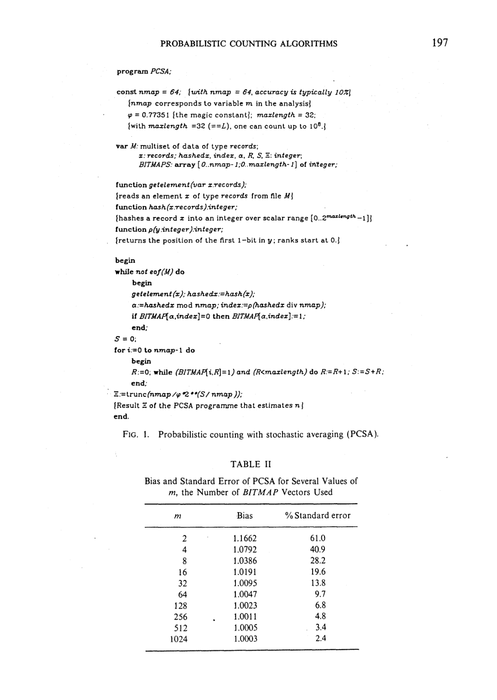
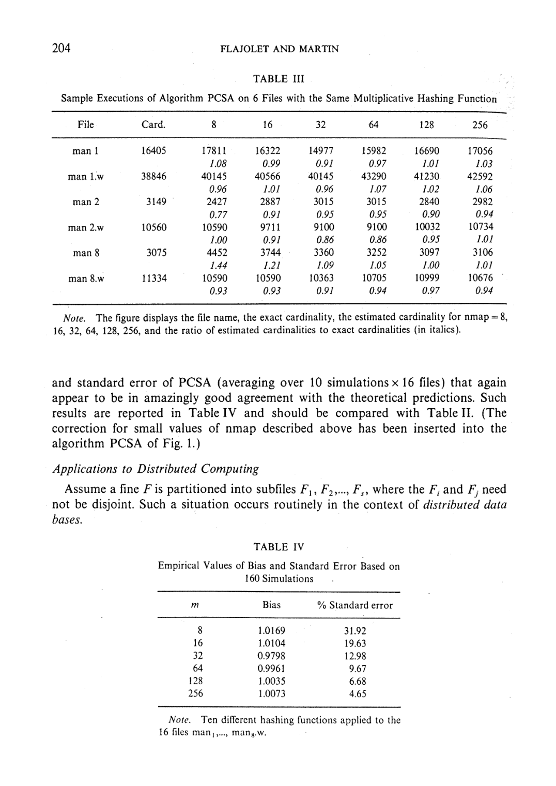

> 本组第 52 篇 · 概率计数与抽样 · [全部论文]() · [上一篇]() · [下一篇]()

本文估计的是不同记录的数量，不是流长度或某键频率。COUNT把每条记录的稳定哈希映成最低有效1的rank，设置位图；用第一个零的位置R指示log2 n。PCSA再用一次哈希分配lot、更新一个位图，以m/φ乘2^(各R平均)估计全局distinct，φ约.77351。

其价值来自小状态、重复幂等和可OR合并，但精度是随机模型下的渐近分布量，不是每次10%误差上界。报告保留小基数、有限hash、位图饱和、重复/删除语义与字长边界，也列出显示hash公式及表III一格比率的局部复现疑问，不将其扩大成所有FM方法错误。复杂解析证明只作有限范围说明，不伪称全部独立验证。

本文保留论文陈述、读者推断与待验证方案的区别；实验数字只适用于原文条件。原文和翻译来自已有 AI 辅助精读报告，已做来源匹配与编辑复核，不等于人工逐项核验或独立实验复现。所有页码均为 PDF 物理页。

## 论文与阅读范围

Philippe Flajolet, G. Nigel Martin. Probabilistic Counting Algorithms for Data Base Applications. Journal of Computer and System Sciences 31 (1985), pp.182-209. 本地28个PDF物理页；印刷页=物理页+181。1983先前结果或1984接收信息不替代本期刊卷年。

[论文集中的原始 PDF](https://algo.inria.fr/flajolet/Publications/FlMa85.pdf) · 本地来源：`probabilistic-counting/probabilistic-counting-algorithms-for-data-base-applications.pdf`，共 28 页。

本篇保留 34 组原文精读和 37 条证据。截图为原始 PDF 的局部页选，不是重新生成的图表；未将整份 PDF 复制到博客。

## 研究问题与适用边界

**Distinct而非到达次数**
同一记录到达一次或百万次，固定hash下都设置同一个pattern位；所以状态依赖不同被哈希值集合，而不是重复频率。目标是以很小辅助空间获得近似distinct cardinality，而非精确集合、频率向量或总记录数。

这种幂等性是确定性的；数值精度则来自对不同记录哈希成均匀独立位串的概率模型。现实有限hash碰撞、记录编码、NULL或字符串相等定义，仍需应用先明确，估计器不替用户决定“同一个值”。

论文既有非平凡解析分析，也有文本文件模拟；报告不把后者抹掉成纯概念文。反过来，所给VAX/Pascal和Unix文本结果也不能充当今天任意数据库列或对抗输入上的验证。

依据：论文陈述；PDF 物理页 4, 5, 22, 23, 25。证据：[FM02](#evidence-fm02), [FM05](#evidence-fm05), [FM16](#evidence-fm16), [FM17](#evidence-fm17), [FM23](#evidence-fm23)。

## 系统架构与数据结构

**COUNT保存完整pattern位图，PCSA保存多张位图**
rho(y)是从最低有效位算起的第一个1的位置，rank从0开始；pattern 0^k1的概率随k按二分衰减。BITMAP[k]记录该pattern是否曾出现。R是从低rank向高rank扫描时第一个零，不是最大见过rank，也不是只存一个max寄存器。

位图低段通常趋于全1，高段趋于全0，中间有fringe。基本R随log2 n移动，但离散较大。直接用m个独立hash各更新一张位图可平均R；PCSA改成一个hash的mod m选lot、div m部分取rho，只更新一张位图以降低每元素工作。

位图数m主要调精度，长度L主要控制截断与容量；记录哈希与编码决定随机模型是否合理。三者不可混为“32位就能无限准确计数”。分布式合并也必须统一m、L、seed、编码及lot/rank映射。

依据：论文陈述；PDF 物理页 4, 15, 21, 24。证据：[FM01](#evidence-fm01), [FM02](#evidence-fm02), [FM03](#evidence-fm03), [FM06](#evidence-fm06), [FM07](#evidence-fm07), [FM10](#evidence-fm10), [FM12](#evidence-fm12), [FM19](#evidence-fm19)。

*原论文 PDF 物理页 16，版权归原作者或出版方。点击图片可查看原尺寸。页面文本中定位到：FIG. 1.；TABLE I1。这是页面定位信息，不表示本次已复核图内所有数据。*

## 核心算法与步骤示例

**一条记录到估计值的路径**
首先规范记录等同性并求稳定hash h(x)。基本COUNT计算k=rho(h)，置BITMAP[k]；PCSA计算a=h mod m，再以rho(h div m)设置第a张位图。所有记录处理完后，对每张图求首零Rj，求S=sum Rj，输出floor((m/φ)·2^(S/m))。

这里平均的是log尺度rank再指数化，不是先求每张基数再算术平均。读者算例R={0,2}时，2^mean(R)=2，mean(2^R)=2.5，二者不同；也不能把2^E[R]与E[2^R]交换来宣布单图无偏。

**边界必须实现，而非照抄伪代码**
原定义rho(0)=L，但数组仅有0..L−1；PCSA中residual也可能为0。清单扫描首零时的边界判断顺序，同样需要内存安全实现先检查索引。报告将零hash、饱和bitmap和空输入守卫列为实现计划，不冒称原清单已经无条件安全。

全空位图Rj=0，未经小基数处理的原式仍约m/φ而非0；偏差修正与初始非线性修正是两件事，不能除一次bias因子后说所有小n准确。

依据：读者推断；PDF 物理页 4, 15, 16, 22。证据：[FM01](#evidence-fm01), [FM03](#evidence-fm03), [FM06](#evidence-fm06), [FM07](#evidence-fm07), [FM09](#evidence-fm09), [FM13](#evidence-fm13), [FM14](#evidence-fm14), [FM15](#evidence-fm15)。

## 正确性、误差界限与局限性

**模型、尺度和渐近范围**
理想模型使R的均值接近log2(φn)，并有很小周期项；R标准差约1.12127，是log尺度量，不是distinct误差1.12%。PCSA的近似bias为1+.31/m，standard error约.78/sqrt(m)。后者是估计值标准差除n，不是对每次结果±10%的确定性约束。

作者的定理按相应渐近条件分析；固定m、较大n的近似不能随意扩展成对任意m,n一致有效。实践段说n/m超过约10到20后渐近均值很近，小基数需另算修正，原文没有给本报告一个可直接宣称已实现的通用小基数算法。

**两处局部复现问题**
按第21页显示的ASCII式(M+N·sum ord(xj)128^j) mod2^L，若L=32，则j≥5项消失；读者已运行abcdeX与abcdeY得到同一结果。此为显示式疑问，未看原Pascal实现或字符遍历方案，不宣布所有FM哈希都有前缀问题。

第23页表III man1.w真基数38846、m=8估计40145，比率却印.96；算术为约1.03344。保留原表和读者计算，需外部版本/勘误核查，不静默修表，也不据单格否定全部模拟。

依据：读者推断；PDF 物理页 5, 15, 21, 22, 23。证据：[FM04](#evidence-fm04), [FM05](#evidence-fm05), [FM08](#evidence-fm08), [FM11](#evidence-fm11), [FM13](#evidence-fm13), [FM14](#evidence-fm14), [FM15](#evidence-fm15), [FM18](#evidence-fm18)。

## 实验设计与结果分析

**作者确实做了文本模拟**
man文件取Unix在线手册章节、以行为记录；man.w改分成五字符块。作者比较真实distinct与PCSA值，并对16文件使用10组变化的乘法hash常数，得到160次模拟的经验bias与standard error。表II是理论，表III示例运行，表IV是160次汇总，三者不应混称同一测量。

表II m=64的bias1.0047、SE9.7%，m=256为1.0011、4.8%；表IV对应m=64经验bias.9961、SE9.67%。bias接近1和standard error小是两个维度，不把9.7%变成所有数据的误差上限。第25页VAX11/780、Berkeley Unix、未优化Pascal版比标准sort通常快约两倍，是作者当时条件的报告，缺少今天复现所需完整代码/编译与计时参数。

读者已运行qa/fm-reader-tests.json中的有限例：bitmap整数47首零4而最大rank5；重复设置幂等；对齐OR等同集中并集；均值/指数区别；空原式非0；pattern计数删除保位；显示hash前缀碰撞及表III比率算术。它们不是随机精度实验、原Pascal重跑或新数据库性能基准。

依据：读者推断；PDF 物理页 4, 15, 21, 22, 23, 24, 25。证据：[FM03](#evidence-fm03), [FM06](#evidence-fm06), [FM08](#evidence-fm08), [FM11](#evidence-fm11), [FM13](#evidence-fm13), [FM16](#evidence-fm16), [FM17](#evidence-fm17), [FM18](#evidence-fm18), [FM19](#evidence-fm19), [FM22](#evidence-fm22), [FM23](#evidence-fm23)。

*原论文 PDF 物理页 23，版权归原作者或出版方。点击图片可查看原尺寸。页面文本中定位到：TABLE I11；TABLE IV。这是页面定位信息，不表示本次已复核图内所有数据。*

## 工程权衡与设计取舍

**空间与准确性，不能只给一个常数**
m扩大通常按1/sqrt(m)降低渐近standard error，却增加位图状态；直接平均每元素做m个hash，而stochastic averaging只更新一个lot。L增大控制高rank截断，与m调离散程度不同。L>log2(n/m)+4是统计尾部建议，不是有限hash永不碰撞、无限流永不饱和的证明。

原位图只记录pattern存在，不能在删除一次后判断是否还有别的记录支持该位。第24页明确提出把位换成出现次数以支持插入删除，代价是更多存储。删除须符合真实有效多重集历史；不能既宣称固定bit空间又悄悄增加无限宽计数器。

scrolling压缩共同1/0区域，只存fringe边界及窗口。大小8是实践建议，不是任意输入和未来删除都无损的普遍保证；合并时也要对齐offset。理论O(m log n) bit、固定机器字实践与压缩窗口估计分别使用不同成本模型。

依据：论文陈述；PDF 物理页 15, 21, 22, 24。证据：[FM06](#evidence-fm06), [FM07](#evidence-fm07), [FM10](#evidence-fm10), [FM12](#evidence-fm12), [FM13](#evidence-fm13), [FM14](#evidence-fm14), [FM15](#evidence-fm15), [FM21](#evidence-fm21), [FM22](#evidence-fm22)。

## 与相关工作的比较

**局部替代与未来算法排名分开**
作者比较了用最右1、最小hash等可观测量的替代方案，并提出更好空间/精度权衡是否可能的问题；并未证明信息论最优，也不能据1985局部分析推出现代所有后续方案都更差。

本算法的bitmap首零统计也不能悄悄替换成其他最大寄存器或harmonic-mean结构而仍称原PCSA。同名count不意味着同任务：此处distinct忽略重复频率，频率摘要则需保留计数信息，接口和误差目标不同。

分布式OR的价值是同一全局hash下，合并摘要与集中处理并集产生相同位状态，允许记录跨分片重叠。它不是把局部distinct标量相加，也不支持任意种子的矩阵直接OR。O(s)是消息数，不等于通信字节为零；s倍加速的作者陈述缺少完整分布式实测条件，不作普遍扩展性保证。

依据：读者推断；PDF 物理页 4, 15, 24, 25。证据：[FM02](#evidence-fm02), [FM03](#evidence-fm03), [FM08](#evidence-fm08), [FM19](#evidence-fm19), [FM20](#evidence-fm20), [FM24](#evidence-fm24)。

## 复现指南与工程落地线索

**先验证位状态，再检验随机误差**
第一步用显式有限键集合和固定toy hash验证rho零基、首零与最大rank区别、重复幂等、OR并集、零hash和饱和边界。现有读者例覆盖部分场景，不证明均匀性。

第二步固定记录编码与hash算法，跨独立种子和多种键分布记录bias、standard error及误差尾部；分开n/m小区间、渐近区间和接近容量的截断。展示式hash须先解决字面前缀问题；没有源代码时不直接宣称复现了原乘法实现。

第三步测试分片重叠、offset对齐、滚动窗口及计数扩展的合法删除。比较排序基线时固定I/O、输入单位、输出精度、编译器与计时范围，不能先预设快两倍。Mellin变换、周期残差界等解析证明需单独逐式核查；本次未独立验证全部推导，也未完成上述随机/原系统复现。

依据：待验证的工程设想；PDF 物理页 4, 5, 16, 21, 22, 24, 25。证据：[FM01](#evidence-fm01), [FM02](#evidence-fm02), [FM03](#evidence-fm03), [FM05](#evidence-fm05), [FM09](#evidence-fm09), [FM10](#evidence-fm10), [FM11](#evidence-fm11), [FM12](#evidence-fm12), [FM15](#evidence-fm15), [FM16](#evidence-fm16), [FM19](#evidence-fm19), [FM21](#evidence-fm21), [FM22](#evidence-fm22), [FM23](#evidence-fm23)。

## 总结与对数据库内核的启示

FM/PCSA把distinct问题转成稳定hash pattern的占据状态，再用首零统计和随机平均在空间、每元素成本与精度间选择。真正可以迁移的是这些机制及其条件，而不是一个脱离hash、小基数和误差分布的“64个计数就永远10%”口号。

本稿增加24段原文精读，保持真实模拟、读者有限测试与未验证的复杂解析证明三个证据层次分开。对显示式hash和单格比率的疑问只作局部记录，原文本与图像都保留；不冒称现代实现或原Pascal程序已经复现。

依据：读者推断；PDF 物理页 4, 5, 15, 21, 22, 23, 25。证据：[FM02](#evidence-fm02), [FM03](#evidence-fm03), [FM05](#evidence-fm05), [FM07](#evidence-fm07), [FM08](#evidence-fm08), [FM11](#evidence-fm11), [FM15](#evidence-fm15), [FM17](#evidence-fm17), [FM18](#evidence-fm18), [FM24](#evidence-fm24)。

## 原文精读：从句子回到机制

以下保留原文、忠实翻译、含义与边界；假设示例不作为论文实验结果。

### P001 · PDF 物理页 2

**原文**

<blockquote class="paper-source-quote"><pre><code>In a number of similar situations, it appears thus that, apart from the sizes of the &#10;files on which one operates (i.e., the number of records), a major determinant of &#10;efficiency is the cardinalities of the underlying sets, i.e., the number of distinct &#10;elements they comprise. &#10;The situation gets much more complex when operations like projections, selec- &#10;tions, multiple joins in combination with various boolean operations appear in &#10;queries.</code></pre></blockquote>

**忠实翻译**

> 在许多类似的情形中，除了所操作文件的大小（即记录数）之外，效率的一个主要决定因素似乎是底层集合的基数，即它们所包含的不同元素的数量。当查询中出现投影、选择、多重连接与各种布尔运算的组合时，情况会变得复杂得多。

**技术含义与边界**

> 原文陈述：在数据库操作中，影响效率的关键因素不仅是输入的记录总数，更是去重后的不同元素数量（基数）。当查询包含投影、选择、多表连接及布尔运算组合时，基数估计问题会显著复杂化。读者推断：这为后续引入概率计数算法提供了动机，因为精确计算基数在复杂查询下代价高昂。适用边界：该论述针对的是需要基数信息的查询场景，未给出具体复杂度公式。

**常见误读**

> 容易将‘效率的主要决定因素是基数’误解为‘文件大小不影响效率’。原文明确使用了‘apart from the sizes of the files... a major determinant’，说明文件大小仍是因素之一，基数是另一个主要决定因素。此外，不应将此处对复杂性的定性描述泛化为对所有查询优化问题的定量保证。

**读者构造的假设示例**

> 读者例：两张百万行表的连接列若均匀落在10个值，等值连接可能产生很大的配对数；若分布倾斜，仅NDV仍不足以确定join结果。基数信息重要，不等于同一NDV就同样优化或耗时。

### P002 · PDF 物理页 28

**原文**

<blockquote class="paper-source-quote"><pre><code>PROBABILISTIC COUNTING ALGORITHMS &#10;209 &#10;ACKNOWLEDGMENTS &#10;The first author would like to express his gratitude to IBM France and the IBM San Jose Research &#10;Laboratory for an invited visit during which his work on the subject was done for a large part. Thanks &#10;are due to M. Schkolnick, Kyu Young Wang (who implemented the method), and R. Fagin for their &#10;support and many stimulating discussions. &#10;Note added in prooj The sequence (-1)“(f’) that occurred repeatedly here is the classical Morse- &#10;Thue sequence.</code></pre></blockquote>

**忠实翻译**

> 此段为致谢：作者感谢IBM访问支持、Kyu Young Wang的实现及其他讨论者。校样附注说反复出现的序列是经典Morse–Thue序列；提取的序列公式损坏，不据乱码重建。

**技术含义与边界**

> 这是背景/校样补注，不是新的算法正确性证明或性能数据。实现者署名与本文提供可执行源代码是两件事。

**常见误读**

> 容易将致谢中提到的‘实现了该方法’误读为论文正文包含了完整的工程实现细节或性能评测报告。原文仅说明有人完成了实现，并未在此处提供实现的代码或实验结果。同时，不应将校样附注中关于 Morse-Thue 序列的提及等同于对该序列在算法中作用的完整数学证明。

**读者构造的假设示例**

> 读者核查问题：若要复现原实现，应另找Pascal代码、记录编码和hash细节，不能只凭致谢确认已复现。

### P003 · PDF 物理页 15

**原文**

<blockquote class="paper-source-quote"><pre><code>It turns out that an effect very similar to straight averaging may be achieved by a &#10;device that we call stochastic averaging. The idea consists in using the hashing &#10;function in order to distribute each record into one of m lots, computing &#10;a = h(x) mod m. We update only the corresponding BITMAP vector of address a &#10;with the “rest” of the information contained in h(x), namely h ( x ) div m E Lh(x)/rn _I.</code></pre></blockquote>

**忠实翻译**

> 作者称随机平均可达到与直接平均很相似的效果：a=h(x) mod m选桶，用剩余信息h(x) div m，即floor(h(x)/m)，更新该BITMAP。

**技术含义与边界**

> 一个hash值分成桶地址和商；当m为2的幂时可视为低位选桶、剩余高位给rho，一条记录只更新一个位图。不等于每条记录执行m次独立hash或m次更新。

**常见误读**

> div是整数除法，不是属于集合的∈符号。随机分桶与摘要误差依赖hash条件；very similar也不应改写为所有参数、高阶矩、置信尾部严格相同。

**读者构造的假设示例**

> 读者构造的假设示例：假设 m=8，哈希函数 h(x) 输出一个整数。若 h(x)=27，则 a = 27 mod 8 = 3，表示分配到第 3 个 BITMAP；用于更新该 BITMAP 的值为 27 div 8 = 3。这样只用了一次哈希计算就完成了分桶和定位。

### P004 · PDF 物理页 21

**原文**

<blockquote class="paper-source-quote"><pre><code>[SI. &#10;2. Length of the BITMAP vector. Since the probability ditribution of the R- &#10;parameter h a s x e r y gteep distribution, &#10;- &#10;it suffices to select L in such a way that &#10;L &gt; log,(n/nmap) -t 4. &#10;(</code></pre></blockquote>

**忠实翻译**

> [SI.
> 2. BITMAP 向量的长度。由于 R-参数的概率分布具有非常陡峭的分布，因此只需选择 L 使得 L > log2(n/nmap) + 4。

**技术含义与边界**

> 物理21页视觉核对了位图长度的实用指导L>log2(n/m)+4。它基于尾部陡峭的分布，不保证任意hash、无限输入或对抗键永不截断。

**常见误读**

> 容易将该公式视为绝对的安全保证，认为只要满足该不等式就绝对不会发生 BITMAP 溢出。原文表述为‘it suffices to select’（足以选择），这是一个基于分布尾部特性的经验/理论指导，且依赖于分布‘非常陡峭’的前提。如果实际数据导致哈希分布偏离假设，该界限可能不足。不应将此局部条件泛化为全局无溢出的保证。

**读者构造的假设示例**

> 读者算术：n=1000000、m=64时右侧约17.93，L=18满足该不等式；仍须实现rho(0)、全1位图和容量不足的显式处理，不能当零风险证明。

### P005 · PDF 物理页 17

**原文**

<blockquote class="paper-source-quote"><pre><code>PCSA: &#10;( 1 + E ( n - 2 ) ) &#10;J w n l &#10;n &#10;]!-here quantities E(m) and q(m) satisfy as m gets large: &#10;n2 y 2 &#10;log2 2 &#10;A=---- &#10;”( o)2 - ”’( 0) + -. &#10;12 &#10;2 &#10;12 &#10;The error terms in Theorem 4 and the no in Theorem 5 are no/ uniform in n7.</code></pre></blockquote>

**忠实翻译**

> 这段提取包含严重公式乱码；可可靠译出的限定是：定理4的误差项和定理5中的n0对m并不一致。具体公式不能从此乱码转写为数学结论。

**技术含义与边界**

> 物理17页讨论对m的渐近量与非一致性。m是随机平均的位图数量，不能把损坏的n7当成新的自定义参数；全文复杂解析证明本次未逐式独立验证。

**常见误读**

> 不一致性针对参数范围，不能把固定m、n增长的结论任意交换成m随n增长，或编造一个O(1/m)完整误差定理。

**读者构造的假设示例**

> 读者问题：若令m不断变大但n/m趋小，小基数偏差已使渐近PCSA近似不适用；不能据0.78/sqrt(m)单式认定误差必持续降低。

### P006 · PDF 物理页 22

**原文**

<blockquote class="paper-source-quote"><pre><code>SimuIat ions &#10;We have conducted fairly extensive simulations of algorithm PCSA applied to &#10;textual data. The files called man,, man,, ..., mans correspond to chapters of the on- &#10;line documantation available on one of our systems, and the versions man,w, &#10;man,w, ...</code></pre></blockquote>

**忠实翻译**

> 模拟
> 我们对应用于文本数据的 PCSA 算法进行了相当广泛的模拟。名为 man,, man,, ..., mans 的文件对应于我们某个系统上可用的在线文档的章节，版本 man,w, man,w, ...

**技术含义与边界**

> 原文陈述：作者说明了他们通过模拟实验验证了 PCSA 算法，实验数据集是系统在线文档（man pages）的各章节文本。读者推断：使用真实文本数据而非纯随机生成的数字，是为了验证算法在实际自然语言词汇分布下的有效性。适用边界：实验结果仅针对这些特定的文本数据文件，原文在此处被截断，未给出模拟的具体指标或结论。

**常见误读**

> 容易将‘应用于文本数据的模拟’泛化为‘算法在所有数据类型上都经过了广泛验证’。原文明确限定了测试对象是‘textual data’（具体为 man pages）。此外，不应从这段引言性质的文字中推断出算法的准确率或性能数值，因为原文未在此处提供结果。

**读者构造的假设示例**

> 原文后续模拟把16个Unix手册/五字符块文件分别用10个hash配置处理，共160组；这是作者有限数据，不是本次运行。表II理论与表IV经验标准误差也应分开，不能把当前读者构造的5000词例冒称原数据。

### P007 · PDF 物理页 16

**原文**

<blockquote class="paper-source-quote"><pre><code>- l;O..marlength- 11 of ihYeger; &#10;function getelement(var z.rec0rd.s); &#10;Ireads an element x of type records from file M j &#10;function hash(x.records).integer; &#10;Ihashes a record z into an integer over scalar range [O..Zmol'm~'h-l]j &#10;function p(y .integer).integer; &#10;{returns the position of the first 1-bit in y ; ranks start at 0.i &#10;begin &#10;rhiIe not eof(M) do &#10;begin &#10;get element (x); hashe&amp;:=hash (2); &#10;a:=hashedx mod nmap; index:=p(hashedz div nmap); &#10;if BITMAqa,indez]=O then BZTMAqa,indez]:= 1 ; &#10;end; &#10;s = 0; &#10;for i:=O to nmap- 1 do &#10;begin &#10;R:=O; while (BITMAqi,R]=1) and (Rtmazlength) do R:=R+l; S : = S + R ; &#10;end; &#10;Z:=trunc(nmap /cp 2 **(S/ &#10;nmap)); &#10;fResuIt Z of the PCSA programme that estimates nl &#10;end.</code></pre></blockquote>

**忠实翻译**

> 伪代码的可辨识流程：读记录、hash，以mod nmap选桶，以商的首个1位置rho选位并置1；各桶扫描首个0得到R，累加S，再用trunc((m/phi)*2^(S/m))估计。标识符和排版损坏不作逐字符代码译本。

**技术含义与边界**

> phi为正文校正常数约0.77351，不是另一套未知参数cp。rho查首个1与最终位图首个0是不同操作。实际程序须定义零hash、有效bit宽度和空/小基数修正。

**常见误读**

> 原扫描条件先写BITMAP[i,R]再写R<maxlength；若语言不保证安全求值或已到数组外，仅有后面的条件未必能防越界。实现应先检查边界再读数组，不能因出现条件就声称已安全。

**读者构造的假设示例**

> 读者例：m=2、hash5与11都落桶1，商2与5分别置位1与0，桶1首零R=2，空桶0的R=0；均值R=1。该例演示状态，不测试hash均匀性或小n准确率。

### P008 · PDF 物理页 15

**原文**

<blockquote class="paper-source-quote"><pre><code>This observation justifies the hope of obtaining very good estimates on n from the &#10;observation of parameter R, using the correction factor q‘ However, the dispersion &#10;of results corresponds to a typical error of 1 binary order of magnitude which is &#10;certainly too high for many applications. &#10;The simplest idea to remedy this situation consists in using a set H of m hashing &#10;functions, where m is a design parameter and computing m different BITMAP vec- &#10;tors.</code></pre></blockquote>

**忠实翻译**

> 这一观察证明了通过观察参数 R 并使用校正因子 q 来获得关于 n 的非常好的估计的希望是合理的。然而，结果的离散程度对应于 1 个二进制数量级的典型误差，这对于许多应用来说肯定太高了。
> 改善这种情况的最简单想法是使用一组包含 m 个哈希函数的集合 H，其中 m 是一个设计参数，并计算 m 个不同的 BITMAP 向量。

**技术含义与边界**

> 单R的离散程度在二进制log尺度很大，随机平均是降低典型误差的路线。E[R]的常数校正与E[2^R]不能互换，典型一个二进制数量级也不是确定置信区间。

**常见误读**

> 容易将‘1 个二进制数量级的典型误差’误解为‘绝对误差为 1’。原文指的是相对误差在 2^1 倍左右（即误差范围跨越一个 2 的幂次）。此外，不应将‘最简单想法’等同于‘最终采用的方案’，结合 P003 可知，作者最终采用了更巧妙的随机平均技术，而不是真的维护 m 个独立哈希函数。

**读者构造的假设示例**

> 读者说明：两桶R为0和2，2^(平均R)=2，而平均(2^R)=2.5；先平均再指数化不能写成平均各桶估计。m=64渐近标准误差约9.7%，不是确定落在真值±5%。

### P009 · PDF 物理页 28

**原文**

<blockquote class="paper-source-quote"><pre><code>G. DOETSCH, &#10;“Handbuch der Laplace-Transformation,” Birkhauser, Basel, 1950. &#10;‘2. P. FLAJOLET, Approximate counting: A detailed analysis, BIT 25 (1989, 113-134. &#10;3. P. FLAJOLEX &#10;AND N. MARTIN, Probabilistic counting, in “Proc. 24th IEEE Sympos. Foundations of &#10;4. D. E.</code></pre></blockquote>

**忠实翻译**

> 这是参考文献片段，列出Doetsch的拉普拉斯变换手册、Flajolet的近似计数分析及Flajolet–Martin会议论文；条目年份和公式受提取损坏，不据乱码补齐。

**技术含义与边界**

> 条目只是来源导航，不是当前段落提供的变换推导或算法结论。本次没有独立读这些外部引用。

**常见误读**

> 引用标题不能代替本文证据或已完成证明；不从片段年份乱码推出发表顺序。

**读者构造的假设示例**

> 读者后续任务：若要核验Mellin推导，先定位正文实际调用的引理，再读对应参考，而不是据标题猜用途。

### P010 · PDF 物理页 22

**原文**

<blockquote class="paper-source-quote"><pre><code>For a practical &#10;use of the algorithm, it suffices to use the estimates of Theorem 5, which one &#10;achieves by changing the last instruction of the programme to &#10;E := trunc(nmap/(q*( 1 + 0.31/nmap))*2**(S/nmap)). &#10;In so doing, we obtain an algorithm which apart from the small periodic fluc- &#10;tuations of amplitude less than &#10;is an asymptotically unbiased estimator of car- &#10;dinali ties n.</code></pre></blockquote>

**忠实翻译**

> 对于算法的实际使用，只需使用定理 5 的估计值，通过将程序的最后一条指令更改为
> E := trunc(nmap/(q*( 1 + 0.31/nmap))*2**(S/nmap)) 即可实现。
> 这样做，我们就得到了一个算法，除了振幅小于 [缺失] 的微小周期性波动外，它是基数 n 的渐近无偏估计量。

**技术含义与边界**

> 有限m偏差修正把估计除以1+0.31/m；正文的渐近与周期残差限定仍在。系数近似不是所有n/m区间严格无偏，更不是每次结果精确。

**常见误读**

> 容易将‘渐近无偏估计量’误解为‘在任何情况下都没有误差’。原文明确指出存在‘微小的周期性波动’（small periodic fluctuations），且‘渐近’一词意味着这是在 n 趋于无穷大时的统计性质。此外，由于原文截断了振幅的具体数值，绝不能自行编造一个数字（如 0.01）来填补空白。也不能将该校正公式的有效性泛化到 nmap 极小（如 nmap=1）的极端情况，因为 0.31/nmap 的推导依赖于一定的 m 值前提。

**读者构造的假设示例**

> 读者算术：m64时1+0.31/m≈1.004844，m256约1.001211；表中渐近bias有舍入。实际n小、空输入或位图截断时，不能单靠这项补偿就获得同样误差。

### FM-REVIEW-01 · PDF 物理页 4

**原文**

<blockquote class="paper-source-quote"><pre><code>Thus ranks are numbered starting from zero.</code></pre></blockquote>

**忠实翻译**

> rank从0开始。

**技术含义与边界**

> rho是最低有效1的位置；bitmap记录每种rank是否出现。

**常见误读**

> 不是最大rank寄存器，也不是把rank从1开始后仍用同一常数。

**读者构造的假设示例**

> 读者例：二进制1000的rho为3。

### FM-REVIEW-02 · PDF 物理页 4

**原文**

<blockquote class="paper-source-quote"><pre><code>BITMAP only depends on the set of hashed values and not on the particular &#10;frequency with which such values may repeat themselves.</code></pre></blockquote>

**忠实翻译**

> BITMAP只依赖被哈希值的集合，不依赖它们重复出现的频率。

**技术含义与边界**

> 固定哈希下重复不改变位图，这是确定性幂等性质；估计准确性另依赖随机模型。

**常见误读**

> 重复不敏感不等于精确去重或任意哈希都无偏。

**读者构造的假设示例**

> 读者例：同一个键重复一百万次仍设置同一个pattern位。

### FM-REVIEW-03 · PDF 物理页 4

**原文**

<blockquote class="paper-source-quote"><pre><code>We propose to use the position of the leftmost zero in BITMAP (ranks start at 0) &#10;as an indicator of log,n.</code></pre></blockquote>

**忠实翻译**

> 用BITMAP中最左侧零的位置，rank从0开始，作为log2 n的指示量。

**技术含义与边界**

> 在图的低rank到高rank排列中，R是第一个零，不是最右的1。

**常见误读**

> 不能把FM bitmap悄悄换成HLL最大寄存器后继续称同一算法。

**读者构造的假设示例**

> 已运行读者例：位图整数47的首零R=4，而见过的最大rank为5。

### FM-REVIEW-04 · PDF 物理页 5

**原文**

<blockquote class="paper-source-quote"><pre><code>the standard deviation of R &#10;is close to &#10;(2) &#10;rT(R)z 1.12 &#10;so that an estimate based on (1) will fVpicallv be o_ne binary order of magnitude off &#10;the exact result,</code></pre></blockquote>

**忠实翻译**

> R的标准差约1.12，所以按基本式得到的估计通常可差一个二进制数量级。（引文保留损字。）

**技术含义与边界**

> 1.12是对log尺度R的标准差，不是基数误差1.12%。

**常见误读**

> 一个位图的估计离散较大，需要平均等改进；不能据单例接近真值证明普遍精度。

**读者构造的假设示例**

> 读者例：R差1会把2^R翻倍。

### FM-REVIEW-05 · PDF 物理页 5

**原文**

<blockquote class="paper-source-quote"><pre><code>bits of elements of B are uniformly and independently dis- &#10;tributed.</code></pre></blockquote>

**忠实翻译**

> 模型假设二进制串各位均匀且独立分布。

**技术含义与边界**

> 不同distinct记录按理想独立均匀串分析，重复记录复用同一哈希。

**常见误读**

> 真实有限哈希、编码与对抗输入并不自动满足这个模型。

**读者构造的假设示例**

> 读者例：不同大小写是否同键要先规范，不能靠估计器决定语义。

### FM-REVIEW-06 · PDF 物理页 15

**原文**

<blockquote class="paper-source-quote"><pre><code>using direct averaging has indeed provably good performances &#10;(with an expected relative error of about 10% if m = 64) but it has the disadvantage &#10;of requiring the calculation of a number of hashing functions, so that the CPU cost &#10;per element scanned gets essentially multiplied by a factor of m.</code></pre></blockquote>

**忠实翻译**

> 直接平均有良好分析性质，m=64时典型相对误差约10%，但每个元素需算多个哈希，CPU成本约乘m。

**技术含义与边界**

> 先对m个R平均再指数变换，与先各自求基数再算均值不同。

**常见误读**

> 期望/指数不能随意交换；这里10%不是每次结果的最大误差。

**读者构造的假设示例**

> 读者例：R为0、2时，2^mean(R)=2，而mean(2^R)=2.5。

### FM-REVIEW-07 · PDF 物理页 15

**原文**

<blockquote class="paper-source-quote"><pre><code>a = h(x) mod m. We update only the corresponding BITMAP vector of address a &#10;with the “rest” of the information contained in h(x), namely h ( x ) div m</code></pre></blockquote>

**忠实翻译**

> 用hash(x) mod m选择一个lot，只更新该lot位图，并用hash(x) div m剩余部分计算pattern。

**技术含义与边界**

> stochastic averaging每个元素只做一次哈希、更新一个位图，lot数随机而非精确n/m。

**常见误读**

> 不能用同一批位既选桶又毫无区分地当pattern值，或声称每桶恰好一样多。

**读者构造的假设示例**

> 读者例：同一键在所有站点须选相同lot和residual rank，才能合并。

### FM-REVIEW-08 · PDF 物理页 15

**原文**

<blockquote class="paper-source-quote"><pre><code>we shall &#10;call standard error the quotient of the standard deviation of an estimate of n by the &#10;value of n; this quantity is thus a precise indication of the expected relative accuracy &#10;of an algorithm estimating n.</code></pre></blockquote>

**忠实翻译**

> standard error定义为估计n的标准差除以n，表示相对离散程度。

**技术含义与边界**

> 这是跨随机哈希的分布量，与bias比率分开。

**常见误读**

> 不能把standard error10%说成所有结果都在±10%。

**读者构造的假设示例**

> 读者例：偏差小但方差大仍可能偶尔估得很远。

### FM-REVIEW-09 · PDF 物理页 16

**原文**

<blockquote class="paper-source-quote"><pre><code>Z:=trunc(nmap /cp 2 **(S/ &#10;nmap));</code></pre></blockquote>

**忠实翻译**

> 结果Z取整为(nmap/φ)乘2^(S/nmap)。（原清单损字和换行保留，公式按原图核对。）

**技术含义与边界**

> S为各位图首零rank之和，φ=.77351。

**常见误读**

> 全空时S=0原式仍为约m/φ，不会自动返回0；需小基数策略。

**读者构造的假设示例**

> 读者例：空输入的原式不能仅因处理了零条记录就推断结果为零。

### FM-REVIEW-10 · PDF 物理页 21

**原文**

<blockquote class="paper-source-quote"><pre><code>There are three factors to be taken into account when applying algorithm PCSA: &#10;(i) The choice of the hashing function. &#10;(ii) The choice of the length of the BITMAP-vectors, L. &#10;(iii) The number, nmap, of BITMAP used (corresponding to quantity m in &#10;our analyses),</code></pre></blockquote>

**忠实翻译**

> 应用PCSA需考虑哈希选择、位图长度L、位图数量nmap；nmap对应分析中的m。

**技术含义与边界**

> 容量、随机质量与精度是不同工程旋钮。

**常见误读**

> 32位hash不等于无限范围无碰撞精确NDV，固定m也不等于误差随n任意都同样。

**读者构造的假设示例**

> 读者例：增加L防截断，与增加m降低标准误差不是同一操作。

### FM-REVIEW-11 · PDF 物理页 21

**原文**

<blockquote class="paper-source-quote"><pre><code>a record x = (xo, x, ,..., x p ) &#10;formed of ASCII characters is hashed into &#10;P &#10;M + N &#10;ord(xj) 128j &#10;j = O &#10;with ord(x) denoting the (standard ASCII</code></pre></blockquote>

**忠实翻译**

> 文本记录为ASCII字符序列，按所示乘法散列式转换，ord为标准ASCII编码。（原式文本层不完整，已按图像核对。）

**技术含义与边界**

> 显示式(M+N sum ord(xj)128^j) mod2^L存在一个字面复现问题：当L=32，j≥5的项全被模数消掉。

**常见误读**

> 仅针对展示式提出疑问，未检查Pascal实现，也不代表所有FM哈希都丢后缀。

**读者构造的假设示例**

> 已运行读者例：abcdeX/abcdeY在M=12345,N=6789,L=32均得2751033758；相同前缀的高位项消失。

### FM-REVIEW-12 · PDF 物理页 21

**原文**

<blockquote class="paper-source-quote"><pre><code>it suffices to select L in such a way that &#10;L &gt; log,(n/nmap) -t 4. &#10;(41 1</code></pre></blockquote>

**忠实翻译**

> 选择L满足L>log2(n/nmap)+4。（原式文本层有损，按原页核对。）

**技术含义与边界**

> 这是控制位图统计截断尾部的长度建议，理想分析默认无限L。

**常见误读**

> 不等于保证所有记录的有限哈希永不碰撞或绝不低估。

**读者构造的假设示例**

> 读者例：相同hash的不同键仍不可由加长bitmap中的未使用位区分。

### FM-REVIEW-13 · PDF 物理页 22

**原文**

<blockquote class="paper-source-quote"><pre><code>nmap = 64 leads to a standard error of about 10 YO, &#10;and with nmap = 256, thisi &#10;error decreases to about 5 %, (see Table 11).</code></pre></blockquote>

**忠实翻译**

> nmap=64时标准误差约10%，nmap=256时约5%，见表II。

**技术含义与边界**

> 表II理论值分别9.7%、4.8%，bias分别1.0047、1.0011；两列不能混算。

**常见误读**

> 不是64个位总空间或256个元素容量，而是位图数量。

**读者构造的假设示例**

> 读者例：m扩大4倍，标准误差近似减半，不能说任意单次误差也必减半。

### FM-REVIEW-14 · PDF 物理页 22

**原文**

<blockquote class="paper-source-quote"><pre><code>If smaller values of nmap &#10;are to be used, it can be corrected using the results of Theorems 4, 5.</code></pre></blockquote>

**忠实翻译**

> 若使用更小nmap，可用定理4、5修正bias。

**技术含义与边界**

> 1+0.31/m的系统偏差修正与初始小n/m非线性是两种不同修正。

**常见误读**

> 除一次bias因子不自动让空输入和极小基数准确。

**读者构造的假设示例**

> 读者例：零个元素的原式仍需单独处理，不能用渐近无偏标签遮住。

### FM-REVIEW-15 · PDF 物理页 22

**原文**

<blockquote class="paper-source-quote"><pre><code>as soon as nlnmap &#10;exceeds 10-20.</code></pre></blockquote>

**忠实翻译**

> 当n/nmap超过约10到20时，渐近估计已很接近实际均值。（提取层斜杠损为字母。）

**技术含义与边界**

> 这是实践有效范围提示，不是对所有m,n统一的确定性误差界。

**常见误读**

> 不能把较大m与很小n组合也不加修正地套渐近数值。

**读者构造的假设示例**

> 读者例：m=256、n=10并不处于这一大n/m区域。

### FM-REVIEW-16 · PDF 物理页 22

**原文**

<blockquote class="paper-source-quote"><pre><code>We counted in each case the number of different records and compared &#10;with corresponding values estimated by algorithm PCSA (here, a record is a line of &#10;text for man, ,... and a 5 letter block for man, w, ...).</code></pre></blockquote>

**忠实翻译**

> 作者对每个文件数真实distinct记录，与PCSA估计比较；man文件以行为记录，man.w以五字符块为记录。

**技术含义与边界**

> 记录单位决定基数，不能拿字节数、行数和五字符块数混比。

**常见误读**

> 这不是今天任意日志或数据库列的性能样本。

**读者构造的假设示例**

> 读者例：同一文本拆成行或固定块，会对应不同distinct任务。

### FM-REVIEW-17 · PDF 物理页 23

**原文**

<blockquote class="paper-source-quote"><pre><code>averaging over 10 simulations x 16 files) that again &#10;appear to be in amazingly good agreement with the theoretical predictions. Such &#10;results are reported in Table IV</code></pre></blockquote>

**忠实翻译**

> 按10次模拟乘16个文件平均，得到经验bias与standard error，报告于表IV。

**技术含义与边界**

> 表IV是160次模拟汇总，表II是理论；不能颠倒成两组独立实测。

**常见误读**

> 十个hash作用同一组文件也不能泛化为所有现实数据的置信保证。

**读者构造的假设示例**

> 读者例：m=64表IV bias=.9961、SE=9.67%，注明样本和哈希变化。

### FM-REVIEW-18 · PDF 物理页 23

**原文**

<blockquote class="paper-source-quote"><pre><code>man 1.w &#10;38846 &#10;40145 &#10;0.96</code></pre></blockquote>

**忠实翻译**

> 表III该行印为man1.w，真基数38846，m=8估计40145，斜体比率0.96。

**技术含义与边界**

> 图像核对后按数值算40145/38846≈1.03344，并不是.96，是局部算术张力。

**常见误读**

> 不能静默把原表改成正确比率，也不能据一格否定全部160次结果。

**读者构造的假设示例**

> 读者算术记录与原表并存，需外部版本或勘误进一步核查。

### FM-REVIEW-19 · PDF 物理页 24

**原文**

<blockquote class="paper-source-quote"><pre><code>computes the logical or of the s BITMAPs. The &#10;resulting BITMAP vector is then used to construct the estimate of n.</code></pre></blockquote>

**忠实翻译**

> 中央处理器对各位图作逻辑OR，再用结果位图构造n的估计。

**技术含义与边界**

> 相同hash、lot、位图长度与编码下，OR等于集中处理并集的sketch，允许分片重叠。

**常见误读**

> 不能把局部NDV标量相加或合并不同种子的摘要。

**读者构造的假设示例**

> 已运行读者例：两个重叠集合的位图OR等于集中集合位图，而局部distinct相加会重复计。

### FM-REVIEW-20 · PDF 物理页 24

**原文**

<blockquote class="paper-source-quote"><pre><code>The number of &#10;messages exchanged is small (being O(s)), and the algorithm results in a net speed- &#10;up by a factor of s.</code></pre></blockquote>

**忠实翻译**

> 消息数小，为O(s)；作者称带来s倍净加速。

**技术含义与边界**

> 消息数量不等于字节数为零，线性加速也依赖处理负载与合并通信条件。

**常见误读**

> 本文未给完整分布式测量配置，不能把此句升级为任意集群实测线性扩展。

**读者构造的假设示例**

> 读者例：一个分片拿走几乎所有记录时，其他处理器空闲，不能从OR性质推出理想均衡加速。

### FM-REVIEW-21 · PDF 物理页 24

**原文**

<blockquote class="paper-source-quote"><pre><code>For practical pruposes, a window of size 8 should suf- &#10;fice,</code></pre></blockquote>

**忠实翻译**

> 实践中大小为8的window应当足够。

**技术含义与边界**

> scrolling保留共同前缀边界和fringe编码，是实践压缩建议。

**常见误读**

> 不能断言8位窗口对所有输入、所有未来删除序列都无损足够。

**读者构造的假设示例**

> 读者例：合并滚动位图还要对齐offset，不是直接对任意8位整数OR。

### FM-REVIEW-22 · PDF 物理页 24

**原文**

<blockquote class="paper-source-quote"><pre><code>one also keeps the counts of such occurrences, one obtains an algorithm that &#10;can maintain running estimates of cardinalities of files subjected to arbitrary &#10;sequences of insertions and deletions. The price to be paid is however a somewhat &#10;increased storage cost.</code></pre></blockquote>

**忠实翻译**

> 若不仅存pattern出现位，还存次数，可维护任意插入删除序列下的运行估计，代价是更多存储。

**技术含义与边界**

> 原文确有删除扩展，plain bitmap本身无法判断何时清某个共享pattern位。

**常见误读**

> 不能声称论文完全没考虑删除，也不能把计数扩展仍算原固定bit开销。

**读者构造的假设示例**

> 已运行读者例：同pattern有两次贡献，删除一次后count仍1，位不能清零；删除必须匹配有效历史。

### FM-REVIEW-23 · PDF 物理页 25

**原文**

<blockquote class="paper-source-quote"><pre><code>On a VAX 11/780 running Berkeley Unix, a non-optimised ver- &#10;sion in Pascal used for our tests is already typically twice as fast as the standard &#10;system sorting routine.</code></pre></blockquote>

**忠实翻译**

> 在运行Berkeley Unix的VAX11/780上，测试用未优化Pascal版通常已比标准排序例程快约两倍。

**技术含义与边界**

> 这是特定年代、代码与比较对象的作者报告，不是现代数据库结果。

**常见误读**

> 20到30条汇编指令的前句也是粗略估计，不是跨架构实测计数。

**读者构造的假设示例**

> 读者复现须找原代码/编译配置、输入、I/O和计时方式，不填缺失参数。

### FM-REVIEW-24 · PDF 物理页 25

**原文**

<blockquote class="paper-source-quote"><pre><code>whether appreciably better storagelaccuracy &#10;eade-offs can be achieved (or to prove that this is not possible from an infor- &#10;ma tion-t heoretic standpoint ).</code></pre></blockquote>

**忠实翻译**

> 是否能显著改善空间/精度权衡，或从信息论角度证明不可能，值得研究。（摘录从句中开始。）

**技术含义与边界**

> 最优性仍为开放问题，作者没有证明所有未来算法都比PCSA差。

**常见误读**

> 不能将讨论右most-bit/minhash等变体的局部比较扩成HLL或所有后续算法的排名。

**读者构造的假设示例**

> 读者例：比较新方案须统一误差、空间模型、hash及输入约束。

## 尚未解决的问题

1. 显示ASCII hash式的高位截断是否有原Pascal实现或正式勘误可解释？本次未核查。
2. 表III局部比率不一致是否存在更正版本？
3. 实际实现如何处理零hash、空输入、小n/m和bitmap饱和？
4. 完整Mellin/残差证明与关于m的渐近范围仍需独立逐式复核。

## 证据索引

证据编号沿用原报告，便于将上文判断追溯到原句。引文匹配只验证位置，不证明解读正确。

**C001N01 · PDF 物理页 2**

问题：在数据库查询优化中，评估策略（如排序后合并求交集）的代价取决于文件记录数a,b以及底层集合的不同元素基数α,β。精确去重需要O(a)或O(a log a)的磁盘访问和辅助存储，代价可能超过利用该信息带来的收益。因此需要一种低开销的基数估计方法。适用边界：面向大型磁盘文件或分布式系统中的多集基数估计。

<blockquote class="paper-source-quote"><pre><code>a major determinant of efficiency is the cardinalities of the underlying sets, i.e., the number of distinct elements they comprise.</code></pre></blockquote>

**C002N01 · PDF 物理页 15**

PCSA 算法的核心机制是 stochastic averaging：使用一个哈希函数将记录分配到 m 个桶中（a = h(x) mod m），仅更新对应地址 a 的 BITMAP 向量，使用的哈希信息为 h(x) div m。最终对 m 个桶的 R 值求平均 A，并用 (1/φ)2^A 作为基数 n 的估计。该机制避免了直接平均需要计算 m 个独立哈希函数导致 CPU 成本乘以 m 的问题，其每个扫描元素的处理代价与单次 COUNT 过程几乎无异。

<blockquote class="paper-source-quote"><pre><code>The idea consists in using the hashing function in order to distribute each record into one of m lots, computing a = h(x) mod m.</code></pre></blockquote>

**C002N02 · PDF 物理页 15**

单次 COUNT 过程的输出 R_n 的期望接近 log_2(φn)，标准差约为 1.12。这意味着典型误差达到 1 个二进制数量级（即相对误差极大），对于许多应用而言过高。因此必须引入多路平均（m 个 BITMAP）来降低方差。理论表明，当有 n 个不同元素时，平均值 A 的标准差为 σ_m / sqrt(m)，从而相对误差按 0.78/sqrt(m) 缩放。

<blockquote class="paper-source-quote"><pre><code>the dispersion of results corresponds to a typical error of 1 binary order of magnitude which is certainly too high for many applications.</code></pre></blockquote>

**C002N03 · PDF 物理页 16**

Fig. 1 给出了 PCSA 的 Pascal 伪代码。数据结构为一个二维数组 BITMAPS[0..nmap-1, 0..maxlength-1]。算法遍历输入流，对每个元素 x 计算 hashedx := hash(x)，取 a := hashedx mod nmap 确定桶索引，取 index := p(hashedx div nmap) 确定位位置（p 返回第一个 1-bit 的位置，从 0 开始）。若该位为 0 则置 1。最后遍历所有桶计算连续前导 1 的长度 R，累加得到 S，最终估计值 Z := trunc(nmap / cp * 2**(S/nmap))，其中 cp=0.77351。

<blockquote class="paper-source-quote"><pre><code>a:=hashedx mod nmap; index:=p(hashedz div nmap); if BITMAqa,indez]=O then BZTMAqa,indez]:= 1 ;</code></pre></blockquote>

**C002N07 · PDF 物理页 17**

定理 4 和 5 中的误差项并非关于 n 一致成立（'no/ uniform in n'，原文疑为 not uniform in n 的 OCR 错误）。这意味着渐近展开的有效性可能依赖于 n 相对于 m 的增长速率。此外，第 4 节指出，当 n/nmap 小于 10-20 时，渐近估计与实际平均值存在初始非线性偏差。对于极小基数的估计，不能直接使用渐近公式，而需要基于精确概率分布计算修正项。

<blockquote class="paper-source-quote"><pre><code>The error terms in Theorem 4 and the no in Theorem 5 are no/ uniform in n7.</code></pre></blockquote>

**C002N08 · PDF 物理页 22**

针对偏差的工程修正：当 nmap > 32 时，Bias 相比 Standard error 可忽略；若使用较小的 nmap，可通过修改最终计算公式来消除一阶偏差。具体做法是将原公式中的除数 cp 替换为 cp * (1 + 0.31/nmap)。这使得算法在忽略极小振幅周期波动的前提下成为渐近无偏估计器。该修正是基于 Theorem 5 中大 m 渐近展开 bias ≈ 1 + 0.31/m 得出的。

<blockquote class="paper-source-quote"><pre><code>E := trunc(nmap/(q*( 1 + 0.31/nmap))*2**(S/nmap)).</code></pre></blockquote>

**C002N09 · PDF 物理页 21**

BITMAP 向量长度 L 的选择基于 R 参数具有极陡峭尾部分布的观察。为保证截断引入的误差低于 5×10^{-5}（原文 'below 5 * ' 后缺失数字，但上下文明示极小），需满足 L > log_2(n/nmap) + 4。例如 nmap=64 时，L=16 可安全计数至 n≈10^5，L=24 可计数远超 10^7。理论模型假设 L 无限大，有限 L 会因无法记录更大的 R 值而产生低估，但该不等式确保了此概率极低。

<blockquote class="paper-source-quote"><pre><code>it suffices to select L in such a way that L &gt; log,(n/nmap) -t 4.</code></pre></blockquote>

**C002N10 · PDF 物理页 22**

实验环境使用了文本文件 man_1 到 man_8 及其 5 字符分块版本 man_i.w，共 16 个文件。哈希函数为标准乘法哈希（将 ASCII 字符视为 128 进制数映射到 [M, M+N]）。Table III 展示了 6 个文件在不同 nmap（8 到 256）下的真实基数（Card.）、PCSA 估计值及比值。例如 man_1 真实基数 16405，nmap=64 时估计 16690（比值 1.01）。Table IV 汇总了 160 次模拟（10 种哈希 × 16 文件）的经验 Bias 和 Standard error，与 Table II 理论值高度吻合。

<blockquote class="paper-source-quote"><pre><code>We have conducted fairly extensive simulations of algorithm PCSA applied to textual data.</code></pre></blockquote>

**C003N01 · PDF 物理页 28**

致谢中明确指出Kyu Young Wang实现了本文所述方法，表明该概率计数算法在论文发表前已有工程实现，且工作部分完成于作者受邀访问IBM France和IBM San Jose Research Laboratory期间。这为后续数据库基数估计的工程落地提供了历史线索。

<blockquote class="paper-source-quote"><pre><code>Thanks are due to M. Schkolnick, Kyu Young Wang (who implemented the method), and R. Fagin for their support</code></pre></blockquote>

**C003N03 · PDF 物理页 28**

参考文献[2]列出P. Flajolet发表于BIT 25卷的'Approximate counting: A detailed analysis'，这是Flajolet对近似计数进行详细数学分析的独立工作，与本文的概率计数主题直接相关，但当前来源未提供其具体结论或复杂度数字。

<blockquote class="paper-source-quote"><pre><code>P. FLAJOLET, Approximate counting: A detailed analysis, BIT 25 (1989, 113-134.</code></pre></blockquote>

**C003N05 · PDF 物理页 28**

参考文献[6]引用R. Morris关于在小寄存器中计数大量事件的工作（Comm. ACM 21, 1978, 840-842）。Morris计数是概率计数的早期基础方法，本文的概率计数算法可视为对其的扩展，但当前页面未展开两者的技术对比。

<blockquote class="paper-source-quote"><pre><code>R. MORRIS, Counting large numbers of events in small registers, Comm. ACM 21 (1978), 840-842.</code></pre></blockquote>

**C003N07 · PDF 物理页 28**

参考文献[7]引用Munro与Spira关于多重集排序与搜索的工作（SIAM J. Comput. 5, No. 1, 1976, 1-8），参考文献[5]引用Lum等人关于键到地址转换的研究（Comm. ACM 14, 1971, 228-239）。这些引用暗示概率计数与哈希、去重及多重集操作存在理论关联。

<blockquote class="paper-source-quote"><pre><code>I. MUNRO AND P. SPIRA, Sorting and searching in multisets, SIAM J. Compur 5, No. 1 (1976), 1-8.</code></pre></blockquote>

**C003N08 · PDF 物理页 28**

当前提供的材料仅为致谢和参考文献列表，不包含任何正文中的算法定义、数据结构、不变量、代价分析或实验结果。无法从中提取排序启发式、剪枝策略、正确性证明或完备性讨论等技术证据。所有技术细节需查阅论文正文。

<blockquote class="paper-source-quote"><pre><code>PROBABILISTIC COUNTING ALGORITHMS 209 ACKNOWLEDGMENTS</code></pre></blockquote>

**FM01 · PDF 物理页 4**

rho是最低有效1的位置；bitmap记录每种rank是否出现。 不是最大rank寄存器，也不是把rank从1开始后仍用同一常数。

<blockquote class="paper-source-quote"><pre><code>Thus ranks are numbered starting from zero.</code></pre></blockquote>

**FM02 · PDF 物理页 4**

固定哈希下重复不改变位图，这是确定性幂等性质；估计准确性另依赖随机模型。 重复不敏感不等于精确去重或任意哈希都无偏。

<blockquote class="paper-source-quote"><pre><code>BITMAP only depends on the set of hashed values and not on the particular &#10;frequency with which such values may repeat themselves.</code></pre></blockquote>

**FM03 · PDF 物理页 4**

在图的低rank到高rank排列中，R是第一个零，不是最右的1。 不能把FM bitmap悄悄换成HLL最大寄存器后继续称同一算法。

<blockquote class="paper-source-quote"><pre><code>We propose to use the position of the leftmost zero in BITMAP (ranks start at 0) &#10;as an indicator of log,n.</code></pre></blockquote>

**FM04 · PDF 物理页 5**

1.12是对log尺度R的标准差，不是基数误差1.12%。 一个位图的估计离散较大，需要平均等改进；不能据单例接近真值证明普遍精度。

<blockquote class="paper-source-quote"><pre><code>the standard deviation of R &#10;is close to &#10;(2) &#10;rT(R)z 1.12 &#10;so that an estimate based on (1) will fVpicallv be o_ne binary order of magnitude off &#10;the exact result,</code></pre></blockquote>

**FM05 · PDF 物理页 5**

不同distinct记录按理想独立均匀串分析，重复记录复用同一哈希。 真实有限哈希、编码与对抗输入并不自动满足这个模型。

<blockquote class="paper-source-quote"><pre><code>bits of elements of B are uniformly and independently dis- &#10;tributed.</code></pre></blockquote>

**FM06 · PDF 物理页 15**

先对m个R平均再指数变换，与先各自求基数再算均值不同。 期望/指数不能随意交换；这里10%不是每次结果的最大误差。

<blockquote class="paper-source-quote"><pre><code>using direct averaging has indeed provably good performances &#10;(with an expected relative error of about 10% if m = 64) but it has the disadvantage &#10;of requiring the calculation of a number of hashing functions, so that the CPU cost &#10;per element scanned gets essentially multiplied by a factor of m.</code></pre></blockquote>

**FM07 · PDF 物理页 15**

stochastic averaging每个元素只做一次哈希、更新一个位图，lot数随机而非精确n/m。 不能用同一批位既选桶又毫无区分地当pattern值，或声称每桶恰好一样多。

<blockquote class="paper-source-quote"><pre><code>a = h(x) mod m. We update only the corresponding BITMAP vector of address a &#10;with the “rest” of the information contained in h(x), namely h ( x ) div m</code></pre></blockquote>

**FM08 · PDF 物理页 15**

这是跨随机哈希的分布量，与bias比率分开。 不能把standard error10%说成所有结果都在±10%。

<blockquote class="paper-source-quote"><pre><code>we shall &#10;call standard error the quotient of the standard deviation of an estimate of n by the &#10;value of n; this quantity is thus a precise indication of the expected relative accuracy &#10;of an algorithm estimating n.</code></pre></blockquote>

**FM09 · PDF 物理页 16**

S为各位图首零rank之和，φ=.77351。 全空时S=0原式仍为约m/φ，不会自动返回0；需小基数策略。

<blockquote class="paper-source-quote"><pre><code>Z:=trunc(nmap /cp 2 **(S/ &#10;nmap));</code></pre></blockquote>

**FM10 · PDF 物理页 21**

容量、随机质量与精度是不同工程旋钮。 32位hash不等于无限范围无碰撞精确NDV，固定m也不等于误差随n任意都同样。

<blockquote class="paper-source-quote"><pre><code>There are three factors to be taken into account when applying algorithm PCSA: &#10;(i) The choice of the hashing function. &#10;(ii) The choice of the length of the BITMAP-vectors, L. &#10;(iii) The number, nmap, of BITMAP used (corresponding to quantity m in &#10;our analyses),</code></pre></blockquote>

**FM11 · PDF 物理页 21**

显示式(M+N sum ord(xj)128^j) mod2^L存在一个字面复现问题：当L=32，j≥5的项全被模数消掉。 仅针对展示式提出疑问，未检查Pascal实现，也不代表所有FM哈希都丢后缀。

<blockquote class="paper-source-quote"><pre><code>a record x = (xo, x, ,..., x p ) &#10;formed of ASCII characters is hashed into &#10;P &#10;M + N &#10;ord(xj) 128j &#10;j = O &#10;with ord(x) denoting the (standard ASCII</code></pre></blockquote>

**FM12 · PDF 物理页 21**

这是控制位图统计截断尾部的长度建议，理想分析默认无限L。 不等于保证所有记录的有限哈希永不碰撞或绝不低估。

<blockquote class="paper-source-quote"><pre><code>it suffices to select L in such a way that &#10;L &gt; log,(n/nmap) -t 4. &#10;(41 1</code></pre></blockquote>

**FM13 · PDF 物理页 22**

表II理论值分别9.7%、4.8%，bias分别1.0047、1.0011；两列不能混算。 不是64个位总空间或256个元素容量，而是位图数量。

<blockquote class="paper-source-quote"><pre><code>nmap = 64 leads to a standard error of about 10 YO, &#10;and with nmap = 256, thisi &#10;error decreases to about 5 %, (see Table 11).</code></pre></blockquote>

**FM14 · PDF 物理页 22**

1+0.31/m的系统偏差修正与初始小n/m非线性是两种不同修正。 除一次bias因子不自动让空输入和极小基数准确。

<blockquote class="paper-source-quote"><pre><code>If smaller values of nmap &#10;are to be used, it can be corrected using the results of Theorems 4, 5.</code></pre></blockquote>

**FM15 · PDF 物理页 22**

这是实践有效范围提示，不是对所有m,n统一的确定性误差界。 不能把较大m与很小n组合也不加修正地套渐近数值。

<blockquote class="paper-source-quote"><pre><code>as soon as nlnmap &#10;exceeds 10-20.</code></pre></blockquote>

**FM16 · PDF 物理页 22**

记录单位决定基数，不能拿字节数、行数和五字符块数混比。 这不是今天任意日志或数据库列的性能样本。

<blockquote class="paper-source-quote"><pre><code>We counted in each case the number of different records and compared &#10;with corresponding values estimated by algorithm PCSA (here, a record is a line of &#10;text for man, ,... and a 5 letter block for man, w, ...).</code></pre></blockquote>

**FM17 · PDF 物理页 23**

表IV是160次模拟汇总，表II是理论；不能颠倒成两组独立实测。 十个hash作用同一组文件也不能泛化为所有现实数据的置信保证。

<blockquote class="paper-source-quote"><pre><code>averaging over 10 simulations x 16 files) that again &#10;appear to be in amazingly good agreement with the theoretical predictions. Such &#10;results are reported in Table IV</code></pre></blockquote>

**FM18 · PDF 物理页 23**

图像核对后按数值算40145/38846≈1.03344，并不是.96，是局部算术张力。 不能静默把原表改成正确比率，也不能据一格否定全部160次结果。

<blockquote class="paper-source-quote"><pre><code>man 1.w &#10;38846 &#10;40145 &#10;0.96</code></pre></blockquote>

**FM19 · PDF 物理页 24**

相同hash、lot、位图长度与编码下，OR等于集中处理并集的sketch，允许分片重叠。 不能把局部NDV标量相加或合并不同种子的摘要。

<blockquote class="paper-source-quote"><pre><code>computes the logical or of the s BITMAPs. The &#10;resulting BITMAP vector is then used to construct the estimate of n.</code></pre></blockquote>

**FM20 · PDF 物理页 24**

消息数量不等于字节数为零，线性加速也依赖处理负载与合并通信条件。 本文未给完整分布式测量配置，不能把此句升级为任意集群实测线性扩展。

<blockquote class="paper-source-quote"><pre><code>The number of &#10;messages exchanged is small (being O(s)), and the algorithm results in a net speed- &#10;up by a factor of s.</code></pre></blockquote>

**FM21 · PDF 物理页 24**

scrolling保留共同前缀边界和fringe编码，是实践压缩建议。 不能断言8位窗口对所有输入、所有未来删除序列都无损足够。

<blockquote class="paper-source-quote"><pre><code>For practical pruposes, a window of size 8 should suf- &#10;fice,</code></pre></blockquote>

**FM22 · PDF 物理页 24**

原文确有删除扩展，plain bitmap本身无法判断何时清某个共享pattern位。 不能声称论文完全没考虑删除，也不能把计数扩展仍算原固定bit开销。

<blockquote class="paper-source-quote"><pre><code>one also keeps the counts of such occurrences, one obtains an algorithm that &#10;can maintain running estimates of cardinalities of files subjected to arbitrary &#10;sequences of insertions and deletions. The price to be paid is however a somewhat &#10;increased storage cost.</code></pre></blockquote>

**FM23 · PDF 物理页 25**

这是特定年代、代码与比较对象的作者报告，不是现代数据库结果。 20到30条汇编指令的前句也是粗略估计，不是跨架构实测计数。

<blockquote class="paper-source-quote"><pre><code>On a VAX 11/780 running Berkeley Unix, a non-optimised ver- &#10;sion in Pascal used for our tests is already typically twice as fast as the standard &#10;system sorting routine.</code></pre></blockquote>

**FM24 · PDF 物理页 25**

最优性仍为开放问题，作者没有证明所有未来算法都比PCSA差。 不能将讨论右most-bit/minhash等变体的局部比较扩成HLL或所有后续算法的排名。

<blockquote class="paper-source-quote"><pre><code>whether appreciably better storagelaccuracy &#10;eade-offs can be achieved (or to prove that this is not possible from an infor- &#10;ma tion-t heoretic standpoint ).</code></pre></blockquote>

## 版本与使用边界

- 原 PDF SHA256：`51480946da12ac941552dffaadc3bb8d55f2a99f290d25541f8debb52be6fd5e`。
- 报告来源：`qwen3.8-max`；此处按已完成报告整理，没有重新请求模型。
- OCR 记录页：[]；低文本页：[]。
- 本次新增页面截图，未据此自动重写原报告的数值、公式或实验结论；原有“未进行图像识别”限制仍适用于分析生成过程。
- 截图与短引仅服务于论文评论，版权归原作者或出版方；正式发布前复查转载范围和授权。
- 本文保留未核实的书目信息及研究问题，不用现代产品行为替代历史论文的证据。

前序报告保留的书目与阅读过程记录

Philippe Flajolet, G. Nigel Martin. Probabilistic Counting Algorithms for Data Base Applications. Journal of Computer and System Sciences 31 (1985), pp.182-209. 本地28个PDF物理页；印刷页=物理页+181。1983先前结果或1984接收信息不替代本期刊卷年。

Codex已读物理1-28页的全部提取文本，但公式文本缺失较多，不称完整公式或证明精读；仅视觉核对4、5、7、10、12、14、15、16、17、21、22、23、24、25、28页。Mellin分析和全部残差推导未独立验证。仅运行Python位图/有限集合/算术例，没有原Pascal、数据库性能或随机误差基准；被引证明与当前实现未核查。API全文读取完成，原来源、模型、用量、引文与审查结果保留；Codex编辑用量未测量。此为AI待复核稿，不是独立人工认证。

