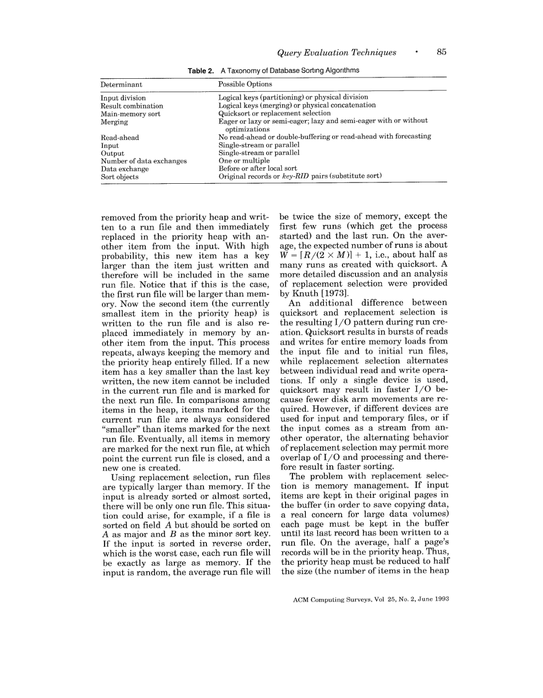
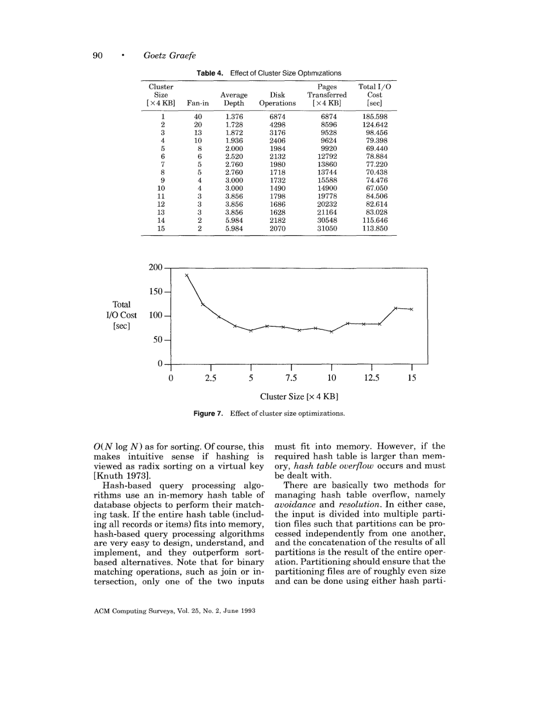

> 本组第 26 篇 · 查询执行引擎 · [全部论文]() · [上一篇]() · [下一篇]()

这篇 1993 年综述的核心贡献不是某个新的单一 join 算法，而是把物理算子、算子间控制、外存数据组织和并行执行放在同一设计框架中：执行引擎决定优化器能够选择什么，流水线改变资源的同时存活区间，排序与哈希通过不同的分治方向实现匹配，但不能据此互相完全替代。

三个必须守住的边界：第一，本文推导的成本主要是 I/O effort，不是完整 CPU/网络/端到端延迟模型；二元匹配部分还明确省略基表输入读取和最终输出写入。第二，hash aggregation 的内存压力取决于保留的输出组状态，而不是输入总量；hash join 的递归深度取决于 build 侧，但分区 I/O 仍涉及两侧。第三，作者推荐保留 sort/hash 两类算法，不能把解析图中的局部优势改写为普遍算法排名。

证据分为三层：物理页 17-18 确有 Volcano 排序实验，实际计数 I/O 操作和传输页，再按 25 ms/操作、2 ms/页计算成本；Figure 11 和 Figure 15 是粗略解析比较，不是同类实测；采样、hash-division、物化视图等性能叙述很多来自被引研究，本报告不伪造其配置或独立验证。

并行章节最值得保留的区分是：distributed 在原文语境指本地自治，parallel 指单一数据库控制点；shared-nothing 属于硬件组织维度。Exchange 封装机制而不决定策略，作者也没有声称 operator model 在同等实现质量下必然大幅快于 bracket model。有序生产者、按序消费者与有限流控缓冲组合导致的死锁，是具体执行计划的组合约束，不是所有排序都不安全、所有哈希引擎都无死锁的结论。

以下九节区分 paper（作者陈述）、inference（读者分析）与 proposal（待做方案）；段内读者构造的例子均不是作者实验。方法、已读页码与 12 页视觉范围见书目信息，并在复现节重申。报告保留为 generated_needs_review，需人工复核。

本文保留论文陈述、读者推断与待验证方案的区别；实验数字只适用于原文条件。原文和翻译来自已有 AI 辅助精读报告，已做来源匹配与编辑复核，不等于人工逐项核验或独立实验复现。所有页码均为 PDF 物理页。

## 论文与阅读范围

Goetz Graefe. Query Evaluation Techniques for Large Databases. ACM Computing Surveys, 25(2), June 1993, pp. 73-170。本地 PDF 共 98 个物理页；本文页码一律指 PDF 物理页，印刷页码=物理页码+72。

[论文集中的原始 PDF](https://github.com/lonng/db-papers/blob/4ff1331069c7cf52ac97dd769e5f484c1c35c200/papers/execution-engine/query-evaluation-techniquesfor-large-databases.pdf) · 本地来源：`execution-engine/query-evaluation-techniquesfor-large-databases.pdf`，共 98 页。

本篇保留 20 组原文精读和 50 条证据。截图为原始 PDF 的局部页选，不是重新生成的图表；未将整份 PDF 复制到博客。

## 一、研究问题、年代与适用边界

1. 研究对象是可以组合的执行设施，而不是完整 DBMS。作者关心：当多个算法共同完成一个请求时，如何使大规模集合和序列的访问、匹配、聚合与重组保持可接受的性能。物理页 2 将 complex query 定义为需要多个查询处理算法协作的查询；large database 在当时语境覆盖若干 MB 到多 TB 的文件。这个历史定义不能直接替换成今日的数据规模门槛。[E01，物理页 1-5]

2. 综述的外延比关系 join 更大。排序与哈希贯穿索引组织、分组去重、二元匹配和并行分区；对象数据库并不因为有 OID 和方法调用就免除大集合访问的成本。只要数据模型允许 set、list 等 bulk type，许多关系执行技术就仍可使用。作者同时讨论 nested relations、时间/科学数据与面向对象数据，但没有说所有新数据模型都能无损降为同一种关系执行算法。[E01]

3. 明确排除项。物理页 3 主要显式讨论只读查询，更新请求可复用其中的搜索工作；物理页 4 将 ACID 保证的实现排除在综述之外，物理页 5 说明递归查询领域仍在发展而不展开。查询优化不是本文系统综述的主题，但作者反复讨论执行机制为优化器暴露哪些选择，并在复杂计划中提出运行时决策。因此不能把“不综述优化”误写成“执行过程完全不考虑优化或自适应”。嵌入式查询不单列，是因为同一执行技术也可适用，并非其语义比交互查询弱。[E01]

4. 目标函数与本文成本函数不是一回事。物理页 3 列出的优化目标包括首条/末条结果等待、CPU、I/O、网络、内存时空积、总资源乃至能耗；并行条件下时间与总工作量还可能不同。与这个宽目标集合相比，物理页 5 的脚注明确承认本文成本推导只覆盖一个有限但重要的侧面：I/O effort。本报告凡引用 MB、页数或 I/O 次数，都先说明是在量化什么，不把它们混成一次查询的完整响应时间。[E02，E03]

5. 年代定位。1993 年关于旋转磁盘 seek/latency、原始设备访问、商用系统算法覆盖和专用硬件的判断，是文中的当代工程背景。将其中的 25 ms、40 ms、100 KB 内存等参数搬到其他年代，需要重新标定。本报告不引入现代数据库源码或最新硬件数字，也不将外部知识补成 Graefe 的原结论。其可复用价值首先在于识别成本边界、状态大小、分区与排序属性、以及控制机制，而非参数永恒有效。

依据：论文陈述；PDF 物理页 1, 2, 3, 4, 5。证据：[E01](#evidence-e01), [E02](#evidence-e02), [E03](#evidence-e03)。

## 二、执行引擎架构、物理代数与缓冲区契约

1. Logical algebra 与 physical algebra。逻辑算子描述可表达的操作，物理算子才选择具体算法并关联可执行成本。一种逻辑 join 可映射到 nested loops、merge 或 hash；一个物理 join 又可合并不去重投影；去重只实现关系投影的一部分；sort 在纯集合代数中没有直接对应项。这不是给同一棵逻辑树简单换类名。即使逻辑 union/intersection 可交换，具体物理算法也可能对两侧输入非对称。[E04，物理页 6-7]

2. Iterator 的工作是控制组合。相比写临时文件、每算子独立进程或将整计划翻译成单个程序，open/next/close 让消费者以过程调用驱动输入，在一个进程里调度任意复杂的算子树。状态必须跨 next 调用存活，Volcano 的说明将函数入口与 heap 中的 state record 分离，并以函数指针解除输入算子的硬编码绑定。这个设计支持多次出现的同类算子，不需要按查询重新编译算子模块。[E05，物理页 8-11]

3. 接口可流水化不等于算法不阻塞。Sort 的 open 会消费输入、生成并中间归并 runs，只将最终一次 merge 留给按需 next；hash join 通常先完成 build 再 probe。Iterator 减少的是不必要的算子间物化与调度成本，不是消除排序 run、hash 溢出文件和算法内部状态。物理页 7 还允许不同 iteration granule 之间用转换算子衔接，不能把“典型单记录”扩张成接口只能永远逐记录。[E04，E05，E06]

4. 计划形状是能力边界。Stored-set-oriented 的二元迭代器每次附加一个存储关系，限制为 left-deep，简化优化器但可能排除某些最优计划；两侧均接受任意子计划的 algebra-oriented 实现可以执行 bushy。支持 bushy 不是声称 bushy 总比 left/right-deep 好。DAG 的公共子表达式可先物化，也可用 split 按最快消费者推进并为慢消费者保留数据；消费速率差距扩大时，split 仍会需要临时磁盘空间。[E05]

5. 缓冲区是物理执行协议的一部分。Fix/pin 的语义是页面暂不被替换或迁移，因此迭代器之间可传递指向已固定页面中记录的地址；接收方接过持有责任，可以 unfix、暂存或继续交给下游。这种指针传递有前提，不能直接宣传为无生命周期代价的零复制。所有 frame 都被 fix 而系统仍需替换时，原文提到扩展 pool 或 abort 等异常路径。LRU 对一次性大扫描可能污染 buffer，DBMIN 等思想因而依据访问模式与收益分配空间，而不是把统一 LRU 当作数据库最优策略。[E13，E14，物理页 25-26]

6. Exchange 是物理控制算子。Operator model 将进程管理、重分布与流控封装到也有 open/next/close 的 exchange；逻辑层它不改变所求数据，物理层却改变执行进程和数据路径。Degree of parallelism、partition function、CPU 分配仍由优化器或实验者设定。与之相比，bracket model 以通用进程模板包住单个算子，算子拥有本进程的控制权。作者强调 operator model 便于将既有顺序算子并行化和在一个进程中放多个算子，但同时说，同样认真实现时没有理由预期两种模型必有显著性能差距。[E31，E32，物理页 57-58]

7. 不要混淆 shared-nothing 与分布式自治。Shared-memory/shared-disk/shared-nothing 描述资源共享方式，parallel/distributed 在本文中描述控制与自治。作者引用 Stonebraker 的 shared-nothing 可扩展性论点，自己则建议以层次式结构作为更一般目标：节点内 shared memory，节点间 interconnection network。Volcano 的架构独立性意在让 exchange 知道拓扑而普通数据算子不必知道，不是在证明网络与本地访问成本相同。[E30，物理页 55、61-63]

8. Store-and-scan、split、active/passive scheduler 与 choose-plan 展示控制操作可继续独立抽象。它们分别处理重扫描/缓存、公共结果多消费者、控制方向转换和运行时计划选择。Choose-plan 有原文描述的实现，但在大型复杂计划中如何自动放置仍被列为研究问题。不能把这些设计草图改称已经完整实现并评估过的现代自适应框架。[E42，物理页 76-78]

依据：论文陈述；PDF 物理页 6, 7, 8, 9, 10, 11, 12, 25, 26, 55, 57, 58, 61, 62, 63, 76, 77, 78。证据：[E04](#evidence-e04), [E05](#evidence-e05), [E06](#evidence-e06), [E13](#evidence-e13), [E14](#evidence-e14), [E30](#evidence-e30), [E31](#evidence-e31), [E32](#evidence-e32), [E42](#evidence-e42)。

*原论文 PDF 物理页 13，版权归原作者或出版方。点击图片可查看原尺寸。页面文本中定位到：Table 2.。这是页面定位信息，不表示本次已复核图内所有数据。*

## 三、排序、哈希、聚合与连接的机制和物理成本

1. 变量与计量先于公式。M 是内存页数，R/S 是输入页数，C 是一次 I/O 的连续页面簇，F 是 fan-in/fan-out，W 是初始 run 数，L 是层数。C 不是机器数，F 也不是固定等于 M。最简单的 merge buffering 为 F=floor(M/C-1)；采用一个 forecasting 输入 buffer 和两个输出 buffer 的示例为 F=floor(M/C)-3。加大 C 会降低 F，却可能显著减少 seek 与 rotational latency；优化页数不等于优化 I/O 次数，也不等于优化时间。[E08，物理页 14-16]

2. 排序的输入阶段。Quicksort 在内存中生成约 M 大小的 runs，W=ceil(R/M)。Replacement selection 将当前 run 与下一 run 的项区分，在堆比较时优先当前 run，维持当前输出的有序性。随机输入的平均 run 约 2M 是附带边界效应的期望，不是每个 run 的保证；逆序输入可退化到 M，近乎有序输入可能生成一个很长的 run。记录若始终钉在原 buffer 页，会因页面中残留少量 heap 元素而浪费容量；复制进 holding area、变长记录管理与碎片是其真实代价。[E06，E07]

3. 归并的层与步。朴素总层数 L=ceil(log_F W)，但实际优化可混合不同层最小 runs，单个记录经历的 merge depth 因而不同。物理页 16 的 F=10、W=12 示例先合并 3 个 run，再与其余 9 个一起归并；文中临时文件写入的 memory-load 计数从 24 降到 15，不能把这两个数当完整查询 I/O。为某个下游留下较小 final fan-in 与中间尽量用满 F 是不同决策。最终一次归并可直接输出给 merge-join；反向写初始 run 或显式保留最后一个内存 run，也可减少略超内存时的临时 I/O，不能把“排序必定全量写盘”当作所有实现的定理。[E06，E08]

4. Hashing 与溢出。内存 equality matching 的期望线性复杂度，不能用来承诺任意外存输入的一趟处理。Overflow avoidance 先分区；overflow resolution 从可容纳假设出发，必要时分区；hybrid hashing 在两者之间动态保留一些桶并让另一些桶落盘。若 build 分区仍超内存，需递归分区；hash quality 与重复值导致的 skew 可使递归失效，原文还提到必要时回退其他算法。[E11，物理页 19、21-22]

5. Hybrid 的局部模型。物理页 19-20 令 K 为磁盘分区数，假设桶分配最优且每个外存分区可在后续内存处理，给出 K=ceil((R-M+C)/(M-C))；此处驻留表空间为 M-(K+1)C，临时 I/O 体积为 2[R-(M-(K+1)C)] 页。要换算时间，还须除以 C、乘每簇时间。这个式子处于其可 hybrid 处理的模型域，不能套到任意 skew 或不足一个 buffer 的配置，整数边界亦未在本报告形式验证。R=240、M=80、C=8 的算例产生 F=9、K=3、48 页驻留空间、384 页临时 I/O；40 ms/簇对应 1.92 s，是算例而非实测。[E11，E12]

6. Aggregation 与 duplicate removal。Scalar aggregate 可单遍累积，grouped aggregate 需要识别组；去重和分组聚合可共用匹配机制，但比较属性与更新动作不同。Sort 可在写 run/merge 时 early aggregation，使一个已完成组内合并的 run 不超过最终输出组数。物理页 28-29 的粗略推导令 G=R/O 为 reduction factor，不是组数；R=100 MB、O=1 MB、M=100 KB、F=10 时，early aggregation 的临时 I/O 是 420 MB，对照未提前聚合为 600 MB。[E15]

7. Hash aggregation 持有的是输出状态。只要组状态整体能装下，即使原输入很大也不必因输入大小而溢出；反之，distinct group 太多才导致表膨胀。一旦某分区开始外存化，在读回前无法继续归并其中的项，分区文件可能仍接近原输入量。物理页 29 对 overflowing、overflow-avoidance 情形给出 2R*ceil(log_F(O/M)) 的临时 I/O，而不是“无溢出也发生这些 I/O”。当 O<=M 时应回到内存路径，不能令负对数生成负 I/O。该页 hybrid aggregation 采用 M-KC 的局部记账，不应悄悄把前一通用算例的 (K+1)C 代入。DISTINCT aggregate 的先去重与最终算术聚合还需分清，不能任意提早做算术。[E15，E16]

8. 二元 matching 家族。Join、semi-join、outer join、anti-semi-join、intersection、union、difference 都要区分匹配与非匹配项，但输出规则不同。Nested loops 可处理一般谓词；block buffering 与内侧 index 可改进成本。物理页 34 的 buffered nested-loop 公式 ceil(R/(M-K))*(S-K)+K，连同 larger outer 的最小化结论，属于该模型，不是通用 join-order 规则。很小的一侧对很大的有索引一侧时，index nested loops 仍可能最快。不能拿大输入 full-scan nested loops 的曲线否定 index nested loops。[E18，E19]

9. Merge 与 hash 的输入要求不同。Merge-join 利用两侧相同排序；重复 join key 在双方都存在且要输出所有配对时，需要回退/保存 value packet，packet 超内存可带来额外 I/O。同一 key 上的连续 merge joins、sorted aggregation 后 join、以及有序索引输入可复用顺序。普通 hash join 对较小 build 侧建表，两侧以相同函数分区，配对分区的结果再拼接；probe 侧无需整体放入内存。递归深度由 build 分区的内存适配决定，而近似临时 I/O 为 2*log_F(R/M)*(R+S)，仍乘两侧数据总量；不能误写为 log_M，也不能遗漏 S。[E19，E20，E24]

10. 指针与 hybrid 不是单一技术名。指针 join 可直接逐个访问目标，也可按物理地址排序或分组以降低磁盘访问。方向固定时，小表指向大表与大表指向小表并不对称。DB2 hybrid join 在原文物理页 35 是将排序的 outer 与 B-tree 叶项匹配，再按 inner RID 位置排序和取回记录的组合，不应因为名字中有 hybrid 就认作 hybrid hash join。[E19，E20]

11. Universal quantification。用 count 将“修完所有指定课程”改写为计数相等，必须排除非指定课程并去重；筛选过的 divisor 通常破坏基表层面原有的引用完整性假设。直接 hash-division 用 divisor 字典分配序号，候选 quotient 各有一张匹配 bitmap，遇到同一匹配重复只设置同一 bit。只有已知输入无重复时才可直接换成计数器；进一步省略 divisor 表还需引用完整性保证。按 divisor 分区的部分结果取交，按 quotient 分区的结果取并，二者不能混用。作者对所有 universal quantification 均可改写为 aggregation 只给出直觉，并承认未找到证明。[E22，E23]

12. 对偶与并行组合。Sort 物理切分、逻辑归并；hash 逻辑分区、物理拼接。它们有对应的 fan-in/out、读前取/写后推、多层/递归与调度问题，但并非每个优化都有精确对应，interesting ordering 与 skew 等差异仍影响选择。作者最终建议保留两类算法。[E24，E25]

并行时 range/hash partitioning 与站点内 sort/hash 算法几乎正交。Local count 的 global 合并是 sum，不是再 count 一次。Symmetric hash join 在到达任一输入时探测另一表并插入本表，原文版本需两侧状态能在内存中共存。Symmetric partitioning 与 symmetric hash join 是不同层面的概念；fragment-and-replicate 也不能直接用于所有 outer/semi/set 语义而仅拼接结果。Band join 则说明非等值也可有结构化算法：windowed merge 或 range 分区并对边界项多分配，且宽 band 接近笛卡尔积时优势受限。[E35，E38，E39，E40，E41]

依据：论文陈述；PDF 物理页 12, 13, 14, 15, 16, 19, 20, 21, 22, 28, 29, 33, 34, 35, 36, 37, 40, 41, 42, 43, 50, 63, 68, 69, 74。证据：[E06](#evidence-e06), [E07](#evidence-e07), [E08](#evidence-e08), [E11](#evidence-e11), [E12](#evidence-e12), [E15](#evidence-e15), [E16](#evidence-e16), [E18](#evidence-e18), [E19](#evidence-e19), [E20](#evidence-e20), [E22](#evidence-e22), [E23](#evidence-e23), [E24](#evidence-e24), [E25](#evidence-e25), [E35](#evidence-e35), [E38](#evidence-e38), [E39](#evidence-e39), [E40](#evidence-e40), [E41](#evidence-e41)。

## 四、正确性不变量、组合风险与证明边界

本节把原文机制整理为读者可检查的不变量，属于 inference，不冒充论文提供了统一形式化证明。整个综述不是定理集，本报告也没有逐个证明或每个整数边界的形式验证。

1. 排序 run 的不变量。当前 run 输出非递减；replacement selection 中不能放入当前 run 的项必须留给后续 run，且 heap 顺序要考虑 run 标记。读者构造的假设示例：三个槽位初始为 [5,2,8]，随后输入 [1,9,3]。输出 2 后读入 1 并标记下一 run；输出 5 后读入 9 属当前 run；输出 8 后读入 3 标记下一 run；此时 9 仍属当前 run，必须先输出 9，首 run 为 [2,5,8,9]，第二 run 才是 [1,3]。不能在输入读完时忽略 heap 内剩余当前项。本例为机制手算，不是作者数据。[E07]

2. 分组与 join multiplicity。Hash aggregation 用组键定位一个输出状态，不等于 hash join 只保留一个同键行。读者构造的假设示例：R 有两个 key=7 的行，S 有三个 key=7 的行，普通 inner equijoin 应保留六个配对；semi-join 只需判断有无匹配。把去重版建表直接拿去做 bag join 会丢结果。Merge 的 value-packet 回扫需求也是为维护这种多重性，而非纯性能优化。[E16，E19，E20]

3. Hash 分区的局部完备性。相等 key 的潜在匹配必须到达同一可配对的分区；两侧不同分区函数会造成漏配。Skew 通常先影响性能和容量；若实现因容量不足而直接丢弃重复项，才变成正确性问题。非等值 band join 不能沿用“每项只落一个普通 equality bucket”而不考虑跨边界候选；原文的 range/multicast 变体正是在处理这个缺口。[E20，E41]

4. Universal quantification 的集合条件。读者构造的假设示例：指定课程是 {A,B}，学生记录是 {A,A}。若只比较原始行数，两者均为 2 会错误通过；bitmap 只记录 A 的 bit，B 仍为空，因此不通过。若另有 {A,C}，未经 divisor semi-join 的 count 同样可错。输入去重、限制传播与候选域必须写清。关于空 divisor、NULL 与完整 SQL 三值逻辑，所选除法段落不足以支持全面规范化结论；实现应先声明关系/集合语义，不能用常识补成作者定理。[E22，E23]

5. Pinned pointer 的有效性。下游使用地址期间，上游不能把对应页面 unfix 后又让 buffer replacement 复用它。原文通过固定页面和转交责任形成生命周期约束；这与“接口返回了一个指针所以数据必然仍有效”完全不同。读者构造的假设测试可以在每次 unfix 后主动复用 frame，暴露悬空引用，但本报告未执行此测试。[E14]

6. Sorted exchange 的死锁是组合性质。原文特定条件包括：有序 producer、需要从多个输入取得足够有序项才能推进的 consumer、非 range 的按 key 分区、有限流控 slack，以及不利分布。Producer 想按自身 sort 次序发送，consumer 又按 merge 次序等待，单个 sort 正确并不保证组合有进展。移动排序到 consumer、改变执行分组、使用单 consumer 或让算子理解 dummy progress key 等，都是打破条件的办法。物理页 67 中改用 hash 消除的是这里对 merge 次序的依赖，不能外推出所有 hash 系统没有循环等待、资源死锁或网络问题。相关图 30-33 未做视觉检查，本判断来自已全文读取的叙述。[E36]

7. Replication 的输出所有权。读者构造的假设示例：一个被广播的 outer-preserved 行在三个站点都未匹配，若三站均直接输出 padding 行，最终会多三份而非所需一份。原文对 naive fragment-and-replicate 的提醒指向这一问题。本报告不声称所有经过协调的现代 broadcast outer join 都不可能正确。[E40]

8. 压缩与过滤的语义前提。Compressed join 在原文依赖同域共同编码，不能让同一整数代码在两侧表示不同值。Bloom/bit-vector 的正位表示可能出现而非已证明出现；负位对当前已完整构建的集合可排除匹配，但 outer join/union 等需要保留非匹配项的算子不能直接丢弃。它也不能单靠正位完成精确去重。读者构造的假设示例：A 与 B 恰好哈希到同一 bit，见过 A 后 B 的正位不证明 B 重复，仍须做精确比较。[E44，E45，E46]

依据：读者推断；PDF 物理页 13, 26, 29, 35, 36, 40, 41, 42, 64, 65, 66, 67, 69, 74, 81, 83, 84。证据：[E07](#evidence-e07), [E14](#evidence-e14), [E16](#evidence-e16), [E19](#evidence-e19), [E20](#evidence-e20), [E22](#evidence-e22), [E23](#evidence-e23), [E36](#evidence-e36), [E40](#evidence-e40), [E41](#evidence-e41), [E44](#evidence-e44), [E45](#evidence-e45), [E46](#evidence-e46)。

## 五、实验、解析曲线与被引性能证据分层

A. 文中实际报告的 Volcano 排序实验，物理页 17-18，Table 4 / Figure 7。[E09，E10]

作者确实排序了 100000 条 100-byte 记录，约 10 MB；sort space=40 页=160 KB，处于 50 页=200 KB 的 I/O buffer 中；cluster 从 1 到 15 页，每页 4 KB。初始 run 含 1600 条记录，共 63 个 runs。实现包含文中归并优化，但明确排除了 read-ahead 与 forecasting。它统计临时 run 文件的 I/O 操作数与传输页数，再按 25 ms/操作加 2 ms/页计算 total I/O cost。不能写成“全文没有实验”，也不能将计算的 cost 改成实测总 wall-clock time。

视觉核对 Table 4：C=1 页时，F=40、平均 depth=1.376、6874 次操作、6874 页、成本 185.598 s；C=10 页时，F=4、depth=3.000、1490 次操作、14900 页、成本 67.050 s，为表中最低；C=15 页时，F=2、depth=5.984、2070 次操作、31050 页、成本 113.850 s。C=5 页也有 69.440 s，故作者强调合理区间而不是必须找出唯一精确 optimum。这里的 F 来自该实验实现与 buffer 配置，不宜盲用其他段落的缓冲公式重新生成表值。

实验支持的结论是：减少传输页数或 merge levels 并不自动最小化带 seek/latency 的 I/O 成本。它没有提供跨现代设备的结论，也不足以证明实际 67.050 s 的查询延迟或所有排序实现的最佳 cluster。所选叙述没有完整列出数据键分布、平台 CPU、重复次数、置信区间与可运行脚本，本报告不补造这些字段。

B. 解析图与算例，不是同等实测证据。

Figure 11，物理页 30：100 MB 输入、100 KB 内存、8 KB cluster、规定 fan-in/out=10，横轴是 group size/reduction factor G，纵轴是 I/O MB。比较无 early/有 early sorting 与无 hybrid/有 hybrid hashing。Sort 公式省略 replacement selection 和前述 merge 优化，hash 公式却假定最优桶分配，所以作者提醒现实成本会更接近。图不能证明所有工作负载下 hash 聚合获胜。[E15，E17]

Figure 15，物理页 38：S=10R、M=100 KB、C=8 KB、规定 F=10、每 cluster 20 条 R 记录；纵轴为 I/O count ×1000，不是秒。比较 block nested loops、两侧排序但不做 optimized merging 的 merge join、不使用 hybrid/bucket tuning/dynamic destaging 的 hash，以及不按目标页合并引用的两种指针方向。故意简化是图的设计，不是报告应删除的注脚。横轴写 Size of R，本报告不擅自补出“千条记录”的单位。文中 R 约 1000 附近的跳变来自额外分区/归并层，不能叫测得的硬件阈值。[E21]

物理页 15 的 50 MB/160 KB 排序、页 20 的 R=240 页 hybrid hash、页 28-29 的 420 MB 聚合、页 54 的 1200 s 与 100 s 并行例，都是成本/指标的说明性算例。对它们做算术核对不等于复现真实系统。[E08，E15，E27；hybrid 算例见 E12]

C. 被引研究与实现说明。

物理页 41 说 hash-division 已在 Volcano 实现且性能优于所比较方法，出处是作者的既有研究；当前综述未完整重述那组基准配置，不能从此编出一张新速度表。[E23]

物理页 60 引 DeWitt 等及 Seshadri/Naughton 的 sampling 研究，给出 1000 partitions、最大 skew=1.5、95% confidence、每站点 110 samples 的文字例。Figure 28 实际绘图图例区分 2/1024 partitions 与 95/99.9% 置信度；文字例中的 1000 与图例的 1024 不应被当成一个精确相同的实验行。它不是本报告新做的采样验证。[E34]

物理页 79 转述 materialized view 等研究，并提醒 Hanson 等未包含多输入 join。其结论不能不加范围地变成 Graefe 本文新测得的普遍优越性。[E43]

因此，本篇有实质实验和丰富的被引性能证据，但不是统一平台、统一指标、覆盖全部算子与架构的 benchmark paper。保留这一证据层次比增加未经支持的百分比更重要。

依据：论文陈述；PDF 物理页 15, 17, 18, 20, 28, 29, 30, 37, 38, 39, 41, 54, 60, 79。证据：[E08](#evidence-e08), [E09](#evidence-e09), [E10](#evidence-e10), [E12](#evidence-e12), [E15](#evidence-e15), [E17](#evidence-e17), [E20](#evidence-e20), [E21](#evidence-e21), [E23](#evidence-e23), [E27](#evidence-e27), [E34](#evidence-e34), [E43](#evidence-e43)。

*原论文 PDF 物理页 18，版权归原作者或出版方。点击图片可查看原尺寸。页面文本中定位到：Figure 7.。这是页面定位信息，不表示本次已复核图内所有数据。*

## 六、性能、空间、调度与失败条件的工程取舍

以下是依据原文整理的工程决策，不是作者给出的普适自动调参器。

1. 时间与体积的 Pareto 边界。较大 cluster 能减少访问次数及固定延迟，却占掉更多 buffer、缩小 fan-in/out 并可能增加层数。Replacement selection 能延长 run，但需要更复杂的内存管理；bucket tuning 能更充分保留有益分区，却可能依赖较小 I/O cluster。二者都说明：某个局部“少写一些页”的选择未必节省总时间。[E07，E08，E12]

2. Sort/hash 选择应包括下一步。已有有序索引、同一 join key 的连续 merge、group 后 merge-join 可使一次排序服务多个算子；hash aggregation 后若 join key 等于 group key，且聚合侧成为 build，可直接复用同一表。Hash 不输出用户要求的排序，并不等于所有 hash 方案必需额外昂贵 sort；sort 的顺序能复用，也不等于在不同 key 上仍免费。比较对象应是带物理属性与状态生命周期的局部计划，而不是孤立算法名。[E19，E24，E25]

3. Skew 的代价跨越两层。外存递归中偏斜使分区缩小不足；并行中偏斜使某个 worker 决定完成时间。Equal partition bytes 不保证 equal join work，尤其一边重复键与另一边多匹配相乘时。Skew avoidance 可先采样/统计，skew resolution 可事后重新分区，但首个内存批次可能不是有效样本，完整随机采样有时要打断 pipeline 并物化。采样开销和数据可达性不能从优化器模型中消失。[E20，E33，E34]

4. 内存不是每算子独占常量。Lazy merging 与 breadth-first partitioning 让中间阶段尽量不与下游共享资源；eager/depth-first 更早产出，却可能激活 consumer 的 hash table 并降低剩余 producer 的 fan-out。物理页 52 特别允许最顶层为了早首条结果使用 depth-first，这与中间算子偏好 breadth-first 并不矛盾。某些 stop point 可让执行器转移到另一子树；hybrid output 提前出现时反而未必有干净 stop point，故作者建议参数化支持 overflow avoidance。[E24，E26]

5. 并行度既改变吞吐，也改变可用内存。固定总内存下，P 越大，每进程 sort run/fan-in 越小，新增 merge levels 可能吞掉并行收益；多机器且 aggregate memory 同时增长则可能减少外存层数，出现 superlinear speedup。两种叙述使用了不同资源条件，不应揉成“并行越多越好”或“并行总是损害排序”。Symmetric hash join 对两侧同时保留状态的需求，也不能按普通单 build 表预算。[E37，E39]

6. 对象与缓冲区设计。指针减少重复复制，但随机 object fault 仍可能昂贵；pin 的数量与存活时间会限制其他算子。独立中间结果内存区可简化某些实现边界，却增加复制和双重管理；原文并未证明共享 buffer pool 总优于每一种独立 pool。硬件 fault detection 快也不消除磁盘访问。[E13，E14，E20]

7. Precomputation 与 representation。索引、join index、链接和物化视图以更新维护/冗余空间换读取成本。只查单个学生 GPA 时，不应拿“即时求值整个 GPA view”的成本作对照。Compression 可增加有效缓存与传输信息密度，但需要计入编码一致性、算术属性解压和处理成本。作者关于优良压缩可改善 hash 分布的分析不是“重复键被压缩后必然不再 skew”的实验保证。Surrogate 处理降低记录复制，但稍后取回完整对象的成本仍在。[E43，E44]

8. Filter 与通信。Semi-join/bit vector 可在传输之前排除必不匹配的 probe 项，也可能引入额外扫描、构建与交换开销。正位越多、冲突越多，过滤收益越弱；对需要输出非匹配项的算子，正确性规则比简单 inner join 更复杂。Fragment-and-replicate 应同时考虑网络复制量和输出 ownership，不能只比较广播字节。[E40，E45，E46]

9. 专用硬件论点必须留在年代中。作者基于当时 CPU 改进速度、I/O 瓶颈和 extensibility 需求，不偏好超出通用处理/存储/通信组件的定制数据库硬件。本报告将其视为历史设计判断；没有据此为今天的某种加速设备作支持或反对裁决。[E47]

依据：读者推断；PDF 物理页 13, 14, 20, 25, 26, 29, 30, 34, 35, 37, 43, 46, 48, 49, 50, 51, 52, 53, 59, 60, 68, 69, 79, 80, 81, 82, 83, 84, 85。证据：[E07](#evidence-e07), [E08](#evidence-e08), [E12](#evidence-e12), [E13](#evidence-e13), [E14](#evidence-e14), [E16](#evidence-e16), [E17](#evidence-e17), [E19](#evidence-e19), [E20](#evidence-e20), [E24](#evidence-e24), [E25](#evidence-e25), [E26](#evidence-e26), [E33](#evidence-e33), [E34](#evidence-e34), [E37](#evidence-e37), [E39](#evidence-e39), [E40](#evidence-e40), [E43](#evidence-e43), [E44](#evidence-e44), [E45](#evidence-e45), [E46](#evidence-e46), [E47](#evidence-e47)。

## 七、同代系统对照与面向后续研究的可验证问题

1. 本文中的系统名是机制例子，不是同平台排行榜。System R 被用来解释 stored-set-oriented/left-deep 与 interesting ordering；Volcano 被反复用作 iterator、exchange 与 extensibility 的实现参照；Gamma 的 bracket model 与 hash-oriented 操作展示另一种组织；Teradata 说明本地 merge-join 可与全局 hash partitioning 共存。这些例子帮助分离设计维度，不构成一份现代产品选型榜。[E19，E31，E32，E35]

2. Parallel 与 distributed 必须按作者定义阅读。原文 distributed 的节点可独立执行完整 DBMS 功能、具有本地授权和自愿合作；parallel 是同一数据库控制点拆分请求并调度可用节点。两类系统都可能运行在不同硬件共享结构上，也都可能利用某些并行性。不能因为一个系统使用网络或 shared-nothing 就断言作者把它归为自治 distributed，也不能把“单一控制点”误读成只允许一个 OS process。[E28，E29]

3. 架构观点的归属。Shared-nothing 的高扩展性是文中归纳的 Stonebraker 等观点；Graefe 明确表达对 hierarchical memory 的偏好，并用可重组的节点层次和 exchange 隔离来支撑。因此“作者证明 shared-nothing 在所有架构中最优”既抹掉观点归属，也超出证据。Architecture independence 指软件解耦，不保证每个架构上相同 cost 或同等 scaleup。[E30]

4. Hybrid 的术语消歧。DB2 hybrid join 组合 index、排序、merge 与 RID 回取；hybrid hash join 组合内存匹配与分区溢出。二者都叫 hybrid，但其物理路径不同。不能凭引用标题推断 hash 实现，也不能用参考文献中一个标题代替正文机制。类似地，symmetric hash join、symmetric partitioning 与 symmetric fragment-and-replicate 也是三个不同问题层面的用词。[E19，E35]

5. 与后续系统的对照只提出问题，不填写未查源码。可验证问题包括：某实现怎样区分 producer/consumer 的 buffer ownership？其排序是否保留 memory-resident final run、如何选择 final fan-in？是否复用有序性或 aggregation hash state？Exchange 是否纯机制，决策函数在哪里？有限流控与 ordered merge 如何保证进展？这些问题来自本文机制，不是对任一今日系统已经确认的事实。本报告没有检查现代系统源码，故不列虚构类名、文件路径或性能数据。[E25，E31，E42]

6. 迁移成本模型应先改测量合同。后续研究可以比较不同存储访问延迟、CPU 复制带宽、网络代价和编码方案下的转折点，但必须固定或清楚申明 total memory、worker 数、临时 I/O 与 base I/O 的口径。这里提出的是 proposal，不是声称 1993 年已经研究了今日硬件。对于科学/时序算子，应进一步核对顺序是否属于数据语义，而不是随意用 set 分区打散；对压缩键，应核对编码与比较语义，不把 domain code 当原值。[E02，E41，E44]

7. 尚无证据的方向不装成结论。Choose-plan 只给出机制与放置研究问题；专用硬件部分是带历史前提的意见；物化视图的收益来自具体查询/更新组合。它们都可启发后续工程，但不足以证明任意自适应执行、专用硬件或预计算策略的现代胜负。[E42，E43，E47]

8. Disk access 的粒度可在执行层重新组合。原文将 index scan 与 record lookup 分开，允许 index-only access、多索引按 RID 交并、先 join 索引后只取真正参与结果的记录，以及将 RID 按物理位置排序/窗口化。它们共同减少不必要的记录访问或 seek，而不是只追求“有一个索引”。窗口只持有有限个未解决引用，和完整收集所有 RID 后排序的阻塞程度不同；它的磁盘调度收益也受其他并发访问影响。读者的设计推论是：访问路径应公开自己产出的是键、RID 还是完整记录，以及附带哪种顺序属性。[E48，物理页 24-25]

9. 非关系数据的对照边界。NF2 的 unnest 可扫描嵌套项，nest 则需要 detail grouping 与 master join；要让二者确为逆操作，可能必须保留结构/键等信息。现有分组和匹配可重用，但嵌套 join 若每次先全部 flatten，会丢失 nesting 本希望节省的工作。[E49，物理页 72-73]

科学时间序列中的 stream 是有语义顺序的 sequence，不仅是任意 set 的枚举。原文把 interpolation、extrapolation、digital filtering 放入 stream 框架，并描述了 Volcano 中的实现验证；这是功能/集成说明，不是本报告补出的一组性能数字。矩阵变换、FFT 或多维 slab extraction 未必同样自然地适合该框架，部分问题更适合存储层。读者不能由集合算子的自由分区，直接推出所有序列算法可无额外同步地任意切分。[E50，物理页 74-75]

依据：读者推断；PDF 物理页 3, 24, 25, 35, 50, 54, 55, 58, 61, 62, 63, 69, 72, 73, 74, 75, 78, 80, 81, 85。证据：[E02](#evidence-e02), [E19](#evidence-e19), [E25](#evidence-e25), [E28](#evidence-e28), [E29](#evidence-e29), [E30](#evidence-e30), [E31](#evidence-e31), [E32](#evidence-e32), [E35](#evidence-e35), [E41](#evidence-e41), [E42](#evidence-e42), [E43](#evidence-e43), [E44](#evidence-e44), [E47](#evidence-e47), [E48](#evidence-e48), [E49](#evidence-e49), [E50](#evidence-e50)。

## 八、可执行的复现方案、验收标准与本次实际核对

本节的算法复现步骤均为尚待执行的 proposal。当前实际完成的是原文阅读、选页图像、引文匹配与局部算术核对，不是运行 Volcano、实现数据库或完成性能复现。

A. 先建立可重复的成本账本。记录 page_bytes、input/output bytes 与行数、group-state bytes、M、C、F、W、每阶段 run/partition 的读写页与 I/O 次数。至少分别报告 base read、temporary write/read、final result write 和 CPU/network time。对于 Section 5 的比较，另生成省略 base/output 的投影，避免拿含 base 的某算法去对照不含 base 的另一个算法。验收：每笔 I/O 均归属某阶段；页数不能为负；数据输入输出守恒或明确属于 aggregation/selection 的缩减。[E08，E18]

B. 排序模拟与实机分离。先做只计页与 merge 操作的模型，支持 quicksort runs、replacement selection、basic/optimized merging、可选 final fan-in。用物理页 15 的 R=51200 KB、M=160 KB、C=16 KB、F=7、L=3、T=33 ms 检查 2*3*(51200/16)*0.033=633.6 s=10.56 min。再按原表条件重建 100000×100-byte 输入的实验；原文未给定的键分布与平台信息必须作为复现者自选参数披露，不伪称原配置。[E07，E08，E09]

对 Table 4，先核验计费公式，再讨论算法是否重建成功：6874*0.025+6874*0.002=185.598 s；1490*0.025+14900*0.002=67.050 s；2070*0.025+31050*0.002=113.850 s。仅重算这三行不算复现 run 生成与实际 I/O 计数；实机测时也必须与这组 model cost 分栏。[E10]

C. Hash/aggregation 的语义与容量测试。用 R=240、M=80、C=8 页检查 K=3、resident=48、temporary=384 页、384/8*0.04=1.92 s。再让输入总量变化而输出组状态固定，验证不应仅因输入变大强制 aggregation spill；反过来固定输入并增加 distinct groups，观察输出状态跨过 M 时的行为。对 100 MB→1 MB 的 sort aggregation，单独重算 420 MB 与 naive 600 MB，明确是临时 I/O 而非查询读写总量。[E11，E12，E15，E16]

D. 三类匹配与 division 的 oracle。对小数据用显式枚举配对作为测试 oracle，比较 sort/hash/loop 的 multiset 输出；覆盖双侧重复、空输入、极端 key skew、无法继续有效细分的分区，并为后者规定安全 fallback。Division 用经过明确集合化的 divisor/candidate 域做 oracle，测试 {A,B} 对 {A,A}、额外课程、divisor selection 与 divisor/quotient 两类 partition；空 divisor 和 NULL 测试需先规定额外语义，而不是说本文已完全规定。[E20，E22，E23]

E. 计划组合与流控。建一个能控制队列容量、记录读写事件、检测停滞的有限流控模型，重放物理页 64-67 的排序生产者/merge 消费者情形。失败标准不能只看是否有数据错误，还要看是否存在所有队列/算子均无法推进的合法状态。依次改变 consumer 数、sort 位置、partition rule 与 dummy-key 协议，检验哪条条件被打破。该模型的外推范围只限该调度协议，不推出所有哈希/网络程序无死锁。[E31，E36]

F. 并行指标与结果所有权。分别测 fixed-size speedup 和随资源同比放大的 scaleup；固定总 M 与每 worker 固定 M 两种预算分开。用 1200/100=12、1200/(16*100)=75%、((1200-100)/1200)/((16-1)/16)=97.777...% 校验指标实现。Local count 的 global 阶段 sum；broadcast preserved rows 与 duplicate-sensitive set/bag 输出都设明确 owner；symmetric join 统计两侧状态总内存。[E27，E37，E38，E39，E40]

G. 把 evidence level 纳入复现结论。Figure 11/15 的目标先是复现公式曲线，不是追求某个端到端吞吐；Figure 28 要查其被引抽样研究后才能声称独立验证置信结论。Bit-vector 测试必须人为制造 hash collision，确认 false positive 不改变精确输出，并检查 outer/union 不匹配项去向。[E17，E21，E34，E45，E46]

本次实际范围：Codex 已全文读 extracted 物理页 1-98，原 PDF SHA 与缓存 SHA 相同，98 页重新提取的 raw text 与缓存逐页一致。API 的 18 块笔记作为背景而非全文替代，截断 draft 未被补括号使用。视觉实际核对 14、15、18、19、20、28、29、30、37、38、54、60 共 12 页，其他图形未核对。只执行离线源证据/结构/算术检查，没有运行上述 A-G 算法实验，也没有独立阅读被引论文。

依据：待验证的工程设想；PDF 物理页 13, 14, 15, 17, 18, 19, 20, 28, 29, 30, 33, 36, 37, 38, 40, 41, 42, 54, 58, 60, 65, 68, 69, 83, 84。证据：[E07](#evidence-e07), [E08](#evidence-e08), [E09](#evidence-e09), [E10](#evidence-e10), [E11](#evidence-e11), [E12](#evidence-e12), [E15](#evidence-e15), [E16](#evidence-e16), [E17](#evidence-e17), [E18](#evidence-e18), [E20](#evidence-e20), [E21](#evidence-e21), [E22](#evidence-e22), [E23](#evidence-e23), [E27](#evidence-e27), [E31](#evidence-e31), [E34](#evidence-e34), [E36](#evidence-e36), [E37](#evidence-e37), [E38](#evidence-e38), [E39](#evidence-e39), [E40](#evidence-e40), [E45](#evidence-e45), [E46](#evidence-e46)。

## 九、结论、可信范围与后续优先级

第一，执行引擎应被理解为物理代数和组合协议的集合。算法选择、顺序/分区属性、缓冲区生命周期与控制转移共同决定计划能力。只实现一个很快的独立 join，而不能让它与上下游协作，并不足以构成高效执行器。[E04，E14，E31]

第二，排序与哈希是可相互借鉴的分治方案，不是必须选边的阵营。作者讨论了相对输入规模、skew、interesting ordering、run 与 partition 的管理方式，最终主张两类都应可选。本文的解析图提供理解转折点的方法，不是普适性能排序。[E17，E25]

第三，成本表述的精确性决定结论能否迁移。I/O 页数、操作数、计费时间、实际 elapsed time 不是同一测量；aggregation 的输出状态、join 的 build 输入和总输入流量也不能混淆。纠正这些口径后，很多看似矛盾的选择，例如更深归并却更低 I/O 时间、更多机器出现 superlinear 而固定总内存下增加 worker 反而变差，才可以统一解释。[E03，E16，E18，E27，E37]

第四，并行性必须同时检查控制、资源和结果语义。Local autonomy 不等于 shared-nothing；exchange 不是 optimizer；同等 partition bytes 不保证同等工作量；broadcast 不能在任何输出规则下无条件拼接。作者对 hierarchical architecture 与 mechanism/policy 分离的偏好，主要是工程组织与可演进性的论证，而不是现代架构性能定理。[E28，E29，E30，E31，E32，E35，E39，E40]

对数据库内核工程师的后续优先级，读者建议依次是：先让每个算子公开其状态与 I/O 口径；再对重复值、溢出、所有权和有限缓冲做组合正确性测试；随后以完整计划与物理属性评估 sort/hash 选择；最后才扩大并行与运行时决策空间。这是本报告 inference，不是作者给出的唯一开发路线。[E14，E25，E42]

可信范围：本报告是当前 Codex 基于完整 98 页本地文本、12 页选定图像和全部 API 保留笔记实际写成的综述，提供可逐页匹配的证据和具体误读检查。它不是把失败的 9000-token draft 机械补全，也不是独立人工事实核查；没有声称所有公式边界已证明、所有被引结果已复现。所有新算法测试与硬件迁移仍是待做工作，报告保持 generated_needs_review。

依据：读者推断；PDF 物理页 5, 6, 26, 29, 30, 33, 50, 54, 55, 58, 63, 68, 69, 78, 85。证据：[E03](#evidence-e03), [E04](#evidence-e04), [E14](#evidence-e14), [E16](#evidence-e16), [E17](#evidence-e17), [E18](#evidence-e18), [E25](#evidence-e25), [E27](#evidence-e27), [E28](#evidence-e28), [E29](#evidence-e29), [E30](#evidence-e30), [E31](#evidence-e31), [E32](#evidence-e32), [E35](#evidence-e35), [E37](#evidence-e37), [E39](#evidence-e39), [E40](#evidence-e40), [E42](#evidence-e42), [E47](#evidence-e47)。

## 原文精读：从句子回到机制

以下保留原文、忠实翻译、含义与边界；假设示例不作为论文实验结果。

### R01 · PDF 物理页 5

**原文**

<blockquote class="paper-source-quote"><pre><code>In any case, our cost functions cover only a lim-&#10;ited, though Important,&#10;aspect of query execution&#10;cost, namely 1/0&#10;effort.</code></pre></blockquote>

**忠实翻译**

> 无论如何，我们的成本函数只覆盖查询执行成本中一个有限但重要的方面，即 I/O 工作量。

**技术含义与边界**

> 作者明确限制自己的定量模型。I/O effort 可再按数据体积、操作次数和每次操作成本表达，并不是所有 CPU、网络和用户等待时间的完整测量。本报告用这个限定解释后续曲线，而不把脚注当无关细节。

**常见误读**

> 把后文的成本优劣写成任意机器上端到端时间的优劣，超出这个限定；反过来，说作者完全没考虑 CPU/网络也不对，正文有定性讨论。

**读者构造的假设示例**

> 读者构造的假设示例：方案 A 临时 I/O 少于 B，但需要更昂贵的键比较。仅用本文某个 I/O 公式可给 A 更低的 I/O 分数，不能由此直接推出 A 的总耗时更短。

### R02 · PDF 物理页 6

**原文**

<blockquote class="paper-source-quote"><pre><code>Another&#10;significant&#10;difference&#10;between&#10;logical&#10;and&#10;physical&#10;algebras&#10;is&#10;the&#10;fact&#10;that&#10;specific&#10;algorithms&#10;and&#10;therefore&#10;cost&#10;functions&#10;are&#10;associated&#10;only&#10;with&#10;physical&#10;operators,&#10;not&#10;with&#10;logical&#10;alge-&#10;bra&#10;operators.</code></pre></blockquote>

**忠实翻译**

> 逻辑代数与物理代数的另一个重要区别是：具体算法，以及因而关联的成本函数，只附着于物理算子，而不附着于逻辑代数算子。

**技术含义与边界**

> 逻辑 join 不足以唯一决定扫描、匹配、临时文件和内存状态；选择物理实现后才有相应成本。这里的 only 针对具体算法成本的归属，不否认优化器可估算逻辑表达式的基数或在搜索中维护下界。后一句是读者为避免误用所作解释。

**常见误读**

> 把 logical operator 与 physical operator 当一一对应，或给没有指定实现的 join 贴一个固定成本。原文列举的合并投影、单独去重与 sort 就在反驳这种简化。

**读者构造的假设示例**

> 读者构造的假设示例：相同 R JOIN S 可用索引探测，也可两侧 sort 再 merge。逻辑谓词相同，但已有索引、排序属性和 build 空间不同，不能只按逻辑结点数比较。

### R03 · PDF 物理页 13

**原文**

<blockquote class="paper-source-quote"><pre><code>If&#10;the&#10;input&#10;is random,&#10;the&#10;average&#10;run&#10;file&#10;will&#10;be&#10;twice&#10;the&#10;size&#10;of memory,&#10;except&#10;the&#10;first&#10;few&#10;runs&#10;(which&#10;get&#10;the&#10;process&#10;started)&#10;and&#10;the&#10;last&#10;run.</code></pre></blockquote>

**忠实翻译**

> 如果输入是随机的，run 文件的平均大小会是内存的两倍，但最初几个用于启动过程的 run 和最后一个 run 例外。

**技术含义与边界**

> 这是 replacement selection 的平均行为和边界例外，不是每次产出都为 2M。算法对当前/下一 run 的标记维护有序性；输入分布和记录内存管理决定实际长度。原句未给出现代随机分布的完整独立性规范，本报告不擅自加强为作者明确假定独立均匀。

**常见误读**

> 省略 if、average 和 exceptions，或者因读到输入末尾就忽略 heap 中仍属当前 run 的大项。长度期望与正确输出当前 run 是不同层面。

**读者构造的假设示例**

> 读者构造的假设示例：M=3 个记录槽，输入 [5,2,8,1,9,3]。首 run 应输出 [2,5,8,9]，再输出 [1,3]；尚未换代的 9 不能遗漏。这不是作者实验，也不用于估计随机输入的平均长度。

### R04 · PDF 物理页 14

**原文**

<blockquote class="paper-source-quote"><pre><code>We&#10;call&#10;the&#10;unit&#10;of 1/0&#10;a&#10;cluster&#10;in&#10;this&#10;survey,&#10;which&#10;is a number&#10;of pages&#10;located&#10;con-&#10;tiguously&#10;on disk.&#10;We indicate&#10;the&#10;cluster&#10;size&#10;with&#10;C, which&#10;we&#10;measure&#10;in&#10;pages&#10;just&#10;like&#10;memory&#10;and&#10;input&#10;sizes.</code></pre></blockquote>

**忠实翻译**

> 本综述把 I/O 的单位称作 cluster，它由磁盘上连续存放的若干页面组成。我们以 C 表示 cluster 大小；像内存大小和输入大小一样，C 也用页面数计量。

**技术含义与边界**

> 这里的 cluster 是 I/O 簇，不是并行机器集群。F 取决于 M/C 和为输入/输出/预读保留的空间；连续大块访问减少固定开销，但会缩小同时可归并/分区的数量。

**常见误读**

> 把 C 译成集群节点数，或在同一个式子里让 M 用 KB、C 用页却未换算；也不能把所有 buffering 方案都硬设 F=M/C。

**读者构造的假设示例**

> 读者构造的假设示例：若 M=80 页、C=8 页且只留一个 output cluster，则基本 merge fan-in 是 floor(80/8-1)=9。若另留预读和额外输出 buffer，9 不再必然是可用 fan-in。

### R05 · PDF 物理页 17

**原文**

<blockquote class="paper-source-quote"><pre><code>We&#10;counted&#10;the&#10;number&#10;of&#10;1/0&#10;operations&#10;and&#10;the&#10;transferred&#10;pages&#10;for&#10;all&#10;run&#10;files,&#10;and&#10;calculated&#10;the&#10;total&#10;1/0&#10;cost by charging&#10;25 ms per&#10;1/0&#10;operation&#10;(for&#10;seek&#10;and&#10;rotational&#10;latency)&#10;and&#10;2&#10;ms for&#10;each&#10;transferred&#10;page&#10;(assuming&#10;2&#10;MB/see&#10;transfer&#10;rate).</code></pre></blockquote>

**忠实翻译**

> 我们统计所有 run 文件的 I/O 操作数与传输页数，再按每次 I/O 操作 25 毫秒（用于寻道和旋转延迟）、每个传输页 2 毫秒计算总 I/O 成本，假定传输率为 2 MB/秒。原始提取的 see 依上下文译为秒，不把转写瑕疵当作技术单位。

**技术含义与边界**

> 这是有实际排序执行与计数、再用硬件代价参数计算秒数的实验。counted 和 calculated 指不同步骤；输出既不是纯理论地假定 runs，也不是直接测所有系统活动的 wall-clock。

**常见误读**

> 把 Table 4 的 67.050 s 写成实测总延迟，或反过来说只是解析公式所以作者没运行排序。两种说法都抹掉测量与计费的区别。

**读者构造的假设示例**

> 读者构造的核算示例：取表中 C=10 页的 1490 次操作与 14900 个页，1490×0.025+14900×0.002=67.050 s。这个重算验证计费一致性，不等于本报告重新执行过 100000 条记录的排序。

### R06 · PDF 物理页 19

**原文**

<blockquote class="paper-source-quote"><pre><code>Hybrid&#10;hash&#10;algorithms&#10;start&#10;out&#10;with&#10;the&#10;(optimistic)&#10;premise&#10;that&#10;no overflow&#10;will&#10;occur;&#10;if it&#10;does,&#10;however,&#10;they&#10;parti-&#10;tion&#10;the&#10;input&#10;into&#10;multiple&#10;partitions&#10;of&#10;which&#10;only&#10;one is written&#10;immediately&#10;to&#10;temporary&#10;files&#10;on disk.&#10;The&#10;other&#10;F – 1&#10;partitions&#10;remain&#10;in&#10;memory.</code></pre></blockquote>

**忠实翻译**

> Hybrid hash 算法开始时乐观地假定不会溢出；但如果确实溢出，就把输入划分为多个分区，其中仅一个立即写入磁盘临时文件，另外 F-1 个分区仍保留在内存。

**技术含义与边界**

> Hybrid 的重点是边消耗内存边按需外存化，不是发生一次 overflow 就全量切换到磁盘。后文允许继续溢出并落盘更多分区；内存中留多少与桶分配、buffer 和 skew 有关。

**常见误读**

> 只保留 optimistic 前半句，宣称该算法不处理溢出；或只看到 partition 就把它当全量预分区的 overflow avoidance。

**读者构造的假设示例**

> 读者构造的假设示例：四个逻辑分区中先有一个大分区落盘，另三个继续内存匹配；随后一个分区也超额，可再落盘。这个过程不要求一次性把四个都写完，也不保证最后一定有三个仍驻留。

### R07 · PDF 物理页 26

**原文**

<blockquote class="paper-source-quote"><pre><code>The&#10;semantics&#10;of fixing&#10;is that&#10;a&#10;fixed&#10;page&#10;is not&#10;subject&#10;to&#10;replacement&#10;or&#10;relocation&#10;in&#10;the&#10;buffer&#10;pool,&#10;and&#10;a&#10;client&#10;module&#10;may&#10;therefore&#10;safely&#10;use&#10;a&#10;memory&#10;address&#10;within&#10;a fixed&#10;page.</code></pre></blockquote>

**忠实翻译**

> Fixing 的语义是：被固定的页不受 buffer pool 中替换或迁移的影响，因此客户端模块可以安全使用固定页内部的内存地址。

**技术含义与边界**

> 安全地址来自 pin 状态，不是指针类型本身。后续转交迭代器时必须保持相应持有责任，直到不再需要或继续转交；过多长生命周期 pin 也会挤占可替换空间。

**常见误读**

> 把“固定期间地址可用”改成“算子间传任何指针均无需复制且永远安全”，遗漏 unfix 与页面复用。

**读者构造的假设示例**

> 读者构造的假设示例：select 返回一个指向 page P 的合格记录地址，下游 hash table 若保存它，就不能让 P 提前 unfix 并被重载成 page Q。是否复制到独立空间是另一项需要记账的设计。

### R08 · PDF 物理页 29

**原文**

<blockquote class="paper-source-quote"><pre><code>Since&#10;only&#10;output&#10;items,&#10;not&#10;input&#10;items,&#10;are&#10;kept&#10;in&#10;memory,&#10;hash&#10;table&#10;overflow&#10;occurs&#10;only&#10;if&#10;the&#10;output&#10;does&#10;not&#10;fit&#10;into&#10;memory.</code></pre></blockquote>

**忠实翻译**

> 由于内存只保存输出项，而不是输入项，只有当输出无法容纳于内存时，hash table 才会溢出。

**技术含义与边界**

> 这里是 grouped aggregation/duplicate removal，不是普通 join。每个组把输入折叠成一个输出状态；实际实现还需为状态、键、目录等结构预留容量。作者用 output size 抽象这些保留项，而非声称只有最终序列化结果字节占内存。

**常见误读**

> 一见输入超过 M 就强制 spill，或把该句泛化成 hash join 也只需容纳最终输出。另一个错误是把 overflowing avoidance 公式标成无溢出成本。

**读者构造的假设示例**

> 读者构造的假设示例：一亿行只分为十个组，若十个组的 sum/count 状态可容纳，输入不必整批驻留；反之，一百万个不同键可能因组状态太多而溢出。数字只为说明，不是作者基准。

### R09 · PDF 物理页 30

**原文**

<blockquote class="paper-source-quote"><pre><code>Furthermore,&#10;since&#10;the&#10;cost&#10;formula&#10;for&#10;hashing&#10;presumes&#10;optimal&#10;assignments&#10;of&#10;hash&#10;buckets&#10;to&#10;output&#10;partitions,&#10;the&#10;real&#10;costs&#10;of&#10;sort-&#10;and&#10;hash-based&#10;aggregation&#10;will&#10;be&#10;much&#10;more&#10;similar&#10;than&#10;they&#10;appear&#10;in&#10;Figure&#10;11.</code></pre></blockquote>

**忠实翻译**

> 此外，因为 hashing 的成本公式假定 hash bucket 被最优地分配给输出分区，实际 sort-based 与 hash-based aggregation 的成本将比 Figure 11 中看起来更加接近。

**技术含义与边界**

> 作者主动标出比较不对称性：此前还说明 sort 公式未计 replacement selection 和 merge 优化。图可说明模型趋势，却不能给出一般系统差距。此处 real costs 更接近是作者对模型限制的判断，不是本报告新做验证。

**常见误读**

> 只摘曲线上的 hash 优势，忽略最佳分配假设与 sort 优化遗漏；或者从“更接近”推成所有情形完全等速。

**读者构造的假设示例**

> 读者构造的假设示例：两种实现若使用不同的分区质量和归并策略，即使同有 100 MB 输入，也不能只把 Figure 11 的 y 值贴到它们身上。先明确变体，再比较。

### R10 · PDF 物理页 33

**原文**

<blockquote class="paper-source-quote"><pre><code>We&#10;assume&#10;that&#10;the&#10;algorithms&#10;are&#10;imple-&#10;mented&#10;as iterators&#10;and&#10;omit&#10;the&#10;cost&#10;of&#10;reading&#10;stored&#10;inputs&#10;and&#10;writing&#10;an&#10;op-&#10;eration’s&#10;output&#10;from&#10;the&#10;cost&#10;formulas&#10;because&#10;both&#10;inputs&#10;and&#10;output&#10;may&#10;be&#10;iterators,&#10;i.e.,&#10;these&#10;intermediate&#10;results&#10;are&#10;never&#10;written&#10;to&#10;disk,&#10;and&#10;because&#10;these&#10;costs&#10;are&#10;equal&#10;for&#10;all&#10;algorithms.</code></pre></blockquote>

**忠实翻译**

> 我们假定算法实现为 iterators，并从成本公式中省略读取存储输入及写出操作结果的成本，因为输入和输出都可能是 iterators，即这些中间结果从不写入磁盘，而且这些成本对所有算法相同。

**技术含义与边界**

> 这是 Section 5 的比较记账约定：先剥离共同或可能由流水线消去的边界 I/O，比较算法内部额外成本。它不意味着真实存储输入不需要读取，或任何计划中的输出都不可能落盘。

**常见误读**

> 把被排除项的零计价当成物理上不存在，或一边给 hash 加 base read，另一边沿用 merge 的省略公式。

**读者构造的假设示例**

> 读者构造的假设示例：比较两个 join 时先分别算 temporary I/O；若最后要存表，再在完整计划账本中加入输入扫描和最终写出。新增项应对相同边界条件一致处理，而不是改写论文公式。

### R11 · PDF 物理页 36

**原文**

<blockquote class="paper-source-quote"><pre><code>Recursive&#10;partitioning&#10;stops&#10;when&#10;the&#10;build&#10;partition&#10;fits&#10;into&#10;memory.&#10;Thus,&#10;the&#10;recursion&#10;depth&#10;of&#10;partitioning&#10;for&#10;binary&#10;match&#10;operators&#10;depends&#10;only&#10;on&#10;the&#10;size&#10;of the&#10;build&#10;input&#10;(which&#10;there-&#10;fore&#10;should&#10;be&#10;chosen&#10;to&#10;be&#10;the&#10;smaller&#10;input)&#10;and&#10;is&#10;independent&#10;of the&#10;size&#10;of&#10;the&#10;probe&#10;input.</code></pre></blockquote>

**忠实翻译**

> 递归分区在 build 分区能放入内存时停止。因此，二元匹配算子的分区递归深度只取决于 build 输入大小，所以应选择较小输入作 build，而与 probe 输入大小无关。

**技术含义与边界**

> 这描述递归层数的停止条件，不是整体成本只依赖 R；页 37 的近似临时 I/O 仍有 (R+S) 因子，并受 skew 影响。内存预算也必须对应能够保存 build 状态的表示。

**常见误读**

> 删掉“depth”后写成 probe 大小对 hash join 成本无影响，或误把公式中的 log_F 写成 log_M。

**读者构造的假设示例**

> 读者构造的假设示例：build 分区尺寸不变而 probe 放大十倍时，分区层数可能不变，但同层需要流过和落盘的 probe 数据更多，故总 I/O 不会因此保持不变。

### R12 · PDF 物理页 40

**原文**

<blockquote class="paper-source-quote"><pre><code>Typically,&#10;universal&#10;quantification&#10;can&#10;easily&#10;be&#10;replaced&#10;by&#10;aggregations.&#10;(In-&#10;tuitively,&#10;all&#10;universal&#10;quantification&#10;can&#10;be replaced&#10;by aggregation.&#10;However,&#10;we&#10;have&#10;not&#10;found&#10;a proof&#10;for this&#10;statement.)</code></pre></blockquote>

**忠实翻译**

> 通常，全称量化可以容易地用聚合替代。（直觉上，所有全称量化都可以用聚合替代；不过，我们尚未找到这一说法的证明。）

**技术含义与边界**

> Typically、intuitively 与未找到证明共同限定陈述强度。紧邻文字还要求对 divisor 限制传播和重复值作正确处理，不能把某个计数改写套到任意逻辑和任意 SQL bag/NULL 条件。

**常见误读**

> 把括号里的直觉提升为完备性定理，或用未经去重的行数相等代替集合覆盖。

**读者构造的假设示例**

> 读者构造的假设示例：要求课程 {A,B}，学生有 {A,A}；两个原始行数相等并不代表覆盖 B。去重与 semi-join 限制检查不可省。空 divisor 的候选域也应另行明确定义。

### R13 · PDF 物理页 50

**原文**

<blockquote class="paper-source-quote"><pre><code>Since&#10;both&#10;cases,&#10;join&#10;of differently&#10;sized&#10;files&#10;and&#10;skewed&#10;hash&#10;value&#10;distributions,&#10;are realistic&#10;sit-&#10;uations&#10;in&#10;database&#10;query&#10;processing,&#10;we&#10;recommend&#10;that&#10;both&#10;sort-&#10;and&#10;hash-&#10;based&#10;algorithms&#10;be included&#10;in&#10;a query-&#10;processing&#10;engine&#10;and&#10;chosen&#10;by&#10;the&#10;query&#10;optimizer&#10;according&#10;to&#10;the&#10;two&#10;cases&#10;above.</code></pre></blockquote>

**忠实翻译**

> 由于大小不同的文件之间的 join，以及倾斜的 hash-value 分布，这两种情况在查询处理中都很现实，我们建议执行引擎同时包含 sort-based 和 hash-based 算法，由优化器依据上述两种情形选择。

**技术含义与边界**

> 这是对偶比较后的工程建议，不是宣布某一方消亡。不同输入相对规模与 hash 分布风险是本段重点；完整计划中还需考虑前文讲过的排序属性和状态复用。

**常见误读**

> 只保留 unequal inputs 对 hash 的好处，或只保留 skew 对 sort 的好处，写成全局规则；同时存在两种条件时作者还要求估计谁的风险更大。

**读者构造的假设示例**

> 读者构造的假设示例：小 build 与大 probe 倾向让 hash 少写大输入，但若所有项集中在少数键且无法有效分区，仍需比较风险。没有读者实测时，不填写一个臆造的自动阈值。

### R14 · PDF 物理页 54

**原文**

<blockquote class="paper-source-quote"><pre><code>In&#10;the&#10;database&#10;literature,&#10;“distributed”&#10;usually&#10;implies&#10;“locally&#10;autonomous,”&#10;i.e.,&#10;each&#10;participating&#10;system&#10;is&#10;a complete&#10;database&#10;management&#10;system&#10;in&#10;itself,&#10;with&#10;access&#10;control,&#10;metadata&#10;(catalogs),&#10;query&#10;processing,&#10;etc.</code></pre></blockquote>

**忠实翻译**

> 在数据库文献中，distributed 通常意味着本地自治，即每个参与系统本身都是完整的 DBMS，拥有访问控制、元数据（目录）、查询处理等功能。

**技术含义与边界**

> 这是作者为本节建立的术语语境。硬件隔离、网络互连与自治控制应分开；该定义也不应声称覆盖所有后世文献的用词。

**常见误读**

> 看见多节点或 shared-nothing 就把系统归为本文意义的 distributed；原文随后明确 parallel 系统也可用 distributed-memory hardware。

**读者构造的假设示例**

> 读者构造的假设示例：三个节点若各自能独立授权查询并选择是否协作，符合这里的自治描述；三个仅执行统一 DBMS 分发 fragments 的 worker，不因数量为三就自动具有这种自治。

### R15 · PDF 物理页 55

**原文**

<blockquote class="paper-source-quote"><pre><code>In&#10;parallel&#10;systems,&#10;on the&#10;other&#10;hand,&#10;there&#10;is only&#10;one locus&#10;of control.&#10;In&#10;other&#10;words,&#10;there&#10;is&#10;only&#10;one&#10;database&#10;man-&#10;agement&#10;system&#10;that&#10;divides&#10;individual&#10;queries&#10;into&#10;fragments&#10;and&#10;executes&#10;the&#10;fragments&#10;in&#10;parallel.</code></pre></blockquote>

**忠实翻译**

> 另一方面，parallel 系统只有一个控制中心。也就是说，只有一个 DBMS 将各个查询拆成片段并并行执行这些片段。

**技术含义与边界**

> One locus of control 是统一数据库控制与调度语境，不要求全部执行发生在单进程或共享同一物理内存。后续 shared-memory/disk/nothing/hierarchical 是另一坐标轴。

**常见误读**

> 把单控制点误译成单 CPU、单 OS process，或由 shared-nothing 推断每个 worker 可自愿拒绝本次事务。

**读者构造的假设示例**

> 读者构造的假设示例：一个逻辑 DBMS 用八个进程在四个有本地盘的节点执行同一 join，仍可属于本文 parallel 定义，而不等同于四个自治数据库间的 federation。

### R16 · PDF 物理页 58

**原文**

<blockquote class="paper-source-quote"><pre><code>A&#10;second&#10;issue&#10;important&#10;to&#10;point&#10;out&#10;is&#10;that&#10;the&#10;exchange&#10;operator&#10;only&#10;pro-&#10;vides&#10;mechanisms&#10;for&#10;parallel&#10;query&#10;pro-&#10;cessing;&#10;it&#10;does&#10;not&#10;determine&#10;or presup-&#10;pose&#10;policies&#10;for&#10;using&#10;its&#10;mechanisms.</code></pre></blockquote>

**忠实翻译**

> 第二个需要强调的要点是：exchange 算子只提供并行查询处理机制；它不决定，也不预设使用这些机制的策略。

**技术含义与边界**

> Process management、redistribution 与 flow control 可封装在控制算子中，但 degree、partition function 和 placement 仍需外部选择。Mechanism/policy 分离是模块化承诺，不是最优性承诺。

**常见误读**

> 把 exchange 写成自动优化并行度、自动均衡 skew 或能在所有架构上确保同速。原文并没有给出这样的决策算法和保证。

**读者构造的假设示例**

> 读者构造的假设示例：同一 exchange 实现可接收 P=2 或 P=8、range 或 hash 的参数。哪组参数更适合具体 join，要另由优化器/实验者决定，不由有这个类名自动解决。

### R17 · PDF 物理页 68

**原文**

<blockquote class="paper-source-quote"><pre><code>In&#10;shared-memory&#10;machines,&#10;memory&#10;must&#10;be divided&#10;over&#10;all&#10;concurrent&#10;sort&#10;processes.&#10;Thus,&#10;the&#10;more&#10;processes&#10;are&#10;active,&#10;the&#10;less memory&#10;each&#10;one can get.</code></pre></blockquote>

**忠实翻译**

> 在 shared-memory 机器中，内存必须分给所有并发的 sort 进程。因此活动进程越多，每个进程能得到的内存就越少。

**技术含义与边界**

> 该讨论固定总体内存：P 增长降低每个 sort 的 run size 和 fan-in，从而可能增加 merge depth。与增加节点同时增加总内存的 superlinear 讨论不矛盾。

**常见误读**

> 把增加 worker 默认当作同时增加内存，或把这里的反效果泛化成并行排序永远不划算。两个比较必须保持资源口径。

**读者构造的假设示例**

> 读者构造的假设示例：固定 80 页总预算，两个进程各得 40 页，八个进程各得 10 页；即使每个处理的输入也变小，其可并行归并的 run 数仍可能下降。本报告未测这组配置的速度。

### R18 · PDF 物理页 68

**原文**

<blockquote class="paper-source-quote"><pre><code>For&#10;aggregation,&#10;local&#10;and&#10;global&#10;aggregate&#10;functions&#10;may&#10;differ.&#10;For&#10;ex-&#10;ample,&#10;to&#10;perform&#10;a&#10;global&#10;count,&#10;the&#10;local&#10;aggregation&#10;counts&#10;while&#10;the&#10;global&#10;aggregation&#10;sums&#10;local&#10;counts&#10;into&#10;a&#10;global&#10;count.</code></pre></blockquote>

**忠实翻译**

> 对于 aggregation，本地与全局的聚合函数可能不同。例如，为计算全局 count，本地聚合先计数，全局聚合再把各本地 count 相加为全局 count。

**技术含义与边界**

> 全局消费的是局部状态而不是原始数据行。函数名相同不保证合并语义正确；这句直接说明 COUNT 的合并律。其他函数的状态设计须另有定义，不能只由本句推导任意 UDA 可拆分。

**常见误读**

> 在全局阶段继续 COUNT 局部输出行，得到 worker 数而非原始行数；或者忽略各分组 key 的对齐。

**读者构造的假设示例**

> 读者构造的假设示例：同一组在三站的局部 count 为 2、5、0，则合并结果应为 7；对三条局部结果再 count 得到 3，是错误答案。

### R19 · PDF 物理页 69

**原文**

<blockquote class="paper-source-quote"><pre><code>Note&#10;that&#10;fragment-and-replicate&#10;meth-&#10;ods&#10;do&#10;not&#10;work&#10;correctly&#10;for&#10;semi-join,&#10;outer&#10;join,&#10;difference,&#10;and&#10;union,&#10;namely,&#10;when&#10;an&#10;item&#10;is&#10;replicated&#10;and&#10;is&#10;in-&#10;serted&#10;into&#10;the&#10;output&#10;(incorrectly)&#10;multi-&#10;ple&#10;times.</code></pre></blockquote>

**忠实翻译**

> 注意，fragment-and-replicate 方法对 semi-join、outer join、difference 和 union 并不能正确工作：当一个项被复制并被错误地多次放入输出时，就会出现问题。

**技术含义与边界**

> 这段警告应连同前文“全局结果是各局部结果拼接”的朴素方案阅读。作者指出复制项的输出责任问题，不是在证明所有增加协调/去重的变体都不可能实现正确语义。

**常见误读**

> 只将广播当成本选择，忽略重复输出；或走到另一极端，宣称任何广播式 outer join 都不可能正确。

**读者构造的假设示例**

> 读者构造的假设示例：一个需要保留的广播行在三个 worker 都无匹配，若每个 worker 各输出一个 null-extended 行，拼接就错误地产生三份。需要明确定义谁负责最终输出。

### R20 · PDF 物理页 83

**原文**

<blockquote class="paper-source-quote"><pre><code>For&#10;one-to-&#10;one&#10;match&#10;operations&#10;other&#10;than&#10;join,&#10;e.g.,&#10;outer&#10;join&#10;and&#10;union,&#10;bit&#10;vector&#10;fil-&#10;ters&#10;can&#10;also&#10;be used,&#10;but&#10;the&#10;algorithm&#10;must&#10;be&#10;modified&#10;to&#10;ensure&#10;that&#10;items&#10;that&#10;do not&#10;pass&#10;the&#10;bit&#10;vector&#10;filter&#10;are&#10;properly&#10;included&#10;in&#10;the&#10;operation’s&#10;out-&#10;put&#10;stream.</code></pre></blockquote>

**忠实翻译**

> 对于 join 以外的一对一匹配操作，例如 outer join 和 union，也可以使用 bit-vector filter；但算法必须修改，以确保没有通过过滤的项被正确地纳入该操作的输出流。

**技术含义与边界**

> Filter 否定的是潜在匹配，不一定否定该项的输出资格。是否丢弃需看所求算子的语义。正位又可能因为碰撞而 false pass，不能直接代替精确比较。

**常见误读**

> 将 inner join 的“负位可弃”无条件应用到 outer/union，导致丢掉本应保留的不匹配项。只强调无假阴性而不看输出语义仍会写错算子。

**读者构造的假设示例**

> 读者构造的假设示例：left outer join 的左行 key=9 在右侧 filter 中为负，可以确认无匹配，但该左行仍应按既定语义输出 null-extension，而不是直接消失。

## 尚未解决的问题

1. Table 4 的原始键分布、平台与完整排序实现配置尚未由当前材料重建；如何在不冒称原配置的前提下区分 model-cost replication 与真实系统复现？
2. 当 hash 分区被严重重复值主导、递归不能有效缩小时，具体实现选择何种 fallback，并如何保证输出多重性与受限内存下的进展？
3. 复杂计划中何时引入 stop point、何时优先首条响应、何时保留 pipeline，是否能由可解释的资源模型共同决定，而非单一算子局部规则？
4. 结合 interesting ordering、hash-state reuse、global partitioning 与 buffer ownership 的物理属性合同应怎样表示？本文提供线索，但没有完成统一形式化规范。
5. 在固定总内存与随机器数增长总内存这两种条件下，最佳并行度与 skew 管理的转折点分别在哪里？需要新的、明确口径的实验。
6. Choose-plan 的放置和候选数量控制仍是文中未决研究问题；当前材料不足以提供自动放置算法及其开销界限。
7. 关系除法在空 divisor、NULL 与 SQL bag 语义下的完整规范需要另行界定；不能只根据本文集合化例子宣布所有 SQL 改写正确。
8. 现代系统与硬件对照尚未做源码和实测核查；本文关于旋转磁盘、压缩分布和专用硬件的判断不能直接当作当代结论。

## 证据索引

证据编号沿用原报告，便于将上文判断追溯到原句。引文匹配只验证位置，不证明解读正确。

**E01 · PDF 物理页 2**

1993 年综述研究复杂查询的执行算法与软件架构；正文开头界定大文件与 bulk data、只读/更新搜索的适用性，并排除 ACID 实现、优化系统综述与递归查询的展开。引用来自研究目的段，范围须结合物理页 1-5 而非把单句当全部限定。

<blockquote class="paper-source-quote"><pre><code>The&#10;purpose&#10;of this&#10;paper&#10;is to&#10;survey&#10;efficient&#10;algorithms&#10;and&#10;software&#10;archi-&#10;tectures&#10;of database&#10;query&#10;execution&#10;en-&#10;gines&#10;for&#10;executing&#10;complex&#10;queries&#10;over&#10;large&#10;databases.</code></pre></blockquote>

**E02 · PDF 物理页 3**

优化目标可随场景改变，原文列举首/末条响应、CPU/I/O/网络、内存与能耗等。目标函数集合广于本文具体推导的 I/O 模型。

<blockquote class="paper-source-quote"><pre><code>The&#10;goal&#10;of query&#10;optimization&#10;is to find&#10;a query&#10;evaluation&#10;plan&#10;that&#10;minimizes&#10;the&#10;most&#10;relevant&#10;performance&#10;measure</code></pre></blockquote>

**E03 · PDF 物理页 5**

脚注明确成本函数只覆盖 I/O effort，不能当作完整 CPU、通信和总延迟成本。

<blockquote class="paper-source-quote"><pre><code>In any case, our cost functions cover only a lim-&#10;ited, though Important,&#10;aspect of query execution&#10;cost, namely 1/0&#10;effort.</code></pre></blockquote>

**E04 · PDF 物理页 6**

具体算法与成本依附于物理算子；逻辑与物理代数不一一对应，物理查询设计还涉及表示与算法能力。

<blockquote class="paper-source-quote"><pre><code>Another&#10;significant&#10;difference&#10;between&#10;logical&#10;and&#10;physical&#10;algebras&#10;is&#10;the&#10;fact&#10;that&#10;specific&#10;algorithms&#10;and&#10;therefore&#10;cost&#10;functions&#10;are&#10;associated&#10;only&#10;with&#10;physical&#10;operators,&#10;not&#10;with&#10;logical&#10;alge-&#10;bra&#10;operators.</code></pre></blockquote>

**E05 · PDF 物理页 8**

Iterator 分离准备、逐项产出和清理，状态跨调用保留。相邻页说明树形能力、DAG 的 split、left-deep 限制和 Volcano 函数指针/state record 实现。

<blockquote class="paper-source-quote"><pre><code>To&#10;make&#10;the&#10;implementation&#10;of opera-&#10;tors&#10;a&#10;little&#10;easier,&#10;it&#10;makes&#10;sense&#10;to&#10;separate&#10;the&#10;functions&#10;(a)&#10;to&#10;prepare&#10;an&#10;operator&#10;for&#10;producing&#10;data,&#10;(b)&#10;to&#10;pro-&#10;duce&#10;an&#10;item,&#10;and&#10;(c)&#10;to&#10;perform&#10;final&#10;housekeeping.</code></pre></blockquote>

**E06 · PDF 物理页 12**

Sort 的大量工作在 open 期完成，但最后一次 merge 可在 next 按需执行。接口可组合并不意味着 sort 无阻塞或无临时 run。

<blockquote class="paper-source-quote"><pre><code>The&#10;last&#10;merge&#10;step&#10;is performed&#10;in&#10;the&#10;next-sort&#10;proce-&#10;dure,&#10;i.e.,&#10;when&#10;demanded&#10;by&#10;the&#10;con-&#10;sumer&#10;of&#10;the&#10;sorted&#10;stream,&#10;e.g.,&#10;a&#10;merge-join.</code></pre></blockquote>

**E07 · PDF 物理页 13**

Replacement selection 的约 2M 平均 run 依赖随机输入并有起止边界例外；同页给出 run 标记、逆序/近有序情形和 memory management 代价。

<blockquote class="paper-source-quote"><pre><code>If&#10;the&#10;input&#10;is random,&#10;the&#10;average&#10;run&#10;file&#10;will&#10;be&#10;twice&#10;the&#10;size&#10;of memory,&#10;except&#10;the&#10;first&#10;few&#10;runs&#10;(which&#10;get&#10;the&#10;process&#10;started)&#10;and&#10;the&#10;last&#10;run.</code></pre></blockquote>

**E08 · PDF 物理页 14**

C 是连续页组成的 I/O cluster，M/R/S 同用页计量；fan-in 取决于缓冲方案。后两页给出 50 MB 排序成本算例、F=10/W=12 的最小 runs 归并及 final fan-in 的独立配置。

<blockquote class="paper-source-quote"><pre><code>We&#10;call&#10;the&#10;unit&#10;of 1/0&#10;a&#10;cluster&#10;in&#10;this&#10;survey,&#10;which&#10;is a number&#10;of pages&#10;located&#10;con-&#10;tiguously&#10;on disk.&#10;We indicate&#10;the&#10;cluster&#10;size&#10;with&#10;C, which&#10;we&#10;measure&#10;in&#10;pages&#10;just&#10;like&#10;memory&#10;and&#10;input&#10;sizes.</code></pre></blockquote>

**E09 · PDF 物理页 17**

Volcano 排序实验确实存在：100000 条 100-byte 记录，40 页 sort space/50 页 buffer，cluster 1-15 页；明确不含 read-ahead 和 forecasting。Table 4/Figure 7 延续到物理页 18。

<blockquote class="paper-source-quote"><pre><code>To&#10;demonstrate&#10;the&#10;effect&#10;of&#10;cluster&#10;size&#10;optimization&#10;(the&#10;second&#10;of the&#10;four&#10;merging&#10;issues&#10;discussed&#10;above),&#10;we&#10;sorted&#10;100,000&#10;100-byte&#10;records,&#10;about&#10;10 MB,&#10;with&#10;the&#10;Volcano&#10;query&#10;process-&#10;ing&#10;system,&#10;which&#10;includes&#10;all&#10;merge&#10;op-&#10;timization&#10;described&#10;above&#10;with&#10;the&#10;ex-&#10;ception&#10;of&#10;read-ahead&#10;and&#10;forecasting.</code></pre></blockquote>

**E10 · PDF 物理页 17**

实验计数 I/O 操作和页，再按 25 ms/操作与 2 ms/页计算成本；Table 4 的秒值不是端到端实测耗时。

<blockquote class="paper-source-quote"><pre><code>We&#10;counted&#10;the&#10;number&#10;of&#10;1/0&#10;operations&#10;and&#10;the&#10;transferred&#10;pages&#10;for&#10;all&#10;run&#10;files,&#10;and&#10;calculated&#10;the&#10;total&#10;1/0&#10;cost by charging&#10;25 ms per&#10;1/0&#10;operation&#10;(for&#10;seek&#10;and&#10;rotational&#10;latency)&#10;and&#10;2&#10;ms for&#10;each&#10;transferred&#10;page&#10;(assuming&#10;2&#10;MB/see&#10;transfer&#10;rate).</code></pre></blockquote>

**E11 · PDF 物理页 19**

Hybrid hashing 在必要时只将部分分区落盘，其余留内存；页 19 给 K 和 resident-memory 模型，页 21-22 讨论递归、skew 与 fallback，不能据内存平均复杂度保证任意外存线性执行。

<blockquote class="paper-source-quote"><pre><code>Hybrid&#10;hash&#10;algorithms&#10;start&#10;out&#10;with&#10;the&#10;(optimistic)&#10;premise&#10;that&#10;no overflow&#10;will&#10;occur;&#10;if it&#10;does,&#10;however,&#10;they&#10;parti-&#10;tion&#10;the&#10;input&#10;into&#10;multiple&#10;partitions&#10;of&#10;which&#10;only&#10;one is written&#10;immediately&#10;to&#10;temporary&#10;files&#10;on disk.&#10;The&#10;other&#10;F – 1&#10;partitions&#10;remain&#10;in&#10;memory.</code></pre></blockquote>

**E12 · PDF 物理页 20**

K 算例假定 optimal bucket assignment。R=240/M=80/C=8 页推出 384 页临时 I/O 和 1.92 s 说明性成本，不是实验结果。

<blockquote class="paper-source-quote"><pre><code>In the&#10;calculation&#10;of K,&#10;we assumed&#10;an&#10;optimal&#10;assignment&#10;of&#10;hash&#10;buckets&#10;to&#10;partition&#10;files.</code></pre></blockquote>

**E13 · PDF 物理页 25**

原文转述 LRU 在许多数据库情形不合适，一次性扫描可扫掉未来有用的页；不能从通用 LRU 推出数据库最优策略。

<blockquote class="paper-source-quote"><pre><code>Stonebraker&#10;[ 1981]&#10;pointed&#10;out&#10;that&#10;the&#10;“standard”&#10;buffer&#10;replacement&#10;policy,&#10;LRU&#10;(least&#10;re-&#10;cently&#10;used),&#10;is wrong&#10;for&#10;many&#10;database&#10;situations.</code></pre></blockquote>

**E14 · PDF 物理页 26**

Fix 阻止替换/迁移，允许持有内存地址；同页继续规定迭代器转交固定项的责任，以及所有 frames 被固定时的异常处理。它是生命周期契约而不是免费零复制。

<blockquote class="paper-source-quote"><pre><code>The&#10;semantics&#10;of fixing&#10;is that&#10;a&#10;fixed&#10;page&#10;is not&#10;subject&#10;to&#10;replacement&#10;or&#10;relocation&#10;in&#10;the&#10;buffer&#10;pool,&#10;and&#10;a&#10;client&#10;module&#10;may&#10;therefore&#10;safely&#10;use&#10;a&#10;memory&#10;address&#10;within&#10;a fixed&#10;page.</code></pre></blockquote>

**E15 · PDF 物理页 28**

Early duplicate removal/aggregation 可在 run 生成与归并中缩小数据；公式设 G=R/O，100 MB→1 MB 的例为 420 MB 而不是 naive 600 MB。页 29 同时限制 DISTINCT aggregate 的提前合并。

<blockquote class="paper-source-quote"><pre><code>With&#10;such&#10;“early”&#10;duplicate&#10;re-&#10;moval&#10;or aggregation,&#10;a run&#10;file&#10;can never&#10;contain&#10;more&#10;items&#10;than&#10;the&#10;final&#10;output&#10;(because&#10;otherwise&#10;it&#10;would&#10;contain&#10;du-&#10;plicates!),&#10;which&#10;may&#10;speed&#10;up&#10;the&#10;final&#10;merges&#10;significantly&#10;[Bitten&#10;and&#10;DeWitt&#10;1983].</code></pre></blockquote>

**E16 · PDF 物理页 29**

Hash aggregation 内存保留 output items，所以容量由输出组状态决定；overflow-avoidance I/O 公式属于有溢出域，不能误写为无溢出路径的 I/O。

<blockquote class="paper-source-quote"><pre><code>Since&#10;only&#10;output&#10;items,&#10;not&#10;input&#10;items,&#10;are&#10;kept&#10;in&#10;memory,&#10;hash&#10;table&#10;overflow&#10;occurs&#10;only&#10;if&#10;the&#10;output&#10;does&#10;not&#10;fit&#10;into&#10;memory.</code></pre></blockquote>

**E17 · PDF 物理页 30**

Figure 11 是 rough analytical comparison，sort 未包括多项优化，hash 假定最优桶分配；作者说实际成本会更接近，不能据图推出普适胜负。

<blockquote class="paper-source-quote"><pre><code>Furthermore,&#10;since&#10;the&#10;cost&#10;formula&#10;for&#10;hashing&#10;presumes&#10;optimal&#10;assignments&#10;of&#10;hash&#10;buckets&#10;to&#10;output&#10;partitions,&#10;the&#10;real&#10;costs&#10;of&#10;sort-&#10;and&#10;hash-based&#10;aggregation&#10;will&#10;be&#10;much&#10;more&#10;similar&#10;than&#10;they&#10;appear&#10;in&#10;Figure&#10;11.</code></pre></blockquote>

**E18 · PDF 物理页 33**

Section 5 的二元匹配成本明确省略 stored input read 与 output write；不得将这组临时 I/O 公式冒称完整查询成本。

<blockquote class="paper-source-quote"><pre><code>We&#10;assume&#10;that&#10;the&#10;algorithms&#10;are&#10;imple-&#10;mented&#10;as iterators&#10;and&#10;omit&#10;the&#10;cost&#10;of&#10;reading&#10;stored&#10;inputs&#10;and&#10;writing&#10;an&#10;op-&#10;eration’s&#10;output&#10;from&#10;the&#10;cost&#10;formulas&#10;because&#10;both&#10;inputs&#10;and&#10;output&#10;may&#10;be&#10;iterators,&#10;i.e.,&#10;these&#10;intermediate&#10;results&#10;are&#10;never&#10;written&#10;to&#10;disk,&#10;and&#10;because&#10;these&#10;costs&#10;are&#10;equal&#10;for&#10;all&#10;algorithms.</code></pre></blockquote>

**E19 · PDF 物理页 34**

Index nested loops 对小输入/大 indexed 输入可最快，不能与 full-scan nested loops 混为一谈。邻页讨论 merge-join 重复值处理、interesting orderings，以及基于 B-tree/RID 的 DB2 hybrid join，而不是 hybrid hash。

<blockquote class="paper-source-quote"><pre><code>A recent&#10;investigation&#10;by DeWitt&#10;et al.&#10;[1993]&#10;demonstrated&#10;that&#10;index&#10;nested-&#10;loops&#10;join&#10;can&#10;be the&#10;fastest&#10;join&#10;method&#10;if one&#10;of the&#10;inputs&#10;is so small&#10;and&#10;if the&#10;other&#10;indexed&#10;input&#10;is&#10;so large&#10;that&#10;the&#10;number&#10;of&#10;index&#10;and&#10;data&#10;page&#10;re-&#10;trievals,&#10;i.e.,&#10;about&#10;the&#10;product&#10;of&#10;the&#10;index&#10;depth&#10;and&#10;the&#10;cardinality&#10;of&#10;the&#10;smaller&#10;input,&#10;is&#10;smaller&#10;than&#10;the&#10;num-&#10;ber&#10;of pages&#10;in&#10;the&#10;larger&#10;input.</code></pre></blockquote>

**E20 · PDF 物理页 36**

Hash join 递归深度由 build 分区是否适配内存决定；页 37 的近似 I/O 是 2*log_F(R/M)*(R+S)，底数是 fan-out F，且包括两侧流量。该页也分析 pointer join 变体与方向约束。

<blockquote class="paper-source-quote"><pre><code>Recursive&#10;partitioning&#10;stops&#10;when&#10;the&#10;build&#10;partition&#10;fits&#10;into&#10;memory.&#10;Thus,&#10;the&#10;recursion&#10;depth&#10;of&#10;partitioning&#10;for&#10;binary&#10;match&#10;operators&#10;depends&#10;only&#10;on&#10;the&#10;size&#10;of the&#10;build&#10;input&#10;(which&#10;there-&#10;fore&#10;should&#10;be&#10;chosen&#10;to&#10;be&#10;the&#10;smaller&#10;input)&#10;and&#10;is&#10;independent&#10;of the&#10;size&#10;of&#10;the&#10;probe&#10;input.</code></pre></blockquote>

**E21 · PDF 物理页 38**

Figure 15 是简化公式计算的算法组对比，明确忽略 fine-tuning。图的 hash 未用 hybrid，指针方向分为 R->S 与 S->R，不能当 wall-clock 实验。

<blockquote class="paper-source-quote"><pre><code>This&#10;comparison&#10;is&#10;not&#10;precise;&#10;its&#10;sole&#10;purpose&#10;is to&#10;give&#10;a&#10;rough&#10;idea&#10;of the&#10;relative&#10;performance&#10;of&#10;the&#10;algorithm&#10;groups,&#10;deliberately&#10;ignor-&#10;ing&#10;the&#10;many&#10;tricks&#10;used&#10;to improve&#10;and&#10;fine-tune&#10;the&#10;basic&#10;algorithms.</code></pre></blockquote>

**E22 · PDF 物理页 40**

Aggregation 改写 universal quantification 需正确限制和去重；作者未证明所有 universal quantification 都可替换。页 42 说明 divisor partition 的结果取交，quotient partition 的结果取并。

<blockquote class="paper-source-quote"><pre><code>Typically,&#10;universal&#10;quantification&#10;can&#10;easily&#10;be&#10;replaced&#10;by&#10;aggregations.&#10;(In-&#10;tuitively,&#10;all&#10;universal&#10;quantification&#10;can&#10;be replaced&#10;by aggregation.&#10;However,&#10;we&#10;have&#10;not&#10;found&#10;a proof&#10;for this&#10;statement.)</code></pre></blockquote>

**E23 · PDF 物理页 41**

Hash-division 对每个 quotient candidate 保存匹配 divisor 的 bitmap；重复匹配只重复设位。原文将其实现/性能归于既有研究，并对计数器替换、溢出和进一步 join 作条件化说明。

<blockquote class="paper-source-quote"><pre><code>For&#10;each&#10;quotient&#10;candi-&#10;date,&#10;a bit&#10;map&#10;is kept&#10;with&#10;one&#10;bit&#10;for&#10;each&#10;divisor&#10;item.&#10;The&#10;bit&#10;map&#10;is indexed&#10;with&#10;the&#10;sequence&#10;numbers&#10;assigned&#10;to&#10;the&#10;divisor&#10;items.</code></pre></blockquote>

**E24 · PDF 物理页 43**

Sort 的 physical divide/logical combine 与 hash 的 logical divide/physical concatenate 构成对偶；后续讨论列出没有直接对应的优化、不同调度与 interesting ordering/hash-state reuse 等条件，而非完全等价。

<blockquote class="paper-source-quote"><pre><code>In&#10;the&#10;sort-based&#10;algo-&#10;rithms,&#10;a large&#10;data&#10;set&#10;is&#10;divided&#10;into&#10;subsets&#10;using&#10;a physical&#10;rule,&#10;namely&#10;into&#10;chunks&#10;as large&#10;as memory.&#10;These&#10;chunks&#10;are&#10;later&#10;combined&#10;using&#10;a logical&#10;step,&#10;merging.&#10;In&#10;the&#10;hash-based&#10;algorithms,&#10;large&#10;inputs&#10;are&#10;cut&#10;into&#10;subsets&#10;using&#10;a&#10;logical&#10;rule,&#10;by&#10;hash&#10;values.</code></pre></blockquote>

**E25 · PDF 物理页 50**

作者建议同时保留 sort/hash，由优化器结合相对输入规模与 skew 危险选择，不主张一个算法族处处胜出。

<blockquote class="paper-source-quote"><pre><code>Since&#10;both&#10;cases,&#10;join&#10;of differently&#10;sized&#10;files&#10;and&#10;skewed&#10;hash&#10;value&#10;distributions,&#10;are realistic&#10;sit-&#10;uations&#10;in&#10;database&#10;query&#10;processing,&#10;we&#10;recommend&#10;that&#10;both&#10;sort-&#10;and&#10;hash-&#10;based&#10;algorithms&#10;be included&#10;in&#10;a query-&#10;processing&#10;engine&#10;and&#10;chosen&#10;by&#10;the&#10;query&#10;optimizer&#10;according&#10;to&#10;the&#10;two&#10;cases&#10;above.</code></pre></blockquote>

**E26 · PDF 物理页 52**

复杂计划下 stop point、启动次序与资源共享重要；中间 hash 算子可倾向 breadth-first，但最顶层为早首条结果可选择 depth-first。分段重优化是作者建议，不是完成的全局调度定理。

<blockquote class="paper-source-quote"><pre><code>Of&#10;course,&#10;the&#10;top-&#10;most&#10;operator&#10;in&#10;a query&#10;evaluation&#10;plan&#10;does&#10;not&#10;have&#10;a consumer&#10;operator&#10;with&#10;which&#10;it&#10;shares&#10;resources;&#10;therefore,&#10;this&#10;operator&#10;should&#10;use&#10;depth-first&#10;partition-&#10;ing&#10;in&#10;order&#10;to provide&#10;a better&#10;response&#10;time,&#10;i.e.,&#10;earlier&#10;delivery&#10;of the&#10;first&#10;data&#10;item.</code></pre></blockquote>

**E27 · PDF 物理页 54**

Speedup 固定问题规模，scaleup 随资源同比放大问题；1200 s/100 s/16 machines 示例的 75% efficiency 与 97.78% Amdahl fraction 不是同一指标。Superlinear 的讨论包含 aggregate memory 增长的条件。

<blockquote class="paper-source-quote"><pre><code>Speedup&#10;considers&#10;additional&#10;hardware&#10;resources&#10;for&#10;a&#10;constant&#10;problem&#10;size;&#10;linear&#10;speedup&#10;is&#10;considered&#10;optimal.</code></pre></blockquote>

**E28 · PDF 物理页 54**

本文 distributed 通常意味本地自治、完整 DBMS 功能和自愿合作，不等于任意使用网络或多个机器。

<blockquote class="paper-source-quote"><pre><code>In&#10;the&#10;database&#10;literature,&#10;“distributed”&#10;usually&#10;implies&#10;“locally&#10;autonomous,”&#10;i.e.,&#10;each&#10;participating&#10;system&#10;is&#10;a complete&#10;database&#10;management&#10;system&#10;in&#10;itself,&#10;with&#10;access&#10;control,&#10;metadata&#10;(catalogs),&#10;query&#10;processing,&#10;etc.</code></pre></blockquote>

**E29 · PDF 物理页 55**

Parallel 在本文指一个 DBMS 控制点下的分解执行；控制点不是进程数或硬件共享方式的同义词。

<blockquote class="paper-source-quote"><pre><code>In&#10;parallel&#10;systems,&#10;on the&#10;other&#10;hand,&#10;there&#10;is only&#10;one locus&#10;of control.&#10;In&#10;other&#10;words,&#10;there&#10;is&#10;only&#10;one&#10;database&#10;man-&#10;agement&#10;system&#10;that&#10;divides&#10;individual&#10;queries&#10;into&#10;fragments&#10;and&#10;executes&#10;the&#10;fragments&#10;in&#10;parallel.</code></pre></blockquote>

**E30 · PDF 物理页 55**

作者本人偏好更一般的 hierarchical architecture；页 61-63 将 Stonebraker 的 shared-nothing 观点、其他事务处理研究和节点内共享/节点间互连区别讨论。架构独立性通过 exchange 隔离，不是性能等价证明。

<blockquote class="paper-source-quote"><pre><code>our&#10;belief&#10;is&#10;that&#10;the&#10;hi-&#10;erarchical&#10;architecture&#10;is&#10;the&#10;most&#10;gen-&#10;eral&#10;of&#10;these&#10;architectures&#10;and&#10;should&#10;be&#10;the&#10;target&#10;architecture&#10;for&#10;new&#10;data-&#10;base&#10;software&#10;development&#10;[Graefe&#10;and&#10;Davison&#10;1993],</code></pre></blockquote>

**E31 · PDF 物理页 58**

Exchange 提供机制而非决定 policy；degree、partition function、placement 仍由优化器或实验者设置。

<blockquote class="paper-source-quote"><pre><code>A&#10;second&#10;issue&#10;important&#10;to&#10;point&#10;out&#10;is&#10;that&#10;the&#10;exchange&#10;operator&#10;only&#10;pro-&#10;vides&#10;mechanisms&#10;for&#10;parallel&#10;query&#10;pro-&#10;cessing;&#10;it&#10;does&#10;not&#10;determine&#10;or presup-&#10;pose&#10;policies&#10;for&#10;using&#10;its&#10;mechanisms.</code></pre></blockquote>

**E32 · PDF 物理页 58**

作者不认为同等认真实现的 bracket/operator model 必然有显著性能差异；工程灵活性与免部分 IPC 不能改写成普遍实测胜出。

<blockquote class="paper-source-quote"><pre><code>There&#10;is no reason&#10;to&#10;assume&#10;that&#10;the&#10;two&#10;models&#10;differ&#10;significantly&#10;in&#10;their&#10;performance&#10;if implemented&#10;with&#10;similar&#10;care.</code></pre></blockquote>

**E33 · PDF 物理页 59**

并行 join 的等大小分区不保证等工作量；同页区分 skew avoidance 与采样对 pipeline/物化的影响。

<blockquote class="paper-source-quote"><pre><code>Notice&#10;that&#10;in&#10;particular&#10;for&#10;binary&#10;operations&#10;such&#10;as join,&#10;equal&#10;processing&#10;loads&#10;can&#10;be different&#10;from&#10;equal-sized&#10;partitions.</code></pre></blockquote>

**E34 · PDF 物理页 60**

此处为被引 sampling 研究的结果说明，不是新做实验；文字为 1000 partitions、skew 1.5、95% confidence、每站点 110 samples。Raw 提取将 95% 写作 9570，已视觉核对原页；保留原 quote 不静默改写。图例另为 1024/2 partitions。

<blockquote class="paper-source-quote"><pre><code>For&#10;example,&#10;to&#10;ensure&#10;a&#10;maximal&#10;skew&#10;of&#10;1.5&#10;among&#10;1,000&#10;partitions&#10;with&#10;9570 confidence,&#10;110&#10;random&#10;samples&#10;must&#10;be&#10;taken&#10;at&#10;each&#10;site.</code></pre></blockquote>

**E35 · PDF 物理页 63**

全局 range/hash partition 与本地 sort/hash 几乎正交；页 69 举出 Gamma/Grace 的 hash join 与 Teradata merge-join 例。页 63-64 还提醒并行化不能替代好的顺序算法和索引。

<blockquote class="paper-source-quote"><pre><code>Either&#10;form&#10;of partitioning&#10;can be combined&#10;with&#10;sort-&#10;and&#10;hash-based&#10;query&#10;processing&#10;algo-&#10;rithms;&#10;in&#10;other&#10;words,&#10;the&#10;choices&#10;of&#10;partitioning&#10;scheme&#10;and&#10;local&#10;algorithm&#10;are&#10;almost&#10;always&#10;entirely&#10;orthogonal.</code></pre></blockquote>

**E36 · PDF 物理页 65**

有序 producer 与按序 merge consumer 的顺序控制冲突，在指定分区/流控/分布条件下可死锁。邻页给避免策略；不是所有 hash 并发程序无死锁的通用证明。图 30-33 未视觉核对。

<blockquote class="paper-source-quote"><pre><code>Thus,&#10;there&#10;are&#10;two&#10;sides&#10;which&#10;both&#10;require&#10;absolute&#10;control&#10;over&#10;the&#10;order&#10;in&#10;which&#10;data&#10;pass&#10;over&#10;the&#10;process&#10;boundary.&#10;If&#10;the&#10;two&#10;requirements&#10;are&#10;incompatible,&#10;an&#10;un-&#10;bounded&#10;buffer&#10;is&#10;required&#10;to&#10;ensure&#10;freedom&#10;from&#10;deadlock.</code></pre></blockquote>

**E37 · PDF 物理页 68**

固定 total memory 的 shared-memory sort 增大 P 会降低每进程内存和 fan-in，可能增加 merge levels；不能与总内存随机器数增长的 superlinear 情况混淆。

<blockquote class="paper-source-quote"><pre><code>In&#10;shared-memory&#10;machines,&#10;memory&#10;must&#10;be divided&#10;over&#10;all&#10;concurrent&#10;sort&#10;processes.&#10;Thus,&#10;the&#10;more&#10;processes&#10;are&#10;active,&#10;the&#10;less memory&#10;each&#10;one can get.</code></pre></blockquote>

**E38 · PDF 物理页 68**

分布式/并行 aggregation 的 local/global 状态合并不必用同一种函数，COUNT 的全局合并是 SUM。

<blockquote class="paper-source-quote"><pre><code>For&#10;aggregation,&#10;local&#10;and&#10;global&#10;aggregate&#10;functions&#10;may&#10;differ.&#10;For&#10;ex-&#10;ample,&#10;to&#10;perform&#10;a&#10;global&#10;count,&#10;the&#10;local&#10;aggregation&#10;counts&#10;while&#10;the&#10;global&#10;aggregation&#10;sums&#10;local&#10;counts&#10;into&#10;a&#10;global&#10;count.</code></pre></blockquote>

**E39 · PDF 物理页 69**

原文 symmetric hash join 的两张表可接受任一侧到达并即刻匹配，但需两侧能同时留内存；一个输入耗尽后可丢掉一张不再需要的表。读者实现时应按剩余输入的探测需求决定哪张可丢弃，不能把仍供探测的表提前释放。

<blockquote class="paper-source-quote"><pre><code>their&#10;disadvantage&#10;is&#10;that&#10;they&#10;require&#10;that&#10;both&#10;inputs&#10;fit&#10;in&#10;mem-&#10;ory,&#10;although&#10;one&#10;hash&#10;table&#10;can&#10;be&#10;dropped&#10;when&#10;one input&#10;is exhausted.</code></pre></blockquote>

**E40 · PDF 物理页 69**

Naive fragment-and-replicate 加直接拼接不适合所有 semi/outer/set 语义，复制项会错误重复输出；两页还讨论 semi-join 减通信与非等值二维 fragment/replicate。

<blockquote class="paper-source-quote"><pre><code>Note&#10;that&#10;fragment-and-replicate&#10;meth-&#10;ods&#10;do&#10;not&#10;work&#10;correctly&#10;for&#10;semi-join,&#10;outer&#10;join,&#10;difference,&#10;and&#10;union,&#10;namely,&#10;when&#10;an&#10;item&#10;is&#10;replicated&#10;and&#10;is&#10;in-&#10;serted&#10;into&#10;the&#10;output&#10;(incorrectly)&#10;multi-&#10;ple&#10;times.</code></pre></blockquote>

**E41 · PDF 物理页 74**

Band join 变体可用 windowed merge 或 range 分区并对部分 build 元组多分配；若 band 过宽使结果接近 Cartesian product，优势受限。

<blockquote class="paper-source-quote"><pre><code>However,&#10;such&#10;“band&#10;joins”&#10;can&#10;be&#10;executed&#10;much&#10;more&#10;effi-&#10;ciently&#10;by&#10;a&#10;variant&#10;of&#10;merge-join&#10;that&#10;keeps&#10;a “window”&#10;of inner&#10;relation&#10;tuples&#10;in&#10;memory&#10;or&#10;by&#10;a variant&#10;of hash&#10;join&#10;that&#10;uses&#10;range&#10;partitioning&#10;and&#10;assigns&#10;some&#10;build&#10;tuples&#10;to&#10;multiple&#10;partition&#10;files.</code></pre></blockquote>

**E42 · PDF 物理页 78**

Store-and-scan/split/scheduler 与 choose-plan 分离不同控制功能。Choose-plan 有实现说明，但复杂计划中的放置尚需研究；不能把部分机制扩成已完成的全局自适应优化系统。

<blockquote class="paper-source-quote"><pre><code>Its&#10;current&#10;implementation&#10;executes&#10;zero&#10;or&#10;more&#10;subplans&#10;and&#10;then&#10;invokes&#10;a&#10;decision&#10;function&#10;provided&#10;by&#10;the&#10;optimizer&#10;that&#10;decides&#10;which&#10;of&#10;multiple&#10;equivalent&#10;plans&#10;to execute&#10;depending&#10;on intermedi-&#10;ate&#10;result&#10;statistics,&#10;current&#10;system&#10;load,&#10;and&#10;run-time&#10;values&#10;of query&#10;parameters&#10;unknown&#10;at&#10;optimization&#10;time.&#10;Unfor-&#10;tunately,&#10;further&#10;research&#10;is&#10;needed&#10;to&#10;develop&#10;techniques&#10;for&#10;placing&#10;such&#10;op-&#10;erators&#10;in&#10;very&#10;complex&#10;query&#10;plans.</code></pre></blockquote>

**E43 · PDF 物理页 80**

物化收益需结合更新维护和查询选择范围；页 79 转述 view 研究并指多输入 join 缺口，页 80 提醒很多查询不需整个 view。

<blockquote class="paper-source-quote"><pre><code>One&#10;issue&#10;that&#10;many&#10;investigations&#10;into&#10;materialized&#10;views&#10;ignore&#10;is the&#10;fact&#10;that&#10;many&#10;queries&#10;do&#10;not&#10;require&#10;views&#10;in&#10;their&#10;entirety.</code></pre></blockquote>

**E44 · PDF 物理页 81**

Compressed join 的正确性限定共同域编码；同一部分还区分 arithmetic 解压、压缩收益与 surrogate 减复制，不能去掉条件或宣布任意编码消除 skew。

<blockquote class="paper-source-quote"><pre><code>Since&#10;keys&#10;and&#10;foreign&#10;keys&#10;are&#10;from&#10;the&#10;same&#10;domain,&#10;and&#10;if&#10;compression&#10;schemes&#10;are&#10;fixed&#10;for&#10;each&#10;domain,&#10;a join&#10;on compressed&#10;key&#10;values&#10;will&#10;give&#10;the&#10;same&#10;results&#10;as&#10;a join&#10;on&#10;normal&#10;uncompressed&#10;key&#10;values.</code></pre></blockquote>

**E45 · PDF 物理页 83**

Bit-vector filter 可有 false passes；outer/union 等输出不匹配项的算子需特别保留这些项，不能照 inner join 直接丢弃负位元组。

<blockquote class="paper-source-quote"><pre><code>For&#10;one-to-&#10;one&#10;match&#10;operations&#10;other&#10;than&#10;join,&#10;e.g.,&#10;outer&#10;join&#10;and&#10;union,&#10;bit&#10;vector&#10;fil-&#10;ters&#10;can&#10;also&#10;be used,&#10;but&#10;the&#10;algorithm&#10;must&#10;be&#10;modified&#10;to&#10;ensure&#10;that&#10;items&#10;that&#10;do not&#10;pass&#10;the&#10;bit&#10;vector&#10;filter&#10;are&#10;properly&#10;included&#10;in&#10;the&#10;operation’s&#10;out-&#10;put&#10;stream.</code></pre></blockquote>

**E46 · PDF 物理页 84**

Bit vector 的正位因碰撞不能证明重复存在，不能单凭正位做精确去重；同页给出更复杂的分文件方案及递归过滤讨论。

<blockquote class="paper-source-quote"><pre><code>Since&#10;bit&#10;vector&#10;filters&#10;can&#10;only&#10;deter-&#10;mine&#10;safely&#10;which&#10;item&#10;has&#10;not&#10;been&#10;seen&#10;yet,&#10;but&#10;not&#10;which&#10;item&#10;has been&#10;seen yet&#10;(due&#10;to&#10;possible&#10;hash&#10;collisions),&#10;bit&#10;vec-&#10;tor&#10;filters&#10;cannot&#10;be&#10;used&#10;in&#10;the&#10;most&#10;direct&#10;way&#10;in&#10;hash-based&#10;duplicate&#10;re-&#10;moval.</code></pre></blockquote>

**E47 · PDF 物理页 85**

作者不偏好超出通用处理/存储/通信的定制硬件，是 1993 年关于硬件趋势与 I/O 瓶颈的历史判断，不构成今天的设备结论。

<blockquote class="paper-source-quote"><pre><code>Therefore,&#10;we&#10;do not&#10;favor&#10;specialized&#10;database&#10;hardware&#10;modules&#10;beyond&#10;general-purpose&#10;processing,&#10;stor-&#10;age,&#10;and&#10;communication&#10;hardware&#10;dedi-&#10;cated&#10;to executing&#10;database&#10;software.</code></pre></blockquote>

**E48 · PDF 物理页 24**

分离 index scan/record lookup 支持 index-only、多索引 RID 集合操作、索引间 join、物理顺序回取和有限 RID 窗口；不能把所有访问成本简化为是否有索引。

<blockquote class="paper-source-quote"><pre><code>There&#10;are&#10;several&#10;advantages&#10;to&#10;sepa-&#10;rating&#10;index&#10;scan&#10;and&#10;record&#10;lookup.&#10;First,&#10;it&#10;is possible&#10;to scan&#10;an index&#10;only&#10;without&#10;ever&#10;retrieving&#10;records&#10;from&#10;the&#10;underlying&#10;data&#10;file.</code></pre></blockquote>

**E49 · PDF 物理页 72**

Nest 需要 detail 分组与 master join，可重用 sort/hash；unnest/nest 的逆性需要保留额外结构信息，并非任意 flatten 后均可无损恢复。

<blockquote class="paper-source-quote"><pre><code>The&#10;nest&#10;operation&#10;requires&#10;grouping&#10;of tuples&#10;in&#10;the&#10;detail&#10;relation&#10;and&#10;a join&#10;with&#10;the&#10;master&#10;relation.</code></pre></blockquote>

**E50 · PDF 物理页 74**

科学时间序列的顺序具有语义；stream 可支持一批序列操作，但不表示矩阵/FFT/slab 等都同样适配，亦不允许集合式任意打散而不考虑同步。

<blockquote class="paper-source-quote"><pre><code>Operators&#10;for&#10;processing&#10;time&#10;series&#10;in&#10;scientific&#10;databases&#10;are&#10;based&#10;on an interpretation&#10;of&#10;a stream&#10;between&#10;operators&#10;not&#10;as&#10;a&#10;set of items&#10;(as in most&#10;database&#10;applica-&#10;tions)&#10;but&#10;as&#10;a&#10;sequence&#10;in&#10;which&#10;the&#10;order&#10;of items&#10;in&#10;a stream&#10;has&#10;semantic&#10;meaning.</code></pre></blockquote>

## 版本与使用边界

- 原 PDF SHA256：`288d7523776017fdf5e7b9bf0bfafd1d9a0ea600c3ed6daf6c1a265ccde59069`。
- 报告来源：`codex-current-session`；此处按已完成报告整理，没有重新请求模型。
- OCR 记录页：[]；低文本页：[]。
- 本次新增页面截图，未据此自动重写原报告的数值、公式或实验结论；原有“未进行图像识别”限制仍适用于分析生成过程。
- 截图与短引仅服务于论文评论，版权归原作者或出版方；正式发布前复查转载范围和授权。
- 本文保留未核实的书目信息及研究问题，不用现代产品行为替代历史论文的证据。

前序报告保留的书目与阅读过程记录

Goetz Graefe. Query Evaluation Techniques for Large Databases. ACM Computing Surveys, 25(2), June 1993, pp. 73-170。本地 PDF 共 98 个物理页；本文页码一律指 PDF 物理页，印刷页码=物理页码+72。方法与来源：API 已覆盖全部 98 页的 18 个分块笔记，并完成 reduce；本报告以这些笔记为背景，由当前 Codex 会话实际重新编排、撰写和原文语义复核，不是恢复截断 JSON。calls/0000257.json 的 draft 因 finish_reason=length、9000 completion tokens 截断，原响应原样保留，不视为完成报告。当前 Codex 已按 11 个有界分段完整读取 SHA 匹配的 extracted 物理页 1-98，包括参考文献；本轮按需回查原页、读取全部 74 条保留笔记及其 18 块概览。实际视觉核对仅限物理页 14、15、18、19、20、28、29、30、37、38、54、60，共 12 页；不声称检查其他图形。此为 Codex source-based AI review，不是独立人工核验，未形式验证全部推导，未独立通读被引论文，未运行数据库算法复现实验。Engine=codex-current-session，usage=None，当前会话用量不可由离线 bridge 测得；不将先前 API 账单计为本报告账单。

