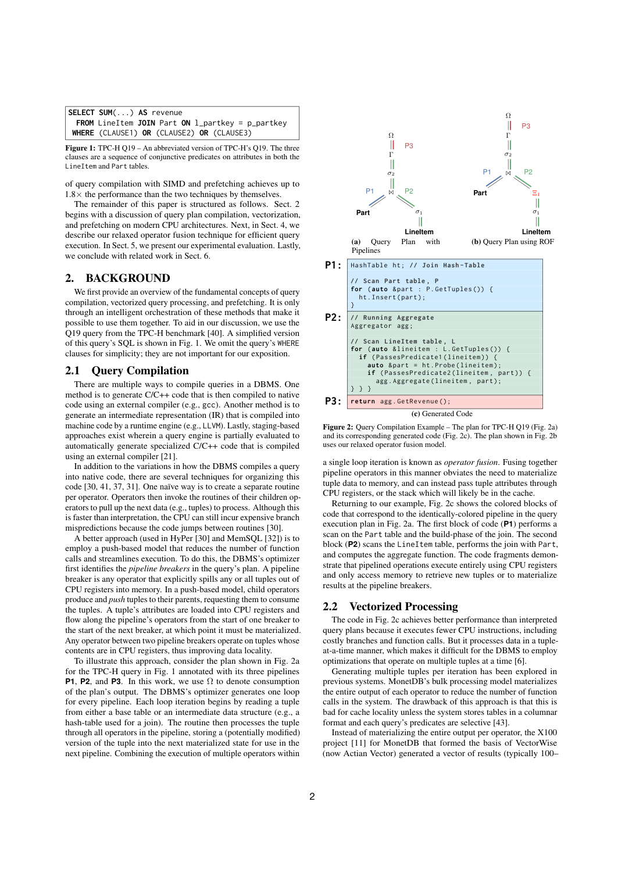
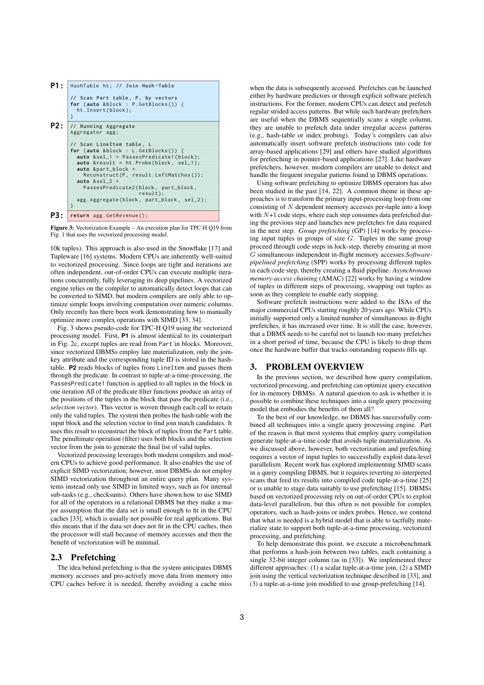

> 本组第 27 篇 · 查询执行引擎 · [全部论文]() · [上一篇]() · [下一篇]()

ROF 在既有 pipeline 内引入受控的 stage 边界：stage 内保留编译融合，stage 间主要暂存足够小的 tuple-ID 向量，必要时附带对齐的位置/指针向量，以支持 SIMD 与跨元组软件预取。目标是在寄存器传递、缓存内缓冲读写、随机访存延迟与指令开销之间取舍，不是让每个算子都物化，也不是证明某个切分策略普遍最优。Peloton/LLVM 3.7 的实验使用 TPC-H SF10 的 8 个查询，包含单线程分析及 1-20 线程扩展；系统比较则统一单线程并预热。数字必须按出处区分：摘要/结论写最高 2.2 倍、跨系统 1.8 倍；Sec.5.2 写七查询 1.7-2.5 倍，逐查询正文又给出 Q3 1.61 倍、Q13 1.5 倍，以及 Q19 对 Vector/HyPer 6/8 倍。原文未解释这些口径差异，本报告不补造几何平均。Q1 中 SIMD 收益很小，而对四项 L1 驻留聚合表额外预取会变慢。

本文保留论文陈述、读者推断与待验证方案的区别；实验数字只适用于原文条件。原文和翻译来自已有 AI 辅助精读报告，已做来源匹配与编辑复核，不等于人工逐项核验或独立实验复现。所有页码均为 PDF 物理页。

## 论文与阅读范围

Prashanth Menon, Todd C. Mowry, Andrew Pavlo. Relaxed Operator Fusion for In-Memory Databases: Making Compilation, Vectorization, and Prefetching Work Together At Last. PVLDB 11(1): 1-13, 2017. DOI: https://doi.org/10.14778/3136610.3136611。来源范围：SHA 匹配的 PDF 物理页 1-13，全文提取共 83,500 字符，无 OCR 页。

[论文集中的原始 PDF](https://github.com/lonng/db-papers/blob/4ff1331069c7cf52ac97dd769e5f484c1c35c200/papers/execution-engine/relaxed-operator-fusion-for-in-memory-databases-making-compilation-vectorization-and-prefetching-work-together-at-last.pdf) · 本地来源：`execution-engine/relaxed-operator-fusion-for-in-memory-databases-making-compilation-vectorization-and-prefetching-work-together-at-last.pdf`，共 13 页。

本篇保留 10 组原文精读和 71 条证据。截图为原始 PDF 的局部页选，不是重新生成的图表；未将整份 PDF 复制到博客。

## 研究问题与适用边界

**研究对象与问题**
论文面向主体数据驻留 DRAM 的内存 OLAP DBMS：磁盘不再是主要瓶颈，缓存未命中与计算吞吐量变得重要。这里“驻留内存”不等于“驻留 CPU 缓存”。编译型 push-based 执行把多个算子融合到逐元组循环，降低调用与中间物化成本；但严格保持单元组处理，不易向 SIMD 或预取暴露跨元组并行机会 [C001N01][C001N02][C001N10]。

**需要协调的并行性**
SIMD 需要组织多条数据以进行并行计算；软件预取需要提前知道后续元组的目标地址，并在取数与实际使用之间安排其他元组的工作。两者都需要跨多个元组安排执行，但预取的地址及目标块不必相邻，不能把“SIMD 数据打包”误解为“预取地址也必须连续”。论文背景中的连续打包要求是其 SIMD 处理方式的讨论，不是对一切 SIMD 指令/体系结构的普遍限制 [C001N08]。

**适用边界**
作者主要解决超出缓存的随机访问结构与计算密集扫描在同一计划中的协调问题；但 ROF 并非只有超缓存 hash join 才适用，Q6 的顺序扫描 SIMD 也受益。缓存内的小聚合表不应无条件预取。“尚无 DBMS 成功整合这些技术”是作者在 2017 年论文中的论断，不是对当今系统的调查结论 [C001N10][C003N05][ROF-X08]。

依据：论文陈述；PDF 物理页 1, 2, 3, 8, 11。证据：[C001N01](#evidence-c001n01), [C001N02](#evidence-c001n02), [C001N08](#evidence-c001n08), [C001N10](#evidence-c001n10), [C003N05](#evidence-c003n05), [ROF-X08](#evidence-rof-x08)。

## 系统架构与核心组件

**Pipeline 与 Stage 的层次**
论文把 pipeline breaker 定义为显式将部分或全部元组从 CPU 寄存器写入内存的算子；这个定义不只指“必须消费完整输入才输出”的阻塞算子。原有 push-based 模型在 breaker 间融合算子，可通过寄存器传值，正文也允许很可能在缓存中的栈；不能解释为机器级保证绝不 spill。ROF 在既有 pipeline 内再划分 stage，每个 stage 内仍融合，不把每个新增边界都当成全关系物化或磁盘 spill [ROF-S01][ROF-S02][C002N04]。

**有界缓冲和调度**
stage 间主要通过 tuple-ID 输出向量通信。stage 内逐元组处理，有效 ID 被压紧写入向量；达到容量或输入耗尽时交给下一 stage。除尾轮外，作者目标是传递满的有效 ID 向量，尾轮可不足容量。输入/输出向量足够小时，单活跃处理 stage 的调度有助于缓存驻留；这既不是所有 buffer 大小的缓存命中保证，也不是多线程系统全局只能运行一个 stage [C002N04][C002N05][ROF-S04]。

**状态和完成条件**
每个 pipeline 外层循环包含多个 stage 内层循环。write 位置表示缓冲有效条目数，read 位置表示消费进度；所有组成 stage 均耗尽才算 pipeline 完成。若后续 stage 需要外部结构中的位置或指针，要保留与主 TID 向量对齐的 companion vector，因此“仅传 TID、从不保存其他状态”不成立 [C002N06][ROF-S05]。

**模型能力不是划分最优性**
一个 pipeline 只有一个 stage 可表达原逐元组融合；每对算子间放边界可表达向量化处理。这说明模型包含两类执行组织方式，不证明应把每对算子都切开。边界本身收益有限，价值在于允许 SIMD 与非缓存数据预取；额外 buffer 读写必须算入成本。实现是在 Peloton 的 LLVM 3.7 JIT 中加入 ROF 生成逻辑，不是放弃编译转回解释执行 [C002N05][ROF-X11][C003N01]。

依据：论文陈述；PDF 物理页 2, 4, 5, 7。证据：[ROF-S01](#evidence-rof-s01), [ROF-S02](#evidence-rof-s02), [C002N04](#evidence-c002n04), [C002N05](#evidence-c002n05), [ROF-S04](#evidence-rof-s04), [C002N06](#evidence-c002n06), [ROF-S05](#evidence-rof-s05), [ROF-X11](#evidence-rof-x11), [C003N01](#evidence-c003n01)。

*原论文 PDF 物理页 2，版权归原作者或出版方。点击图片可查看原尺寸。页面文本中定位到：Figure 1: TPC-H Q19 – An abbreviated version of TPC-H’s Q19. The three；Figure 2: Query Compilation Example – The plan for TPC-H Q19 (Fig. 2a)。这是页面定位信息，不表示本次已复核图内所有数据。*

## 算法机制与执行步骤

**SIMD 与压紧输出**
本文贪心地在 SIMD 算子输出设置 stage 边界。逐 lane 退回标量会延长寄存器占用；直接传整个 SIMD 寄存器可能留下无效 lane。压紧输出减少后续有效性检查，形成紧凑 SIMD 循环，但要付出 TID 写入/读出缓冲的成本。满向量性质须带尾轮例外，不能把这条贪心规则当成任意算子、数据分布和硬件上的最优证明 [C002N07][C002N05]。

谓词实现加载属性及 TID，比较生成 bit-mask；用 movemask 得到查表索引，置换有效 TID 到前部，再用 masked store 写缓冲并以 popcnt 更新位置。AVX2 256-bit 处理 8 个 4-byte 整数，对应 256 种有效性掩码，表项 8 bytes，合计 2 KB。这里的 8 lane、stage 向量容量和 GP 组大小是三个不同尺度 [C002N08][ROF-S09]。

读者构造的假设示例：一个 8-lane 批次的有效 TID 为 0、2、4，压紧后仅把这三个 ID 追加到缓冲；继续处理更多批次直到缓冲满或输入结束。此例只说明压紧语义，不给出特定 ISA 的 movemask 位序或声称执行了指令测试。

**哈希结构与预取分工**
Sec.4.3 的通用表采用 open addressing、linear probing 和 MurmurHash3。连续桶以 8-byte status 开头，重复值放外部连续区，status 可复用为其指针；末端保存 4-byte hash 供 resize 使用。status/key 靠近桶头是为减少检查时访存，但 key 尺寸和 cache-line 布局仍有限制。它不是 Fig.4 微基准中仅 4B key+4B payload 的简化桶 [C002N10][C002N01]。

软件预取用于初次随机桶访问，后续线性探测序列可利用硬件预取。对需随机访问且结构超过缓存的算子，输入边界提供一组独立元组以重叠取数和处理。GP 让同一组按代码步骤 lock-step 推进：某步骤消费前一步预取的数据，并为下一步发请求。不能把它写成“每个元组刚预取就立刻消费”，也不能像原报告示例一样先 probe 一遍再 probe 一遍。它是分组调度，不是跨线程屏障语义 [ROF-X01][C002N11]。

本文选择 GP 的理由是代码生成简单、分组代码步骤提供处理插入冲突的组织点，以及其特定线性探测表随机访问层数较固定。作者在这一设计下认为 AMAC 不会比 GP 更好；不能推广到任意链式结构、偏斜、重复键或缓存层级。ROF 本身也不绑定 GP [C002N11][ROF-S11]。

**规划与代码体积**
对可 SIMD 化的 scan，planner 贪心放置输出边界。预取可依据统计估算中间结构是否超缓存，但估计失误可能减速；另一方案在随机访问算子输入设边界，生成预取/非预取两路，运行时根据结构大小选择。若复制所有剩余逻辑会代码膨胀，ROF 在该算子输出再设边界，将复制限制到该算子的逻辑。这里是限制复制范围，不是消除分支、编译或代码体积成本。过多预取还有指令与缓存污染开销 [C002N12][ROF-X12][ROF-S13][ROF-S10]。

依据：论文陈述；PDF 物理页 3, 4, 5, 6, 7。证据：[C002N07](#evidence-c002n07), [C002N05](#evidence-c002n05), [C002N08](#evidence-c002n08), [ROF-S09](#evidence-rof-s09), [C002N10](#evidence-c002n10), [C002N01](#evidence-c002n01), [ROF-X01](#evidence-rof-x01), [C002N11](#evidence-c002n11), [ROF-S11](#evidence-rof-s11), [C002N12](#evidence-c002n12), [ROF-X12](#evidence-rof-x12), [ROF-S13](#evidence-rof-s13), [ROF-S10](#evidence-rof-s10), [ROF-X14](#evidence-rof-x14), [ROF-X15](#evidence-rof-x15)。

## 正确性与一致性保证

**论文提供的机制与未证明事项**
原文给出了缓冲 read/write 位置、尾批次、伴随位置/指针向量，以及多线程执行中的局部状态、协调合并和共享表更新机制；未给出完整的形式化语义等价证明、事务隔离/恢复协议或任意输入下的正确性证明。不能把“没有证明”写成“没有多线程实现描述” [C002N06][ROF-S05][ROF-X02][ROF-X05]。

**读者推断：应验证的不变量**
分阶段与原融合执行等价，需要每个有效元组恰好处理一次，尾向量不漏不重复，companion vector 与 TID 保持对应，join 多匹配的枚举和聚合更新语义不变，并保证被引用状态在消费前有效。满向量是调度性质，不自动证明这些条件；也不能由不用 selection vector 推导正确性已获保证。

**GP 不是线程同步协议**
同组元组按代码步骤 lock-step 的 GP 调度，以及作者所谓处理重复插入冲突的同步组织点，不能自行推出隐式跨核 barrier。Sec.5.6 说明各线程维护局部状态，pipeline-breaking 处由协调线程合并；对 Q3/Q13 的共享 group hash-join 更新，原文明确提到用 64-bit compare-and-swap 串行化。具体原子/同步策略与 GP 的组内访存安排应分别理解 [ROF-X01][ROF-X02][ROF-X05]。

**尚待测试的边界**
空输入、尾批次、输出容量、重复键、多匹配、未 SIMD 化表达式及运行时双路径都应进入语义对照测试（读者建议）。来源未完整规定 masked store 的异常和越界处理，本报告不凭外部 ISA 记忆补充结论，也不把软件预取当成同步或内存安全保证。

依据：读者推断；PDF 物理页 3, 4, 5, 10。证据：[C002N06](#evidence-c002n06), [ROF-S05](#evidence-rof-s05), [ROF-X01](#evidence-rof-x01), [ROF-X02](#evidence-rof-x02), [ROF-X05](#evidence-rof-x05)。

## 实验设计与结果分析

**硬件、实现与指标**
Peloton 通过 LLVM 3.7 实现 JIT/ROF。机器为双路、每路 10 核 Intel Xeon E5-2630v4（共 20 物理核，Broadwell），原文描述 25 MB L3、128 GB DRAM、AVX2 256-bit、每物理核 10 个 LFB；本报告不自行扩写全机 L3 容量。numactl 将整个数据库装入同一 NUMA region。各实验十次运行取平均执行时间；不是 p95、中位数或统计显著性结果 [C003N01][ROF-X05]。

TPC-H SF10（约 10 GB），仅 Q1、Q3、Q4、Q5、Q6、Q13、Q14、Q19。作者称其覆盖 choke-point 分类并期待推广，但未测试其余 14 查询。Sec.5.2-5.5 初始分析单线程、无查询间并发；Sec.5.6 另有多线程扩展；Sec.5.7 跨系统比较又统一关闭多线程。不能称整篇“只做了单线程实验” [C003N02][ROF-X03][C004N01]。

**Fig.4 微基准：输出吞吐，不是查询耗时**
比较 scalar、vertical SIMD 和 scalar+GP 三种 hash join。探测表 A 固定 100m 个 32-bit 整数（约 382 MB），改变 B 使 hash table 从 1 MB 到 1024 MB；open addressing、linear probing、50% fill、MurmurHash3 32-bit finalizer，AoS 每桶 4B key+4B payload，均匀分布、每个 A 元组至多匹配一个 B 元组。原文给输出 100m 元组约 381 MB。使用 20 个硬件线程且关闭超线程、25 MB 共享 L3；纵轴为 output tuples/s。正文称预取版本始终更快，常见收益最高约 1.2 倍，并将该 SIMD 实现的劣势归于碰撞重算和超缓存后的内存瓶颈。这不是所有 SIMD join 的普遍排名，也不是 ROF 端到端查询的 1.2 倍结果 [C001N07][C002N01][C002N02]。

**Peloton 内部基线与分解：数字保留出处**
基线是同一引擎的 data-centric 编译，而不是拿 HyPer 系统直接充当基线。摘要/结论写最高 2.2 倍，Sec.5.2 写七查询 1.7-2.5 倍；Sec.5.3 的 Q3 却写总体最高 1.61 倍，Q13 写整体 1.5 倍。原文未解释这些数字间的差异，不将 Sec.5.2 的文字当成所有单柱精确复算结果 [ROF-X10][ROF-S30][C003N03][C003N07][ROF-X06]。

Q1 仅约 1.04 倍：98% 是通过率，P1 的扫描部分约占总体 4%、其余主要为聚合约 96%；仅把扫描理想加速 8 倍，整体理论上限约 1.036 倍。对四项 L1 驻留聚合表再预取会减速 [C003N04][C003N05]。
Q3 的扫描时间比例 1%、3.7%、7% 分别属于 P1、P2、P3 内部，不能当整条查询比例；LineItem SIMD 一步约 1.02 倍，而复用向量做后续 join probe 预取的一步约 1.38 倍，作者写总体最高 1.61 倍 [ROF-S19][C003N07]。
Q13 的非平凡字符串 LIKE 无法 SIMD，但 staging 仍支持预取。作者报告 O1 为 1.34 倍、O2 相对 O1 再 1.04 倍、整体 1.5 倍；三者不能直接乘法自洽，保留源文不一致，不把算出的约 1.39 当作者实测 [ROF-X06]。
Q14 的 2% LineItem 通过率下，SIMD 改善 P1 1.89 倍、整查询 1.37 倍，预取再改善整查询 1.45 倍，合计接近 2 倍。不能把 P1 的 1.89 倍当整查询收益 [C003N09]。
Q19 的 Fig.14 O3 在每对算子间插入 staging；已核对图中 O2/O3 柱高近似，不能据此称额外切分最优，也未从像素编造精确耗时 [ROF-X13]。

**参数敏感性**
Sec.5.4 固定 GP=16、选各查询最佳 staged plan，将输出容量从 64 扫到 256k tuples。原文先写“除 Q13 外均不敏感”，同节后文却说 Q13 的 LIKE 瓶颈使更大向量无帮助，只有 Q3 随宽度改善、到 16k 后不再改善。报告显式标记这一前后不一致。该节把 Q14 的 2% 扫描表写成 Orders，也与 Fig.13/Q14 case 的 LineItem 不符；本文采用后者的明确计划归属 [ROF-S20][ROF-S26][ROF-S27][C003N11][C003N09]。
Sec.5.5 固定各查询最佳输出容量，将 GP 组从 0（关闭）扫到 256。Q6 仅顺序扫描，无预取收益；Q1 无预取最快。其余适用查询随组大小增至 16 改善，作者解释为内存并行度和循环指令数共同作用，16 不是所有 CPU/负载最优常数，也不由 10 个 LFB 直接推导 [ROF-S21][C003N12][C003N13]。

**多线程：不是线性扩展保证**
Sec.5.6 使用最佳 staged plan，在 SF10 上从 1 线程扩至 20 个物理核，十次均值。线程局部状态在 pipeline breaker 处由协调线程合并；1 到 2 线程可能因记账、同步和 join build 全局表构建而变慢。Q3/Q13 超过 10 线程出现跨 NUMA 及共享 CAS 访问相关抖动，Q5 亦受影响；部分 join 查询 ROF 对基线约 1.5-1.61 倍。不能从这些结果推导消除同步成本或生产并发服务的线性扩展 [ROF-X02][ROF-X03][ROF-X04][ROF-X05]。

**系统比较：单线程、预热及不同实现**
在相同硬件和数据库上比较 Vector、当时版本 HyPer、Peloton 有/无 ROF；预热且努力调优，但作者承认优化和计划并不完全相同 [C004N01]。逐查询正文数字（均需保留比较对象）：
- Q1：HyPer 比原文所称 Peloton 约快 1.38 倍、比 Vector 超过 6.5 倍，作者指出定点与浮点算术差别 [ROF-X07]。
- Q3：Peloton ROF 对 Vector/HyPer 为 1.8/1.5 倍；Q4 为 1.8/1.2 倍，后者涉及 CRC32/SSE4 与 MurmurHash3 的指令开销差异 [C004N02][C004N03]。
- Q5：对 Vector/HyPer 约 3.4/1.1 倍；Q6 为 5.4/2.3 倍，所测 HyPer 版本没有这里的 SIMD scan [C004N04][ROF-X08]。
- Q13：启用 ROF 后对 Vector 约 1.4 倍。Peloton LIKE 假设 clean input；其他系统可能处理损坏 UTF 更健壮是作者推测，不是已证实的正确性妥协或确定加速成因 [C004N06][ROF-X09]。
- Q14：对 Vector/HyPer 为 3.9/1.35 倍，但 HyPer 是 index nested-loop join，另两者是 hash join [C004N07]。
- Q19：对 Vector/HyPer 为 6/8 倍，Peloton 对低基数过滤属性使用字典编码，Vector 也压缩字符串 [C004N08][ROF-S25]。
摘要的跨系统 1.8 倍与以上个案数字未在源文中获得统一解释。不补“几何平均”“特定子集上限”或其他无证据的解释。本文没有测量 JIT 编译额外成本，也未做实验复现；这些执行时间不能直接充当冷启动编译加执行总延迟。

依据：论文陈述；PDF 物理页 1, 3, 4, 7, 8, 9, 10, 11, 12。证据：[C003N01](#evidence-c003n01), [ROF-X05](#evidence-rof-x05), [C003N02](#evidence-c003n02), [ROF-X03](#evidence-rof-x03), [C004N01](#evidence-c004n01), [C001N07](#evidence-c001n07), [C002N01](#evidence-c002n01), [C002N02](#evidence-c002n02), [ROF-X10](#evidence-rof-x10), [ROF-S30](#evidence-rof-s30), [C003N03](#evidence-c003n03), [C003N07](#evidence-c003n07), [ROF-X06](#evidence-rof-x06), [C003N04](#evidence-c003n04), [C003N05](#evidence-c003n05), [ROF-S19](#evidence-rof-s19), [C003N09](#evidence-c003n09), [ROF-X13](#evidence-rof-x13), [ROF-S20](#evidence-rof-s20), [ROF-S26](#evidence-rof-s26), [ROF-S27](#evidence-rof-s27), [C003N11](#evidence-c003n11), [ROF-S21](#evidence-rof-s21), [C003N12](#evidence-c003n12), [C003N13](#evidence-c003n13), [ROF-X02](#evidence-rof-x02), [ROF-X04](#evidence-rof-x04), [ROF-X07](#evidence-rof-x07), [C004N02](#evidence-c004n02), [C004N03](#evidence-c004n03), [C004N04](#evidence-c004n04), [ROF-X08](#evidence-rof-x08), [C004N06](#evidence-c004n06), [ROF-X09](#evidence-rof-x09), [C004N07](#evidence-c004n07), [C004N08](#evidence-c004n08), [ROF-S25](#evidence-rof-s25), [ROF-X16](#evidence-rof-x16)。

*原论文 PDF 物理页 3，版权归原作者或出版方。点击图片可查看原尺寸。页面文本中定位到：Figure 3: Vectorization Example – An execution plan for TPC-H Q19 from；Fig. 1 that uses the vectorized processing model.；Fig. 3 shows pseudo-code for TPC-H Q19 using the vectorized。这是页面定位信息，不表示本次已复核图内所有数据。*

## 设计权衡与局限性

**缓冲流量换取跨元组并行性**
ROF 保留 stage 内的融合，把跨 stage 寄存器值传递换成有界向量读写，以暴露 SIMD 与预取机会。主向量压紧 TID，而不是必然复制完整行；跨外部结构仍要 companion vector。只有足够小的输入/输出向量才有缓存驻留前提。目标哈希表可以超出缓存；不能把“stage buffer 可驻留”说成“所有中间结构都驻留” [C002N04][ROF-S04][ROF-S05]。

**寄存器、cache 和未完成请求是不同约束**
退出 SIMD 逐 lane 处理会占用寄存器，传递带无效 lane 的寄存器会浪费计算；压紧存储也有开销。Q1 98% 通过时，额外 ID 复制抵消大量 SIMD 收益，但作者仍写 ROF 总体约 1.04 倍，不能将其改写为 SIMD 已被实验证明净减速。真正变慢的是再预取仅四项、已在 L1 的聚合表 [C002N07][C003N04][C003N05]。

AVX2 的 8 个 32-bit lane、stage 输出容量、GP 组大小必须分开调优。较大 buffer 可减少外层循环，但未必继续增加随机访存并行度，且缓存前提可能失效；过多软件预取还会增加无用指令、cache pollution，并遇到 outstanding-request 容量限制。内存延迟隐藏也不等于消除内存带宽瓶颈 [ROF-S09][ROF-S20][ROF-S10][C001N06][C003N13]。

**选择性切分，不是边界越多越好**
可 SIMD 的 scan 输出边界、超缓存随机访问算子输入边界、限制双路径代码复制的输出边界，各有不同目的。统计误判可能把收益翻成开销；双路径按运行时结构大小选择，并在输出处分隔剩余逻辑，可缓解静态误判与代码复制，但不免费。Fig.14 的 O3 全切分没有显示明显优于 O2，原文未证明其全局最优 [C002N12][ROF-X12][ROF-S13][ROF-X13]。

**个案归因与实现约束**
Q3 的主要增益来自 join 预取；Q14 中 P1 SIMD 的 1.89 倍不能替代整查询的 1.37 倍。GP 对 AMAC 的比较基于本文线性探测表随机访问层数较固定的假设，不宜跨结构推广。系统级 CRC32/Murmur、join 算法、字典编码及 LIKE 输入前提不同，不能将所有跨系统差距归为 ROF 单一机制 [C003N07][C003N09][C002N11][C004N03][C004N06][C004N07][C004N08]。

依据：论文陈述；PDF 物理页 3, 4, 5, 6, 7, 8, 9, 10, 11, 12。证据：[C002N04](#evidence-c002n04), [ROF-S04](#evidence-rof-s04), [ROF-S05](#evidence-rof-s05), [C002N07](#evidence-c002n07), [C003N04](#evidence-c003n04), [C003N05](#evidence-c003n05), [ROF-S09](#evidence-rof-s09), [ROF-S20](#evidence-rof-s20), [ROF-S10](#evidence-rof-s10), [C001N06](#evidence-c001n06), [C003N13](#evidence-c003n13), [C002N12](#evidence-c002n12), [ROF-X12](#evidence-rof-x12), [ROF-S13](#evidence-rof-s13), [ROF-X13](#evidence-rof-x13), [C003N07](#evidence-c003n07), [C003N09](#evidence-c003n09), [C002N11](#evidence-c002n11), [C004N03](#evidence-c004n03), [C004N06](#evidence-c004n06), [C004N07](#evidence-c004n07), [C004N08](#evidence-c004n08), [ROF-X14](#evidence-rof-x14), [ROF-X15](#evidence-rof-x15)。

## 相关工作与系统对比

以下仅整理本文 2017 年对相关工作的描述，没有联网或检查这些系统当今源码、版本和维护状态。

**编译与向量化的组织差异**
论文描述 HyPer/MemSQL 的 data-centric push-based 融合用较少循环和调用保持代码紧凑；这里讨论的是所述逐元组生成方式，不是“任何查询编译都只能逐元组”的必然限制。X100/VectorWise 的块式处理及 selection vector 为批量计算提供机会；批处理不等于每个操作都使用 SIMD，也不等于编译与向量化互斥 [C001N02][C001N03][C001N09]。

ROF 的贡献是统一保留融合、选择性暂存和预取的计划组织，不是发明 SIMD 或软件预取。HIQUE 每个算子物化与 ROF 只在所选 staging 点暂存的差别，是本文强调的设计对照；MapD 的 GPU LLVM/NVVM 路径则属不同执行目标，论文没有给出 ROF 对 GPU 的实测优势 [C004N12]。

**历史陈述与比较范围**
System R 代码生成、Volcano 以及 Hekaton、Impala 等历史介绍来自本文 related work；本报告未独立核验相应外部论文。论文提到软件预取约二十年前进入商业 ISA，这一相对时间以 2017 年为参照，而不是当前年份 [C004N09][C001N06]。

Sec.5.7 的 HyPer 是所测旧版本，缺少 SIMD scan，不能概括为 HyPer 永远不支持 SIMD。系统实验虽统一单线程、预热及硬件，仍混合了哈希函数、join 算法、数值表示和字符串实现差异；ROF 的机制收益更应结合 Peloton 内部有/无 ROF 的消融理解，而不能仅看跨系统排名 [C004N01][C004N03][C004N07][ROF-X07][ROF-X08]。

依据：论文陈述；PDF 物理页 2, 3, 11, 12。证据：[C001N02](#evidence-c001n02), [C001N03](#evidence-c001n03), [C001N09](#evidence-c001n09), [C004N12](#evidence-c004n12), [C004N09](#evidence-c004n09), [C001N06](#evidence-c001n06), [C004N01](#evidence-c004n01), [C004N03](#evidence-c004n03), [C004N07](#evidence-c004n07), [ROF-X07](#evidence-rof-x07), [ROF-X08](#evidence-rof-x08)。

## 复现指南与待验证问题

本节全为读者提出的复现计划，未实际执行实验，不是论文新增结果。

1. 固定历史 Peloton/ROF 源码、LLVM 3.7、数据生成器与查询文本；记录论文未明确给出的构建版本和编译选项，不假定当前仓库仍能直接复现。尽量采用所述双路每路 10 核 E5-2630v4/AVX2、128 GB 环境，并明确记录 cache、LFB 与 NUMA 设置 [C003N01]。
2. 生成 SF10，完整列入实际八查询 Q1、Q3、Q4、Q5、Q6、Q13、Q14、Q19。先在同一引擎对照有/无 ROF，并逐项加入 SIMD、预取及边界；固定并报告参数，每条件十次平均，同时额外记录离散度。不要遗漏 Q6，也不要称已覆盖全部 22 查询 [C003N02][ROF-X03][ROF-X08]。
3. 分离三种测试口径：微基准按 Fig.4 的均匀分布、单匹配、20 线程且 HT 关闭、简化 AoS 桶，记录 output tuples/s；查询初始分析单线程；扩展实验另扫 1-20 线程并保留同步/NUMA 成本。HT 关闭是微基准明确条件，不把它无说明推广成全文统一声明 [C002N01][C003N01][ROF-X02][ROF-X03][ROF-X05]。
4. 先固定 GP=16 扫 stage 容量 64-256k，再固定各查询选定容量扫 GP=0-256；随后可增加联合搜索作为扩展实验。分别测 SIMD 压紧、TID/伴随向量流量、软件预取和代码体积，避免把最佳手调 staged plan 的结果当自动优化器的无条件结果 [ROF-S20][ROF-S21][ROF-S13]。
5. 对照关系结果：空/尾批次、重复键及多匹配、NULL/字符串等系统支持范围、buffer 容量和运行时双路径；比较多重集或确定性聚合结果，不能只比较条数。记录 query compile time、warm execution time 和两者总和，以补充原文未充分交代的短查询成本（新增测试建议）。
6. 跨系统实验保持单线程、预热和相同数据，并记录计划、编码、算术与 LIKE 语义；另设同函数/同 join 算法的对照，不能预先把任何胜负归因于 ROF。对摘要与逐例数字的差异保留未解状态，不用自造平均值作为复现目标 [C004N01][C004N03][C004N06][C004N07][ROF-X07][ROF-X10]。

**其他系统的待验证问题**
本文没有核查 DuckDB、StarRocks 或 Calcite 的源码与现状，不再先断言它们使用何种执行/JIT 机制。可在另行取证后询问：目标系统是否能表达 pipeline 内暂存边界？selection vector 与压紧 TID 的成本如何测量？运行时结构大小反馈与代码生成层在哪里结合？能否独立开关 SIMD 与预取以区分收益？这些都是研究建议，不是本文对上述系统的结论。

依据：待验证的工程设想；PDF 物理页 1, 4, 7, 9, 10, 11, 12。证据：[C003N01](#evidence-c003n01), [C003N02](#evidence-c003n02), [ROF-X03](#evidence-rof-x03), [ROF-X08](#evidence-rof-x08), [C002N01](#evidence-c002n01), [ROF-X02](#evidence-rof-x02), [ROF-X05](#evidence-rof-x05), [ROF-S20](#evidence-rof-s20), [ROF-S21](#evidence-rof-s21), [ROF-S13](#evidence-rof-s13), [C004N01](#evidence-c004n01), [C004N03](#evidence-c004n03), [C004N06](#evidence-c004n06), [C004N07](#evidence-c004n07), [ROF-X07](#evidence-rof-x07), [ROF-X10](#evidence-rof-x10)。

## 总结与工程启示

ROF 的核心是受控地放松 pipeline 内的融合：stage 内继续编译融合，边界处用有界 TID 及必要的伴随状态暂存，使计算与跨元组随机取数可以分开安排。它不消除物化代价，也不保证所有数据结构驻留缓存。零边界、每对算子设边界和有选择的边界，是模型可表达的不同方案，不是同一条普遍最优策略 [C002N04][C002N05][ROF-S05][ROF-X11][ROF-X13]。

证据支持“在本文测得的部分查询与硬件上，SIMD/预取相配合可改善执行”，不支持“所有查询至少快 1.7 倍”“跨系统最高只有 1.8 倍”或“所有实验单线程”。摘要、Sec.5.2、逐例和结论的数字不完全一致，必须保留出处和未解差异；不能拿几何平均来补解释。Q1 的小 L1 表说明多加预取会变慢，但不等于 Q1 所选 ROF 整体退化 [ROF-X10][C003N03][C003N05][C003N07][ROF-X06][ROF-X03][ROF-S25][ROF-S30]。

**工程启示（读者推断）**
应按真实瓶颈选择阶段：寄存器存活、SIMD 有效 lane、cache 内 buffer 流量、随机取数延迟、指令数、带宽和代码体积要分别衡量。统计估计与运行时双路径都有代价，输出边界可限制复制范围；GP=16 是所测平台的结果，不是参数定律 [ROF-S13][ROF-S10][C003N13]。

在移植或跨系统比较前，先保证语义一致、补齐编译与运行成本，再考察并行同步和 NUMA。原文已有线程局部状态/协调合并/CAS 描述，但不构成完整事务正确性证明；Q13 的字符串实现差异提示检查前提，不能未经验证就宣布某系统牺牲正确性 [ROF-X02][ROF-X05][C004N06][ROF-X09]。

依据：读者推断；PDF 物理页 1, 4, 5, 6, 7, 8, 9, 10, 11, 12。证据：[C002N04](#evidence-c002n04), [C002N05](#evidence-c002n05), [ROF-S05](#evidence-rof-s05), [ROF-X11](#evidence-rof-x11), [ROF-X13](#evidence-rof-x13), [ROF-X10](#evidence-rof-x10), [C003N03](#evidence-c003n03), [C003N05](#evidence-c003n05), [C003N07](#evidence-c003n07), [ROF-X06](#evidence-rof-x06), [ROF-X03](#evidence-rof-x03), [ROF-S25](#evidence-rof-s25), [ROF-S30](#evidence-rof-s30), [ROF-S13](#evidence-rof-s13), [ROF-S10](#evidence-rof-s10), [C003N13](#evidence-c003n13), [ROF-X02](#evidence-rof-x02), [ROF-X05](#evidence-rof-x05), [C004N06](#evidence-c004n06), [ROF-X09](#evidence-rof-x09)。

## 原文精读：从句子回到机制

以下保留原文、忠实翻译、含义与边界；假设示例不作为论文实验结果。

### P001 · PDF 物理页 1

**原文**

<blockquote class="paper-source-quote"><pre><code>Given&#10;this trend, we anticipate that most future OLAP applications will use&#10;in-memory DBMSs. Because in-memory DBMSs are designed such&#10;that the bulk of the working dataset fits in memory, disk accesses&#10;are no longer the main bottleneck in query execution. Instead, cache&#10;misses to memory and computational throughput are much more&#10;important factors in the performance of in-memory DBMSs.</code></pre></blockquote>

**忠实翻译**

> 鉴于这一趋势，我们预计大多数未来的 OLAP 应用将使用内存 DBMS。由于内存 DBMS 的设计使得工作数据集的主体能够放入内存，磁盘访问不再是查询执行的主要瓶颈。相反，对内存的缓存未命中（cache misses）以及计算吞吐量是内存 DBMS 性能中更为重要的因素。

**技术含义与边界**

> 原文陈述了作者对未来 OLAP 应用采用内存 DBMS 的预期，并指出在内存 DBMS 场景下，性能瓶颈从磁盘 I/O 转移到了 CPU 缓存未命中和计算吞吐量。适用边界限定于“工作数据集主体能放入内存”的内存 DBMS 设计前提。读者可推断：针对内存 DBMS 的优化应聚焦于缓存友好性和指令级并行，而非传统的磁盘 I/O 减少。

**常见误读**

> 容易发生的错误解读是将“磁盘访问不再是主要瓶颈”泛化为“磁盘访问完全不重要”。原文明确限定了前提是“工作数据集的主体适合放入内存”，如果工作集超出内存容量，该结论不成立。此外，不能将此局部观察直接作为所有数据库系统的通用保证。

**读者构造的假设示例**

> 读者构造的假设示例：假设一个分析型查询需要扫描 5GB 的数据，而系统可用内存为 32GB。在此前提下，数据完全驻留内存，查询耗时主要取决于 CPU 处理数据的吞吐量以及数据在 L1/L2/L3 缓存中的命中率，而不是从磁盘读取数据的速度。

### P002 · PDF 物理页 12

**原文**

<blockquote class="paper-source-quote"><pre><code>Peloton and Vector&#10;are able to take advantage of this optimization, but HyPer (in this&#10;version) and Peloton without ROF must execute a scalar scan. We&#10;note that both Peloton and Vector implement Q14 with a hash-join,&#10;whereas HyPer uses an index nested-loop join. This is the reason&#10;why Peloton without ROF is slower than HyPer since the probe&#10;phase of the join will incur the additional overhead of duplicate chain&#10;traversal.</code></pre></blockquote>

**忠实翻译**

> Peloton 和 Vector 能够利用这一优化，但 HyPer（在此版本中）以及没有 ROF 的 Peloton 必须执行标量扫描（scalar scan）。我们注意到 Peloton 和 Vector 都使用 hash-join 实现 Q14，而 HyPer 使用 index nested-loop join。这就是为什么没有 ROF 的 Peloton 比 HyPer 慢的原因，因为 join 的探测阶段（probe phase）会产生遍历重复链（duplicate chain traversal）的额外开销。

**技术含义与边界**

> 原文对比了不同系统在 TPC-H Q14 上的执行策略与性能。作者陈述的事实包括：Peloton 和 Vector 支持某项优化并使用 hash-join；特定版本的 HyPer 和无 ROF 的 Peloton 执行标量扫描且 HyPer 使用 index nested-loop join。无 ROF 的 Peloton 较慢的原因被归结为 hash-join 探测阶段遍历重复链的额外开销。适用边界限于所测试的特定系统版本和 Q14 查询。

**常见误读**

> 容易发生的错误解读是认为 hash-join 在所有情况下都比 index nested-loop join 慢，或者认为 Peloton 整体性能不如 HyPer。原文仅针对 Q14 且明确指出是因为“探测阶段的重复链遍历开销”导致无 ROF 的 Peloton 较慢，同时强调了这是 HyPer 的“此版本”的表现，不能泛化为全局或跨查询的性能保证。

**读者构造的假设示例**

> 读者构造的假设示例：两个实现对同一输入分别选择 hash join 与 index nested-loop join。若前者需逐个枚举重复匹配的外部条目，其额外访问可能改变耗时；这只是解释计划差异的假设，不声称本文的重复值区域必为链表，也不推出哪种 join 总是更快。

### P003 · PDF 物理页 6

**原文**

<blockquote class="paper-source-quote"><pre><code>MurmurHash3 satisfies these&#10;requirements and used in many popular systems [4, 2, 3].&#10;Our hash-table, shown in Fig. 7, is laid out as a contiguous array&#10;of buckets. Buckets begin with an 8-byte status field that indicates&#10;(1) if this bucket is empty, (2) if it is occupied by a single key-value&#10;pair, or (3) if it is occupied and there are duplicate values for the key.&#10;Duplicate values are stored externally in a contiguous memory space,&#10;and the status field is re-purposed to store a pointer to this memory&#10;location.</code></pre></blockquote>

**忠实翻译**

> MurmurHash3 满足这些要求并被用于许多流行系统中 [4, 2, 3]。我们的哈希表（如图 7 所示）被布局为一个连续的桶（buckets）数组。桶以一个 8 字节的状态字段开头，该字段指示：(1) 此桶是否为空，(2) 是否被单个键值对占用，或 (3) 是否被占用且该键存在重复值。重复值被外部存储在一个连续的内存空间中，并且状态字段被重新用作指向该内存位置的指针。

**技术含义与边界**

> 原文把哈希表描述为连续桶数组，头部8字节status区分空、单项及重复值情形；重复值位于外部连续空间，此字段被复用为其指针。它没有在该片段中给出状态标签与地址的具体编码，不应进一步断言所有状态位消失或内存表示方式。

**常见误读**

> 不要把状态字段和重复值指针画成额外两个独立的8字节字段；原文说复用同一字段。也不能从此段补造指针tag位、外部区容量或所有桶都占固定8字节等细节。

**读者构造的假设示例**

> 读者构造的假设示例：假设哈希表的一个桶对应键 'A'。如果没有数据，前 8 字节标记为空；如果只有一个元组，前 8 字节标记为单键值对；如果有三个元组的键都是 'A'，前 8 字节变为一个内存地址，指向堆上另一块连续内存，该内存中依次存放这三个元组的值。

### P004 · PDF 物理页 3

**原文**

<blockquote class="paper-source-quote"><pre><code>While CPUs&#10;initially supported only a limited number of simultaneous in-flight&#10;prefetches, it has increased over time. It is still the case, however,&#10;that a DBMS needs to be careful not to launch too many prefetches&#10;in a short period of time, because the CPU is likely to drop them&#10;once the hardware buffer that tracks outstanding requests fills up.&#10;3.</code></pre></blockquote>

**忠实翻译**

> 虽然 CPU 最初只支持有限数量的同时进行中的预取（in-flight prefetches），但这一数量随时间推移已有所增加。然而，DBMS 仍需谨慎，不要在短时间内启动过多的预取，因为一旦跟踪未完成请求的硬件缓冲区填满，CPU 很可能会丢弃它们。

**技术含义与边界**

> 此段承接软件预取指令的讨论：CPU跟踪未完成请求的硬件资源有限，过密发请求可能被丢弃。不要把它混成硬件自动模式预测器的专属限制，也不要把可能丢弃改成固定精确丢弃数；与GP组大小的关系还受实现指令成本影响。

**常见误读**

> 容易发生的错误解读是认为只要 CPU 支持更多并发预取，DBMS 就可以无限制地发出预取指令。原文明确否定了这一点，强调“仍需谨慎”且“很可能会丢弃”。不能将硬件能力的提升等同于软件可以忽略预取频率的控制。

**读者构造的假设示例**

> 读者构造的假设示例：假设某 CPU 的硬件预取缓冲区最多只能跟踪 20 个未完成的预取请求。如果 DBMS 在一个极短的循环内连续发出了 50 个预取指令，那么后发出的 30 个指令可能会被 CPU 直接忽略，导致后续访问这些数据时依然发生缓存未命中。

### P005 · PDF 物理页 7

**原文**

<blockquote class="paper-source-quote"><pre><code>TPC-H is a decision support system workload that simulates an&#10;OLAP environment where there is little to prior knowledge of the&#10;queries. It contains eight tables in 3NF schema. We use a scale&#10;factor of 10 in each experiment (⇠10 GB). Peloton is still early in&#10;development; we plan to run larger scale experiments are it matures.&#10;Although the TPC-H workload contains 22 queries, we select&#10;eight queries that cover all TPC-H choke-point query classifica-&#10;tions [10] that vary from compute- to memory/join-intensive queries.</code></pre></blockquote>

**忠实翻译**

> TPC-H 是一个决策支持系统工作负载，模拟了一个对查询几乎没有先验知识的 OLAP 环境。它包含八个处于 3NF 模式的表。我们在每个实验中使用 10 的缩放因子（scale factor）（约 10 GB）。Peloton 仍处于开发早期；我们计划在其成熟后运行更大规模的实验。尽管 TPC-H 工作负载包含 22 个查询，我们选择了八个查询，它们涵盖了所有 TPC-H 瓶颈点（choke-point）查询分类 [10]，这些分类从计算密集型到内存/join 密集型查询不等。

**技术含义与边界**

> 作者用SF10（约10GB）和八个查询评估，并称它们覆盖choke-point分类；这是代表性选择理由，而非已经证明能代表所有22查询或所有生产负载。

**常见误读**

> 容易发生的错误解读是将 SF=10 的实验结果视为该系统在生产环境下的最终性能表现。原文明确声明“Peloton 仍处于开发早期”且“计划运行更大规模的实验”，因此当前的 10GB 结果是局部且初步的，不能泛化为全局或大规模数据下的性能保证。

**读者构造的假设示例**

> 读者构造的假设示例：为检查子集覆盖，先按本文实际查询Q1、Q3、Q4、Q5、Q6、Q13、Q14、Q19建立矩阵，再为其他查询单列未测项；不能把未测试的Q9加入作者八查询名单。此矩阵是读者建议，不是新的实验结果。

### P006 · PDF 物理页 9

**原文**

<blockquote class="paper-source-quote"><pre><code>This opti-&#10;mization further improves performance over O1 by 1.04⇥, resulting&#10;in an overall improvement of 1.5⇥compared to the baseline.&#10;Q14 Case Study: The predicate on the LineItem table has only a&#10;2% selectivity and, hence, it is an ideal candidate for being converted&#10;into a SIMD predicate. To do so, in O1 the planner installs a stage&#10;boundary (⌅) after the predicate over LineItem (σ). This improves&#10;P1’s execution time by 1.89⇥and Q14’s overall time by 1.37⇥.</code></pre></blockquote>

**忠实翻译**

> （片段开头仍属于Q13）该优化在O1基础上再改善1.04倍，相比基线整体改善1.5倍。（以下开始Q14 Case Study）LineItem谓词通过率仅2%，因此适合转为SIMD谓词；O1在该谓词之后安装stage边界，改善P1执行时间1.89倍、Q14总体时间1.37倍。

**技术含义与边界**

> 该原文片段跨越两个查询，必须按“Q14 Case Study”标题分段：前两个数字1.04/1.5属于Q13，不属于Q14。后两数分别是Q14的pipeline P1与整查询口径，P1不是单个算子。结合本页此前Q13 O1=1.34倍，整体1.5与增量1.04不能直接乘法自洽；保持源文差异，不擅自修正作者测量。

**常见误读**

> 最容易把同一片段所有数字都归给Q14，或把P1的1.89倍当整查询加速。2%在这里是满足谓词的通过比例，不是过滤掉2%。这些数都只属于所述查询/阶段，不是通用SIMD收益。

**读者构造的假设示例**

> 读者构造的假设示例：给段落数字加标签：Q13-O2增量=1.04、Q13-总体=1.5、Q14-P1=1.89、Q14-总体=1.37。标签只澄清原文归属，不表示消除了Q13数字之间的不一致，也未产生新的性能测量。

### P007 · PDF 物理页 4

**原文**

<blockquote class="paper-source-quote"><pre><code>Figure 4: Microbenchmark – Effect of hash-table size on join performance&#10;We measure the overall throughput in output tuples per-second&#10;as we vary the size of the join’s hash-table from 1 MB to 1024 MB.&#10;We keep the size of the probe table (A) fixed to 100m tuples, totaling&#10;⇠382 MB of raw data. We vary the size of the build table (B) such&#10;that it produces a hash-table of the desired size in the experiment.</code></pre></blockquote>

**忠实翻译**

> 图 4：微基准测试——哈希表大小对 join 性能的影响。我们在将 join 的哈希表大小从 1 MB 变化到 1024 MB 的同时，测量以每秒输出元组数为单位的总体吞吐量。我们将探测表（A）的大小固定为 1 亿个元组，总计约 382 MB 的原始数据。我们改变构建表（B）的大小，使其在实验中生成所需大小的哈希表。

**技术含义与边界**

> 原文描述了一个微基准测试（Microbenchmark）的实验设计，目的是孤立地评估哈希表大小对 join 吞吐量的影响。控制变量法：探测表（probe table A）固定为 1 亿元组（约 382MB），自变量是构建表（build table B）生成的哈希表大小（1MB 至 1024MB），因变量是每秒输出元组数。

**常见误读**

> 探测表A在该实验中被固定，是控制变量；这不表示它在其他实验中不会影响结果。382MB是A的原始数据大小，不是B的哈希表大小；图4也不是单线程整查询执行时间。

**读者构造的假设示例**

> 读者构造的假设示例：固定A为1亿行，再调节B的元组数和哈希表容量，使最终哈希表分别为1MB、16MB、128MB。B原始数据大小不必等于哈希表容量。按相同线程和分布条件测每秒输出元组数，这只是实验设计示意。

### P008 · PDF 物理页 8

**原文**

<blockquote class="paper-source-quote"><pre><code>The second optimization (O2) uses the output of the SIMD scan&#10;stored in σ’s output stage vector (⌅) to prefetch hash-table entries in&#10;the build phase of the aggregation (Γ). But Fig. 10 shows prefetching&#10;makes the query slower. Γ’s hash-table is sufficiently small enough&#10;(just four entries) to fit in the CPU’s L1 cache, obviating the need&#10;for prefetching. The overhead of the DBMS invoking the prefetch&#10;instructions is non-negligible and thus degrades performance. O2&#10;highlights the importance of accurate query statistics.</code></pre></blockquote>

**忠实翻译**

> 第二个优化（O2）使用存储在 σ 的输出阶段向量（⌅）中的 SIMD 扫描输出来在聚合（Γ）的构建阶段预取哈希表条目。但图 10 显示预取使查询变慢了。Γ 的哈希表足够小（只有四个条目）以至于能放入 CPU 的 L1 缓存，从而消除了预取的必要性。DBMS 调用预取指令的开销是不可忽略的，因此降低了性能。O2 凸显了准确查询统计信息的重要性。

**技术含义与边界**

> 原文陈述了一个优化失败的反直觉案例。O2 试图利用 SIMD 扫描的结果去预取聚合操作哈希表的条目，但由于该哈希表极小（仅 4 个条目），常驻 L1 缓存，预取不仅无益，其指令调用开销反而拖慢了查询。作者由此得出结论：准确的查询统计信息对于决定是否应用此类优化至关重要。

**常见误读**

> 容易发生的错误解读是得出“预取总是有害的”或“SIMD 结合预取无效”的全局结论。原文明确给出了导致性能下降的具体前提条件：“哈希表足够小（只有四个条目）以放入 L1 缓存”。在哈希表较大、无法完全放入缓存的场景下，该结论不适用。

**读者构造的假设示例**

> 读者构造的假设示例：假设一个聚合查询按“性别”分组，哈希表只有“男”、“女”等极少数条目，完全在 L1 缓存中。此时如果 DBMS 仍然执行复杂的逻辑去计算内存地址并发出 prefetch 指令，这些指令消耗的 CPU 周期反而超过了直接从 L1 缓存读取数据的时间，导致总执行时间增加。

### P009 · PDF 物理页 2

**原文**

<blockquote class="paper-source-quote"><pre><code>To do this, the DBMS’s optimizer&#10;first identifies the pipeline breakers in the query’s plan. A pipeline&#10;breaker is any operator that explicitly spills any or all tuples out of&#10;CPU registers into memory. In a push-based model, child operators&#10;produce and push tuples to their parents, requesting them to consume&#10;the tuples.</code></pre></blockquote>

**忠实翻译**

> 为了做到这一点，DBMS 的优化器首先识别查询计划中的流水线破坏者（pipeline breakers）。流水线破坏者是任何显式地将部分或全部元组从 CPU 寄存器溢出（spills）到内存的操作符。在基于推送（push-based）的模型中，子操作符产生并将元组推送给它们的父操作符，请求父操作符消费这些元组。

**技术含义与边界**

> 原文定义了“流水线破坏者”的概念：即迫使数据从 CPU 寄存器写回内存的操作符。同时简述了基于推送的执行模型的工作方式：子节点主动将数据推给父节点消费。这两个概念是理解查询执行引擎流水线划分的基础。

**常见误读**

> 本文定义强调显式从寄存器写入内存，不应缩窄成只有必须吃完整输入的阻塞算子。ROF新增的缓存内暂存边界位于既有pipeline内部，也不能一概解释为落盘或全关系物化。

**读者构造的假设示例**

> 读者构造的假设示例：假设查询计划中有一个 Filter 操作符和一个 Sort 操作符。Filter 可以在流水线中逐行处理，数据保留在寄存器中传递给下一个操作符；但 Sort 必须收集所有输入数据才能排序，因此它必须将数据从寄存器写入内存，Sort 就是一个流水线破坏者。

### P010 · PDF 物理页 10

**原文**

<blockquote class="paper-source-quote"><pre><code>The CPU used in our eval-&#10;uation supports a maximum of 10 outstanding L1 cache references&#10;(per core), and thus one would expect the optimal group size to be&#10;10 since this should saturate the CPU’s memory-level parallelism.&#10;These results, however, show that the optimal group size is 16. This&#10;is because the GP technique that we implemented is also limited by&#10;instruction count. Using larger group sizes enable fewer iterations of&#10;the outer-most loop, which reduces overall instruction count.</code></pre></blockquote>

**忠实翻译**

> 我们评估中使用的 CPU 支持最多 10 个未完成的 L1 缓存引用（每核），因此人们会预期最佳分组大小（group size）为 10，因为这应该能使 CPU 的内存级并行性（memory-level parallelism）饱和。然而，这些结果表明最佳分组大小是 16。这是因为我们实现的 GP 技术也受到指令数的限制。使用更大的分组大小可以减少最外层循环的迭代次数，从而降低总体指令数。

**技术含义与边界**

> 原文探讨了分组预取（Group Prefetching, GP）技术中最佳分组大小的决定因素。虽然硬件层面（L1 缓存未完成引用上限为 10）暗示最佳分组应为 10，但实际测量结果为 16。作者解释这是因为软件层面的循环指令开销（instruction count）成为了另一个瓶颈，更大的分组减少了外层循环迭代次数，抵消了超出硬件并行度带来的边际收益递减。

**常见误读**

> 容易发生的错误解读是认为最佳分组大小永远等于硬件支持的最大未完成缓存引用数，或者认为 16 是所有 CPU 架构下的通用最佳值。原文明确指出这是“我们评估中使用的 CPU”以及“我们实现的 GP 技术”的特定结果，受限于具体的指令数和循环结构，不能跨平台泛化。

**读者构造的假设示例**

> 读者构造的假设示例：假设 CPU 最多允许 10 个并发内存请求。如果分组大小设为 10，外层循环需要执行 1000 次；如果分组大小设为 16，虽然超出了 10 个并发限制，但外层循环只需执行约 625 次。减少的 375 次循环带来的分支预测、计数器递增等指令开销的节省，可能大于超出 10 个并发限制带来的微小延迟，从而使 16 成为实际更快的选择。

## 尚未解决的问题

1. 原文摘要/结论的2.2倍、Sec.5.2的1.7-2.5倍与逐查询数字为何不一致？跨系统1.8倍与Q19的6/8倍也未获源文解释，需原始实验记录才能厘清。
2. Sec.5.4中Q13/Q3例外及Q14扫描表名的文字不一致，应如何从原始数据核对？Q13的1.34倍、增量1.04倍和总体1.5倍各自对应什么测量？
3. 加入stage边界、双路径与SIMD之后的编译时间、代码体积和短查询总延迟如何变化？本文没有足够测量回答。
4. 在原文局部状态/协调线程/CAS机制之外，怎样形式化验证重复键、多匹配、尾批次及并发访问的语义不变量？不能由GP自动推出事务隔离或同步正确性。
5. 换用其他哈希结构、硬件或数据分布后，GP/SPP/AMAC、SIMD输出边界及组大小的最优取舍是否变化？需要新的受控实验。
6. 更大数据规模、多查询并发、其他TPC-H查询和复杂表达式下，缓存流量与预取净收益能否维持？原文的SF10八查询不能替代这些检验。

## 证据索引

证据编号沿用原报告，便于将上文判断追溯到原句。引文匹配只验证位置，不证明解读正确。

**C001N01 · PDF 物理页 1**

论文面向主体数据驻留DRAM的内存OLAP，关注缓存未命中与计算吞吐。ROF用受控staging为SIMD和预取暴露跨元组并行。超缓存随机访问是主要动机，不是全部适用范围：Q6顺序扫描也可受益。

<blockquote class="paper-source-quote"><pre><code>Because in-memory DBMSs are designed such that the bulk of the working dataset fits in memory, disk accesses are no longer the main bottleneck in query execution.</code></pre></blockquote>

**C001N02 · PDF 物理页 2**

本文以显式将部分/全部元组从寄存器物化到内存定义pipeline breaker。所述push-based编译在breaker间融合逐元组处理，减少调用；寄存器或可能在cache中的栈并非零spill的机器级保证，也非所有查询编译只能逐元组。

<blockquote class="paper-source-quote"><pre><code>A pipeline breaker is any operator that explicitly spills any or all tuples out of CPU registers into memory.</code></pre></blockquote>

**C001N03 · PDF 物理页 3**

向量化处理模型（如 X100/MonetDB/VectorWise）的机制：不逐元组处理，而是每次处理一个包含 100 至 10k 个元组的 block。谓词过滤函数一次性应用于整个 block，产生 selection vector（记录通过谓词的元组位置数组）。该 selection vector 在后续算子调用中传递，仅保留有效元组。向量化引擎依赖编译器自动检测可转换为 SIMD 的循环，但现代编译器通常只能优化涉及数值列计算的简单循环。对于 hash join 等复杂算子，向量化模型依赖乱序执行，效果受限。

<blockquote class="paper-source-quote"><pre><code>All of the predicate filter functions produce an array of the positions of the tuples in the block that pass the predicate (i.e., selection vector).</code></pre></blockquote>

**C001N06 · PDF 物理页 3**

预取的硬件限制：虽然商业 CPU 大约 20 年前就加入了软件预取指令，且同时支持的 in-flight 预取数量随时间增加，但 DBMS 仍必须小心不能在短时间内启动过多预取请求。一旦跟踪未完成请求的硬件缓冲区填满，CPU 很可能会丢弃多余的预取指令。这意味着预取窗口大小（如 GP 中的 G）需要根据具体硬件的 outstanding request buffer 容量进行调整，不能无限增大。

<blockquote class="paper-source-quote"><pre><code>a DBMS needs to be careful not to launch too many prefetches in a short period of time, because the CPU is likely to drop them</code></pre></blockquote>

**C001N07 · PDF 物理页 3**

实验环境与基线设置（微基准测试部分）：为了证明单一技术无法兼顾所有优势，作者执行了一个微基准测试，对两个各包含单个 32 位整数列的表执行 hash-join。实现了三种方法作为对比基线：(1) scalar tuple-at-a-time join；(2) 使用文献 [33] 中 vertical vectorization 技术的 SIMD join；(3) 修改为使用 group-prefetching [14] 的 tuple-at-a-time join。注意：此块文本仅描述了微基准的设置，未提供具体的性能数据或结果数字。整体评估环境为 Peloton 内存 DBMS，基准为 TPC-H，对比系统包括 HyPer 和 Actian Vector。

<blockquote class="paper-source-quote"><pre><code>we execute a microbenchmark that performs a hash-join between two tables, each containing a single 32-bit integer column (as in [33]).</code></pre></blockquote>

**C001N08 · PDF 物理页 1**

作者比较其SIMD数据打包方式与预取地址生成需求：预取地址/目标块无须相邻；计划高层稀疏访问改变权衡。此段不是对所有SIMD ISA访存能力的普遍定理。

<blockquote class="paper-source-quote"><pre><code>SIMD vector instructions require that data be packed together contiguously, whereas prefetching needs to generate a set of addresses (to be prefetched) ahead of time</code></pre></blockquote>

**C001N09 · PDF 物理页 2**

查询编译的三种实现路径：(1) 生成 C/C++ 代码并使用外部编译器（如 gcc）编译为原生代码；(2) 生成中间表示（IR）由运行时引擎（如 LLVM）编译为机器码；(3) 基于 staging 的方法，通过对查询引擎进行部分求值（partially evaluated）自动生成专用的 C/C++ 代码再外部编译。除了编译方式，代码组织方式也有多种：朴素方法是为每个算子创建独立例程并通过调用拉取数据，但这会导致昂贵的分支预测失败；push-based 模型则通过减少函数调用来优化。

<blockquote class="paper-source-quote"><pre><code>Another method is to generate an intermediate representation (IR) that is compiled into machine code by a runtime engine (e.g., LLVM).</code></pre></blockquote>

**C001N10 · PDF 物理页 3**

这是作者2017年对当时技术整合不足的判断，不是当前DBMS状态核查。本文讨论的逐元组生成方式难以暴露SIMD/预取所需跨元组机会；不表示所有编译方法必然只能逐元组。

<blockquote class="paper-source-quote"><pre><code>Recent work has explored implementing SIMD scans in a query compiling DBMS, but it requires reverting to interpreted scans that feed its results into compiled code tuple-at-a-time</code></pre></blockquote>

**C002N01 · PDF 物理页 4**

Fig.4的简化join微基准：A=100m个32-bit整数约382MB，B变化形成1-1024MB哈希表，linear probing、50%填充、MurmurHash3 32-bit finalizer、AoS桶4B key+4B payload，均匀分布且至多单匹配，20硬件线程、HT关闭、25MB共享L3，指标output tuples/s。作者称scalar+prefetch在所测范围优于所选vertical SIMD实现，常见最高约1.2倍；不外推为一切SIMD join结论。

<blockquote class="paper-source-quote"><pre><code>We measure the overall throughput in output tuples per-second as we vary the size of the join’s hash-table from 1 MB to 1024 MB.</code></pre></blockquote>

**C002N02 · PDF 物理页 4**

作者对Fig.4所选vertical SIMD实现的解释是碰撞重算hash及超cache后内存瓶颈；不证明所有SIMD hash join在超缓存时都无用。

<blockquote class="paper-source-quote"><pre><code>This is because vectorization requires recomputing hash values on hash and key collisions.</code></pre></blockquote>

**C002N03 · PDF 物理页 4**

作者用扫描层常规则访存和更高层稀疏随机访存说明策略性暂存的动机；并非所有计划都必须切分或所有高层访问都使硬件预取完全失效。

<blockquote class="paper-source-quote"><pre><code>At the leaves of the tree, the DBMS can rely on the hardware prefetcher; this is not true higher up.</code></pre></blockquote>

**C002N04 · PDF 物理页 4**

ROF划分pipeline为多个stage，stage内融合，stage间主要传TID向量。单活跃处理stage加足够小buffer是作者缓存驻留前提；不是任意buffer或整个多线程系统的全局保证。需要外部状态时另有对齐伴随向量。

<blockquote class="paper-source-quote"><pre><code>Stages within a pipeline communicate solely through cache-resident vectors of tuple IDs.</code></pre></blockquote>

**C002N05 · PDF 物理页 4**

除了尾轮，ROF向后续stage交付满的有效ID向量。一个stage表达tuple-at-a-time、每对算子间切分表达vectorized model，是模型能力而非全切分最优证明。

<blockquote class="paper-source-quote"><pre><code>with the exception of the last stage iteration, ROF stages always deliver a full vector of input to the next stage</code></pre></blockquote>

**C002N06 · PDF 物理页 4**

ROF 代码生成结构：每个 pipeline 生成一个外层循环，内部按 stage 数量拆分为多个 inner-loop。每个 stage 内的算子代码被融合。输出向量维护 read 和 write 位置：write 位置跟踪向量中元组数，read 位置跟踪当前 stage 已读取进度。当 read 位置超过物化状态数据量，或输入向量的 read 与 write 索引相等时，stage 耗尽输入。若 stage 访问后续 stage 需要的外部数据结构，ROF 需要一个伴随输出向量来存储对齐的数据位置/指针。

<blockquote class="paper-source-quote"><pre><code>The write position tracks the number of tuples in the vector; the read position tracks how far into the vector a given stage has read.</code></pre></blockquote>

**C002N07 · PDF 物理页 5**

本文贪心在SIMD输出放stage边界，以压紧有效ID、减小无效lane和下游检查；尾轮仍可不满。相对寄存器内传递需付buffer流量，并非任何场景的最优划分。

<blockquote class="paper-source-quote"><pre><code>Given this, we greedily force a stage boundary on all SIMD operator outputs.</code></pre></blockquote>

**C002N08 · PDF 物理页 5**

SIMD 谓词评估的实现细节：不使用 partial vectorization 逐位提取，而是使用预计算的、cache-resident 的 permutation table 查找置换掩码，将 SIMD 元素重排为有效和无效部分。具体步骤：加载属性值和 tuple ID 到最宽 SIMD 寄存器，应用谓词产生 bit-mask；调用 movemask 指令将 bit-mask 转为整数索引；查表获取 8-byte 置换掩码；应用置换将有效 tuple ID 移到寄存器前端；使用 masked store 写入输出向量；用 popcnt 计算有效元组数并更新 write 位置。

<blockquote class="paper-source-quote"><pre><code>ROF uses a different approach that is wholly in SIMD code. The technique leverages a precomputed, cache-resident index to lookup permutation masks</code></pre></blockquote>

**C002N10 · PDF 物理页 6**

Hash table 数据结构设计：使用 open-addressing 和 linear probing。bucket 起始为 8-byte status 字段，指示空、单键值对占用或存在重复值（此时 status 字段复用为指向外部连续内存的指针）。key 和 value 紧随其后，hash 值放在最后。status 和 key 靠近开头以确保一次内存加载即可读取两者（前提是 key 不超过 cache-line 减去 8 bytes）。hash 值仅在 resize 时使用以避免重算。

<blockquote class="paper-source-quote"><pre><code>Buckets begin with an 8-byte status field that indicates (1) if this bucket is empty, (2) if it is occupied by a single key-value pair</code></pre></blockquote>

**C002N11 · PDF 物理页 6**

在本文open-addressing/linear-probing结构、初次随机桶访问层数较固定的前提下，作者选择GP：代码生成简单、分组代码步骤便于组织重复插入冲突处理，并引用先前SPP结果；其AMAC不优于GP判断限于该设计。这里的同步组织点不自动构成跨线程barrier，ROF也可配其他预取方法。

<blockquote class="paper-source-quote"><pre><code>Since all tuples in a group have the same number of random accesses even in the presence of skew, AMAC does not improve performance over GP.</code></pre></blockquote>

**C002N12 · PDF 物理页 6**

预取可用静态尺寸统计决定，估计错误可能减速；也可生成两路并在运行时按中间结构尺寸选择。Sec.4.4续于第7页：算子输出边界限制只复制该算子逻辑，不能遗漏此代码膨胀缓解措施。

<blockquote class="paper-source-quote"><pre><code>This heuristic can backfire if the collected statistics are inaccurate (see Sect. 5.3) and result in a minor performance degradation.</code></pre></blockquote>

**C003N01 · PDF 物理页 7**

实验在Peloton内存DBMS上实现ROF，修改其查询规划器以支持基于LLVM (v3.7) 的JIT编译。硬件为双路10核Intel Xeon E5-2630v4 (Broadwell)，25 MB L3缓存，128 GB DRAM，支持AVX2 256位SIMD寄存器，每个物理核支持10个未完成的内存预取请求（即10个line-fill buffer槽位）。使用numactl确保数据库加载到同一NUMA区域。每次实验运行10次取平均执行时间。为防止缓存一致性流量干扰，初始实验限制每个查询单线程且不并发执行多查询。

<blockquote class="paper-source-quote"><pre><code>We performed our evaluation on a machine with a dual-socket 10-core Intel Xeon E5-2630v4 CPU with 25 MB of L3 cache and 128 GB of DRAM.</code></pre></blockquote>

**C003N02 · PDF 物理页 7**

工作负载使用TPC-H基准测试的子集，缩放因子为10（约10 GB）。从22个查询中选取了8个，覆盖了所有TPC-H choke-point查询分类，包含从计算密集型到内存/连接密集型的查询。作者推断结果可泛化至其余TPC-H查询。文中明确指出Peloton仍处于开发早期，计划在系统成熟后运行更大规模的实验。

<blockquote class="paper-source-quote"><pre><code>We use a scale factor of 10 in each experiment (⇠10 GB). Peloton is still early in development; we plan to run larger scale experiments are it matures.</code></pre></blockquote>

**C003N03 · PDF 物理页 7**

Sec.5.2作者写七查询1.7-2.5倍，Q1边际收益；它与摘要/结论2.2倍及Q3=1.61、Q13=1.5等case数字不完全一致。该引文证明作者这样写，不解决源文差异，也不是逐柱精确复算。

<blockquote class="paper-source-quote"><pre><code>As we see in Fig. 9, our ROF technique yields performance gains ranging from 1.7⇥to 2.5⇥ for seven of eight queries</code></pre></blockquote>

**C003N04 · PDF 物理页 8**

Q1约98%通过。作者称P1的扫描部分占总体约4%、聚合约96%；即便扫描理论8倍，整体上限约1.036倍。SIMD压紧ID成本抵消大部分收益，但所选ROF仍约1.04倍；另加对L1四项表预取才出现明确减速。

<blockquote class="paper-source-quote"><pre><code>At such high-selectivity, the benefit data-level parallelism (i.e., reduced CPI) from using SIMD predicate evaluation is offset by the overhead</code></pre></blockquote>

**C003N05 · PDF 物理页 8**

Q1中O2优化导致性能下降的原因在于：聚合算子Γ的哈希表极小（仅4个条目），完全能放入CPU的L1缓存，无需预取。而DBMS调用预取指令的开销不可忽略，从而降低了性能。这凸显了准确查询统计信息的重要性：不准确的统计信息可能导致规划器错误地安装ROF阶段边界以启用预取，进而导致性能下降。这是ROF模型的一个已知反例和适用边界。

<blockquote class="paper-source-quote"><pre><code>Γ’s hash-table is sufficiently small enough (just four entries) to fit in the CPU’s L1 cache, obviating the need for prefetching.</code></pre></blockquote>

**C003N07 · PDF 物理页 8**

Q3个案：LineItem SIMD一步约1.02倍，复用向量做join probe预取一步约1.38倍，作者总体写最高1.61倍。不能把这一查询的收益主次推广为所有扫描接join计划的普遍结论。

<blockquote class="paper-source-quote"><pre><code>using the resulting output vector to perform prefetching on the probe of ./2 results in an improvement of 1.38⇥.</code></pre></blockquote>

**C003N09 · PDF 物理页 9**

Q14的LineItem谓词通过率约2%。O1改善P1 1.89倍、整查询1.37倍；O2复用该向量支持probe预取，build输入Part可直接读表无需新增stage，整查询相对O1再1.45倍、对基线近2倍。P3输出静态单值代价近零，不等于前序聚合更新无需计算。

<blockquote class="paper-source-quote"><pre><code>The predicate on the LineItem table has only a 2% selectivity and, hence, it is an ideal candidate for being converted into a SIMD predicate.</code></pre></blockquote>

**C003N10 · PDF 物理页 9**

本引文是Sec.5.4前文的Q13例外说法；同节后文解释Q13更大向量无收益、只有Q3改善至16k，存在源文前后不一致。固定GP16、输出容量64-256k；Q14扫描表在此段被误写Orders，应对照case/Fig.13的LineItem。

<blockquote class="paper-source-quote"><pre><code>The results in Fig. 15 show that all but one of the queries (Q13) are insensitive to the size of the stages’ output vectors.</code></pre></blockquote>

**C003N11 · PDF 物理页 9**

Q13对向量宽度不敏感的原因是其瓶颈在于Orders表o_comment字段的LIKE子句求值，该谓词无法使用SIMD。它使用输出向量来预取后续探测的哈希桶，但由于查询计划使用的组大小为16，系统已经能够饱和硬件的内存并行度，因此更大的向量没有帮助。唯一随向量宽度增加而变好的查询是Q3，在超过16k元组前略有提升，因为其LineItem上的SIMD扫描谓词选择率约为54%，更大的向量减少了最外层循环迭代次数。

<blockquote class="paper-source-quote"><pre><code>The only query whose performance gets better as the vector width increases is Q3.</code></pre></blockquote>

**C003N12 · PDF 物理页 10**

GP组0-256、各查询固定所选输出容量。Q6仅顺序扫描不受组大小影响，Q1无预取最快；适用查询改善至16。最优16是本文硬件/实现结果，不把“所有查询变快”的文字无条件覆盖Q1/Q6反例。

<blockquote class="paper-source-quote"><pre><code>These results, however, show that the optimal group size is 16. This is because the GP technique that we implemented is also limited by instruction count.</code></pre></blockquote>

**C003N13 · PDF 物理页 10**

关于最优预取组大小为16而非硬件LFB槽位数10的解释：实现的GP（Group Prefetching）技术不仅受限于硬件未完成请求数，还受限于指令数量。使用更大的组大小可以减少最外层循环的迭代次数，从而降低整体指令数。但当组大小超过16后性能不再提升，因为此时DBMS已经使CPU饱和。这是一个结合了硬件内存级并行度与软件指令开销的权衡机制。

<blockquote class="paper-source-quote"><pre><code>Using larger group sizes enable fewer iterations of the outer-most loop, which reduces overall instruction count. Hence, groups larger than 16 do not improve performance</code></pre></blockquote>

**C004N01 · PDF 物理页 11**

系统对比实验在相同硬件和数据库上部署所有DBMS，禁用多线程执行以确保公平比较，并对每个系统进行TPC-H调优。实验前先执行所有TPC-H查询进行预热但不采集测量数据。基线为Peloton未启用ROF的配置，优化配置为启用ROF。对比对象包括Vector和HyPer。

<blockquote class="paper-source-quote"><pre><code>we disabled multi-threaded execution in all of the systems and made a good faith effort to tune each one for TPC-H.</code></pre></blockquote>

**C004N02 · PDF 物理页 11**

Q3中Peloton ROF对Vector/HyPer为1.8/1.5倍，作者归因于跨元组隐藏随机访存延迟。文中对分区join后gather成本的说法来自其引文[36]，不是本报告已独立复现的普遍结论。

<blockquote class="paper-source-quote"><pre><code>Our ROF technique hides this cache-miss latency by overlapping computation and memory accesses of different tuples.</code></pre></blockquote>

**C004N03 · PDF 物理页 11**

Q4中HyPer使用CRC32哈希并通过SIMD（SSE4）实现，而Peloton使用计算更密集的MurmurHash3。这导致ROF预取带来的缓存收益被更高的指令开销部分抵消。未启用ROF的Peloton性能与Vector相当但低于HyPer。启用ROF后Peloton相比基线提升超过2倍。这是哈希函数选择影响编译型引擎性能的典型案例。

<blockquote class="paper-source-quote"><pre><code>HyPer uses CRC32 for hashing, implemented using SIMD (SSE4), whereas Peloton uses the more computationally intensive MurmurHash3.</code></pre></blockquote>

**C004N04 · PDF 物理页 11**

Q5包含五路join，涉及基准测试中最大的表，物化的join表超出缓存大小，因此预取起关键作用。启用ROF的Peloton比基线提升超过2倍，比Vector快约3.4倍，比HyPer快1.1倍。LineItem扫描在探测Orders的hash表前无过滤条件，大部分时间花在Peloton的哈希计算上，更高指令数抵消了预取收益。

<blockquote class="paper-source-quote"><pre><code>The scan over LineItem contains no restrictions before probing the hash-table on Orders, hence the majority of time is spent performing hash computations</code></pre></blockquote>

**C004N06 · PDF 物理页 11**

Q13的Peloton LIKE使用简单比较且假设clean input；其余系统可能用更健壮实现处理损坏UTF，是作者跨第11-12页的推测。可据此指出输入/实现前提的比较风险，但不能断定已证明牺牲正确性，或给出差距中由它造成的比例。

<blockquote class="paper-source-quote"><pre><code>Peloton uses a simple comparison for the LIKE function that assumes clean input data. The slower results for Vector and HyPer suggest to us that they</code></pre></blockquote>

**C004N07 · PDF 物理页 12**

Q14中Peloton和Vector使用hash-join实现，而HyPer使用index nested-loop join。未启用ROF的Peloton因join探测阶段需遍历重复链而慢于HyPer。启用ROF后结合SIMD扫描和build/probe阶段的预取，Peloton比Vector快3.9倍，比HyPer快1.35倍。该查询包含对LineItem的高选择性扫描，受益于SIMD实现。

<blockquote class="paper-source-quote"><pre><code>both Peloton and Vector implement Q14 with a hash-join, whereas HyPer uses an index nested-loop join.</code></pre></blockquote>

**C004N08 · PDF 物理页 12**

Q19中Peloton对被过滤属性使用字典编码，因为其基数足够小。启用字典编码后，ROF将LineItem上的标量扫描转换为使用SIMD的向量化扫描。Vector也自动压缩字符串。结合预取和staging，启用ROF的Peloton比Vector快6倍，比HyPer快8倍。这说明ROF可以与字典编码等存储层优化协同工作。

<blockquote class="paper-source-quote"><pre><code>Peloton uses dictionary-encoding for the filtered attributes because their cardinalities are sufficiently small.</code></pre></blockquote>

**C004N09 · PDF 物理页 12**

相关工作梳理了查询编译的历史脉络：IBM System R在1970年代直接将SQL编译为汇编代码，但因外部函数调用成本高、跨操作系统可移植性差和软件工程复杂性而在1980年代初放弃。随后Volcano模型在磁盘导向DBMS中取代了编译方式，因为当时瓶颈在磁盘I/O而非解释开销。Hekaton、Impala、HyPer、MemSQL等现代内存DBMS重新引入了编译技术。

<blockquote class="paper-source-quote"><pre><code>IBM abandoned this approach in the early 1980s because of the high cost of external function calls, poor portability across operating systems</code></pre></blockquote>

**C004N12 · PDF 物理页 12**

HIQUE系统将代数查询计划翻译为C++，但与ROF模型不同，HIQUE中每个算子总是物化其结果，这阻止了算子流水线化（operator pipelining）。MapD是GPU加速DBMS，将所有查询特定例程编译为LLVM IR再通过NVVM IR JIT编译为GPU原生代码。这些对比凸显了ROF在staging点选择性物化与完全物化之间的设计权衡。

<blockquote class="paper-source-quote"><pre><code>Unlike our ROF model, each operator in HIQUE always materializes its results, which prevents operator pipelining.</code></pre></blockquote>

**ROF-S01 · PDF 物理页 2**

论文在此采用寄存器到内存的物化定义；不能把所有 breaker 仅定义成必须读完整个输入的阻塞算子。

<blockquote class="paper-source-quote"><pre><code>A pipeline&#10;breaker is any operator that explicitly spills any or all tuples out of&#10;CPU registers into memory.</code></pre></blockquote>

**ROF-S02 · PDF 物理页 2**

传统融合的寄存器传递不是绝不访问栈/内存的硬保证。

<blockquote class="paper-source-quote"><pre><code>CPU registers, or the stack which will likely be in the cache.</code></pre></blockquote>

**ROF-S04 · PDF 物理页 4**

单活跃stage和足够小向量是缓存驻留陈述的前提；不可保证任意大小向量或哈希表驻留缓存。

<blockquote class="paper-source-quote"><pre><code>Since&#10;there is always exactly one active processing stage in ROF, we en-&#10;sure both input and output vectors (when sufficiently small) will&#10;remain in the CPU’s caches.</code></pre></blockquote>

**ROF-S05 · PDF 物理页 5**

跨stage外部状态要有与TID对齐的伴随位置/指针向量，不能简化成所有情况都仅一个TID。

<blockquote class="paper-source-quote"><pre><code>If a stage accesses external&#10;data structures that are needed in subsequent stages, ROF requires a&#10;companion output vector that stores data positions/pointers that it is&#10;aligned with the primary TID output vector.</code></pre></blockquote>

**ROF-S09 · PDF 物理页 6**

AVX2、8个4字节整数对应256种掩码、2KB查表；stage向量容量与SIMD寄存器宽度是不同参数。

<blockquote class="paper-source-quote"><pre><code>The permutation table stores an 8-byte value for each possible&#10;input bit-mask.</code></pre></blockquote>

**ROF-S10 · PDF 物理页 6**

预取要覆盖延迟，也有无效指令和缓存污染成本。

<blockquote class="paper-source-quote"><pre><code>On the&#10;other hand, aggressively prefetching all of the data needed within a&#10;pipeline can also hurt performance due to cache pollution and wasted&#10;instructions.</code></pre></blockquote>

**ROF-S11 · PDF 物理页 6**

ROF不绑定GP，本文选择GP有实现及特定哈希表结构方面的原因，不应称GP普遍优于SPP/AMAC。

<blockquote class="paper-source-quote"><pre><code>Although we can employ any software prefetching technique&#10;with ROF, we decided to use GP for multiple reasons.</code></pre></blockquote>

**ROF-S13 · PDF 物理页 7**

动态预取/非预取双路径可在输出边界限制后续逻辑复制；不是凭空消除编译成本。

<blockquote class="paper-source-quote"><pre><code>ROF remedies this by installing&#10;a stage boundary at the operator’s output, thereby duplicating only&#10;the operator’s logic rather than the entire query plan.</code></pre></blockquote>

**ROF-S19 · PDF 物理页 8**

Q3三个比例分别是各pipeline内部扫描/过滤占比，不能误称整条查询的百分比；收益主要来自join预取而非scan SIMD。

<blockquote class="paper-source-quote"><pre><code>Roughly 1% of&#10;time in P1 is spent filtering Customer tuples, 3.7% of P2 is on scan-&#10;ning and filtering the Orders table, and 7% of P3 is on scanning&#10;the LineItem table.</code></pre></blockquote>

**ROF-S20 · PDF 物理页 9**

向量宽度实验固定GP=16、扫描64到256k tuple容量，使用已选最佳分阶段计划。

<blockquote class="paper-source-quote"><pre><code>We select the optimal staged plan for the eight TPC-H&#10;queries and fix the prefetch group size to 16. We then vary the size&#10;of all the output vectors in each plan from 64 to 256k tuples.</code></pre></blockquote>

**ROF-S21 · PDF 物理页 10**

预取组实验0到256，0关闭预取，不要与stage vector大小范围混淆。

<blockquote class="paper-source-quote"><pre><code>We then&#10;vary the group sizes from zero (disabling prefetching) to 256 tuples.</code></pre></blockquote>

**ROF-S25 · PDF 物理页 12**

Q19跨系统个案的6倍/8倍，不是摘要1.8倍，也不是所有查询结果。

<blockquote class="paper-source-quote"><pre><code>Peloton with ROF executes this query 6⇥faster than&#10;Vector and 8⇥faster than HyPer.</code></pre></blockquote>

**ROF-S26 · PDF 物理页 9**

此处Q13例外的陈述，与后文Q13不受益/Q3改善冲突，应显式记为原文不一致。

<blockquote class="paper-source-quote"><pre><code>The results in Fig. 15 show that all but one of the queries (Q13)&#10;are insensitive to the size of the stages’ output vectors.</code></pre></blockquote>

**ROF-S27 · PDF 物理页 9**

同节后文说Q3受益，不能无说明把前文Q13当确定结论。

<blockquote class="paper-source-quote"><pre><code>The only query whose performance gets better as the vector width&#10;increases is Q3.</code></pre></blockquote>

**ROF-S29 · PDF 物理页 7**

Sec.5.2的作者文字，和摘要及部分case数字不一致，不能当所有图值精确复算结果。

<blockquote class="paper-source-quote"><pre><code>performance gains ranging from 1.7⇥to 2.5⇥&#10;for seven of eight queries</code></pre></blockquote>

**ROF-S30 · PDF 物理页 12**

结论的汇总口径与部分实验正文不同，分别标来源，不擅自整合。

<blockquote class="paper-source-quote"><pre><code>up&#10;to 2.2⇥.</code></pre></blockquote>

**ROF-X01 · PDF 物理页 3**

GP使同组元组按代码步骤lock-step推进。此处是内存访问调度，不是跨线程正确性的屏障证明。

<blockquote class="paper-source-quote"><pre><code>Group prefetching (GP) [14] works by process-&#10;ing input tuples in groups of size G. Tuples in the same group&#10;proceed through code steps in lock-step, thereby ensuring at most&#10;G simultaneous independent in-flight memory accesses.</code></pre></blockquote>

**ROF-X02 · PDF 物理页 10**

Sec.5.6给出多线程策略：线程局部状态，pipeline breaker处协调线程合并；跨图标题的原始文本保留。

<blockquote class="paper-source-quote"><pre><code>We now evaluate the performance of Peloton with ROF when&#10;executing queries using a multiple threads. We implemented a sim-&#10;plified version of the multi-threaded execution strategy employed&#10;in HyPer [26]. Each pipeline in the query plan is executed us-&#10;ing multiple threads that each modify only thread-local state. At&#10;Figure 16: Sensitivity to Prefetching Distance – The execution time of the&#10;TPC-H queries when varying the ROF model’s group prefetch size.&#10;pipeline-breaking operators, a single coordinator thread coalesces&#10;data produced by each execution thread.</code></pre></blockquote>

**ROF-X03 · PDF 物理页 10**

多线程实验使用8个查询最佳分阶段计划，1到物理核数，SF10，十次均值。

<blockquote class="paper-source-quote"><pre><code>We ran the eight TPC-H queries from Sect. 5.2, using each query’s&#10;best staged plan. We vary the number of execution threads from&#10;one to the number of physical cores in the benchmark machine. We&#10;report averages over ten runs using a TPC-H SF10 database.</code></pre></blockquote>

**ROF-X04 · PDF 物理页 10**

1到2线程时执行时间可能增加，作者归因于bookkeeping/synchronization和build端协调构表成本。

<blockquote class="paper-source-quote"><pre><code>We first note that the jump in execution time when moving from one&#10;thread to two threads for all the queries is due to the non-negligible&#10;bookkeeping and synchronization overhead that is necessary to sup-&#10;port multi-threaded execution. This is independent of the ROF&#10;model. As described earlier, hash-joins end at a synchronization bar-&#10;rier on the build-side as execution threads wait for the coordinator&#10;thread to construct a global hash-table. For low thread counts, this&#10;overhead outweighs the benefit of multiple threads. But this cost is&#10;eliminated with the addition of more execution threads.</code></pre></blockquote>

**ROF-X05 · PDF 物理页 10**

Q3/Q13超过10线程有NUMA抖动，原文说明64位CAS串行化共享表更新；不是没有并发实现描述。

<blockquote class="paper-source-quote"><pre><code>One final observation is the slight variance in execution times in&#10;Q3 and Q13 with more than 10 threads. This jitter is due to NUMA&#10;effects on our two CPU machine (10 cores per socket). Both Q3 and&#10;Q13 execute using a group hash-join, meaning that the DBMS uses&#10;the materialized hash-table during building and probing. Concurrent&#10;updates to the table are serialized using 64-bit compare-and-swap&#10;instructions. Hence, CPUs in different NUMA regions experience&#10;different latency when accessing these counters stored in the global&#10;hash-table. Q5 exhibits this effect as it requires two global hash-&#10;tables probes (i.e., four random memory accesses). Despite this,&#10;ROF is still improves performance by 1.5⇥.</code></pre></blockquote>

**ROF-X06 · PDF 物理页 9**

此段仍属于Q13：O1=1.34倍，O2增量1.04倍，作者整体写1.5倍；三数不能直接相乘自洽，不能把它们归给随后开始的Q14。

<blockquote class="paper-source-quote"><pre><code>O1 results in a performance improvement of&#10;1.34⇥over the baseline.&#10;The second optimization (O2) prefetches hash-table buckets needed&#10;during the build phase of the aggregation (Γ). Once again the DBMS&#10;installs a stage boundary (⌅2) after the group-join (./). This opti-&#10;mization further improves performance over O1 by 1.04⇥, resulting&#10;in an overall improvement of 1.5⇥compared to the baseline.</code></pre></blockquote>

**ROF-X07 · PDF 物理页 11**

系统比较Q1的1.38倍/6.5倍是HyPer对Peloton/Vector，作者指出定点与浮点差异。

<blockquote class="paper-source-quote"><pre><code>Q1: HyPer performs the best in Q1, completing almost 1.38⇥&#10;faster than Peloton, and more than 6.5⇥faster than Vector. This is&#10;because HyPer uses fixed-point decimal arithmetic rather than more&#10;computationally expensive floating point arithmetic.</code></pre></blockquote>

**ROF-X08 · PDF 物理页 11**

Q6仅顺序扫描，1.2%通过率；Peloton ROF对Vector/HyPer分别5.4/2.3倍，旧版HyPer缺少此SIMD优化。

<blockquote class="paper-source-quote"><pre><code>Q6: Peloton with ROF outperforms Vector by 5.4⇥and HyPer&#10;by 2.3⇥. Q6 is a sequential scan with a highly selective predi-&#10;cate (1.2%). Hence, leveraging SIMD predicate evaluation yields&#10;significant performance improvements, more than 2⇥in Peloton.&#10;The version of HyPer we use does not include the SIMD optimiza-&#10;tions [25], but we believe it will also enjoy similar benefits of SIMD.</code></pre></blockquote>

**ROF-X09 · PDF 物理页 12**

Q13对其他系统LIKE更健壮的说法是作者推测；该句续自第11页，不是已验证正确性妥协。

<blockquote class="paper-source-quote"><pre><code>are likely using more sophisticated implementations that are able to&#10;handle problematic data better (e.g., broken UTF encodings).</code></pre></blockquote>

**ROF-X10 · PDF 物理页 1**

摘要作者写最高2.2倍与跨系统1.8倍，未定义几何平均；与逐例高倍数应分出处列示。

<blockquote class="paper-source-quote"><pre><code>Our evaluation shows that&#10;our approach reduces the execution time of OLAP queries by up to&#10;2.2⇥and achieves up to 1.8⇥better performance compared to other&#10;in-memory DBMSs.</code></pre></blockquote>

**ROF-X11 · PDF 物理页 5**

边界本身不是主要收益，关键是让SIMD和非缓存数据预取可用。

<blockquote class="paper-source-quote"><pre><code>Staging alone does not provide many benefits; however, it facili-&#10;ties two optimizations not possible otherwise: SIMD vectorization,&#10;and prefetching of non-cache-resident data.</code></pre></blockquote>

**ROF-X12 · PDF 物理页 6**

替代方案生成预取/非预取双路径，并按运行时中间结构尺寸选择；下一页说明输出边界限制代码复制。

<blockquote class="paper-source-quote"><pre><code>An alternative approach is for the&#10;query planner to always install a stage boundary at the input to any&#10;operator that performs random memory accesses, but generate two&#10;code paths: one path that does prefetching and one that does not.&#10;The query compiler generates statistics collection code to track the&#10;size of intermediate data structures, and then uses this information&#10;to guide the program through either code path at runtime. In this&#10;way, the decision to prefetch is independent of query planning.</code></pre></blockquote>

**ROF-X13 · PDF 物理页 9**

Fig.14的O3是在每对算子间插边界；看图O2和O3近似，并无普遍最优证明。

<blockquote class="paper-source-quote"><pre><code>Description: Insert staging points between every pair of operators.</code></pre></blockquote>

**ROF-X14 · PDF 物理页 6**

软件预取加速初次随机桶访问；硬件预取可辅助线性碰撞探测。

<blockquote class="paper-source-quote"><pre><code>Our hash-table design is amenable to both software and hardware&#10;prefetching. Since joins and aggregations operate on tuple vectors,&#10;software prefeteching will speed up the initial hash-table probe.&#10;Secondly, the hardware prefetcher kicks in to accelerate the linear&#10;probing search sequence for hash collisions. By front-loading the&#10;status field and the key, the DBMS tries to ensure that at most&#10;one memory reference to a bucket is necessary to check both if the&#10;bucket is occupied and if the keys match.</code></pre></blockquote>

**ROF-X15 · PDF 物理页 6**

AVX2中8个4字节元素有256种掩码，256项乘8B=2KB，不能混淆lane数和stage容量。

<blockquote class="paper-source-quote"><pre><code>The permutation table stores an 8-byte value for each possible&#10;input bit-mask. A SIMD register storing n elements can produce&#10;2n masks. With AVX2 256-bit registers operating on eight 4-byte&#10;integers, this results in 28 = 256 possible bit-masks. Thus, the size&#10;of the largest permutation table is at most 28 ⇥8 = 2 KB, small&#10;enough to fit in the CPU’s L1 cache.</code></pre></blockquote>

**ROF-X16 · PDF 物理页 9**

Sec.5.4把Q14的扫描表误写Orders，与Fig.13和同页Q14 case的LineItem不一致，报告保留该源文差异。

<blockquote class="paper-source-quote"><pre><code>This is because their scans are highly selective (2% for Q14 on&#10;the Orders table and 4% for Q19 on the LineItem table), and so&#10;using SIMD shifts the main bottleneck to the next stage in their&#10;respective pipelines. For Q14, this is mainly the probe-side of the&#10;join, whereas it is the build-side of the join in Q19. The extra latency&#10;incurred due to accessing larger-than-cache hash-tables constitutes&#10;the largest time component of their execution plan, even though it is&#10;ameliorated through prefetching.&#10;Q1 is also insensitive to the vector size, but for a slightly different&#10;reason. In this query, more than 98% of the tuples in the LineItem&#10;table qualify the predicate. As such, the primary bottleneck in the&#10;first pipeline is not in the SIMD scan, but in the aggregation. This&#10;aggregation does not benefit from larger vector sizes, which is why&#10;Q1 is not impacted by varying this configuration parameter.</code></pre></blockquote>

## 版本与使用边界

- 原 PDF SHA256：`4ded6b8ac68654fa5e2048ae8b10c040080f75ba6de557972ddcccc20573f261`。
- 报告来源：`qwen3.8-max`；此处按已完成报告整理，没有重新请求模型。
- OCR 记录页：[]；低文本页：[]。
- 本次新增页面截图，未据此自动重写原报告的数值、公式或实验结论；原有“未进行图像识别”限制仍适用于分析生成过程。
- 截图与短引仅服务于论文评论，版权归原作者或出版方；正式发布前复查转载范围和授权。
- 本文保留未核实的书目信息及研究问题，不用现代产品行为替代历史论文的证据。

前序报告保留的书目与阅读过程记录

Prashanth Menon, Todd C. Mowry, Andrew Pavlo. Relaxed Operator Fusion for In-Memory Databases: Making Compilation, Vectorization, and Prefetching Work Together At Last. PVLDB 11(1): 1-13, 2017. DOI: https://doi.org/10.14778/3136610.3136611。来源范围：SHA 匹配的 PDF 物理页 1-13，全文提取共 83,500 字符，无 OCR 页。Codex 复核另视觉检查物理页 4、7、9、11 的关键图表；不是全 13 页视觉审阅、外部文献核验或实验复现。原 coverage/critique 保留生成阶段记录，追加复核范围见 editorial_review。

