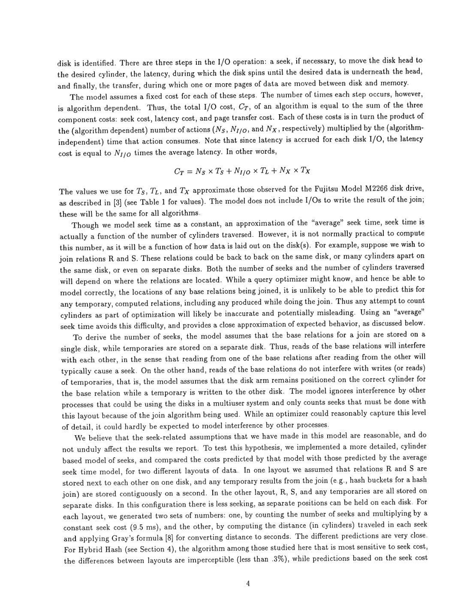
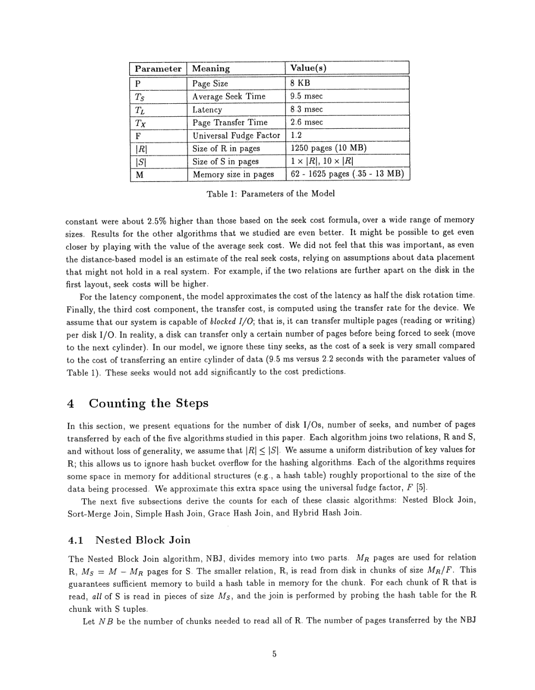

> 本组第 6 篇 · 代价模型 · [全部论文]() · [上一篇]() · [下一篇]()

本报告依据 Haas、Carey、Livny 的1993年技术报告，分析五种无预建连接访问结构的 ad hoc join 及其缓冲分配。成本为 C_T=N_S*T_S+N_I/O*T_L+N_X*T_X，只建模磁盘寻道、旋转等待与页传输，不含CPU、最终结果写出、并行/重叠I/O或其他进程干扰。默认基础关系同盘、临时数据另盘，不能概括成单盘实验。作者用模型内的分析实验说明：算法选择与buffer分配必须共同考虑I/O次数和传输量；表4的Actual Cost也是详细模型重估，不是设备实测。调优后Grace约改善2.5倍，NBJ相对NBJ1最高约3.5倍；这些均为本文参数下的预测，非普遍收益或误差保证。27页OCR已完整复核，并视觉核对19个关键扫描页，修复F因子、SMJ公式、表格数字和1250/1500示例误读。

本文保留论文陈述、读者推断与待验证方案的区别；实验数字只适用于原文条件。原文和翻译来自已有 AI 辅助精读报告，已做来源匹配与编辑复核，不等于人工逐项核验或独立实验复现。所有页码均为 PDF 物理页。

## 论文与阅读范围

作者: Laura Haas, Michael J. Carey, Miron Livny; 年份: 1993年5月; 出处: Technical Report #1148。缺口: 出版机构未在提供的文本中明确（仅知为技术报告编号）；未提供同行评审状态、DOI或后续正式发表信息。

[论文集中的原始 PDF](https://github.com/lonng/db-papers/blob/4ff1331069c7cf52ac97dd769e5f484c1c35c200/papers/cost-model/seeking-the-truth-about-ad-hoc-join-costs.pdf) · 本地来源：`cost-model/seeking-the-truth-about-ad-hoc-join-costs.pdf`，共 27 页。

本篇保留 10 组原文精读和 47 条证据。截图为原始 PDF 的局部页选，不是重新生成的图表；未将整份 PDF 复制到博客。

## 研究问题与适用边界

本文研究决策支持环境里不能预先准备连接访问结构的 ad hoc join，比较 Nested Block Join（NBJ）、Sort-Merge Join（SMJ）、Simple Hash、Grace Hash、Hybrid Hash。这里的“last resort”指不依赖预先建立的 B-tree/join index 等连接访问结构，不是新连接语义，也不说明这些算法只能作为生产系统最后选项。[C001N01]

研究问题是：同一算法在不同缓冲分配下会产生多少次寻道、多少次I/O、多少页传输；优化器用什么成本模型才能同时选择算法和分配内存。论文不以宣布某种join恒优为目标，特意使用简化版本来揭示模型如何改变“最佳”的判断。[C004N09]

边界必须明确：这是磁盘I/O成本的分析研究，不是CPU+I/O的端到端执行时间模型。默认R、S在同一磁盘、临时关系在另一磁盘；基础读与临时写不争用同一磁头，基础关系之间仍会产生seek。模型不计其他进程干扰，未计并行/重叠I/O。作者还比较了分盘布局与基于柱面距离的seek估计，不能写成“只研究一块盘”或“从未考虑多盘”。[SR001][SR002][C004N10]

最终连接结果写出被排除，理由是各算法相同；中间桶和排序run的写出仍计费。模型忽略跨柱面的微小seek，物理页6给出9.5 ms与传输整柱面约2.2 s的比较，因此不应再称这两个数在全文中缺失。但这仍是近似，不构成所有数据布局下相对排序不变的证明。[C001N10][SR017]

另假设|R|<=|S|，R的键均匀以忽略哈希桶溢出；SMJ及分区哈希的推导限制在各自能完成一次归并/两阶段处理的内存范围。极端低内存、多趟处理与倾斜溢出不能直接套用现有结论。[SR004][C004N10]

依据：论文陈述；PDF 物理页 2, 5, 6, 24。证据：[C001N01](#evidence-c001n01), [C001N10](#evidence-c001n10), [C004N09](#evidence-c004n09), [C004N10](#evidence-c004n10), [SR001](#evidence-sr001), [SR002](#evidence-sr002), [SR004](#evidence-sr004), [SR017](#evidence-sr017)。

## 系统架构与代价模型组件

扫描物理页5的规范记号为 C_T=N_S*T_S+N_I/O*T_L+N_X*T_X。N_S计寻道动作，N_I/O计磁盘请求，N_X计传输页数；三个数量由算法和缓冲决定，三个时间权重由设备决定。T_L是旋转等待，不是笼统的“初始定位”，每次I/O均计一次；一次多页I/O能摊薄T_L，但不消除每页传输项。不是每个I/O都必然另计一次完整seek。[SR001]

物理页6表1经扫描核对：P=8 KB，T_S=9.5 ms，T_L=8.3 ms，T_X=2.6 ms，F=1.2；|R|=1250页（作者记10 MB），|S|取|R|或10|R|。这些近似于Fujitsu M2266参数，不是未知硬件。表1的M栏原写62至1625页、括注.35至13 MB；下限页数与MB换算不一致，本报告保留原文并标记，不擅自统一。正文分析区间从.35 MB开始，后续buffer估计验证另用1至13 MB。[SR001][SR003]

F是附加结构所占空间的近似倍数，不是CPU系数。全文未给hash、比较、排序或元组处理的CPU时间参数，不能据此比较CPU效率。[SR004]

NBJ：M_R+M_S=M，每块R的数据容量M_R/F；本文明确为这块建立内存哈希表，再逐次扫描S探测。NB=ceil(|R|F/M_R)。不能因通用NBJ可能不用hash就否定本文实现。[SR004]
SMJ：第一阶段I/O缓冲I、O与工作区WS=M-I-O竞争内存，以tournament tree生成runs，平均run长度近似2WS/F；第二阶段将内存按run分配，每run为MPR=M/(NR_R+NR_S)。本文假设M>sqrt(F|S|)以一次归并完成。[SR005]
Simple Hash：WS=M-I-O，NI=ceil(|R|F/WS)，每轮可驻留R数据floor(WS/F)页。R与S的剩余部分都逐轮缩减，非只扫描一次或只缩减R。[SR006]
Grace：B=ceil(|R|F/(M-I_1))，第一阶段每桶输出buffer为O=floor((M-I_1)/B)；第二阶段一桶R及其hash表驻留，S桶按I_2扫描。假设M>sqrt(F|R|)。[SR007]
Hybrid：同样的两阶段内存前提；第一阶段WS=M-KO-I_1留给R0，磁盘桶为K个；给定buffer，K是满足K(M-I_2)+WS>=|R|F的最小可行整数。这里是第二阶段I_2，不是I_1；右侧必须有F。R0及其对应S数据避免落盘。[SR008]

作者关于执行层与buffer manager之间传递hint有利的判断是原文观点；本文没有交付可验证的系统实现。[C004N11]

依据：论文陈述；PDF 物理页 5, 6, 7, 8, 9, 10, 24。证据：[SR001](#evidence-sr001), [SR002](#evidence-sr002), [SR003](#evidence-sr003), [SR004](#evidence-sr004), [SR005](#evidence-sr005), [SR006](#evidence-sr006), [SR007](#evidence-sr007), [SR008](#evidence-sr008), [C004N11](#evidence-c004n11)。

*原论文 PDF 物理页 5，版权归原作者或出版方。点击图片可查看原尺寸。这是页面定位信息，不表示本次已复核图内所有数据。*

## 核心算法、缓冲分配推导与小例子

作者先把离散成本近似成单变量连续函数，求导找驻点，再按算法决定参数修正整数buffer。NBJ、Simple、Grace、Hybrid、SMJ的决定参数分别是NB、NI、B、K、RL。多数buffer估计推导忽略seek以简化求解，但原始详细成本仍保留seek；SMJ因run长度改变随机归并读而在推导中也保留seek。[C003N05][C003N06]

NBJ规范式：N_X=|R|+NB|S|，N_I/O=NB(1+ceil(|S|/M_S))，N_S=2NB。令y=T_L/T_X，连续驻点满足
(|S|+y)M_S^2+2y|S|M_S-y|S|M=0。
y趋零时M_S趋零；y趋无穷时先得到sqrt(|S|(M+|S|))-|S|，还需|S|/M趋无穷才得到M/2。因此50%规则有两个极限条件，不能仅凭“高延迟”宣称严格半分。[C003N07][SR009]

原文NBJ示例（不是读者另造实验）：M=500页、|R|=|S|=1250页，F=1.2，y约3；作者给出M_S=37、M_R=463，所以NB=ceil(1250*1.2/463)=ceil(1500/463)=4。1500是F开销修正后的页容量需求，和1250毫不矛盾。固定NB=4后，M_R只需ceil(1500/4)=375页，最终M_S=125页；375是R区，不是S扫描buffer。这样S每轮请求数从ceil(1250/37)=34降为ceil(1250/125)=10，而NB及N_X不变。[SR012][SR013]
读者算术复核：若严格令y=3，正根约35.806页，不能声称精确得到37；表1的y=8.3/2.6约3.1923，正根约36.844，向上取整为37。两种初始整数估计在此例仍都得到NB=4及最终M_S=125。该区分保留了作者“约3”的措辞。[SR003][C003N11]

SMJ：固定两阶段传输量N_X=3(|R|+|S|)，设I=O。扫描物理页19确认驻点方程是
(xF(|R|+|S|)-8M)I^2+8M^2I-2M^3=0，
x=(T_L+T_S)/T_L。
末项不是-2M^2，x分母也不是T_X。较大的输入输出buffer降低生成run阶段请求数，却挤占WS、缩短run并增加归并阶段随机读。表2估计只作为初值，需按RL调整可执行分配；连续极限的“buffer趋零”不是零页buffer的实现建议。[SR005][SR010][C003N08]

Simple：I=O的连续估计满足2I^2+4yI-yM=0，即I_0由sqrt(y^2+0.5yM)-y估计。随后按I_0决定NI，再取I_max=(M-ceil(|R|F/NI))/2，以I=O=I_0+(w/M)(I_max-I_0)、w=min(M,125)作经验滑动修正，并处理整数页。这不是OCR串“3(u-[4])”所代表的数学式，也非全局最优证明。[C004N01][SR013]

Grace：作者用第一阶段输入与各桶输出buffer近似等大来估计B，连续式为MB^2-|R|FB-|R|F=0，再按整数页确定O、I_1并将第二阶段剩余空间给I_2。它是对原本复杂求解的简化，并非所有设备下等分buffer必然最优。[SR007][C004N02]

Hybrid：给定buffer时最小可行K不等于全局最优buffer配置。作者为求简式采用I_1=O=I_2、|R|远大于K、|R|F远大于I、|S|=|R|等近似，后续还取大关系及M远大于y的近似，得到表2中约1.1sqrt(M)的每buffer估计。作者明确不知道对所有M、|R|、|S|是否严格最优。每次改变buffer都影响R0与传输量，不能照搬NBJ固定NB后直接扩buffer的做法。[SR008][SR011]

图4的NBJ约20%（1 MB、25页）和约4%（12.5 MB、63页）是本文参数下的不同最优点，不是通用配置常量。[C002N11]

依据：论文陈述；PDF 物理页 6, 7, 9, 10, 14, 17, 18, 19, 20, 21。证据：[C003N05](#evidence-c003n05), [C003N06](#evidence-c003n06), [C003N07](#evidence-c003n07), [C003N08](#evidence-c003n08), [C003N11](#evidence-c003n11), [C004N01](#evidence-c004n01), [C004N02](#evidence-c004n02), [SR005](#evidence-sr005), [SR007](#evidence-sr007), [SR008](#evidence-sr008), [SR009](#evidence-sr009), [SR010](#evidence-sr010), [SR011](#evidence-sr011), [SR012](#evidence-sr012), [SR013](#evidence-sr013), [C002N11](#evidence-c002n11), [SR003](#evidence-sr003), [C001N05](#evidence-c001n05)。

## 正确性论证与模型局限性

本节为基于原文的审查判断。必须区分三个问题：join结果是否正确、给定算法的I/O计数是否符合模型、buffer估计能否接近该模型的最低成本。本文主要分析后两项，并未证明优化后的所有实现或生产系统均满足全局最优。[SR001][SR014]

图7的observed minimum来自在模型里改变buffer求最低成本，与公式配置产生的estimated模型成本比较。通常接近2%，Simple/Hybrid通常接近5%，是在同一模型中的配置质量检验，不是模型对真实硬件响应时间的预测准确率。不能把这组结果写成“公式已获设备实测验证”或严格2%误差界。[C004N03][C004N04][SR014]

连续化求驻点、对称buffer假设、丢弃部分seek项、整数化与启发式滑动都会影响估计；不应把最终性能偏差全归于单一数学步骤。Hybrid的多重近似及“不知是否严格最优”的原文声明尤其需要保留。[C003N06][SR011]

内存可行域也不能略过：R的hash结构需F倍空间；均匀R键让作者忽略哈希溢出；SMJ需单次归并的内存假设，Grace/Hybrid需两阶段可行。M>|R|F附近，buffer过大会把原可整体驻留的R挤出，需额外比较一块和两块的成本。这里的关键不是连续函数在所有配置上平滑，而是离散阶段数会跳变。[SR004][C004N04][C004N10]

seek近似的内部比较属于局部合理性检查：作者用两种布局及距离/常量seek模型比较，报告Hybrid不同布局预测差小于0.3%、常量seek估计约高2.5%。这不是多用户干扰或真实I/O调度验证。硬件权重只用一组、无CPU与并行重叠项，所以既不能外推端到端join排序，也不能把NBJ在某些图中的优势当成普适定理。[SR019][SR001][C004N10]

依据：读者推断；PDF 物理页 5, 6, 17, 18, 20, 21, 22, 24。证据：[SR001](#evidence-sr001), [SR002](#evidence-sr002), [SR004](#evidence-sr004), [SR009](#evidence-sr009), [SR011](#evidence-sr011), [SR014](#evidence-sr014), [C003N06](#evidence-c003n06), [C004N03](#evidence-c004n03), [C004N04](#evidence-c004n04), [C004N10](#evidence-c004n10), [SR019](#evidence-sr019)。

## 实验设计、数据与不可得出的结论

实验性质与参数：第5节是analytical “experiments”，不是五个物理join实现的计时benchmark。用Fujitsu M2266近似I/O参数，P=8 KB、T_S=9.5 ms、T_L=8.3 ms、T_X=2.6 ms、F=1.2、|R|=1250页，|S|为1倍或10倍|R|。第5.1节和表4覆盖.35至13 MB，图1/2主要展示2至13 MB；第5.3节buffer估计检验用1至13 MB，图4/5用1与12.5 MB，图6还包括3.5、9 MB。不能将所有实验统一写成1至13 MB。本文没有给CPU时间参数或实际运行所需OS/文件系统配置。[SR001][SR003][C004N03]

未调优基线：图1仅数传输页，通常偏好Hybrid，NBJ1（M_S=1）在部分较大内存点可竞争。图2仍用朴素buffer，但加入seek和latency后，在展示的2至13 MB区间NBJ50（M_S=M/2）胜出；这是基线变化下的预测，不是优化buffer后结果。第5.1节更小内存的NBJ50还会退化，因此不能写成所有内存均最优。[C002N08][SR018]

buffer敏感性：SMJ的U形成本底部较平，文中“偏离10%约损失2%”是局部描述；NBJ高内存点可能损失50%以上。图5大内存左端实际I=3、O=2，并不是所有曲线左端都为每buffer一页。Grace增加输入buffer会挤压桶输出buffer，不能认为增加所有buffer无代价。Hybrid在本文低内存配置下以R0为空、类似Grace时最好；较大内存时R0可明显减少传输。原文在图6段落写“as much as 400% worse”，本报告保留该原意，不擅自换成精确倍数或百分比降幅。[C003N01][C003N02][C003N03][C003N04]

表3（物理页22）比较估计buffer配置相对遍历buffer最低模型成本的百分误差。已逐行核对两组比例、五列算法、13个内存点，完整转录见qa记录。关键反例：M=1 MB时NBJ误差3.9%/4.2%；M=7 MB时Simple为4.4%/5.2%；M=13 MB时Simple为7.0%/7.6%。因此“通常2%”与“通常5%”绝非上界，也不是与实测时间相比的误差。M>|R|F的整体驻留边界需要额外sanity check。[SR014][SR015][C004N04][C004N05]

调优后比较：图8相对图9中朴素分配的预测改善，Grace约2.5倍，NBJ相对NBJ1最高约3.5倍、相对NBJ50约1.3至1.5倍。Hybrid改善后在本文低内存（<3 MB，近似Grace）和高内存（M>|R|F，近似Simple）才优于NBJ；Grace和SMJ接近，是因为调好buffer后其相同传输量主导。上述均为这组参数下的模型结果，不是通用算法排名。[C004N06]

表4（物理页23）的每个模型都按自身目标选择算法和buffer，“Actual Cost”再用详细模型计算同一配置的秒数。扫描核对的例子：
M=1 MB：transfer-only选Hybrid，83.4 s；I/O-count-only选NBJ，85.7 s；detailed选Grace/Hyb.，26.6/26.6 s。
M=2 MB：对应为Hybrid 78.0 s、NBJ 43.3 s、Grace/S-MJ 21.8/21.8 s。
M=4 MB：I/O-count-only的NBJ是23.0 s，detailed NBJ是16.6 s，不能接受OCR误读93.0。
M=13 MB：transfer-only认为NBJ/Simple/Hybrid等价，但详细模型成本分别16.9/27.3/27.3 s；detailed选NBJ 6.6 s。
同算法也会因不同buffer而代价不同；并列胜者只在选择模型中相等，不意味着详细模型成本相同。作者概括简单模型可带来约四倍成本；例如27.3/6.6约4.14，不能把“四倍”写成数学上界或普遍损失，更不能称这些秒数为真实设备实测。[SR016][C004N07]

不能得出：NBJ恒优、Hybrid恒劣、CPU效率结论、倾斜/溢出情形保证、现代存储或并行环境的相同排名。已知变体与更低内存多趟处理不在本文直接验证范围。[C004N09][C004N10][C004N11]

依据：论文陈述；PDF 物理页 5, 6, 11, 15, 16, 21, 22, 23, 24。证据：[SR001](#evidence-sr001), [SR003](#evidence-sr003), [SR014](#evidence-sr014), [SR015](#evidence-sr015), [SR016](#evidence-sr016), [C002N08](#evidence-c002n08), [C003N01](#evidence-c003n01), [C003N02](#evidence-c003n02), [C003N03](#evidence-c003n03), [C003N04](#evidence-c003n04), [C004N03](#evidence-c004n03), [C004N04](#evidence-c004n04), [C004N05](#evidence-c004n05), [C004N06](#evidence-c004n06), [C004N07](#evidence-c004n07), [C004N09](#evidence-c004n09), [C004N10](#evidence-c004n10), [C004N11](#evidence-c004n11), [SR018](#evidence-sr018)。

*原论文 PDF 物理页 6，版权归原作者或出版方。点击图片可查看原尺寸。这是页面定位信息，不表示本次已复核图内所有数据。*

## 设计权衡与工程启示

本节把原文结果与读者工程推断分开。

原文中的核心权衡不是笼统“内存越大越快”，而是在固定M内，将页给I/O buffer可减少请求数，却可能减少R驻留容量或排序WS，增加重扫、落盘或归并成本。F必须进入内存可行性计算；没有CPU项，不能把哈希表占用空间直接推成CPU开销结论。[SR001][SR004]

NBJ的50%规则只有在仅I/O次数主导、且S相对内存很大的极限下才得到；一般情况下应共同考虑传输与latency，且检查NB的阶跃。Hybrid保留R0减少传输的收益与挤占buffer的代价相抵，低内存时R0收益可能很小，不等于应永久取消Hybrid或证明其实现复杂度不值得。[SR009][C003N03][SR011]

调优后页传输的相对作用增大，是减少过多I/O的结果，不意味着页传输绝对量必然增加。SMJ和Grace在本文两阶段且调优配置下传输量一致，故可能成本接近；不能据此推成CPU或真实系统时间相同。[C004N06][C004N08]

读者推断：面对难以稳定控制的内存，除最低模型点外可考察邻近buffer变化的风险。图5的SMJ较平、NBJ/Hybrid部分区间较陡，提供了这样的研究动机，但论文未比较并发内存抢占或证明某算法在竞争下更安全。[C003N01][C003N04]

作者提出优化器应了解实现的buffer策略，执行层与buffer manager传递hint可能有利。读者可据此设计成本估计与执行资源分配的一致性检查；论文未实现这个接口，也没有测量优化器规划时间，因此不能声称精细模型的规划开销已被量化。[C004N11]

依据：读者推断；PDF 物理页 5, 6, 15, 16, 18, 20, 21, 23, 24。证据：[SR001](#evidence-sr001), [SR004](#evidence-sr004), [SR009](#evidence-sr009), [SR011](#evidence-sr011), [C003N01](#evidence-c003n01), [C003N03](#evidence-c003n03), [C003N04](#evidence-c003n04), [C004N06](#evidence-c004n06), [C004N08](#evidence-c004n08), [C004N11](#evidence-c004n11)。

## 与相关系统及现代技术的联系

本节仅列待验证问题，不报告StarRocks、DuckDB、Calcite或其他系统的当前实现事实；本次未阅读其源码，也未联网补充资料。

1. 面向目标系统的join成本接口，是否区分I/O请求数、数据传输量与算法buffer配置？若还有CPU、并行或重叠I/O，需增加哪些原文没有的项，而不是把T_S直接替换成一个未经校准的新常量？[SR001][C004N10]
2. 目标实现中，构建侧空间开销是否能用F倍页数描述，键倾斜与溢出是否改变阶段数？需要源码、测量和新模型回答，不能把本文均匀键假设移植为事实。[SR004]
3. 外部排序或分区join在多趟情况下如何选择I/O批量与工作区？本文明确未直接验证更低内存范围，扩展后的算法排名未知。[C004N10]
4. 目标实现若允许分配提示，是否仍保持预期buffer大小？R整体可驻留附近是否检查“一块/两块”的离散成本跳变？这是源于本文边界的检查问题，不表示某现代引擎已存在该缺陷。[C004N04]
5. 加入论文提到的NBJ双向扫描或改进Hybrid变体后，buffer敏感度和三种模型的决策差距如何变化？本文没有给出这些变体的同参数比较。[C004N09][SR011]

依据：待验证的工程设想；PDF 物理页 5, 6, 20, 21, 24。证据：[SR001](#evidence-sr001), [SR004](#evidence-sr004), [SR011](#evidence-sr011), [C004N04](#evidence-c004n04), [C004N09](#evidence-c004n09), [C004N10](#evidence-c004n10)。

## 复现指南与潜在障碍

以下为尚未执行的读者复现计划。忠实复现应先重建论文的分析计算，不应把物理引擎实测当成图7或表4原本的生成方式。

1. 固定输入。采用P=8 KB、T_S=9.5 ms、T_L=8.3 ms、T_X=2.6 ms、F=1.2、|R|=1250页、两种|S|比例。内存优先按页枚举，同时保留原论文MB标签；表1下限62页与.35 MB不一致应作为输入歧义记录，不能静默修改原文。布局设基础关系同盘、临时关系另盘，无其他进程干扰。[SR001][SR002][SR003]
2. 实现计数而非先实现物理join。按原文计算N_S、N_I/O、N_X，特别保留中间桶/run写出，排除最终结果写出。检查F、ceil/floor、每算法的输入/输出/驻留区总和和各阶段可行性。SMJ和分区hash不满足两阶段前提的输入应拒绝或标为未覆盖，不拿本式强算。[SR004][SR005][SR007][SR008]
3. 做算术单测。确认NBJ的1250*1.2=1500、NB=4、最终M_R=375/M_S=125；将y约3与精确3区分。确认SMJ驻点末项-2M^3和x分母T_L；Simple经验插值按原页而不是OCR乱码实现。枚举buffer寻找最低详细模型成本，再与估计配置比较。[SR010][SR012][SR013]
4. 复现图7/表3。对M=1至13 MB、两种|S|比例分别比较估计buffer与遍历buffer最低模型成本；误差按成本差相对最低值计算，核对表3选定点及完整行。目标是复现已记录数值和通常接近的趋势，不是要求所有点小于2%：原表已有7.0%/7.6%反例。[SR014][SR015]
5. 复现表4。三个优化目标分别优化算法及buffer，再用同一详细模型重估所选配置。核对1、2、4、13 MB的胜者与秒数；保留并列候选各自详细成本。不要将选择模型估计值直接冒充Actual Cost。[SR016]
6. 可选外部验证。若另行实现物理join并实测，应独立标为新增研究，记录CPU、OS、文件系统、设备布局、缓存及I/O调度等条件，再评估本模型的预测误差。本文未给这些实现条件；不能承诺现代设备重现固定四倍差距。若采用改进算法或并行/重叠I/O，已经改变研究范围。[C004N09][C004N10]

本次只完成来源审核与文档修订，没有实现上述计算器或执行物理复现实验。

依据：待验证的工程设想；PDF 物理页 5, 6, 7, 9, 10, 19, 20, 21, 22, 23, 24。证据：[SR001](#evidence-sr001), [SR002](#evidence-sr002), [SR003](#evidence-sr003), [SR004](#evidence-sr004), [SR005](#evidence-sr005), [SR007](#evidence-sr007), [SR008](#evidence-sr008), [SR010](#evidence-sr010), [SR012](#evidence-sr012), [SR013](#evidence-sr013), [SR014](#evidence-sr014), [SR015](#evidence-sr015), [SR016](#evidence-sr016), [C004N09](#evidence-c004n09), [C004N10](#evidence-c004n10)。

## 总结与工程价值

论文的可支持结论是：在其磁盘I/O模型与简化算法中，优化器必须理解算法如何使用内存，并联合考虑寻道、每请求latency和每页传输成本；仅页数或仅请求数可能同时误导算法选择和buffer分配。表4的成本差是详细模型对不同决策的重估，不是端到端实测，也非CPU结论。[SR001][SR016]

审核已修复会改变技术含义的错误：默认双盘布局被误称单盘；NBJ中的hash表被否定；Simple和Hybrid公式漏F；Hybrid将I_2错成I_1；SMJ末项幂次和成本比率误写；NBJ的1250与1500被错判为矛盾；原文可读参数被称缺失。完整保留原始quote，并以新增raw OCR证据及扫描核对记录支持规范化解释。[SR002][SR003][SR004]

buffer估计是带近似与离散修正的工具，不是严格误差界或全局最优证书。NBJ半分内存还需要两个极限条件；表3的Simple在13 MB处有7.0%/7.6%误差，不能把“通常2%/5%”写成保证。[SR009][SR014][SR015]

调优后的相对收益和算法排序依赖本文硬件权重、关系规模、均匀R键、无溢出、两阶段处理及指定算法版本。已知改进变体、更低内存多趟、CPU和并行环境尚需独立研究；论文自己反对将结果读成NBJ恒优。[C004N06][C004N09][C004N10][C004N11]

依据：论文陈述；PDF 物理页 5, 6, 18, 21, 22, 23, 24。证据：[SR001](#evidence-sr001), [SR002](#evidence-sr002), [SR003](#evidence-sr003), [SR004](#evidence-sr004), [SR009](#evidence-sr009), [SR014](#evidence-sr014), [SR015](#evidence-sr015), [SR016](#evidence-sr016), [C004N06](#evidence-c004n06), [C004N09](#evidence-c004n09), [C004N10](#evidence-c004n10), [C004N11](#evidence-c004n11)。

## 原文精读：从句子回到机制

以下保留原文、忠实翻译、含义与边界；假设示例不作为论文实验结果。

### P001 · PDF 物理页 2

**原文**

<blockquote class="paper-source-quote"><pre><code>1  Introduction&#10;&#10;     The join of two sets of tuples is a fundamental operation for relational database system, and many algorithms&#10;      have been proposed to compute joins [1, 2, 5, 10, 15,  17]. Some join algorithms exploit pre-computed access&#10;        structures, such as B-trees or join indices  [18]. These algorithms are ideal for pre-meditated joins that will&#10;       be done repeatedly.  However, in a decision support environment, not  all joins can be anticipated.</code></pre></blockquote>

**忠实翻译**

> 1 引言
> 
> 两个元组集合的连接是关系数据库系统的一项基本操作，已经提出了许多算法来计算连接 [1, 2, 5, 10, 15, 17]。一些连接算法利用预先计算的访问结构，例如 B-trees 或 join indices [18]。这些算法对于将被反复执行的预先计划好的连接是理想的。然而，在决策支持环境中，并非所有连接都能被预见。

**技术含义与边界**

> 原文陈述了连接操作的基础性，并区分了两类场景：一类是可以预见的、重复执行的连接，适合使用依赖预计算访问结构（如 B-trees、join indices）的算法；另一类是决策支持环境中的不可预见连接，暗示这类场景需要不依赖预计算结构的算法。读者可推断本文后续将讨论适用于后者的算法。适用边界在于该论述仅针对关系数据库系统中的连接操作。

**常见误读**

> 容易发生的错误解读是认为 B-trees 或 join indices 在决策支持环境中完全无用。原文并未否定它们在决策支持环境中的作用，只是指出在该环境中“并非所有连接都能被预见”，因此不能将所有连接都寄托于预计算结构。不应将此局部观察泛化为全局保证。

**读者构造的假设示例**

> 读者构造的假设示例：在一个数据仓库中，分析师临时发起一个跨两张未建立 join index 的大表的查询，此时无法使用依赖预计算结构的算法，需要采用其他连接算法。

### P002 · PDF 物理页 24

**原文**

<blockquote class="paper-source-quote"><pre><code>showed earlier (in Section 5.1) that latency  is so important? The answer  is simply that by optimizing the&#10; buffer allocations, we reduced the negative effect of the excessive I/Os that were occurring with the naive&#10; allocations. Thus, the effect of page transfers was increased ~ but only because we significantly reduced the&#10;number of I/Os.</code></pre></blockquote>

**忠实翻译**

> 前面（在第 5.1 节中）展示了延迟为何如此重要？答案很简单，通过优化缓冲区分配，我们减少了朴素分配下发生的过度 I/O 的负面影响。因此，页传输的影响增加了——但这仅仅是因为我们显著减少了 I/O 的数量。

**技术含义与边界**

> 作者解释优化buffer后的成本构成变化：过多I/O请求的latency开销降低，使页传输在总成本中的相对权重更大。该段不意味着传输页数或绝对传输成本必然增加；还需同时建模两类成本才能找到合适分配。

**常见误读**

> 不要把相对占比增加写成绝对成本增加，也不要用“请求数和传输量同比下降、占比不变”的算术例子解释本段。latency在本文是旋转等待，不是seek的同义词。

**读者构造的假设示例**

> 读者构造的假设示例：固定传输1000页、每页1 ms，传输共1000 ms。若1000次I/O各有8 ms等待，则总成本为9000 ms；合并成100次多页I/O且假设seek项不变为零，则总成本1800 ms，传输占比从约11.1%升至55.6%。这不是作者实验。

### P003 · PDF 物理页 14

**原文**

<blockquote class="paper-source-quote"><pre><code>For the larger memory,&#10;the minimum occurs at around 4%, or 63 pages (this is the largest amount of memory we can give to S and&#10;still have R fit in memory in one chunk, minimizing transfer costs).&#10;    In [9], Hagmann predicts that the minimum should occur at 50% of memory, regardless of memory size.&#10;We will show in section 5.3 that this  is in fact true in systems where latency cost  is so high that transfer&#10;costs are negligible, as Hagmann assumes.</code></pre></blockquote>

**忠实翻译**

> 对于较大的内存，最小值出现在大约 4%，即 63 个页面处（这是我们能分配给 S 的最大内存量，同时仍能让 R 在一个 chunk 中放入内存，从而最小化传输成本）。
> 在 [9] 中，Hagmann 预测无论内存大小如何，最小值都应出现在内存的 50% 处。我们将在第 5.3 节中证明，在延迟成本高到使传输成本可以忽略不计的系统中（正如 Hagmann 所假设的那样），这实际上是正确的。

**技术含义与边界**

> 作者在图4的12.5 MB配置下报告约4%即63页给S，以保留足够M_R容纳R及哈希表；不是只容纳R裸数据。正文第5.3节还说明，50%规则要有延迟主导和|S|相对M很大两个极限，不能据此泛化任一数字。

**常见误读**

> 4%、63页是特定图中取值；50%也不是单凭延迟很高就严格成立。计算R整体驻留必须包含F，不能把R裸大小与剩余内存直接相等而漏hash结构。

**读者构造的假设示例**

> 读者构造的假设示例：M=1563页、R=1250页、F=1.2，则R连同附加结构需1500页，只剩63页给S。再扩大S缓冲就会破坏这组配置的单块驻留条件；不是新的作者测量。

### P004 · PDF 物理页 5

**原文**

<blockquote class="paper-source-quote"><pre><code>In other words,&#10;&#10;        Cr= Ns X Ts + Nrjo     x Tr + Nx  x Tx&#10;&#10;The values we use for Ts, Tz, and Tx approximate those observed for the Fujitsu Model M2266 disk drive,&#10; as described in  [3] (see Table  1 for values). The model does not include I/Os to write the result of the join;&#10; these will be the same for all algorithms.&#10;   Though we model seek time as a constant, an approximation of the “average” seek time, seek time  is&#10; actually a function of the number of cylinders traversed.</code></pre></blockquote>

**忠实翻译**

> 换言之，C_T=N_S*T_S+N_I/O*T_L+N_X*T_X（记号按物理页5扫描式规范化，原OCR引文未改）。T_S、T_L、T_X的取值近似于[3]所述Fujitsu M2266磁盘，见表1。模型不计连接最终结果的写出I/O，因为各算法相同。虽然将寻道时间近似为常量“平均寻道时间”，实际寻道时间是跨越柱面数的函数。

**技术含义与边界**

> 扫描原页确认总成本C_T的三项分别是寻道、旋转等待和页传输；OCR的Cr、Nrjo、Tr、Tz是字形转写问题，不是作者另定义了四种时间。模型计中间run/桶的写入，仅排除最终join结果写出，也不含CPU。表1的T_S=9.5、T_L=8.3、T_X=2.6 ms已另行扫描核对。

**常见误读**

> 不能将OCR字形当成真实公式或保留为未经解决的作者符号矛盾；不能把“最终结果写出不计”扩展成“全部写入不计”。这些秒数只是模型I/O成本，非完整执行时间保证。

**读者构造的假设示例**

> 读者构造的假设示例：设N_S=2、N_I/O=10、N_X=100，按表1得2*9.5+10*8.3+100*2.6=362 ms；未计CPU和最终结果写出，不能称为端到端实测。

### P005 · PDF 物理页 11

**原文**

<blockquote class="paper-source-quote"><pre><code>At the upper end of the range,  M &gt; |R|F, or, in other words, R  fits&#10; in memory. In Figure 1 we show the number of transfers, Nx, for  M = 2 to 13 MB, where |S| = || = 10 MB.&#10;&#10;   The graphs in Figure  1 predict that Hybrid will outperform the other algorithms for much of the memory&#10; range.  Its only rival is NBJ,, which, when  M &gt; 4 MB (when R  can be read in three chunks or less), will at&#10; times outperform Hybrid.</code></pre></blockquote>

**忠实翻译**

> 在范围上端，M>|R|F，即R及其附加结构能驻留内存。图1展示M为2至13 MB时的传输页数N_X，其中|S|=|R|=10 MB（关系符号按物理页11扫描核对，原OCR引文未改）。图1预测Hybrid在大部分内存区间优于其他算法；其竞争者NBJ1在M>4 MB、R可分成三块或更少时，有时会更优。

**技术含义与边界**

> 此段针对transfer-only模型和特定朴素buffer：指标是传输页数，不是详细I/O秒数或CPU效率。扫描页确认缺失的关系符号为|R|，NBJ下标为1；无须继续猜测。M>|R|F包括F开销，而非仅R裸大小。

**常见误读**

> 不能将图1的Hybrid优势泛化成详细模型下恒优。也不能把NBJ1与NBJ50混同：二者S缓冲分别一页、半数内存。修正解读但保留原OCR quote。

**读者构造的假设示例**

> 读者构造的假设示例：R=1250页、F=1.2，若M_R=500页，则NB=ceil(1500/500)=3；若另改变S缓冲，N_I/O会变化，不能只凭这个块数断定完整I/O成本谁更低。

### P006 · PDF 物理页 19

**原文**

<blockquote class="paper-source-quote"><pre><code>For example, as |R| and  |S| become large, J and&#10;O approach zero, that  is,  it becomes important to make the runs as long as possible. As M increases, so&#10;should J and O; as M decreases, I and O will decrease.  If seek costs are very high, x approaches infinity;&#10;in this case buffers will shrink towards zero, as this increases run length and M PR, reducing the number of&#10;&#10;seeks.&#10;&#10;&#10;Simple Hash Join&#10;&#10;Simple Hash lives up to its name; its solution  is remarkably tractable.</code></pre></blockquote>

**忠实翻译**

> 例如，随着|R|与|S|变大，I和O趋近零，即尽可能延长run变得重要。M增加时I、O应增加，M减少时I、O也减少。若寻道成本很高，x趋无穷，则buffer趋零，以增加run长度及MPR，减少seek。随后进入Simple Hash Join一节。这里的I被OCR部分识别成J，已核对物理页19，原引文保留。

**技术含义与边界**

> 上半段仍属于Sort-Merge的连续buffer估计，变量为输入I、输出O，x=(T_L+T_S)/T_L。它讨论生成run的buffer与工作区竞争，并不是Simple Hash算法结论；归并每run内存MPR越大，随机读越少。

**常见误读**

> 实际buffer至少需可行的整数页，不能把数学极限零当实现配置。OCR的I/J不是不同变量；x不是seek与每页传输时间之比。

**读者构造的假设示例**

> 读者构造的假设示例：固定M与数据规模，若T_L保持不变而T_S显著增加，连续SMJ估计倾向缩小I、O以保留更长run；仍须检查整数buffer和一次归并可行性，不能直接设为零。

### P007 · PDF 物理页 16

**原文**

<blockquote class="paper-source-quote"><pre><code>The more space given to the input and&#10;output buffers, the less space there  is for Ro.  Interestingly, when memory is small relative to |R|, the best&#10;performance is achieved when all of memory is used as buffers, that  is, when there  is no Ro.  In other words,&#10;when memory is tight, Hybrid performs best  if it is simply run as Grace Hash.</code></pre></blockquote>

**忠实翻译**

> 分配给输入和输出缓冲区的空间越多，留给 Ro 的空间就越少。有趣的是，当内存相对于 |R| 较小时，最佳性能是在所有内存都被用作缓冲区时实现的，也就是说，当没有 Ro 时。换句话说，当内存紧张时，如果直接将 Hybrid 作为 Grace Hash 运行，它的性能最好。

**技术含义与边界**

> 原文揭示了 Hybrid Hash Join 算法中内存分配的权衡机制：输入/输出缓冲区与内存驻留分区（Ro）之间的竞争。作者陈述了一个反直觉的结论：在内存相对于 |R| 较小的条件下，不为 Ro 保留任何空间（即将全部内存用作缓冲区）能获得最佳性能。此时，Hybrid 算法退化为 Grace Hash 算法。适用边界明确限定在“内存相对于 |R| 较小”的前提下。

**常见误读**

> 容易将“所有内存都被用作缓冲区时实现最佳性能”泛化为 Hybrid 算法的全局最优策略。原文有严格的限定条件：“when memory is small relative to |R|”。在内存充足时，保留空间给 Ro 才是 Hybrid 的优势所在。不能脱离前提条件得出“Hybrid 应该总是作为 Grace Hash 运行”的错误结论。

**读者构造的假设示例**

> 读者构造的假设示例：若R很大而M仅够两阶段hash的最低需求，给R0留很小空间只能避免极少传输，却可能显著缩小各输出buffer。可比较R0=0与R0>0的完整计数来理解权衡；未经计算，不能断言任意一组50页/1000页参数下都由Grace获胜。

### P008 · PDF 物理页 21

**原文**

<blockquote class="paper-source-quote"><pre><code>As indicated above, the roughest estimates are for Simple and Hybrid Hash Join,&#10; and even those estimates are normally within 5%, except when memory  is sufficiently large to hold R and&#10;  its hash table, with some space left over, ie., M &gt; |R\F.  In this case, too large a buffer can keep R, from&#10;  fitting, greatly increasing the cost of algorithms such as NBJ, Hybrid and Simple Hash.</code></pre></blockquote>

**忠实翻译**

> 如上所述，Simple和Hybrid Hash Join的估计最粗略；通常误差仍在5%以内，但内存足以容纳R及其hash表且有剩余（M>|R|F）时例外。此时过大的buffer可使R无法驻留，大幅增加NBJ、Hybrid和Simple等算法的成本。M>|R|F按物理页21扫描核对，原OCR引文未改。

**技术含义与边界**

> 这里评价的是估计buffer配置相对模型内遍历所得最低成本的性能偏差，不是成本模型相对真实设备计时的准确率。5%是通常情况而非保证。扫描页已确认乘以F；大buffer挤走可驻留R时会触发离散成本跃迁。

**常见误读**

> 不能把“通常5%”当上界；表3的Simple在13 MB为7.0%/7.6%。也不能把整个驻留条件读成R除以F或把F当CPU系数。

**读者构造的假设示例**

> 读者构造的假设示例：假设 R 及其哈希表共需 90 MB，总内存 M 为 100 MB。此时 M 满足大于 R 加哈希表的条件。如果将缓冲区分配为 15 MB，剩余的 85 MB 就不足以容纳 90 MB 的 R 及其哈希表，导致原本可以在内存中完成的连接被迫进行磁盘 I/O，成本剧增。

### P009 · PDF 物理页 17

**原文**

<blockquote class="paper-source-quote"><pre><code>Once we have a continuous function in a single variable, we differentiate it, and set the result equal to zero.&#10;For most of the algorithms, we ignore seek  costs.   Initially, we included them, but they complicated the&#10;equations without significantly affecting the results.  This  is because  for most of the algorithms,  it  is the&#10;ratio of the number of I/Os to the number of pages transferred that is the key tradeoff for determining buffer&#10;allocations.</code></pre></blockquote>

**忠实翻译**

> 一旦我们得到一个单变量的连续函数，我们就对其求导，并将结果设为零。对于大多数算法，我们忽略了寻道成本。最初，我们包含了它们，但它们使方程变得复杂，却没有显著影响结果。这是因为对于大多数算法，决定缓冲区分配的关键权衡是 I/O 次数与传输页数之间的比率。

**技术含义与边界**

> 这是第5.3节推导buffer估计的方法：连续化后求驻点，多数算法为简化推导忽略seek，主要权衡请求数与传输页数。完整I/O模型并未删除seek；原页后续明确SMJ为例外，因为buffer影响run数量和随机归并读，故保留seek。

**常见误读**

> 不能从求解阶段的近似推出seek在完整模型中无用，或SMJ也忽略seek。求导零点与离散可行分配仍有距离，也非所有算法都获得严格全局最优解。

**读者构造的假设示例**

> 读者构造的假设示例：假设某算法的成本函数可以表示为 C(x) = A/x + B*x，其中 x 是缓冲区大小，A/x 代表 I/O 次数相关成本，B*x 代表传输相关成本。通过对 C(x) 求导并令其为零，可以解析地求出最优的 x 值，而无需引入复杂的寻道距离函数。

### P010 · PDF 物理页 8

**原文**

<blockquote class="paper-source-quote"><pre><code>This gives us&#10;                      Ns=44=44 [tts[RI   + |MPR[S|&#10;&#10;4.3  Simple Hash Join&#10;&#10;In Simple Hash Join, relation R  is read and reduced repeatedly,  as follows.  Each time R is read, a hash&#10;function  is applied. Records matching the function are inserted into an in-memory hash table. Those not&#10;matching are written back to disk (producing a reduced version of R  for input to the next iteration).</code></pre></blockquote>

**忠实翻译**

> 上方公式仍是Sort-Merge的寻道式。按物理页8扫描核对，规范写为N_S=4+ceil(|R|/MPR)+ceil(|S|/MPR)；原OCR乱码保留。随后第4.3节开始：Simple Hash Join反复读取并缩减R；每轮应用哈希函数，将属于当前处理部分的记录放入内存哈希表，其余记录写回，构成下一轮的缩减R。

**技术含义与边界**

> 不能把章节标题前的SMJ公式归给Simple Hash。Simple后续还扫描S探测驻留hash表，并写出S剩余部分；WS=M-I-O，NI=ceil(|R|F/WS)。这里只是在每轮选择当前可驻留的hash部分，不是成功匹配连接键才建立hash表。

**常见误读**

> 不能把OCR“44=44”等字符当真实数学式，或因局部文本损坏就断言无法核对原页。该SMJ式已通过本地扫描渲染确认；Simple不是单趟，也不是只缩减R而不处理S。

**读者构造的假设示例**

> 读者构造的假设示例：R有1000页、F=1.2、WS=240页，则每轮驻留数据容量floor(240/1.2)=200页，NI=ceil(1200/240)=5。每轮还扫描并缩减相应S数据；这不是作者实验或CPU时间估计。

## 尚未解决的问题

1. 表1的M下限62页与同栏.35 MB不相符；复现时如何明确记录该原文内部输入歧义，而不擅自改源文？[SR003]
2. 多趟归并、递归分区、键倾斜或哈希溢出会怎样改变计数和buffer优化？论文未直接验证这些情形。[SR004][C004N10]
3. 加入CPU、并行/重叠I/O、缓存与多用户干扰后，模型需新增什么项，算法排序是否仍相同？本文没有答案。[SR001][SR002][C004N10]
4. 在改进NBJ/SMJ/Hybrid变体中，图8的buffer敏感度和表4的模型决策差距如何变化？需另行比较。[C004N09]
5. 接近M>|R|F边界时，怎样枚举可行整数分配并比较一块与两块，避免大buffer挤走本可驻留的R？[C004N04]
6. 现代目标系统是否让成本估计与实际资源分配一致？本次未读其源码，不作实现断言。[C004N11]

## 证据索引

证据编号沿用原报告，便于将上文判断追溯到原句。引文匹配只验证位置，不证明解读正确。

**C001N01 · PDF 物理页 2**

本文聚焦于无法利用预计算索引（如 B-tree 或 join index）的 ad hoc join（'last resort' 算法），适用于决策支持环境中不可预见的连接操作。问题边界明确排除依赖预计算访问结构的场景，仅比较 Nested Block Join、Sort-Merge Join、Simple Hash Join、Grace Hash Join 和 Hybrid Hash Join 五种方法。

<blockquote class="paper-source-quote"><pre><code>Some join algorithms exploit pre-computed access structures, such as B-trees or join indices [18]. These algorithms are ideal for pre-meditated joins</code></pre></blockquote>

**C001N05 · PDF 物理页 6**

本文的 NBJ 在 M_R 页内存中构建 R chunk 的哈希表，chunk 数据容量为 M_R/F，M_S=M-M_R。扫描 S 探测该哈希表。F=1.2 表示额外结构的空间开销；NB=ceil(|R|F/M_R)，N_X=|R|+NB|S|。这是原文明确采用的 NBJ 实现，不应以其他 NBJ 变体否定其哈希表。

<blockquote class="paper-source-quote"><pre><code>Mp pages are used for relation R, Ms = M — Mp pages for S. The smaller relation, R, is read from disk in chunks of size Mp/F.</code></pre></blockquote>

**C001N10 · PDF 物理页 5**

模型省略连接最终结果的写出 I/O，理由是对各算法相同；并不省略中间 runs/桶的读写。物理页6另说明忽略跨柱面的小 seek，比较9.5 ms与传输整柱面约2.2 s。这是建模近似，不保证所有布局下相对排序不变。

<blockquote class="paper-source-quote"><pre><code>The model does not include I/Os to write the result of the join; these will be the same for all algorithms.</code></pre></blockquote>

**C002N01 · PDF 物理页 8**

Simple Hash Join 使用输入 I、输出 O 和 WS=M-I-O；反复读取并缩减 R、S，驻留部分在内存中连接，剩余部分写出供下轮处理。扫描页8确认 NI=ceil(|R|F/WS)，每轮 R 数据容量 K_R=floor(WS/F)。旧解释漏掉 F；原 quote 不变。

<blockquote class="paper-source-quote"><pre><code>In Simple Hash Join, relation R is read and reduced repeatedly, as follows. Each time R is read, a hash function is applied.</code></pre></blockquote>

**C002N04 · PDF 物理页 9**

扫描物理页9确认 Grace 的寻道式为 N_S=2+ceil(|R|/O)+ceil(|S|/O)+2B。两个 ceil 项分别计第一阶段写桶时的寻道，2B 计第二阶段在配对 R/S 桶之间的切换；不是给写桶项再乘2。结论依赖本文基础关系同盘、临时桶另盘的布局。

<blockquote class="paper-source-quote"><pre><code>since all the buckets are on the same disk, the method has to seek back and forth between buckets of R and S</code></pre></blockquote>

**C002N05 · PDF 物理页 10**

Hybrid 在两阶段假设 M>sqrt(F|R|) 下运行。第一阶段输入为 I_1，K 个磁盘桶输出共 K*O 页，驻留工作区 WS=M-K*O-I_1。给定缓冲分配，K 为满足 K(M-I_2)+WS>=|R|F 的最小可行整数；I_2 是第二阶段扫描 S 的缓冲。原驻留桶及其对应 S 元组避免写出。

<blockquote class="paper-source-quote"><pre><code>This algorithm is designed to combine the best behavior of Simple Hash and Grace Hash. As in Grace, the algorithm has two phases</code></pre></blockquote>

**C002N08 · PDF 物理页 11**

在仅计页传输数（transfer-only model）的分析实验中，图 1 显示 Hybrid Hash 在大部分内存范围内优于其他算法，仅在 M>4MB 时 NBJ1 偶尔更优。Simple Hash 在小内存时极差但在约 6MB 后追平 Hybrid。NBJ50 在小内存最差，大内存时降至 Grace 和 SortMerge 之下。这与当时文献中的普遍认知一致。

<blockquote class="paper-source-quote"><pre><code>The graphs in Figure 1 predict that Hybrid will outperform the other algorithms for much of the memory range.</code></pre></blockquote>

**C002N11 · PDF 物理页 14**

图4中NBJ的最优S缓冲随M变化：1 MB时约20%即25页，12.5 MB时约4%即63页，后者保留了R及hash结构单块驻留空间。Hagmann半分结论对应请求数主导；第5.3节进一步要求|S|相对M很大才能严格趋M/2。不是固定配置规则。

<blockquote class="paper-source-quote"><pre><code>In [9], Hagmann predicts that the minimum should occur at 50% of memory, regardless of memory size.</code></pre></blockquote>

**C003N01 · PDF 物理页 15**

图5在模型内显示SMJ的buffer成本曲线U形且底部较平；大内存最优约50%，小内存约25%至40%。原文局部示例称偏离10%可损失约2%，NBJ高内存下可损失50%以上。小内存左端I=O=1；大内存左端实际I=3、O=2，不能将所有左端统称一页buffer。

<blockquote class="paper-source-quote"><pre><code>Both curves are U-shaped, and very flat at the bottom. This is because changes in buffer allocations do not affect the amount of data transferred</code></pre></blockquote>

**C003N02 · PDF 物理页 15**

Grace Hash 的 buffer 分配曲线形状与 Sort-Merge 类似，但最小值出现得更早，且 U 型底部更窄、更不平坦。原因是增加输入 buffer 大小会减少读 I/O，但同时减少了输出 buffer 可用空间，从而增加写 I/O。而 Sort-Merge 实验中同时增加了输入和输出 buffer 的大小，因此读写 I/O 都减少。

<blockquote class="paper-source-quote"><pre><code>the minima come somewhat earlier for Grace, and the bottom of the “U” is narrower and less flat.</code></pre></blockquote>

**C003N03 · PDF 物理页 16**

图6(a)展示了 Hybrid Hash 在四种内存大小下的 buffer 分配实验。当内存相对于 |R| 较小时，将所有内存用作 buffer（即 Ro 为空，退化为 Grace Hash）性能最好。随着内存增大，最优点越来越早出现，直到几乎所有内存都分配给 Ro 时达到最佳。图6(b)解释了原因：小内存下传输代价几乎恒定，增加 buffer 减少 I/O 次数即可提升性能；大内存下 I/O 次数几乎恒定，Ro 的大小显著影响传输数据量。

<blockquote class="paper-source-quote"><pre><code>when memory is small relative to |R|, the best performance is achieved when all of memory is used as buffers, that is, when there is no Ro.</code></pre></blockquote>

**C003N04 · PDF 物理页 16**

Hybrid Hash 实验中，朴素分配（I=O=1，即图6最左点）的性能比最优差高达400%。大内存对偏离最优点的敏感度高于中小内存，因为大内存下 buffer 占比每增加一个百分点，都会导致 Ro 大幅减小，进而显著增加传输代价。大内存偏离最优点10%意味着约15%的性能损失，而小内存仅为3%到5%。

<blockquote class="paper-source-quote"><pre><code>Performance there is as much as 400% worse than the optimal. We also see that larger memories are more sensitive to small deviations</code></pre></blockquote>

**C003N05 · PDF 物理页 17**

为每种算法寻找最优 buffer 分配的一般方法是：将代价函数近似为关于 buffer 大小的连续函数，对其求导并令结果为零。对于多 buffer 算法（如 Sort-Merge），需做进一步假设（如输入输出 buffer 大小相等）以转化为单变量方程。每个算法都有一个决定参数（determining parameter），其值始终依赖于内存分配：NBJ 是 NB，Simple 是 NJ，Grace 是 B，Hybrid 是 K，Sort-Merge 是 RL。

<blockquote class="paper-source-quote"><pre><code>Our general approach is to minimize the cost function via differentiation. To do this, we approximate the cost of each algorithm by a continuous function</code></pre></blockquote>

**C003N06 · PDF 物理页 17**

在推导大多数算法的最优 buffer 公式时忽略了寻道代价（seek costs），因为决定 buffer 分配的关键权衡是 I/O 次数与传输页数的比率。但 Sort-Merge join 是一个显著例外，其基于 buffer 分配在顺序 I/O 和随机 I/O 之间存在显著的权衡，因此在 Sort-Merge 的计算中包含了寻道代价。

<blockquote class="paper-source-quote"><pre><code>For most of the algorithms, we ignore seek costs. Initially, we included them, but they complicated the equations without significantly affecting the results.</code></pre></blockquote>

**C003N07 · PDF 物理页 18**

NBJ 连续近似的驻点满足 (|S|+y)M_S^2+2y|S|M_S-y|S|M=0，y=T_L/T_X。y趋零时 M_S 趋零。仅令y趋无穷，得到 sqrt(|S|(M+|S|))-|S|；还需 |S|/M趋无穷，才进一步趋向M/2。不能省略第二个极限条件。

<blockquote class="paper-source-quote"><pre><code>if we take the limit of this formula as y approaches zero (this is the case in which latency is small, and only page transfers matter), then Ms approaches zero.</code></pre></blockquote>

**C003N08 · PDF 物理页 19**

扫描物理页19确认 SMJ 连续化二次式为 (xF(|R|+|S|)-8M)I^2+8M^2I-2M^3=0，x=(T_L+T_S)/T_L。旧解释把末项幂次3写成2，并误写x的分母。I=O，固定传输项不影响求驻点；seek保留，因为run长度影响归并随机读。零缓冲仅为连续极限，非可执行分配。

<blockquote class="paper-source-quote"><pre><code>If seek costs are very high, x approaches infinity; in this case buffers will shrink towards zero, as this increases run length</code></pre></blockquote>

**C003N11 · PDF 物理页 20**

作者示例采用 M=500页、y约3、|R|=|S|=1250页，给出 M_S=37、M_R=463、NB=ceil(1500/463)=4。其中1500=|R|F=1250*1.2，无矛盾。随后保持NB=4，令M_R=ceil(1500/4)=375，最终M_S=125页（续见物理页21）。375不是最终S缓冲。严格令y=3时连续根约35.806；表1的y=8.3/2.6给根36.844，向上取整37，不能把作者的“约3”当成精确等式。

<blockquote class="paper-source-quote"><pre><code>the formulas in Table 2 should be used as an initial estimate of the buffer sizes. To account for the discrete nature of the actual cost formulas</code></pre></blockquote>

**C004N01 · PDF 物理页 21**

扫描物理页21确认 Simple 的滑动估计：先由表2求I_0，以对应NI求 I_max=(M-ceil(|R|F/NI))/2，再用 I=O=I_0+(w/M)(I_max-I_0)，w=min(M,125)。需按实际整数页分配。作者称此经验修正对其参数工作良好，不是普适最优保证；旧OCR乱码不是公式。

<blockquote class="paper-source-quote"><pre><code>We have found through experimentation that a good approximation results from the following procedure.</code></pre></blockquote>

**C004N02 · PDF 物理页 21**

Grace Hash Join 的公式直接设定决定参数，其缓冲分配的滑动过程由 Table 2 中的方程完成，无需像 Simple Hash 那样额外做启发式插值。Hybrid Hash Join 的公式本身已足够好；虽然可用类似技巧微调，但每次改变缓冲空间都会改变 R0 的大小从而影响总数据传输量，因此作者认为不值得追求进一步优化。

<blockquote class="paper-source-quote"><pre><code>For Hybrid, the formula we arrived at works well as it is; some improvement using similar tricks may be possible</code></pre></blockquote>

**C004N03 · PDF 物理页 21**

作者在详细I/O模型内遍历缓冲大小（M=1至13 MB），将扫描得到的最低模型成本与估计公式配置的模型成本比较；图7的observed不是已证明的真实设备计时。作者称通常在2%以内，表3仍有超过2%和5%的条目，不能用作误差上界。

<blockquote class="paper-source-quote"><pre><code>we experimentally varied the buffer size for each algorithm (for M between 1 and 13 MB)</code></pre></blockquote>

**C004N04 · PDF 物理页 21**

Simple Hash 和 Hybrid Hash Join 的估计最粗糙，通常误差在 5% 以内，但当内存大到足以容纳 R 及其哈希表且仍有剩余（即 M > |R|F）时例外。此时过大的缓冲会导致 R 无法放入内存，使 NBJ、Hybrid 和 Simple Hash 的代价大幅增加。作者建议在此情况下增加一个健全性检查，比较两个 chunk 与单个 chunk 的代价。

<blockquote class="paper-source-quote"><pre><code>except when memory is sufficiently large to hold R and its hash table, with some space left over</code></pre></blockquote>

**C004N05 · PDF 物理页 22**

已对照物理页22扫描表3，覆盖M=1至13 MB、两种|S|/|R|和五算法。表格为缓冲估计造成的模型成本百分比误差，非模型相对实测的误差。例：M=1时NBJ为3.9%/4.2%；M=7时Simple为4.4%/5.2%；M=13时Simple为7.0%/7.6%。原OCR表格仍保留，数字以扫描核对记录为据。

<blockquote class="paper-source-quote"><pre><code>Table 3: Percent Error in Performance Using Estimated Buffer Sizes</code></pre></blockquote>

**C004N06 · PDF 物理页 21**

图8对照图9是调优buffer后的模型预测改善：Grace约2.5倍，NBJ相对NBJ1最高约3.5倍、相对NBJ50约1.3至1.5倍。本文参数下Hybrid仅在<3 MB低内存及M>|R|F高内存时优于NBJ；Grace与SMJ因相同传输量在调优后接近。不是实测或普遍排名。

<blockquote class="paper-source-quote"><pre><code>Grace improves by a factor of about 2.5, and NBJ by as much as 3.5 times</code></pre></blockquote>

**C004N07 · PDF 物理页 23**

表4各简化优化器按各自模型选择算法与缓冲；Actual Cost是详细模型对该选择的重估秒数，不是真实机器实测。扫描物理页23确认M=1 MB时transfer-only选Hybrid 83.4 s、I/O-only选NBJ 85.7 s、detailed选Grace/Hyb. 26.6/26.6 s；M=4 MB的I/O-only NBJ为23.0 s，不是OCR的93.0。作者称简单模型可造成约四倍成本，不能推广为普遍上界。

<blockquote class="paper-source-quote"><pre><code>Table 4: Comparison of Optimizer Predictions under Three I/O Cost Models</code></pre></blockquote>

**C004N08 · PDF 物理页 24**

优化缓冲后，朴素分配中过多I/O带来的负面影响减小，页传输在剩余成本中更重要。该论证要求共同考虑I/O次数和传输量；不意味着页传输的绝对成本必然增大，也不是说优化后延迟不再重要。

<blockquote class="paper-source-quote"><pre><code>by optimizing the buffer allocations, we reduced the negative effect of the excessive I/Os that were occurring</code></pre></blockquote>

**C004N09 · PDF 物理页 24**

研究使用了各算法的简化版本，未采用已知改进变体。例如 Won Kim 提出的 NBJ 变体先正向再反向读取 S，可略微减少磁盘 I/O 和页传输。SMJ 有多种变体，Graefe 提出了 Hybrid Hash Join 的多项优化。作者有意选择简单版本，目的是展示模型如何影响对最优算法的判断，而非确定哪个算法最好。

<blockquote class="paper-source-quote"><pre><code>the point of this work is not to say which is the best join method, but to show how the model used affects our view</code></pre></blockquote>

**C004N10 · PDF 物理页 24**

本文SMJ的单次归并假设为M>sqrt(F|S|)，Grace/Hybrid的两阶段假设为M>sqrt(F|R|)。作者未直接验证更低内存下多趟情形，也未预测极端稀缺内存时的算法排序。只使用一组T_X、T_L、T_S；并行或重叠I/O可能需要额外建模。

<blockquote class="paper-source-quote"><pre><code>We are confident that our thesis, that a detailed model is necessary, is still equally valid when this occurs</code></pre></blockquote>

**C004N11 · PDF 物理页 24**

论文结论不应被解读为证明 NBJ 在大范围内存中都是最佳选择。核心贡献是表明查询优化器必须同时考虑 I/O 的三个组成部分（延迟、寻道、页传输），并深入理解所建模算法的缓冲分配方式。允许在执行引擎与缓冲管理器之间传递 hint 的系统将具有优势（引用 [12]）。

<blockquote class="paper-source-quote"><pre><code>the reader should not interpret our work as simply, for example, proving that NBJ is the best choice</code></pre></blockquote>

**SR001 · PDF 物理页 5**

I/O成本 C_T=N_S*T_S+N_I/O*T_L+N_X*T_X；T_L为旋转等待，每个I/O一次；没有CPU项。原OCR公式字形不可靠，规范式已核对扫描原页。

<blockquote class="paper-source-quote"><pre><code>The model assumes a  fixed cost for each of these steps. The number of times each step occurs, however,&#10;is algorithm dependent.  Thus, the total 1/O cost, Cr, of an algorithm  is equal to the sum of the three&#10;component costs: seek cost, latency cost, and page transfer cost. Each of these costs is in turn the product of&#10;the (algorithm dependent) number of actions (Ns, Nijo, and Nx, respectively) multiplied by the (algorithm-&#10;independent) time that action consumes. Note that since latency  is accrued for each disk I/O, the latency&#10;cost  is equal to Nj/o times the average latency. In other words,&#10;&#10;        Cr= Ns X Ts + Nrjo     x Tr + Nx  x Tx&#10;&#10;The values we use for Ts, Tz, and Tx approximate those observed for the Fujitsu Model M2266 disk drive,&#10; as described in  [3] (see Table  1 for values). The model does not include I/Os to write the result of the join;&#10; these will be the same for all algorithms.</code></pre></blockquote>

**SR002 · PDF 物理页 5**

默认基础关系共用一盘、临时关系另一盘；不计其他进程干扰。另比较基础关系/临时结果分盘等布局及常量/距离寻道模型，非“所有数据单盘”。

<blockquote class="paper-source-quote"><pre><code>To derive the number of seeks, the model assumes that the base relations for a join are stored on a&#10; single disk, while temporaries are stored on a separate disk. Thus, reads of the base relations will interfere&#10; with each other,  in the sense that reading from one of the base relations after reading from the other will&#10; typically cause a seek. On the other hand, reads of the base relations do not interfere with writes (or reads)&#10; of temporaries, that  is, the model assumes that the disk arm remains positioned on the correct cylinder for&#10; the base relation while a temporary  is written to the other disk. The model ignores interference by other&#10; processes that could be using the disks in a multiuser system and only counts seeks that must be done with&#10; this layout because of the join algorithm being used. While an optimizer could reasonably capture this level&#10; of detail,  it could hardly be expected to model interference by other processes.</code></pre></blockquote>

**SR003 · PDF 物理页 6**

扫描表1核对：页8 KB；T_S=9.5 ms；T_L=8.3 ms；T_X=2.6 ms；F=1.2；|R|=1250页(10 MB)；|S|=1或10倍|R|；M栏写62至1625页(.35至13 MB)。OCR遗漏T_L且误读页大小；页数/MB下限原文内部不一致，未静默修正。

<blockquote class="paper-source-quote"><pre><code>[ Parameter | Meaning              Value(s)     —_&#10;              P                                                5 KD&#10;                Ts            Average Seek Time        9.5 msec.&#10;&#10;&#10;&#10;&#10;&#10;                                                ;&#10;             Tx           Page Transfer Time       2.6 msec&#10;               F           Universal FudgeFactor | 1.2&#10;           {Ri           Size of R in pages        1250 pages (10 MB)   7&#10;                        [S|             Size of S in pages      1x |R], 10 x |R|&#10;                         Memory size in pages    62  - 1625 pages (.35 - 13 MB)&#10;&#10;&#10;                                  Table 1: Parameters of the Model</code></pre></blockquote>

**SR004 · PDF 物理页 6**

假设|R|<=|S|、R键均匀以忽略哈希溢出；F近似额外结构内存。本文NBJ明确为R chunk建哈希表并用S探测。

<blockquote class="paper-source-quote"><pre><code>In this section, we present equations for the number of disk I/Os, number of seeks, and number of pages&#10; transferred by each of the five algorithms studied in this paper. Each algorithm joins two relations, R and S,&#10;and without loss of generality, we assume that |R| &lt; |S]. We assume a uniform distribution of key values for&#10; R; this allows us to ignore hash bucket overflow for the hashing algorithms. Each of the algorithms requires&#10;some space in memory for additional structures  (e.g., a hash table) roughly proportional to the size of the&#10; data being processed. We approximate this extra space using the universal fudge factor, F’  [5].&#10;   The next  five subsections  derive the counts for each of these  classic algorithms:  Nested Block Join,&#10; Sort-Merge Join, Simple Hash Join, Grace Hash Join, and Hybrid Hash Join.&#10;&#10;&#10; 4.1  Nested Block Join&#10;&#10; The Nested Block Join algorithm, NBJ, divides memory into two parts.  Mp pages are used for relation&#10; R, Ms = M — Mp pages for   S.  The smaller relation, R,  is read from disk in chunks of size Mp/F.  This&#10; guarantees sufficient memory to build a hash table in memory for the chunk.  For each chunk of R that is&#10; read,  all of S  is read in pieces of size Mg, and the join  is performed by probing the hash table for the R&#10;&#10; chunk with S tuples.</code></pre></blockquote>

**SR005 · PDF 物理页 7**

扫描SMJ段确认M>sqrt(F|S|)以保证一次归并；每关系读两次写一次，N_X=3(|R|+|S|)。run平均长度近似2WS/F，归并阶段按run分配缓冲。

<blockquote class="paper-source-quote"><pre><code>4.2  Sort-Merge Join&#10;&#10;The Sort-Merge join method has two phases.  In the first phase, each relation is sorted into runs, and in the&#10;second phase the runs from both relations are merged together. We assume M &gt; \/F'|S|. This guarantees&#10; one merge pass. With less memory, Sort-Merge join will require multiple merge passes in the second phase.&#10;Each relation  is read twice, and written, in the form of sorted runs, once. Thus,&#10;&#10;                               Nx = 3|R|+ 3|S|&#10;&#10; The number of disk I/Os  is computed by dividing the amount being read or written by the number of pages&#10;&#10; being read or written at a time.&#10;&#10;&#10;&#10;&#10;&#10;                    _&#10;         mo = |'5[lA *lolt|T1*[RI         IS|         \s|ol* |p|[RI   * |werIS|&#10; During the first phase, memory is divided into three sections: an input buffer of size  I, an output buffer of&#10; size O, and working space to build a tournament tree for the sort, of size WS = M — I —O.  In the second&#10; phase memory  is divided evenly between the runs of R and S, with MPR pages per run. The first four&#10; terms of the equation for Ny/o account for the reads and writes during the first phase. During this phase,&#10; the relation being sorted  is read in in chunks of size  I, and copied from the input buffer into the tournament&#10; tree.  Output runs are built up in the output buffer, and written to disk whenever the output buffer  is full.&#10; Each run will be, on average,             2xWS&#10;                                ni = [25]&#10; pages long [11] and will be written to disk contiguously. The last two terms represent the phase two reads&#10; of these runs in chunks of size MPR, where MPR is the number of pages of memory divided by the sum of&#10; the number of runs of R (N Rp) and the number of runs ofS (N Rs). Thus,&#10;                      MPR=   M&#10;                              NRriNRs&#10;&#10; while,                                                             [RI&#10;                           NRe= |                                            R  [z&#10;&#10;&#10;&#10;                                                                   6</code></pre></blockquote>

**SR006 · PDF 物理页 8**

扫描Simple段确认WS=M-I-O、NI=ceil(|R|F/WS)、K_R=floor(WS/F)；R/S剩余关系逐轮缩减。不能遗漏F或误当只处理R。

<blockquote class="paper-source-quote"><pre><code>For this join method, memory  is again divided into three parts, the input buffer of size  I, the output&#10;buffer of size O, and the working space for the hash bucket of size WS = M ~I-—O.  The number of&#10; iterations, NI,  is given by                          [RIF&#10;                       NI=|—&gt;                                                                           | Ws&#10;&#10;The number of pages of R kept in memory on each iteration is Kp, where&#10;                  a=-  |"ws&#10;&#10;and the number of pages of S that match the in-memory portion of R on each iteration (and hence are not&#10; written back out)  is on average&#10;                                  Ks = [SM[RI</code></pre></blockquote>

**SR007 · PDF 物理页 9**

扫描Grace段确认B=ceil(|R|F/(M-I_1))、O=floor((M-I_1)/B)、M>sqrt(F|R|)；N_S=2+ceil(|R|/O)+ceil(|S|/O)+2B。

<blockquote class="paper-source-quote"><pre><code>4.4  Grace Hash Join&#10;&#10;In the Grace Hash join method there are two phases.  In the  first phase, each relation  is read, and hashed&#10;into buckets which are written to disk. The number of buckets, B,  is determined by the size of the smaller&#10; relation,                                         [RIF&#10;                        B= |——                                Fe -h&#10;&#10;where J;  is the number of pages reserved for the input buffer in the first phase. Each bucket gets&#10;                       o=|"54|M-&#10;&#10; pages of memory during the first phase. The number of buckets  is chosen so that each individual bucket&#10; will  fit in memory with its hash table in the second phase. We assume M &gt;   F|R| so that this  is feasible.&#10; In the second phase, buckets of R are read into memory one at a time, a hash table  is built, and then the&#10; corresponding bucket of S  is read Jz pages at a time and used to probe the hash table.&#10;   As with Sort-Merge, each relation is read twice, and written once, so the number of page transfers  is&#10;&#10;                              Nx = 3|R| + 3|5|&#10;&#10;&#10; The number of disk I/Os  is given by:&#10;              wyo=|F                        _   [lA +/ol+l]z[RI     S|  i t+}ol|IS| ttleS|&#10;&#10; The terms are, in order, the number of I/Os needed to read R  in the first phase, to write R in the first phase,&#10; to read S in the first phase, to write S in the first phase and finally, to read R in the second phase, and to&#10;&#10; read S in the second phase.&#10;    The number of seeks  is                            iR|        is|&#10;                              ne =2  =    —_   2B                          =  24/2]  « [tL&#10; The  first term reflects the initial seeks to the beginnings of R and  S. The next two terms account for the&#10; random I/O while writing buckets (each write incurs a seek).  Then, since  all the buckets are on the same&#10; disk, the method has to seek back and forth between buckets of R and S  in the second phase&#10;&#10;&#10;&#10;&#10;&#10;                                                                  8</code></pre></blockquote>

**SR008 · PDF 物理页 10**

扫描Hybrid段确认WS=M-KO-I_1；K(M-I_2)+WS>=|R|F，K=ceil((|R|F-(M-I_1))/(M-I_2-O))。驻留桶数据页floor(WS/F)，第二阶段输入I_2。所有式子须在缓冲可行域内使用。

<blockquote class="paper-source-quote"><pre><code>Memory in the  first phase  is divided into three pieces, one of size 1  for input, one of size K + O for&#10;output buffers, where K is the number of buckets excluding the in-memory bucket and O  is the number of&#10;pages allocated to buffering each of these buckets, and one of size WS = M-—K x O-lI, for the in-memory&#10; bucket. The optimal K, given [;, Iz and O   is the smallest K for which&#10;                       K x (M — Ih) +WS &gt; |RIF&#10;&#10;The  first term corresponds to the amount of data stored  in the A buckets (each bucket can be as big as&#10;(M = In) pages), the second to the amount kept in memory. Substituting in the definition of WS and solving,&#10; we get                           —(M -~                       x  [i (Mh)&#10;                       M-I-O</code></pre></blockquote>

**SR009 · PDF 物理页 18**

NBJ仅I/O极限先得到sqrt(|S|(M+|S|))-|S|，还需|S|/M很大才趋M/2；两个条件不可合并丢失。

<blockquote class="paper-source-quote"><pre><code>Finally, we note that  if we take the limit as y goes to infinity, we get to the case  in which latency  is&#10;so great that only disk I/Os count (page transfer costs can be ignored).  This  is the case that Hagmann&#10;considers in  [9].&#10;                       yoolim Ms = V/|S| x (M+ |S|) - |S] = Mg&#10;This may not look much like .5M (Hagmann’s result), but in fact, as S becomes large,  it converges to this.&#10;As proof, write  |S| as a multiple of M, say  |S| =c x M. Then the formula above becomes&#10;&#10;                          Mg =(Vex (c+1)-c)x  M&#10;&#10;To take the limit of this as  c goes to infinity, we rewrite the square root as a Taylor series expansion, as&#10;&#10; follows,&#10;                         Mg =(cex /14+1/e-c)x M&#10;           =                     1         1&#10;                     My          —_— —    wee  ~                                  = (cx (145:  gat   )   c) «M&#10;                          Ms =  e+e       L bee  x M&#10;                       so               2°    8e&#10;                           Msro= €(1_odBe +     x M&#10;&#10; Taking the limit as c goes to infinity yields:&#10;                                              lim Mg = ly&#10;                                                          e—+00        2&#10;&#10; QED.</code></pre></blockquote>

**SR010 · PDF 物理页 19**

扫描SMJ驻点方程末项为-2M^3，x=(T_L+T_S)/T_L；不是OCR推测的-2M^2或以T_X为分母。

<blockquote class="paper-source-quote"><pre><code>After simplification,&#10;                            (xF(|R|+|S|) —8M)I? +8M7I —- 2M? =0&#10;&#10;where x = (7, + Ts)/Tt, the ratio of random to sequential 1/O costs. Application of the quadratic formula&#10;yields the result given in Table 2.</code></pre></blockquote>

**SR011 · PDF 物理页 20**

Hybrid估计用I_1=O=I_2、|R|远大于K、|R|F远大于I、|S|=|R|等近似，再取大关系及M远大于y的近似。表2的1.1sqrt(M)是本文参数下估计，不是全局最优证明。

<blockquote class="paper-source-quote"><pre><code>Hybrid Hash Join&#10;&#10;Finally, we come to Hybrid Hash Join. The result of differentiating and trying to solve the resulting equation&#10;for Hybrid  is a quartic, with a uselessly long and complex solution’.  However,  by making a series  of&#10;approximations we were able to arrive at a cost formula that we could minimize. We used the following&#10;approximations:     I = O =  Io,  |R| &gt; K, |RIF &gt;  J, and  |S| =  |R|. We argue that these  are normally&#10;reasonable assumptions (with the exception of the last; however, the solution  is not highly sensitive to this&#10;ratio, and the simplification is significant). With these assumptions, we get an approximate cost Ch (for&#10;clarity, we have divided through by Tx; minimizing this function will produce the same result as minimizing&#10;Ci, a8 Tx  is a constant).   itCon =_ Y=(5|R|-3M/F a4I + 3y                                                       “hat   = Y¢5|R|—3M/F)    + IR5794&#10;Remember that y  is the ratio of latency to transfer cost, T,/Tx.  Taking the derivative with respect to  I&#10;&#10; yields:&#10;   =dC y/Tx =_ (5|R|--y        3M/P     4M + 6y                                                            ALIX         ——a =                                FU|R|—3M/F)    + IRI   —aye = 0&#10;        (12yM/F + 4M|R] — 14y|RI)I? + (20yM|R| — 12yM?/F)I — (5y|R| — 3yM/F)M? = 0&#10;&#10; Using our old friend, the quadratic formula, we arrive at&#10;&#10;                           M         5M ,  5M.    M2&#10;                   7a DORE)+ 15  = fat  + AE  = state&#10;                                          O/IRIF + 2/y - 7/M&#10;&#10; Since this  is already a fairly rough approximation, due to the simplifications used to reduce the cost to a&#10; quadratic, we feel justified in simplifying further, by taking the limit as |R| goes to infinity (basically, looking&#10; at what happens when R andS  are much bigger than M), and noting that M &gt; y. This yields the simple&#10; result given in Table 2.  In fact, this last approximation tends to compensate for the earlier approximations;&#10; this simple formula yields excellent results, often 10% better than those achieved using the value for  I given&#10; by the quadratic above.  However, we do not know  if these results are strictly optimal for all memory sizes&#10; and values of |S| and  |R].</code></pre></blockquote>

**SR012 · PDF 物理页 20**

NBJ示例1500来自1250*F，初值M_S=37、M_R=463得到NB=4；下一页继续保持NB并扩展S缓冲。

<blockquote class="paper-source-quote"><pre><code>For NBJ, Sort Merge and Simple Hash, the formulas in Table  2 should be used as an initial estimate of&#10; the buffer  sizes.  To account for the discrete nature of the actual cost formulas, this estimate should be&#10; used to compute an optimal value of the determining parameter for the algorithm. Then for Sort-Merge&#10; and NBJ the buffer space should be re-computed as the maximum number of pages that still produces this&#10; value for the determining parameter. For example, suppose we have a memory size of 500 pages (M = 500)&#10; and a  ratio of latency  to transfer  cost of about three  (y =  3), with  |R| =  |S| =  1250.  For NBJ, we&#10; get the value Ms =  37.  Then Mr = 500 — 37 = 463.  For this value of Mr, with  |R| =  1250, we get&#10; NB = [|R|F/Mp] = [1500/463] = 4. Note that  if we are reading R in 4 chunks, we need only 375 pages of</code></pre></blockquote>

**SR013 · PDF 物理页 21**

NBJ示例结尾明确M_R=375、M_S=125；Simple经验插值另有适用性限制，不能把375称为S缓冲。

<blockquote class="paper-source-quote"><pre><code>memory for each chunk ({|R|F/NB]). Thus, Ms = M — Mr = 125. This will be strictly better than the&#10;original estimate, as  it will decrease the number of I/Os needed to read S, while leaving the number of I/Os&#10;for Rand the amount of data transferred the same. Similar optimizations can be made for Sort Merge using&#10;an initial estimate of buffer size to set run length.&#10;    For Simple Hash, some adjustment of the estimate is necessary, as the continuous approximation to the&#10;cost formula was a very rough one, introducing significant error in the results  in some cases.  However,&#10;each change in the buffer space changes the amount of data transferred, so using the maximum number of&#10;pages  is not a solution. We have found through experimentation that a good approximation results from&#10;the following procedure.  Let the initial estimate obtained from the formula in Table 2 be Io. The largest&#10;buffer size for the number of iterations, NJ, determined by Ip  is Imac = 3 (u - [4  ]). The optimum lies&#10;between Ip and Imazr, a8 Ip  is an underestimate. Since Jp  is more accurate for larger memories, we would like&#10;the estimate to be close to Ip when M    is large, and closer to Imaz when M  is small. We therefore choose&#10;T=O=[0 + Umar — Ig), where w represents a small memory size.  For our parameter values, we found&#10;w = min(M,125) worked well.  (I.e., for memories up to 125 pages, I =O = Imaz.  For bigger memories,&#10; I = O slides back towards Ip, as desired).</code></pre></blockquote>

**SR014 · PDF 物理页 21**

图7/表3的最优值在模型内变化buffer找到；通常2%/5%是经验描述，R整体可驻留边界要额外比较一块与两块。

<blockquote class="paper-source-quote"><pre><code>The formulas that we arrived at are as diverse as the algorithms themselves. Each algorithm uses memory&#10; differently, and none of the derivations was particularly easy. To test our results, we experimentally varied&#10; the buffer size for each algorithm (for M between  1 and 13 MB) and compared the observed minima to those&#10; predicted by our formulas when used as described above.  In Figure 7 we show the predicted response times&#10; in seconds for our formulas for  all five algorithms (“estimated” curves) as well as the observed minima for&#10; those algorithms (“observed”  curves),  for  [S| =  |R| and  |S] = 10 x  |R].  In most cases, the formulas are&#10; amazingly accurate, typically within 2% of the optimal. Looking at Table 3, we get a better sense of the&#10; errors involved in Figure 7. As indicated above, the roughest estimates are for Simple and Hybrid Hash Join,&#10; and even those estimates are normally within 5%, except when memory  is sufficiently large to hold R and&#10;  its hash table, with some space left over, ie., M &gt; |R\F.  In this case, too large a buffer can keep R, from&#10;  fitting, greatly increasing the cost of algorithms such as NBJ, Hybrid and Simple Hash. When memory  is&#10;  this large, an additional sanity check, comparing the cost of two chunks versus a single one, should be made.&#10; From the table, we can also see that the estimates tend to get worse as  |S| increases.  This is to be expected,&#10;  given the simplifications we made when deriving the formulas for the estimates. However, the percent error&#10;  increases only slightly with the ten-fold increase in  |S].</code></pre></blockquote>

**SR015 · PDF 物理页 22**

表3完整扫描核对另存qa记录；这是估计buffer相对遍历buffer所得最低模型成本的百分误差。M=13 MB的Simple误差7.0%/7.6%使2%或5%不可能是严格上界。

<blockquote class="paper-source-quote"><pre><code>[|    ___% Error when  [S| = |R|           % Error when  |S| = 10 x |R|&#10; M (MB)|NBJ  S-MJ  Grace  Simple  Hybrid |NBJ_   S-MJ_  Grace  Simple  Hybrid&#10;[|10[| 39    00     00         3.4         0.0  4200     14        3.5         0.0&#10;      3100     05      19      19    [| 00    01     08      19         3.2&#10;           00    00        0.5         0.3      10  | 00    07     02        0.3       13&#10;      4.0        0.0       0.0       0.0        0.0      11        0.0       3.0       0.0        0.1          1.1&#10;|60|5.0        0.000       0.500       0.000        0.02.0         0.71.2        0.00.0     0904     0001        0.01.9         0.905&#10;|80||90[| 000000    000000    05~=—0000     440.016      070000 ||| 000000    Ol1116     0000O01        5.20.01.6         0.50.00.3&#10;           00    00     00        0.0      00  | 00    00     00        0.0         0.0&#10;                 0.0    00     00        0.0       11    [| 00  00     00        0.2         0.2&#10;                 0.0    05     00      13      00  | 00    O01     00        0.5      05&#10;                 0.0    00       0.0      70   0.0       0.0       O01        0.0        7.6         0.0&#10;&#10;                   Table 3: Percent Error in Performance Using Estimated Buffer Sizes&#10;&#10;&#10;&#10;&#10;&#10;                                                           21</code></pre></blockquote>

**SR016 · PDF 物理页 23**

表4完整扫描核对另存qa记录；原OCR列有错位，不能拿93.0等为真实数值。Actual Cost按详细模型重估，原文在表后明确说明。

<blockquote class="paper-source-quote"><pre><code>Transfer-only optimizer     I/O count-only optimizer     Detailed optimizer&#10; M (MB)     Winner      Actual Cost                          Winner    Actual Cost&#10; 0.35      Hybrid         88.2         S-MJ            69.4         S-MJ            69.4&#10;   05                                      Grace/Hyb.      _43.4/43.4 | Grace/Hyb.      _43.4/43.4&#10;      1.0          Hybrid              83.4         NBJ            85.7       Grace/Hyb.      26.6/26.6&#10;      2.0          Hybrid              78.0         NBJ            43.3       Grace/S-MJ      21.8/21.8&#10;                 Hybrid              72.5       __NBJ            29.8          Hybrid            19.7&#10;     4.0          Hybrid                ~ 67.5        NBJ            ~~    93.0         NBJ              16.6&#10;&#10;| 60 |      NBJ                44.2         NBJ             16.4         NBJ  BA&#10;                NBJ                30.6         NBJ             16.4         NBJ              9.9&#10;               NBJ                30.6         NBJ              13.1       _NBJ              9.8&#10;| 90 |      NBJ   (80.6         NBJ              13.1         NBJ              9.8&#10;              Simple              36.5         NBJ             13.1         NBJ               9.8&#10;&#10;&#10;&#10;&#10;&#10;                                                                                                                                                                                                                                                                                                                                                                                                                                                                                                                                                                                                                                                                                                                                                                                                                                                                                                    |               Simp./Hyb.         31.9/32.3       NBJ          1B1          Simple             8.9&#10;                Simp. /Hyb.        27.4/27.4       NBJ               9.8        Simp./Hyb.        _7.8/7.8&#10;            NBJ/Simp./Hyb.   16.9/27.3/27.3     NBJ  (98         NBJ      6.6&#10;&#10;               Table 4: Comparison of Optimizer Predictions under Three I/O Cost Models</code></pre></blockquote>

**SR017 · PDF 物理页 6**

忽略跨柱面的微小寻道，原文对比9.5 ms与约2.2秒整柱面传输；支持blocked I/O不等于没有寻道，也不代表忽略所有写入。

<blockquote class="paper-source-quote"><pre><code>For the latency component, the model approximates the cost of the latency as half the disk rotation time.&#10;Finally, the third cost component, the transfer cost,  is computed using the transfer rate for the device. We&#10;assume that our system is capable of blocked [/O; that  is, it can transfer multiple pages (reading or writing)&#10;per disk I/O. In reality, a disk can transfer only a certain number of pages before being forced to seek (move&#10;to the next cylinder). In our model, we ignore these tiny seeks, as the cost of a seek  is very small compared&#10; to the cost of transferring an entire cylinder of data (9.5 ms versus 2.2 seconds with the parameter values of&#10;Table 1). These seeks would not add significantly to the cost predictions.</code></pre></blockquote>

**SR018 · PDF 物理页 11**

第5.1节在相同朴素buffer下比较transfer-only与详细模型：图2展示区间NBJ50领先，但更小内存会退化。图1/2主展示2至13 MB，不等于整个分析区间。

<blockquote class="paper-source-quote"><pre><code>5.1  Debunking the “Common Wisdom”&#10;&#10;Our first experiment compares the predictions of our model with the results predicted by the earlier, transfer&#10;only, model described  in section  2.  For this transfer only model, Cr = Cx = Nx x Tx, as Ty   = Ts = 0&#10;under the assumptions of this model. For purposes of this experiment, we set the buffer sizes 7, I), Jz and O&#10;to one disk page, consistent with typical formulations in the literature. For NBJ, we use two different values&#10;for Ms, based on two different proposals in the literature. The  first uses one disk page for S (Ms =  1);&#10;the second uses half the available memory for S (Ms = M/2), per  [9]. We call these two versions of the&#10;algorithm NBJ, and NBJso, respectively.&#10;   We computed Nx for each of these six algorithms for memory sizes ranging from .35MB to 13MB, using&#10;the parameter values given in Table  1. We use Nx instead of Cx because Nx  is independent of the value&#10;of Tx, hence more general (and since Tx  is a constant, the shapes of the curves are identical). The lower&#10;memory bound (.35 MB)  is slightly more than the minimum memory required to make Hybrid, Grace and&#10;Sort-Merge run as two phase algorithms. At the upper end of the range,  M &gt; |R|F, or, in other words, R  fits&#10; in memory. In Figure 1 we show the number of transfers, Nx, for  M = 2 to 13 MB, where |S| = || = 10 MB.&#10;&#10;   The graphs in Figure  1 predict that Hybrid will outperform the other algorithms for much of the memory&#10; range.  Its only rival is NBJ,, which, when  M &gt; 4 MB (when R  can be read in three chunks or less), will at&#10; times outperform Hybrid. As expected, Simple Hash is terrible when memory is small, but improves to rival&#10; Hybrid once memory reaches about 6 MB. The worst in small memory is  N BJso; in larger memory sizes,&#10; though,  it too drops below Grace and SortMerge, each of which transfer a constant amount of data.  For&#10; smaller memories the trends at the left edge of Figure 1(a) continue, with NBJ,, NBJso and Simple Hash&#10; getting rapidly worse, while Grace, Hybrid and Sort-Merge are stable, with Hybrid being slightly better than&#10; the other two. Results for |S| = 10 x |R| (not shown) are qualitatively similar.&#10;   We computed Cr using our detailed I/O cost model over the same parameters, with the same values for&#10; the buffer sizes. The results are shown in Figure  2. The y-axis in these figures is in seconds, computed using&#10; the weights Tx, Ts and Ty, from Table  1.&#10;    The more detailed model yields different results.  In fact, the results are strikingly different.  With the&#10; detailed model, N BJso is the winner over the whole range of memory sizes shown in Figure 2. Also surprising&#10; relative to the common wisdom, Grace and SortMerge both out-perform Hybrid until memory becomes very&#10; large  (5 MB for SortMerge, and 7 MB for Grace).  Hybrid  is never better than fourth choice among the&#10; algorithms over this range of memory sizes. Moreover, the differences are significant; Hybrid is two to three&#10; times worse than NBJso, and as much as 50% worse than Grace. The reason for these results  is that Hybrid,&#10; with these buffer allocations, uses most of its phase one memory for bucket Ro, reading and writing the rest&#10; of R in many tiny pieces,  thus requiring many disk I/Os.  Grace, on the other hand, divides phase one&#10; memory over  all the buckets,  so while  its transfer cost  is constant,  it does those transfers very efficiently&#10; in terms of the number of disk I/Os required.  Grace’s  cost  is still dominated by transfer time, which  is&#10; why  it appears constant at this resolution (it is actually declining slightly with increasing memory).  NVBJso&#10; provides the best balance between pages transferred and I/Os, hence its strong showing.&#10;     For memories under 2 MB (not shown), N BJso’s performance degrades, falling to fourth place for M &lt;&#10;  1.5 MB. Although it continues to do an excellent job of reducing the number of disk I/Os, the transfer costs&#10; sky-rocket in this range (because the small size of Mr forces NB up).  Hybrid never climbs above third&#10;&#10;&#10;&#10;&#10;                                                         10</code></pre></blockquote>

**SR019 · PDF 物理页 5**

作者比较两种布局及常量/柱面距离seek模型：Hybrid不同布局差小于0.3%；续页6报告常量seek模型预测约高2.5%。这是模型间比较，不是设备实测准确率。

<blockquote class="paper-source-quote"><pre><code>We believe that the seek-related assumptions that we have made in this model are reasonable, and do&#10; not unduly affect the results we report. To test this hypothesis, we implemented a more detailed, cylinder&#10; based model of seeks, and compared the costs predicted by that model with those predicted by the average&#10; seek time model, for two different layouts of data.  In one layout we assumed that relations R and S are&#10;  stored next to each other on one disk, and any temporary results from the join (e.g., hash buckets for a hash&#10;  join) are stored contiguously on a second.  In the other layout, R, S, and any temporaries are all stored on&#10;  separate disks.  In this configuration there is less seeking, as separate positions can be held on each disk.  For&#10;  each layout, we generated two sets of numbers: one, by counting the number of seeks and multiplying by a&#10;  constant seek cost (9.5 ms), and the other, by computing the distance  (in cylinders) traveled in each seek&#10;  and applying Gray’s formula [8] for converting distance to seconds. The different predictions are very close.&#10;  For Hybrid Hash (see Section 4), the algorithm among those studied here that is most sensitive to seek cost,&#10;  the differences between layouts are imperceptible (less than .3%), while predictions based on the seek cost&#10;&#10;&#10;&#10;                                                                    4</code></pre></blockquote>

## 版本与使用边界

- 原 PDF SHA256：`4cd11473ebe0254006482924510ae3392938dbb28866f32a1dd3ee0b7e0790e6`。
- 报告来源：`qwen3.8-max`；此处按已完成报告整理，没有重新请求模型。
- OCR 记录页：[1, 2, 3, 4, 5, 6, 7, 8, 9, 10, 11, 12, 13, 14, 15, 16, 17, 18, 19, 20, 21, 22, 23, 24, 25, 26, 27]；低文本页：[]。
- 本次新增页面截图，未据此自动重写原报告的数值、公式或实验结论；原有“未进行图像识别”限制仍适用于分析生成过程。
- 截图与短引仅服务于论文评论，版权归原作者或出版方；正式发布前复查转载范围和授权。
- 本文保留未核实的书目信息及研究问题，不用现代产品行为替代历史论文的证据。
