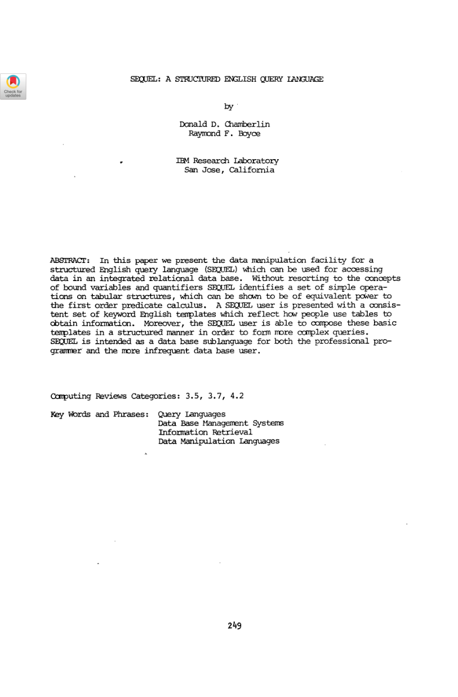
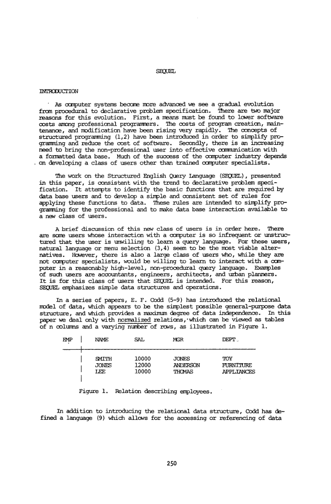

> 本组第 44 篇 · 关系模型与查询语言 · [全部论文]() · [上一篇]() · [下一篇]()

SEQUEL以SELECT-FROM-WHERE映射块和集合组合表达关系查询，目标是让愿意学习高层语言的非专业用户也能工作。核心不只是英语关键字，还有嵌套some/ALL、聚合重复策略、分组作用域与块标签相关引用。

这些历史规则不完全等于当前SQL：普通mapping去重、聚合默认保留重复，等号可隐含集合some，分组过滤仍写WHERE。报告结合原图保留Q3 ALL与Q9分组/包含符号的解释边界，不补造完备实现或性能数据。

本文保留论文陈述、读者推断与待验证方案的区别；实验数字只适用于原文条件。原文和翻译来自已有 AI 辅助精读报告，已做来源匹配与编辑复核，不等于人工逐项核验或独立实验复现。所有页码均为 PDF 物理页。

## 论文与阅读范围

Donald D. Chamberlin, Raymond F. Boyce. SEQUEL: A Structured English Query Language. 本地副本16个PDF物理页，印刷249-264；封面无明确刊发年份，本报告不猜元数据。

[论文集中的原始 PDF](https://github.com/lonng/db-papers/blob/4ff1331069c7cf52ac97dd769e5f484c1c35c200/papers/essentials/sequel%3A-a-structured-english-query-language.pdf) · 本地来源：`essentials/sequel_-a-structured-english-query-language.pdf`，共 16 页。

本篇保留 20 组原文精读和 20 条证据。截图为原始 PDF 的局部页选，不是重新生成的图表；未将整份 PDF 复制到博客。

## 研究对象与用户

SEQUEL目标是为关系数据访问提供块结构英语关键字模板，让愿意学习高层非过程语言的非专业用户与程序员描述所需数据，而非写逐行导航程序。作者也区分极少交互、完全不愿学查询语言的人，并认为自然语言或菜单可能更合适；因此它不是“人人无需学习”的自然语言产品。

论文经SQUARE既有工作说明表达能力，强调集合查表、组合映射与关键字线性记法。它没有发布新的硬件执行引擎，也未提供受控可用性实验或查询延迟测试。宣称等价一阶演算的能力，不是图灵完备，更不是语法简洁就运行更快。

本地副本标题和页码可确认；报告不凭参考条目的日期猜这份副本刊发元数据。所有页码按PDF物理页，印刷页=物理页+248。

依据：论文陈述；PDF 物理页 1, 2, 3, 5。证据：[SEQ01](#evidence-seq01), [SEQ02](#evidence-seq02), [SEQ03](#evidence-seq03), [SEQ04](#evidence-seq04), [SEQ06](#evidence-seq06)。

## Mapping与块组合

基本mapping有表、domain、range和参数：先按domain列匹配参数，再返回对应range值或元组。SELECT-FROM-WHERE把这些角色排成关键字块，内层mapping的结果集合可成为外层匹配条件。它是逻辑描述，并不指定必须逐块物化或选哪种索引。

普通mapping默认消除重复；应用数学函数时默认保留重复，可显式覆盖，附录有DUPL/UNIQUE。这与现代SQL普通SELECT常见bag默认不同，不应直接把同形语句放进当前引擎就称复现原语义。

表名限定解决一部分列歧义，块标签解决同表多次出现时的相关引用，例如内层NAME=B1.MGR。作者减少的是显式绑定变量/量词负担，不是取消所有跨块作用域。名字解析与输出重数需要解释器明确实现。

依据：论文陈述；PDF 物理页 4, 6, 7, 8, 11, 13。证据：[SEQ05](#evidence-seq05), [SEQ07](#evidence-seq07), [SEQ08](#evidence-seq08), [SEQ11](#evidence-seq11), [SEQ17](#evidence-seq17), [SEQ20](#evidence-seq20)。

*原论文 PDF 物理页 1，版权归原作者或出版方。点击图片可查看原尺寸。这是页面定位信息，不表示本次已复核图内所有数据。*

## 从嵌套映射到分组

**集合匹配**
内层产生一组值，未写ALL的比较默认为some；ALL可放在比较两侧表达不同量化。这里早期等号允许集合匹配，不等于现代要求最多一行的标量子查询等号。读者构造例：内层部门为{TOY,SHOE}，some匹配任一部门，不能据同一个等号断言右侧只应有一个值。

**分组作用域**
GROUP BY按某列或列组建立组，分组列可直接引用，其他列需通过返回单值的函数使用。Q7写的是分组之后WHERE COUNT(NAME)>10，不能不加说明改称已出现现代HAVING。Q4.1又允许NAME、SAL-AVG(SAL)而不写GROUP BY，显示其历史作用域与后来SQL并非同一套规则。

**集合操作的位置**
同一mapping里的AND/OR作用于同一行；两个独立mapping投影后再交并则作用于结果值。原Q5数据里FRED分属两条不同记录，投影交集可纳入FRED，但同一行同时SHOE且经理BOB只返回JOHN。这个区别比把所有式子直接变成连接重排更基础。

依据：论文陈述；PDF 物理页 7, 8, 10。证据：[SEQ08](#evidence-seq08), [SEQ09](#evidence-seq09), [SEQ11](#evidence-seq11), [SEQ12](#evidence-seq12), [SEQ13](#evidence-seq13), [SEQ14](#evidence-seq14), [SEQ15](#evidence-seq15)。

## 原语义与两处展示张力

重复策略、投影位置、聚合上下文及绑定范围都影响结果，不只是格式选择。本文等价能力主张依赖SQUARE既有定义与引用，本报告未独立核对全套形式证明，不能把几个样例当完备性证书。

Q3把DEPT=改为DEPT=ALL，作者说可找所有二楼部门都售卖的商品；然而前文按“外层行的单个domain-value与所有内层值比较”的字面表述，遇到多个不同部门值会有张力。报告将“对每个商品，不存在缺少它的二楼部门”列为读者除法式重建，而不悄悄把它当现代标量=ALL或原文已完整证明的语义。

Q9原图集合符号是包含（superset-inclusive），文本层误成等号；而原展示未写GROUP BY DEPT，前文却说SET取分组值。按部门分组并检查包含三对(NAME,MGR)是合理意图解释，但必须说明这是补足展示前提。若改成相等，会错误排除还有其他员工的部门。

这两项保持为局部解释问题，不宣布外部已确认勘误，也不据此否定整篇语言设计。

依据：读者推断；PDF 物理页 1, 3, 7, 8, 11。证据：[SEQ01](#evidence-seq01), [SEQ03](#evidence-seq03), [SEQ10](#evidence-seq10), [SEQ11](#evidence-seq11), [SEQ13](#evidence-seq13), [SEQ16](#evidence-seq16)。

## 没有引擎基准与用户研究

文章主要以百货商店EMP、SALES、SUPPLY、LOC、CLASS等模式及查询示例说明。没有新受控用户学习实验、完成任务时间统计、硬件参数、执行计划对照、吞吐或延迟测量。不能把“意在更易写易维护”改成已量化的生产力倍数。

报告实际运行的是Python有限集合例，见qa/sequel-reader-tests.json：原Q5的同一行AND得到JOHN；独立投影NAME集合的交集得到FRED、JOHN。它复核的是给定样例的集合计算，不是原SEQUEL引擎或现代SQL执行。

视觉核对覆盖8页，包含重复规则、ALL、Q4.1、分组、Q9符号/缺失分组、块标签与附录比较语法。文本层部分列名、比较符和BNF丢失，原段引文保持提取内容，解释明确标出图像修正，不伪造替换为“逐字提取”。

依据：读者推断；PDF 物理页 2, 5, 8, 11, 12, 13。证据：[SEQ02](#evidence-seq02), [SEQ06](#evidence-seq06), [SEQ13](#evidence-seq13), [SEQ16](#evidence-seq16), [SEQ18](#evidence-seq18), [SEQ20](#evidence-seq20)。

*原论文 PDF 物理页 2，版权归原作者或出版方。点击图片可查看原尺寸。页面文本中定位到：Figure i. Relation describing enployees.。这是页面定位信息，不表示本次已复核图内所有数据。*

## 简洁模板不消除语义复杂性

关键字块让查询按从所需结果到匹配条件的结构书写，减少读者直接操纵量词和绑定变量的负担。但嵌套集合比较、左右ALL、相关引用以及聚合上下文仍有精确语义，作者自己也说真正复杂的查询并不会因此都很简单。

默认重复策略随数学函数上下文改变，可以让普通投影和聚合符合某些直觉，却要求实现和用户清楚何时去重。工资10、10、20的均值，保留重复为40/3，先去重为15；不能由同一个AVG函数名猜参数重数。

GROUP BY使常见分组摆脱显式自由变量，却给列引用施加每组单值约束。块标签又在需要相关时引入明确定位。本文讨论的是语言表达层取舍，未提供优化器代价模型，不从语法嵌套直接推导物理嵌套循环或复杂度上界。

依据：论文陈述；PDF 物理页 3, 7, 8, 10, 11, 12。证据：[SEQ04](#evidence-seq04), [SEQ09](#evidence-seq09), [SEQ11](#evidence-seq11), [SEQ14](#evidence-seq14), [SEQ15](#evidence-seq15), [SEQ17](#evidence-seq17), [SEQ18](#evidence-seq18)。

## 历史SEQUEL不等于当前SQL

形式相似不意味着默认与作用域相同：普通mapping去重、聚合保留重复、等号隐含some、分组WHERE及无GROUP BY的Q4.1混合表达，都需要历史语义解释。把它们默认为今天的SQL，会同时误读语言能力与示例合法性。

本篇主要给查询DMF，DDF在引用18另述；没有完整INSERT/UPDATE、事务、恢复、索引和执行架构规范。关于现代StarRocks、Calcite、DuckDB等，只能提出后续核查：AST怎样表达量化与集合类型，bag/set转换在哪一阶段，分组与相关作用域怎样解析。当前报告未读这些源码，不宣称它们直接照搬或已解决所有历史问题。

最值得比较的是逻辑表达与运行实现之间的距离：语法能描述，不表示已给出最优执行或所有边界语义。

依据：读者推断；PDF 物理页 6, 7, 8, 10, 12, 13。证据：[SEQ07](#evidence-seq07), [SEQ08](#evidence-seq08), [SEQ11](#evidence-seq11), [SEQ12](#evidence-seq12), [SEQ15](#evidence-seq15), [SEQ19](#evidence-seq19), [SEQ20](#evidence-seq20)。

## 最小解释器与边界样例

先固定一个有界关系集合语义，实现mapping、投影去重、集合并交差和嵌套some匹配；记录输入与输出类型，不把其直接翻译成现代标量子查询。用小枚举查询作参考语义，再考虑实现优化。

第二阶段加入显式重复模式、聚合及分组。用重复工资、空集合、多个内层值、同名不同员工、同表多块引用等样例检查作用域与重数。Q3 ALL需要先写清意图解释和量化范围；Q9需要显式说明按部门分组及包含比较，不静默改写原展示。

第三阶段才根据附录做parser，并把扫描符号损坏处与原图对照。parse成功不是语义正确，BNF也未独自给出全部NULL/空集/运行规则。除已运行Q5集合例外，上述解释器与现代SQL对照均尚未实现或执行；不能把读者计划写成原作者基准。

依据：待验证的工程设想；PDF 物理页 7, 8, 11, 13。证据：[SEQ08](#evidence-seq08), [SEQ09](#evidence-seq09), [SEQ10](#evidence-seq10), [SEQ11](#evidence-seq11), [SEQ13](#evidence-seq13), [SEQ16](#evidence-seq16), [SEQ17](#evidence-seq17), [SEQ20](#evidence-seq20)。

## 结论

SEQUEL的持久贡献是以可组合关键字模板组织集合查询，降低对显式量词与绑定变量的依赖，并把分组、聚合和相关引用纳入同一个表达框架。它不需要被神化为任意自然语言、零训练系统或成熟高性能引擎才能体现价值。

本稿由当前Codex依据16页原文实际撰写，保留20段原文精读和Q5有限集合测试，重点区分历史重复默认、some/ALL、相关作用域与现代SQL惯例。Q3和Q9的展示张力、被引证明未核查以及无性能/用户实验的边界均保持可见，最终仍需人工复核。

依据：读者推断；PDF 物理页 1, 3, 7, 8, 11, 12, 13。证据：[SEQ01](#evidence-seq01), [SEQ03](#evidence-seq03), [SEQ10](#evidence-seq10), [SEQ11](#evidence-seq11), [SEQ13](#evidence-seq13), [SEQ16](#evidence-seq16), [SEQ18](#evidence-seq18), [SEQ20](#evidence-seq20)。

## 原文精读：从句子回到机制

以下保留原文、忠实翻译、含义与边界；假设示例不作为论文实验结果。

### P001 · PDF 物理页 1

**原文**

<blockquote class="paper-source-quote"><pre><code>Without resorting to the concepts &#10;of bound variables and quantifiers SEQUEL identifies a set of simple opera- &#10;ticns on tabular structures, which can be shown to be of equivalent power to &#10;the first order predicate calculus.</code></pre></blockquote>

**忠实翻译**

> 不诉诸绑定变量和量词概念，SEQUEL给出一组简单表格操作，作者称可证明具有一阶谓词演算的等价能力。

**技术含义与边界**

> 这是表达能力主张；正文通过SQUARE工作及引用说明，不在此完整展开形式证明。

**常见误读**

> 不是图灵完备、自然语言理解或性能定理。

**读者构造的假设示例**

> 读者例：隐藏显式量词可改变写法，不意味着查询执行不需匹配多行。

### P002 · PDF 物理页 2

**原文**

<blockquote class="paper-source-quote"><pre><code>the user is unwilling to learn a query language. For these users, &#10;natural language or menu selection (3,4) seem to be the most viable alter- &#10;natives.</code></pre></blockquote>

**忠实翻译**

> 用户不愿学习查询语言；对这些用户，自然语言或菜单似乎是最可行的选择。（摘录从前句中段开始。）

**技术含义与边界**

> 作者区分不愿学习者与愿学高层非过程语言的非计算机专业用户。

**常见误读**

> 不是宣称SEQUEL就是任意自然语言，或无需训练人人可用。

**读者构造的假设示例**

> 读者例：会计愿学固定模板，不代表临时问一句话就可无歧义生成程序。

### P003 · PDF 物理页 3

**原文**

<blockquote class="paper-source-quote"><pre><code>it has been shown &#10;(14) that the SQUARE language is complete, i.e., any query e~qoressible in &#10;the predicate calculus is expressible in SQUARE.</code></pre></blockquote>

**忠实翻译**

> 已有工作证明SQUARE完备，即谓词演算中可表达的查询可在SQUARE表达。

**技术含义与边界**

> 这里是引用已有SQUARE结果，而不是本文新增完整证明。

**常见误读**

> 不能把引用能力和本文自己完成形式验证混为一谈。

**读者构造的假设示例**

> 读者例：若需严证，须独立阅读相应定义、限制与证明。

### P004 · PDF 物理页 3

**原文**

<blockquote class="paper-source-quote"><pre><code>block-structured ~glish keyword syntax.</code></pre></blockquote>

**忠实翻译**

> 块结构的英语关键字语法。

**技术含义与边界**

> 线性表示与可组合块是设计选择，表层英语并不取消语法规则。

**常见误读**

> 不是自由自然语言或受控用户研究结果。

**读者构造的假设示例**

> 读者例：SELECT-FROM-WHERE的组合比任意口语更受约束。

### P005 · PDF 物理页 4

**原文**

<blockquote class="paper-source-quote"><pre><code>A mapping consists of a table name (IMP), a dcmain (DEPT), a range (NAME), and &#10;an ar~ent &#10;('TOY').</code></pre></blockquote>

**忠实翻译**

> mapping由表名、domain、range和参数组成，例中分别为EMP、DEPT、NAME和TOY。

**技术含义与边界**

> 这里domain/range是查表映射的选取列角色，不可不加说明等同所有现代类型域术语。

**常见误读**

> 不能按名字就推断物理索引或唯一键。

**读者构造的假设示例**

> 读者例：DEPT匹配TOY后返回NAME，可由不同存储路径实现。

### P006 · PDF 物理页 5

**原文**

<blockquote class="paper-source-quote"><pre><code>The SEQUEL language is equivalent in power to SQUARE, but is intended &#10;for users who are more ccrnfortable with an English-keyword format than with &#10;the terse mathematical notation of SQUARE.</code></pre></blockquote>

**忠实翻译**

> SEQUEL与SQUARE表达能力等价，但面向更熟悉英语关键字而非简短数学记号的用户。

**技术含义与边界**

> 改动主要是描述方式与可读性目标，不是额外计算能力的实测跃升。

**常见误读**

> 不能声称因此所有查询更快或已证实更易学。

**读者构造的假设示例**

> 读者例：相同逻辑可用映射记号或嵌套关键字块写出，执行策略仍待实现。

### P007 · PDF 物理页 6

**原文**

<blockquote class="paper-source-quote"><pre><code>If the WHERE-clause of a mapping is omitted, the mapping returns a pro- &#10;jection, or list of unique values of the selected col~n (s) taken from the &#10;entire table:</code></pre></blockquote>

**忠实翻译**

> 省略WHERE时返回整个表所选列的投影，即唯一值列表。

**技术含义与边界**

> 本文默认普通mapping会去重，与今日许多SQL SELECT默认bag不同。

**常见误读**

> 不要将其无修改地在现代SQL引擎上运行并当作原语义。

**读者构造的假设示例**

> 读者例：部门TOY出现三次，这种投影仅返回一个TOY。

### P008 · PDF 物理页 7

**原文**

<blockquote class="paper-source-quote"><pre><code>a set is used in a comparison in the absence of &#10;the word 'ALL', the default meaning is 'some'.</code></pre></blockquote>

**忠实翻译**

> 在比较中使用集合而未指定ALL时，默认含义为some，即存在某个值。

**技术含义与边界**

> 早期嵌套mapping的等号可隐含集合匹配，不是现代必须单行的标量子查询等号。

**常见误读**

> 不能把历史表达式DEPT=(SELECT...)直接当当前标量子查询语法。

**读者构造的假设示例**

> 读者例：右边返回两个部门，默认匹配任一个与右边必须只一行是不同规则。

### P009 · PDF 物理页 7

**原文**

<blockquote class="paper-source-quote"><pre><code>any comparison operator (&gt;, &lt;, etc.) may be modified by the word &#10;'ALL' on either or both sides in order to enable ccmapariscn of an item to a &#10;set or a set to a set.</code></pre></blockquote>

**忠实翻译**

> 一般比较运算可在任一侧或两侧加ALL，以允许项对集合或集合对集合的比较。

**技术含义与边界**

> ALL的作用位置与量化范围要明确，不只是随意强调英语“所有”。

**常见误读**

> 不能省略左右侧量化后假定普通集合比较等价。

**读者构造的假设示例**

> 读者例：some-left/all-right与all-left/some-right表达不同条件。

### P010 · PDF 物理页 7

**原文**

<blockquote class="paper-source-quote"><pre><code>Thus changing &#10;'DEPT = ' to 'DEPT = ALL' in Q3 would return the items sold by all depart- &#10;ments on the second floor.</code></pre></blockquote>

**忠实翻译**

> 把Q3的DEPT=改成DEPT=ALL，会返回所有二楼部门都售卖的商品。

**技术含义与边界**

> 这一意图与前文“每条外层行的domain-value与所有内层值比较”的字面描述有张力。

**常见误读**

> 不要悄悄等同现代标量=ALL，或据此宣称任意多部门都能由单行部门值等于全部值实现。

**读者构造的假设示例**

> 读者重建：对每个商品检查不存在一个二楼部门不卖它，是关系除法式解释；本文未独立形式证明该重建就是全部早期语法。

### P011 · PDF 物理页 8

**原文**

<blockquote class="paper-source-quote"><pre><code>if a mathematical function is applied to the results of a mapping, &#10;duplicates are preserved by the mapping; otherwise, duplicates are eliminated.</code></pre></blockquote>

**忠实翻译**

> 若对mapping结果应用数学函数，mapping保留重复；否则消除重复。

**技术含义与边界**

> 聚合上下文与普通mapping默认重复策略不同，附录允许显式覆盖。

**常见误读**

> 不是所有SELECT都去重，也不是所有函数参数都自动集合化。

**读者构造的假设示例**

> 读者例：工资10、10、20的均值若保留重复为40/3，先去重则15。

### P012 · PDF 物理页 8

**原文**

<blockquote class="paper-source-quote"><pre><code>NAME, SAL - AVG (SAL)</code></pre></blockquote>

**忠实翻译**

> NAME以及SAL减去AVG(SAL)。

**技术含义与边界**

> Q4.1把每位员工字段与部门平均值并列，且原例无GROUP BY；这是其作用域规则的历史示例。

**常见误读**

> 不要把它当现代无GROUP BY混合聚合必合法，或直接补成窗口函数后冒充原句。

**读者构造的假设示例**

> 读者现代重建可显式求部门均值后回接，但那是读者解释，不是已执行原SEQUEL引擎。

### P013 · PDF 物理页 8

**原文**

<blockquote class="paper-source-quote"><pre><code>the clauses separated by AND/OR apply to the &#10;same row of the table; in the second case, the mappings are applied inde- &#10;pendently and the union/intersection is applied to the results.</code></pre></blockquote>

**忠实翻译**

> AND/OR分隔的条件作用于同一行；独立mapping之间的并/交作用于各自结果。

**技术含义与边界**

> 投影后丢掉的行身份使结果集合交集与同一行同时满足不同。

**常见误读**

> 不能把所有交集都机械推成同一行上的AND。

**读者构造的假设示例**

> 已运行原Q5读者例：AND只得JOHN，两个NAME结果交集得JOHN与FRED。

### P014 · PDF 物理页 10

**原文**

<blockquote class="paper-source-quote"><pre><code>The grouping col~mn or coltmms @4GR in the above example) may be referred to &#10;because it has only one value per group.</code></pre></blockquote>

**忠实翻译**

> 分组列可以被引用，因为每组只有一个该值。（保留原文本层损字。）

**技术含义与边界**

> GROUP BY建立表达式作用域，其他列通常需经单值聚合。

**常见误读**

> 不指定物理哈希或排序算法，也不能由GROUP BY词推出已实现向量化。

**读者构造的假设示例**

> 读者例：按MGR分组，可直接返回MGR，SAL则须定义组内汇总。

### P015 · PDF 物理页 10

**原文**

<blockquote class="paper-source-quote"><pre><code>A coltmm-name &#10;which is not part of the grouping criterion may not be referred to except as &#10;an arg~ent to a function whid~ returns a single value per group.</code></pre></blockquote>

**忠实翻译**

> 不属于分组条件的列名，只能作为某个每组返回单值函数的参数被引用。

**技术含义与边界**

> 紧随其后的Q7用分组后的WHERE COUNT(NAME)>10，不是现代HAVING关键字。

**常见误读**

> 不能把历史WHERE语法直接解释为先逐行过滤COUNT。

**读者构造的假设示例**

> 读者重建可分清行筛选与组筛选两个阶段，具体语法应按目标语言另写。

### P016 · PDF 物理页 11

**原文**

<blockquote class="paper-source-quote"><pre><code>special function SET, which returns the set of values grouped to- &#10;gether by the GROUP BY clause.</code></pre></blockquote>

**忠实翻译**

> 特殊函数SET返回由GROUP BY分组在一起的值集合。

**技术含义与边界**

> Q9图像的集合比较是包含（superset-inclusive），非提取层的等号；但展示未写GROUP BY DEPT，需明示按部门分组的解释前提。

**常见误读**

> 不要静默改成集合相等并漏掉原例缺失分组的问题。

**读者构造的假设示例**

> 读者例：某部门还有第四位员工，只要包含要求的三对姓名/经理也应满足包含意图，而相等会排除它。

### P017 · PDF 物理页 11

**原文**

<blockquote class="paper-source-quote"><pre><code>SEQUEL &#10;allows an arbitrarily-d~osen block label to be attad~ed to a mapping and used &#10;to qualify coltmn-references.</code></pre></blockquote>

**忠实翻译**

> SEQUEL允许给mapping加任意选择的块标签，用来限定列引用。

**技术含义与边界**

> 表名不足以区分同表多次出现时，B1.MGR可关联到外层块。

**常见误读**

> 不能说本文消除了所有相关引用或完全不支持别名/标签。

**读者构造的假设示例**

> 读者例：员工工资大于自己经理工资，需要从内层识别外层那一行的经理。

### P018 · PDF 物理页 12

**原文**

<blockquote class="paper-source-quote"><pre><code>we do not suggest that &#10;really complex queries are simple to express in SEQJEL;</code></pre></blockquote>

**忠实翻译**

> 作者并不主张真正复杂的查询在SEQUEL里也很简单。（摘录保留文本层拼写。）

**技术含义与边界**

> 作者区分语法组织的改善与复杂问题本身的复杂性。

**常见误读**

> 不能把简洁示例泛化为零学习成本或所有查询显著缩短。

**读者构造的假设示例**

> 读者例：多层相关、重复与空集条件仍须精确定义。

### P019 · PDF 物理页 12

**原文**

<blockquote class="paper-source-quote"><pre><code>This sublanguage has also &#10;been used'as the basis of a data definition facility (DDF) (18).</code></pre></blockquote>

**忠实翻译**

> 该子语言也已用作数据定义设施DDF的基础，参见引用18。

**技术含义与边界**

> 本篇主要呈现查询DMF；完整DDL细节在别处，不是完整引擎实现和事务规范。

**常见误读**

> 不能补造INSERT/UPDATE语义、ACID协议、索引和执行架构。

**读者构造的假设示例**

> 读者例：查询BNF并不能回答崩溃后写入如何恢复。

### P020 · PDF 物理页 13

**原文**

<blockquote class="paper-source-quote"><pre><code>The formal syntax for &#10;SE~jEL queries is given in the Appendix.</code></pre></blockquote>

**忠实翻译**

> SEQUEL查询的形式语法在附录给出。

**技术含义与边界**

> 附录BNF帮助界定组合与比较语法，但若干扫描符号损坏，需看图像，不可凭乱码生成完备parser。

**常见误读**

> 语法规则不独自给出所有NULL、空集、作用域与运行语义。

**读者构造的假设示例**

> 读者例：先验证AST与scope，再做解释器；不能仅parse成功就称结果正确。

## 尚未解决的问题

1. Q3 conjunctive mapping与单行domain-value对ALL的字面描述，完整SQUARE定义怎样协调？
2. Q9原展示缺失GROUP BY，是否有未写出的默认组规则或版本差异？
3. 完整空集、NULL和左右ALL语义需回到形式定义与原始文献进一步核查。

## 证据索引

证据编号沿用原报告，便于将上文判断追溯到原句。引文匹配只验证位置，不证明解读正确。

**SEQ01 · PDF 物理页 1**

这是表达能力主张；正文通过SQUARE工作及引用说明，不在此完整展开形式证明。 不是图灵完备、自然语言理解或性能定理。

<blockquote class="paper-source-quote"><pre><code>Without resorting to the concepts &#10;of bound variables and quantifiers SEQUEL identifies a set of simple opera- &#10;ticns on tabular structures, which can be shown to be of equivalent power to &#10;the first order predicate calculus.</code></pre></blockquote>

**SEQ02 · PDF 物理页 2**

作者区分不愿学习者与愿学高层非过程语言的非计算机专业用户。 不是宣称SEQUEL就是任意自然语言，或无需训练人人可用。

<blockquote class="paper-source-quote"><pre><code>the user is unwilling to learn a query language. For these users, &#10;natural language or menu selection (3,4) seem to be the most viable alter- &#10;natives.</code></pre></blockquote>

**SEQ03 · PDF 物理页 3**

这里是引用已有SQUARE结果，而不是本文新增完整证明。 不能把引用能力和本文自己完成形式验证混为一谈。

<blockquote class="paper-source-quote"><pre><code>it has been shown &#10;(14) that the SQUARE language is complete, i.e., any query e~qoressible in &#10;the predicate calculus is expressible in SQUARE.</code></pre></blockquote>

**SEQ04 · PDF 物理页 3**

线性表示与可组合块是设计选择，表层英语并不取消语法规则。 不是自由自然语言或受控用户研究结果。

<blockquote class="paper-source-quote"><pre><code>block-structured ~glish keyword syntax.</code></pre></blockquote>

**SEQ05 · PDF 物理页 4**

这里domain/range是查表映射的选取列角色，不可不加说明等同所有现代类型域术语。 不能按名字就推断物理索引或唯一键。

<blockquote class="paper-source-quote"><pre><code>A mapping consists of a table name (IMP), a dcmain (DEPT), a range (NAME), and &#10;an ar~ent &#10;('TOY').</code></pre></blockquote>

**SEQ06 · PDF 物理页 5**

改动主要是描述方式与可读性目标，不是额外计算能力的实测跃升。 不能声称因此所有查询更快或已证实更易学。

<blockquote class="paper-source-quote"><pre><code>The SEQUEL language is equivalent in power to SQUARE, but is intended &#10;for users who are more ccrnfortable with an English-keyword format than with &#10;the terse mathematical notation of SQUARE.</code></pre></blockquote>

**SEQ07 · PDF 物理页 6**

本文默认普通mapping会去重，与今日许多SQL SELECT默认bag不同。 不要将其无修改地在现代SQL引擎上运行并当作原语义。

<blockquote class="paper-source-quote"><pre><code>If the WHERE-clause of a mapping is omitted, the mapping returns a pro- &#10;jection, or list of unique values of the selected col~n (s) taken from the &#10;entire table:</code></pre></blockquote>

**SEQ08 · PDF 物理页 7**

早期嵌套mapping的等号可隐含集合匹配，不是现代必须单行的标量子查询等号。 不能把历史表达式DEPT=(SELECT...)直接当当前标量子查询语法。

<blockquote class="paper-source-quote"><pre><code>a set is used in a comparison in the absence of &#10;the word 'ALL', the default meaning is 'some'.</code></pre></blockquote>

**SEQ09 · PDF 物理页 7**

ALL的作用位置与量化范围要明确，不只是随意强调英语“所有”。 不能省略左右侧量化后假定普通集合比较等价。

<blockquote class="paper-source-quote"><pre><code>any comparison operator (&gt;, &lt;, etc.) may be modified by the word &#10;'ALL' on either or both sides in order to enable ccmapariscn of an item to a &#10;set or a set to a set.</code></pre></blockquote>

**SEQ10 · PDF 物理页 7**

这一意图与前文“每条外层行的domain-value与所有内层值比较”的字面描述有张力。 不要悄悄等同现代标量=ALL，或据此宣称任意多部门都能由单行部门值等于全部值实现。

<blockquote class="paper-source-quote"><pre><code>Thus changing &#10;'DEPT = ' to 'DEPT = ALL' in Q3 would return the items sold by all depart- &#10;ments on the second floor.</code></pre></blockquote>

**SEQ11 · PDF 物理页 8**

聚合上下文与普通mapping默认重复策略不同，附录允许显式覆盖。 不是所有SELECT都去重，也不是所有函数参数都自动集合化。

<blockquote class="paper-source-quote"><pre><code>if a mathematical function is applied to the results of a mapping, &#10;duplicates are preserved by the mapping; otherwise, duplicates are eliminated.</code></pre></blockquote>

**SEQ12 · PDF 物理页 8**

Q4.1把每位员工字段与部门平均值并列，且原例无GROUP BY；这是其作用域规则的历史示例。 不要把它当现代无GROUP BY混合聚合必合法，或直接补成窗口函数后冒充原句。

<blockquote class="paper-source-quote"><pre><code>NAME, SAL - AVG (SAL)</code></pre></blockquote>

**SEQ13 · PDF 物理页 8**

投影后丢掉的行身份使结果集合交集与同一行同时满足不同。 不能把所有交集都机械推成同一行上的AND。

<blockquote class="paper-source-quote"><pre><code>the clauses separated by AND/OR apply to the &#10;same row of the table; in the second case, the mappings are applied inde- &#10;pendently and the union/intersection is applied to the results.</code></pre></blockquote>

**SEQ14 · PDF 物理页 10**

GROUP BY建立表达式作用域，其他列通常需经单值聚合。 不指定物理哈希或排序算法，也不能由GROUP BY词推出已实现向量化。

<blockquote class="paper-source-quote"><pre><code>The grouping col~mn or coltmms @4GR in the above example) may be referred to &#10;because it has only one value per group.</code></pre></blockquote>

**SEQ15 · PDF 物理页 10**

紧随其后的Q7用分组后的WHERE COUNT(NAME)>10，不是现代HAVING关键字。 不能把历史WHERE语法直接解释为先逐行过滤COUNT。

<blockquote class="paper-source-quote"><pre><code>A coltmm-name &#10;which is not part of the grouping criterion may not be referred to except as &#10;an arg~ent to a function whid~ returns a single value per group.</code></pre></blockquote>

**SEQ16 · PDF 物理页 11**

Q9图像的集合比较是包含（superset-inclusive），非提取层的等号；但展示未写GROUP BY DEPT，需明示按部门分组的解释前提。 不要静默改成集合相等并漏掉原例缺失分组的问题。

<blockquote class="paper-source-quote"><pre><code>special function SET, which returns the set of values grouped to- &#10;gether by the GROUP BY clause.</code></pre></blockquote>

**SEQ17 · PDF 物理页 11**

表名不足以区分同表多次出现时，B1.MGR可关联到外层块。 不能说本文消除了所有相关引用或完全不支持别名/标签。

<blockquote class="paper-source-quote"><pre><code>SEQUEL &#10;allows an arbitrarily-d~osen block label to be attad~ed to a mapping and used &#10;to qualify coltmn-references.</code></pre></blockquote>

**SEQ18 · PDF 物理页 12**

作者区分语法组织的改善与复杂问题本身的复杂性。 不能把简洁示例泛化为零学习成本或所有查询显著缩短。

<blockquote class="paper-source-quote"><pre><code>we do not suggest that &#10;really complex queries are simple to express in SEQJEL;</code></pre></blockquote>

**SEQ19 · PDF 物理页 12**

本篇主要呈现查询DMF；完整DDL细节在别处，不是完整引擎实现和事务规范。 不能补造INSERT/UPDATE语义、ACID协议、索引和执行架构。

<blockquote class="paper-source-quote"><pre><code>This sublanguage has also &#10;been used'as the basis of a data definition facility (DDF) (18).</code></pre></blockquote>

**SEQ20 · PDF 物理页 13**

附录BNF帮助界定组合与比较语法，但若干扫描符号损坏，需看图像，不可凭乱码生成完备parser。 语法规则不独自给出所有NULL、空集、作用域与运行语义。

<blockquote class="paper-source-quote"><pre><code>The formal syntax for &#10;SE~jEL queries is given in the Appendix.</code></pre></blockquote>

## 版本与使用边界

- 原 PDF SHA256：`46fc2ddc000d2bb924293adec04a53f6df0d2f8df584ac7957b85ba1387d90ce`。
- 报告来源：`codex-current-session`；此处按已完成报告整理，没有重新请求模型。
- OCR 记录页：[]；低文本页：[]。
- 本次新增页面截图，未据此自动重写原报告的数值、公式或实验结论；原有“未进行图像识别”限制仍适用于分析生成过程。
- 截图与短引仅服务于论文评论，版权归原作者或出版方；正式发布前复查转载范围和授权。
- 本文保留未核实的书目信息及研究问题，不用现代产品行为替代历史论文的证据。

前序报告保留的书目与阅读过程记录

Donald D. Chamberlin, Raymond F. Boyce. SEQUEL: A Structured English Query Language. 本地副本16个PDF物理页，印刷249-264；封面无明确刊发年份，本报告不猜元数据。

当前Codex实际阅读物理1-16页全文，视觉核对1、5、7、8、9、10、11、15页后撰写。API两块笔记为背景；draft call400虽JSON完整、finish_reason=stop，但有paper段未给证据引用，未作为完成稿，原响应保留。Python有限集合Q5读者例已运行，非原SEQUEL或现代SQL引擎测试。engine=codex-current-session，usage=None，用量未测；不拿先前API账单冒充本稿账单。被引证明/现代产品未核查，仍为AI待复核稿。

